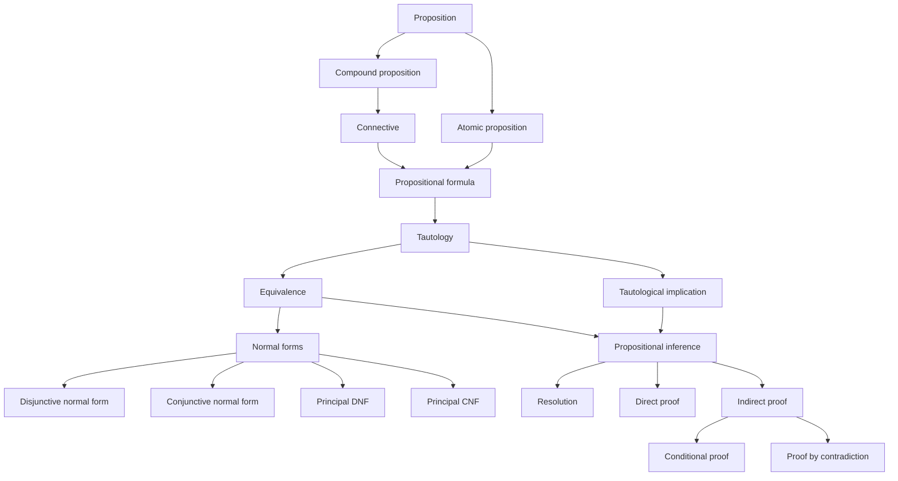

With truth tables, we can in principle determine the truth value of any formula under any assignment, but the method is rather brute-force. This chapter introduces more elegant tools. We first discuss the "equals sign" between formulas, namely logical equivalence, and collect the commonly used equivalences; we then show that every formula can be brought into a standard normal form; finally, we pass from equivalence to inference and present tautological implication, rules of inference, and resolution, a method well suited to machines. This material has something of a logic puzzle about it: it is worth trying to read and understand every formula, as an exercise in careful thinking.

## 2.1. The Equivalence Theorem

**Definition 2.1.1 (Logical Equivalence)** Let $A(p_1, \cdots, p_n)$ and $B(p_1, \cdots, p_n)$ be formulas. If $A$ and $B$ have the same truth value under every truth assignment to $p_1, \cdots, p_n$, then $A$ and $B$ are said to be **logically equivalent**, written $A = B$ or $A \Leftrightarrow B$.

Logical equivalence is an **equivalence relation**: it is reflexive, symmetric, and transitive.

**Theorem 2.1.1 (Equivalence Theorem)** Let $A$ and $B$ be propositional formulas. Then $A = B$ if and only if $A \leftrightarrow B$ is a **tautology**.

**Example 2.1.1 (The Four Forms of a Conditional)** A classic example of equivalence is the contrapositive. For the conditional $p \to q$:

| Name | Formula |
| :-- | :-- |
| Conditional | $p \to q$ |
| Converse | $q \to p$ |
| Inverse | $\lnot p \to \lnot q$ |
| Contrapositive | $\lnot q \to \lnot p$ |

```mermaid
flowchart LR
  P["Conditional<br/>p → q"] <-->|converses| C["Converse<br/>q → p"]
  I["Inverse<br/>¬p → ¬q"] <-->|converses| CP["Contrapositive<br/>¬q → ¬p"]
  P <-->|inverses| I
  C <-->|inverses| CP
  P <-.->|contrapositives (equivalent)| CP
  C <-.->|contrapositives (equivalent)| I
```

A conditional is equivalent to its contrapositive: $p \to q = \lnot q \to \lnot p$; the converse of a conditional is equivalent to its inverse: $q \to p = \lnot p \to \lnot q$.

Equivalent formulas can replace each other inside a larger formula; this is the *replacement rule*.

**Theorem 2.1.2 (Replacement Rule)** Let $A$ be a **subformula** of a formula $\Phi(A)$. If a formula $B$ satisfies $A = B$, and $\Phi(B)$ is obtained by replacing an occurrence of $A$ in $\Phi(A)$ with $B$, then $\Phi(A) = \Phi(B)$.

**Remark 2.1.1** The replacement rule differs from the substitution rule (Theorem 1.5.1) as follows: replacement does not require the original formula to be a tautology; what is replaced may be any subformula, not just a propositional variable; and not all occurrences need to be replaced. The price is that it requires $A = B$, and its conclusion is that the formulas before and after replacement are equivalent.

## 2.2. Equivalence Laws

To use the replacement rule more flexibly, we first collect some commonly used equivalences. All of them can be verified with truth tables, so detailed proofs add little; it is more worthwhile to be able to explain each of them convincingly by reasoning close to natural language.

**Formula 2.2.1 (Double Negation)**

$$
\lnot \lnot p = p
$$

**Formula 2.2.2 (Associative Laws)**

$$
\begin{aligned}
(p \lor q) \lor r & = p \lor (q \lor r) \\
(p \land q) \land r & = p \land (q \land r) \\
(p \leftrightarrow q) \leftrightarrow r & = p \leftrightarrow (q \leftrightarrow r) \\
(p \to q) \to r & \neq p \to (q \to r)
\end{aligned}
$$

**Formula 2.2.3 (Commutative Laws)**

$$
\begin{aligned}
p \lor q & = q \lor p \\
p \land q & = q \land p \\
p \leftrightarrow q & = q \leftrightarrow p \\
p \to q & \neq q \to p
\end{aligned}
$$

**Formula 2.2.4 (Distributive Laws)**

$$
\begin{aligned}
p \lor (q \land r) & = (p \lor q) \land (p \lor r) \\
p \land (q \lor r) & = (p \land q) \lor (p \land r) \\
p \to (q \to r) & = (p \to q) \to (p \to r) \\
p \leftrightarrow (q \leftrightarrow r) & \neq (p \leftrightarrow q) \leftrightarrow (p \leftrightarrow r)
\end{aligned}
$$

**Formula 2.2.5 (Idempotent Laws)**

$$
\begin{aligned}
p \lor p & = p \\
p \land p & = p \\
p \to p & = 1 \\
p \leftrightarrow p & = 1
\end{aligned}
$$

**Formula 2.2.6 (Absorption Laws)**

$$
\begin{aligned}
p \lor (p \land q) & = p \\
p \land (p \lor q) & = p
\end{aligned}
$$

**Formula 2.2.7 (De Morgan's Laws)**

$$
\begin{aligned}
\lnot (p \lor q) & = \lnot p \land \lnot q \\
\lnot (p \land q) & = \lnot p \lor \lnot q \\
\lnot (p \to q) & = p \land \lnot q \\
\lnot (p \leftrightarrow q) & = \lnot p \leftrightarrow q = p \leftrightarrow \lnot q \\
& = (\lnot p \land q) \lor (p \land \lnot q)
\end{aligned}
$$

*De Morgan's laws* are used constantly. With practice, one no longer thinks of them as just these few formulas; they generalize to the result in [Section 2.5](#sec-2.5): the negation of a disjunction (conjunction) of several propositions equals the conjunction (disjunction) of their negations. In fact, we met another form of De Morgan's laws long ago, in primary school: when removing parentheses preceded by a minus sign, every plus and minus sign inside the parentheses flips.

**Formula 2.2.8 (Identity Laws)**

$$
\begin{aligned}
p \lor 0 & = p \\
p \land 1 & = p \\
1 \to p & = p \\
1 \leftrightarrow p & = p \\
p \to 0 & = \lnot p \\
p \leftrightarrow 0 & = \lnot p
\end{aligned}
$$

**Formula 2.2.9 (Domination Laws)**

$$
\begin{aligned}
p \lor 1 & = 1 \\
p \land 0 & = 0 \\
p \to 1 & = 1 \\
0 \to p & = 1
\end{aligned}
$$

**Formula 2.2.10 (Complement Laws)**

$$
\begin{aligned}
p \lor \lnot p & = 1 \\
p \land \lnot p & = 0 \\
p \to \lnot p & = \lnot p \\
\lnot p \to p & = p \\
p \leftrightarrow \lnot p & = 0
\end{aligned}
$$

**Formula 2.2.11 (Other Common Equivalences)**

| Name | Equivalence |
| :-- | :-- |
| Material implication | $p \to q = \lnot p \lor q$ |
| Contraposition | $p \to q = \lnot q \to \lnot p$ |
| Exchange of premises | $p \to (q \to r) = q \to (p \to r)$ |
| Exportation | $p \to (q \to r) = (p \land q) \to r$ |
| Disjunction of antecedents | $(p \to r) \land (q \to r) = (p \lor q) \to r$ |
| Material equivalence | $p \leftrightarrow q = (p \to q) \land (q \to p)$ |
| Biconditional of negations | $p \leftrightarrow q = \lnot p \leftrightarrow \lnot q$ |
| Biconditional from its true cases | $p \leftrightarrow q = (p \land q) \lor (\lnot p \land \lnot q)$ |
| Biconditional from its false cases | $p \leftrightarrow q = (p \lor \lnot q) \land (\lnot p \lor q)$ |
| Reductio ad absurdum | $(p \to q) \land (p \to \lnot q) = \lnot p$ |

Equivalence tells us that many formulas of different shapes express exactly the same meaning: they have identical truth tables. Can we then set up some convention that picks one definite formula to represent them all?

## 2.3. Formulas and Truth Tables

Writing down the truth table of a given formula is natural. Conversely, given the truth table of $A(p_1, \cdots, p_n)$, we can also write down an expression for $A$.

Suppose the truth table of $A$ has $m$ rows with value 1 and $k$ rows with value 0 ($m + k = 2^n$), ignoring for now the order of the rows. Let $a_{ij}$ be the value of $p_j$ in the $i$-th row with value 1, and $b_{ij}$ the value of $p_j$ in the $i$-th row with value 0:

| $p_1$ | $\cdots$ | $p_n$ | $A$ |
| :-: | :-: | :-: | :-: |
| $a_{11}$ | $\cdots$ | $a_{1n}$ | 1 |
| $\vdots$ |  | $\vdots$ | $\vdots$ |
| $a_{m1}$ | $\cdots$ | $a_{mn}$ | 1 |
| $b_{11}$ | $\cdots$ | $b_{1n}$ | 0 |
| $\vdots$ |  | $\vdots$ | $\vdots$ |
| $b_{k1}$ | $\cdots$ | $b_{kn}$ | 0 |

**Theorem 2.3.1** The formula $A$ can be expressed in the following two ways.

- From the rows with value 1:

$$
A = Q_1 \lor \cdots \lor Q_m, \quad Q_i = r_{i1} \land \cdots \land r_{in}, \quad
r_{ij} =
\begin{cases}
p_j, & a_{ij} = 1, \\
\lnot p_j, & a_{ij} = 0.
\end{cases}
$$

- From the rows with value 0:

$$
A = R_1 \land \cdots \land R_k, \quad R_i = s_{i1} \lor \cdots \lor s_{in}, \quad
s_{ij} =
\begin{cases}
\lnot p_j, & b_{ij} = 1, \\
p_j, & b_{ij} = 0.
\end{cases}
$$

By convention, $A = 0$ when $m = 0$, and $A = 1$ when $k = 0$.

$Q_i$ is true exactly on the $i$-th row with value 1, and $R_i$ is false exactly on the $i$-th row with value 0. Writing $A$ from the rows with value 1 thus enumerates all the cases in which it is true; writing it from the rows with value 0 is the reverse, ruling out all the cases in which it is false.

## 2.4. Functionally Complete Sets of Connectives

Consider the formulas in the propositional variables $p, q$. If equivalent formulas are regarded as belonging to the same class, there are $2^{2^2} = 16$ classes in total (corresponding to 16 different truth tables), and each class defines a corresponding binary connective. In general, $n$ propositional variables give rise to $2^{2^n}$ $n$-ary connectives.

Besides the common connectives, the following three binary connectives are also frequently used:

- *Exclusive or* $\overline{\lor}$: $p \mathbin{\overline{\lor}} q = (\lnot p \land q) \lor (p \land \lnot q)$;
- *NAND* $\uparrow$: $p \uparrow q = \lnot (p \land q)$;
- *NOR* $\downarrow$: $p \downarrow q = \lnot (p \lor q)$.

| $p$ | $q$ | $p \mathbin{\overline{\lor}} q$ | $p \uparrow q$ | $p \downarrow q$ |
| :-: | :-: | :-: | :-: | :-: |
|  0  |  0  |  0  |  1  |  1  |
|  0  |  1  |  1  |  1  |  0  |
|  1  |  0  |  1  |  1  |  0  |
|  1  |  1  |  0  |  0  |  0  |

Clearly, representing all truth tables does not require so many connectives: by Theorem 2.3.1, $\{\lnot, \land, \lor\}$ already suffices.

**Definition 2.4.1 (Functionally Complete Set)** Let $C$ be a set of connectives. If every propositional formula is equivalent to some formula containing only connectives from $C$, then $C$ is called a **functionally complete set** of connectives.

**Theorem 2.4.1** The sets $\{\lnot, \land, \lor\}$, $\{\lnot, \land\}$, $\{\lnot, \lor\}$, $\{\lnot, \to\}$, $\{\uparrow\}$, and $\{\downarrow\}$ are all functionally complete.

**Proof** Starting from the five common connectives, we work from the top down to see which connectives can be dispensed with. A biconditional is the conjunction of two implications, $p \leftrightarrow q = (p \to q) \land (q \to p)$, and implication can be eliminated by material implication, $p \to q = \lnot p \lor q$; hence $\{\lnot, \land, \lor\}$ is complete. By De Morgan's laws, $p \lor q = \lnot (\lnot p \land \lnot q)$ and $p \land q = \lnot (\lnot p \lor \lnot q)$, so one of conjunction and disjunction can also be dropped, and both $\{\lnot, \land\}$ and $\{\lnot, \lor\}$ are complete. Moreover, $p \lor q = \lnot p \to q$, so $\{\lnot, \to\}$ is complete.

For NAND and NOR, the key is to build up $\lnot$ together with $\land$ or $\lor$ from the bottom up. It is easy to check that $\lnot p = p \uparrow p = p \downarrow p$; once negation is available, $p \land q = \lnot (p \uparrow q)$ and $p \lor q = \lnot (p \downarrow q)$. Hence both $\{\uparrow\}$ and $\{\downarrow\}$ are complete. $\square$

Different complete sets serve different purposes: $\{\lnot, \land, \lor\}$ gives rise to **Boolean algebra**; $\{\lnot, \to\}$ is used in studying deductive reasoning in logical systems (the axiomatic system of [1.1.3](/1.1.3) uses $\{\lnot, \lor\}$); and $\{\uparrow\}$ and $\{\downarrow\}$ are widely used in very-large-scale integrated circuits.

## 2.5. Duals

**Definition 2.5.1 (Dual Formula)** Let $A = A(p_1, \cdots, p_n)$ be a formula containing only the connectives $\lnot, \land, \lor$. The formula obtained by replacing every $\land, \lor, 0, 1$ in $A$ with $\lor, \land, 1, 0$, respectively, is called the **dual formula** of $A$, written $A^*$. We also write $A^- = A(\lnot p_1, \cdots, \lnot p_n)$.

**Property 2.5.1** Duals have many interesting properties; we list them here without proof:

- $\lnot (A^*) = (\lnot A)^*$ and $\lnot (A^-) = (\lnot A)^-$;
- $(A^*)^* = A$ and $(A^-)^- = A$;
- $\lnot A = (A^*)^-$; this is the generalized De Morgan's law;
- if $A = B$, then $A^* = B^*$;
- if $A \to B$ is valid, then $B^* \to A^*$ is valid;
- $A$ and $A^-$ are both tautologies or neither, and both satisfiable or neither; the same holds for $\lnot A$ and $A^*$;
- if $A$ is a tautology, then $A^*$ is a contradiction.

## 2.6. Normal Forms and Principal Normal Forms

**Definition 2.6.1 (Literal)** A propositional variable $p$ and its negation $\lnot p$ are both called **literals**; $p$ and $\lnot p$ are called a **complementary pair**.

**Definition 2.6.2 (Simple Disjunctions and Simple Conjunctions)** A disjunction of finitely many literals is called a **simple disjunction**, or a **clause**; a conjunction of finitely many literals is called a **simple conjunction**.

A simple disjunction is a tautology if and only if it contains some propositional variable together with its negation, that is, a complementary pair; a simple conjunction is a contradiction if and only if it contains a complementary pair.

**Definition 2.6.3 (Disjunctive Normal Form)** A formula of the form $A_1 \lor \cdots \lor A_n$, where each $A_i$ is a simple conjunction, is called a **disjunctive normal form**.

**Definition 2.6.4 (Conjunctive Normal Form)** A formula of the form $A_1 \land \cdots \land A_n$, where each $A_i$ is a simple disjunction, is called a **conjunctive normal form**.

**Theorem 2.6.1 (Normal Form Theorem)** Every propositional formula is equivalent to some conjunctive normal form and to some disjunctive normal form.

The conjunctive and disjunctive normal forms of a formula are not unique, however, so it is worth defining principal normal forms. In what follows, let the formula contain the $n$ propositional variables $p_1, \cdots, p_n$, and regard a truth assignment as a binary number $i$ (with $p_1$ as the most significant bit); we call it the $i$-th assignment, and it corresponds to row $i$ of the truth table (counting from 0).

**Definition 2.6.5 (Minterm)** A simple conjunction in which each propositional variable occurs exactly once, either as $p_j$ or as $\lnot p_j$, is called a **minterm**. Taking the literal $p_j$ when $p_j$ is 1 in the $i$-th assignment, and $\lnot p_j$ when it is 0, gives the minterm denoted $m_i$. The minterm $m_i$ is true exactly under the $i$-th assignment.

**Definition 2.6.6 (Maxterm)** A simple disjunction in which each propositional variable occurs exactly once, either as $p_j$ or as $\lnot p_j$, is called a **maxterm**. Taking the literal $\lnot p_j$ when $p_j$ is 1 in the $i$-th assignment, and $p_j$ when it is 0, gives the maxterm denoted $M_i$. The maxterm $M_i$ is false exactly under the $i$-th assignment.

For example, when $n = 2$, $m_2 = p_1 \land \lnot p_2$ and $M_2 = \lnot p_1 \lor p_2$.

**Property 2.6.1** Minterms and maxterms have the following properties:

- there are $2^n$ minterms and $2^n$ maxterms in $n$ propositional variables, as many as there are truth assignments;
- each minterm is true under exactly one assignment, each maxterm is false under exactly one assignment, and $\lnot m_i = M_i$;
- no two distinct minterms are equivalent, and no two distinct maxterms are equivalent; for $i \neq j$, $m_i \land m_j = 0$ and $M_i \lor M_j = 1$;
- if a formula $A$ has exactly $k$ satisfying assignments, then $A$ can be expressed as the disjunction of the minterms of these $k$ assignments, and also as the conjunction of the maxterms of the remaining $2^n - k$ assignments; $\lnot A$ is the disjunction of the remaining $2^n - k$ minterms, or the conjunction of the maxterms of the $k$ satisfying assignments of $A$;
- the disjunction of all $2^n$ minterms is a tautology, and the conjunction of all $2^n$ maxterms is a contradiction:

$$
\bigvee_{i = 0}^{2^n - 1} m_i = 1, \qquad \bigwedge_{i = 0}^{2^n - 1} M_i = 0
$$

**Definition 2.6.7 (Principal Disjunctive Normal Form)** A disjunctive normal form consisting only of minterms is called a **principal disjunctive normal form**.

**Theorem 2.6.2 (Principal Disjunctive Normal Form Theorem)** Every formula in $n$ propositional variables is equivalent to a unique principal disjunctive normal form containing exactly these $n$ propositional variables.

The principal disjunctive normal form is often abbreviated as $\bigvee_{i, j, \cdots} = m_i \lor m_j \lor \cdots$, where the subscripts $i, j, \cdots$ are the numbers of the rows with value 1 in the truth table.

**Definition 2.6.8 (Principal Conjunctive Normal Form)** A conjunctive normal form consisting only of maxterms is called a **principal conjunctive normal form**.

**Theorem 2.6.3 (Principal Conjunctive Normal Form Theorem)** Every formula in $n$ propositional variables is equivalent to a unique principal conjunctive normal form containing exactly these $n$ propositional variables.

The principal conjunctive normal form is often abbreviated as $\bigwedge_{i, j, \cdots} = M_i \land M_j \land \cdots$, where the subscripts $i, j, \cdots$ are the numbers of the rows with value 0 in the truth table.

By convention, the principal conjunctive normal form of a tautology is the empty formula, and so is the principal disjunctive normal form of a contradiction.

**Example 2.6.1** The formula $p \to q$ is false only when $p = 1, q = 0$, that is, under assignment 2, so

$$
p \to q = m_0 \lor m_1 \lor m_3 = (\lnot p \land \lnot q) \lor (\lnot p \land q) \lor (p \land q) = M_2 = \lnot p \lor q
$$

Principal normal forms exploit the completeness of AND, OR, and NOT: the principal disjunctive and conjunctive normal forms correspond, respectively, to writing a formula "from the rows with value 1" and "from the rows with value 0" in [Section 2.3](#sec-2.3). In the notation above, converting one into the other is very convenient: the subscripts of the principal conjunctive normal form are exactly the complement of those of the principal disjunctive normal form.

So far, however we transform a formula, the new formula has exactly the same truth values as before. Inference, by contrast, proceeds from given propositions toward the proposition to be proved, and its intermediate steps need not all be equivalences; it may include steps from a stronger condition to a weaker one, which is precisely the role of implication. In the discussion above we always tried to eliminate implications, whereas in inference we are glad to see this concise form appear.

## 2.7. Forms of Inference

A form of inference consists of premises and a conclusion. A form of inference in which the conclusion must be true whenever the premises are true is called a valid form of inference.

**Definition 2.7.1 (Tautological Implication)** Let $A(p_1, \cdots, p_n)$ and $B(p_1, \cdots, p_n)$ be formulas. If $B$ is true under every truth assignment that makes $A$ true, then we say that $A$ **tautologically implies** $B$, or that $B$ is a **logical consequence** of $A$, and write $A \Rightarrow B$.

**Property 2.7.1** Tautological implication has the following natural properties:

- if $A \Rightarrow B$ and $A$ is a tautology, then $B$ is also a tautology;
- if $A \Rightarrow B$ and $B \Rightarrow A$, then $A = B$;
- if $A \Rightarrow B$ and $B \Rightarrow C$, then $A \Rightarrow C$;
- if $A \Rightarrow B$ and $A \Rightarrow C$, then $A \Rightarrow B \land C$, and of course also $A \Rightarrow B \lor C$;
- if $A \Rightarrow C$ and $B \Rightarrow C$, then $A \lor B \Rightarrow C$, and of course also $A \land B \Rightarrow C$;
- $A \Rightarrow B$ if and only if $A \to B$ is a tautology;
- $A \Rightarrow B$ if and only if $A \land \lnot B$ is a contradiction.

## 2.8. Basic Inference Formulas

Many of the following formulas can be understood directly in natural language, and others are consequences of earlier ones. They can be approached with the same natural-language reasoning we used for the equivalence laws:

| No. | Inference | Remark |
| :-: | :-- | :-- |
| 1 | $p \land q \Rightarrow p$ | Natural |
| 2 | $\lnot (p \to q) \Rightarrow p$ | Consequence of 1 |
| 3 | $\lnot (p \to q) \Rightarrow \lnot q$ | Consequence of 1 |
| 4 | $p \Rightarrow p \lor q$ | Natural |
| 5 | $\lnot p \Rightarrow p \to q$ | Consequence of 4; contrapositive of 2 |
| 6 | $q \Rightarrow p \to q$ | Consequence of 4; contrapositive of 3 |
| 7 | $\lnot p \land (p \lor q) \Rightarrow q$ | Disjunctive syllogism |
| 8 | $p \land (p \to q) \Rightarrow q$ | Modus ponens |
| 9 | $\lnot q \land (p \to q) \Rightarrow \lnot p$ | Modus tollens, the reverse of modus ponens |
| 10 | $(p \to q) \land (q \to r) \Rightarrow p \to r$ | Hypothetical syllogism |
| 11 | $(p \leftrightarrow q) \land (q \leftrightarrow r) \Rightarrow p \leftrightarrow r$ | Two-way syllogism |
| 12 | $(p \to r) \land (q \to r) \land (p \lor q) \Rightarrow r$ | Consequence of the syllogism |
| 13 | $(p \to q) \land (r \to s) \land (p \lor r) \Rightarrow q \lor s$ | Consequence of the syllogism (constructive dilemma) |
| 14 | $(p \to q) \land (r \to s) \land (\lnot q \lor \lnot s) \Rightarrow \lnot p \lor \lnot r$ | Consequence of the syllogism (destructive dilemma) |
| 15 | $q \to r \Rightarrow (p \lor q) \to (p \lor r)$ | By cases on $p$ |
| 16 | $q \to r \Rightarrow (p \to q) \to (p \to r)$ | By cases on $p$ |

## 2.9. Inference Calculus

The basic process of inference is to start from the premises and, using the basic inference formulas and rules of inference, derive the conclusion step by step. A *rule of inference* licenses a single step of a derivation; the commonly used ones include:

- premise introduction: a given premise may be introduced at any point in the derivation;
- conclusion introduction: an intermediate conclusion may be used as a premise for later steps;
- the **substitution rule**: applied to propositional variables in a tautology (Theorem 1.5.1);
- the **replacement rule**: replacing a subformula by an equivalent one (Theorem 2.1.2);
- *modus ponens*: from $A$ and $A \to B$, infer $B$;
- *conditional proof*, also called introduction of an additional premise: if the conclusion is an implication, its antecedent may be introduced as an additional premise, and the conclusion becomes its consequent. This is justified by the fact that $A \Rightarrow B \to C$ holds if and only if $A \land B \Rightarrow C$ does.

**Example 2.9.1** Prove that $(p \to q) \land (q \to r) \Rightarrow p \to r$.

**Proof**

| Step | Formula | Justification |
| :-: | :-- | :-- |
| 1 | $p \to q$ | Premise |
| 2 | $p$ | Additional premise |
| 3 | $q$ | 1, 2, modus ponens |
| 4 | $q \to r$ | Premise |
| 5 | $r$ | 3, 4, modus ponens |
| 6 | $p \to r$ | 2–5, conditional proof |

$\square$

## 2.10. Resolution

The derivations above require a certain amount of inspiration: there are so many rules and formulas that considerable skill is needed. Could we instead use a single rule of inference, so that a computer can carry out the inference by "brute force"? This is where the normal forms come in, and we once again want to turn implications into AND, OR, and NOT as far as possible.

**Definition 2.10.1 (Resolvent)** Let the clauses $C_1 = p \lor C_1'$ and $C_2 = \lnot p \lor C_2'$ contain the complementary pair $p, \lnot p$. Then $R(C_1, C_2) = C_1' \lor C_2'$ is called the **resolvent** of $C_1$ and $C_2$. The process of obtaining $R(C_1, C_2)$ from $C_1, C_2$ is called **resolution**.

Resolution is justified by $C_1 \land C_2 \Rightarrow C_1' \lor C_2'$: if $p$ is true, $C_2'$ must be true; if $p$ is false, $C_1'$ must be true.

**Algorithm 2.10.1 (Resolution)** Proving $A \Rightarrow B$ is equivalent to proving that $A \land \lnot B$ is a contradiction (Property 2.7.1). The steps are as follows:

1. Form the conjunction of all the premises $A$ with the negation $\lnot B$ of the conclusion, obtaining $A \land \lnot B$;
2. Convert $A \land \lnot B$ into a conjunctive normal form $C_1 \land \cdots \land C_n$ and form the clause set $S = \{ C_1, \cdots, C_n \}$, where each clause $C_i$ is a simple disjunction;
3. Resolve clauses in $S$, add each resolvent to $S$, and repeat;
4. If the empty clause (a contradiction) is derived, then $A \land \lnot B$ is a contradiction and $A \Rightarrow B$ is proved; if no new clauses can be produced and the empty clause has not been derived, then $A \land \lnot B$ is satisfiable and $A \Rightarrow B$ does not hold.

Resolution in propositional logic is sound and complete: $A \land \lnot B$ is a contradiction if and only if the empty clause can be derived by resolution. Since there are only finitely many propositional variables, there are only finitely many distinct clauses, so once duplicates are discarded the process must terminate; hence it also decides when $A \Rightarrow B$ fails. Once resolution is extended to predicate logic, termination is guaranteed only for unsatisfiable inputs (see [1.1.5](/1.1.5#sec-5.6)).

## Summary {#summary}

The concepts and methods of propositional logic from the first two chapters can be summarized in the following diagram:



The first two chapters started from semantics and gave a preliminary, not entirely rigorous formalization of propositional logic; many of the results can still be obtained from natural logic, for instance the naive definition of when a truth value is true and when it is false. This is only the starting point of logic. To go further, we need to set aside something as concrete as truth and falsity (abstract as it may already seem), and this is the axiomatic method of the next chapter.
