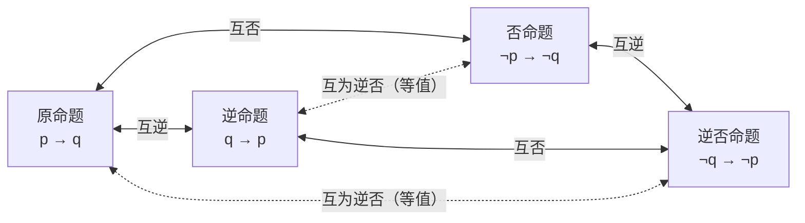
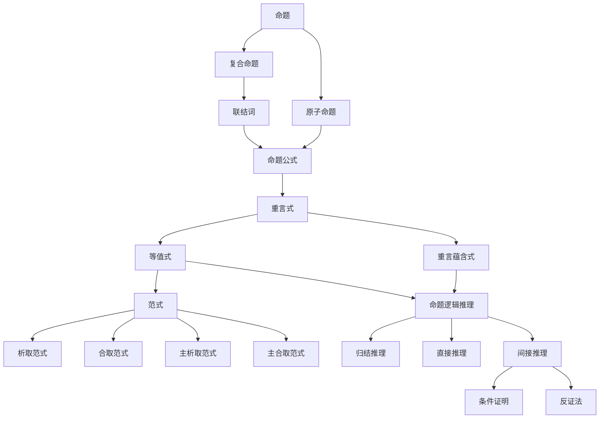

有了真值表，理论上就能研究任何公式在任何赋值下的真值，但这种方法相当粗暴。本章引入更优雅的工具：先讨论公式之间的"等号"——等值，整理常用的等值公式；再说明任何公式都能化成标准的范式；最后从等值走向推理，介绍重言蕴含、推理规则和适合机器执行的归结法。这部分内容有点像逻辑游戏，不妨尝试看懂并理解每个公式，锻炼一下自己的思维能力。

## 2.1. 等值定理

**定义 2.1.1（等值）** 对公式 $A(p_1, \cdots, p_n)$ 和 $B(p_1, \cdots, p_n)$，如果在 $p_1, \cdots, p_n$ 的任一赋值下 $A$ 和 $B$ 的真值都相同，则称 $A$ 与 $B$ **等值**，记为 $A = B$ 或 $A \Leftrightarrow B$。

等值关系是一种等价关系，具有自反性、对称性和传递性。

**定理 2.1.1（等值定理）** 设 $A$、$B$ 为两个命题公式，则 $A = B$ 的充分必要条件是 $A \leftrightarrow B$ 是重言式。

**例 2.1.1（四种命题）** 一个经典的等值例子是逆否命题。对原命题 $p \to q$：

| 名称 | 公式 |
| :-- | :-- |
| 原命题 | $p \to q$ |
| 逆命题 | $q \to p$ |
| 否命题 | $\lnot p \to \lnot q$ |
| 逆否命题 | $\lnot q \to \lnot p$ |

一个命题与它的逆否命题等值：$p \to q = \lnot q \to \lnot p$；一个命题的逆命题与否命题等值：$q \to p = \lnot p \to \lnot q$。

**定理 2.1.2（置换规则）** 设 $A$ 是公式 $\Phi(A)$ 的子公式。若公式 $B$ 满足 $A = B$，将 $\Phi(A)$ 中 $A$ 的出现换成 $B$ 得到 $\Phi(B)$，则 $\Phi(A) = \Phi(B)$。

**注 2.1.1** 置换规则与代入规则（定理 1.5.1）的不同在于：置换不要求原公式是重言式；被替换的可以是任意子公式，而不仅限于命题变项；也不要求替换所有出现。代价是它要求 $A = B$，结论是置换前后的公式等值。

## 2.2. 等值公式

为了更灵活地使用置换规则，我们先整理一些常用的等值公式。它们都可以用真值表验证，这时讨论细致的证明意义不大；如果能用接近自然语言的推理自圆其说地解释它们，意义会更大。

**公式 2.2.1（双重否定律）**

$$
\lnot \lnot p = p
$$

**公式 2.2.2（结合律）**

$$
\begin{aligned}
(p \lor q) \lor r & = p \lor (q \lor r) \\
(p \land q) \land r & = p \land (q \land r) \\
(p \leftrightarrow q) \leftrightarrow r & = p \leftrightarrow (q \leftrightarrow r) \\
(p \to q) \to r & \neq p \to (q \to r)
\end{aligned}
$$

**公式 2.2.3（交换律）**

$$
\begin{aligned}
p \lor q & = q \lor p \\
p \land q & = q \land p \\
p \leftrightarrow q & = q \leftrightarrow p \\
p \to q & \neq q \to p
\end{aligned}
$$

**公式 2.2.4（分配律）**

$$
\begin{aligned}
p \lor (q \land r) & = (p \lor q) \land (p \lor r) \\
p \land (q \lor r) & = (p \land q) \lor (p \land r) \\
p \to (q \to r) & = (p \to q) \to (p \to r) \\
p \leftrightarrow (q \leftrightarrow r) & \neq (p \leftrightarrow q) \leftrightarrow (p \leftrightarrow r)
\end{aligned}
$$

**公式 2.2.5（等幂律）** 也称恒等律。

$$
\begin{aligned}
p \lor p & = p \\
p \land p & = p \\
p \to p & = 1 \\
p \leftrightarrow p & = 1
\end{aligned}
$$

**公式 2.2.6（吸收律）**

$$
\begin{aligned}
p \lor (p \land q) & = p \\
p \land (p \lor q) & = p
\end{aligned}
$$

**公式 2.2.7（德摩根律）** 也称摩根律。

$$
\begin{aligned}
\lnot (p \lor q) & = \lnot p \land \lnot q \\
\lnot (p \land q) & = \lnot p \lor \lnot q \\
\lnot (p \to q) & = p \land \lnot q \\
\lnot (p \leftrightarrow q) & = \lnot p \leftrightarrow q = p \leftrightarrow \lnot q \\
& = (\lnot p \land q) \lor (p \land \lnot q)
\end{aligned}
$$

德摩根律（De Morgan's laws）的应用非常频繁。熟练以后它不局限于这几个公式，可以推广为 [2.5 节](#sec-2.5)中的结论：多个命题的析取（合取）的否定，等于各命题的否定的合取（析取）。其实我们早就接触过另一种形式的德摩根律：小学去掉减号后面的括号时，括号里的加减号要变号。

**公式 2.2.8（同一律）**

$$
\begin{aligned}
p \lor 0 & = p \\
p \land 1 & = p \\
1 \to p & = p \\
1 \leftrightarrow p & = p \\
p \to 0 & = \lnot p \\
p \leftrightarrow 0 & = \lnot p
\end{aligned}
$$

**公式 2.2.9（零律）**

$$
\begin{aligned}
p \lor 1 & = 1 \\
p \land 0 & = 0 \\
p \to 1 & = 1 \\
0 \to p & = 1
\end{aligned}
$$

**公式 2.2.10（补余律）**

$$
\begin{aligned}
p \lor \lnot p & = 1 \\
p \land \lnot p & = 0 \\
p \to \lnot p & = \lnot p \\
\lnot p \to p & = p \\
p \leftrightarrow \lnot p & = 0
\end{aligned}
$$

**公式 2.2.11（其他常用的等值公式）**

| 名称 | 等值公式 |
| :-- | :-- |
| 蕴含等值式 | $p \to q = \lnot p \lor q$ |
| 假言易位 | $p \to q = \lnot q \to \lnot p$ |
| 前提交换 | $p \to (q \to r) = q \to (p \to r)$ |
| 前提合取合并 | $p \to (q \to r) = (p \land q) \to r$ |
| 前提析取合并 | $(p \to r) \land (q \to r) = (p \lor q) \to r$ |
| 等价等值式 | $p \leftrightarrow q = (p \to q) \land (q \to p)$ |
| 等价否定等值式 | $p \leftrightarrow q = \lnot p \leftrightarrow \lnot q$ |
| 从取真描述双条件 | $p \leftrightarrow q = (p \land q) \lor (\lnot p \land \lnot q)$ |
| 从取假描述双条件 | $p \leftrightarrow q = (p \lor \lnot q) \land (\lnot p \lor q)$ |
| 归谬论 | $(p \to q) \land (p \to \lnot q) = \lnot p$ |

有了等值，我们知道许多形式不同的公式其实表达了完全相同的含义，它们有完全相同的真值表。那么能否形成某种规范，从中选出一个确定的公式来代表它们？

## 2.3. 命题公式与真值表的关系

从命题公式列出真值表的方法是自然的。反过来，给定了 $A(p_1, \cdots, p_n)$ 的真值表，也可以写出 $A$ 的表达式。

设 $A$ 的真值表中有 $m$ 行取 1、$k$ 行取 0（$m + k = 2^n$），暂不考虑各行的排列顺序。记第 $i$ 个取 1 的行中 $p_j$ 的取值为 $a_{ij}$，第 $i$ 个取 0 的行中 $p_j$ 的取值为 $b_{ij}$：

| $p_1$ | $\cdots$ | $p_n$ | $A$ |
| :-: | :-: | :-: | :-: |
| $a_{11}$ | $\cdots$ | $a_{1n}$ | 1 |
| $\vdots$ |  | $\vdots$ | $\vdots$ |
| $a_{m1}$ | $\cdots$ | $a_{mn}$ | 1 |
| $b_{11}$ | $\cdots$ | $b_{1n}$ | 0 |
| $\vdots$ |  | $\vdots$ | $\vdots$ |
| $b_{k1}$ | $\cdots$ | $b_{kn}$ | 0 |

**定理 2.3.1** 公式 $A$ 可以用以下两种方式表示。

- **从取 1 的行列写**：

$$
A = Q_1 \lor \cdots \lor Q_m, \quad Q_i = r_{i1} \land \cdots \land r_{in}, \quad
r_{ij} =
\begin{cases}
p_j, & a_{ij} = 1, \\
\lnot p_j, & a_{ij} = 0.
\end{cases}
$$

- **从取 0 的行列写**：

$$
A = R_1 \land \cdots \land R_k, \quad R_i = s_{i1} \lor \cdots \lor s_{in}, \quad
s_{ij} =
\begin{cases}
\lnot p_j, & b_{ij} = 1, \\
p_j, & b_{ij} = 0.
\end{cases}
$$

约定 $m = 0$ 时 $A = 0$，$k = 0$ 时 $A = 1$。

$Q_i$ 恰在第 $i$ 个取 1 的行上为真，$R_i$ 恰在第 $i$ 个取 0 的行上为假。所以从取 1 的行列写是枚举所有取真的情况；从取 0 的行列写则是它的反面，即排除所有取假的情况。

## 2.4. 联结词的完备集

以 $p, q$ 为命题变项的公式，如果把等值的公式视为同一类，则一共有 $2^{2^2} = 16$ 类（对应 16 种不同的真值表），每一类都可以定义一个二元联结词与之对应。一般地，$n$ 个命题变项可以定义 $2^{2^n}$ 个 $n$ 元联结词。

除了常用联结词，还常用以下 3 个二元联结词：

- **异或**（不可兼或）$\overline{\lor}$：$p \mathbin{\overline{\lor}} q = (\lnot p \land q) \lor (p \land \lnot q)$；
- **与非** $\uparrow$：$p \uparrow q = \lnot (p \land q)$；
- **或非** $\downarrow$：$p \downarrow q = \lnot (p \lor q)$。

| $p$ | $q$ | $p \mathbin{\overline{\lor}} q$ | $p \uparrow q$ | $p \downarrow q$ |
| :-: | :-: | :-: | :-: | :-: |
|  0  |  0  |  0  |  1  |  1  |
|  0  |  1  |  1  |  1  |  0  |
|  1  |  0  |  1  |  1  |  0  |
|  1  |  1  |  0  |  0  |  0  |

显然，表示所有真值表并不需要这么多联结词：由定理 2.3.1，$\{\lnot, \land, \lor\}$ 就已经足够。

**定义 2.4.1（联结词的完备集）** 设 $C$ 是一个联结词集合。如果任一命题公式都可以与一个仅含 $C$ 中联结词的公式等值，则称 $C$ 为**联结词的完备集**（functionally complete set）。

**定理 2.4.1** $\{\lnot, \land, \lor\}$、$\{\lnot, \land\}$、$\{\lnot, \lor\}$、$\{\lnot, \to\}$、$\{\uparrow\}$、$\{\downarrow\}$ 都是联结词的完备集。

**证明** 从 5 个常用联结词出发，自上而下地看哪些联结词可以省去。双蕴含是两个蕴含的合取，$p \leftrightarrow q = (p \to q) \land (q \to p)$；蕴含可以用蕴含等值式 $p \to q = \lnot p \lor q$ 省去，所以 $\{\lnot, \land, \lor\}$ 是完备集。由德摩根律，$p \lor q = \lnot (\lnot p \land \lnot q)$，$p \land q = \lnot (\lnot p \lor \lnot q)$，所以合取、析取之一也可以省去，$\{\lnot, \land\}$ 与 $\{\lnot, \lor\}$ 都是完备集。又 $p \lor q = \lnot p \to q$，所以 $\{\lnot, \to\}$ 是完备集。

对与非和或非，关键是自下而上地表示出 $\lnot$ 以及 $\land$ 或 $\lor$。不难验证 $\lnot p = p \uparrow p = p \downarrow p$；有了否定之后，$p \land q = \lnot (p \uparrow q)$，$p \lor q = \lnot (p \downarrow q)$。所以 $\{\uparrow\}$ 与 $\{\downarrow\}$ 都是完备集。$\square$

不同的完备集各有用途：$\{\lnot, \land, \lor\}$ 构成布尔代数系统，$\{\lnot, \to\}$ 用于研究逻辑系统的演绎推理（[1.1.3](/1.1.3) 的公理系统选用了 $\{\lnot, \lor\}$），$\{\uparrow\}$、$\{\downarrow\}$ 在大规模集成电路中有广泛应用。

## 2.5. 对偶式

**定义 2.5.1（对偶式）** 设公式 $A = A(p_1, \cdots, p_n)$ 中只含联结词 $\lnot, \land, \lor$。将 $A$ 中所有的 $\land, \lor, 0, 1$ 分别换成 $\lor, \land, 1, 0$，得到的公式称为 $A$ 的**对偶式**，记为 $A^*$。另记 $A^- = A(\lnot p_1, \cdots, \lnot p_n)$。

**性质 2.5.1** 对偶式有许多有趣的性质，这里只列举，不证明：

- $\lnot (A^*) = (\lnot A)^*$，$\lnot (A^-) = (\lnot A)^-$；
- $(A^*)^* = A$，$(A^-)^- = A$；
- $\lnot A = (A^*)^-$，这就是一般化的德摩根律；
- 若 $A = B$，则 $A^* = B^*$；
- 若 $A \to B$ 永真，则 $B^* \to A^*$ 永真；
- $A$ 与 $A^-$ 同永真、同可满足；$\lnot A$ 与 $A^*$ 同永真、同可满足；
- 若 $A$ 为重言式，则 $A^*$ 为矛盾式。

## 2.6. 范式与主范式

**定义 2.6.1（文字）** 命题变项 $p$ 及其否定 $\lnot p$ 统称为**文字**，$p$ 与 $\lnot p$ 称为**互补对**。

**定义 2.6.2（简单析取式与简单合取式）** 由有限个文字构成的析取式称为**简单析取式**，由有限个文字构成的合取式称为**简单合取式**。

一个简单析取式是重言式，当且仅当它同时含有某个命题变项及其否定，即含有一个互补对；一个简单合取式是矛盾式，当且仅当它含有一个互补对。

**定义 2.6.3（析取范式）** 形如 $A_1 \lor \cdots \lor A_n$ 的公式称为**析取范式**，其中每个 $A_i$ 都是简单合取式。

**定义 2.6.4（合取范式）** 形如 $A_1 \land \cdots \land A_n$ 的公式称为**合取范式**，其中每个 $A_i$ 都是简单析取式。

**定理 2.6.1（范式存在定理）** 任一命题公式都存在与之等值的合取范式和析取范式。

但一个公式的合取范式和析取范式并不唯一，所以有必要进一步定义主范式。下面设公式含 $n$ 个命题变项 $p_1, \cdots, p_n$，并把一个赋值看作二进制数 $i$（$p_1$ 为最高位），称为第 $i$ 个赋值，对应真值表的第 $i$ 行（从 0 开始）。

**定义 2.6.5（极小项）** 每个命题变项恰以 $p_j$ 或 $\lnot p_j$ 之一出现一次的简单合取式称为**极小项**（minterm）。第 $i$ 个赋值中 $p_j$ 取 1 时取文字 $p_j$，取 0 时取 $\lnot p_j$，这样得到的极小项记为 $m_i$。$m_i$ 恰在第 $i$ 个赋值下为真。

**定义 2.6.6（极大项）** 每个命题变项恰以 $p_j$ 或 $\lnot p_j$ 之一出现一次的简单析取式称为**极大项**（maxterm）。第 $i$ 个赋值中 $p_j$ 取 1 时取文字 $\lnot p_j$，取 0 时取 $p_j$，这样得到的极大项记为 $M_i$。$M_i$ 恰在第 $i$ 个赋值下为假。

例如 $n = 2$ 时，$m_2 = p_1 \land \lnot p_2$，$M_2 = \lnot p_1 \lor p_2$。

**性质 2.6.1** 极小项与极大项有以下性质：

- $n$ 个命题变项的极小项和极大项各有 $2^n$ 个，与赋值的个数相同；
- 每个极小项只在一个赋值下为真，每个极大项只在一个赋值下为假，且 $\lnot m_i = M_i$；
- 极小项两两不等值，极大项两两不等值；当 $i \neq j$ 时，$m_i \land m_j = 0$，$M_i \lor M_j = 1$；
- 若公式 $A$ 恰有 $k$ 个成真赋值，则 $A$ 可以表示为这 $k$ 个赋值对应的极小项的析取，也可以表示为其余 $2^n - k$ 个赋值对应的极大项的合取；$\lnot A$ 则是其余 $2^n - k$ 个极小项的析取，或 $A$ 的 $k$ 个成真赋值对应的极大项的合取；
- 全部 $2^n$ 个极小项的析取是重言式，全部 $2^n$ 个极大项的合取是矛盾式：

$$
\bigvee_{i = 0}^{2^n - 1} m_i = 1, \qquad \bigwedge_{i = 0}^{2^n - 1} M_i = 0
$$

**定义 2.6.7（主析取范式）** 仅由极小项构成的析取范式称为**主析取范式**（principal disjunctive normal form）。

**定理 2.6.2（主析取范式定理）** 任一含 $n$ 个命题变项的公式，都存在唯一的与之等值、且恰含这 $n$ 个命题变项的主析取范式。

主析取范式常简记为 $\bigvee_{i, j, \cdots} = m_i \lor m_j \lor \cdots$，其中下标 $i, j, \cdots$ 是真值表中取 1 的行号。

**定义 2.6.8（主合取范式）** 仅由极大项构成的合取范式称为**主合取范式**（principal conjunctive normal form）。

**定理 2.6.3（主合取范式定理）** 任一含 $n$ 个命题变项的公式，都存在唯一的与之等值、且恰含这 $n$ 个命题变项的主合取范式。

主合取范式常简记为 $\bigwedge_{i, j, \cdots} = M_i \land M_j \land \cdots$，其中下标 $i, j, \cdots$ 是真值表中取 0 的行号。

约定：重言式的主合取范式为空公式，矛盾式的主析取范式为空公式。

**例 2.6.1** 公式 $p \to q$ 只在 $p = 1, q = 0$，即第 2 个赋值下为假，所以

$$
p \to q = m_0 \lor m_1 \lor m_3 = (\lnot p \land \lnot q) \lor (\lnot p \land q) \lor (p \land q) = M_2 = \lnot p \lor q
$$

主范式利用了与、或、非的完备性：主析取范式和主合取范式分别对应 [2.3 节](#sec-2.3)的"从取 1 的行列写"和"从取 0 的行列写"。在上述记号下，两者可以非常方便地互相转化：主合取范式的下标恰是主析取范式下标的补集。

到此为止，无论怎么变换，得到的新公式与变换前的真值完全一致。但推理演算需要从已有的命题出发逐步接近要证明的命题，中间不必每一步都等值，也可以包括从强的条件推出弱的条件的步骤，这正是蕴含的作用。前面的讨论总是希望消去蕴含，而在推理中，我们反而很希望出现蕴含这种简洁的形式。

## 2.7. 推理形式

**推理形式**由**前提**和**结论**两部分组成。前提真时结论必真的推理形式称为正确的推理形式。

**定义 2.7.1（重言蕴含）** 对公式 $A(p_1, \cdots, p_n)$ 和 $B(p_1, \cdots, p_n)$，如果在任一使 $A$ 为真的赋值下 $B$ 都为真，则称 $A$ **重言蕴含** $B$（tautological implication），或称 $B$ 是 $A$ 的**逻辑推论**，记为 $A \Rightarrow B$。

**性质 2.7.1** 重言蕴含有以下自然的结论：

- 若 $A \Rightarrow B$，且 $A$ 为重言式，则 $B$ 也为重言式；
- 若 $A \Rightarrow B$ 且 $B \Rightarrow A$，则 $A = B$；
- 若 $A \Rightarrow B$ 且 $B \Rightarrow C$，则 $A \Rightarrow C$；
- 若 $A \Rightarrow B$ 且 $A \Rightarrow C$，则 $A \Rightarrow B \land C$，自然也有 $A \Rightarrow B \lor C$；
- 若 $A \Rightarrow C$ 且 $B \Rightarrow C$，则 $A \lor B \Rightarrow C$，自然也有 $A \land B \Rightarrow C$；
- $A \Rightarrow B$ 的充要条件是 $A \to B$ 为重言式；
- $A \Rightarrow B$ 的充要条件是 $A \land \lnot B$ 为矛盾式。

## 2.8. 基本推理公式

以下公式中，许多能直接用自然语言理解，另一些是已有公式的推论。可以用理解等值公式时同样的自然语言思路来看它们：

| 编号 | 推理公式 | 说明 |
| :-: | :-- | :-- |
| 1 | $p \land q \Rightarrow p$ | 自然的结论 |
| 2 | $\lnot (p \to q) \Rightarrow p$ | 1 的推论 |
| 3 | $\lnot (p \to q) \Rightarrow \lnot q$ | 1 的推论 |
| 4 | $p \Rightarrow p \lor q$ | 自然的结论 |
| 5 | $\lnot p \Rightarrow p \to q$ | 4 的推论，2 的逆否 |
| 6 | $q \Rightarrow p \to q$ | 4 的推论，3 的逆否 |
| 7 | $\lnot p \land (p \lor q) \Rightarrow q$ | 析取三段论 |
| 8 | $p \land (p \to q) \Rightarrow q$ | 假言推理（分离规则） |
| 9 | $\lnot q \land (p \to q) \Rightarrow \lnot p$ | 拒取式，假言推理的反面 |
| 10 | $(p \to q) \land (q \to r) \Rightarrow p \to r$ | 假言三段论 |
| 11 | $(p \leftrightarrow q) \land (q \leftrightarrow r) \Rightarrow p \leftrightarrow r$ | 双向的三段论 |
| 12 | $(p \to r) \land (q \to r) \land (p \lor q) \Rightarrow r$ | 三段论的推论 |
| 13 | $(p \to q) \land (r \to s) \land (p \lor r) \Rightarrow q \lor s$ | 三段论的推论（构造性二难） |
| 14 | $(p \to q) \land (r \to s) \land (\lnot q \lor \lnot s) \Rightarrow \lnot p \lor \lnot r$ | 三段论的推论（破坏性二难） |
| 15 | $q \to r \Rightarrow (p \lor q) \to (p \lor r)$ | 对 $p$ 分类讨论 |
| 16 | $q \to r \Rightarrow (p \to q) \to (p \to r)$ | 对 $p$ 分类讨论 |

## 2.9. 推理演算

推理的基本过程是从前提出发，运用基本推理公式和推理规则，逐步推演出结论。**推理规则**包括：

- **前提引入规则**：推理过程中可以随时引入已知前提；
- **结论引入规则**：中间结论可以作为后续推理的前提；
- **代入规则**：对重言式中的命题变项使用（定理 1.5.1）；
- **置换规则**：对子公式使用等值公式置换（定理 2.1.2）；
- **分离规则**：由 $A$ 和 $A \to B$ 得到 $B$，即假言推理；
- **条件证明规则**（附加前提引入）：如果结论是蕴含式，可以把它的前件当作附加前提引入，结论变为它的后件。依据是 $A \Rightarrow B \to C$ 与 $A \land B \Rightarrow C$ 等价。

**例 2.9.1** 证明 $(p \to q) \land (q \to r) \Rightarrow p \to r$。

**证明**

| 步骤 | 公式 | 依据 |
| :-: | :-- | :-- |
| 1 | $p \to q$ | 前提引入 |
| 2 | $p$ | 附加前提引入 |
| 3 | $q$ | 1、2 分离 |
| 4 | $q \to r$ | 前提引入 |
| 5 | $r$ | 3、4 分离 |
| 6 | $p \to r$ | 2–5 条件证明 |

$\square$

## 2.10. 归结推理法

上面的推理过程多少需要一些灵光一现：规则和公式太多，需要的技巧比较高。能不能只用一条推理规则，让计算机可以"暴力"地完成推理？这时前面讲的范式就派上了用场，我们又要尽可能把蕴含转化成与、或、非。

**定义 2.10.1（归结式）** 设子句 $C_1 = p \lor C_1'$，$C_2 = \lnot p \lor C_2'$ 含有互补对 $p, \lnot p$，则称 $R(C_1, C_2) = C_1' \lor C_2'$ 为 $C_1$ 与 $C_2$ 的**归结式**。由 $C_1, C_2$ 得到 $R(C_1, C_2)$ 的过程称为**归结**。

归结的依据是 $C_1 \land C_2 \Rightarrow C_1' \lor C_2'$：$p$ 为真时 $C_2'$ 必为真，$p$ 为假时 $C_1'$ 必为真。

**算法 2.10.1（归结法）** 要证 $A \Rightarrow B$，等价于证 $A \land \lnot B$ 是矛盾式（性质 2.7.1）。步骤如下：

1. 将所有前提 $A$ 与结论的否定 $\lnot B$ 合取，得到 $A \land \lnot B$；
2. 将 $A \land \lnot B$ 化为合取范式 $C_1 \land \cdots \land C_n$，建立子句集 $S = \{ C_1, \cdots, C_n \}$，其中每个子句 $C_i$ 是简单析取式；
3. 对 $S$ 中的子句做归结，归结式仍放入 $S$，重复此过程；
4. 若归结出空子句（矛盾式），则 $A \land \lnot B$ 是矛盾式，$A \Rightarrow B$ 得证；若直到不再产生新子句都没有归结出空子句，则 $A \land \lnot B$ 是可满足式，$A \Rightarrow B$ 不成立。

命题逻辑的归结法是可靠且完备的：$A \land \lnot B$ 是矛盾式当且仅当能归结出空子句。由于命题变项只有有限个，不同的子句也只有有限个，去掉重复子句后过程必然终止，所以它也能判定 $A \Rightarrow B$ 不成立。推广到谓词逻辑后，归结法就只能在不可满足时保证终止了（见 [1.1.5](/1.1.5#sec-5.6)）。

## 小结 {#summary}

前两章对命题逻辑的概念和方法可以概括为下图：

前两章从语义出发，对命题逻辑做了不太严格的初步形式化，许多结论仍然可以从自然的逻辑得到，比如真值何时为真、何时为假的朴素定义。这只是逻辑学的起点：如果要继续探讨，我们需要抛开真假这种具体的东西（虽然它似乎已经很抽象了），这就是下一章的公理化方法。
