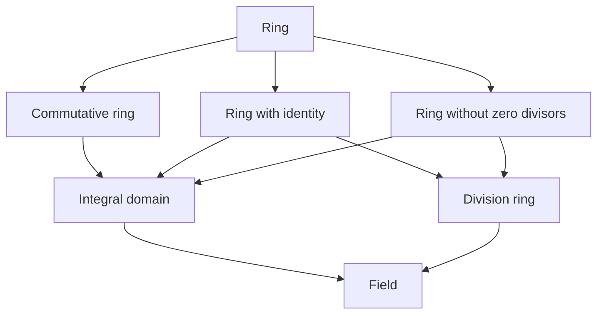

A group has a single operation, whereas integers, polynomials and matrices all have both addition and multiplication, linked by the **distributive law** (Section 1.3.3). A ring is the abstraction of such systems in which one can add, subtract and multiply; a field further requires multiplication to be commutative and every nonzero element to be invertible, so that one can also divide.

This chapter builds directly on Chapter 2: the additive part of a ring is an **abelian group**, and subrings, ideals, quotient rings, ring homomorphisms and the fundamental homomorphism theorem for rings correspond respectively to **subgroups**, **normal subgroups**, **quotient groups**, group homomorphisms and the fundamental homomorphism theorem for groups (Theorem 2.7.7); all of these are in turn concrete forms of the **congruence relations** and **quotient algebras** of Chapter 1 (Section 1.4.8). We introduce, in order, the definition of a ring, subrings and ideals, quotient rings and ring homomorphisms; then zero divisors, integral domains and division rings; and finally fields, the characteristic of a field, prime fields, and vector spaces over a field. Vector spaces over a field generalize linear algebra and are the setting of Lie algebras in Chapter 5 and of representation theory in Chapter 6.

## 3.1. Basic Notions of Rings

### 3.1.1. Definition of a Ring

**Definition 3.1.1 (Ring)** Let $R$ be a nonempty set with two binary operations, addition "$+$" and multiplication "$\cdot$". The algebraic system $(R, +, \cdot)$ is called a ring if the following three conditions hold:

1. $(R, +)$ is an **abelian group**, that is:
   - addition is associative: $(a+b)+c = a+(b+c)$;
   - addition is commutative: $a+b = b+a$;
   - there is an additive identity $0$ with $a+0 = 0+a = a$;
   - every element $a$ has an additive inverse $-a$ with $a+(-a)=(-a)+a=0$.
2. $(R, \cdot)$ is a **semigroup**, that is, multiplication is associative: $(ab)c = a(bc)$.
3. Multiplication satisfies the **distributive law** over addition: for all $a, b, c \in R$,
   $$
   a \cdot (b+c) = a \cdot b + a \cdot c, \quad (a+b) \cdot c = a \cdot c + b \cdot c.
   $$

In the additive notation of Section 1.3.5, the additive identity $0$ is called the zero element of the ring, the additive inverse $-a$ of $a$ is called the negative of $a$, and we write $a - b = a + (-b)$. If multiplication in the ring has an identity, it is written $1$ and called the identity (or unity) of the ring. The multiplication sign $\cdot$ is usually omitted, so $ab$ means $a \cdot b$. Any result that involves only addition can be quoted directly from the theorems on abelian groups in Chapter 2.

### 3.1.2. Basic Properties of Rings

**Theorem 3.1.1** Let $(R, +, \cdot)$ be a ring. Then for all $a, b \in R$:

1. $a \cdot 0 = 0 \cdot a = 0$;
2. $a \cdot (-b) = (-a) \cdot b = -(ab)$;
3. $(-a) \cdot (-b) = ab$.

**Proof**: By the distributive law,

$$
a \cdot 0 = a \cdot (0+0) = a \cdot 0 + a \cdot 0;
$$

adding $-(a \cdot 0)$ to both sides gives $a \cdot 0 = 0$, and $0 \cdot a = 0$ is proved in the same way. From $ab + a(-b) = a(b + (-b)) = a \cdot 0 = 0$ we get $a(-b) = -(ab)$, and similarly $(-a)b = -(ab)$. Finally, $(-a)(-b) = -(a(-b)) = -(-(ab)) = ab$. $\square$

### 3.1.3. Types of Rings and Common Examples

Common rings include:

1. The ring of integers $(\mathbb{Z}, +, \cdot)$: the integers form a ring under ordinary addition and multiplication.
2. The rings of rational numbers $(\mathbb{Q}, +, \cdot)$, real numbers $(\mathbb{R}, +, \cdot)$ and complex numbers $(\mathbb{C}, +, \cdot)$, each under addition and multiplication of numbers.
3. The matrix ring $(M_n(\mathbb{R}), +, \cdot)$: the real matrices of order $n$ form a ring under matrix addition and multiplication.
4. The *polynomial ring* $\mathbb{R}[x]$: the polynomials with real coefficients form a ring under addition and multiplication of polynomials. More generally, for any commutative ring with identity $R$, the polynomials with coefficients in $R$ form a polynomial ring $R[x]$.
5. The ring of residue classes modulo $n$, $(\mathbb{Z}_n, +, \cdot)$: the set $\mathbb{Z}_n = \{\bar{0}, \bar{1}, \dots, \overline{n-1}\}$ is a ring under addition modulo $n$, $\bar{a} + \bar{b} = \overline{a+b}$, and multiplication modulo $n$, $\bar{a} \cdot \bar{b} = \overline{ab}$, from Section 1.3.2.

In group theory, $\mathbb{Z}_n$ is a cyclic group (its additive structure); the residue class ring $\mathbb{Z}_n$ adds multiplication modulo $n$ to it, which is the natural passage from groups to rings.

In general, for any ring $R$, the group $(R, +)$ is called its additive group; if $R$ has an identity, the **invertible elements** of $R$ form a group under multiplication, called the *group of units* of $R$ and denoted $R^\times$. For example, $\mathbb{Z}^\times = \{1, -1\}$ and $M_n(\mathbb{R})^\times = \operatorname{GL}(n, \mathbb{R})$. Thus many of the groups of Chapter 2 are taken from rings.

**Definition 3.1.2 (Commutative Ring)** Let $(R, +, \cdot)$ be a ring. If multiplication is commutative ($ab = ba$ for all $a, b \in R$), then $R$ is called a commutative ring; otherwise it is called a **noncommutative ring**.

**Definition 3.1.3 (Ring with Identity)** Let $(R, +, \cdot)$ be a ring. If multiplication has an identity $1$ (that is, $a \cdot 1 = 1 \cdot a = a$ for all $a \in R$), then $R$ is called a ring with identity (or a **unital ring**).

**Remark** One usually also requires $1 \neq 0$ in a ring with identity. If $1 = 0$, then $a = a \cdot 1 = a \cdot 0 = 0$ for every $a \in R$, so the ring has only one element; it is called the zero ring.

For example:

- The ring of integers $\mathbb{Z}$ is both commutative and a ring with identity (the identity is $1$).
- The matrix ring $M_n(\mathbb{R})$ ($n \ge 2$) is a ring with identity (the identity matrix) but is not commutative.
- The set $2\mathbb{Z}$ of even integers is a commutative ring but not a ring with identity (it has no multiplicative identity).

## 3.2. Subrings, Ideals and Quotient Rings

### 3.2.1. Subrings

**Definition 3.2.1 (Subring)** Let $(R, +, \cdot)$ be a ring and $S$ a nonempty subset of $R$. If $S$ is itself a ring under the addition and multiplication of $R$, then $S$ is called a subring of $R$.

**Theorem 3.2.1 (Subring Criterion)** Let $R$ be a ring and $S$ a nonempty subset of $R$. Then $S$ is a subring of $R$ if and only if for all $a, b \in S$:

1. $a - b \in S$;
2. $ab \in S$.

Condition 1 is exactly the criterion for $(S, +)$ to be a subgroup of $(R, +)$ (Theorem 2.2.6); it combines the existence of the zero element and of additive inverses with closure under addition. The remaining ring axioms are inherited from $R$.

For example:

- the set $2\mathbb{Z}$ of even integers is a subring of the ring of integers $\mathbb{Z}$;
- the ring of integers $\mathbb{Z}$ is a subring of the ring of rational numbers $\mathbb{Q}$;
- the upper triangular matrices form a subring of the matrix ring $M_n(\mathbb{R})$.

### 3.2.2. Ideals

Ideals play the same role in ring theory as **normal subgroups** in group theory: they are the substructures needed to form quotient rings.

**Definition 3.2.2 (Ideal)** Let $(R, +, \cdot)$ be a ring and $I$ a subgroup of $(R, +)$. If $ra \in I$ for all $a \in I$ and $r \in R$, then $I$ is called a **left ideal** of $R$; if $ar \in I$ for all such $a$ and $r$, then $I$ is called a **right ideal**. If $I$ is both a left and a right ideal, it is called an ideal (two-sided ideal) of $R$, written $I \triangleleft R$.

In words: multiplying an element of the ideal by any element of the ring gives a result that stays in the ideal. This is called the absorption property of ideals. Hence $I$ is an ideal of $R$ if and only if:

1. $I$ is nonempty;
2. $i - j \in I$ for all $i, j \in I$;
3. $ri \in I$ and $ir \in I$ for all $i \in I$ and $r \in R$.

Examples of ideals:

- Every ring $R$ has the two ideals $\{0\}$ and $R$, called the trivial ideals.
- In the ring of integers $\mathbb{Z}$, the set $n\mathbb{Z} = \{nk \mid k \in \mathbb{Z}\}$ is an ideal for every integer $n$.
- In the polynomial ring $\mathbb{R}[x]$, the polynomials with zero constant term form an ideal.

The following kinds of ideals are particularly important.

**Definition 3.2.3** Let $I$ be an ideal of a ring $R$.

- If $I \neq R$, then $I$ is called a **proper ideal** of $R$;
- if $I$ is a proper ideal and there is no ideal $J$ with $I \subsetneq J \subsetneq R$, then $I$ is called a **maximal ideal**;
- let $R$ be a commutative ring and $I$ a proper ideal. If for all $a, b \in R$, $ab \in I$ implies $a \in I$ or $b \in I$, then $I$ is called a **prime ideal**.

For example, $p\mathbb{Z}$ ($p$ prime) is a prime ideal of $\mathbb{Z}$ and also a maximal ideal; the zero ideal $\{0\}$ is a prime ideal of $\mathbb{Z}$ (since $\mathbb{Z}$ has no zero divisors) but not a maximal ideal, because $\{0\} \subsetneq 2\mathbb{Z} \subsetneq \mathbb{Z}$.

Comparison with normal subgroups: $(R, +)$ is an abelian group, so every subgroup of it is normal in the additive sense; an ideal is additionally required to have the absorption property $rI \subseteq I$, $Ir \subseteq I$ (where $rI = \{ri \mid i \in I\}$), which is exactly the condition needed for multiplication on the quotient set to be well defined. Note that in general only inclusion holds; for instance $0 \cdot I = \{0\}$.

### 3.2.3. Quotient Rings

**Theorem 3.2.2** Let $I$ be an ideal of a ring $R$, and let

$$
R/I = \{a + I \mid a \in R\},
$$

where $a + I = \{a + i \mid i \in I\}$ is a coset of $I$. Define addition and multiplication on $R/I$ by

$$
(a + I) + (b + I) = (a + b) + I, \quad (a + I)(b + I) = ab + I.
$$

Then $R/I$ is a ring under these two operations, called the *quotient ring* of $R$ by $I$ (also called a residue class ring).

**Proof**: As an additive group, $I$ is a (normal) subgroup of the abelian group $(R, +)$, so by Theorem 2.6.3, $R/I$ is a quotient group under addition, and addition does not depend on representatives. For multiplication, if $a' = a + i$ and $b' = b + j$ ($i, j \in I$), then

$$
a'b' = ab + (aj + ib + ij),
$$

and by absorption $aj, ib, ij \in I$, so $a'b' + I = ab + I$; multiplication does not depend on representatives either. In other words, "$a \sim b \iff a - b \in I$" is a **congruence relation** (Definition 1.4.7) with respect to both addition and multiplication, and $R/I$ is the corresponding **quotient algebra**; associativity and distributivity are inherited from $R$ by Theorem 1.4.2. $\square$

For example, the ring of residue classes modulo $n$, $\mathbb{Z}_n$, is the quotient ring $\mathbb{Z}/n\mathbb{Z}$ of the ring of integers $\mathbb{Z}$ by the ideal $n\mathbb{Z}$. This agrees with the group-theoretic view of the cyclic group $\mathbb{Z}_n$ as the quotient group of $\mathbb{Z}$ by the subgroup $n\mathbb{Z}$.

## 3.3. Ring Homomorphisms and the Fundamental Homomorphism Theorem

### 3.3.1. Definition of a Ring Homomorphism

**Definition 3.3.1** Let $R$ and $S$ be rings (with addition and multiplication written the same way in both) and let $f: R \to S$ be a map. If $f(a + b) = f(a) + f(b)$ (preservation of addition) and $f(ab) = f(a)f(b)$ (preservation of multiplication) for all $a, b \in R$, then $f$ is called a **ring homomorphism** from $R$ to $S$. If $f$ is injective, surjective or bijective, it is called a **monomorphism**, an **epimorphism** or an **isomorphism**, respectively.

This is exactly the definition of a homomorphism for several operations in Section 1.4.3. In particular, a ring homomorphism is a group homomorphism between the additive groups, so all the results of Chapter 2 on group homomorphisms apply to its additive part.

### 3.3.2. Basic Properties of Ring Homomorphisms

**Theorem 3.3.1** Let $f: R \to S$ be a ring homomorphism. Then:

1. $f(0_R) = 0_S$ (the image of zero is zero);
2. $f(-a) = -f(a)$ (the image of an additive inverse is the additive inverse of the image);
3. if $R$ is a ring with identity $1_R$, then $f(1_R)$ is the identity of the subring $f(R)$; if $f$ is surjective, $f(1_R)$ is the identity of $S$.

### 3.3.3. The Kernel of a Ring Homomorphism

**Definition 3.3.2** Let $f: R \to S$ be a ring homomorphism. The set $\ker f = \{a \in R \mid f(a) = 0_S\}$ is called the kernel of the ring homomorphism $f$.

**Theorem 3.3.2** Let $f: R \to S$ be a ring homomorphism. Then $\ker f$ is an ideal of $R$.

**Proof**: $\ker f$ is the kernel of a homomorphism of additive groups and hence a subgroup of $(R, +)$. For any $r \in R$ and $k \in \ker f$,

$$
f(rk) = f(r)f(k) = f(r) \cdot 0_S = 0_S,
$$

so $rk \in \ker f$; similarly $kr \in \ker f$. $\square$

The kernel of a group homomorphism is a **normal subgroup** (Theorem 2.7.4), and the kernel of a ring homomorphism is an ideal; the two correspond exactly.

### 3.3.4. The Fundamental Homomorphism Theorem for Rings

**Theorem 3.3.3 (Fundamental Homomorphism Theorem for Rings, or First Isomorphism Theorem)** Let $R$ and $S$ be rings and $f: R \to S$ a surjective ring homomorphism. Then

$$
R / \ker f \cong S,
$$

with the isomorphism given by $a + \ker f \mapsto f(a)$.

This is the ring-theoretic counterpart of the fundamental homomorphism theorem for groups (Theorem 2.7.7): replace "group" by "ring", "normal subgroup" by "ideal" and "quotient group" by "quotient ring". The proof is the same: by Theorem 2.7.7, $a + \ker f \mapsto f(a)$ is an isomorphism of additive groups, and it remains only to check that it preserves multiplication.

For example:

- $k \mapsto \bar{k}$ is a surjective ring homomorphism from $\mathbb{Z}$ onto $\mathbb{Z}_n$ with kernel $n\mathbb{Z}$, so $\mathbb{Z}/n\mathbb{Z} \cong \mathbb{Z}_n$ (as rings);
- "evaluation at $0$", $p(x) \mapsto p(0)$, is a surjective ring homomorphism from $\mathbb{R}[x]$ onto $\mathbb{R}$ whose kernel is the ideal of polynomials with zero constant term, denoted $(x)$; hence $\mathbb{R}[x]/(x) \cong \mathbb{R}$.

## 3.4. Zero Divisors, Integral Domains and Division Rings

### 3.4.1. Zero Divisors

**Definition 3.4.1 (Zero Divisor)** Let $R$ be a ring and $a, b \in R$ with $a \neq 0$, $b \neq 0$ but $ab = 0$. Then $a$ is called a left zero divisor of $R$ and $b$ a right zero divisor; both are called zero divisors. A ring that has no zero divisors is called a **ring without zero divisors**.

For example:

- The ring of integers $\mathbb{Z}$ has no zero divisors.
- The matrix ring $M_2(\mathbb{R})$ has zero divisors; for instance
  $$
  \begin{pmatrix} 1 & 0 \\ 0 & 0 \end{pmatrix} \begin{pmatrix} 0 & 0 \\ 1 & 0 \end{pmatrix} = \begin{pmatrix} 0 & 0 \\ 0 & 0 \end{pmatrix}.
  $$
- In the residue class ring $\mathbb{Z}_6$, $\bar{2} \cdot \bar{3} = \bar{0}$, so $\bar{2}$ and $\bar{3}$ are zero divisors.

**Theorem 3.4.1** A ring $R$ has no zero divisors if and only if the multiplicative **cancellation law** holds, that is,

$$
\forall a, b, c \in R,\ a \neq 0:\quad ab = ac \Rightarrow b = c.
$$

**Proof**: If $R$ has no zero divisors and $ab = ac$, then $a(b-c) = 0$, and $a \neq 0$ gives $b-c=0$, that is, $b = c$. Conversely, if the cancellation law holds and $ab = 0$ with $a \neq 0$, then $ab = a \cdot 0$, and cancelling $a$ gives $b = 0$; so $R$ has no zero divisors. $\square$

### 3.4.2. Integral Domains

**Definition 3.4.2 (Integral Domain)** A commutative ring $R$ with multiplicative identity $1 \neq 0$ and without zero divisors is called an integral domain.

For example:

- The ring of integers $\mathbb{Z}$ is an integral domain.
- The polynomial ring $\mathbb{R}[x]$ is an integral domain.
- The ring of residue classes modulo $n$, $\mathbb{Z}_n$ ($n \ge 2$), is an integral domain if and only if $n$ is prime: if $n = kl$ with $1 < k, l < n$, then $\bar{k} \cdot \bar{l} = \bar{0}$ exhibits zero divisors; if $n$ is prime, then $n \mid kl$ implies $n \mid k$ or $n \mid l$.

An integral domain keeps the main properties of multiplication of integers (commutativity, an identity, cancellation) but does not require division to be possible.

### 3.4.3. Division Rings

**Definition 3.4.3 (Division Ring)** Let $R$ be a ring with identity $1 \neq 0$. If every nonzero element of $R$ has a multiplicative inverse, then $R$ is called a division ring, or a **skew field**.

A division ring need not be commutative. A division ring always has no zero divisors: if $a \neq 0$ and $ab = 0$, then $b = a^{-1}ab = 0$.

For example, Hamilton's quaternions $\{a + bi + cj + dk \mid a, b, c, d \in \mathbb{R}\}$ (with $i^2 = j^2 = k^2 = ijk = -1$) form a noncommutative division ring.

### 3.4.4. Relations among Types of Rings

The diagram below summarizes the hierarchy of rings and their special types; arrows point from the general to the special:

## 3.5. Fields

### 3.5.1. Definition of a Field

What distinguishes a field is that one can "divide": every nonzero element has a multiplicative inverse.

**Definition 3.5.1 (Field)** Let $(F, +, \cdot)$ be a ring. If $(F \setminus \{0\}, \cdot)$ is an abelian group, then $F$ is called a field.

Equivalently, a field is a division ring with commutative multiplication; a field is also an integral domain in which every nonzero element is invertible. By definition, a field contains at least the two elements $0$ and $1$, and $1 \neq 0$.

### 3.5.2. Number Fields and Common Fields

**Definition 3.5.2 (Number Field)** Let $F$ be a subset of the complex numbers containing $0$ and $1$. If $F$ is closed under the four arithmetic operations of addition, subtraction, multiplication and division (by nonzero numbers), then $F$ is called a number field.

Typical fields:

- the field of rational numbers $(\mathbb{Q}, +, \cdot)$: every number field contains $\mathbb{Q}$, so it is the smallest number field;
- the field of real numbers $(\mathbb{R}, +, \cdot)$;
- the field of complex numbers $(\mathbb{C}, +, \cdot)$;
- a *finite field*, also called a Galois field: a field with finitely many elements, such as $\mathbb{Z}_p$ ($p$ prime).

The ring of integers $\mathbb{Z}$ is not a field, because no nonzero integer other than $\pm 1$ has a multiplicative inverse.

### 3.5.3. Subfields

**Definition 3.5.3** Let $F$ be a field and $K$ a nonempty subset of $F$. If $K$ is itself a field under the operations of $F$, then $K$ is called a **subfield** of $F$.

$K$ is a subfield of the field $F$ if and only if $K$ is a subring of $F$, $K$ contains a nonzero element, and $a^{-1} \in K$ for every nonzero $a \in K$.

### 3.5.4. The Characteristic of a Field

**Definition 3.5.4 (Characteristic of a Field)** Let $F$ be a field with multiplicative identity $1$, and consider the order of $1$ in the additive group. If there is a positive integer $p$ such that the sum of $p$ copies of $1$ equals $0$ (written $p \cdot 1 = 0$), then the least such positive integer $p$ is called the **characteristic** of $F$, written $\operatorname{char} F = p$; if there is no such positive integer, $F$ is said to have characteristic $0$.

For example, $\mathbb{Q}$, $\mathbb{R}$ and $\mathbb{C}$ have characteristic $0$, and $\mathbb{Z}_p$ has characteristic $p$. In general, $m \cdot 1$ denotes the sum of $m$ copies of $1$.

**Theorem 3.5.1** If a field $F$ has characteristic $p > 0$, then $p$ is prime.

**Proof**: $p \neq 1$ because $1 \neq 0$. Suppose $p$ is composite, $p = mn$ with $1 < m, n < p$. Then by the distributive law

$$
(m \cdot 1)(n \cdot 1) = (mn) \cdot 1 = 0.
$$

By the minimality of $p$, $m \cdot 1 \neq 0$ and $n \cdot 1 \neq 0$, contradicting the fact that a field has no zero divisors. $\square$

### 3.5.5. Prime Fields

**Definition 3.5.5** A field that contains no proper subfield is called a **prime field**.

**Theorem 3.5.2** Every field contains a unique prime subfield (namely the intersection of all its subfields). According to the characteristic, prime fields fall into two classes:

- if the characteristic is $0$, the prime subfield is isomorphic to the field of rational numbers $\mathbb{Q}$;
- if the characteristic is a prime $p$, the prime subfield is isomorphic to $\mathbb{F}_p = \mathbb{Z}_p$ (the field of residue classes modulo $p$).

**Corollary**: The number of elements of a finite field is a prime power $p^n$ ($n \ge 1$), where $p$ is its characteristic. Indeed, a finite field cannot have characteristic $0$, and it can be regarded as a finite-dimensional vector space over its prime subfield $\mathbb{F}_p$ (Definition 3.6.1). If the dimension is $n$, then after choosing a basis each element is uniquely determined by $n$ coordinates in $\mathbb{F}_p$, so there are $p^n$ elements. In particular, for $n=1$, $\mathbb{Z}_p$ is the typical finite field with $p$ elements.

Lagrange's theorem in group theory (Theorem 2.5.3) restricts the orders of subgroups; the corollary here restricts the number of elements of a finite field: it must be a power of the characteristic.

## 3.6. Some Important Notions of Field Theory (Overview)

### 3.6.1. Fields of Fractions

**Theorem 3.6.1** Every integral domain $R$ can be embedded in a field; that is, there are a field $F$ and a monomorphism $\varphi: R \to F$. The smallest such field consists of all "fractions" $a/b$ ($a, b \in R$, $b \neq 0$) and is called the *field of fractions* of $R$. The construction of the field of rational numbers $\mathbb{Q}$ from the ring of integers $\mathbb{Z}$ is a special case.

### 3.6.2. Field Extensions

If $K$ is a subfield of $F$, then $F$ is called an *extension field* of $K$; we also say that $F$ is a field extension of $K$. For example, the field of complex numbers $\mathbb{C}$ is an extension field of the field of real numbers $\mathbb{R}$, and both are extension fields of the field of rational numbers $\mathbb{Q}$. The theory of field extensions is the foundation of Galois theory.

The basic method for constructing extension fields is to form quotient rings. Let $R$ be a commutative ring with identity and $I$ an ideal of $R$; one can show that $R/I$ is a field if and only if $I$ is a maximal ideal. In the polynomial ring $F[x]$ over a field $F$, the ideal $(p(x))$ of all multiples of an irreducible polynomial $p(x)$ is maximal, so $F[x]/(p(x))$ is an extension field of $F$; if $\deg p = n$, it is an $n$-dimensional vector space over $F$. For example:

- $\mathbb{R}[x]/(x^2 + 1) \cong \mathbb{C}$, where the coset of $x$ plays the role of the imaginary unit $i$;
- $x^2 + x + 1$ has no root in $\mathbb{F}_2$ and is therefore irreducible, so $\mathbb{F}_2[x]/(x^2 + x + 1)$ is the finite field $\mathbb{F}_4$ with $4$ elements;
- the field $\mathbb{F}_{2^8}$ used in the AES encryption algorithm is $\mathbb{F}_2[x]/(x^8 + x^4 + x^3 + x + 1)$; the $8$ bits of a byte are the $8$ coordinates of an element.

### 3.6.3. Vector Spaces over a Field

In linear algebra, linear spaces are defined over number fields (see [Linear Algebra: Linear Spaces](/2.1.7#sec-7.1)). The eight axioms there use only addition, subtraction, multiplication and division in the number field, so the number field can be replaced by an arbitrary field.

**Definition 3.6.1 (Vector Space)** Let $F$ be a field. A nonempty set $V$ together with an addition $V \times V \to V$ and a scalar multiplication $F \times V \to V$ is called a vector space (or linear space) over $F$ if $(V, +)$ is an abelian group and for all $a, b \in F$ and $x, y \in V$

$$
a(x + y) = ax + ay, \quad (a + b)x = ax + bx, \quad (ab)x = a(bx), \quad 1x = x.
$$

In the language of Chapter 1, a vector space is an algebraic system: an additive abelian group together with a family of unary operations $x \mapsto ax$ indexed by the elements of the field. The results of linear algebra on bases, dimension, linear maps and their matrix representations ([Linear Algebra 2.1.7](/2.1.7)) hold for vector spaces over any field, with the same proofs. For example:

- $F^n$ ($n$-tuples with componentwise operations) is an $n$-dimensional vector space over $F$;
- $\mathbb{F}_2^n$ is the vector space of bit strings of length $n$ under bitwise exclusive or, and linear error-correcting codes are its subspaces;
- $F[x]$ is an infinite-dimensional vector space over $F$.

A map between two vector spaces over $F$ that preserves addition and scalar multiplication is called a *linear map*; it is precisely a **homomorphism** between such algebraic systems. The set of all linear maps from $V$ to itself is denoted $\operatorname{End}(V)$, and the invertible ones form the **general linear group** $\operatorname{GL}(V)$. Once a basis is fixed, the linear maps on an $n$-dimensional space correspond one-to-one to the matrices of order $n$, and $\operatorname{GL}(V)$ corresponds to $\operatorname{GL}(n, F)$. These notions are used throughout Chapters 5 and 6.

## Summary

| Topic | Key concepts |
|------|----------|
| Basic notions of rings | definition of a ring (additive abelian group, multiplicative semigroup, distributive law), commutative rings, rings with identity, common rings (integers, polynomial rings, matrix rings, residue classes modulo $n$) |
| Subrings and ideals | subring criterion, definition of an ideal and the absorption property, analogy between ideals and normal subgroups |
| Quotient rings and ring homomorphisms | construction of quotient rings, definition and kernel of a ring homomorphism, the kernel is an ideal, fundamental homomorphism theorem for rings |
| Integral domains and division rings | zero divisors, integral domains (commutative, with identity, no zero divisors), division rings (every nonzero element invertible) |
| Fields | definition of a field (commutative division ring), number fields, subfield criterion, characteristic, classification of prime fields |
| Extension fields and vector spaces | field of fractions, extension fields via quotient rings $F[x]/(p(x))$, finite fields, vector spaces over a field, linear maps, $\operatorname{GL}(V)$ |

The theory of rings and fields has wide applications in coding theory, cryptography and other areas. For example, the AES encryption algorithm is based on arithmetic in the finite field $\mathbb{F}_{2^8}$; error-correcting codes such as Reed–Solomon codes are built on polynomial rings and quotient rings over finite fields, and they are used in optical discs, QR codes, and error correction in DNA data storage.

So far, the operations of groups and rings have all come from "computation": addition, multiplication, composition. The next chapter takes a different starting point: beginning with an order relation, it treats "taking the supremum" and "taking the infimum" as two operations, which gives lattices. Lattices that are distributive and in which every element has a complement are Boolean algebras, and a Boolean algebra can in turn be viewed as a special kind of ring (Section 4.3.4).
