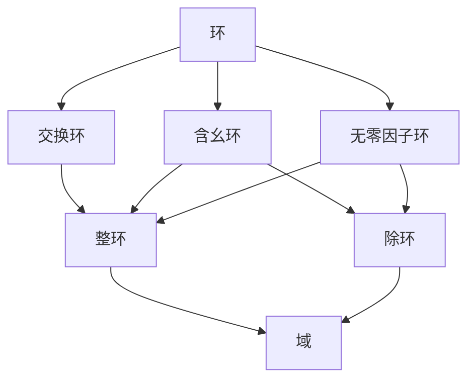

环是同时具有加法和乘法两种运算、并由分配律把两者联系起来的代数系统；域是环的特殊情形，要求乘法交换且非零元都可逆。本章的结构与上一章平行：从环的定义出发，依次介绍子环、理想与商环、环同态及同态基本定理，再讨论零因子、整环、除环，最后介绍域、域的特征与素域。群论中的许多结论（正规子群与商群、同态基本定理）在这里都有对应的版本。

## 3.1. 环的基本概念

### 3.1.1. 环的定义

在群论中，我们讨论的是只有一种二元运算的代数系统；环则同时涉及两种运算。

**定义 3.1.1（环）** 设 $R$ 是非空集合，在 $R$ 上定义了加法"$+$"和乘法"$\cdot$"两种二元运算。若满足以下三个条件，则称代数系统 $(R, +, \cdot)$ 是一个环：

1. $(R, +)$ 是交换群，即：
   - 加法结合律：$(a+b)+c = a+(b+c)$；
   - 加法交换律：$a+b = b+a$；
   - 存在加法单位元 $0$，使得 $a+0 = 0+a = a$；
   - 每个元素 $a$ 有加法逆元 $-a$，使得 $a+(-a)=(-a)+a=0$。
2. $(R, \cdot)$ 是半群，即乘法满足结合律：$(ab)c = a(bc)$。
3. 乘法对加法满足**分配律**：对任意 $a, b, c \in R$，
   $$
   a \cdot (b+c) = a \cdot b + a \cdot c, \quad (a+b) \cdot c = a \cdot c + b \cdot c.
   $$

加法单位元 $0$ 称为环的**零元**，$a$ 的加法逆元记为 $-a$，并记 $a - b = a + (-b)$。若环中乘法有单位元，则记作 $1$，称为环的单位元（幺元）。

### 3.1.2. 环的基本性质

**定理 3.1.1** 设 $(R, +, \cdot)$ 是一个环，则对任意 $a, b \in R$，有：

1. $a \cdot 0 = 0 \cdot a = 0$；
2. $a \cdot (-b) = (-a) \cdot b = -(ab)$；
3. $(-a) \cdot (-b) = ab$。

**证明**：由分配律，

$$
a \cdot 0 = a \cdot (0+0) = a \cdot 0 + a \cdot 0,
$$

两边加上 $-(a \cdot 0)$ 得 $a \cdot 0 = 0$，类似可证 $0 \cdot a = 0$。由 $ab + a(-b) = a(b + (-b)) = a \cdot 0 = 0$ 得 $a(-b) = -(ab)$，同理 $(-a)b = -(ab)$。最后 $(-a)(-b) = -(a(-b)) = -(-(ab)) = ab$。 $\square$

### 3.1.3. 环的类型与常见例子

常见的环有：

1. **整数环** $(\mathbb{Z}, +, \times)$：整数集合关于普通加法和乘法构成环。
2. **有理数环** $(\mathbb{Q}, +, \times)$、**实数环** $(\mathbb{R}, +, \times)$、**复数环** $(\mathbb{C}, +, \times)$：均关于数的加法和乘法构成环。
3. **矩阵环** $(M_n(\mathbb{R}), +, \times)$：$n$ 阶实矩阵的集合关于矩阵加法和乘法构成环。
4. **多项式环** $\mathbb{R}[x]$：实系数多项式的集合关于多项式加法和乘法构成环。
5. **模 $n$ 剩余类环** $(\mathbb{Z}_n, \oplus, \otimes)$：$\mathbb{Z}_n = \{\bar{0}, \bar{1}, \dots, \overline{n-1}\}$ 关于模 $n$ 加法 $\bar{a} \oplus \bar{b} = \overline{a+b}$ 和模 $n$ 乘法 $\bar{a} \otimes \bar{b} = \overline{ab}$ 构成环。

在群论中，$\mathbb{Z}_n$ 是一个循环群（加法结构）；剩余类环 $\mathbb{Z}_n$ 在此基础上增加了模 $n$ 乘法，这正是从群到环的自然过渡。

**定义 3.1.2（交换环）** 设 $(R, +, \cdot)$ 是环。若乘法满足交换律（对任意 $a, b \in R$，$ab = ba$），则称 $R$ 是交换环，否则称为**非交换环**。

**定义 3.1.3（含幺环）** 设 $(R, +, \cdot)$ 是环。若乘法有单位元 $1$（即对任意 $a \in R$，$a \cdot 1 = 1 \cdot a = a$），则称 $R$ 是含幺环（或**有单位元的环**）。

**注** 通常还要求含幺环中 $1 \neq 0$。若 $1 = 0$，则对任意 $a \in R$ 有 $a = a \cdot 1 = a \cdot 0 = 0$，环只含一个元素，称为**零环**。

例如：

- 整数环 $\mathbb{Z}$ 既是交换环又是含幺环（单位元为 $1$）。
- 矩阵环 $M_n(\mathbb{R})$（$n \ge 2$）是含幺环（单位元为单位矩阵），但不是交换环。
- 偶数集 $2\mathbb{Z}$ 是交换环，但不是含幺环（没有乘法单位元）。

## 3.2. 子环、理想与商环

### 3.2.1. 子环

**定义 3.2.1（子环）** 设 $(R, +, \cdot)$ 是一个环，$S$ 是 $R$ 的非空子集。若 $S$ 关于 $R$ 的加法和乘法也构成一个环，则称 $S$ 为环 $R$ 的子环。

**定理 3.2.1（子环判别法）** 设 $R$ 是环，$S$ 是 $R$ 的非空子集，则 $S$ 是 $R$ 的子环当且仅当对任意 $a, b \in S$，有：

1. $a - b \in S$；
2. $ab \in S$。

条件 1 正是"$(S, +)$ 是 $(R, +)$ 的子群"的判别条件（定理 2.2.6），它把零元、加法逆元的存在以及加法封闭性合在一起；其余的环公理由 $R$ 继承。

例如：

- 偶数集 $2\mathbb{Z}$ 是整数环 $\mathbb{Z}$ 的子环；
- 整数环 $\mathbb{Z}$ 是有理数环 $\mathbb{Q}$ 的子环；
- 上三角矩阵的集合是矩阵环 $M_n(\mathbb{R})$ 的子环。

### 3.2.2. 理想

理想在环论中的地位类似于正规子群在群论中的地位：它是构造商环所需要的子结构。

**定义 3.2.2（理想）** 设 $(R, +, \cdot)$ 是一个环，$I$ 是 $(R, +)$ 的子群。若对任意的 $a \in I$，$r \in R$，都有 $ra \in I$，则称 $I$ 是 $R$ 的一个**左理想**；若都有 $ar \in I$，则称 $I$ 是**右理想**。若 $I$ 既是左理想又是右理想，则称 $I$ 是 $R$ 的一个理想（双边理想），记作 $I \triangleleft R$。

也就是说，用环中任意元素去乘理想中的元素，结果仍落在理想中，这称为理想的**吸收性**。由此，$I$ 是 $R$ 的理想当且仅当：

1. $I$ 非空；
2. 对任意 $i, j \in I$，$i - j \in I$；
3. 对任意 $i \in I$，$r \in R$，$ri \in I$ 且 $ir \in I$。

理想的例子：

- 任何环 $R$ 都有两个理想 $\{0\}$ 和 $R$，称为**平凡理想**。
- 在整数环 $\mathbb{Z}$ 中，对任意整数 $n$，集合 $n\mathbb{Z} = \{nk \mid k \in \mathbb{Z}\}$ 是理想。
- 在多项式环 $\mathbb{R}[x]$ 中，所有常数项为零的多项式构成的集合是理想。

几类重要的理想：

- **真理想**：若 $I \neq R$，则称 $I$ 是 $R$ 的真理想。
- **极大理想**：若 $I$ 是真理想，且不存在理想 $J$ 满足 $I \subsetneq J \subsetneq R$，则称 $I$ 是极大理想。
- **素理想**：设 $R$ 是交换环，$I$ 是真理想。若对任意 $a, b \in R$，$ab \in I$ 蕴含 $a \in I$ 或 $b \in I$，则称 $I$ 是素理想。例如 $p\mathbb{Z}$（$p$ 为素数）是 $\mathbb{Z}$ 的素理想，也是极大理想。

与正规子群比较：$(R, +)$ 是交换群，所以它的任何子群都是加法意义下的正规子群；理想额外要求吸收性 $rI \subseteq I$、$Ir \subseteq I$（这里 $rI = \{ri \mid i \in I\}$），这正是使商集上的乘法有定义所需要的条件。注意一般只有包含关系，例如 $0 \cdot I = \{0\}$。

### 3.2.3. 商环

**定理 3.2.2** 设 $I$ 是环 $R$ 的一个理想。令

$$
R/I = \{a + I \mid a \in R\},
$$

其中 $a + I = \{a + i \mid i \in I\}$ 是 $I$ 的陪集。在 $R/I$ 上定义加法和乘法：

$$
(a + I) + (b + I) = (a + b) + I, \quad (a + I)(b + I) = ab + I,
$$

则 $R/I$ 关于这两种运算构成一个环，称为 $R$ 关于 $I$ 的**商环**（也称剩余类环）。

例如，模 $n$ 剩余类环 $\mathbb{Z}_n$ 就是整数环 $\mathbb{Z}$ 关于理想 $n\mathbb{Z}$ 的商环 $\mathbb{Z}/n\mathbb{Z}$，这与群论中把循环群 $\mathbb{Z}_n$ 看作 $\mathbb{Z}$ 关于子群 $n\mathbb{Z}$ 的商群是一致的。

## 3.3. 环的同态与同态基本定理

### 3.3.1. 环同态的定义

**定义 3.3.1** 设 $(R, +, \cdot)$ 和 $(S, \oplus, \otimes)$ 是两个环，$f: R \to S$ 是一个映射。若对任意 $a, b \in R$，有

1. $f(a + b) = f(a) \oplus f(b)$（保持加法）；
2. $f(ab) = f(a) \otimes f(b)$（保持乘法），

则称 $f$ 是 $R$ 到 $S$ 的**环同态映射**，简称**环同态**。若 $f$ 是单射、满射、双射，则分别称为**单同态**、**满同态**和**同构**。

### 3.3.2. 环同态的基本性质

**定理 3.3.1** 设 $f: R \to S$ 是环同态，则：

1. $f(0_R) = 0_S$（零元的象是零元）；
2. $f(-a) = -f(a)$（加法逆元的象是象的加法逆元）；
3. 若 $R$ 是含幺环，单位元为 $1_R$，则 $f(1_R)$ 是子环 $f(R)$ 的单位元；若 $f$ 是满射，则 $f(1_R)$ 是 $S$ 的单位元。

### 3.3.3. 环同态的核

**定义 3.3.2** 设 $f: R \to S$ 是环同态，集合

$$
\ker f = \{a \in R \mid f(a) = 0_S\}
$$

称为环同态 $f$ 的**核**。

**定理 3.3.2** 设 $f: R \to S$ 是环同态，则 $\ker f$ 是 $R$ 的一个理想。

**证明**：$\ker f$ 是加法群同态的核，故是 $(R, +)$ 的子群。对任意 $r \in R$，$k \in \ker f$，有

$$
f(rk) = f(r)f(k) = f(r) \cdot 0_S = 0_S,
$$

故 $rk \in \ker f$，同理 $kr \in \ker f$。 $\square$

群同态的核是正规子群（定理 2.7.4），环同态的核是理想，二者正好对应。

### 3.3.4. 环的同态基本定理

**定理 3.3.3（环的同态基本定理，亦称第一同构定理）** 设 $R$ 和 $S$ 是环，$f: R \to S$ 是环满同态，则

$$
R / \ker f \cong S,
$$

同构由 $a + \ker f \mapsto f(a)$ 给出。

这正是群的同态基本定理（定理 2.7.7）在环中的对应：把"群"换成"环"，"正规子群"换成"理想"，"商群"换成"商环"即可。

## 3.4. 零因子、整环与除环

### 3.4.1. 零因子

**定义 3.4.1（零因子）** 设 $R$ 是环，$a, b \in R$，$a \neq 0$，$b \neq 0$，但 $ab = 0$，则称 $a$ 是 $R$ 的一个左零因子，$b$ 是一个右零因子，统称零因子。不含零因子的环称为**无零因子环**。

例如：

- 整数环 $\mathbb{Z}$ 是无零因子环。
- 矩阵环 $M_2(\mathbb{R})$ 含有零因子，例如
  $$
  \begin{pmatrix} 1 & 0 \\ 0 & 0 \end{pmatrix} \begin{pmatrix} 0 & 0 \\ 1 & 0 \end{pmatrix} = \begin{pmatrix} 0 & 0 \\ 0 & 0 \end{pmatrix}.
  $$
- 剩余类环 $\mathbb{Z}_6$ 中，$\bar{2} \cdot \bar{3} = \bar{0}$，故 $\bar{2}$ 和 $\bar{3}$ 是零因子。

**定理 3.4.1** 环 $R$ 是无零因子环当且仅当乘法消去律成立，即

$$
\forall a, b, c \in R,\ a \neq 0:\quad ab = ac \Rightarrow b = c.
$$

**证明**：若 $R$ 无零因子且 $ab = ac$，则 $a(b-c) = 0$，由 $a \neq 0$ 得 $b-c=0$，即 $b = c$。反之，若消去律成立而 $ab = 0$，$a \neq 0$，则 $ab = a \cdot 0$，消去 $a$ 得 $b = 0$，所以 $R$ 无零因子。 $\square$

### 3.4.2. 整环

**定义 3.4.2（整环）** 设 $R$ 是一个交换环，有乘法单位元 $1 \neq 0$，且 $R$ 无零因子，则称 $R$ 是一个整环。

例如：

- 整数环 $\mathbb{Z}$ 是整环。
- 多项式环 $\mathbb{R}[x]$ 是整环。
- 模 $n$ 剩余类环 $\mathbb{Z}_n$（$n \ge 2$）是整环当且仅当 $n$ 是素数：若 $n = kl$，$1 < k, l < n$，则 $\bar{k} \cdot \bar{l} = \bar{0}$ 是零因子；若 $n$ 是素数，则 $n \mid kl$ 蕴含 $n \mid k$ 或 $n \mid l$。

整环保留了整数乘法的主要性质（交换、有单位元、可以消去），但不要求能做除法。

### 3.4.3. 除环

**定义 3.4.3（除环）** 设 $R$ 是含幺环，$1 \neq 0$。若 $R$ 中每个非零元都有乘法逆元，则称 $R$ 是一个除环，也称为**体**。

除环不要求乘法交换。除环一定无零因子：若 $a \neq 0$ 且 $ab = 0$，则 $b = a^{-1}ab = 0$。

例如，Hamilton 四元数集合 $\{a + bi + cj + dk \mid a, b, c, d \in \mathbb{R}\}$（$i^2 = j^2 = k^2 = ijk = -1$）构成一个非交换除环。

### 3.4.4. 各种环的关系

下图归纳了环及其特殊类型之间的层次关系，箭头由一般指向特殊：

## 3.5. 域

### 3.5.1. 域的定义

域的特点是可以做"除法"：每个非零元都有乘法逆元。

**定义 3.5.1（域）** 设 $(F, +, \cdot)$ 是一个环。若 $(F \setminus \{0\}, \cdot)$ 是交换群，则称 $F$ 是一个域。

等价地说，域是乘法交换的除环；域也是每个非零元都可逆的整环。由定义，域至少含有 $0$ 和 $1$ 两个元素，且 $1 \neq 0$。

### 3.5.2. 数域与常见的域

**定义 3.5.2（数域）** 设 $F$ 是复数集的一个子集，含有 $0$ 和 $1$。若 $F$ 对数的加、减、乘、除（除数不为零）四则运算都封闭，则称 $F$ 是一个数域。

典型的域：

- **有理数域** $(\mathbb{Q}, +, \times)$：任何数域都包含 $\mathbb{Q}$，所以它是最小的数域；
- **实数域** $(\mathbb{R}, +, \times)$；
- **复数域** $(\mathbb{C}, +, \times)$；
- **有限域**（Galois 域）：元素个数有限的域，如 $\mathbb{Z}_p$（$p$ 为素数）。

整数环 $\mathbb{Z}$ 不是域，因为除 $\pm 1$ 以外的非零整数都没有乘法逆元。

### 3.5.3. 子域

**定义 3.5.3** 设 $F$ 是域，$K$ 是 $F$ 的非空子集。若 $K$ 关于 $F$ 的运算也构成一个域，则称 $K$ 是 $F$ 的**子域**。

$K$ 是域 $F$ 的子域，当且仅当 $K$ 是 $F$ 的子环，$K$ 含有非零元，且对任意非零元 $a \in K$，$a^{-1} \in K$。

### 3.5.4. 域的特征

**定义 3.5.4** 设 $F$ 是一个域，$1$ 是 $F$ 的乘法单位元。考虑 $1$ 在加法群中的阶：若存在正整数 $p$ 使得

$$
\underbrace{1 + 1 + \cdots + 1}_{p \text{ 个}} = 0,
$$

则称满足该条件的最小正整数 $p$ 为域 $F$ 的**特征**，记作 $\operatorname{char} F = p$；若不存在这样的正整数，则称 $F$ 的特征为 $0$。

例如 $\mathbb{Q}$、$\mathbb{R}$、$\mathbb{C}$ 的特征为 $0$，$\mathbb{Z}_p$ 的特征为 $p$。下面用 $m \cdot 1$ 表示 $m$ 个 $1$ 相加。

**定理 3.5.1** 若域 $F$ 的特征 $p > 0$，则 $p$ 必为素数。

**证明**：$p \neq 1$，因为 $1 \neq 0$。假设 $p$ 为合数，$p = mn$（$1 < m, n < p$），则由分配律

$$
(m \cdot 1)(n \cdot 1) = (mn) \cdot 1 = 0.
$$

由 $p$ 的最小性，$m \cdot 1 \neq 0$，$n \cdot 1 \neq 0$，这与域无零因子矛盾。 $\square$

### 3.5.5. 素域

**定义 3.5.5** 不含任何真子域的域称为**素域**。

**定理 3.5.2** 任何域都包含唯一的一个素子域（即它的所有子域的交）。根据域的特征，素域分为两类：

- 若特征为 $0$，则素子域与有理数域 $\mathbb{Q}$ 同构；
- 若特征为素数 $p$，则素子域与 $\mathbb{F}_p = \mathbb{Z}_p$（模 $p$ 剩余类域）同构。

**推论**：有限域的元素个数一定是素数的幂 $p^n$（$n \ge 1$），其中 $p$ 是它的特征。这是因为有限域的特征不能为 $0$，而有限域可以看作其素子域 $\mathbb{F}_p$ 上的 $n$ 维向量空间，所以有 $p^n$ 个元素。特别地，当 $n=1$ 时，$\mathbb{Z}_p$ 是典型的 $p$ 元有限域。

群论中的 Lagrange 定理（定理 2.5.3）限制了子群的阶，这里的推论则限制了有限域的元素个数：它一定是特征的幂。

## 3.6. 域论中的几个重要概念（简介）

### 3.6.1. 分式域

**定理 3.6.1** 任何一个整环 $R$ 都可以嵌入到一个域中，即存在域 $F$ 和单同态 $\varphi: R \to F$。其中最小的一个由全体"分式" $a/b$（$a, b \in R$，$b \neq 0$）构成，称为 $R$ 的**分式域**。从整数环 $\mathbb{Z}$ 构造有理数域 $\mathbb{Q}$ 就是这一构造的特例。

### 3.6.2. 域扩张

若 $K$ 是 $F$ 的子域，则称 $F$ 是 $K$ 的一个**扩域**（或扩张）。例如复数域 $\mathbb{C}$ 是实数域 $\mathbb{R}$ 的扩域，实数域和复数域又都是有理数域 $\mathbb{Q}$ 的扩域。扩域理论是 Galois 理论的基础。

## 本章小结

| 主题 | 核心概念 |
|------|----------|
| 环的基本概念 | 环的定义（加法交换群、乘法半群、分配律），交换环、含幺环，常见的环（整数环、多项式环、矩阵环、模 $n$ 剩余类环） |
| 子环与理想 | 子环的判定，理想的定义与吸收性，理想与正规子群的类比 |
| 商环与环同态 | 商环的构造，环同态的定义与核，核是理想，环的同态基本定理 |
| 整环与除环 | 零因子，整环（交换、含幺、无零因子），除环（非零元均可逆） |
| 域 | 域的定义（交换除环），数域，子域的判定，特征，素域的分类 |

环与域的理论在编码理论、密码学等领域有广泛应用。例如 AES 加密算法的基础是有限域 $\mathbb{F}_{2^8}$ 上的运算；多项式环与商环的构造是代数编码理论的核心工具。
