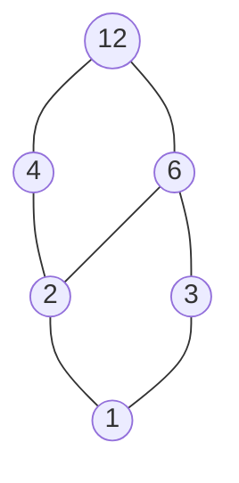
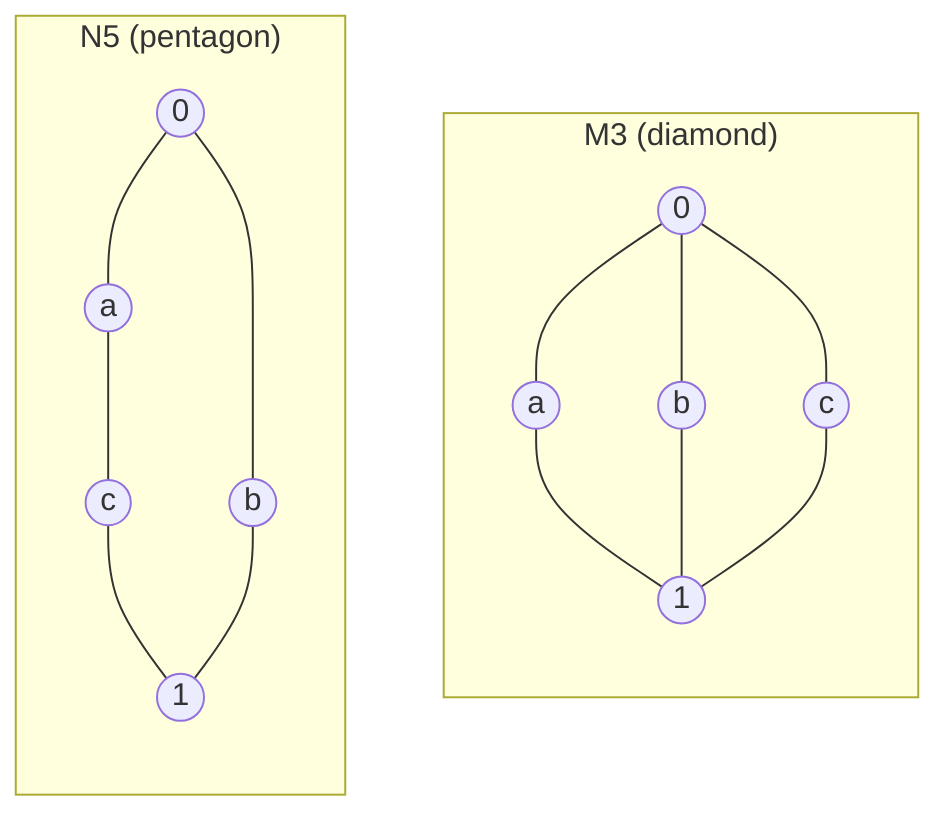

The groups, rings and fields of the previous two chapters all come from "computation": addition, multiplication, composition of maps. Mathematics and computer science have another, equally basic, kind of structure that comes from "comparison": inclusion between sets, divisibility between integers, implication between propositions, inclusion between subgroups. All of these are **partial orders**. When any two elements have a "least common upper bound" and a "greatest common lower bound", taking suprema and infima become two binary operations, and the poset turns into an **algebraic system**: a **lattice**. The notion of a lattice goes back to Dedekind's work at the end of the nineteenth century; from the 1930s on, Garrett Birkhoff developed lattice theory systematically.

Within the course, this chapter reuses the language of Chapter 1 (algebraic systems, **homomorphisms**, **subalgebras**) and draws many examples from the previous two chapters (lattices of subgroups and of ideals). Its central example, the Boolean algebra, is both the algebra of set operations and of propositional logic and, as it happens, a special kind of **commutative ring** (Section 4.3.4), which connects it with Chapter 3. Boolean algebra is the mathematical foundation of logic circuit design; in computational biology, Boolean networks use it to model gene regulatory networks.

## 4.1. Posets

### 4.1.1. Partial Orders Revisited

**Partial orders** and **posets** were defined in set theory ([Definitions 2.8.1 and 2.8.3](/1.2.2#def-2.8.1)); here we only recall them. A relation $\le$ on a set $P$ is called a partial order, and $(P, \le)$ a poset, if $\le$ is a **reflexive relation**, an **antisymmetric relation** and a **transitive relation**:

1. reflexivity: $a \le a$ for every $a \in P$;
2. antisymmetry: if $a \le b$ and $b \le a$, then $a = b$;
3. transitivity: if $a \le b$ and $b \le c$, then $a \le c$.

Compared with an **equivalence relation** (Definition 1.2.2), only symmetry has been replaced by antisymmetry: an equivalence relation sorts elements into disjoint classes, whereas a partial order arranges them by "height". If any two elements are comparable, the order is called a total order ([Definition 2.8.8](/1.2.2#def-2.8.8)). Finite posets can be drawn as Hasse diagrams ([Set Theory, Section 2.8](/1.2.2#sec-2.8)).

Common posets include:

- $(\mathbb{R}, \le)$, which is a total order;
- the power set $(\mathcal{P}(S), \subseteq)$;
- the positive integers under divisibility: $m \le n$ if and only if $m \mid n$;
- the subgroups of a group $G$ under inclusion, and the ideals of a ring $R$ under inclusion.

The Gene Ontology, widely used in computational biology, organizes functional terms into a directed acyclic graph by relations such as "is a"; the reflexive–transitive closure of this relation is a partial order.

### 4.1.2. Suprema and Infima

Let $(P, \le)$ be a poset and $S \subseteq P$ (for the detailed definitions see [Definition 2.8.6](/1.2.2#def-2.8.6)).

- If $u \in P$ satisfies $s \le u$ for every $s \in S$, then $u$ is called an **upper bound** of $S$; a **lower bound** is defined similarly.
- The least upper bound of $S$ is called the **supremum** of $S$, written $\bigvee S$ or $\sup S$; the greatest lower bound of $S$ is called the **infimum** of $S$, written $\bigwedge S$ or $\inf S$.

If a supremum or infimum exists, it is unique (by antisymmetry). For example, in the real interval $[0,1]$ with its usual order, the subset $S=\{0.3, 0.8\}$ has supremum $0.8$ and infimum $0.3$.

A supremum need not exist: in $P = \{\varnothing, \{1\}, \{2\}\}$ ordered by inclusion, $\{1\}$ and $\{2\}$ have no upper bound. Lattices are exactly the posets in which this cannot happen.

## 4.2. Lattices

### 4.2.1. Two Equivalent Definitions of a Lattice

There are two equivalent ways to define a lattice: one based on the order relation, the other on algebraic operations. The order-theoretic definition is more intuitive; the algebraic one is more convenient for calculation.

**Definition 4.2.1 (Lattice)** Let $(L, \le)$ be a nonempty poset. If for all $a, b \in L$ the set $\{a, b\}$ has both a supremum and an infimum, then $L$ is called a lattice. We write $a \vee b = \sup\{a, b\}$, called the **join** of $a$ and $b$, and $a \wedge b = \inf\{a, b\}$, called the **meet** of $a$ and $b$.

**Theorem 4.2.1 (Algebraic Definition of a Lattice)** Let $(L, \vee, \wedge)$ be a nonempty algebraic system with two binary operations. If $\vee$ and $\wedge$ satisfy the following axioms, then, setting $a \le b \iff a \wedge b = a$, $(L, \le)$ is a lattice whose join and meet are exactly $\vee$ and $\wedge$:

1. commutative laws: $a \vee b = b \vee a$, $a \wedge b = b \wedge a$;
2. associative laws: $(a \vee b) \vee c = a \vee (b \vee c)$, $(a \wedge b) \wedge c = a \wedge (b \wedge c)$;
3. absorption laws: $a \vee (a \wedge b) = a$, $a \wedge (a \vee b) = a$.

Conversely, in a lattice defined from a poset, join and meet necessarily satisfy these axioms. The two definitions are therefore equivalent.

**Theorem 4.2.2 (Idempotent Laws)** In a lattice $(L, \vee, \wedge)$, $a \vee a = a$ and $a \wedge a = a$ for every $a \in L$.

**Proof**: By the two absorption laws, $a \vee a = a \vee (a \wedge (a \vee a)) = a$; similarly $a \wedge a = a \wedge (a \vee (a \wedge a)) = a$. $\square$

Theorem 4.2.2 uses only the absorption laws, so it also holds under the axioms of Theorem 4.2.1. We now prove the first half of Theorem 4.2.1.

**Proof** (of Theorem 4.2.1): First, $a \wedge b = a \iff a \vee b = b$. If $a \wedge b = a$, then $a \vee b = (a \wedge b) \vee b = b \vee (b \wedge a) = b$; conversely, if $a \vee b = b$, then $a \wedge b = a \wedge (a \vee b) = a$.

Next we check that $\le$ is a partial order. Reflexivity follows from the idempotent law $a \wedge a = a$; if $a \wedge b = a$ and $b \wedge a = b$, then $a = b$ by commutativity; and if $a \wedge b = a$ and $b \wedge c = b$, then $a \wedge c = (a \wedge b) \wedge c = a \wedge (b \wedge c) = a \wedge b = a$, which gives transitivity.

Finally, $(a \wedge b) \wedge a = a \wedge b$, so $a \wedge b \le a$, and likewise $a \wedge b \le b$; if $c \le a$ and $c \le b$, then $c \wedge (a \wedge b) = (c \wedge a) \wedge b = c \wedge b = c$, that is, $c \le a \wedge b$. Hence $a \wedge b = \inf\{a, b\}$. Dually (using $a \le b \iff a \vee b = b$), $a \vee b = \sup\{a, b\}$. $\square$

In the language of Chapter 1, a lattice is an algebraic system $(L, \vee, \wedge)$ with two binary operations, both satisfying the **commutative law** and the **associative law**, linked to each other by the absorption laws. Unlike in a ring, the two operations of a lattice play symmetric roles: interchanging $\vee$ and $\wedge$ in the axioms again gives the axioms of a lattice. Consequently every theorem of lattice theory has a dual theorem, obtained by interchanging $\vee$ with $\wedge$ and $\le$ with $\ge$.

### 4.2.2. Order and Operations

In a lattice, the partial order and the operations of join and meet determine each other:

$$
a \le b \iff a \vee b = b \iff a \wedge b = a.
$$

This relation is the bridge between the order structure and the algebraic structure. It shows that the two views of a lattice are essentially the same, so algebraic tools and order-theoretic intuition can be used together.

### 4.2.3. Examples of Lattices

**Example 4.2.1** Let $S$ be a nonempty set and $\mathcal{P}(S)$ its power set. For $A, B \in \mathcal{P}(S)$ let $A \vee B = A \cup B$ and $A \wedge B = A \cap B$. Then $(\mathcal{P}(S), \cup, \cap)$ is a lattice, and the corresponding partial order is inclusion $\subseteq$.

**Example 4.2.2** The set $\mathbb{N}_+$ of positive integers is a poset under divisibility: $m \le n$ if and only if $m \mid n$. In this order, the supremum of $\{m, n\}$ is the least common multiple $\operatorname{lcm}(m, n)$ and the infimum is the greatest common divisor $\gcd(m, n)$, so $(\mathbb{N}_+, \operatorname{lcm}, \gcd)$ is a lattice. It differs from the power set lattice of Example 4.2.1: there the operations are union and intersection of sets, here they are the number-theoretic lcm and gcd. This illustrates the abstract nature of lattices.

The positive divisors of $12$ form a sublattice under divisibility, with the following Hasse diagram (a lower element divides an upper one):

**Example 4.2.3** Every totally ordered set is a lattice, with $a \vee b = \max\{a, b\}$ and $a \wedge b = \min\{a, b\}$; for example $(\mathbb{R}, \max, \min)$.

**Example 4.2.4 (Subgroup Lattice)** Let $G$ be a group and $\mathcal{L}(G)$ the poset of all **subgroups** of $G$ under inclusion. For subgroups $H, K$:

- $H \wedge K = H \cap K$, which is a subgroup (Theorem 2.2.7);
- $H \vee K$ is the smallest subgroup containing $H \cup K$, namely the intersection of all subgroups containing $H \cup K$ (the argument of Theorem 2.2.7 shows that an intersection of any number of subgroups is a subgroup); it is called the subgroup generated by $H \cup K$.

So $\mathcal{L}(G)$ is a lattice. Note that $H \cup K$ itself is in general not a subgroup, so $H \vee K$ is usually larger than $H \cup K$. If $G$ is a cyclic group of order $n$, then by Theorem 2.3.3 its subgroups correspond one-to-one to the positive divisors of $n$, and the subgroup of order $d$ is contained in the subgroup of order $d'$ if and only if $d \mid d'$; so the subgroup lattice of $\mathbb{Z}_{12}$ is isomorphic to the divisor lattice of $12$ above. Similarly, the **ideals** of a ring form a lattice with $I \wedge J = I \cap J$ and $I \vee J = I + J = \{i + j \mid i \in I, j \in J\}$.

## 4.3. Special Lattices

### 4.3.1. Distributive Lattices

**Definition 4.3.1 (Distributive Lattice)** Let $(L, \vee, \wedge)$ be a lattice. If for all $a, b, c \in L$ the **distributive laws**

$$
a \wedge (b \vee c) = (a \wedge b) \vee (a \wedge c), \quad a \vee (b \wedge c) = (a \vee b) \wedge (a \vee c)
$$

hold, then $L$ is called a distributive lattice.

In a lattice, each of the two distributive laws implies the other, so it suffices to check one of them. This differs from rings, where only multiplication distributes over addition; in a distributive lattice, $\wedge$ distributes over $\vee$ and $\vee$ distributes over $\wedge$.

**Example 4.3.1** The power set lattice $(\mathcal{P}(S), \cup, \cap)$ and the divisibility lattice $(\mathbb{N}_+, \operatorname{lcm}, \gcd)$ are distributive. Every totally ordered set is also a distributive lattice.

### 4.3.2. Modular Lattices

**Definition 4.3.2 (Modular Lattice)** Let $(L, \vee, \wedge)$ be a lattice. If for all $a, b, c \in L$ with $a \le c$

$$
a \vee (b \wedge c) = (a \vee b) \wedge c,
$$

then $L$ is called a modular lattice.

Every distributive lattice is modular (apply the distributive law and use $a \vee c = c$), but not conversely. Modularity is a weaker condition than distributivity; for example, the lattice of normal subgroups of a group and the lattice of subspaces of a vector space are modular but in general not distributive.

The following two five-element lattices, $M_3$ and $N_5$, are the standard counterexamples for distributivity and modularity.

- In $M_3$, $a \wedge (b \vee c) = a \wedge 1 = a$, whereas $(a \wedge b) \vee (a \wedge c) = 0 \vee 0 = 0$, so $M_3$ is not distributive (one can check that it is modular).
- In $N_5$, $a \le c$, but $a \vee (b \wedge c) = a \vee 0 = a$, whereas $(a \vee b) \wedge c = 1 \wedge c = c$, so $N_5$ is not modular.

$M_3$ arises naturally from the earlier chapters: $\mathbb{Z}_2 \times \mathbb{Z}_2$ has exactly three subgroups of order $2$, and its subgroup lattice is $M_3$; three distinct lines through the origin in the plane $\mathbb{R}^2$, together with $\{0\}$ and $\mathbb{R}^2$, also form $M_3$. Hence subgroup lattices and subspace lattices are in general not distributive.

**Theorem 4.3.1 (Dedekind–Birkhoff)** A lattice $L$ is modular if and only if it contains no sublattice isomorphic to $N_5$; $L$ is distributive if and only if it contains no sublattice isomorphic to $N_5$ or to $M_3$.

### 4.3.3. Bounded Lattices, Complements and Boolean Lattices

**Definition 4.3.3** Let $(L, \vee, \wedge)$ be a lattice.

- If $L$ has an element $0$ with $a \vee 0 = a$ (that is, $0 \le a$) for every $a \in L$ and an element $1$ with $a \wedge 1 = a$ (that is, $a \le 1$), then $L$ is called a **bounded lattice**, $0$ is called its **least element** and $1$ its **greatest element**.
- In a bounded lattice, if for $a \in L$ there is $a' \in L$ with $a \vee a' = 1$ and $a \wedge a' = 0$, then $a'$ is called a complement of $a$. The **complement** corresponds to "not" in logic and is the central feature of Boolean algebras.

In the language of Chapter 1, $0$ is the **identity element** of the operation $\vee$, and $1$ is the identity element of $\wedge$. Note that a complement is not an **inverse element**: the $1$ in $a \vee a' = 1$ is not the identity of $\vee$. In fact, no element of a lattice other than $0$ is invertible with respect to $\vee$ (if $a \vee b = 0$, then $a \le 0$, that is, $a = 0$), so lattices and groups are algebraic systems of an entirely different nature.

**Theorem 4.3.2** In a bounded distributive lattice, the complement of an element, if it exists, is unique.

**Proof**: Let $b$ and $c$ both be complements of $a$. Then

$$
b = b \wedge 1 = b \wedge (a \vee c) = (b \wedge a) \vee (b \wedge c) = 0 \vee (b \wedge c) = b \wedge c.
$$

Similarly $c = c \wedge b$, so $b = c$. $\square$

In a lattice that is not distributive, complements need not be unique: in $M_3$, both $b$ and $c$ are complements of $a$.

**Definition 4.3.4 (Boolean Algebra)** A bounded distributive lattice in which every element has a complement is called a **Boolean lattice**. Regarding the (unique) complement as a unary operation $a \mapsto a'$, we obtain an algebraic system $(B, \vee, \wedge, ', 0, 1)$, called a Boolean algebra. Boolean lattices and Boolean algebras are two descriptions of the same object; the latter is the foundation of the algebra of logic and of digital circuit design.

**Example 4.3.2** The power set lattice $(\mathcal{P}(S), \cup, \cap)$ is a Boolean lattice: its least element is $\varnothing$, its greatest element is $S$, and the complement of $A$ is the set complement $A' = S \setminus A$.

**Example 4.3.3** On the two-element set $\{0, 1\}$, let $\vee$ be "or", $\wedge$ be "and", and $'$ be "not". This gives the simplest Boolean algebra, the algebra of truth values of propositional logic (see [functionally complete sets of connectives in propositional logic](/1.1.2#sec-2.4)). More generally, the $n$-ary Boolean functions $\{0,1\}^n \to \{0,1\}$ form a Boolean algebra with $2^{2^n}$ elements under pointwise or, and and not; digital logic circuits compute exactly such functions. In computational biology, a *Boolean network* uses the same language to describe gene regulation: the state of each gene is $0$ (off) or $1$ (expressed), its state at the next time step is a Boolean function of the current states of its regulators, and the attractors of the network are used to explain the stable phenotypes of cells.

**Theorem 4.3.3** In a Boolean algebra, for all $a, b$:

1. $(a')' = a$;
2. **De Morgan's laws**: $(a \vee b)' = a' \wedge b'$ and $(a \wedge b)' = a' \vee b'$.

**Proof**: Since $a' \vee a = 1$ and $a' \wedge a = 0$, $a$ is a complement of $a'$, and 1 follows from the uniqueness of complements (Theorem 4.3.2). For 2, by the distributive laws,

$$
(a \vee b) \vee (a' \wedge b') = (a \vee b \vee a') \wedge (a \vee b \vee b') = 1 \wedge 1 = 1,
$$

$$
(a \vee b) \wedge (a' \wedge b') = (a \wedge a' \wedge b') \vee (b \wedge a' \wedge b') = 0 \vee 0 = 0,
$$

so $a' \wedge b'$ is the complement of $a \vee b$, and uniqueness gives the first identity; the second is its dual. $\square$

The structure of finite Boolean algebras is completely described by power set lattices. An element $a \neq 0$ of a Boolean algebra $B$ is called an *atom* if $0 \le x \le a$ implies $x = 0$ or $x = a$. In a power set lattice, the atoms are the singletons.

**Theorem 4.3.4 (Representation Theorem for Finite Boolean Algebras)** Let $B$ be a finite Boolean algebra and $A$ the set of its atoms. Then $b \mapsto \{x \in A \mid x \le b\}$ is an isomorphism of Boolean algebras from $B$ onto $\mathcal{P}(A)$. Consequently the number of elements of a finite Boolean algebra is a power of $2$.

This is the finite case of Stone's representation theorem. For example, the positive divisors of $30 = 2 \cdot 3 \cdot 5$ form a Boolean algebra under $(\operatorname{lcm}, \gcd)$ (with complement $d' = 30/d$); its atoms are $2, 3, 5$, so it is isomorphic to $\mathcal{P}(\{2, 3, 5\})$ and has $8$ elements. The divisor lattice of $12$, by contrast, is not a Boolean algebra: $2$ has no complement.

### 4.3.4. Boolean Algebras and Boolean Rings

A Boolean algebra can also be rewritten as a ring in the sense of Chapter 3. A ring in which every element satisfies $a^2 = a$ is called a *Boolean ring*.

**Theorem 4.3.5** Let $(B, \vee, \wedge, ', 0, 1)$ be a Boolean algebra, and define

$$
a + b = (a \wedge b') \vee (a' \wedge b), \qquad a \cdot b = a \wedge b.
$$

Then $(B, +, \cdot)$ is a commutative Boolean ring with zero element $0$ and identity $1$, and every element satisfies $a + a = 0$. Conversely, in a Boolean ring with identity, setting $a \vee b = a + b + ab$, $a \wedge b = ab$ and $a' = 1 + a$ yields a Boolean algebra. The two constructions are inverse to each other.

In a power set lattice, $A + B = (A \setminus B) \cup (B \setminus A)$ is the **symmetric difference** of sets, and $(\mathcal{P}(S), +, \cap)$ is a commutative ring in which every element is its own negative. On $\{0, 1\}$, $+$ is "exclusive or" and $\cdot$ is "and", and this Boolean ring is the **finite field** $\mathbb{F}_2$. Translating logical operations into polynomial arithmetic over $\mathbb{F}_2$ (for example $\lnot a = 1 + a$ and $a \lor b = a + b + ab$) is a standard technique in circuit verification and cryptanalysis.

## 4.4. Lattice Homomorphisms and Ideals

### 4.4.1. Sublattices and Lattice Homomorphisms

**Definition 4.4.1 (Sublattice)** Let $(L, \vee, \wedge)$ be a lattice and $S$ a nonempty subset of $L$. If $S$ is closed under $\vee$ and $\wedge$, then $S$ is called a sublattice of $L$.

This is exactly the subalgebra of Chapter 1 (Definition 1.4.4) for two operations.

**Definition 4.4.2 (Lattice Homomorphism)** Let $(L_1, \vee_1, \wedge_1)$ and $(L_2, \vee_2, \wedge_2)$ be lattices and $f\colon L_1 \to L_2$ a map. If $f(a \vee_1 b) = f(a) \vee_2 f(b)$ and $f(a \wedge_1 b) = f(a) \wedge_2 f(b)$ for all $a, b \in L_1$, then $f$ is called a **lattice homomorphism**; if $f$ is moreover bijective, it is called a **lattice isomorphism**.

This is the definition of a homomorphism for several operations from Section 1.4.3. A homomorphism of Boolean algebras is further required to preserve complements, $0$ and $1$. For example, for a fixed $x \in S$, the map $\mathcal{P}(S) \to \{0, 1\}$ sending $A$ to $1$ if $x \in A$ and to $0$ if $x \notin A$ is a homomorphism of Boolean algebras.

**Theorem 4.4.1** A lattice homomorphism preserves order: $a \le b \Rightarrow f(a) \le f(b)$. If $f$ is a lattice isomorphism, then $a \le b \iff f(a) \le f(b)$.

**Proof**: If $a \le b$, then $a \wedge_1 b = a$, so $f(a) \wedge_2 f(b) = f(a)$, that is, $f(a) \le f(b)$. If $f$ is bijective and $f(a) \le f(b)$, then $f(a \wedge_1 b) = f(a)$, and injectivity gives $a \wedge_1 b = a$, that is, $a \le b$. $\square$

Conversely, an order-preserving map need not be a lattice homomorphism: send $a, b, c$ of $M_3$ all to $m$ in the chain $\{0 < m < 1\}$, $0 \mapsto 0$ and $1 \mapsto 1$. This map preserves order, but $f(a \vee b) = 1 \neq m = f(a) \vee f(b)$.

### 4.4.2. Ideals and Filters of a Lattice

**Definition 4.4.3** Let $L$ be a lattice and $I$ a nonempty subset of $L$. If

1. $a \vee b \in I$ for all $a, b \in I$;
2. for all $a \in I$ and $x \in L$, $x \le a$ implies $x \in I$,

then $I$ is called an **ideal** of $L$.

Condition 2 (being closed downward) is equivalent to $a \wedge x \in I$ for all $a \in I$ and $x \in L$. This is formally similar to the absorption property of **ideals** of a ring with respect to multiplication; in fact, in a Boolean algebra the lattice ideals are exactly the ring ideals of the Boolean ring of Theorem 4.3.5. For every $a \in L$, the set $\{x \in L \mid x \le a\}$ is an ideal, called the principal ideal generated by $a$.

**Definition 4.4.4 (Filter)** Let $L$ be a lattice and $F$ a nonempty subset of $L$. If

1. $a \wedge b \in F$ for all $a, b \in F$;
2. for all $a \in F$ and $x \in L$, $a \le x$ implies $x \in F$,

then $F$ is called a filter of $L$.

Ideals and filters are dual notions: an ideal is closed under joins and closed downward, a filter is closed under meets and closed upward. In the Boolean algebra of propositional logic, "all propositions derivable from a set of premises" form a filter; this is the starting point for studying logical inference with lattice theory.

## Summary

| Topic | Key concepts |
|------|----------|
| Posets | partial orders (compared with equivalence relations), upper and lower bounds, suprema and infima |
| Lattices | equivalence of the order-theoretic and algebraic definitions, absorption and idempotent laws, duality principle, power set lattices, divisibility lattices, subgroup lattices |
| Special lattices | distributive and modular lattices, $M_3$ and $N_5$, bounded lattices, complements, Boolean algebras, De Morgan's laws, representation theorem for finite Boolean algebras |
| Boolean rings | conversion between Boolean algebras and Boolean rings with identity, symmetric difference, $\mathbb{F}_2$ |
| Homomorphisms and ideals | sublattices, lattice homomorphisms preserve order, ideals and filters of a lattice |

Lattices and Boolean algebras are discrete structures determined by order relations. The next chapter returns to symmetry, but no longer to finite groups such as the six symmetries of a triangle; instead it considers groups that vary continuously, such as the group of all rotations of space. Describing them requires the fields and vector spaces of Chapter 3: adding a non-associative bracket operation to a vector space gives a Lie algebra.
