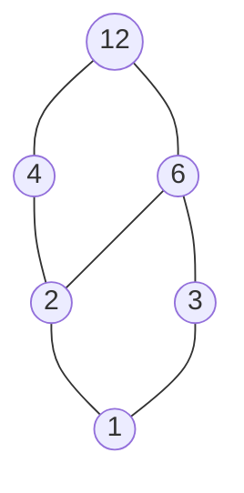
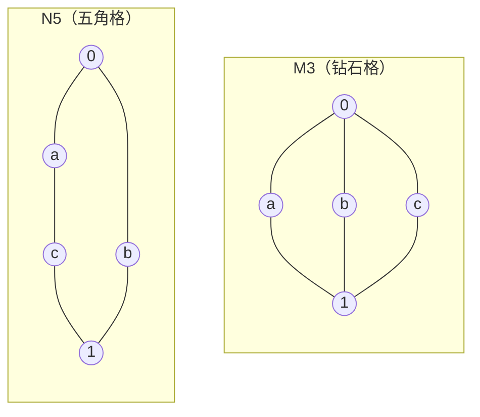

前两章的群、环、域都来自"计算"：加法、乘法、映射的合成。数学和计算机科学中还有另一类同样基本的结构，它们来自"比较"：集合之间的包含、整数之间的整除、命题之间的蕴含、子群之间的包含。这些关系都是偏序关系；当任意两个元素都有"最小的公共上界"和"最大的公共下界"时，取上确界和取下确界就成为两种二元运算，偏序集于是变成一个代数系统，这就是**格**。格的概念可以追溯到 19 世纪末 Dedekind 的工作，20 世纪 30 年代起 Garrett Birkhoff 系统地建立了格论。

本章在主线中的位置是这样的：它沿用第 1 章的代数系统、同态、子代数等语言，例子大量取自前两章（子群格、理想格）；它的核心例子——布尔代数——既是集合运算与命题逻辑的代数，又恰好可以看作一种特殊的交换环（4.3.4 节），从而与第 3 章接上。布尔代数是逻辑电路设计的数学基础，在计算生物学中，布尔网络用它来建模基因调控网络。

## 4.1. 偏序集

### 4.1.1. 偏序关系的回顾

偏序关系与偏序集已在集合论中定义（[定义 2.8.1、定义 2.8.3](/1.2.2#def-2.8.1)），这里只作回顾：集合 $P$ 上的关系 $\le$ 若满足

1. **自反性**：对任意 $a \in P$，$a \le a$；
2. **反对称性**：若 $a \le b$ 且 $b \le a$，则 $a = b$；
3. **传递性**：若 $a \le b$ 且 $b \le c$，则 $a \le c$，

就称为偏序关系，$(P, \le)$ 称为偏序集。与等价关系（定义 1.2.2）相比，只是把对称性换成了反对称性：等价关系把元素分成互不相交的类，偏序关系则把元素排成"高低"。若任意两个元素都可比，则称为全序（[定义 2.8.8](/1.2.2#def-2.8.8)）。有限偏序集可以用哈斯图表示（[集合论 2.8 节](/1.2.2#sec-2.8)）。

常见的偏序集有：

- $(\mathbb{R}, \le)$，这是全序；
- 幂集 $(\mathcal{P}(S), \subseteq)$；
- 正整数关于整除：$m \le n$ 当且仅当 $m \mid n$；
- 群 $G$ 的全体子群关于包含关系，环 $R$ 的全体理想关于包含关系。

计算生物学中常用的基因本体（Gene Ontology）把功能术语按"是一种"（is a）等关系组织成有向无环图，这个关系的自反传递闭包就是一个偏序。

### 4.1.2. 上确界与下确界

设 $(P, \le)$ 是偏序集，$S \subseteq P$（详细定义见[定义 2.8.6](/1.2.2#def-2.8.6)）。

- 若 $u \in P$ 使得对任意 $s \in S$ 都有 $s \le u$，则称 $u$ 是 $S$ 的一个**上界**；类似地可定义**下界**。
- $S$ 的最小的上界称为 $S$ 的**上确界**，记作 $\bigvee S$ 或 $\sup S$；$S$ 的最大的下界称为 $S$ 的**下确界**，记作 $\bigwedge S$ 或 $\inf S$。

上确界、下确界若存在，则是唯一的（由反对称性）。例如，在实数区间 $[0,1]$（通常的大小关系）中取子集 $S=\{0.3, 0.8\}$，其上确界为 $0.8$，下确界为 $0.3$。

上确界不一定存在：在 $P = \{\varnothing, \{1\}, \{2\}\}$（包含关系）中，$\{1\}$ 与 $\{2\}$ 没有上界。格就是排除了这种情况的偏序集。

## 4.2. 格

### 4.2.1. 格的两种等价定义

格有两种等价的定义方式：一种基于序关系，另一种基于代数运算。序定义更直观，代数定义更便于运算推导。

**定义 4.2.1（格）** 设 $(L, \le)$ 是一个非空偏序集。若对任意 $a, b \in L$，集合 $\{a, b\}$ 都有上确界和下确界，则称 $L$ 是一个格。

记 $a \vee b = \sup\{a, b\}$，称为 $a$ 与 $b$ 的**并**；$a \wedge b = \inf\{a, b\}$，称为 $a$ 与 $b$ 的**交**。

**定理 4.2.1（格的代数定义）** 设 $(L, \vee, \wedge)$ 是带有两个二元运算的非空代数系统。若 $\vee$ 和 $\wedge$ 满足以下公理，则在 $L$ 上令 $a \le b \iff a \wedge b = a$，$(L, \le)$ 是一个格，且 $\vee$ 和 $\wedge$ 恰好是该格中的并和交：

1. 交换律：$a \vee b = b \vee a$，$a \wedge b = b \wedge a$；
2. 结合律：$(a \vee b) \vee c = a \vee (b \vee c)$，$(a \wedge b) \wedge c = a \wedge (b \wedge c)$；
3. 吸收律：$a \vee (a \wedge b) = a$，$a \wedge (a \vee b) = a$。

反之，由偏序集定义的格中，并和交两种运算必然满足上述公理。因此两种定义是等价的。

**定理 4.2.2（幂等律）** 在格 $(L, \vee, \wedge)$ 中，对任意 $a \in L$，有 $a \vee a = a$，$a \wedge a = a$。

**证明**：由两条吸收律，$a \vee a = a \vee (a \wedge (a \vee a)) = a$；同理 $a \wedge a = a \wedge (a \vee (a \wedge a)) = a$。 $\square$

定理 4.2.2 只用到吸收律，所以在定理 4.2.1 的公理下也成立。下面给出定理 4.2.1 前半部分的证明。

**证明**（定理 4.2.1）：先说明 $a \wedge b = a \iff a \vee b = b$。若 $a \wedge b = a$，则 $a \vee b = (a \wedge b) \vee b = b \vee (b \wedge a) = b$；反之若 $a \vee b = b$，则 $a \wedge b = a \wedge (a \vee b) = a$。

再验证 $\le$ 是偏序：由幂等律 $a \wedge a = a$，得自反性；若 $a \wedge b = a$ 且 $b \wedge a = b$，由交换律得 $a = b$；若 $a \wedge b = a$，$b \wedge c = b$，则 $a \wedge c = (a \wedge b) \wedge c = a \wedge (b \wedge c) = a \wedge b = a$，得传递性。

最后，$(a \wedge b) \wedge a = a \wedge b$，所以 $a \wedge b \le a$，同理 $a \wedge b \le b$；若 $c \le a$，$c \le b$，则 $c \wedge (a \wedge b) = (c \wedge a) \wedge b = c \wedge b = c$，即 $c \le a \wedge b$。故 $a \wedge b = \inf\{a, b\}$。对偶地（利用 $a \le b \iff a \vee b = b$）得 $a \vee b = \sup\{a, b\}$。 $\square$

按第 1 章的说法，格是一个有两个二元运算的代数系统 $(L, \vee, \wedge)$，两个运算都满足交换律和结合律，并由吸收律相互联系。与环不同，格中的两个运算地位对称：把公理中的 $\vee$ 与 $\wedge$ 互换，得到的仍是格的公理。因此格论中的每个定理都有一个**对偶**的定理，只需把 $\vee, \wedge$ 互换、$\le, \ge$ 互换。

### 4.2.2. 偏序与代数运算的关系

在格中，偏序关系与并、交运算可以互相确定：

$$
a \le b \iff a \vee b = b \iff a \wedge b = a.
$$

这一关系是序结构与代数结构之间的桥梁，说明格的两种视角本质上一致，因此代数工具与序的直观可以配合使用。

### 4.2.3. 格的例子

**例 4.2.1** 设 $S$ 是非空集合，$\mathcal{P}(S)$ 为其幂集。对任意 $A, B \in \mathcal{P}(S)$，令 $A \vee B = A \cup B$，$A \wedge B = A \cap B$，则 $(\mathcal{P}(S), \cup, \cap)$ 构成一个格，对应的偏序就是包含关系 $\subseteq$。

**例 4.2.2** 正整数集合 $\mathbb{Z}^+$ 关于整除关系构成一个偏序集：$m \le n$ 当且仅当 $m \mid n$。在此偏序下，集合 $\{m, n\}$ 的上确界是最小公倍数 $\operatorname{lcm}(m, n)$，下确界是最大公约数 $\gcd(m, n)$，因此 $(\mathbb{Z}^+, \operatorname{lcm}, \gcd)$ 是一个格。它与例 4.2.1 的幂集格不同：幂集格的运算是集合的并与交，而整除格的运算是数论中的 lcm 与 gcd，这体现了格的抽象性。

$12$ 的全部正因子在整除关系下构成一个子格，它的哈斯图如下（下方的元素整除上方的元素）：

**例 4.2.3** 任何全序集都是格，$a \vee b = \max\{a, b\}$，$a \wedge b = \min\{a, b\}$。例如 $(\mathbb{R}, \max, \min)$。

**例 4.2.4（子群格）** 设 $G$ 是群，$\mathcal{L}(G)$ 是 $G$ 的全体子群关于包含关系构成的偏序集。对子群 $H, K$：

- $H \wedge K = H \cap K$，它是子群（定理 2.2.7）；
- $H \vee K$ 是包含 $H \cup K$ 的最小子群，即所有包含 $H \cup K$ 的子群之交（与定理 2.2.7 同样的论证说明任意多个子群之交仍是子群），称为由 $H \cup K$ **生成的子群**。

所以 $\mathcal{L}(G)$ 是格。注意 $H \cup K$ 本身一般不是子群，因此 $H \vee K$ 通常比 $H \cup K$ 大。若 $G$ 是 $n$ 阶循环群，由定理 2.3.3，它的子群与 $n$ 的正因子一一对应，且 $d$ 阶子群包含于 $d'$ 阶子群当且仅当 $d \mid d'$；所以 $\mathbb{Z}_{12}$ 的子群格与上面 $12$ 的因子格同构。类似地，环的全体理想构成格，$I \wedge J = I \cap J$，$I \vee J = I + J = \{i + j \mid i \in I, j \in J\}$。

## 4.3. 特殊的格

### 4.3.1. 分配格

**定义 4.3.1（分配格）** 设 $(L, \vee, \wedge)$ 是一个格。若对任意 $a, b, c \in L$，分配律

$$
a \wedge (b \vee c) = (a \wedge b) \vee (a \wedge c), \quad a \vee (b \wedge c) = (a \vee b) \wedge (a \vee c)
$$

成立，则称 $L$ 为分配格。

在格中，这两条分配律互相蕴含，因此只需验证其中一条。与环不同，环中只有乘法对加法分配，而在分配格中 $\wedge$ 对 $\vee$、$\vee$ 对 $\wedge$ 都分配。

**例 4.3.1** 幂集格 $(\mathcal{P}(S), \cup, \cap)$ 和整除格 $(\mathbb{Z}^+, \operatorname{lcm}, \gcd)$ 都是分配格。全序集也是分配格。

### 4.3.2. 模格

**定义 4.3.2（模格）** 设 $(L, \vee, \wedge)$ 是一个格。若对任意 $a, b, c \in L$，当 $a \le c$ 时有

$$
a \vee (b \wedge c) = (a \vee b) \wedge c,
$$

则称 $L$ 为模格。

分配格一定是模格（在分配律中利用 $a \vee c = c$ 即得），但反之不成立。模格的概念比分配格更宽，例如群的正规子群格、向量空间的子空间格都是模格，但一般不是分配格。

下面两个五元格 $M_3$、$N_5$ 是判断分配性与模性的标准反例。

- 在 $M_3$ 中，$a \wedge (b \vee c) = a \wedge 1 = a$，而 $(a \wedge b) \vee (a \wedge c) = 0 \vee 0 = 0$，所以 $M_3$ 不是分配格（可以验证它是模格）。
- 在 $N_5$ 中，$a \le c$，但 $a \vee (b \wedge c) = a \vee 0 = a$，而 $(a \vee b) \wedge c = 1 \wedge c = c$，所以 $N_5$ 不是模格。

$M_3$ 在前几章中自然出现：$\mathbb{Z}_2 \times \mathbb{Z}_2$ 恰有三个 $2$ 阶子群，它的子群格就是 $M_3$；平面 $\mathbb{R}^2$ 中三条不同的过原点直线，连同 $\{0\}$ 和 $\mathbb{R}^2$，也构成 $M_3$。所以子群格与子空间格一般不是分配格。

**定理 4.3.1（Dedekind–Birkhoff）** 格 $L$ 是模格当且仅当它不含与 $N_5$ 同构的子格；$L$ 是分配格当且仅当它既不含与 $N_5$ 同构的子格，也不含与 $M_3$ 同构的子格。

### 4.3.3. 有界格、补元与布尔格

**定义 4.3.3** 设 $(L, \vee, \wedge)$ 是一个格。

- 若 $L$ 中存在元素 $0$，使得对任意 $a \in L$ 有 $a \vee 0 = a$（即 $0 \le a$），且存在元素 $1$，使得 $a \wedge 1 = a$（即 $a \le 1$），则称 $L$ 是**有界格**，称 $0$ 为**最小元**，$1$ 为**最大元**。
- 在有界格中，若对 $a \in L$ 存在 $a' \in L$ 使得 $a \vee a' = 1$ 且 $a \wedge a' = 0$，则称 $a'$ 是 $a$ 的**补元**。补元对应于逻辑中的"非"，这是布尔代数的核心特征。

用第 1 章的语言说，$0$ 是运算 $\vee$ 的单位元，$1$ 是运算 $\wedge$ 的单位元。注意补元不是逆元：$a \vee a' = 1$ 中的 $1$ 并不是 $\vee$ 的单位元。事实上，由幂等律，格中除 $0$ 以外没有元素关于 $\vee$ 可逆（若 $a \vee b = 0$，则 $a \le 0$，即 $a = 0$），所以格与群是性质完全不同的代数系统。

**定理 4.3.2** 在有界分配格中，一个元素的补元若存在则唯一。

**证明**：设 $b, c$ 都是 $a$ 的补元，则

$$
b = b \wedge 1 = b \wedge (a \vee c) = (b \wedge a) \vee (b \wedge c) = 0 \vee (b \wedge c) = b \wedge c.
$$

同理 $c = c \wedge b$，所以 $b = c$。 $\square$

在非分配格中补元可以不唯一：$M_3$ 中 $b$ 和 $c$ 都是 $a$ 的补元。

**定义 4.3.4（布尔代数）** 若一个有界分配格中每个元素都有补元，则称该格为**布尔格**。把（唯一的）补元看作一元运算 $a \mapsto a'$，得到的代数系统 $(B, \vee, \wedge, ', 0, 1)$ 称为布尔代数。布尔格与布尔代数是同一对象的两种描述，后者是逻辑代数和数字电路设计的基础。

**例 4.3.2** 幂集格 $(\mathcal{P}(S), \cup, \cap)$ 是布尔格：最小元为 $\varnothing$，最大元为 $S$，补元就是集合的补 $A' = S \setminus A$。

**例 4.3.3** 两元集 $\{0, 1\}$ 中令 $\vee$ 为"或"、$\wedge$ 为"与"、$'$ 为"非"，得到最简单的布尔代数，它就是命题逻辑真值的代数（参见[命题逻辑中的完备联结词集](/1.1.2#sec-2.4)）。更一般地，全体 $n$ 元布尔函数 $\{0,1\}^n \to \{0,1\}$ 在逐点的或、与、非下构成含 $2^{2^n}$ 个元素的布尔代数；数字逻辑电路计算的正是这样的函数。计算生物学中的**布尔网络**用同样的语言描述基因调控：每个基因的状态取 $0$（关闭）或 $1$（表达），下一时刻的状态由调控它的基因的当前状态经一个布尔函数决定，网络的吸引子被用来解释细胞的稳定表型。

**定理 4.3.3** 在布尔代数中，对任意 $a, b$：

1. $(a')' = a$；
2. **De Morgan 律**：$(a \vee b)' = a' \wedge b'$，$(a \wedge b)' = a' \vee b'$。

**证明**：$a$ 满足 $a' \vee a = 1$，$a' \wedge a = 0$，所以 $a$ 是 $a'$ 的补元，由补元的唯一性（定理 4.3.2）得 1。对 2，利用分配律，

$$
(a \vee b) \vee (a' \wedge b') = (a \vee b \vee a') \wedge (a \vee b \vee b') = 1 \wedge 1 = 1,
$$

$$
(a \vee b) \wedge (a' \wedge b') = (a \wedge a' \wedge b') \vee (b \wedge a' \wedge b') = 0 \vee 0 = 0,
$$

所以 $a' \wedge b'$ 是 $a \vee b$ 的补元，再由唯一性得第一式；第二式是它的对偶。 $\square$

有限布尔代数的结构完全由幂集格给出。称 $a \neq 0$ 为布尔代数 $B$ 的**原子**，如果由 $0 \le x \le a$ 只能推出 $x = 0$ 或 $x = a$。在幂集格中，原子就是单元素集。

**定理 4.3.4（有限布尔代数的表示定理）** 设 $B$ 是有限布尔代数，$A$ 是它的全体原子构成的集合，则 $b \mapsto \{x \in A \mid x \le b\}$ 是 $B$ 到 $\mathcal{P}(A)$ 的布尔代数同构。因此有限布尔代数的元素个数一定是 $2$ 的幂。

这是 Stone 表示定理的有限情形。例如 $30 = 2 \cdot 3 \cdot 5$ 的正因子在 $(\operatorname{lcm}, \gcd)$ 下构成布尔代数（补元为 $d' = 30/d$），它的原子是 $2, 3, 5$，因而与 $\mathcal{P}(\{2, 3, 5\})$ 同构，共 $8$ 个元素。而 $12$ 的因子格不是布尔代数：$2$ 没有补元。

### 4.3.4. 布尔代数与布尔环

布尔代数还可以改写成第 3 章意义下的环。称每个元素都满足 $a^2 = a$ 的环为**布尔环**。

**定理 4.3.5** 设 $(B, \vee, \wedge, ', 0, 1)$ 是布尔代数，令

$$
a + b = (a \wedge b') \vee (a' \wedge b), \qquad a \cdot b = a \wedge b,
$$

则 $(B, +, \cdot)$ 是以 $0$ 为零元、$1$ 为单位元的交换布尔环，且每个元素满足 $a + a = 0$。反之，在含幺布尔环中令 $a \vee b = a + b + ab$，$a \wedge b = ab$，$a' = 1 + a$，就得到布尔代数。这两种构造互逆。

在幂集格中，$A + B = (A \setminus B) \cup (B \setminus A)$ 是集合的**对称差**，$(\mathcal{P}(S), +, \cap)$ 是交换环，每个元素都是自己的负元；在 $\{0, 1\}$ 上，$+$ 是"异或"，$\cdot$ 是"与"，这个布尔环就是有限域 $\mathbb{F}_2$。把逻辑运算翻译成 $\mathbb{F}_2$ 上的多项式运算（如 $\lnot a = 1 + a$，$a \lor b = a + b + ab$），是电路验证和密码分析中的常用方法。

## 4.4. 格同态与理想

### 4.4.1. 子格与格同态

**定义 4.4.1（子格）** 设 $(L, \vee, \wedge)$ 是一个格，$S$ 是 $L$ 的非空子集。若 $S$ 在运算 $\vee$ 和 $\wedge$ 下封闭，则称 $S$ 是 $L$ 的一个子格。

这正是第 1 章子代数（定义 1.4.4）在两个运算下的情形。

**定义 4.4.2** 设 $(L_1, \vee_1, \wedge_1)$ 和 $(L_2, \vee_2, \wedge_2)$ 是格，$f: L_1 \to L_2$ 是一个映射。若对任意 $a, b \in L_1$，有

$$
f(a \vee_1 b) = f(a) \vee_2 f(b), \quad f(a \wedge_1 b) = f(a) \wedge_2 f(b),
$$

则称 $f$ 是**格同态**。若 $f$ 还是双射，则称 $f$ 为**格同构**。

这是 1.4.3 节对多个运算的同态定义。布尔代数之间的同态还要求保持补元、$0$ 和 $1$。例如固定 $x \in S$，映射 $\mathcal{P}(S) \to \{0, 1\}$，$A \mapsto 1$（若 $x \in A$）或 $0$（若 $x \notin A$）是布尔代数同态。

**定理 4.4.1** 格同态保持序关系：$a \le b \Rightarrow f(a) \le f(b)$。若 $f$ 是格同构，则 $a \le b \iff f(a) \le f(b)$。

**证明**：若 $a \le b$，则 $a \wedge_1 b = a$，于是 $f(a) \wedge_2 f(b) = f(a)$，即 $f(a) \le f(b)$。若 $f$ 是双射且 $f(a) \le f(b)$，则 $f(a \wedge_1 b) = f(a)$，由单射得 $a \wedge_1 b = a$，即 $a \le b$。 $\square$

反过来，保持序关系的映射不一定是格同态：把 $M_3$ 的 $a, b, c$ 都映到全序集 $\{0 < m < 1\}$ 的 $m$、$0 \mapsto 0$、$1 \mapsto 1$，它保持序，但 $f(a \vee b) = 1 \neq m = f(a) \vee f(b)$。

### 4.4.2. 格中的理想与滤子

**定义 4.4.3** 设 $L$ 是一个格，$I$ 是 $L$ 的非空子集。若 $I$ 满足：

1. 对任意 $a, b \in I$，$a \vee b \in I$；
2. 对任意 $a \in I$ 和 $x \in L$，若 $x \le a$，则 $x \in I$，

则称 $I$ 是 $L$ 的一个**理想**。

条件 2（向下封闭）等价于：对任意 $a \in I$，$x \in L$，有 $a \wedge x \in I$。这与环的理想对乘法的吸收性形式上类似；事实上，在布尔代数中，格的理想恰好就是定理 4.3.5 所给布尔环的环理想。对任意 $a \in L$，$\{x \in L \mid x \le a\}$ 是一个理想，称为由 $a$ 生成的**主理想**。

**定义 4.4.4（滤子）** 设 $L$ 是一个格，$F$ 是 $L$ 的非空子集。若 $F$ 满足：

1. 对任意 $a, b \in F$，$a \wedge b \in F$；
2. 对任意 $a \in F$ 和 $x \in L$，若 $a \le x$，则 $x \in F$，

则称 $F$ 是 $L$ 的一个滤子。

理想和滤子是对偶概念：理想对并封闭且向下封闭，滤子对交封闭且向上封闭。在命题逻辑的布尔代数中，"由一组前提推出的全部命题"构成一个滤子，这是用格论研究逻辑推理的出发点。

## 本章小结

| 主题 | 核心概念 |
|------|----------|
| 偏序集 | 偏序关系（与等价关系的对比），上界、下界、上确界、下确界 |
| 格 | 序定义与代数定义的等价性，吸收律、幂等律，对偶原理，幂集格、整除格、子群格 |
| 特殊的格 | 分配格、模格，$M_3$ 与 $N_5$，有界格、补元，布尔代数，De Morgan 律，有限布尔代数的表示定理 |
| 布尔环 | 布尔代数与含幺布尔环的互相转化，对称差，$\mathbb{F}_2$ |
| 同态与理想 | 子格，格同态保持序，格的理想与滤子 |

格与布尔代数研究的是离散的、由序关系决定的结构。下一章回到对称性，但关注的不再是三角形的六个对称那样的有限群，而是空间中全体旋转那样连续变化的群。描述它们需要第 3 章的域与向量空间：在一个向量空间上加一种不满足结合律的括号运算，就得到李代数。
