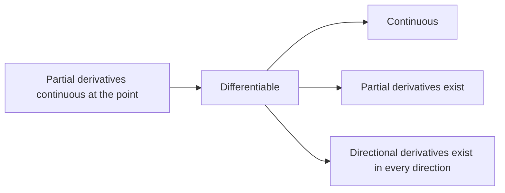

With this chapter we enter multivariable calculus. It is a direct generalization of single-variable calculus: limits, continuity, derivatives and differentials all have multivariable versions, and most of the rules of computation keep their form. Once the independent variable ranges over the plane or space instead of a line, however, there are infinitely many ways to "approach a point", and phenomena appear that have no counterpart in one variable: a function may have the same limit along every line through a point and still have no limit there, and a function may have all its partial derivatives and still be discontinuous. The guiding thread of the chapter is to compare, at every step, what changes and what stays the same relative to the one-variable case.

We first set up the topological language of $\mathbb{R}^n$ (distance, open and closed sets, regions), and then treat in turn limits and continuity of functions of several variables, partial derivatives, the total differential, directional derivatives and the gradient, and finally differentiation of composite and implicit functions. The essence of differentiation is "local linear approximation": the derivative of a function of one variable is a number, whereas the differential of a function of several variables is a linear map, whose matrix is the Jacobian matrix; the chain rule for composite functions is then just multiplication of Jacobian matrices. The chapter therefore relies heavily on the language of linear algebra ([2.1](/2.1)): **inner product** and **length** ([2.1.4](/2.1.4)), **linear map** and **standard matrix**, **matrix multiplication** and **determinant**. Limits and derivatives in one variable are covered in [2.2.2](/2.2.2)–[2.2.4](/2.2.4). The next chapter uses the tools developed here to study Taylor's formula, geometric applications and extrema, and in the integral calculus of several variables starting in [2.2.12](/2.2.12), the scaling factor in the change of variables formula is exactly the Jacobian determinant of this chapter.

## 10.1. Point Sets in $\mathbb{R}^n$

### 10.1.1. Distance and Convergence of Sequences of Points

A point of $\mathbb{R}^n$ is written $x=(x_1,\dots,x_n)$; in the plane and in space we also write $P(x,y)$, $M_0(x_0,y_0,z_0)$ and so on. The **inner product** of two points $x,y$ is $(x,y)=\sum_{k=1}^n x_ky_k$, and it defines the length $\|x\|=\sqrt{(x,x)}$. To prove the **Cauchy–Schwarz inequality** $(x,y)^2\le(x,x)(y,y)$, it suffices to observe that the quadratic polynomial $(x+ty,x+ty)=(x,x)+2t(x,y)+t^2(y,y)\ge0$ in $t$ has a nonpositive discriminant; from it we obtain the **triangle inequality** $\|x+y\|\le\|x\|+\|y\|$.

**Definition 10.1.1 (Distance)** For $x,y\in\mathbb{R}^n$, the number $d(x,y)=\|x-y\|=\sqrt{\sum_{k=1}^n(x_k-y_k)^2}$ is called the **distance** between $x$ and $y$. It satisfies $d(x,y)\ge0$ (with equality if and only if $x=y$), $d(x,y)=d(y,x)$ and $d(x,y)\le d(x,z)+d(z,y)$.

**Definition 10.1.2 (Convergence of a Sequence of Points)** Let $\{x^{(m)}\}$ be a sequence of points in $\mathbb{R}^n$ and $x_0\in\mathbb{R}^n$. If $\lim\limits_{m\to\infty}d(x^{(m)},x_0)=0$, that is, for every $\varepsilon>0$ there is $N$ such that $d(x^{(m)},x_0)<\varepsilon$ whenever $m>N$, we say that $\{x^{(m)}\}$ **converges** to $x_0$ and write $\lim\limits_{m\to\infty}x^{(m)}=x_0$.

**Theorem 10.1.1** Write $x^{(m)}=(x^{(m)}_1,\dots,x^{(m)}_n)$ and $x_0=(x_{0,1},\dots,x_{0,n})$. Then $\lim\limits_{m\to\infty}x^{(m)}=x_0$ if and only if $\lim\limits_{m\to\infty}x^{(m)}_k=x_{0,k}$ for every $k=1,\dots,n$.

**Proof** This follows at once from the inequalities

$$
|x^{(m)}_k-x_{0,k}|\le d(x^{(m)},x_0)\le\sqrt{n}\max_{1\le k\le n}|x^{(m)}_k-x_{0,k}|.
$$

$\square$

Convergence of sequences of points in $\mathbb{R}^n$ thus reduces, component by component, to convergence of sequences of numbers, and the results for sequences carry over: the limit of a convergent sequence of points is unique, and a convergent sequence of points is bounded; the **Cauchy criterion**: $\{x^{(m)}\}$ converges if and only if for every $\varepsilon>0$ there is $N$ such that $d(x^{(m)},x^{(k)})<\varepsilon$ whenever $m,k>N$; the **Bolzano–Weierstrass theorem**: every bounded sequence of points in $\mathbb{R}^n$ has a convergent subsequence (extract convergent subsequences one component at a time).

### 10.1.2. Neighborhoods, Interior Points and Boundary Points

**Definition 10.1.3 (Neighborhood)** Let $x_0\in\mathbb{R}^n$ and $\delta>0$. The set $N(x_0,\delta)=\{x\in\mathbb{R}^n\mid d(x,x_0)<\delta\}$ is called the $\delta$-**neighborhood** of $x_0$, and $N^*(x_0,\delta)=N(x_0,\delta)\setminus\{x_0\}$ the punctured $\delta$-neighborhood of $x_0$. In $\mathbb{R}^2$ a neighborhood is an open disk, in $\mathbb{R}^3$ an open ball.

Neighborhoods describe how a point is positioned relative to a set.

**Definition 10.1.4 (Interior, Exterior and Boundary Points)** Let $D\subset\mathbb{R}^n$ and $x_0\in\mathbb{R}^n$.

- If there is $\delta>0$ with $N(x_0,\delta)\subset D$, then $x_0$ is called an **interior point** of $D$ (necessarily $x_0\in D$); the set of all interior points of $D$ is the interior of $D$;
- if there is $\delta>0$ with $N(x_0,\delta)\cap D=\varnothing$, then $x_0$ is called an **exterior point** of $D$;
- if for every $\delta>0$ the neighborhood $N(x_0,\delta)$ contains both points of $D$ and points not in $D$, then $x_0$ is called a **boundary point** of $D$. The set of all boundary points of $D$ is the boundary of $D$, denoted $\partial D$.

Every point is exactly one of the three. A boundary point may or may not belong to $D$: $(1,0)$ is a boundary point both of the open disk $\{x^2+y^2<1\}$ and of the closed disk $\{x^2+y^2\le1\}$.

**Definition 10.1.5 (Limit Point)** Let $D\subset\mathbb{R}^n$. If $N^*(x_0,\delta)\cap D\ne\varnothing$ for every $\delta>0$, then $x_0$ is called a **limit point** of $D$.

A limit point may or may not belong to $D$, and a point of $D$ need not be a limit point: for $D=\{x^2+y^2<1\}\cup\{(2,0)\}$, the points of the unit circle are limit points not in $D$, while $(2,0)$ belongs to $D$ but is not a limit point (it is an isolated point, and also a boundary point). Interior points are limit points; exterior points are not.

**Proposition 10.1.1** $x_0$ is a limit point of $D$ if and only if there is a sequence $\{x^{(m)}\}$ in $D$ with $x^{(m)}\ne x_0$ and $\lim\limits_{m\to\infty}x^{(m)}=x_0$. In particular, every neighborhood of a limit point contains infinitely many points of $D$.

**Proof** Sufficiency follows directly from the definition. Necessity: for each positive integer $m$, choose $x^{(m)}\in N^*(x_0,1/m)\cap D$; then $0<d(x^{(m)},x_0)<1/m$. $\square$

### 10.1.3. Open Sets, Closed Sets and Regions

**Definition 10.1.6 (Open and Closed Sets)** Let $D\subset\mathbb{R}^n$. If every point of $D$ is an interior point, $D$ is called an **open set**; if all limit points of $D$ belong to $D$, $D$ is called a **closed set**. By convention, $\varnothing$ and $\mathbb{R}^n$ are both open and closed.

For example, the open disk $D=\{x^2+y^2<1\}$ is open: for $A(x_0,y_0)\in D$, put $l=\sqrt{x_0^2+y_0^2}<1$ and $\delta=(1-l)/2$; by the triangle inequality, $P\in N(A,\delta)$ implies $d(P,O)\le d(P,A)+d(A,O)<\delta+l<1$. The closed disk $\{x^2+y^2\le1\}$ and the half-plane $\{y\le0\}$ are closed sets.

**Proposition 10.1.2** In $\mathbb{R}^n$, the complement of an open set is closed and the complement of a closed set is open. The set $D\cup\partial D$ is always closed; it is called the closure of $D$ and denoted $\overline{D}$.

**Definition 10.1.7 (Connected Sets, Regions and Closed Regions)** Let $D\subset\mathbb{R}^n$.

- If any two points of $D$ can be joined by a continuous curve lying in $D$, then $D$ is called a **connected set**;
- a connected open set is called a **region** (or open region), and the union of a region with its boundary is called a **closed region**;
- if there is $M>0$ with $D\subset N(0,M)$, then $D$ is called a **bounded set**.

Following the lecture notes, "connected" here means path-connected. Connectedness in topology (the set cannot be split into two disjoint nonempty relatively open subsets) is in general weaker, but the two notions coincide for open sets, so the definition of a region is unaffected. The union of two disjoint disks at positive distance is open but not connected, hence not a region.

A closed region is always a closed set, but a closed set need not be a closed region (for example, the union of two disjoint closed disks). By the Bolzano–Weierstrass theorem, every sequence of points in a bounded closed set has a convergent subsequence whose limit again lies in the set. This underlies the properties of continuous functions on bounded closed regions proved below.

## 10.2. Functions of Several Variables and Their Limits

### 10.2.1. Functions of Several Variables

**Definition 10.2.1 (Function of Several Variables)** Let $D\subset\mathbb{R}^n$ be nonempty. If a rule $f$ assigns to each $x=(x_1,\dots,x_n)\in D$ a unique real number $u$, then $f$ is called a function of $n$ variables defined on $D$, written $u=f(x)=f(x_1,\dots,x_n)$; $D$ is the domain of $f$, denoted $D_f$. For $n\ge2$ such an $f$ is called a **function of several variables**.

A function of two variables is written $z=f(x,y)$, a function of three variables $u=f(x,y,z)$. A function of the form $z=f(x,y)$ is called explicit; one determined by an equation $F(x,y,z)=0$ is called an **implicit function** ([10.8](#sec-10.8)). Unless stated otherwise, the domain is the set on which the expression makes sense: the domain of $z=\sqrt{1-x^2-y^2}$ is the closed unit disk, that of $z=\ln(x+y)$ is the half-plane $\{x+y>0\}$, and that of $z=\sqrt{(x^2+y^2)(x^2+y^2-1)}$ is $\{(0,0)\}\cup\{x^2+y^2\ge1\}$.

The graph $\{(x,y,f(x,y))\mid (x,y)\in D\}$ of a function of two variables is in general a surface in space: $z=x+2y-2$ is a plane, $z=\sqrt{1-x^2-y^2}$ the upper hemisphere, $z=\sqrt{x^2+y^2}$ a cone, $z=x^2+y^2$ a paraboloid of revolution, and $z=x^2-y^2$ and $z=xy$ are saddle surfaces. When the three-dimensional graph is hard to draw, we represent the function by its level curves in the plane.

**Definition 10.2.2 (Level Curve)** For a constant $c$, the plane set $\{(x,y)\in D\mid f(x,y)=c\}$ is called a **level curve** of the function $z=f(x,y)$; for a function of three variables, $f(x,y,z)=c$ is called a level surface.

A level curve is the projection onto the $xy$-plane of the intersection of the surface $z=f(x,y)$ with the plane $z=c$; the contour lines on a map are the level curves of the elevation function. For $z=x^2-y^2$, for instance, the level curve for $c=0$ is the pair of lines $y=\pm x$, for $c>0$ it is a hyperbola with transverse axis along the $x$-axis, and for $c<0$ a hyperbola with transverse axis along the $y$-axis; at the origin the function rises in some directions and falls in others, which is the "saddle point" of the saddle surface.

### 10.2.2. Double Limits

**Definition 10.2.3 (Double Limit)** Let $f$ have domain $D\subset\mathbb{R}^n$, let $x_0$ be a limit point of $D$, and let $A$ be a constant. If for every $\varepsilon>0$ there is $\delta>0$ such that $|f(x)-A|<\varepsilon$ whenever $x\in D\cap N^*(x_0,\delta)$, we say that $f(x)$ has limit $A$ as $x\to x_0$ and write $\lim\limits_{x\to x_0}f(x)=A$. In the case of two variables we write $\lim\limits_{(x,y)\to(x_0,y_0)}f(x,y)=A$ and call it a **double limit**.

As in one variable, $x_0$ must be a limit point of the domain, and $f(x_0)$ need not be defined; the difference is that $x$ may approach $x_0$ in an arbitrary manner, subject only to $d(x,x_0)\to0$. The arithmetic of limits, the squeeze theorem and limits of composite functions all hold as in one variable. To prove that a limit of two variables exists, one often uses the estimates $|x-x_0|,|y-y_0|\le\rho$, where $\rho=\sqrt{(x-x_0)^2+(y-y_0)^2}$.

**Example 10.2.1** Prove that $\lim\limits_{(x,y)\to(0,0)}\dfrac{x^2+y^2}{|x|+|y|}=0$ and $\lim\limits_{(x,y)\to(0,0)}\dfrac{xy}{\sqrt{x^2+y^2}}=0$.

**Proof** From $(|x|+|y|)^2\ge x^2+y^2$ we get $0\le\dfrac{x^2+y^2}{|x|+|y|}\le\sqrt{x^2+y^2}$; from $|xy|\le\frac12(x^2+y^2)$ we get $\left|\dfrac{xy}{\sqrt{x^2+y^2}}\right|\le\frac12\sqrt{x^2+y^2}$. Both are bounded by a constant multiple of $\rho$, so for every $\varepsilon>0$ we may take $\delta=\varepsilon$. $\square$

A limit in several variables requires the same limit no matter from which direction the point approaches. Hence:

**Proposition 10.2.1** If $f(x)$ has different limits as $x$ tends to $x_0$ along two paths in $D$ having $x_0$ as a limit point, or has no limit along some such path, then $\lim\limits_{x\to x_0}f(x)$ does not exist.

This can only be used to show that a limit does not exist; to show that it does exist, one must use the definition or a squeeze argument, since paths can never be exhausted one by one.

**Example 10.2.2** Discuss the limits of the following functions at the origin:

1. $f(x,y)=\dfrac{x^2-y^2}{x^2+y^2}$: along $y=kx$ we have $f\to\dfrac{1-k^2}{1+k^2}$, which depends on $k$, so the limit does not exist;
2. $f(x,y)=\dfrac{xy}{x^2+y^2}$: along $y=kx$ we have $f\to\dfrac{k}{1+k^2}$, so the limit does not exist;
3. $f(x,y)=\dfrac{x^2y}{x^4+y^2}$: along every line $y=kx$ we have $f=\dfrac{kx}{x^2+k^2}\to0$ (and $f\equiv0$ along $x=0$), but along the parabola $y=x^2$ we have $f\equiv\frac12$, so the limit does not exist.

The third example shows that a double limit may fail to exist even when the limits along all lines agree. In polar coordinates the function $\dfrac{xy}{x^2+y^2}$ equals $\frac12\sin2\theta$, which depends only on the direction; its level curves are rays from the origin, and near the origin the surface looks like a twisted fan:

### 10.2.3. Iterated Limits

For a function of two variables we may also take the limit in one variable first and then in the other.

**Definition 10.2.4 (Iterated Limit)** Let $(x_0,y_0)$ be a limit point of $D$. If for each $y\ne y_0$ near $y_0$ the limit $\varphi(y)=\lim\limits_{x\to x_0}f(x,y)$ exists and $\lim\limits_{y\to y_0}\varphi(y)=A$, then $A$ is called the **iterated limit** of $f$ at $(x_0,y_0)$, first in $x$ and then in $y$, written $\lim\limits_{y\to y_0}\lim\limits_{x\to x_0}f(x,y)=A$. The iterated limit first in $y$ and then in $x$ is defined similarly.

**Theorem 10.2.1** If $\lim\limits_{(x,y)\to(x_0,y_0)}f(x,y)=A$ and for each $y\ne y_0$ near $y_0$ the limit $\lim\limits_{x\to x_0}f(x,y)=\varphi(y)$ exists, then $\lim\limits_{y\to y_0}\varphi(y)=A$.

**Proof** For every $\varepsilon>0$ there is $\delta>0$ such that $|f(x,y)-A|<\varepsilon$ whenever $0<\sqrt{(x-x_0)^2+(y-y_0)^2}<\delta$. With $\delta_1=\delta/2$, this inequality holds whenever $0<|x-x_0|<\delta_1$ and $0<|y-y_0|<\delta_1$. Fixing $y$ and letting $x\to x_0$ gives $|\varphi(y)-A|\le\varepsilon$. $\square$

Thus if the double limit and an iterated limit both exist, they are equal; and if both iterated limits exist but differ, the double limit cannot exist. Beyond this there is no necessary relation among the three:

| Function | Double limit | Iterated limits |
|---|---|---|
| $x\sin\frac1y+y\sin\frac1x$ | $0$ (since $\lvert f\rvert\le\lvert x\rvert+\lvert y\rvert$) | neither exists |
| $\dfrac{xy}{x^2+y^2}$ | does not exist | both equal $0$ |
| $\dfrac{x^2-y^2}{x^2+y^2}$ | does not exist | $-1$ first in $x$ then in $y$; $1$ first in $y$ then in $x$ |

The third row also shows that the order of two limit operations cannot in general be interchanged.

## 10.3. Continuous Functions of Several Variables

### 10.3.1. Definition of Continuity

**Definition 10.3.1 (Continuity)** Let $x_0\in D_f$. If $x_0$ is an isolated point of $D_f$, or $\lim\limits_{x\to x_0}f(x)=f(x_0)$, that is, for every $\varepsilon>0$ there is $\delta>0$ such that $|f(x)-f(x_0)|<\varepsilon$ whenever $x\in D_f\cap N(x_0,\delta)$, then $f$ is said to be **continuous** at $x_0$. If $f$ is continuous at every point of a set $D$ (with $x$ approaching through points of $D$), $f$ is said to be continuous on $D$, written $f\in C(D)$.

For a closed region $D$, continuity on $D$ requires at a boundary point only that the limit as $x$ approaches through points of $D$ equal the function value, just as for one-sided continuity of a function of one variable at the endpoints of a closed interval. Sums, differences, products, quotients (with nonzero denominator) and compositions of continuous functions are continuous, so every **elementary function** of several variables is continuous on any region contained in its domain.

**Example 10.3.1** Let $f(x,y)=x\sin\dfrac1y$ for $y\ne0$ and $f(x,0)=0$. Since $|f(x,y)|\le|x|$, $f$ is continuous at $(0,0)$; but for $x_0\ne0$, approaching $(x_0,0)$ along $x=x_0$, the expression $x_0\sin\frac1y$ has no limit, so $f$ is discontinuous at $(x_0,0)$. Points of discontinuity may thus fill a whole curve.

Continuity of a function of two variables in each variable separately does not imply continuity: let $f(x,y)=1$ for $xy\ne0$ and $f(x,y)=0$ for $xy=0$. At the origin $f$ is continuous in $x$ and in $y$ ($f(x,0)\equiv f(0,y)\equiv0$), but $f\equiv1$ along $y=x$, so $f$ is not continuous at the origin.

### 10.3.2. Continuous Functions on Bounded Closed Regions

The three global properties of continuous functions on a closed interval extend to bounded closed regions.

**Theorem 10.3.1 (Extreme Value Theorem)** If $f$ is continuous on a bounded closed region $D$, then $f$ is bounded on $D$, and there are $P,Q\in D$ with $f(P)=\max\limits_{x\in D}f(x)$ and $f(Q)=\min\limits_{x\in D}f(x)$.

**Proof** We first prove boundedness. Otherwise there are $x^{(m)}\in D$ with $|f(x^{(m)})|>m$. By the Bolzano–Weierstrass theorem, $\{x^{(m)}\}$ has a subsequence converging to some point $x^*$, and $x^*\in D$ because $D$ is closed; by continuity $f(x^{(m_k)})\to f(x^*)$, contradicting $|f(x^{(m_k)})|>m_k$. Next let $M=\sup_D f$ and choose $x^{(m)}\in D$ with $M-\frac1m<f(x^{(m)})\le M$; again a convergent subsequence $x^{(m_k)}\to P\in D$ gives $f(P)=M$. The minimum is handled in the same way. $\square$

**Theorem 10.3.2 (Uniform Continuity Theorem)** If $f$ is continuous on a bounded closed region $D$, then $f$ is uniformly continuous on $D$ (**uniform continuity**): for every $\varepsilon>0$ there is $\delta>0$ such that $|f(x)-f(x')|<\varepsilon$ whenever $x,x'\in D$ and $d(x,x')<\delta$.

**Proof** Otherwise there are $\varepsilon_0>0$ and $x^{(m)},x'^{(m)}\in D$ with $d(x^{(m)},x'^{(m)})<\frac1m$ but $|f(x^{(m)})-f(x'^{(m)})|\ge\varepsilon_0$. Take a convergent subsequence $x^{(m_k)}\to x^*\in D$; then also $x'^{(m_k)}\to x^*$. Letting $k\to\infty$ gives $0=|f(x^*)-f(x^*)|\ge\varepsilon_0$, a contradiction. $\square$

**Theorem 10.3.3 (Intermediate Value Theorem)** Let $f$ be continuous on a region (or closed region) $D$ and $P,Q\in D$. Then for every $\mu$ between $f(P)$ and $f(Q)$ there is $\xi\in D$ with $f(\xi)=\mu$.

**Proof** By connectedness there is a continuous curve $x=\gamma(t)$ ($t\in[0,1]$) in $D$ joining $P=\gamma(0)$ to $Q=\gamma(1)$. The function $g(t)=f(\gamma(t))$ of one variable is continuous on $[0,1]$, so by the intermediate value theorem in one variable there is $t_0$ with $g(t_0)=\mu$; take $\xi=\gamma(t_0)$. $\square$

All three theorems depend on the hypotheses on the region: $f(x,y)=1-x^2-y^2$ has no minimum on the open disk $\{x^2+y^2<1\}$, and the intermediate value theorem needs connectedness.

**Example 10.3.2** Let $f$ be continuous on $\mathbb{R}^2$ with $\lim\limits_{x^2+y^2\to\infty}f(x,y)=+\infty$. Then $f$ attains a minimum on $\mathbb{R}^2$.

**Proof** There is $M>0$ such that $f(x,y)>f(0,0)$ whenever $x^2+y^2>M^2$. On the bounded closed region $D=\{x^2+y^2\le M^2\}$, $f$ attains a minimum $f(x_0,y_0)\le f(0,0)$, while outside $D$ we have $f>f(0,0)\ge f(x_0,y_0)$; hence $f(x_0,y_0)$ is the minimum of $f$ on the whole plane. $\square$

### 10.3.3. Continuous Maps

**Definition 10.3.2 (Limit and Continuity of a Map)** Let $D\subset\mathbb{R}^m$. If each $x\in D$ is assigned a unique $y\in\mathbb{R}^n$, this assignment $f$ is called a map from $D$ to $\mathbb{R}^n$, written $y=f(x)$. Let $x_0$ be a limit point of $D$ and $A\in\mathbb{R}^n$. If for every $\varepsilon>0$ there is $\delta>0$ such that $f(x)\in N(A,\varepsilon)$ whenever $x\in D\cap N^*(x_0,\delta)$, we write $\lim\limits_{x\to x_0}f(x)=A$; if $x_0\in D$ and $\lim\limits_{x\to x_0}f(x)=f(x_0)$, we say $f$ is continuous at $x_0$.

Writing the map in components as $f(x)=(f_1(x),\dots,f_n(x))$, each component $f_k$ is a function of $m$ variables. Exactly as in Theorem 10.1.1:

**Theorem 10.3.4** A map $f$ is continuous at $x_0$ if and only if each of its components $f_1,\dots,f_n$ is continuous at $x_0$.

For example, for an $n\times m$ matrix $A$, every component of the **linear map** $x\mapsto Ax$ is a linear expression in $x_1,\dots,x_m$, so the map is a continuous map $\mathbb{R}^m\to\mathbb{R}^n$; $A$ is its **standard matrix**. We shall see in [10.7](#sec-10.7) that near a point, a differentiable map is "approximately" such a linear map.

## 10.4. Partial Derivatives

### 10.4.1. Definition of Partial Derivatives

Limits and continuity are qualitative properties. To measure quantitatively how fast a function changes, we first hold all variables but one fixed and let only that one vary; this brings us back to the derivative of a function of one variable.

**Definition 10.4.1 (Partial Derivative)** Let $z=f(x,y)$ be defined in a neighborhood of $(x_0,y_0)$. If the limit

$$
\lim_{\Delta x\to0}\frac{f(x_0+\Delta x,y_0)-f(x_0,y_0)}{\Delta x}
$$

exists, it is called the **partial derivative** of $f$ with respect to $x$ at $(x_0,y_0)$, denoted $f_x(x_0,y_0)$, $\dfrac{\partial f}{\partial x}(x_0,y_0)$ or $\left.\dfrac{\partial z}{\partial x}\right|_{(x_0,y_0)}$. The partial derivative $f_y(x_0,y_0)$ with respect to $y$ is defined similarly. For a function $f(x_1,\dots,x_n)$ of $n$ variables, holding the other variables fixed and letting only $x_i$ vary gives the partial derivative $\dfrac{\partial f}{\partial x_i}$, also written $f_{x_i}$ or $f_i'$ (numbered by the position of the variable, which is convenient for composite functions).

Geometrically, $f_x(x_0,y_0)=\dfrac{\mathrm{d}}{\mathrm{d}x}f(x,y_0)\Big|_{x=x_0}$ is the slope, relative to the $x$-axis, of the tangent line at the point $(x_0,y_0,f(x_0,y_0))$ to the curve in which the surface $z=f(x,y)$ meets the plane $y=y_0$. To compute a partial derivative we treat the other variables as constants and apply the rules of differentiation in one variable.

**Example 10.4.1** For $u=x^y\sin(x+y)$ ($x>0$),

$$
\frac{\partial u}{\partial x}=yx^{y-1}\sin(x+y)+x^y\cos(x+y),\qquad
\frac{\partial u}{\partial y}=x^y\ln x\,\sin(x+y)+x^y\cos(x+y).
$$

Unlike $\dfrac{\mathrm{d}y}{\mathrm{d}x}$ in one variable, $\dfrac{\partial z}{\partial x}$ is a single symbol and cannot be read as a quotient of two "partial differentials". For example, in the ideal gas law $pV=RT$ we have $\dfrac{\partial p}{\partial V}=-\dfrac{RT}{V^2}$, $\dfrac{\partial V}{\partial T}=\dfrac{R}{p}$ and $\dfrac{\partial T}{\partial p}=\dfrac{V}{R}$, and the product of the three is $-\dfrac{RT}{pV}=-1$, not $1$.

Partial derivatives reflect only the behavior of a function along the coordinate directions, so their existence has no necessary connection with continuity:

**Example 10.4.2**

1. Let $f(x,y)=1$ on $y=x^2$, $x\ne0$, and $f=0$ elsewhere. Since $f\equiv0$ on both coordinate axes, $f_x(0,0)=f_y(0,0)=0$; but $f\to1\ne f(0,0)$ as the origin is approached along $y=x^2$, so $f$ is not continuous at the origin. The function $\dfrac{xy}{x^2+y^2}$ (defined to be $0$ at the origin) behaves the same way: both partial derivatives at the origin are $0$, yet the function is not continuous (Example 10.2.2).
2. $f(x,y)=\sqrt{x^2+y^2}$ is a continuous elementary function, but $\lim\limits_{\Delta x\to0}\dfrac{f(\Delta x,0)-f(0,0)}{\Delta x}=\lim\limits_{\Delta x\to0}\dfrac{|\Delta x|}{\Delta x}$ does not exist, so $f_x(0,0)$ does not exist.

### 10.4.2. Higher-Order Partial Derivatives

The partial derivatives $f_x,f_y$ are again functions of $x,y$ and can be differentiated further.

**Definition 10.4.2 (Higher-Order Partial Derivatives)** A function $f$ of two variables has four second-order partial derivatives:

$$
f_{xx}=\frac{\partial^2f}{\partial x^2},\quad
f_{xy}=(f_x)_y=\frac{\partial^2f}{\partial y\,\partial x},\quad
f_{yx}=(f_y)_x=\frac{\partial^2f}{\partial x\,\partial y},\quad
f_{yy}=\frac{\partial^2f}{\partial y^2},
$$

of which $f_{xy}$ and $f_{yx}$ are called **mixed partial derivatives**. Subscripts are written from left to right in the order of differentiation, whereas the $\partial$ notation is read from right to left. Third-order and other **higher-order partial derivatives** are defined similarly.

In general, mixed partial derivatives depend on the order of differentiation.

**Example 10.4.3** Let $f(x,y)=\dfrac{xy(x^2-y^2)}{x^2+y^2}$ and $f(0,0)=0$. By definition, $f_x(0,y)=\lim\limits_{x\to0}\dfrac{f(x,y)}{x}=-y$ and $f_y(x,0)=\lim\limits_{y\to0}\dfrac{f(x,y)}{y}=x$, so

$$
f_{xy}(0,0)=\frac{\mathrm{d}}{\mathrm{d}y}(-y)\Big|_{y=0}=-1,\qquad f_{yx}(0,0)=\frac{\mathrm{d}}{\mathrm{d}x}(x)\Big|_{x=0}=1.
$$

**Theorem 10.4.1 (Equality of Mixed Partial Derivatives)** If $f_{xy}$ and $f_{yx}$ exist in a neighborhood of $(a,b)$ and are both continuous at $(a,b)$, then $f_{xy}(a,b)=f_{yx}(a,b)$.

**Proof** For sufficiently small $h,k\ne0$, let

$$
L=f(a+h,b+k)-f(a+h,b)-f(a,b+k)+f(a,b).
$$

Put $\varphi(x)=f(x,b+k)-f(x,b)$; then $L=\varphi(a+h)-\varphi(a)$. By the one-variable **mean value theorem**, $L=\varphi'(a+\theta_1h)h=[f_x(a+\theta_1h,b+k)-f_x(a+\theta_1h,b)]h$, and applying the mean value theorem again in the second variable, $L=f_{xy}(a+\theta_1h,b+\theta_2k)hk$. Similarly, with $\psi(y)=f(a+h,y)-f(a,y)$ we get $L=f_{yx}(a+\theta_3h,b+\theta_4k)hk$, where $\theta_i\in(0,1)$. Hence

$$
f_{xy}(a+\theta_1h,b+\theta_2k)=f_{yx}(a+\theta_3h,b+\theta_4k).
$$

Letting $(h,k)\to(0,0)$ and using the continuity of both mixed partial derivatives at $(a,b)$ gives the result. $\square$

The proof applies the mean value theorem twice and needs the mixed partial derivatives to exist near $(a,b)$; this is why the hypothesis reads "exist in a neighborhood and are continuous at the point". Continuity at a single point alone is not enough. By induction: if all $k$-th order partial derivatives of $f$ are continuous (written $f\in C^k$), then mixed partial derivatives of order up to $k$ do not depend on the order of differentiation. The functions met in this course generally satisfy this condition, and from now on we do not distinguish between $f_{xy}$ and $f_{yx}$.

**Example 10.4.4** For $z=\sin(xy)$: $z_x=y\cos(xy)$, $z_{xx}=-y^2\sin(xy)$, $z_{xy}=\cos(xy)-xy\sin(xy)=z_{yx}$ and $z_{yy}=-x^2\sin(xy)$.

## 10.5. The Total Differential

### 10.5.1. Differentiability and the Total Differential

A function of one variable is differentiable when $f(x_0+\Delta x)-f(x_0)=a\Delta x+o(\Delta x)$: the principal part of the increment is a linear function of the increment of the independent variable. The definition for several variables is the same, except that the linear part becomes a linear combination of $n$ increments. Below we write the increment as a vector $\boldsymbol{h}=(h_1,\dots,h_n)=x-x_0$.

**Definition 10.5.1 (Differentiability and Total Differential)** Let $f$ be defined in a neighborhood of $x_0$. If there are constants $a_1,\dots,a_n$ such that

$$
f(x_0+\boldsymbol{h})-f(x_0)=a_1h_1+\cdots+a_nh_n+o(\|\boldsymbol{h}\|)\qquad(\boldsymbol{h}\to\boldsymbol{0}),
$$

then $f$ is said to be differentiable at $x_0$, and the linear part $a_1h_1+\cdots+a_nh_n$ is called the **total differential** of $f$ at $x_0$, denoted $\mathrm{d}f(x_0)$. If $f$ is differentiable at every point of a region $D$, it is said to be differentiable on $D$.

**Theorem 10.5.1 (Necessary Conditions for Differentiability)** If $f$ is differentiable at $x_0$, then

1. $f$ is continuous at $x_0$;
2. all partial derivatives of $f$ at $x_0$ exist and $a_i=\dfrac{\partial f}{\partial x_i}(x_0)$, so that

$$
\mathrm{d}f=\frac{\partial f}{\partial x_1}\mathrm{d}x_1+\cdots+\frac{\partial f}{\partial x_n}\mathrm{d}x_n,
$$

where for the independent variables we write $\mathrm{d}x_i=h_i$.

**Proof** Letting $\boldsymbol{h}\to\boldsymbol{0}$ gives $f(x_0+\boldsymbol{h})\to f(x_0)$. Taking $\boldsymbol{h}=(t,0,\dots,0)$ gives $f(x_0+\boldsymbol{h})-f(x_0)=a_1t+o(t)$; dividing by $t$ and letting $t\to0$ yields $f_{x_1}(x_0)=a_1$, and similarly for the others. $\square$

For a differentiable function the total differential is uniquely determined by the partial derivatives; but the existence of partial derivatives is only a necessary condition for differentiability. The standard way to decide whether a given function is differentiable at a point is: check continuity and the existence of the partial derivatives; if they exist, write down the "candidate differential" $f_x\Delta x+f_y\Delta y$ and test whether the remainder is $o(\rho)$.

**Example 10.5.1** Let $f(x,y)=\dfrac{xy}{\sqrt{x^2+y^2}}$ and $f(0,0)=0$. By Example 10.2.1 it is continuous at the origin; since $f(x,0)\equiv f(0,y)\equiv0$, we have $f_x(0,0)=f_y(0,0)=0$. If $f$ were differentiable at the origin, then $\mathrm{d}f=0$ and the quotient

$$
\frac{f(\Delta x,\Delta y)-0}{\rho}=\frac{\Delta x\,\Delta y}{(\Delta x)^2+(\Delta y)^2}
$$

would tend to $0$; but it is identically $\frac12$ along $\Delta y=\Delta x$. So $f$ is continuous at the origin and has partial derivatives there, but is not differentiable.

**Theorem 10.5.2 (Sufficient Condition for Differentiability)** If the partial derivatives of $f$ exist in a neighborhood of $x_0$ and are all continuous at $x_0$, then $f$ is differentiable at $x_0$.

**Proof** We treat a function of two variables. Split the increment into increments along the two coordinate directions and apply the one-variable mean value theorem to each:

$$
\begin{aligned}
f(x_0+h,y_0+k)-f(x_0,y_0)&=[f(x_0+h,y_0+k)-f(x_0,y_0+k)]+[f(x_0,y_0+k)-f(x_0,y_0)]\\
&=f_x(x_0+\theta_1h,y_0+k)h+f_y(x_0,y_0+\theta_2k)k\\
&=f_x(x_0,y_0)h+f_y(x_0,y_0)k+\alpha h+\beta k,
\end{aligned}
$$

where $\theta_1,\theta_2\in(0,1)$ and $\alpha,\beta\to0$ by the continuity of the partial derivatives. Moreover $|\alpha h+\beta k|\le(|\alpha|+|\beta|)\rho=o(\rho)$. $\square$

The second bracket in the proof only uses the existence of $f_y(x_0,y_0)$, so the hypothesis can be weakened to "one partial derivative is continuous at $x_0$ and the other exists at $x_0$". Continuity of the partial derivatives is likewise only a sufficient condition for differentiability:

**Example 10.5.2** Let $f(x,y)=(x^2+y^2)\sin\dfrac{1}{x^2+y^2}$ and $f(0,0)=0$. Since $|f|\le\rho^2=o(\rho)$, $f$ is differentiable at the origin with $\mathrm{d}f(0,0)=0$. Away from the origin, however,

$$
f_x(x,y)=2x\sin\frac{1}{x^2+y^2}-\frac{2x}{x^2+y^2}\cos\frac{1}{x^2+y^2},
$$

and as the origin is approached along the $x$-axis, the second term $-\frac2x\cos\frac1{x^2}$ oscillates unboundedly, so $f_x$ is not continuous at the origin; the same holds for $f_y$.

The relations among these notions are as follows (arrows denote implication; none of the converses holds, with counterexamples in Examples 10.4.2, 10.5.1 and 10.5.2 and in [10.6](#sec-10.6)):

Neither continuity nor existence of the partial derivatives implies the other. In one variable, having a derivative and being differentiable are equivalent; for functions of several variables, by contrast, differentiability is strictly stronger than the existence of partial derivatives: partial derivatives look at only two directions, whereas differentiability is a global requirement on all ways of approaching the point.

**Example 10.5.3** Find the total differential of $u=\dfrac{x}{z}-\ln\dfrac{z}{y}$. We have $u_x=\dfrac1z$, $u_y=\dfrac1y$ and $u_z=-\dfrac{x}{z^2}-\dfrac1z$, all continuous on the domain, so

$$
\mathrm{d}u=\frac1z\,\mathrm{d}x+\frac1y\,\mathrm{d}y-\Big(\frac{x}{z^2}+\frac1z\Big)\mathrm{d}z.
$$

### 10.5.2. Geometric Meaning of the Differential

If $f$ is differentiable at $(x_0,y_0)$ and $z_0=f(x_0,y_0)$, then

$$
f(x,y)=z_0+f_x(x_0,y_0)(x-x_0)+f_y(x_0,y_0)(y-y_0)+o(\rho).
$$

Dropping $o(\rho)$ on the right leaves a plane $z=z_0+f_x(x_0,y_0)(x-x_0)+f_y(x_0,y_0)(y-y_0)$ through $(x_0,y_0,z_0)$, and near this point the height difference between the surface $z=f(x,y)$ and the plane is an infinitesimal of higher order than $\rho$. This plane is the tangent plane of the surface at the point (treated in detail in [2.2.11](/2.2.11)). Geometrically, differentiability means "replacing the surface by a plane", just as the differential of a function of one variable means "replacing the curve by a line". For example, the tangent plane of $z=x^2+y^2$ at $(1,1,2)$ is $z=2+2(x-1)+2(y-1)$.

### 10.5.3. Higher-Order Total Differentials

If the second-order partial derivatives of $f$ are continuous, treating $\mathrm{d}x,\mathrm{d}y$ as constants independent of $x,y$ and taking the total differential of $\mathrm{d}f=f_x\mathrm{d}x+f_y\mathrm{d}y$ once more gives the second-order total differential

$$
\mathrm{d}^2f=f_{xx}\,\mathrm{d}x^2+2f_{xy}\,\mathrm{d}x\,\mathrm{d}y+f_{yy}\,\mathrm{d}y^2=\Big(\mathrm{d}x\frac{\partial}{\partial x}+\mathrm{d}y\frac{\partial}{\partial y}\Big)^2f,
$$

and in general $\mathrm{d}^mf=\Big(\mathrm{d}x\dfrac{\partial}{\partial x}+\mathrm{d}y\dfrac{\partial}{\partial y}\Big)^mf=\sum\limits_{k=0}^m\dbinom{m}{k}\dfrac{\partial^mf}{\partial x^k\,\partial y^{m-k}}\mathrm{d}x^k\,\mathrm{d}y^{m-k}$. This notation will be used in Taylor's formula.

### 10.5.4. Potentials of Differential Forms in Two Variables

In one variable, the differential form $f(x)\,\mathrm{d}x$ of any continuous function $f(x)$ is the differential of some function (an **antiderivative**). In two variables this is no longer the case.

**Definition 10.5.2 (Antiderivative of a Differential Form)** Let $u(x,y),v(x,y)$ be continuous on a region $D$. If there is a differentiable function $f$ with $\mathrm{d}f=u\,\mathrm{d}x+v\,\mathrm{d}y$, that is, $f_x=u$ and $f_y=v$, then $f$ is called an **antiderivative** of the differential form $u\,\mathrm{d}x+v\,\mathrm{d}y$ on $D$.

**Proposition 10.5.1** If $u,v$ have continuous partial derivatives and $u\,\mathrm{d}x+v\,\mathrm{d}y$ has an antiderivative $f$, then $\dfrac{\partial u}{\partial y}=\dfrac{\partial v}{\partial x}$.

**Proof** $u_y=f_{xy}$ and $v_x=f_{yx}$ are both continuous, hence equal by Theorem 10.4.1. $\square$

So $xy\,\mathrm{d}x+xy\,\mathrm{d}y$ has no antiderivative ($u_y=x\ne y=v_x$). On which regions the condition $u_y=v_x$ is also sufficient can be answered only with conservative fields in [2.2.14](/2.2.14); it is also the test for exact equations in [2.2.15](/2.2.15). When the condition holds, an antiderivative can be found by "integrating in one variable and then determining the undetermined function":

**Example 10.5.4** Find an antiderivative of $(2xy+y^2)\,\mathrm{d}x+(x^2+2xy+1)\,\mathrm{d}y$. Here $u_y=2x+2y=v_x$. From $f_x=2xy+y^2$ we get $f=x^2y+xy^2+C(y)$; substituting into $f_y=x^2+2xy+C'(y)=x^2+2xy+1$ gives $C'(y)=1$. Hence the antiderivatives are $f=x^2y+xy^2+y+C$.

## 10.6. Directional Derivatives and the Gradient

### 10.6.1. Directional Derivatives

Partial derivatives are rates of change along the coordinate axes. In general we want the rate of change of a function in an arbitrary direction.

**Definition 10.6.1 (Directional Derivative)** Let $f$ be defined in a neighborhood of $x_0$ and let $\boldsymbol{v}$ be a unit vector. If the limit

$$
\frac{\partial f}{\partial\boldsymbol{v}}(x_0)=\lim_{t\to0}\frac{f(x_0+t\boldsymbol{v})-f(x_0)}{t}
$$

exists, it is called the **directional derivative** of $f$ at $x_0$ in the direction $\boldsymbol{v}$.

The directional derivative is just the derivative at $t=0$ of the one-variable function $g(t)=f(x_0+t\boldsymbol{v})$; it measures how fast the function changes along the line through $x_0$ with direction $\boldsymbol{v}$. The directional derivative in the direction of a standard basis vector $\boldsymbol{e}_i$ is the partial derivative $f_{x_i}(x_0)$. In two variables one often writes $\boldsymbol{v}=(\cos\alpha,\sin\alpha)$, and in three variables uses the direction cosines $(\cos\alpha,\cos\beta,\cos\gamma)$. Note that $\boldsymbol{v}$ must be a unit vector: a given direction must first be normalized.

**Theorem 10.6.1** If $f$ is differentiable at $x_0$, then the directional derivative of $f$ at $x_0$ exists in every direction $\boldsymbol{v}=(v_1,\dots,v_n)$, and

$$
\frac{\partial f}{\partial\boldsymbol{v}}(x_0)=\frac{\partial f}{\partial x_1}(x_0)v_1+\cdots+\frac{\partial f}{\partial x_n}(x_0)v_n.
$$

**Proof** Take $\boldsymbol{h}=t\boldsymbol{v}$ in the definition of differentiability. Then $\|\boldsymbol{h}\|=|t|$ and $f(x_0+t\boldsymbol{v})-f(x_0)=t\sum_i f_{x_i}(x_0)v_i+o(t)$; divide by $t$ and let $t\to0$. $\square$

**Example 10.6.1** Find the directional derivative of $f(x,y)=x^2+4y^2$ at $(1,2)$ in the direction of the tangent to the curve $y=2x^2$. At $(1,2)$ the curve has $y'=4x=4$, tangent vector $(1,4)$, normalized to $\boldsymbol{v}=\frac{1}{\sqrt{17}}(1,4)$. With $f_x=2x=2$ and $f_y=8y=16$, we get $\dfrac{\partial f}{\partial\boldsymbol{v}}=\dfrac{2+64}{\sqrt{17}}=\dfrac{66}{\sqrt{17}}$.

Without differentiability, the directional derivatives may all exist and yet violate the formula above, and the function may even be discontinuous:

**Example 10.6.2**

1. The function $f$ of Example 10.4.2 (equal to $1$ on the parabola $y=x^2$ with the origin removed, and $0$ elsewhere): near the origin, every line through the origin meets the parabola in no point other than the origin, so the directional derivative exists in every direction and equals $0$; yet $f$ is not continuous at the origin, let alone differentiable.
2. $f(x,y)=\dfrac{x^2y}{x^2+y^2}$, $f(0,0)=0$. Here $f_x(0,0)=f_y(0,0)=0$, but along $\boldsymbol{v}=\frac1{\sqrt2}(1,1)$ we have $f(t\boldsymbol{v})=\dfrac{t}{2\sqrt2}$, so the directional derivative is $\dfrac{1}{2\sqrt2}\ne f_x\cdot\frac1{\sqrt2}+f_y\cdot\frac1{\sqrt2}=0$. Hence $f$ is not differentiable at the origin.

### 10.6.2. The Gradient

**Definition 10.6.2 (Gradient)** Let $f$ be differentiable at $x_0$. The vector

$$
\operatorname{grad}f(x_0)=\nabla f(x_0)=\Big(\frac{\partial f}{\partial x_1}(x_0),\dots,\frac{\partial f}{\partial x_n}(x_0)\Big)
$$

is called the **gradient** of $f$ at $x_0$.

Both the total differential and the directional derivative can then be written as **inner products** with the gradient:

$$
\mathrm{d}f=\nabla f(x_0)\cdot\boldsymbol{h},\qquad \frac{\partial f}{\partial\boldsymbol{v}}(x_0)=\nabla f(x_0)\cdot\boldsymbol{v}.
$$

The derivative in the one-variable differential $f'(x_0)\,\mathrm{d}x$ is replaced in several variables by the gradient.

**Theorem 10.6.2 (Geometric Meaning of the Gradient)** Let $f$ be differentiable at $x_0$ with $\nabla f(x_0)\ne\boldsymbol{0}$. Among all unit vectors $\boldsymbol{v}$, the directional derivative is largest for $\boldsymbol{v}=\nabla f(x_0)/\|\nabla f(x_0)\|$, with maximum value $\|\nabla f(x_0)\|$; it is smallest in the direction of $-\nabla f(x_0)$, with value $-\|\nabla f(x_0)\|$; and it is $0$ in the directions perpendicular to the gradient.

**Proof** By the **Cauchy–Schwarz inequality**, $\dfrac{\partial f}{\partial\boldsymbol{v}}=\nabla f\cdot\boldsymbol{v}=\|\nabla f\|\cos\theta\in[-\|\nabla f\|,\|\nabla f\|]$, where $\theta$ is the angle between $\boldsymbol{v}$ and $\nabla f$; the three cases correspond to $\theta=0$, $\pi$ and $\pi/2$. $\square$

Thus the gradient points in the direction of fastest increase of the function, and its length is the maximal rate of increase. Along a level curve $f(x,y)=c$ the function is constant and the directional derivative vanishes, so the gradient is perpendicular to the level curves (a rigorous proof uses the chain rule of [10.7](#sec-10.7): if $\boldsymbol{r}(t)$ parametrizes the level curve, differentiating $f(\boldsymbol{r}(t))\equiv c$ gives $\nabla f\cdot\boldsymbol{r}'(t)=0$). Likewise the gradient of a function of three variables is perpendicular to its level surfaces, which we shall use to find normal vectors of surfaces.

**Example 10.6.3** Find the direction in which the directional derivative of $f(x,y,z)=xy+yz+zx$ at $(1,0,-1)$ is smallest, and the smallest value. We have $\nabla f=(y+z,x+z,x+y)$, which equals $(-1,0,1)$ at this point. The required direction is $-\nabla f/\|\nabla f\|=\frac{1}{\sqrt2}(1,0,-1)$, and the smallest value is $-\sqrt2$.

**Example 10.6.4** Let $f$ be differentiable at the origin with directional derivatives $1$ and $-1$ in the directions of $\boldsymbol{l}=(3,4)$ and $\boldsymbol{n}=(5,-12)$ respectively. Find $f_x(0,0)$ and $f_y(0,0)$. By Theorem 10.6.1, $\frac35f_x+\frac45f_y=1$ and $\frac5{13}f_x-\frac{12}{13}f_y=-1$, that is, $3f_x+4f_y=5$ and $5f_x-12f_y=-13$, so $f_x(0,0)=\frac17$ and $f_y(0,0)=\frac87$.

The figure below shows the level curves and gradient field of $f(x,y)=x\,\mathrm{e}^{-x^2-y^2}$: the arrows are everywhere perpendicular to the level curves and point toward increasing values, and the gradient vanishes at the maximum point $\big(\frac1{\sqrt2},0\big)$ and the minimum point $\big(-\frac1{\sqrt2},0\big)$.

## 10.7. The Chain Rule and the Jacobian Matrix

### 10.7.1. The Chain Rule

**Theorem 10.7.1 (Chain Rule)** Let the function $y=f(u_1,\dots,u_m)$ of $m$ variables be differentiable at $u_0$, let the functions $u_i=g_i(x_1,\dots,x_n)$ ($i=1,\dots,m$) of $n$ variables all be differentiable at $x_0$, and let $u_0=(g_1(x_0),\dots,g_m(x_0))$. Then the composite function $y=f(g_1(x),\dots,g_m(x))$ is differentiable at $x_0$, and

$$
\frac{\partial y}{\partial x_k}=\sum_{i=1}^m\frac{\partial y}{\partial u_i}\frac{\partial u_i}{\partial x_k}\qquad(k=1,\dots,n).
$$

**Proof** Let $\Delta u_i=g_i(x_0+\boldsymbol{h})-g_i(x_0)$ and $\Delta\boldsymbol{u}=(\Delta u_1,\dots,\Delta u_m)$. Since $f$ is differentiable,

$$
\Delta y=\sum_{i=1}^m f_{u_i}(u_0)\Delta u_i+\alpha(\Delta\boldsymbol{u})\|\Delta\boldsymbol{u}\|,
$$

where $\alpha(\Delta\boldsymbol{u})\to0$ as $\Delta\boldsymbol{u}\to\boldsymbol{0}$, and we set $\alpha(\boldsymbol{0})=0$. Since the $g_i$ are differentiable, $\Delta u_i=\sum_k\frac{\partial u_i}{\partial x_k}h_k+o(\|\boldsymbol{h}\|)$; substituting into the first term gives $\sum_k\Big(\sum_i\frac{\partial y}{\partial u_i}\frac{\partial u_i}{\partial x_k}\Big)h_k+o(\|\boldsymbol{h}\|)$. As for the second term, differentiability of the $g_i$ implies that $\|\Delta\boldsymbol{u}\|/\|\boldsymbol{h}\|$ is bounded, and as $\boldsymbol{h}\to\boldsymbol{0}$ we have $\Delta\boldsymbol{u}\to\boldsymbol{0}$ and $\alpha\to0$, so it is also $o(\|\boldsymbol{h}\|)$. $\square$

In particular, if each $u_i=u_i(t)$ is a function of one variable, we obtain the "total derivative" $\dfrac{\mathrm{d}y}{\mathrm{d}t}=\sum\limits_{i=1}^m\dfrac{\partial y}{\partial u_i}\dfrac{\mathrm{d}u_i}{\mathrm{d}t}$. If we only want the partial derivatives of the composite function, the inner functions need only have partial derivatives, but differentiability of the outer function cannot be dropped:

**Example 10.7.1** Let $f(u,v)=\dfrac{u^2v}{u^2+v^2}$, $f(0,0)=0$, and $u=v=x$. The composite function is $y=f(x,x)=\dfrac x2$, with $\dfrac{\mathrm{d}y}{\mathrm{d}x}\Big|_{x=0}=\dfrac12$. But $f_u(0,0)=f_v(0,0)=0$, and a formal application of the chain rule gives $0$. The reason is that $f$ is not differentiable at the origin (shown in Example 10.6.2).

**Example 10.7.2** Differentiate $y=\Big(\dfrac1x\Big)^{1/x}$ ($x>0$). Put $u=\frac1x$, $v=\frac1x$ and $y=u^v$; then

$$
\frac{\mathrm{d}y}{\mathrm{d}x}=vu^{v-1}\Big(-\frac1{x^2}\Big)+u^v\ln u\Big(-\frac1{x^2}\Big)=\Big(\frac1x\Big)^{1/x}\frac{\ln x-1}{x^2}.
$$

This agrees with the result of logarithmic differentiation in one variable, but the reasoning is more mechanical.

When differentiating abstract functions, we write $f_1'$ and $f_2'$ for the partial derivatives of $f$ with respect to its first and second intermediate variables, $f_{12}''$ and so on similarly; these are again composite functions with the same intermediate variables as $f$, so differentiating them again requires the chain rule once more.

**Example 10.7.3** Let $f$ have continuous second-order partial derivatives and $z=f\Big(xy,\dfrac xy\Big)$. Find $z_{xx}$ and $z_{xy}$.

$$
z_x=yf_1'+\frac1yf_2',\qquad
z_{xx}=y^2f_{11}''+2f_{12}''+\frac1{y^2}f_{22}'',
$$

$$
z_{xy}=f_1'+y\Big(xf_{11}''-\frac{x}{y^2}f_{12}''\Big)-\frac1{y^2}f_2'+\frac1y\Big(xf_{21}''-\frac{x}{y^2}f_{22}''\Big)
=f_1'-\frac1{y^2}f_2'+xyf_{11}''-\frac{x}{y^3}f_{22}'',
$$

where the last step uses $f_{12}''=f_{21}''$.

The chain rule shows that, whether $u,v$ are independent or intermediate variables, the total differential of $z=f(u,v)$ can always be written $\mathrm{d}z=f_u\,\mathrm{d}u+f_v\,\mathrm{d}v$; this is the **invariance of the first differential** for functions of several variables. Using it to compute partial derivatives of composite functions is often more convenient than applying the chain rule term by term.

**Definition 10.7.1 (Homogeneous Function)** If $f(tx,ty,tz)=t^kf(x,y,z)$ for every $t>0$ and every $(x,y,z)$ in the domain (with $t(x,y,z)$ also in the domain), then $f$ is called a **homogeneous function** of degree $k$.

**Theorem 10.7.2 (Euler's Theorem on Homogeneous Functions)** A differentiable function $f(x,y,z)$ is homogeneous of degree $k$ if and only if

$$
xf_x(x,y,z)+yf_y(x,y,z)+zf_z(x,y,z)=kf(x,y,z).
$$

**Proof** Necessity: differentiating $f(tx,ty,tz)=t^kf(x,y,z)$ with respect to $t$ gives $xf_1'(tx,ty,tz)+yf_2'(tx,ty,tz)+zf_3'(tx,ty,tz)=kt^{k-1}f(x,y,z)$; set $t=1$. Sufficiency: let $\varphi(t)=t^{-k}f(tx,ty,tz)$. Then

$$
\varphi'(t)=t^{-k-1}\big[(tx)f_1'+(ty)f_2'+(tz)f_3'-kf\big](tx,ty,tz)=0,
$$

so $\varphi(t)=\varphi(1)=f(x,y,z)$. $\square$

### 10.7.2. The Differential of a Map and the Jacobian Matrix

Write a map $y=f(x)$ ($\mathbb{R}^n\to\mathbb{R}^m$) as $m$ component functions $y_i=f_i(x_1,\dots,x_n)$. If every component is differentiable at $x_0$, arranging their total differentials in a column gives

$$
\begin{bmatrix}\mathrm{d}y_1\\ \vdots\\ \mathrm{d}y_m\end{bmatrix}
=\begin{bmatrix}\dfrac{\partial y_1}{\partial x_1}&\cdots&\dfrac{\partial y_1}{\partial x_n}\\ \vdots&&\vdots\\ \dfrac{\partial y_m}{\partial x_1}&\cdots&\dfrac{\partial y_m}{\partial x_n}\end{bmatrix}
\begin{bmatrix}\mathrm{d}x_1\\ \vdots\\ \mathrm{d}x_n\end{bmatrix}.
$$

**Definition 10.7.2 (Jacobian Matrix and Jacobian Determinant)** Let the components of the map $y=f(x)$ be differentiable at $x_0$. The $m\times n$ matrix $\Big[\dfrac{\partial y_i}{\partial x_j}(x_0)\Big]$ above is called the **Jacobian matrix** of $f$ at $x_0$, denoted $J_f(x_0)$ or $\dfrac{\partial(y_1,\dots,y_m)}{\partial(x_1,\dots,x_n)}\Big|_{x_0}$; we then say that $f$ is differentiable at $x_0$, with differential $\mathrm{d}y=J_f(x_0)\,\mathrm{d}x$. When $m=n$, $\det J_f(x_0)$ is called the **Jacobian determinant** of $f$ at $x_0$.

The $i$-th row of the Jacobian matrix is the gradient of the component $f_i$. For $m=1$ the Jacobian matrix is a $1\times n$ row vector whose entries are the components of the gradient; for $m=n=1$ it is just the derivative $f'(x_0)$. Differentiability can be expressed uniformly as

$$
f(x_0+\boldsymbol{h})=f(x_0)+J_f(x_0)\boldsymbol{h}+o(\|\boldsymbol{h}\|),
$$

that is, near $x_0$ the map $f$ is approximated by the linear map $\boldsymbol{h}\mapsto J_f(x_0)\boldsymbol{h}$, and the Jacobian matrix is the **standard matrix** of this linear map. The derivative of a function of one variable is a "local proportionality factor"; the derivative of a map of several variables is a "local linear map".

**Theorem 10.7.3 (Chain Rule in Matrix Form)** Let $u=g(x)$ ($\mathbb{R}^n\to\mathbb{R}^k$) be differentiable at $x_0$ and $y=f(u)$ ($\mathbb{R}^k\to\mathbb{R}^m$) be differentiable at $u_0=g(x_0)$. Then $f\circ g$ is differentiable at $x_0$, and

$$
J_{f\circ g}(x_0)=J_f(u_0)\,J_g(x_0).
$$

**Proof** By Theorem 10.7.1, $\dfrac{\partial y_i}{\partial x_j}=\sum_{l=1}^k\dfrac{\partial y_i}{\partial u_l}\dfrac{\partial u_l}{\partial x_j}$. The left side is the $(i,j)$ entry of $J_{f\circ g}$, and the right side is the product of the $i$-th row of $J_f$ with the $j$-th column of $J_g$, which is precisely the definition of **matrix multiplication**. $\square$

This matches exactly the linear algebra fact that composition of linear maps corresponds to multiplication of matrices: the local linear approximation of a composite map is the composite of the local linear approximations. In particular, the Jacobian matrix of a linear map $x\mapsto Ax$ is $A$ everywhere.

**Example 10.7.4 (Polar Coordinates)** The Jacobian matrix and Jacobian determinant of $x=r\cos\theta$, $y=r\sin\theta$ are

$$
\frac{\partial(x,y)}{\partial(r,\theta)}=\begin{bmatrix}\cos\theta&-r\sin\theta\\ \sin\theta&r\cos\theta\end{bmatrix},\qquad
\det\frac{\partial(x,y)}{\partial(r,\theta)}=r.
$$

If $u=x^2-y^2$ and $v=xy$, then by Theorem 10.7.3,

$$
\frac{\partial(u,v)}{\partial(r,\theta)}=\begin{bmatrix}2x&-2y\\ y&x\end{bmatrix}\begin{bmatrix}\cos\theta&-r\sin\theta\\ \sin\theta&r\cos\theta\end{bmatrix}
=\begin{bmatrix}2(x\cos\theta-y\sin\theta)&-2r(x\sin\theta+y\cos\theta)\\ y\cos\theta+x\sin\theta&r(x\cos\theta-y\sin\theta)\end{bmatrix}.
$$

Substituting $x=r\cos\theta$, $y=r\sin\theta$ reproduces the result of differentiating $u=r^2\cos2\theta$ and $v=\frac12r^2\sin2\theta$ directly. The Jacobian determinant $r$ of polar coordinates will reappear in [2.2.12](/2.2.12) as the scaling factor of the area element.

## 10.8. The Implicit Function Theorem

### 10.8.1. Implicit Functions Defined by One Equation

When does an equation $F(x,y)=0$ determine a function $y=f(x)$ near a point? Near $(0,1)$ the unit circle $x^2+y^2=1$ determines $y=\sqrt{1-x^2}$, but near $(1,0)$ there are two values of $y$ for each $x<1$ and none for $x>1$, so no function is determined. The difference is that the tangent line at the latter point is vertical, that is, $F_y(1,0)=0$.

**Theorem 10.8.1 (Implicit Function Theorem)** Let $F(x,y)$ have continuous partial derivatives in a neighborhood of $(x_0,y_0)$, with $F(x_0,y_0)=0$ and $F_y(x_0,y_0)\ne0$. Then there exist $\delta>0$ and a unique function $y=f(x)$, $x\in(x_0-\delta,x_0+\delta)$, such that:

1. $y_0=f(x_0)$ and $F(x,f(x))\equiv0$;
2. $f$ has a continuous derivative, and $f'(x)=-\dfrac{F_x(x,f(x))}{F_y(x,f(x))}$.

**Proof** We may assume $F_y(x_0,y_0)>0$. By continuity of $F_y$ there is a rectangle $[x_0-a,x_0+a]\times[y_0-b,y_0+b]$ on which $F_y>0$, so $F(x,y)$ is strictly increasing in $y$ there. From $F(x_0,y_0)=0$ we get $F(x_0,y_0-b)<0<F(x_0,y_0+b)$; by continuity of $F$ there is $\delta>0$ such that $F(x,y_0-b)<0<F(x,y_0+b)$ whenever $|x-x_0|<\delta$. For each such $x$, the one-variable **intermediate value theorem** and monotonicity give exactly one $y\in(y_0-b,y_0+b)$ with $F(x,y)=0$; call it $f(x)$. Repeating the argument with $b$ replaced by an arbitrarily small $\varepsilon$ shows that $f$ is continuous. Finally, since $F$ is differentiable,

$$
0=F(x+\Delta x,f(x+\Delta x))-F(x,f(x))=F_x\Delta x+F_y\Delta y+\alpha\Delta x+\beta\Delta y,
$$

where $\Delta y=f(x+\Delta x)-f(x)\to0$ and $\alpha,\beta\to0$. Solving gives $\dfrac{\Delta y}{\Delta x}=-\dfrac{F_x+\alpha}{F_y+\beta}\to-\dfrac{F_x}{F_y}$. $\square$

The theorem is local: it asserts only that a unique implicit function is determined in some neighborhood of $(x_0,y_0)$. There is no need to memorize the derivative formula: simply differentiate both sides of $F(x,f(x))=0$, regarding $y$ as a function of $x$ (one-variable **implicit differentiation**).

**Example 10.8.1** Let $y=f(x)$ be determined by the folium of Descartes $x^3+y^3-3axy=0$ ($a>0$); find its extrema. Here $F_x=3x^2-3ay$ and $F_y=3y^2-3ax$. Setting $f'(x)=-F_x/F_y=0$ gives $y=x^2/a$, and substituting into the equation gives $x^3(x^3-2a^3)=0$. For $x=0$ we have $y=0$, but $F_y(0,0)=0$ and the implicit function theorem does not apply; take $x=\sqrt[3]{2}\,a$, $y=\sqrt[3]{4}\,a$, where $F_y=3\sqrt[3]{2}\,a^2\ne0$. Differentiating $F_x+F_yy'=0$ once more, at a point with $y'=0$ we get $y''=-F_{xx}/F_y=-\dfrac{6\sqrt[3]{2}\,a}{3\sqrt[3]{2}\,a^2}=-\dfrac2a<0$, so $x=\sqrt[3]{2}\,a$ is a maximum point, with maximum value $\sqrt[3]{4}\,a$.

**Theorem 10.8.2** Let $F(x_1,\dots,x_n,y)$ have continuous partial derivatives in a neighborhood of $P_0=(x_1^0,\dots,x_n^0,y_0)$, with $F(P_0)=0$ and $F_y(P_0)\ne0$. Then in some neighborhood of $(x_1^0,\dots,x_n^0)$ there is a unique function $y=f(x_1,\dots,x_n)$ with continuous partial derivatives such that $y_0=f(x_1^0,\dots,x_n^0)$ and $F(x_1,\dots,x_n,f(x_1,\dots,x_n))\equiv0$, and

$$
\frac{\partial f}{\partial x_i}=-\frac{F_{x_i}}{F_y}\qquad(i=1,\dots,n).
$$

**Example 10.8.2** Near a point with $z\ne0$, the sphere $x^2+y^2+z^2=R^2$ determines $z=z(x,y)$. Then $z_x=-\dfrac xz$, $z_y=-\dfrac yz$, and

$$
z_{xx}=-\frac{z-xz_x}{z^2}=-\frac{z+x^2/z}{z^2}=-\frac{x^2+z^2}{z^3}.
$$

**Example 10.8.3** Let $z=z(x,y)$ be determined by $z^x=y^z$ ($y,z>0$); find $z_x,z_y$. Take total differentials of both sides (invariance of the first differential), treating all differentials on an equal footing:

$$
z^x\ln z\,\mathrm{d}x+xz^{x-1}\mathrm{d}z=zy^{z-1}\mathrm{d}y+y^z\ln y\,\mathrm{d}z.
$$

Solving gives $\mathrm{d}z=\dfrac{-z^x\ln z\,\mathrm{d}x+zy^{z-1}\mathrm{d}y}{xz^{x-1}-y^z\ln y}$, that is, $z_x=\dfrac{z^x\ln z}{y^z\ln y-xz^{x-1}}$ and $z_y=\dfrac{zy^{z-1}}{xz^{x-1}-y^z\ln y}$.

### 10.8.2. Implicit Functions Defined by Systems of Equations

Two equations $F=0$, $G=0$ in $n+2$ variables generally determine two of the variables as functions of the remaining $n$. Linear algebra suggests why: each additional independent equation removes one free variable, and whether we can solve for the designated variables depends on whether their coefficient matrix is invertible. In the nonlinear case, the coefficient matrix is replaced by a Jacobian matrix.

**Theorem 10.8.3** Let $F(x_1,\dots,x_n,y,z)$ and $G(x_1,\dots,x_n,y,z)$ have continuous partial derivatives in a neighborhood of $P_0=(x^0,y_0,z_0)$, with $F(P_0)=G(P_0)=0$ and

$$
\det\frac{\partial(F,G)}{\partial(y,z)}\Big|_{P_0}=\begin{vmatrix}F_y&F_z\\ G_y&G_z\end{vmatrix}_{P_0}\ne0.
$$

Then in some neighborhood of $x^0$ there is a unique pair of functions $y=f(x_1,\dots,x_n)$, $z=g(x_1,\dots,x_n)$ with continuous partial derivatives such that $y_0=f(x^0)$, $z_0=g(x^0)$ and $F(x,f(x),g(x))\equiv G(x,f(x),g(x))\equiv0$, and

$$
\frac{\partial(f,g)}{\partial(x_1,\dots,x_n)}=-\Big[\frac{\partial(F,G)}{\partial(y,z)}\Big]^{-1}\frac{\partial(F,G)}{\partial(x_1,\dots,x_n)}.
$$

The derivative formula comes from differentiating $F(x,f(x),g(x))=0$ and $G(x,f(x),g(x))=0$ with respect to $x_i$, which gives a linear system for $\dfrac{\partial y}{\partial x_i},\dfrac{\partial z}{\partial x_i}$:

$$
\begin{bmatrix}F_y&F_z\\ G_y&G_z\end{bmatrix}\begin{bmatrix}\partial y/\partial x_i\\ \partial z/\partial x_i\end{bmatrix}=-\begin{bmatrix}F_{x_i}\\ G_{x_i}\end{bmatrix},
$$

whose coefficient matrix is an **invertible matrix**; it is solved by Cramer's rule. In practice one differentiates in this way directly instead of memorizing the formula.

**Example 10.8.4** Near a point with $yz\ne0$, the system $x^2+y^2+z^2=1$, $x^2+2y^2-z^2=0$ determines $y=y(x)$ and $z=z(x)$. Differentiating with respect to $x$:

$$
\begin{bmatrix}2y&2z\\ 4y&-2z\end{bmatrix}\begin{bmatrix}y'\\ z'\end{bmatrix}=-\begin{bmatrix}2x\\ 2x\end{bmatrix}.
$$

The coefficient determinant is $-12yz\ne0$, and solving gives $y'=-\dfrac{2x}{3y}$ and $z'=-\dfrac{x}{3z}$.

**Example 10.8.5** Let $x=u\cos v$, $y=u\sin v$ and $z=uv$; find $\dfrac{\partial z}{\partial x}$ (with $z$ regarded as a function of $x,y$). The first two equations determine $u,v$ as functions of $x,y$; differentiating with respect to $x$ gives $1=u_x\cos v-uv_x\sin v$ and $0=u_x\sin v+uv_x\cos v$, whence $u_x=\cos v$ and $v_x=-\dfrac{\sin v}{u}$. Therefore $z_x=vu_x+uv_x=v\cos v-\sin v$.

### 10.8.3. Inverse Maps

When can a map $u=u(x,y)$, $v=v(x,y)$ be inverted to give $x=x(u,v)$, $y=y(u,v)$? Regard it as a system of equations $F=u(x,y)-u=0$, $G=v(x,y)-v=0$ in $x,y$; Theorem 10.8.3 then yields:

**Theorem 10.8.4 (Inverse Function Theorem)** Let the map $f\colon(x,y)\mapsto(u,v)$ have continuous partial derivatives in a neighborhood of $(x_0,y_0)$, with $\det\dfrac{\partial(u,v)}{\partial(x,y)}\Big|_{(x_0,y_0)}\ne0$. Then $f$ has a continuously differentiable inverse map in some neighborhood of $(x_0,y_0)$, and

$$
\frac{\partial(x,y)}{\partial(u,v)}=\Big[\frac{\partial(u,v)}{\partial(x,y)}\Big]^{-1},\qquad
\det\frac{\partial(x,y)}{\partial(u,v)}\cdot\det\frac{\partial(u,v)}{\partial(x,y)}=1.
$$

The second formula follows at once from $f^{-1}\circ f=\mathrm{id}$ and the chain rule; it generalizes the one-variable formula $\dfrac{\mathrm{d}x}{\mathrm{d}y}=1\Big/\dfrac{\mathrm{d}y}{\mathrm{d}x}$. The $n$-dimensional case is entirely analogous.

The inverse function theorem is also local. The map $u=\mathrm{e}^x\cos y$, $v=\mathrm{e}^x\sin y$ has Jacobian determinant $\mathrm{e}^{2x}\ne0$ and is therefore invertible near every point; but $(x,y)$ and $(x,y+2\pi)$ have the same image, so it is not injective on the whole plane, and the origin has no preimage.

## Summary

| Concept | Definition or formula | Difference from one variable |
|---|---|---|
| Double limit | $x\in N^*(x_0,\delta)\cap D\Rightarrow\lvert f(x)-A\rvert<\varepsilon$ | Approach is arbitrary; different limits along different paths mean no limit |
| Partial derivative | Differentiate with the other variables held fixed | Existence does not imply continuity |
| Total differential | $\Delta f=\nabla f\cdot\boldsymbol{h}+o(\lVert\boldsymbol{h}\rVert)$ | Strictly stronger than existence of partial derivatives; continuous partial derivatives suffice |
| Directional derivative | $\dfrac{\partial f}{\partial\boldsymbol{v}}=\nabla f\cdot\boldsymbol{v}$ (if differentiable) | Determined by the gradient when differentiable; the gradient gives the direction of fastest increase |
| Mixed partial derivatives | $f_{xy}=f_{yx}$ if they exist nearby and are continuous at the point | Depend on the order in general |
| Jacobian matrix | $J_f=\Big[\dfrac{\partial y_i}{\partial x_j}\Big]$, $\mathrm{d}y=J_f\,\mathrm{d}x$ | The derivative becomes the matrix of a linear map |
| Chain rule | $J_{f\circ g}=J_f\,J_g$ | Corresponds to matrix multiplication; the outer function must be differentiable |
| Implicit functions | $y'=-F_x/F_y$ if $F_y\ne0$; for systems, $\det\dfrac{\partial(F,G)}{\partial(y,z)}\ne0$ is required | All results are local |

| Property | One variable | Several variables |
|---|---|---|
| Derivative and differential | Equivalent | Differentiable $\Rightarrow$ partial derivatives exist, but not conversely |
| Differentiability and continuity | Differentiable $\Rightarrow$ continuous | Differentiable $\Rightarrow$ continuous; existence of partial derivatives does not imply continuity |
| Continuous functions on a closed interval (bounded closed region) | Extreme values, uniform continuity, intermediate values | The same; intermediate values require connectedness |
