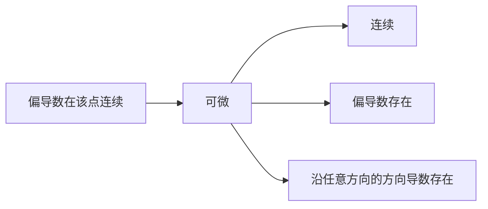

从本章起进入多元微积分。它是一元微积分的直接推广：极限、连续、导数、微分这些概念都有多元的版本，而且大部分运算法则形式不变。但自变量从一条直线扩展到平面和空间之后，"趋近一点"的方式有无穷多种，于是出现了一元情形没有的现象：沿每条直线极限都相同的函数可能没有极限，偏导数都存在的函数可能不连续。学习时应当时时与一元情形比较"异"与"同"，这是本章的主线。

本章先在 $\mathbb{R}^n$ 中建立距离与开集、闭集、区域等拓扑语言，再依次讨论多元函数的极限与连续、偏导数、全微分、方向导数与梯度，最后是复合函数与隐函数的微分法。微分的本质是"局部的线性近似"：一元函数的导数是一个数，多元函数的微分是一个线性映射，它的矩阵就是 Jacobi 矩阵，复合函数的链式法则就是 Jacobi 矩阵的乘法。因此本章大量使用线性代数（[2.1](/2.1)）的语言：**内积**与**长度**（[2.1.4](/2.1.4)）、**线性映射**与**表示矩阵**、**矩阵乘法**与**行列式**。一元微积分的极限与导数见 [2.2.2](/2.2.2)–[2.2.4](/2.2.4)。下一章用本章的工具研究 Taylor 公式、几何应用与极值，[2.2.12](/2.2.12) 起的多元积分学中，换元公式的放大系数正是本章的 Jacobi 行列式。

## 10.1. $\mathbb{R}^n$ 中的点集

### 10.1.1. 距离与点列的收敛

$\mathbb{R}^n$ 中的点记作 $x=(x_1,\dots,x_n)$，平面与空间中也常记作 $P(x,y)$、$M_0(x_0,y_0,z_0)$。两点 $x,y$ 的**内积**为 $(x,y)=\sum_{k=1}^n x_ky_k$，由它定义长度 $\|x\|=\sqrt{(x,x)}$。**Cauchy–Schwarz 不等式** $(x,y)^2\le(x,x)(y,y)$ 的证明只需注意关于 $t$ 的二次三项式 $(x+ty,x+ty)=(x,x)+2t(x,y)+t^2(y,y)\ge0$ 的判别式非正；由它得到**三角不等式** $\|x+y\|\le\|x\|+\|y\|$。

**定义 10.1.1（距离）** 称 $d(x,y)=\|x-y\|=\sqrt{\sum_{k=1}^n(x_k-y_k)^2}$ 为 $x,y\in\mathbb{R}^n$ 的**距离**。它满足 $d(x,y)\ge0$（等号当且仅当 $x=y$）、$d(x,y)=d(y,x)$ 与 $d(x,y)\le d(x,z)+d(z,y)$。

**定义 10.1.2（点列的收敛）** 设 $\{x^{(m)}\}$ 是 $\mathbb{R}^n$ 中的点列，$x_0\in\mathbb{R}^n$。若 $\lim\limits_{m\to\infty}d(x^{(m)},x_0)=0$，即对任意 $\varepsilon>0$，存在 $N$，当 $m>N$ 时 $d(x^{(m)},x_0)<\varepsilon$，则称 $\{x^{(m)}\}$ **收敛**于 $x_0$，记作 $\lim\limits_{m\to\infty}x^{(m)}=x_0$。

**定理 10.1.1** 记 $x^{(m)}=(x^{(m)}_1,\dots,x^{(m)}_n)$，$x_0=(x_{0,1},\dots,x_{0,n})$。则 $\lim\limits_{m\to\infty}x^{(m)}=x_0$ 当且仅当对每个 $k=1,\dots,n$，$\lim\limits_{m\to\infty}x^{(m)}_k=x_{0,k}$。

**证明** 由不等式

$$
|x^{(m)}_k-x_{0,k}|\le d(x^{(m)},x_0)\le\sqrt{n}\max_{1\le k\le n}|x^{(m)}_k-x_{0,k}|
$$

立得。$\square$

因此 $\mathbb{R}^n$ 中点列的收敛可以逐个分量地归结为数列的收敛，数列的结论随之推广：收敛点列的极限唯一、收敛点列有界；**Cauchy 收敛准则**：$\{x^{(m)}\}$ 收敛当且仅当对任意 $\varepsilon>0$，存在 $N$，当 $m,k>N$ 时 $d(x^{(m)},x^{(k)})<\varepsilon$；**列紧性定理**：$\mathbb{R}^n$ 中的有界点列必有收敛子列（对各分量依次取收敛子列即可）。

### 10.1.2. 邻域、内点与边界点

**定义 10.1.3（邻域）** 设 $x_0\in\mathbb{R}^n$，$\delta>0$。称 $N(x_0,\delta)=\{x\in\mathbb{R}^n\mid d(x,x_0)<\delta\}$ 为 $x_0$ 的 $\delta$ **邻域**，称 $N^*(x_0,\delta)=N(x_0,\delta)\setminus\{x_0\}$ 为 $x_0$ 的 $\delta$ 去心邻域。在 $\mathbb{R}^2$ 中邻域是开圆盘，在 $\mathbb{R}^3$ 中是开球。

用邻域可以刻画一个点与一个点集的位置关系。

**定义 10.1.4（内点、外点与边界点）** 设 $D\subset\mathbb{R}^n$，$x_0\in\mathbb{R}^n$。

- 若存在 $\delta>0$ 使 $N(x_0,\delta)\subset D$，则称 $x_0$ 为 $D$ 的**内点**（必有 $x_0\in D$），$D$ 的全体内点称为 $D$ 的内部；
- 若存在 $\delta>0$ 使 $N(x_0,\delta)\cap D=\varnothing$，则称 $x_0$ 为 $D$ 的**外点**；
- 若对任意 $\delta>0$，$N(x_0,\delta)$ 中既有属于 $D$ 的点，又有不属于 $D$ 的点，则称 $x_0$ 为 $D$ 的**边界点**。$D$ 的全体边界点称为 $D$ 的边界，记作 $\partial D$。

每个点恰是三者之一。边界点可以属于 $D$，也可以不属于 $D$：$(1,0)$ 既是开圆盘 $\{x^2+y^2<1\}$ 的边界点，也是闭圆盘 $\{x^2+y^2\le1\}$ 的边界点。

**定义 10.1.5（聚点）** 设 $D\subset\mathbb{R}^n$。若对任意 $\delta>0$，$N^*(x_0,\delta)\cap D\ne\varnothing$，则称 $x_0$ 为 $D$ 的**聚点**。

聚点可以属于 $D$ 也可以不属于 $D$，属于 $D$ 的点也不一定是聚点：$D=\{x^2+y^2<1\}\cup\{(2,0)\}$ 中，单位圆周上的点都是聚点但不属于 $D$，$(2,0)$ 属于 $D$ 但不是聚点（它是孤立点，也是边界点）。内点都是聚点，外点都不是聚点。

**命题 10.1.1** $x_0$ 是 $D$ 的聚点，当且仅当存在 $D$ 中的点列 $\{x^{(m)}\}$，$x^{(m)}\ne x_0$，使 $\lim\limits_{m\to\infty}x^{(m)}=x_0$。特别地，聚点的任意邻域中都有 $D$ 的无穷多个点。

**证明** 充分性由定义直接得到。必要性：对每个正整数 $m$，取 $x^{(m)}\in N^*(x_0,1/m)\cap D$，则 $0<d(x^{(m)},x_0)<1/m$。$\square$

### 10.1.3. 开集、闭集与区域

**定义 10.1.6（开集与闭集）** 设 $D\subset\mathbb{R}^n$。若 $D$ 的每个点都是内点，则称 $D$ 为**开集**；若 $D$ 的所有聚点都属于 $D$，则称 $D$ 为**闭集**。约定 $\varnothing$ 与 $\mathbb{R}^n$ 既是开集也是闭集。

例如开圆盘 $D=\{x^2+y^2<1\}$ 是开集：对 $A(x_0,y_0)\in D$，记 $l=\sqrt{x_0^2+y_0^2}<1$，取 $\delta=(1-l)/2$，由三角不等式，$P\in N(A,\delta)$ 时 $d(P,O)\le d(P,A)+d(A,O)<\delta+l<1$。闭圆盘 $\{x^2+y^2\le1\}$、半平面 $\{y\le0\}$ 是闭集。

**命题 10.1.2** 在 $\mathbb{R}^n$ 中，开集的补集是闭集，闭集的补集是开集。$D\cup\partial D$ 总是闭集，称为 $D$ 的闭包，记作 $\overline{D}$。

**定义 10.1.7（连通集、区域与闭区域）** 设 $D\subset\mathbb{R}^n$。

- 若 $D$ 中任意两点都可以用一条位于 $D$ 内的连续曲线连接，则称 $D$ 为**连通集**；
- 连通的开集称为**区域**（或开区域），区域与其边界的并称为**闭区域**；
- 若存在 $M>0$ 使 $D\subset N(0,M)$，则称 $D$ 为**有界集**。

这里的"连通"按课件的定义是道路连通。拓扑学中的"连通"（不能分成两个不相交的非空开子集）一般更弱，但对开集两者等价，因此区域的定义不受影响。两个相离的圆盘之并是开集，但不连通，不是区域。

闭区域一定是闭集，闭集却不一定是闭区域（例如两个相离的闭圆盘之并）。由列紧性定理，有界闭集中的任一点列都有收敛子列，且极限仍在该集合中。这是下面有界闭区域上连续函数性质的基础。

## 10.2. 多元函数及其极限

### 10.2.1. 多元函数

**定义 10.2.1（多元函数）** 设 $D\subset\mathbb{R}^n$ 非空。若按对应规则 $f$，对每个 $x=(x_1,\dots,x_n)\in D$ 都有唯一的实数 $u$ 与之对应，则称 $f$ 为定义在 $D$ 上的 $n$ 元函数，记作 $u=f(x)=f(x_1,\dots,x_n)$，$D$ 称为 $f$ 的定义域，记作 $D_f$。$n\ge2$ 时统称**多元函数**。

二元函数记作 $z=f(x,y)$，三元函数记作 $u=f(x,y,z)$。形如 $z=f(x,y)$ 的称为显函数，由方程 $F(x,y,z)=0$ 确定的称为**隐函数**（[10.8](#sec-10.8)）。定义域按"使表达式有意义"确定：$z=\sqrt{1-x^2-y^2}$ 的定义域是闭单位圆盘，$z=\ln(x+y)$ 的定义域是半平面 $\{x+y>0\}$，$z=\sqrt{(x^2+y^2)(x^2+y^2-1)}$ 的定义域是 $\{(0,0)\}\cup\{x^2+y^2\ge1\}$。

二元函数的图形 $\{(x,y,f(x,y))\mid (x,y)\in D\}$ 一般是空间曲面：$z=x+2y-2$ 是平面，$z=\sqrt{1-x^2-y^2}$ 是上半球面，$z=\sqrt{x^2+y^2}$ 是锥面，$z=x^2+y^2$ 是旋转抛物面，$z=x^2-y^2$ 与 $z=xy$ 是马鞍面。三维图形不便画出时，用平面上的等值线表示。

**定义 10.2.2（等值线）** 对常数 $c$，称平面点集 $\{(x,y)\in D\mid f(x,y)=c\}$ 为二元函数 $z=f(x,y)$ 的一条**等值线**；三元函数 $f(x,y,z)=c$ 称为等值面。

等值线是曲面 $z=f(x,y)$ 与平面 $z=c$ 的交线在 $xOy$ 平面上的投影，地图上的等高线就是地面高度函数的等值线。例如 $z=x^2-y^2$ 的等值线：$c=0$ 时是两条直线 $y=\pm x$，$c>0$ 时是以 $x$ 轴为实轴的双曲线，$c<0$ 时是以 $y$ 轴为实轴的双曲线；原点处各方向的升降不一致，是马鞍面的"鞍点"。

### 10.2.2. 二重极限

**定义 10.2.3（二重极限）** 设 $f$ 的定义域为 $D\subset\mathbb{R}^n$，$x_0$ 是 $D$ 的聚点，$A$ 是常数。若对任意 $\varepsilon>0$，存在 $\delta>0$，使得当 $x\in D\cap N^*(x_0,\delta)$ 时 $|f(x)-A|<\varepsilon$，则称当 $x\to x_0$ 时 $f(x)$ 以 $A$ 为极限，记作 $\lim\limits_{x\to x_0}f(x)=A$。二元情形记作 $\lim\limits_{(x,y)\to(x_0,y_0)}f(x,y)=A$，称为**二重极限**。

与一元情形一样，$x_0$ 必须是定义域的聚点，$f(x_0)$ 可以没有定义；不同的是 $x\to x_0$ 的方式是任意的，只要求 $d(x,x_0)\to0$。一元函数极限的四则运算、夹逼定理、复合函数的极限都照样成立。证明二元极限存在时，常用 $|x-x_0|,|y-y_0|\le\rho$ 放缩，其中 $\rho=\sqrt{(x-x_0)^2+(y-y_0)^2}$。

**例 10.2.1** 证明 $\lim\limits_{(x,y)\to(0,0)}\dfrac{x^2+y^2}{|x|+|y|}=0$ 与 $\lim\limits_{(x,y)\to(0,0)}\dfrac{xy}{\sqrt{x^2+y^2}}=0$。

**证明** 由 $(|x|+|y|)^2\ge x^2+y^2$ 得 $0\le\dfrac{x^2+y^2}{|x|+|y|}\le\sqrt{x^2+y^2}$；由 $|xy|\le\frac12(x^2+y^2)$ 得 $\left|\dfrac{xy}{\sqrt{x^2+y^2}}\right|\le\frac12\sqrt{x^2+y^2}$。两者都被 $\rho$ 的常数倍控制，对任意 $\varepsilon>0$ 取 $\delta=\varepsilon$ 即可。$\square$

多元极限要求沿"四面八方"趋近时都有同一个极限。因此：

**命题 10.2.1** 若点 $x$ 沿 $D$ 中两条以 $x_0$ 为聚点的路径趋于 $x_0$ 时 $f(x)$ 的极限不同，或沿某条路径的极限不存在，则 $\lim\limits_{x\to x_0}f(x)$ 不存在。

这只能用来否定极限的存在；要肯定极限存在，必须用定义或夹逼，因为路径是枚举不完的。

**例 10.2.2** 讨论下列函数在原点的极限：

1. $f(x,y)=\dfrac{x^2-y^2}{x^2+y^2}$：沿 $y=kx$ 趋于原点时 $f\to\dfrac{1-k^2}{1+k^2}$，随 $k$ 而变，极限不存在；
2. $f(x,y)=\dfrac{xy}{x^2+y^2}$：沿 $y=kx$ 时 $f\to\dfrac{k}{1+k^2}$，极限不存在；
3. $f(x,y)=\dfrac{x^2y}{x^4+y^2}$：沿任意直线 $y=kx$ 时 $f=\dfrac{kx}{x^2+k^2}\to0$（沿 $x=0$ 时 $f\equiv0$），但沿抛物线 $y=x^2$ 时 $f\equiv\frac12$，极限不存在。

第 3 个例子说明，即使沿所有直线的极限都相同，二重极限也可能不存在。函数 $\dfrac{xy}{x^2+y^2}$ 在极坐标下等于 $\frac12\sin2\theta$，只依赖于方向，它的等值线是过原点的射线，曲面在原点附近像一把被扭转的扇子：

### 10.2.3. 累次极限

二元函数还可以先对一个变量、再对另一个变量求极限。

**定义 10.2.4（累次极限）** 设 $(x_0,y_0)$ 是 $D$ 的聚点。若对 $y_0$ 附近的每个 $y\ne y_0$，极限 $\varphi(y)=\lim\limits_{x\to x_0}f(x,y)$ 存在，且 $\lim\limits_{y\to y_0}\varphi(y)=A$，则称 $A$ 为 $f$ 在 $(x_0,y_0)$ 处先 $x$ 后 $y$ 的**累次极限**，记作 $\lim\limits_{y\to y_0}\lim\limits_{x\to x_0}f(x,y)=A$。类似地定义先 $y$ 后 $x$ 的累次极限。

**定理 10.2.1** 若 $\lim\limits_{(x,y)\to(x_0,y_0)}f(x,y)=A$，且对 $y_0$ 附近的每个 $y\ne y_0$，$\lim\limits_{x\to x_0}f(x,y)=\varphi(y)$ 存在，则 $\lim\limits_{y\to y_0}\varphi(y)=A$。

**证明** 对任意 $\varepsilon>0$，存在 $\delta>0$，当 $0<\sqrt{(x-x_0)^2+(y-y_0)^2}<\delta$ 时 $|f(x,y)-A|<\varepsilon$。取 $\delta_1=\delta/2$，当 $0<|x-x_0|<\delta_1$、$0<|y-y_0|<\delta_1$ 时上式成立。固定 $y$，令 $x\to x_0$，得 $|\varphi(y)-A|\le\varepsilon$。$\square$

所以二重极限与累次极限都存在时必相等；两个累次极限存在而不相等时，二重极限一定不存在。但三者之间没有别的必然联系：

| 函数 | 二重极限 | 累次极限 |
|---|---|---|
| $x\sin\frac1y+y\sin\frac1x$ | $0$（因 $\lvert f\rvert\le\lvert x\rvert+\lvert y\rvert$） | 两个都不存在 |
| $\dfrac{xy}{x^2+y^2}$ | 不存在 | 都等于 $0$ |
| $\dfrac{x^2-y^2}{x^2+y^2}$ | 不存在 | 先 $x$ 后 $y$ 为 $-1$，先 $y$ 后 $x$ 为 $1$ |

第三行也说明一般不能交换两个极限运算的次序。

## 10.3. 多元连续函数

### 10.3.1. 连续的定义

**定义 10.3.1（连续）** 设 $x_0\in D_f$。若 $x_0$ 是 $D_f$ 的孤立点，或 $\lim\limits_{x\to x_0}f(x)=f(x_0)$，即对任意 $\varepsilon>0$，存在 $\delta>0$，当 $x\in D_f\cap N(x_0,\delta)$ 时 $|f(x)-f(x_0)|<\varepsilon$，则称 $f$ 在 $x_0$ **连续**。若 $f$ 在集合 $D$ 的每一点（沿 $D$ 中的点趋近）都连续，则称 $f$ 在 $D$ 上连续，记作 $f\in C(D)$。

对闭区域 $D$，"在 $D$ 上连续"在边界点处只要求沿 $D$ 内的点趋近时极限等于函数值，相当于一元函数在闭区间端点的单侧连续。连续函数的和、差、积、商（分母不为零）与复合仍连续，因此多元**初等函数**在其定义域内的区域上连续。

**例 10.3.1** 设 $f(x,y)=x\sin\dfrac1y$（$y\ne0$），$f(x,0)=0$。由 $|f(x,y)|\le|x|$，$f$ 在 $(0,0)$ 连续；但当 $x_0\ne0$ 时，沿 $x=x_0$ 趋于 $(x_0,0)$，$x_0\sin\frac1y$ 没有极限，故 $f$ 在 $(x_0,0)$ 不连续。间断点可以组成一条曲线。

二元函数对每个变量分别连续，不能推出它连续：$f(x,y)=1$（$xy\ne0$），$f(x,y)=0$（$xy=0$）在原点关于 $x$、关于 $y$ 都连续（$f(x,0)\equiv f(0,y)\equiv0$），但沿 $y=x$ 时 $f\equiv1$，在原点不连续。

### 10.3.2. 有界闭区域上连续函数的性质

一元函数在闭区间上的三个整体性质，推广到有界闭区域上。

**定理 10.3.1（最大最小值定理）** 若 $f$ 在有界闭区域 $D$ 上连续，则 $f$ 在 $D$ 上有界，且存在 $P,Q\in D$，使 $f(P)=\max\limits_{x\in D}f(x)$，$f(Q)=\min\limits_{x\in D}f(x)$。

**证明** 先证有界。若不然，存在 $x^{(m)}\in D$ 使 $|f(x^{(m)})|>m$。由列紧性定理，$\{x^{(m)}\}$ 有子列收敛于某点 $x^*$，因 $D$ 是闭集，$x^*\in D$；由连续性 $f(x^{(m_k)})\to f(x^*)$，与 $|f(x^{(m_k)})|>m_k$ 矛盾。再设 $M=\sup_D f$，取 $x^{(m)}\in D$ 使 $M-\frac1m<f(x^{(m)})\le M$，同样取收敛子列 $x^{(m_k)}\to P\in D$，得 $f(P)=M$。最小值同理。$\square$

**定理 10.3.2（一致连续定理）** 若 $f$ 在有界闭区域 $D$ 上连续，则 $f$ 在 $D$ 上**一致连续**：对任意 $\varepsilon>0$，存在 $\delta>0$，当 $x,x'\in D$、$d(x,x')<\delta$ 时 $|f(x)-f(x')|<\varepsilon$。

**证明** 若不然，存在 $\varepsilon_0>0$ 及 $x^{(m)},x'^{(m)}\in D$，$d(x^{(m)},x'^{(m)})<\frac1m$，但 $|f(x^{(m)})-f(x'^{(m)})|\ge\varepsilon_0$。取收敛子列 $x^{(m_k)}\to x^*\in D$，则 $x'^{(m_k)}\to x^*$ 也成立。令 $k\to\infty$ 得 $0=|f(x^*)-f(x^*)|\ge\varepsilon_0$，矛盾。$\square$

**定理 10.3.3（介值定理）** 设 $f$ 在区域（或闭区域）$D$ 上连续，$P,Q\in D$，则对介于 $f(P)$ 与 $f(Q)$ 之间的任意 $\mu$，存在 $\xi\in D$ 使 $f(\xi)=\mu$。

**证明** 由连通性，有 $D$ 中的连续曲线 $x=\gamma(t)$（$t\in[0,1]$）连接 $P=\gamma(0)$ 与 $Q=\gamma(1)$。一元函数 $g(t)=f(\gamma(t))$ 在 $[0,1]$ 上连续，由一元的介值定理存在 $t_0$ 使 $g(t_0)=\mu$，取 $\xi=\gamma(t_0)$。$\square$

三个定理都依赖于区域的条件：$f(x,y)=1-x^2-y^2$ 在开圆盘 $\{x^2+y^2<1\}$ 上没有最小值；介值定理需要连通性。

**例 10.3.2** 设 $f$ 在 $\mathbb{R}^2$ 上连续，且 $\lim\limits_{x^2+y^2\to\infty}f(x,y)=+\infty$，则 $f$ 在 $\mathbb{R}^2$ 上有最小值。

**证明** 存在 $M>0$，当 $x^2+y^2>M^2$ 时 $f(x,y)>f(0,0)$。$f$ 在有界闭区域 $D=\{x^2+y^2\le M^2\}$ 上有最小值 $f(x_0,y_0)\le f(0,0)$，而 $D$ 外 $f>f(0,0)\ge f(x_0,y_0)$，所以 $f(x_0,y_0)$ 是 $f$ 在整个平面上的最小值。$\square$

### 10.3.3. 连续映射

**定义 10.3.2（映射的极限与连续）** 设 $D\subset\mathbb{R}^m$。若对每个 $x\in D$ 都有唯一的 $y\in\mathbb{R}^n$ 与之对应，则称这个对应 $f$ 为从 $D$ 到 $\mathbb{R}^n$ 的映射，记作 $y=f(x)$。设 $x_0$ 是 $D$ 的聚点，$A\in\mathbb{R}^n$，若对任意 $\varepsilon>0$，存在 $\delta>0$，当 $x\in D\cap N^*(x_0,\delta)$ 时 $f(x)\in N(A,\varepsilon)$，则称 $\lim\limits_{x\to x_0}f(x)=A$；若 $x_0\in D$ 且 $\lim\limits_{x\to x_0}f(x)=f(x_0)$，则称 $f$ 在 $x_0$ 连续。

把映射写成分量 $f(x)=(f_1(x),\dots,f_n(x))$，每个分量 $f_k$ 是一个 $m$ 元函数。与定理 10.1.1 同理：

**定理 10.3.4** 映射 $f$ 在 $x_0$ 连续，当且仅当它的每个分量 $f_1,\dots,f_n$ 都在 $x_0$ 连续。

例如，对 $n\times m$ 矩阵 $A$，**线性映射** $x\mapsto Ax$ 的每个分量都是 $x_1,\dots,x_m$ 的一次式，因而是 $\mathbb{R}^m\to\mathbb{R}^n$ 的连续映射；$A$ 就是这个映射的**表示矩阵**。下文 [10.7](#sec-10.7) 将看到，可微映射在一点附近就"近似地"是这样一个线性映射。

## 10.4. 偏导数

### 10.4.1. 偏导数的定义

极限与连续是定性的性质。为了定量地研究函数的变化快慢，先固定其他变量，只让一个变量变化，这就回到了一元函数的导数。

**定义 10.4.1（偏导数）** 设 $z=f(x,y)$ 在 $(x_0,y_0)$ 的某邻域内有定义。若极限

$$
\lim_{\Delta x\to0}\frac{f(x_0+\Delta x,y_0)-f(x_0,y_0)}{\Delta x}
$$

存在，则称它为 $f$ 在 $(x_0,y_0)$ 关于 $x$ 的**偏导数**，记作 $f_x(x_0,y_0)$、$\dfrac{\partial f}{\partial x}(x_0,y_0)$ 或 $\left.\dfrac{\partial z}{\partial x}\right|_{(x_0,y_0)}$。类似地定义关于 $y$ 的偏导数 $f_y(x_0,y_0)$。对 $n$ 元函数 $f(x_1,\dots,x_n)$，固定其余变量、只让 $x_i$ 变化得到偏导数 $\dfrac{\partial f}{\partial x_i}$，也记作 $f_{x_i}$ 或 $f_i'$（按变量的位置编号，在复合函数中很方便）。

几何上，$f_x(x_0,y_0)=\dfrac{\mathrm{d}}{\mathrm{d}x}f(x,y_0)\Big|_{x=x_0}$ 是曲面 $z=f(x,y)$ 与平面 $y=y_0$ 的交线在点 $(x_0,y_0,f(x_0,y_0))$ 处切线关于 $x$ 轴的斜率。求偏导数时把其余变量看作常数，用一元函数的求导法则即可。

**例 10.4.1** 设 $u=x^y\sin(x+y)$（$x>0$），则

$$
\frac{\partial u}{\partial x}=yx^{y-1}\sin(x+y)+x^y\cos(x+y),\qquad
\frac{\partial u}{\partial y}=x^y\ln x\,\sin(x+y)+x^y\cos(x+y).
$$

与一元的 $\dfrac{\mathrm{d}y}{\mathrm{d}x}$ 不同，$\dfrac{\partial z}{\partial x}$ 只是一个整体记号，不能看作两个"偏微分"之商。例如理想气体状态方程 $pV=RT$ 中，$\dfrac{\partial p}{\partial V}=-\dfrac{RT}{V^2}$，$\dfrac{\partial V}{\partial T}=\dfrac{R}{p}$，$\dfrac{\partial T}{\partial p}=\dfrac{V}{R}$，三者之积为 $-\dfrac{RT}{pV}=-1$，而不是 $1$。

偏导数只反映函数沿坐标轴方向的性质，因此它的存在与连续性没有必然联系：

**例 10.4.2** 

1. $f(x,y)=1$（$y=x^2$，$x\ne0$），其余点 $f=0$。在两条坐标轴上 $f\equiv0$，故 $f_x(0,0)=f_y(0,0)=0$；但沿 $y=x^2$ 趋于原点时 $f\to1\ne f(0,0)$，$f$ 在原点不连续。函数 $\dfrac{xy}{x^2+y^2}$（原点处补充定义为 $0$）也是这样：两个偏导数在原点都为 $0$，函数却不连续（例 10.2.2）。
2. $f(x,y)=\sqrt{x^2+y^2}$ 是连续的初等函数，但 $\lim\limits_{\Delta x\to0}\dfrac{f(\Delta x,0)-f(0,0)}{\Delta x}=\lim\limits_{\Delta x\to0}\dfrac{|\Delta x|}{\Delta x}$ 不存在，$f_x(0,0)$ 不存在。

### 10.4.2. 高阶偏导数

偏导函数 $f_x,f_y$ 仍是 $x,y$ 的函数，可以继续求偏导数。

**定义 10.4.2（高阶偏导数）** 二元函数 $f$ 的二阶偏导数有四个：

$$
f_{xx}=\frac{\partial^2f}{\partial x^2},\quad
f_{xy}=(f_x)_y=\frac{\partial^2f}{\partial y\,\partial x},\quad
f_{yx}=(f_y)_x=\frac{\partial^2f}{\partial x\,\partial y},\quad
f_{yy}=\frac{\partial^2f}{\partial y^2},
$$

其中 $f_{xy}$、$f_{yx}$ 称为**混合偏导数**。下标按求导的先后从左往右写，$\partial$ 记号中则从右往左读。类似地定义三阶及更高阶的**高阶偏导数**。

一般来说，混合偏导数与求导的次序有关。

**例 10.4.3** 设 $f(x,y)=\dfrac{xy(x^2-y^2)}{x^2+y^2}$，$f(0,0)=0$。由定义，$f_x(0,y)=\lim\limits_{x\to0}\dfrac{f(x,y)}{x}=-y$，$f_y(x,0)=\lim\limits_{y\to0}\dfrac{f(x,y)}{y}=x$，所以

$$
f_{xy}(0,0)=\frac{\mathrm{d}}{\mathrm{d}y}(-y)\Big|_{y=0}=-1,\qquad f_{yx}(0,0)=\frac{\mathrm{d}}{\mathrm{d}x}(x)\Big|_{x=0}=1.
$$

**定理 10.4.1（混合偏导数相等的条件）** 若 $f_{xy}$ 与 $f_{yx}$ 在 $(a,b)$ 的某邻域内存在，且都在 $(a,b)$ 连续，则 $f_{xy}(a,b)=f_{yx}(a,b)$。

**证明** 对充分小的 $h,k\ne0$，令

$$
L=f(a+h,b+k)-f(a+h,b)-f(a,b+k)+f(a,b).
$$

记 $\varphi(x)=f(x,b+k)-f(x,b)$，则 $L=\varphi(a+h)-\varphi(a)$。由一元的 **Lagrange 中值定理**，$L=\varphi'(a+\theta_1h)h=[f_x(a+\theta_1h,b+k)-f_x(a+\theta_1h,b)]h$，再对第二个变量用中值定理，$L=f_{xy}(a+\theta_1h,b+\theta_2k)hk$。同理，记 $\psi(y)=f(a+h,y)-f(a,y)$，有 $L=f_{yx}(a+\theta_3h,b+\theta_4k)hk$，其中 $\theta_i\in(0,1)$。于是

$$
f_{xy}(a+\theta_1h,b+\theta_2k)=f_{yx}(a+\theta_3h,b+\theta_4k).
$$

令 $(h,k)\to(0,0)$，由两个混合偏导数在 $(a,b)$ 的连续性得结论。$\square$

证明中两次使用中值定理，需要混合偏导数在 $(a,b)$ 附近存在，所以定理的条件是"在邻域内存在且在该点连续"，只在一点连续是不够的。由归纳可得：若 $f$ 的 $k$ 阶偏导数都连续（记作 $f\in C^k$），则 $k$ 阶以内的混合偏导数与求导次序无关。本课程中遇到的函数一般都满足这一条件，以后不再区分 $f_{xy}$ 与 $f_{yx}$。

**例 10.4.4** 设 $z=\sin(xy)$，则 $z_x=y\cos(xy)$，$z_{xx}=-y^2\sin(xy)$，$z_{xy}=\cos(xy)-xy\sin(xy)=z_{yx}$，$z_{yy}=-x^2\sin(xy)$。

## 10.5. 全微分

### 10.5.1. 可微与全微分

一元函数可微是指 $f(x_0+\Delta x)-f(x_0)=a\Delta x+o(\Delta x)$：增量的主要部分是自变量增量的线性函数。多元函数照此定义，只是线性部分变成了 $n$ 个增量的线性组合。下面把增量写成向量 $\boldsymbol{h}=(h_1,\dots,h_n)=x-x_0$。

**定义 10.5.1（可微与全微分）** 设 $f$ 在 $x_0$ 的某邻域内有定义。若存在常数 $a_1,\dots,a_n$，使得

$$
f(x_0+\boldsymbol{h})-f(x_0)=a_1h_1+\cdots+a_nh_n+o(\|\boldsymbol{h}\|)\qquad(\boldsymbol{h}\to\boldsymbol{0}),
$$

则称 $f$ 在 $x_0$ **可微**，称线性部分 $a_1h_1+\cdots+a_nh_n$ 为 $f$ 在 $x_0$ 的**全微分**，记作 $\mathrm{d}f(x_0)$。若 $f$ 在区域 $D$ 的每一点可微，则称 $f$ 在 $D$ 上可微。

**定理 10.5.1（可微的必要条件）** 若 $f$ 在 $x_0$ 可微，则

1. $f$ 在 $x_0$ 连续；
2. $f$ 在 $x_0$ 的各偏导数都存在，且 $a_i=\dfrac{\partial f}{\partial x_i}(x_0)$，从而

$$
\mathrm{d}f=\frac{\partial f}{\partial x_1}\mathrm{d}x_1+\cdots+\frac{\partial f}{\partial x_n}\mathrm{d}x_n,
$$

这里对自变量记 $\mathrm{d}x_i=h_i$。

**证明** 令 $\boldsymbol{h}\to\boldsymbol{0}$ 即得 $f(x_0+\boldsymbol{h})\to f(x_0)$。取 $\boldsymbol{h}=(t,0,\dots,0)$，得 $f(x_0+\boldsymbol{h})-f(x_0)=a_1t+o(t)$，除以 $t$ 并令 $t\to0$ 得 $f_{x_1}(x_0)=a_1$，其余同理。$\square$

可微的函数，全微分由偏导数唯一确定；但偏导数存在只是可微的必要条件。判断一个具体函数在一点是否可微，标准做法是：先看连续性与偏导数是否存在，若存在，写出"候选的微分" $f_x\Delta x+f_y\Delta y$，再检验余项是否为 $o(\rho)$。

**例 10.5.1** 设 $f(x,y)=\dfrac{xy}{\sqrt{x^2+y^2}}$，$f(0,0)=0$。由例 10.2.1 它在原点连续；$f(x,0)\equiv f(0,y)\equiv0$，所以 $f_x(0,0)=f_y(0,0)=0$。若 $f$ 在原点可微，则 $\mathrm{d}f=0$，余项

$$
\frac{f(\Delta x,\Delta y)-0}{\rho}=\frac{\Delta x\,\Delta y}{(\Delta x)^2+(\Delta y)^2}
$$

应趋于 $0$，但沿 $\Delta y=\Delta x$ 它恒等于 $\frac12$。所以 $f$ 在原点连续、偏导数存在，但不可微。

**定理 10.5.2（可微的充分条件）** 若 $f$ 的各偏导数在 $x_0$ 的某邻域内存在，且都在 $x_0$ 连续，则 $f$ 在 $x_0$ 可微。

**证明** 以二元函数为例。把增量拆成沿两个坐标方向的增量，分别用一元的中值定理：

$$
\begin{aligned}
f(x_0+h,y_0+k)-f(x_0,y_0)&=[f(x_0+h,y_0+k)-f(x_0,y_0+k)]+[f(x_0,y_0+k)-f(x_0,y_0)]\\
&=f_x(x_0+\theta_1h,y_0+k)h+f_y(x_0,y_0+\theta_2k)k\\
&=f_x(x_0,y_0)h+f_y(x_0,y_0)k+\alpha h+\beta k,
\end{aligned}
$$

其中 $\theta_1,\theta_2\in(0,1)$，由偏导数的连续性 $\alpha,\beta\to0$。而 $|\alpha h+\beta k|\le(|\alpha|+|\beta|)\rho=o(\rho)$。$\square$

证明中第二个方括号只用到 $f_y(x_0,y_0)$ 存在，所以条件可以减弱为"一个偏导数在 $x_0$ 连续、另一个在 $x_0$ 存在"。偏导数连续也只是可微的充分条件：

**例 10.5.2** 设 $f(x,y)=(x^2+y^2)\sin\dfrac{1}{x^2+y^2}$，$f(0,0)=0$。由 $|f|\le\rho^2=o(\rho)$，$f$ 在原点可微，$\mathrm{d}f(0,0)=0$。但在原点以外

$$
f_x(x,y)=2x\sin\frac{1}{x^2+y^2}-\frac{2x}{x^2+y^2}\cos\frac{1}{x^2+y^2},
$$

沿 $x$ 轴趋于原点时第二项 $-\frac2x\cos\frac1{x^2}$ 无界振荡，$f_x$ 在原点不连续；$f_y$ 同理。

各概念之间的关系如下（箭头表示蕴含，反向都不成立，反例见例 10.4.2、例 10.5.1、例 10.5.2 与 [10.6](#sec-10.6)）：

连续与偏导数存在之间互不蕴含。与一元函数"可导 ⇔ 可微"不同，多元函数中可微比偏导数存在严格地强：偏导数只考虑两个方向，而可微是关于所有趋近方式的整体要求。

**例 10.5.3** 求 $u=\dfrac{x}{z}-\ln\dfrac{z}{y}$ 的全微分。$u_x=\dfrac1z$，$u_y=\dfrac1y$，$u_z=-\dfrac{x}{z^2}-\dfrac1z$，各偏导数在定义域内连续，所以

$$
\mathrm{d}u=\frac1z\,\mathrm{d}x+\frac1y\,\mathrm{d}y-\Big(\frac{x}{z^2}+\frac1z\Big)\mathrm{d}z.
$$

### 10.5.2. 微分的几何意义

若 $f$ 在 $(x_0,y_0)$ 可微，令 $z_0=f(x_0,y_0)$，则

$$
f(x,y)=z_0+f_x(x_0,y_0)(x-x_0)+f_y(x_0,y_0)(y-y_0)+o(\rho).
$$

右端去掉 $o(\rho)$ 后是一个过点 $(x_0,y_0,z_0)$ 的平面 $z=z_0+f_x(x_0,y_0)(x-x_0)+f_y(x_0,y_0)(y-y_0)$，曲面 $z=f(x,y)$ 与它在该点附近的高度差是 $\rho$ 的高阶无穷小。这个平面就是曲面在该点的切平面（[2.2.11](/2.2.11) 中详细讨论），可微的几何意义是"以平代曲"，正如一元函数的微分是"以直代曲"。例如 $z=x^2+y^2$ 在 $(1,1,2)$ 处的切平面为 $z=2+2(x-1)+2(y-1)$。

### 10.5.3. 高阶全微分

若 $f$ 的二阶偏导数连续，把 $\mathrm{d}x,\mathrm{d}y$ 看作与 $x,y$ 无关的常量，对 $\mathrm{d}f=f_x\mathrm{d}x+f_y\mathrm{d}y$ 再求一次全微分，得二阶全微分

$$
\mathrm{d}^2f=f_{xx}\,\mathrm{d}x^2+2f_{xy}\,\mathrm{d}x\,\mathrm{d}y+f_{yy}\,\mathrm{d}y^2=\Big(\mathrm{d}x\frac{\partial}{\partial x}+\mathrm{d}y\frac{\partial}{\partial y}\Big)^2f,
$$

一般地 $\mathrm{d}^mf=\Big(\mathrm{d}x\dfrac{\partial}{\partial x}+\mathrm{d}y\dfrac{\partial}{\partial y}\Big)^mf=\sum\limits_{k=0}^m\dbinom{m}{k}\dfrac{\partial^mf}{\partial x^k\,\partial y^{m-k}}\mathrm{d}x^k\,\mathrm{d}y^{m-k}$。这一记号将在 Taylor 公式中使用。

### 10.5.4. 二元微分形式的原函数

一元函数中，任一连续函数 $f(x)$ 的微分形式 $f(x)\,\mathrm{d}x$ 都是某个函数（**原函数**）的微分。二元情形则不然。

**定义 10.5.2（微分形式的原函数）** 设 $u(x,y),v(x,y)$ 在区域 $D$ 上连续。若存在可微函数 $f$，使 $\mathrm{d}f=u\,\mathrm{d}x+v\,\mathrm{d}y$，即 $f_x=u$、$f_y=v$，则称 $f$ 为微分形式 $u\,\mathrm{d}x+v\,\mathrm{d}y$ 在 $D$ 上的一个**原函数**。

**命题 10.5.1** 若 $u,v$ 有连续的偏导数，且 $u\,\mathrm{d}x+v\,\mathrm{d}y$ 有原函数 $f$，则 $\dfrac{\partial u}{\partial y}=\dfrac{\partial v}{\partial x}$。

**证明** $u_y=f_{xy}$，$v_x=f_{yx}$，两者都连续，由定理 10.4.1 相等。$\square$

所以 $xy\,\mathrm{d}x+xy\,\mathrm{d}y$ 没有原函数（$u_y=x\ne y=v_x$）。条件 $u_y=v_x$ 在什么区域上也是充分的，要到 [2.2.14](/2.2.14) 的保守场才能回答；它也是 [2.2.15](/2.2.15) 中全微分方程的判别条件。满足条件时，原函数可以用"先对一个变量积分、再定待定函数"的方法求出：

**例 10.5.4** 求 $(2xy+y^2)\,\mathrm{d}x+(x^2+2xy+1)\,\mathrm{d}y$ 的原函数。这里 $u_y=2x+2y=v_x$。由 $f_x=2xy+y^2$ 得 $f=x^2y+xy^2+C(y)$，代入 $f_y=x^2+2xy+C'(y)=x^2+2xy+1$，得 $C'(y)=1$。所以原函数为 $f=x^2y+xy^2+y+C$。

## 10.6. 方向导数与梯度

### 10.6.1. 方向导数

偏导数是沿坐标轴方向的变化率。一般地，我们关心函数沿任意方向的变化率。

**定义 10.6.1（方向导数）** 设 $f$ 在 $x_0$ 的某邻域内有定义，$\boldsymbol{v}$ 是单位向量。若极限

$$
\frac{\partial f}{\partial\boldsymbol{v}}(x_0)=\lim_{t\to0}\frac{f(x_0+t\boldsymbol{v})-f(x_0)}{t}
$$

存在，则称它为 $f$ 在 $x_0$ 沿方向 $\boldsymbol{v}$ 的**方向导数**。

方向导数就是一元函数 $g(t)=f(x_0+t\boldsymbol{v})$ 在 $t=0$ 的导数，反映函数沿过 $x_0$、方向为 $\boldsymbol{v}$ 的直线的变化快慢。沿标准基向量 $\boldsymbol{e}_i$ 的方向导数就是偏导数 $f_{x_i}(x_0)$。二元情形常写 $\boldsymbol{v}=(\cos\alpha,\sin\alpha)$，三元情形写成方向余弦 $(\cos\alpha,\cos\beta,\cos\gamma)$。注意 $\boldsymbol{v}$ 必须是单位向量，给定的方向要先单位化。

**定理 10.6.1** 若 $f$ 在 $x_0$ 可微，则 $f$ 在 $x_0$ 沿任意方向 $\boldsymbol{v}=(v_1,\dots,v_n)$ 的方向导数都存在，且

$$
\frac{\partial f}{\partial\boldsymbol{v}}(x_0)=\frac{\partial f}{\partial x_1}(x_0)v_1+\cdots+\frac{\partial f}{\partial x_n}(x_0)v_n.
$$

**证明** 在可微的定义中取 $\boldsymbol{h}=t\boldsymbol{v}$，则 $\|\boldsymbol{h}\|=|t|$，$f(x_0+t\boldsymbol{v})-f(x_0)=t\sum_i f_{x_i}(x_0)v_i+o(t)$，除以 $t$ 后令 $t\to0$。$\square$

**例 10.6.1** 求 $f(x,y)=x^2+4y^2$ 在点 $(1,2)$ 处沿曲线 $y=2x^2$ 的切线方向的方向导数。曲线在 $(1,2)$ 处 $y'=4x=4$，切向量 $(1,4)$，单位化为 $\boldsymbol{v}=\frac{1}{\sqrt{17}}(1,4)$。$f_x=2x=2$，$f_y=8y=16$，所以 $\dfrac{\partial f}{\partial\boldsymbol{v}}=\dfrac{2+64}{\sqrt{17}}=\dfrac{66}{\sqrt{17}}$。

不可微时，方向导数可能都存在，但不满足上面的公式，甚至函数不连续：

**例 10.6.2** 

1. 例 10.4.2 中的 $f$（在抛物线 $y=x^2$ 上去掉原点处取 $1$，其余为 $0$）：过原点的任一直线在原点附近与抛物线没有交点（除原点外），所以沿任何方向的方向导数都存在且为 $0$；但 $f$ 在原点不连续，当然不可微。
2. $f(x,y)=\dfrac{x^2y}{x^2+y^2}$，$f(0,0)=0$。$f_x(0,0)=f_y(0,0)=0$，但沿 $\boldsymbol{v}=\frac1{\sqrt2}(1,1)$，$f(t\boldsymbol{v})=\dfrac{t}{2\sqrt2}$，方向导数为 $\dfrac{1}{2\sqrt2}\ne f_x\cdot\frac1{\sqrt2}+f_y\cdot\frac1{\sqrt2}=0$。所以 $f$ 在原点不可微。

### 10.6.2. 梯度

**定义 10.6.2（梯度）** 设 $f$ 在 $x_0$ 可微。称向量

$$
\operatorname{grad}f(x_0)=\nabla f(x_0)=\Big(\frac{\partial f}{\partial x_1}(x_0),\dots,\frac{\partial f}{\partial x_n}(x_0)\Big)
$$

为 $f$ 在 $x_0$ 的**梯度**。

于是全微分与方向导数都可以用梯度的**内积**写出：

$$
\mathrm{d}f=\nabla f(x_0)\cdot\boldsymbol{h},\qquad \frac{\partial f}{\partial\boldsymbol{v}}(x_0)=\nabla f(x_0)\cdot\boldsymbol{v}.
$$

一元函数的微分 $f'(x_0)\,\mathrm{d}x$ 中的导数，在多元情形换成了梯度。

**定理 10.6.2（梯度的几何意义）** 设 $f$ 在 $x_0$ 可微且 $\nabla f(x_0)\ne\boldsymbol{0}$。在所有单位向量 $\boldsymbol{v}$ 中，沿 $\boldsymbol{v}=\nabla f(x_0)/\|\nabla f(x_0)\|$ 的方向导数最大，最大值为 $\|\nabla f(x_0)\|$；沿 $-\nabla f(x_0)$ 方向最小，为 $-\|\nabla f(x_0)\|$；沿与梯度垂直的方向为 $0$。

**证明** 由 **Cauchy–Schwarz 不等式**，$\dfrac{\partial f}{\partial\boldsymbol{v}}=\nabla f\cdot\boldsymbol{v}=\|\nabla f\|\cos\theta\in[-\|\nabla f\|,\|\nabla f\|]$，$\theta$ 为 $\boldsymbol{v}$ 与 $\nabla f$ 的夹角，$\theta=0$、$\pi$、$\pi/2$ 分别对应三种情形。$\square$

所以梯度的方向是函数增长最快的方向，长度是最大的增长率。沿等值线 $f(x,y)=c$ 函数值不变，方向导数为零，因此梯度与等值线垂直（严格的证明要用 [10.7](#sec-10.7) 的链式法则：若 $\boldsymbol{r}(t)$ 是等值线的参数方程，对 $f(\boldsymbol{r}(t))\equiv c$ 求导得 $\nabla f\cdot\boldsymbol{r}'(t)=0$）。三元函数的梯度同样垂直于等值面，这将用来求曲面的法向量。

**例 10.6.3** 求 $f(x,y,z)=xy+yz+zx$ 在点 $(1,0,-1)$ 处方向导数最小的方向及最小值。$\nabla f=(y+z,x+z,x+y)$，在该点为 $(-1,0,1)$。所求方向为 $-\nabla f/\|\nabla f\|=\frac{1}{\sqrt2}(1,0,-1)$，最小值为 $-\sqrt2$。

**例 10.6.4** 设 $f$ 在原点可微，沿 $\boldsymbol{l}=(3,4)$ 与 $\boldsymbol{n}=(5,-12)$ 方向的方向导数分别为 $1$ 和 $-1$，求 $f_x(0,0)$、$f_y(0,0)$。由定理 10.6.1，$\frac35f_x+\frac45f_y=1$，$\frac5{13}f_x-\frac{12}{13}f_y=-1$，即 $3f_x+4f_y=5$，$5f_x-12f_y=-13$，解得 $f_x(0,0)=\frac17$，$f_y(0,0)=\frac87$。

下图是 $f(x,y)=x\,\mathrm{e}^{-x^2-y^2}$ 的等值线与梯度场：箭头处处与等值线垂直，指向函数增大的一侧，在极大值点 $\big(\frac1{\sqrt2},0\big)$ 与极小值点 $\big(-\frac1{\sqrt2},0\big)$ 处梯度为零。

## 10.7. 复合函数微分法与 Jacobi 矩阵

### 10.7.1. 链式法则

**定理 10.7.1（链式法则）** 设 $m$ 元函数 $y=f(u_1,\dots,u_m)$ 在 $u_0$ 可微，$n$ 元函数 $u_i=g_i(x_1,\dots,x_n)$（$i=1,\dots,m$）都在 $x_0$ 可微，且 $u_0=(g_1(x_0),\dots,g_m(x_0))$，则复合函数 $y=f(g_1(x),\dots,g_m(x))$ 在 $x_0$ 可微，且

$$
\frac{\partial y}{\partial x_k}=\sum_{i=1}^m\frac{\partial y}{\partial u_i}\frac{\partial u_i}{\partial x_k}\qquad(k=1,\dots,n).
$$

**证明** 记 $\Delta u_i=g_i(x_0+\boldsymbol{h})-g_i(x_0)$，$\Delta\boldsymbol{u}=(\Delta u_1,\dots,\Delta u_m)$。由 $f$ 可微，

$$
\Delta y=\sum_{i=1}^m f_{u_i}(u_0)\Delta u_i+\alpha(\Delta\boldsymbol{u})\|\Delta\boldsymbol{u}\|,
$$

其中 $\alpha(\Delta\boldsymbol{u})\to0$（$\Delta\boldsymbol{u}\to\boldsymbol{0}$），并补充定义 $\alpha(\boldsymbol{0})=0$。由 $g_i$ 可微，$\Delta u_i=\sum_k\frac{\partial u_i}{\partial x_k}h_k+o(\|\boldsymbol{h}\|)$，代入第一项得 $\sum_k\Big(\sum_i\frac{\partial y}{\partial u_i}\frac{\partial u_i}{\partial x_k}\Big)h_k+o(\|\boldsymbol{h}\|)$。对第二项，$g_i$ 可微蕴含 $\|\Delta\boldsymbol{u}\|/\|\boldsymbol{h}\|$ 有界，且 $\boldsymbol{h}\to\boldsymbol{0}$ 时 $\Delta\boldsymbol{u}\to\boldsymbol{0}$、$\alpha\to0$，所以它也是 $o(\|\boldsymbol{h}\|)$。$\square$

特别地，若 $u_i=u_i(t)$ 是一元函数，则得到"全导数" $\dfrac{\mathrm{d}y}{\mathrm{d}t}=\sum\limits_{i=1}^m\dfrac{\partial y}{\partial u_i}\dfrac{\mathrm{d}u_i}{\mathrm{d}t}$。只要求复合函数的偏导数时，内层函数只需偏导数存在，但外层函数的可微性不能去掉：

**例 10.7.1** 设 $f(u,v)=\dfrac{u^2v}{u^2+v^2}$，$f(0,0)=0$，$u=v=x$。复合函数 $y=f(x,x)=\dfrac x2$，$\dfrac{\mathrm{d}y}{\mathrm{d}x}\Big|_{x=0}=\dfrac12$。但 $f_u(0,0)=f_v(0,0)=0$，形式地套用链式法则得 $0$。原因是 $f$ 在原点不可微（例 10.6.2 已证）。

**例 10.7.2** 求 $y=\Big(\dfrac1x\Big)^{1/x}$（$x>0$）的导数。令 $u=\frac1x$，$v=\frac1x$，$y=u^v$，则

$$
\frac{\mathrm{d}y}{\mathrm{d}x}=vu^{v-1}\Big(-\frac1{x^2}\Big)+u^v\ln u\Big(-\frac1{x^2}\Big)=\Big(\frac1x\Big)^{1/x}\frac{\ln x-1}{x^2}.
$$

这与一元的对数求导法结果相同，但思路更机械。

对抽象函数求偏导时，记 $f_1'$、$f_2'$ 为 $f$ 对第一、第二个中间变量的偏导数，$f_{12}''$ 等类推；它们仍是与 $f$ 有相同中间变量的复合函数，再求导时仍要用链式法则。

**例 10.7.3** 设 $f$ 有连续的二阶偏导数，$z=f\Big(xy,\dfrac xy\Big)$，求 $z_{xx}$ 与 $z_{xy}$。

$$
z_x=yf_1'+\frac1yf_2',\qquad
z_{xx}=y^2f_{11}''+2f_{12}''+\frac1{y^2}f_{22}'',
$$

$$
z_{xy}=f_1'+y\Big(xf_{11}''-\frac{x}{y^2}f_{12}''\Big)-\frac1{y^2}f_2'+\frac1y\Big(xf_{21}''-\frac{x}{y^2}f_{22}''\Big)
=f_1'-\frac1{y^2}f_2'+xyf_{11}''-\frac{x}{y^3}f_{22}'',
$$

最后一步用到 $f_{12}''=f_{21}''$。

链式法则说明，无论 $u,v$ 是自变量还是中间变量，$z=f(u,v)$ 的全微分都可以写成 $\mathrm{d}z=f_u\,\mathrm{d}u+f_v\,\mathrm{d}v$，这就是多元函数的**一阶微分形式不变性**。用它求复合函数的偏导数，常常比逐个用链式法则更方便。

**定义 10.7.1（齐次函数）** 若对任意 $t>0$ 和定义域中的 $(x,y,z)$（$t(x,y,z)$ 也在定义域中），有 $f(tx,ty,tz)=t^kf(x,y,z)$，则称 $f$ 为 $k$ 次**齐次函数**。

**定理 10.7.2（Euler 齐次函数定理）** 可微函数 $f(x,y,z)$ 是 $k$ 次齐次函数，当且仅当

$$
xf_x(x,y,z)+yf_y(x,y,z)+zf_z(x,y,z)=kf(x,y,z).
$$

**证明** 必要性：对 $f(tx,ty,tz)=t^kf(x,y,z)$ 两端关于 $t$ 求导，得 $xf_1'(tx,ty,tz)+yf_2'(tx,ty,tz)+zf_3'(tx,ty,tz)=kt^{k-1}f(x,y,z)$，令 $t=1$。充分性：令 $\varphi(t)=t^{-k}f(tx,ty,tz)$，则

$$
\varphi'(t)=t^{-k-1}\big[(tx)f_1'+(ty)f_2'+(tz)f_3'-kf\big](tx,ty,tz)=0,
$$

所以 $\varphi(t)=\varphi(1)=f(x,y,z)$。$\square$

### 10.7.2. 映射的微分与 Jacobi 矩阵

把一个映射 $y=f(x)$（$\mathbb{R}^n\to\mathbb{R}^m$）写成 $m$ 个分量函数 $y_i=f_i(x_1,\dots,x_n)$。若每个分量都在 $x_0$ 可微，把它们的全微分排成一列，得到

$$
\begin{bmatrix}\mathrm{d}y_1\\ \vdots\\ \mathrm{d}y_m\end{bmatrix}
=\begin{bmatrix}\dfrac{\partial y_1}{\partial x_1}&\cdots&\dfrac{\partial y_1}{\partial x_n}\\ \vdots&&\vdots\\ \dfrac{\partial y_m}{\partial x_1}&\cdots&\dfrac{\partial y_m}{\partial x_n}\end{bmatrix}
\begin{bmatrix}\mathrm{d}x_1\\ \vdots\\ \mathrm{d}x_n\end{bmatrix}.
$$

**定义 10.7.2（Jacobi 矩阵与 Jacobi 行列式）** 设映射 $y=f(x)$ 的各分量在 $x_0$ 可微。称上式中的 $m\times n$ 矩阵 $\Big[\dfrac{\partial y_i}{\partial x_j}(x_0)\Big]$ 为 $f$ 在 $x_0$ 的 **Jacobi 矩阵**，记作 $J_f(x_0)$ 或 $\dfrac{\partial(y_1,\dots,y_m)}{\partial(x_1,\dots,x_n)}\Big|_{x_0}$，并称 $f$ 在 $x_0$ 可微，其微分为 $\mathrm{d}y=J_f(x_0)\,\mathrm{d}x$。当 $m=n$ 时，称 $\det J_f(x_0)$ 为 $f$ 在 $x_0$ 的 **Jacobi 行列式**。

Jacobi 矩阵的第 $i$ 行是分量 $f_i$ 的梯度。$m=1$ 时 Jacobi 矩阵是 $1\times n$ 的行向量，其分量就是梯度的分量；$m=n=1$ 时它就是导数 $f'(x_0)$。可微的含义可以统一地写成

$$
f(x_0+\boldsymbol{h})=f(x_0)+J_f(x_0)\boldsymbol{h}+o(\|\boldsymbol{h}\|),
$$

即 $f$ 在 $x_0$ 附近近似于一个线性映射 $\boldsymbol{h}\mapsto J_f(x_0)\boldsymbol{h}$，Jacobi 矩阵就是这个线性映射的**表示矩阵**。一元函数的导数是"局部的比例系数"，多元映射的导数是"局部的线性映射"。

**定理 10.7.3（链式法则的矩阵形式）** 设 $u=g(x)$（$\mathbb{R}^n\to\mathbb{R}^k$）在 $x_0$ 可微，$y=f(u)$（$\mathbb{R}^k\to\mathbb{R}^m$）在 $u_0=g(x_0)$ 可微，则 $f\circ g$ 在 $x_0$ 可微，且

$$
J_{f\circ g}(x_0)=J_f(u_0)\,J_g(x_0).
$$

**证明** 由定理 10.7.1，$\dfrac{\partial y_i}{\partial x_j}=\sum_{l=1}^k\dfrac{\partial y_i}{\partial u_l}\dfrac{\partial u_l}{\partial x_j}$，左端是 $J_{f\circ g}$ 的 $(i,j)$ 元，右端是 $J_f$ 的第 $i$ 行与 $J_g$ 的第 $j$ 列的乘积，这正是**矩阵乘法**的定义。$\square$

这与线性代数中"线性映射的复合对应矩阵的乘积"完全一致：复合映射的局部线性近似，是各自局部线性近似的复合。特别地，线性映射 $x\mapsto Ax$ 的 Jacobi 矩阵处处是 $A$。

**例 10.7.4（极坐标变换）** $x=r\cos\theta$，$y=r\sin\theta$ 的 Jacobi 矩阵与 Jacobi 行列式为

$$
\frac{\partial(x,y)}{\partial(r,\theta)}=\begin{bmatrix}\cos\theta&-r\sin\theta\\ \sin\theta&r\cos\theta\end{bmatrix},\qquad
\det\frac{\partial(x,y)}{\partial(r,\theta)}=r.
$$

若 $u=x^2-y^2$，$v=xy$，则由定理 10.7.3，

$$
\frac{\partial(u,v)}{\partial(r,\theta)}=\begin{bmatrix}2x&-2y\\ y&x\end{bmatrix}\begin{bmatrix}\cos\theta&-r\sin\theta\\ \sin\theta&r\cos\theta\end{bmatrix}
=\begin{bmatrix}2(x\cos\theta-y\sin\theta)&-2r(x\sin\theta+y\cos\theta)\\ y\cos\theta+x\sin\theta&r(x\cos\theta-y\sin\theta)\end{bmatrix}.
$$

代入 $x=r\cos\theta$、$y=r\sin\theta$ 即得 $u=r^2\cos2\theta$、$v=\frac12r^2\sin2\theta$ 直接求导的结果。极坐标的 Jacobi 行列式 $r$ 将在 [2.2.12](/2.2.12) 中作为面积元的放大系数出现。

## 10.8. 隐函数定理

### 10.8.1. 一个方程确定的隐函数

方程 $F(x,y)=0$ 什么时候能在一点附近确定一个函数 $y=f(x)$？单位圆 $x^2+y^2=1$ 在 $(0,1)$ 附近确定 $y=\sqrt{1-x^2}$，但在 $(1,0)$ 附近，对每个 $x<1$ 有两个 $y$，对 $x>1$ 一个也没有，不能确定函数。区别在于后者的切线是竖直的，即 $F_y(1,0)=0$。

**定理 10.8.1（隐函数定理）** 设 $F(x,y)$ 在 $(x_0,y_0)$ 的某邻域内有连续的偏导数，$F(x_0,y_0)=0$，$F_y(x_0,y_0)\ne0$。则存在 $\delta>0$ 与唯一的函数 $y=f(x)$，$x\in(x_0-\delta,x_0+\delta)$，满足：

1. $y_0=f(x_0)$，且 $F(x,f(x))\equiv0$；
2. $f$ 有连续的导函数，且 $f'(x)=-\dfrac{F_x(x,f(x))}{F_y(x,f(x))}$。

**证明** 不妨设 $F_y(x_0,y_0)>0$。由 $F_y$ 的连续性，存在矩形 $[x_0-a,x_0+a]\times[y_0-b,y_0+b]$，其上 $F_y>0$，于是 $F(x,y)$ 关于 $y$ 严格增。由 $F(x_0,y_0)=0$ 得 $F(x_0,y_0-b)<0<F(x_0,y_0+b)$；由 $F$ 的连续性，存在 $\delta>0$，当 $|x-x_0|<\delta$ 时 $F(x,y_0-b)<0<F(x,y_0+b)$。对每个这样的 $x$，由一元的**介值定理**与单调性，恰有一个 $y\in(y_0-b,y_0+b)$ 使 $F(x,y)=0$，记为 $f(x)$。把 $b$ 换成任意小的 $\varepsilon$ 重复这一论证即得 $f$ 连续。最后，由 $F$ 可微，

$$
0=F(x+\Delta x,f(x+\Delta x))-F(x,f(x))=F_x\Delta x+F_y\Delta y+\alpha\Delta x+\beta\Delta y,
$$

其中 $\Delta y=f(x+\Delta x)-f(x)\to0$，$\alpha,\beta\to0$。解出 $\dfrac{\Delta y}{\Delta x}=-\dfrac{F_x+\alpha}{F_y+\beta}\to-\dfrac{F_x}{F_y}$。$\square$

定理是局部的：它只断言在 $(x_0,y_0)$ 的某个邻域内确定唯一的隐函数。求导公式也可以不记，直接对 $F(x,f(x))=0$ 两边求导，把 $y$ 看作 $x$ 的函数即可（一元的**隐函数求导**）。

**例 10.8.1** 设 $y=f(x)$ 由 Descartes 叶形线 $x^3+y^3-3axy=0$（$a>0$）确定，求它的极值。$F_x=3x^2-3ay$，$F_y=3y^2-3ax$。令 $f'(x)=-F_x/F_y=0$，得 $y=x^2/a$，代入方程得 $x^3(x^3-2a^3)=0$。$x=0$ 时 $y=0$，但 $F_y(0,0)=0$，隐函数定理不适用；取 $x=\sqrt[3]{2}\,a$，$y=\sqrt[3]{4}\,a$，此处 $F_y=3\sqrt[3]{2}\,a^2\ne0$。对 $F_x+F_yy'=0$ 再求导，在 $y'=0$ 的点上得 $y''=-F_{xx}/F_y=-\dfrac{6\sqrt[3]{2}\,a}{3\sqrt[3]{2}\,a^2}=-\dfrac2a<0$，所以 $x=\sqrt[3]{2}\,a$ 是极大值点，极大值为 $\sqrt[3]{4}\,a$。

**定理 10.8.2** 设 $F(x_1,\dots,x_n,y)$ 在 $P_0=(x_1^0,\dots,x_n^0,y_0)$ 的某邻域内有连续的偏导数，$F(P_0)=0$，$F_y(P_0)\ne0$，则在 $(x_1^0,\dots,x_n^0)$ 的某邻域内存在唯一的有连续偏导数的函数 $y=f(x_1,\dots,x_n)$，满足 $y_0=f(x_1^0,\dots,x_n^0)$、$F(x_1,\dots,x_n,f(x_1,\dots,x_n))\equiv0$，且

$$
\frac{\partial f}{\partial x_i}=-\frac{F_{x_i}}{F_y}\qquad(i=1,\dots,n).
$$

**例 10.8.2** 球面 $x^2+y^2+z^2=R^2$ 在 $z\ne0$ 的点附近确定 $z=z(x,y)$。$z_x=-\dfrac xz$，$z_y=-\dfrac yz$，

$$
z_{xx}=-\frac{z-xz_x}{z^2}=-\frac{z+x^2/z}{z^2}=-\frac{x^2+z^2}{z^3}.
$$

**例 10.8.3** 设 $z=z(x,y)$ 由 $z^x=y^z$（$y,z>0$）确定，求 $z_x,z_y$。两边取全微分（一阶微分形式不变性），各微分的地位相同：

$$
z^x\ln z\,\mathrm{d}x+xz^{x-1}\mathrm{d}z=zy^{z-1}\mathrm{d}y+y^z\ln y\,\mathrm{d}z,
$$

解出 $\mathrm{d}z=\dfrac{-z^x\ln z\,\mathrm{d}x+zy^{z-1}\mathrm{d}y}{xz^{x-1}-y^z\ln y}$，即 $z_x=\dfrac{z^x\ln z}{y^z\ln y-xz^{x-1}}$，$z_y=\dfrac{zy^{z-1}}{xz^{x-1}-y^z\ln y}$。

### 10.8.2. 方程组确定的隐函数

两个方程 $F=0$、$G=0$ 中有 $n+2$ 个变量，一般能确定两个变量为其余 $n$ 个变量的函数。线性代数的启示是：每多一个独立的方程就少一个自由变量，而能否解出指定的变量，取决于它们的系数矩阵是否可逆。非线性情形中，系数矩阵换成 Jacobi 矩阵。

**定理 10.8.3** 设 $F(x_1,\dots,x_n,y,z)$、$G(x_1,\dots,x_n,y,z)$ 在 $P_0=(x^0,y_0,z_0)$ 的某邻域内有连续的偏导数，$F(P_0)=G(P_0)=0$，且

$$
\det\frac{\partial(F,G)}{\partial(y,z)}\Big|_{P_0}=\begin{vmatrix}F_y&F_z\\ G_y&G_z\end{vmatrix}_{P_0}\ne0,
$$

则在 $x^0$ 的某邻域内存在唯一的一组有连续偏导数的函数 $y=f(x_1,\dots,x_n)$、$z=g(x_1,\dots,x_n)$，满足 $y_0=f(x^0)$、$z_0=g(x^0)$，$F(x,f(x),g(x))\equiv G(x,f(x),g(x))\equiv0$，且

$$
\frac{\partial(f,g)}{\partial(x_1,\dots,x_n)}=-\Big[\frac{\partial(F,G)}{\partial(y,z)}\Big]^{-1}\frac{\partial(F,G)}{\partial(x_1,\dots,x_n)}.
$$

求导公式的来源是：对 $F(x,f(x),g(x))=0$、$G(x,f(x),g(x))=0$ 关于 $x_i$ 求导，得关于 $\dfrac{\partial y}{\partial x_i},\dfrac{\partial z}{\partial x_i}$ 的线性方程组

$$
\begin{bmatrix}F_y&F_z\\ G_y&G_z\end{bmatrix}\begin{bmatrix}\partial y/\partial x_i\\ \partial z/\partial x_i\end{bmatrix}=-\begin{bmatrix}F_{x_i}\\ G_{x_i}\end{bmatrix},
$$

系数矩阵是**可逆矩阵**，由 Cramer 法则解出。实际计算时直接这样求导，不必记公式。

**例 10.8.4** 方程组 $x^2+y^2+z^2=1$，$x^2+2y^2-z^2=0$ 在 $yz\ne0$ 的点附近确定 $y=y(x)$、$z=z(x)$。对 $x$ 求导：

$$
\begin{bmatrix}2y&2z\\ 4y&-2z\end{bmatrix}\begin{bmatrix}y'\\ z'\end{bmatrix}=-\begin{bmatrix}2x\\ 2x\end{bmatrix},
$$

系数行列式为 $-12yz\ne0$，解得 $y'=-\dfrac{2x}{3y}$，$z'=-\dfrac{x}{3z}$。

**例 10.8.5** 设 $x=u\cos v$，$y=u\sin v$，$z=uv$，求 $\dfrac{\partial z}{\partial x}$（$z$ 看作 $x,y$ 的函数）。前两式确定 $u,v$ 为 $x,y$ 的函数，对 $x$ 求导：$1=u_x\cos v-uv_x\sin v$，$0=u_x\sin v+uv_x\cos v$，解得 $u_x=\cos v$，$v_x=-\dfrac{\sin v}{u}$。于是 $z_x=vu_x+uv_x=v\cos v-\sin v$。

### 10.8.3. 逆映射

映射 $u=u(x,y)$、$v=v(x,y)$ 何时可以反解出 $x=x(u,v)$、$y=y(u,v)$？把它看作关于 $x,y$ 的方程组 $F=u(x,y)-u=0$、$G=v(x,y)-v=0$，由定理 10.8.3 得到：

**定理 10.8.4（逆映射定理）** 设映射 $f\colon(x,y)\mapsto(u,v)$ 在 $(x_0,y_0)$ 的某邻域内有连续的偏导数，且 $\det\dfrac{\partial(u,v)}{\partial(x,y)}\Big|_{(x_0,y_0)}\ne0$，则 $f$ 在 $(x_0,y_0)$ 的某邻域内有连续可微的逆映射，且

$$
\frac{\partial(x,y)}{\partial(u,v)}=\Big[\frac{\partial(u,v)}{\partial(x,y)}\Big]^{-1},\qquad
\det\frac{\partial(x,y)}{\partial(u,v)}\cdot\det\frac{\partial(u,v)}{\partial(x,y)}=1.
$$

后一式由 $f^{-1}\circ f=\mathrm{id}$ 与链式法则立得，它是一元公式 $\dfrac{\mathrm{d}x}{\mathrm{d}y}=1\Big/\dfrac{\mathrm{d}y}{\mathrm{d}x}$ 的推广。$n$ 维情形完全相同。

逆映射定理也是局部的。映射 $u=\mathrm{e}^x\cos y$，$v=\mathrm{e}^x\sin y$ 的 Jacobi 行列式为 $\mathrm{e}^{2x}\ne0$，在每一点附近都可逆；但 $(x,y)$ 与 $(x,y+2\pi)$ 有相同的像，它在整个平面上不是单射，而且原点没有原像。

## 小结

| 概念 | 定义或公式 | 与一元情形的差别 |
|---|---|---|
| 二重极限 | $x\in N^*(x_0,\delta)\cap D\Rightarrow\lvert f(x)-A\rvert<\varepsilon$ | 趋近方式任意；沿不同路径极限不同则不存在 |
| 偏导数 | 固定其余变量求导 | 存在不蕴含连续 |
| 全微分 | $\Delta f=\nabla f\cdot\boldsymbol{h}+o(\lVert\boldsymbol{h}\rVert)$ | 比偏导数存在严格地强；偏导数连续是充分条件 |
| 方向导数 | $\dfrac{\partial f}{\partial\boldsymbol{v}}=\nabla f\cdot\boldsymbol{v}$（可微时） | 可微时由梯度决定；梯度方向增长最快 |
| 混合偏导数 | 邻域内存在、该点连续时 $f_{xy}=f_{yx}$ | 一般与次序有关 |
| Jacobi 矩阵 | $J_f=\Big[\dfrac{\partial y_i}{\partial x_j}\Big]$，$\mathrm{d}y=J_f\,\mathrm{d}x$ | 导数推广为线性映射的矩阵 |
| 链式法则 | $J_{f\circ g}=J_f\,J_g$ | 对应矩阵乘法；外层函数须可微 |
| 隐函数 | $F_y\ne0$ 时 $y'=-F_x/F_y$；方程组要求 $\det\dfrac{\partial(F,G)}{\partial(y,z)}\ne0$ | 都是局部结论 |

| 性质 | 一元函数 | 多元函数 |
|---|---|---|
| 可导与可微 | 等价 | 可微 $\Rightarrow$ 偏导数存在，反之不然 |
| 可微与连续 | 可微 $\Rightarrow$ 连续 | 可微 $\Rightarrow$ 连续；偏导数存在不能推出连续 |
| 闭区间（有界闭区域）上的连续函数 | 有最值、一致连续、介值性 | 相同，介值性需要连通 |
