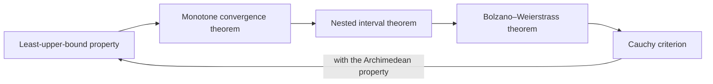

Intuitively, the graph of a continuous function is a curve "without breaks." This chapter makes the intuition precise in the language of limits from [Chapter 2](/2.2.2): $f$ is continuous at $x_0$ when $\lim\limits_{x \to x_0} f(x) = f(x_0)$, that is, when the limit equals the value of the function. On this basis we discuss in turn the classification of points of discontinuity, the behavior of continuity under operations, and the continuity of elementary functions. We then establish two further forms of the completeness of the real numbers, the nested interval theorem and the Bolzano–Weierstrass theorem, and use them to prove the three basic properties of continuous functions on closed intervals (Bolzano's theorem, the intermediate value theorem and the extreme value theorem) as well as the sufficiency part of the Cauchy criterion. Finally we introduce uniform continuity, a global property that [Chapter 7](/2.2.7) needs to prove that continuous functions are integrable.

In later chapters, derivatives ([Chapter 4](/2.2.4)) presuppose continuity, and the mean value theorems ([Chapter 5](/2.2.5)) rest on the properties of continuous functions on closed intervals; the **right continuity** of distribution functions in probability theory is also defined in this chapter.

## 3.1. Continuity: Concepts and Properties

### 3.1.1. Continuity and Discontinuity

**Definition 3.1.1 (Continuous Function)** Let $f$ be defined on some neighborhood $N(x_0)$ of $x_0$. If

$$
\lim_{x \to x_0} f(x) = f(x_0),
$$
then $f$ is said to be **continuous** at the point $x_0$. In $\varepsilon$-$\delta$ language: for every $\varepsilon > 0$ there exists $\delta > 0$ such that $|f(x) - f(x_0)| < \varepsilon$ whenever $|x - x_0| < \delta$.

Compared with the definition of the limit of a function, there are two differences: $f$ must be defined at $x_0$, and the condition $0 < |x - x_0|$ is replaced by $|x - x_0|$ (for $x = x_0$ the inequality holds automatically). Writing $\Delta x = x - x_0$ for the increment of the independent variable and $\Delta y = f(x_0 + \Delta x) - f(x_0)$ for the increment of the function, we have

$$
f \text{ is continuous at } x_0 \iff \lim_{\Delta x \to 0} \Delta y = 0,
$$
that is, a small change in the independent variable causes only a small change in the value of the function. By Heine's theorem, the **sequential criterion for limits** (Theorem 2.3.6), $f$ is continuous at $x_0$ if and only if for every sequence $\{x_n\}$ converging to $x_0$ (here $x_n \ne x_0$ is not required)

$$
\lim_{n \to \infty} f(x_n) = f(x_0) = f\Bigl(\lim_{n \to \infty} x_n\Bigr).
$$
Continuous functions are therefore described as functions that "commute with limits."

**Definition 3.1.2 (Left and Right Continuity)** If $\lim\limits_{x \to x_0^-} f(x) = f(x_0)$, then $f$ is said to be **left-continuous** at $x_0$; if $\lim\limits_{x \to x_0^+} f(x) = f(x_0)$, then $f$ is said to be **right-continuous** at $x_0$.

From the relation between one-sided limits and limits, $f$ is continuous at $x_0$ if and only if it is both left-continuous and right-continuous at $x_0$. For example, the floor function $\lfloor x \rfloor$ is right-continuous but not left-continuous at every integer; in probability theory, the distribution function of every random variable is right-continuous.

**Definition 3.1.3 (Continuous Function on an Interval)** If $f$ is continuous at every point of an open interval $I$, then $f$ is said to be continuous on $I$, written $f \in C(I)$. If $f$ is continuous at every point of $(a, b)$, right-continuous at the left endpoint $a$ and left-continuous at the right endpoint $b$, then $f$ is said to be continuous on the closed interval $[a, b]$, written $f \in C[a, b]$. Continuity on $[a, b)$ and $(a, b]$ is defined similarly.

**Example 3.1.1** Prove that $a^x$ ($a > 0$, $a \ne 1$) is continuous everywhere on $(-\infty, +\infty)$.

**Proof** Take any $x_0$. Then $\Delta y = a^{x_0 + \Delta x} - a^{x_0} = a^{x_0}(a^{\Delta x} - 1)$; by Example 2.3.3, $a^{\Delta x} \to 1$ as $\Delta x \to 0$, so $\Delta y \to 0$. $\square$

Examples 2.3.3 and 2.4.2 of [Chapter 2](/2.2.2) have already shown that the limits of $\sin x$, $\cos x$, $a^x$ and $\ln x$ at every point of their domains equal their values; in general, the basic elementary functions are continuous at every point of their domains (§3.1.3).

**Example 3.1.2** Let $f(x) = \begin{cases} \dfrac{\ln(1 + 2x)}{x}, & x > 0, \\ a\cos x, & x \leq 0 \end{cases}$ be continuous at $0$. Find $a$.

**Solution** $\lim\limits_{x \to 0^+} f(x) = \lim\limits_{x \to 0^+} \frac{2x}{x} = 2$ (substituting the **equivalent infinitesimals** $\ln(1 + 2x) \sim 2x$), and $\lim\limits_{x \to 0^-} f(x) = a = f(0)$. Continuity requires both one-sided limits to equal $f(0)$, so $a = 2$.

**Example 3.1.3** Determine whether $f(x) = \dfrac{2^{1/x} - 1}{2^{1/x} + 1}$ ($x \ne 0$), $f(0) = 1$, is continuous at $0$.

**Solution** Let $u = 2^{1/x}$. As $x \to 0^+$, $u \to +\infty$ and $f(x) = \frac{1 - 1/u}{1 + 1/u} \to 1$; as $x \to 0^-$, $u \to 0^+$ and $f(x) \to \frac{0 - 1}{0 + 1} = -1$. The one-sided limits differ, so $f$ is not continuous at $0$ (it is right-continuous but not left-continuous).

**Definition 3.1.4 (Point of Discontinuity)** Let $f$ be defined on some punctured neighborhood of $x_0$. If $f$ is not continuous at $x_0$, then $x_0$ is called a **point of discontinuity** of $f$.

Discontinuity occurs in two ways: $f$ is not defined at $x_0$ (as $\frac{x}{x - 1}$ at $x = 1$), or $f$ is defined at $x_0$ but $\lim\limits_{x \to x_0} f(x) \ne f(x_0)$ (including the case where the limit does not exist, as $\operatorname{sgn} x$ at $x = 0$). Points of discontinuity are divided into two kinds according to whether the one-sided limits exist.

**Definition 3.1.5 (Classification of Discontinuities)** Let $x_0$ be a point of discontinuity of $f$.

1. If the left-hand limit $f(x_0 - 0)$ and the right-hand limit $f(x_0 + 0)$ both exist, then $x_0$ is called a **discontinuity of the first kind**. Specifically:
   - if $f(x_0 - 0) = f(x_0 + 0)$ (while $f$ is undefined at $x_0$ or $f(x_0)$ differs from this value), then $x_0$ is called a **removable discontinuity**;
   - if $f(x_0 - 0) \ne f(x_0 + 0)$, then $x_0$ is called a **jump discontinuity**.
2. If at least one of the one-sided limits does not exist, then $x_0$ is called a **discontinuity of the second kind**. Specifically:
   - if $f(x)$ is unbounded as $x \to x_0^-$ or as $x \to x_0^+$, then $x_0$ is called an **infinite discontinuity**;
   - if $f$ is bounded near $x_0$ but some one-sided limit does not exist, then $x_0$ is called an **oscillating discontinuity**.

"Removable" means that by defining or redefining $f$ at the single point $x_0$, setting $f(x_0) = \lim\limits_{x \to x_0} f(x)$, we obtain a function continuous at $x_0$. For example, $\frac{\sin x}{x}$ has a removable discontinuity at $x = 0$ and becomes continuous once we define $f(0) = 1$; $\lfloor x \rfloor$ has a jump discontinuity at every integer; $\frac1x$ has an infinite discontinuity at $x = 0$; and $\sin\frac1x$ has an oscillating discontinuity at $x = 0$ (Example 2.3.6).

**Example 3.1.4** Classify the points of discontinuity of $f(x) = \dfrac{\lfloor x \rfloor}{x}$.

**Solution** $f$ is undefined at $x = 0$. For $0 < x < 1$, $f(x) = 0$; for $-1 < x < 0$, $f(x) = -\frac1x \to +\infty$ ($x \to 0^-$), so $x = 0$ is a discontinuity of the second kind (an infinite discontinuity). At an integer $n \ne 0$, $\lim\limits_{x \to n^-} f(x) = \frac{n - 1}{n}$ and $\lim\limits_{x \to n^+} f(x) = \frac nn = 1$; these differ, so $n$ is a discontinuity of the first kind (a jump discontinuity). At all other points $f$ is a quotient of continuous functions and hence continuous (Theorem 3.1.2).

**Example 3.1.5** The **Dirichlet function** $D(x)$ is discontinuous everywhere: every interval contains both rational and irrational numbers (Theorem 1.1.2), so at every point $x_0$ we can choose a sequence of rationals and a sequence of irrationals tending to $x_0$, along which $D$ takes the values $1$ and $0$, respectively. By Heine's theorem, $\lim\limits_{x \to x_0} D(x)$ does not exist, and every point is a discontinuity of the second kind (an oscillating discontinuity). By contrast, $xD(x)$ is continuous only at $x = 0$: $|xD(x)| \leq |x|$.

### 3.1.2. Elementary Properties of Continuous Functions

The properties and rules for limits of functions immediately give the following properties of continuous functions.

**Theorem 3.1.1 (Local Sign Preservation)** Let $f$ be continuous at $x_0$ with $f(x_0) > 0$ ($< 0$). Then there exists $\delta > 0$ such that $f(x) > 0$ ($< 0$) for $x \in N(x_0, \delta)$.

**Theorem 3.1.2 (Continuity under Arithmetic Operations)** If $f$ and $g$ are continuous at $x_0$, then so are $cf$ ($c \in \mathbb{R}$), $f \pm g$, $fg$, and $\frac fg$ (provided $g(x_0) \ne 0$).

**Theorem 3.1.3 (Continuity of Composite Functions)** Let $x = g(t)$ be continuous at $t_0$, let $x_0 = g(t_0)$, and let $f$ be continuous at $x_0$. Then the composite function $f(g(t))$ is continuous at $t_0$.

**Proof** We have $\lim\limits_{t \to t_0} g(t) = g(t_0) = x_0$ and $\lim\limits_{x \to x_0} f(x) = f(x_0)$. Since $f$ is continuous at $x_0$, the theorem on limits of composite functions (Theorem 2.4.4) does not need the condition $g(t) \ne x_0$, so $\lim\limits_{t \to t_0} f(g(t)) = f(x_0) = f(g(t_0))$. $\square$

More generally, if $\lim\limits_{t \to t_0} g(t) = x_0$ ($g$ need not be continuous at $t_0$) and $f$ is continuous at $x_0$, then $\lim\limits_{t \to t_0} f(g(t)) = f\bigl(\lim\limits_{t \to t_0} g(t)\bigr)$: a continuous function and a limit can be interchanged.

**Theorem 3.1.4 (Continuity of Functions of the Form $u^v$)** Let $u(x)$ and $v(x)$ be continuous at $x_0$ with $u(x_0) > 0$. Then $u(x)^{v(x)}$ is continuous at $x_0$.

**Proof** $u(x)^{v(x)} = \mathrm{e}^{v(x)\ln u(x)}$. Since $\ln u$ is continuous at $u(x_0) > 0$, Theorem 3.1.3 shows that $\ln u(x)$ is continuous at $x_0$; by Theorem 3.1.2, so is $v(x)\ln u(x)$; the result follows from the continuity of $\mathrm{e}^y$ and Theorem 3.1.3. $\square$

**Theorem 3.1.5 (Continuity of Inverse Functions)** Let $y = f(x)$ be strictly increasing (decreasing) and continuous on $[a, b]$, and let $\alpha = f(a)$, $\beta = f(b)$. Then its inverse function $x = f^{-1}(y)$ is strictly increasing (decreasing) and continuous on $[\alpha, \beta]$ ($[\beta, \alpha]$).

That the range of $f$ is exactly $[\alpha, \beta]$ requires the intermediate value theorem proved below (Theorem 3.3.2). The inverse function is continuous because a monotonic function can only have jump discontinuities (§2.4.3), whereas the range of $f^{-1}$ is the whole interval $[a, b]$, with no values "skipped," so it cannot jump.

### 3.1.3. Continuity of Elementary Functions

**Theorem 3.1.6 (Continuity of the Basic Elementary Functions)** The basic elementary functions (constant functions, power functions $x^\alpha$, exponential functions $a^x$, logarithmic functions $\log_a x$, trigonometric functions and inverse trigonometric functions) are continuous at every point of their domains.

**Proof** The continuity of $\sin x$, $\cos x$, $a^x$ and $\ln x$ was proved in Examples 2.3.3 and 2.4.2; that of $\tan x$ and the other trigonometric functions follows from Theorem 3.1.2; $\log_a x = \frac{\ln x}{\ln a}$; the continuity of $x^\alpha = \mathrm{e}^{\alpha\ln x}$ ($x > 0$) follows from Theorem 3.1.3; and the inverse trigonometric functions are inverses of trigonometric functions on intervals of monotonicity, so Theorem 3.1.5 applies. $\square$

**Theorem 3.1.7 (Continuity of Elementary Functions)** An elementary function is continuous on every interval contained in its domain.

Since elementary functions are obtained from basic elementary functions by finitely many arithmetic operations and compositions, this is a direct consequence of Theorems 3.1.2, 3.1.3 and 3.1.6. The phrase "interval contained in its domain" cannot be omitted: $\sqrt{\cos x - 1}$ is an elementary function, but its domain $\{2k\pi \mid k \in \mathbb{Z}\}$ consists of isolated points; the function is undefined near these points, so continuity is meaningless there. The practical significance of Theorem 3.1.7 is that the limit of an elementary function at a point $x_0$ of an interval in its domain is obtained simply by substituting $f(x_0)$, and that discontinuities of an elementary function can occur only at points outside its domain (isolated points where it is undefined).

**Example 3.1.6** Study the continuity of the following functions and identify the points of discontinuity and their kinds:

$$
\text{(1)}\ f(x) = (1 + x)^{\frac{x}{\tan(x - \pi/4)}}, \ x \in (0, 2\pi); \qquad \text{(2)}\ f(x) = \frac{x(x - 1)}{|x|(x^2 - 1)}.
$$

**Solution** (1) This is an elementary function, and its points of discontinuity are those where the exponent is undefined: $x = \frac{3\pi}4, \frac{7\pi}4$, where $\tan\left(x - \frac\pi4\right)$ is undefined, and $x = \frac\pi4, \frac{5\pi}4$, where $\tan\left(x - \frac\pi4\right) = 0$. At $x = \frac{3\pi}4$ and $\frac{7\pi}4$, $\tan\left(x - \frac\pi4\right) \to \infty$, the exponent tends to $0$ and $f(x) \to 1$, so these are removable discontinuities. At $x = \frac\pi4$ the exponent tends to $+\infty$ from the right and to $-\infty$ from the left, while the base $1 + \frac\pi4 > 1$; hence $f(x) \to +\infty$ ($x \to \frac\pi4^+$), and this is a discontinuity of the second kind (an infinite discontinuity); the same holds at $x = \frac{5\pi}4$.

(2) The domain is $x \ne 0, \pm1$, and there $f(x) = \frac{\operatorname{sgn} x}{x + 1}$. Hence at $x = 0$ we have $f(0 - 0) = -1$ and $f(0 + 0) = 1$, a jump discontinuity; at $x = 1$, $f(x) \to \frac12$, a removable discontinuity; at $x = -1$, $f(x) \to \infty$, an infinite discontinuity.

**Example 3.1.7** Discuss the continuity of $f(x) = \dfrac{\lfloor x \rfloor\ln(1 + x)}{1 + \sin x}$.

**Solution** The domain is $x > -1$ with $x \ne 2k\pi - \frac\pi2$ ($k \in \mathbb{N}_+$). At $x = 2k\pi - \frac\pi2$ the denominator tends to $0$ while the numerator does not, so $f(x) \to \infty$: an infinite discontinuity. At a positive integer $n$, $\lfloor x \rfloor$ jumps:

$$
\lim_{x \to n^+} f(x) = \frac{n\ln(1 + n)}{1 + \sin n}, \qquad \lim_{x \to n^-} f(x) = \frac{(n - 1)\ln(1 + n)}{1 + \sin n};
$$
these differ, so $n$ is a jump discontinuity. At $x = 0$, $\lfloor x \rfloor$ also jumps (from $-1$ to $0$), but the factor $\ln(1 + x) \to 0$, so both one-sided limits equal $0 = f(0)$ and $f$ is continuous at $0$. At all other points $f$ is a product and quotient of continuous functions, hence continuous.

## 3.2. The Nested Interval Theorem and the Bolzano–Weierstrass Theorem

The properties of continuous functions on closed intervals and the sufficiency part of the Cauchy criterion must all be proved from the fact that "the real numbers have no gaps." This section gives two new formulations of the completeness of the real numbers that are more convenient to use directly than the least-upper-bound property.

**Theorem 3.2.1 (Nested Interval Theorem)** Let $[a_n, b_n]$ ($n \in \mathbb{N}_+$) be a sequence of closed intervals such that

1. $[a_n, b_n] \supseteq [a_{n+1}, b_{n+1}]$, $n = 1, 2, \dots$;
2. $\lim\limits_{n \to \infty} (b_n - a_n) = 0$.

Then there is a unique real number $\xi$ belonging to all these intervals, that is, $\bigcap\limits_{n=1}^\infty [a_n, b_n] = \{\xi\}$, and $\lim\limits_{n \to \infty} a_n = \lim\limits_{n \to \infty} b_n = \xi$.

**Proof** By condition 1, $\{a_n\}$ is nondecreasing and bounded above by $b_1$, and $\{b_n\}$ is nonincreasing and bounded below by $a_1$. By the **monotone convergence theorem**, let $a_n \to \xi$ and $b_n \to \eta$; then $\eta - \xi = \lim(b_n - a_n) = 0$, that is, $\xi = \eta$. Moreover, $\xi = \sup\{a_n\} = \inf\{b_n\}$, so $a_n \leq \xi \leq b_n$ for all $n$, and $\xi$ belongs to every interval. If $\xi'$ also belongs to every interval, then $a_n \leq \xi' \leq b_n$, and passing to the limit by order preservation gives $\xi \leq \xi' \leq \xi$, so $\xi' = \xi$. $\square$

Neither condition can be dropped, and the intervals must be closed: the nested open intervals $\left(0, \frac1n\right)$ satisfy 1 and 2 but have empty intersection; the intervals $[n, +\infty)$ are not bounded, and their intersection is also empty; if only condition 1 holds, the intersection is nonempty but need not be a single point (for example, the intersection of $\left[-1 - \frac1n, 1 + \frac1n\right]$ is $[-1, 1]$).

**Theorem 3.2.2 (Bolzano–Weierstrass Theorem)**

1. Every bounded sequence has a convergent subsequence;
2. If $\{x_n\} \subseteq [a, b]$ and $\{x_{n_j}\}$ is a convergent subsequence with $\lim\limits_{j \to \infty} x_{n_j} = \xi$, then $\xi \in [a, b]$.

**Proof** 1. Let $\{x_n\} \subseteq [a_1, b_1]$. Bisect $[a_1, b_1]$ into two closed intervals; at least one of them contains infinitely many terms of $\{x_n\}$; call it $[a_2, b_2]$. Bisect $[a_2, b_2]$ and call a half containing infinitely many terms $[a_3, b_3]$. Continuing in this way, we obtain nested closed intervals $[a_j, b_j]$ with $b_j - a_j = \frac{b_1 - a_1}{2^{j-1}} \to 0$, each containing infinitely many terms of $\{x_n\}$. By the nested interval theorem, $a_j, b_j \to \xi$.

Now choose indices successively: pick a term $x_{n_1}$ in $[a_1, b_1]$; pick a term $x_{n_2}$ in $[a_2, b_2]$ with $n_2 > n_1$ (possible because $[a_2, b_2]$ contains infinitely many terms); in general, pick $x_{n_j}$ in $[a_j, b_j]$ with $n_j > n_{j-1}$. Then $\{x_{n_j}\}$ is a subsequence and $a_j \leq x_{n_j} \leq b_j$, so $x_{n_j} \to \xi$ by the squeeze theorem.

2. This follows from $a \leq x_{n_j} \leq b$ and order preservation: $a \leq \xi \leq b$. $\square$

The Bolzano–Weierstrass theorem is the sequence version of Theorem 3.4.2 of [1.2.3](/1.2.3#sec-3.4), "every bounded infinite set has a **limit point**." Conclusion 2 expresses an important feature of closed intervals: limits of subsequences of sequences in the interval cannot "escape" from it; for the open interval $(0, 1)$, by contrast, the limit $0$ of the sequence $\frac1n$ is not in the interval. Combined with the result of §2.1.4, every sequence has either a convergent subsequence or a subsequence tending to $\infty$.

As a first application of the Bolzano–Weierstrass theorem, we complete the proof left over from [Chapter 2](/2.2.2).

**Theorem 3.2.3 (Cauchy Criterion)** A sequence $\{x_n\}$ converges if and only if $\{x_n\}$ is a **Cauchy sequence**.

**Proof** Necessity was proved in Theorem 2.2.4. Sufficiency is proved in two steps.

(1) A Cauchy sequence is bounded. For $\varepsilon = 1$ there exists $N$ such that $|x_{n+p} - x_n| < 1$ for $n > N$ and all $p$; in particular $|x_{N+p} - x_{N+1}| < 1$, that is, $|x_n| < |x_{N+1}| + 1$ for $n > N$. With $M = \max\{|x_1|, \dots, |x_N|, |x_{N+1}| + 1\}$, we have $|x_n| \leq M$ for all $n$.

(2) A Cauchy sequence converges. By (1) and the Bolzano–Weierstrass theorem there is a convergent subsequence $x_{n_j} \to A$. Given $\varepsilon > 0$, there exists $N$ such that $|x_n - x_m| < \frac\varepsilon2$ for $m, n > N$, and there exists $J$ such that $|x_{n_j} - A| < \frac\varepsilon2$ for $j > J$. Fix some $j > J$ with $n_j > N$; then for $n > N$,

$$
|x_n - A| \leq |x_n - x_{n_j}| + |x_{n_j} - A| < \frac\varepsilon2 + \frac\varepsilon2 = \varepsilon.
$$
Hence $x_n \to A$. $\square$

We have now proved, starting from the least-upper-bound property, the monotone convergence theorem, the nested interval theorem, the Bolzano–Weierstrass theorem and the Cauchy criterion in turn. Conversely, any one of them (the Cauchy criterion together with the Archimedean property) implies the least-upper-bound property, so they are equivalent formulations of the **completeness of the real numbers**. In each situation we use the most convenient one: the monotone convergence theorem for limits of recursive sequences, the nested interval theorem for bisection arguments, the Bolzano–Weierstrass theorem for "extracting a convergent subsequence," and the Cauchy criterion for deciding convergence when the limit is unknown.

## 3.3. Properties of Continuous Functions on Closed Intervals

The three theorems of this section describe the global behavior of continuous functions on bounded closed intervals. Their conclusions are all intuitive, but their proofs all require the completeness of the real numbers: over the rational numbers, $f(x) = x^2 - 2$ is "continuous" on $[1, 2] \cap \mathbb{Q}$ and takes values of opposite signs at the endpoints, yet it has no zero.

**Theorem 3.3.1 (Bolzano's Theorem)** Let $f \in C[a, b]$ with $f(a)f(b) < 0$. Then there exists $\xi \in (a, b)$ such that $f(\xi) = 0$.

**Proof** Without loss of generality let $f(a) < 0 < f(b)$. Take the midpoint $c = \frac{a + b}2$: if $f(c) = 0$, we are done; if $f(c) > 0$, let $[a_1, b_1] = [a, c]$; if $f(c) < 0$, let $[a_1, b_1] = [c, b]$. In either case $f(a_1) < 0 < f(b_1)$. Repeat this step on $[a_1, b_1]$. If at some step the value at the midpoint is $0$, we are done; otherwise we obtain a sequence of closed intervals $[a_n, b_n]$ with

$$
[a_n, b_n] \supseteq [a_{n+1}, b_{n+1}], \qquad b_n - a_n = \frac{b - a}{2^n} \to 0, \qquad f(a_n) < 0 < f(b_n).
$$
By the nested interval theorem, $a_n, b_n \to \xi \in [a, b]$. By the continuity of $f$ and sign preservation,

$$
f(\xi) = \lim_{n \to \infty} f(a_n) \leq 0, \qquad f(\xi) = \lim_{n \to \infty} f(b_n) \geq 0,
$$
so $f(\xi) = 0$; and since $f(a) \ne 0 \ne f(b)$, we have $\xi \in (a, b)$. $\square$

This proof is itself a numerical method for finding zeros.

**Algorithm 3.3.1 (Bisection Method)** Let $f \in C[a, b]$ with $f(a) < 0 < f(b)$, and let a tolerance $\eta > 0$ be given.

1. Set $a_0 = a$ and $b_0 = b$;
2. For $n = 0, 1, 2, \dots$: let $c = \frac{a_n + b_n}2$. If $f(c) = 0$, output $c$; if $f(c) < 0$, set $a_{n+1} = c$, $b_{n+1} = b_n$; otherwise set $a_{n+1} = a_n$, $b_{n+1} = c$;
3. Stop when $b_n - a_n = \frac{b - a}{2^n} < \eta$, and output $\frac{a_n + b_n}2$.

The error of the output relative to the true zero $\xi$ is at most $\frac{b - a}{2^{n+1}}$; each step halves the error bound, so about $\log_2\frac{b - a}{\eta}$ steps are needed to reach the tolerance $\eta$.

![Finding the zero of f(x) = x³ + x − 1 on [0, 1] by bisection: each step keeps the half whose endpoint values have opposite signs, producing nested intervals of length 2^{-n} that converge to the zero ξ ≈ 0.6823.](./plots/bisection.py)

**Theorem 3.3.2 (Intermediate Value Theorem)** Let $f \in C[a, b]$ with $f(a) \ne f(b)$. Then for every real number $\mu$ between $f(a)$ and $f(b)$ there exists $\xi \in (a, b)$ such that $f(\xi) = \mu$.

**Proof** Let $g(x) = f(x) - \mu$. Then $g \in C[a, b]$, and $g(a)$ and $g(b)$ have opposite signs. By Bolzano's theorem there exists $\xi \in (a, b)$ with $g(\xi) = 0$, that is, $f(\xi) = \mu$. $\square$

The key to applying Bolzano's theorem and the intermediate value theorem is to construct an auxiliary function, turning "there exists $\xi$ satisfying some equation" into "some function has a zero."

**Example 3.3.1** If $m$ is odd, then the polynomial $p(x) = x^m + a_1x^{m-1} + \cdots + a_{m-1}x + a_m$ has at least one real zero.

**Proof** $p(x) = x^m\left(1 + \frac{a_1}x + \cdots + \frac{a_m}{x^m}\right)$, and the expression in parentheses tends to $1$; since $m$ is odd, $p(x) \to +\infty$ as $x \to +\infty$ and $p(x) \to -\infty$ as $x \to -\infty$. Hence there exists $M > 0$ with $p(-M) < 0 < p(M)$, and by Bolzano's theorem there exists $\xi \in (-M, M)$ with $p(\xi) = 0$. $\square$

**Example 3.3.2** Let $f \in C[a, b]$ with $f(a) < a$ and $f(b) > b$. Then there exists $\xi \in (a, b)$ with $f(\xi) = \xi$.

**Proof** Let $g(x) = f(x) - x$. Then $g \in C[a, b]$ and $g(a) < 0 < g(b)$, and Bolzano's theorem gives the result. $\square$

**Example 3.3.3** Let $f \in C[0, a]$ ($a > 0$) with $f(0) = f(a) = 0$ and $f > 0$ on $(0, a)$. Prove that for every $l \in (0, a)$ there exists $\xi \in (0, a - l)$ such that $f(\xi) = f(\xi + l)$.

**Proof** Let $g(x) = f(x) - f(x + l)$, $x \in [0, a - l]$. Then $g$ is continuous, $g(0) = -f(l) < 0$ and $g(a - l) = f(a - l) > 0$. By Bolzano's theorem there exists $\xi \in (0, a - l)$ with $g(\xi) = 0$. $\square$

**Example 3.3.4** Let $f \in C[a, +\infty)$ with $f(a) > 0$ and $\lim\limits_{x \to +\infty} f(x) = A < 0$. Then there exists $\xi \in (a, +\infty)$ with $f(\xi) = 0$.

**Proof** By local sign preservation for limits of functions, there exists $X > a$ such that $f(x) < 0$ for $x > X$. Then $f$ is continuous on the closed interval $[a, X + 1]$ and takes values of opposite signs at its endpoints, and Bolzano's theorem gives the result. $\square$

The trick in Example 3.3.4 is to use the limit to "truncate" a problem on an infinite interval to one on a closed interval.

**Theorem 3.3.3 (Extreme Value Theorem)** Let $f \in C[a, b]$. Then

1. $f$ is bounded on $[a, b]$: there exists $M > 0$ such that $|f(x)| \leq M$ for $x \in [a, b]$;
2. $f$ attains a maximum and a minimum on $[a, b]$: there exist $\alpha, \beta \in [a, b]$ such that $f(\beta) \leq f(x) \leq f(\alpha)$ for all $x \in [a, b]$.

**Proof** 1. Suppose, to the contrary, that $f$ is unbounded on $[a, b]$. Then for every $n \in \mathbb{N}_+$ there exists $x_n \in [a, b]$ with $|f(x_n)| > n$. By the Bolzano–Weierstrass theorem, the bounded sequence $\{x_n\}$ has a convergent subsequence $x_{n_j} \to \xi$, and $\xi \in [a, b]$. By the continuity of $f$ at $\xi$ (one-sided continuity if $\xi$ is an endpoint), $f(x_{n_j}) \to f(\xi)$, so $\{f(x_{n_j})\}$ is bounded; but $|f(x_{n_j})| > n_j \geq j$, a contradiction.

2. By 1 and the least-upper-bound property, $M = \sup\limits_{[a, b]} f$ exists. By the characterization of suprema, for every $n$ there exists $x_n \in [a, b]$ with $M - \frac1n < f(x_n) \leq M$, so $f(x_n) \to M$ by the squeeze theorem. By the Bolzano–Weierstrass theorem, extract a convergent subsequence $x_{n_j} \to \alpha \in [a, b]$; by continuity, $f(\alpha) = \lim\limits_{j \to \infty} f(x_{n_j}) = M$. The minimum is handled in the same way. $\square$

Neither the condition "bounded closed interval" nor the condition "continuous" can be dropped: $f(x) = x$ is continuous on $(0, 1)$ but attains neither a maximum nor a minimum; $\frac1x$ is continuous on $(0, 1]$ but unbounded; $f(x) = x - \lfloor x \rfloor$ has a jump discontinuity on $[0, 1]$ and does not attain its supremum $1$.

**Corollary 3.3.1 (Strengthened Intermediate Value Theorem)** Let $f \in C[a, b]$, and let $m$ and $M$ be the minimum and maximum of $f$ on $[a, b]$. Then for every $\mu \in [m, M]$ there exists $\xi \in [a, b]$ such that $f(\xi) = \mu$. In other words, $f([a, b]) = [m, M]$.

**Proof** Let $f(\beta) = m$ and $f(\alpha) = M$. If $m = M$, then $f$ is constant. Otherwise apply the intermediate value theorem on the closed interval with endpoints $\alpha$ and $\beta$ (for $\mu = m$ or $M$ take $\xi = \beta$ or $\alpha$ directly). $\square$

Note that here $\xi$ is guaranteed only to lie in the closed interval $[a, b]$: the extreme values may be attained at the endpoints; for example, for $f(x) = x$ on $[0, 1]$ and $\mu = 1$, the only choice is $\xi = 1$.

**Example 3.3.5** Let $f \in C[0, +\infty)$ with $f(0) = 0$ and $\lim\limits_{x \to +\infty} f(x) = 0$, and suppose $f$ is not identically zero. Prove that $f$ has a positive maximum or a negative minimum on $[0, +\infty)$.

**Proof** Since $f$ is not identically zero, there exists $x_0$ with $f(x_0) \ne 0$; suppose $f(x_0) > 0$. Since $\lim\limits_{x \to +\infty} f(x) = 0$, there exists $X > x_0$ such that $|f(x)| < f(x_0)$ for $x > X$. As $f$ is continuous on $[0, X]$, the extreme value theorem gives a maximum $M \geq f(x_0) > 0$ there; and for $x > X$, $f(x) < f(x_0) \leq M$. Hence $M$ is the maximum of $f$ on $[0, +\infty)$, and it is positive. If $f(x_0) < 0$, the same argument gives a negative minimum. $\square$

## 3.4. Uniform Continuity

That $f$ is continuous on an interval $I$ means that for every point $v \in I$ and every $\varepsilon > 0$ there exists $\delta > 0$ such that $|f(x) - f(v)| < \varepsilon$ whenever $|x - v| < \delta$. Here $\delta$ generally depends both on $\varepsilon$ and on the point $v$: the more rapidly the function changes, the smaller $\delta$ must be. If a single $\delta$ can be found that works for all points of the interval, we obtain a stronger notion.

**Definition 3.4.1 (Uniform Continuity)** Let $f$ be defined on an interval $I$. If for every $\varepsilon > 0$ there exists $\delta > 0$ such that $|f(u) - f(v)| < \varepsilon$ for all $u, v \in I$ with $|u - v| < \delta$, then $f$ is said to be **uniformly continuous** on $I$.

- Uniform continuity implies continuity (fix $v$); the converse is false.
- Continuity is a local property (defined pointwise), while uniform continuity is a global property (it depends on the interval $I$). Describing global properties of a function on an interval often requires uniform continuity, for example the proof in [Chapter 7](/2.2.7) that continuous functions are Riemann integrable.
- Intuitively, uniform continuity says that $f$ varies "gently" on $I$: if a rectangular window of width $\delta$ and height $\varepsilon$ slides along the curve, the curve never leaves the window through its top or bottom edge.
- Negation: $f$ is not uniformly continuous on $I$ if and only if there exist $\varepsilon_0 > 0$ and two sequences $u_n, v_n$ in $I$ with $|u_n - v_n| \to 0$ but $|f(u_n) - f(v_n)| \geq \varepsilon_0$.

**Example 3.4.1** $\sin x$ is uniformly continuous on $(-\infty, +\infty)$.

**Proof** For all $u, v$, $|\sin u - \sin v| = 2\left|\cos\frac{u + v}2\right|\left|\sin\frac{u - v}2\right| \leq |u - v|$. Given $\varepsilon > 0$, take $\delta = \varepsilon$. $\square$

In general, if there is a constant $L$ with $|f(u) - f(v)| \leq L|u - v|$ for all $u, v \in I$ (a Lipschitz condition), then $f$ is uniformly continuous on $I$, with $\delta = \frac\varepsilon L$. [Chapter 5](/2.2.5) shows that functions with bounded derivatives satisfy this condition; but a bounded derivative is only a sufficient condition for uniform continuity, not a necessary one: $\sqrt x$ is uniformly continuous on $[0, 1]$ (Theorem 3.4.1), although its derivative is unbounded near $0$.

**Example 3.4.2** $f(x) = \frac1x$ is not uniformly continuous on $(0, +\infty)$.

**Proof** Take $\varepsilon_0 = 1$. For any $\delta \in (0, 1)$, let $u = \delta$ and $v = \frac\delta2$. Then $|u - v| = \frac\delta2 < \delta$, but

$$
|f(u) - f(v)| = \frac2\delta - \frac1\delta = \frac1\delta > 1 = \varepsilon_0. \qquad \square
$$

Similarly, $x^2$ is not uniformly continuous on $(-\infty, +\infty)$ (take $u_n = n + \frac1n$ and $v_n = n$; then $u_n^2 - v_n^2 = 2 + \frac1{n^2} > 2$). These two counterexamples represent the two ways uniform continuity can fail: becoming infinitely steep near a finite endpoint ($\frac1x$ near $0$), or becoming steeper and steeper at infinity ($x^2$). The next theorem shows that neither can happen on a bounded closed interval.

**Theorem 3.4.1 (Heine–Cantor Theorem)** If $f \in C[a, b]$, then $f$ is uniformly continuous on $[a, b]$.

**Proof** Suppose, to the contrary, that $f$ is not uniformly continuous on $[a, b]$. Then there exists $\varepsilon_0 > 0$ such that for every $\delta = \frac1n$ there are $u_n, v_n \in [a, b]$ with $|u_n - v_n| < \frac1n$ but $|f(u_n) - f(v_n)| \geq \varepsilon_0$. By the Bolzano–Weierstrass theorem, $\{u_n\}$ has a convergent subsequence $u_{n_j} \to \xi \in [a, b]$. From $u_{n_j} - \frac1{n_j} < v_{n_j} < u_{n_j} + \frac1{n_j}$ and the squeeze theorem, $v_{n_j} \to \xi$. By the continuity of $f$ at $\xi$,

$$
\lim_{j \to \infty} \bigl|f(u_{n_j}) - f(v_{n_j})\bigr| = |f(\xi) - f(\xi)| = 0,
$$
contradicting $|f(u_{n_j}) - f(v_{n_j})| \geq \varepsilon_0$. $\square$

As in the proof of the extreme value theorem, the key is conclusion 2 of the Bolzano–Weierstrass theorem: the limit $\xi$ of the subsequence remains in $[a, b]$, where $f$ is continuous. For $\frac1x$ on the open interval $(0, 1)$, the common limit $0$ of $u_n$ and $v_n$ lies outside the interval, and the argument breaks down.

**Example 3.4.3** Let $f \in C[a, +\infty)$ and suppose $\lim\limits_{x \to +\infty} f(x)$ exists. Then $f$ is uniformly continuous on $[a, +\infty)$.

**Proof** Let $A$ be the limit. Given $\varepsilon > 0$, there exists $X > a$ such that $|f(x) - A| < \frac\varepsilon2$ for $x > X$, so $|f(u) - f(v)| < \varepsilon$ for $u, v \in (X, +\infty)$. By the Heine–Cantor theorem, $f$ is uniformly continuous on $[a, X + 1]$: there exists $\delta \in (0, 1)$ such that $|f(u) - f(v)| < \varepsilon$ whenever $u, v \in [a, X + 1]$ and $|u - v| < \delta$. Now take any $u, v \in [a, +\infty)$ with $|u - v| < \delta < 1$: if the smaller of the two points is $\leq X$, then both lie in $[a, X + 1]$; otherwise both lie in $(X, +\infty)$. In either case $|f(u) - f(v)| < \varepsilon$. $\square$

Letting the two intervals overlap ($[a, X + 1]$ and $(X, +\infty)$) and taking $\delta < 1$ guarantees that any two sufficiently close points lie in the same piece; this is the standard technique for proving uniform continuity piece by piece.

Finally, consider bounded open intervals. By Example 3.4.2, $\frac1x$ is continuous but not uniformly continuous on $(0, 1)$, because its one-sided limit at the endpoint $0$ does not exist. This turns out to be the only obstruction.

**Theorem 3.4.2** Let $(a, b)$ be a bounded open interval and $f \in C(a, b)$. Then $f$ is uniformly continuous on $(a, b)$ if and only if the one-sided limits $\lim\limits_{x \to a^+} f(x)$ and $\lim\limits_{x \to b^-} f(x)$ both exist.

**Proof** Sufficiency: set $f(a) = \lim\limits_{x \to a^+} f(x)$ and $f(b) = \lim\limits_{x \to b^-} f(x)$. The extended function belongs to $C[a, b]$, so by the Heine–Cantor theorem it is uniformly continuous on $[a, b]$, and hence on $(a, b)$.

Necessity: we treat only $x \to a^+$. Given $\varepsilon > 0$, take $\delta$ as in the definition of uniform continuity. Let $\{x_n\} \subseteq (a, b)$ with $x_n \to a$. Then there exists $N$ such that $|x_n - x_m| < \delta$, and hence $|f(x_n) - f(x_m)| < \varepsilon$, for $m, n > N$; that is, $\{f(x_n)\}$ is a Cauchy sequence, which converges by the Cauchy criterion. For two such sequences $\{x_n\}$ and $\{y_n\}$, the interlaced sequence $x_1, y_1, x_2, y_2, \dots$ also tends to $a$, so its sequence of function values also converges, and therefore $\lim f(x_n) = \lim f(y_n)$. Thus the limit of $f(x_n)$ does not depend on the choice of the sequence, and by Heine's theorem (in its one-sided form) $\lim\limits_{x \to a^+} f(x)$ exists. $\square$

**Example 3.4.4** Let $(a, b)$ be bounded and let $f$ be uniformly continuous on $(a, b)$. Then $f$ is bounded on $(a, b)$.

**Proof** By Theorem 3.4.2, $f$ extends to a continuous function on $[a, b]$, which is bounded by the extreme value theorem. $\square$

One can also estimate directly without Theorem 3.4.2: for $\varepsilon = 1$, take $\delta$ as in the definition of uniform continuity and fix $x_0 \in (a, b)$. For any $x \in (a, b)$, insert division points between $x_0$ and $x$ so that adjacent points are less than $\delta$ apart; since $|x - x_0| < b - a$, the number $l$ of pieces can be taken to be at most $k = \left\lfloor \frac{2(b - a)}{\delta} \right\rfloor + 1$ (independent of $x$). Estimating piece by piece gives $|f(x) - f(x_0)| < l \leq k$, so $|f(x)| < |f(x_0)| + k$. $\square$

The converse fails: $\sin\frac1x$ is bounded and continuous on $(0, 1)$, but its limit as $x \to 0^+$ does not exist, so by Theorem 3.4.2 it is not uniformly continuous.

## Summary

| Topic | Key points |
|---|---|
| Continuity | $\lim\limits_{x \to x_0} f(x) = f(x_0)$; equivalently $\Delta y \to 0$, or $f(x_n) \to f(x_0)$ for every $x_n \to x_0$ |
| One-sided continuity | Continuous $\iff$ left-continuous and right-continuous; $C[a, b]$ requires only one-sided continuity at the endpoints |
| Points of discontinuity | First kind (both one-sided limits exist): removable, jump; second kind (at least one does not exist): infinite, oscillating |
| Operations and elementary functions | Arithmetic operations, composition, $u^v$ and inverses preserve continuity; elementary functions are continuous on intervals in their domains, so limits can be found by substitution |
| Nested interval theorem | Nested closed intervals with lengths $\to 0$ $\implies$ the intersection is exactly one point |
| Bolzano–Weierstrass theorem | Every bounded sequence has a convergent subsequence; limits of subsequences of sequences in $[a, b]$ stay in $[a, b]$ |
| Completeness | Least-upper-bound property $\Rightarrow$ monotone convergence $\Rightarrow$ nested intervals $\Rightarrow$ Bolzano–Weierstrass $\Rightarrow$ Cauchy criterion, all equivalent |
| Bolzano's theorem, intermediate value theorem | $f \in C[a, b]$, $f(a)f(b) < 0 \implies \exists \xi \in (a, b)$, $f(\xi) = 0$; $f([a, b]) = [m, M]$ |
| Extreme value theorem | $f \in C[a, b]$ is bounded and attains its maximum and minimum; neither "bounded closed interval" nor "continuous" can be dropped |
| Uniform continuity | $\delta$ depends only on $\varepsilon$, not on the point; Heine–Cantor: continuous on $[a, b]$ $\implies$ uniformly continuous; on a bounded open interval, uniformly continuous $\iff$ the one-sided limits at the endpoints exist |
| Methods | Construct an auxiliary function and apply Bolzano's theorem; use a limit to truncate an infinite interval to a closed interval; Algorithm 3.3.1 (bisection) |
