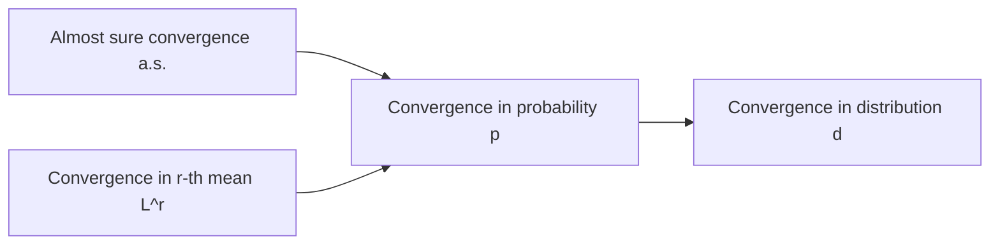

The main line of probability theory runs: probability space $(\Omega, \mathcal{F}, \mathbb{P})$ → random variables (vectors) and their distributions → numerical characteristics → limits of sequences of random variables $X_n \to\ ?$. The **law of large numbers** and the **central limit theorem** of the previous two chapters use convergence in probability, almost sure convergence and convergence in distribution. This chapter steps back from those two specific theorems and studies the modes of convergence of a general sequence of random variables systematically: their definitions, how they compare in strength, counterexamples that expose the differences, and several convergence theorems used again and again in statistics: the continuous mapping theorem, Slutsky's theorem, the delta method and the continuity theorem for characteristic functions. These tools are the foundation of large-sample theory in statistical inference ([3.2.2](/3.2.2), [3.2.3](/3.2.3)).

## 14.1. Definitions

Let $(\Omega, \mathcal{F}, \mathbb{P})$ be a probability space and let $X_n$ and $X$ be random variables on it, with distribution functions $F_n(x) = \mathbb{P}(X_n \le x)$ and $F(x) = \mathbb{P}(X \le x)$. All modes of convergence start from the convergence of a sequence of numbers: $\lim_n a_n = a$ means that for every $\varepsilon > 0$ there is a positive integer $N$ such that $\lvert a_n - a \rvert \le \varepsilon$ for $n \ge N$. The modes differ in how the randomness is first removed to produce a sequence of numbers.

**Definition 14.1.1 (Convergence in Distribution)** If $\lim_{n \to \infty} F_n(x) = F(x)$ at every continuity point $x$ of $F(x)$, we say that $X_n$ converges to $X$ in distribution (**convergence in distribution**) and write $X_n \xrightarrow{d} X$; we also say that $F_n$ converges weakly to $F$ and write $F_n \xrightarrow{w} F$.

**Definition 14.1.2 (Almost Sure Convergence)** If $\mathbb{P}\left(\lim_{n \to \infty} X_n = X\right) = 1$, we say that $X_n$ converges to $X$ almost surely (**almost sure convergence**) and write $X_n \xrightarrow{\text{a.s.}} X$ or $X_n \to X$ a.s.

For any $\varepsilon > 0$, let $A_n = \{\lvert X_n - X \rvert < \varepsilon\}$. By the definition of the limit of a sequence,

$$
\left\{\lim_{n \to \infty} X_n = X\right\} = \left\{\omega\colon \lim_{n \to \infty} X_n(\omega) = X(\omega)\right\} \subset \bigcup_{n=1}^{\infty}\bigcap_{k=n}^{\infty}\{\lvert X_k - X \rvert < \varepsilon\} = \liminf_{n \to \infty} A_n. \tag{14.1}
$$
The relation is inclusion, not equality: the left-hand side requires that, for every $\varepsilon > 0$, the deviation be less than $\varepsilon$ from some index on, while the right-hand side concerns a single $\varepsilon$. The limit inferior of events $\liminf_n A_n$ means intuitively "$A_n$ occurs at all times from some time on" (Definition 2.2.1), which corresponds exactly to "the deviations stay under control from some index on" in the limit of a sequence.

**Definition 14.1.3 (Convergence in Probability)** If $\lim_{n \to \infty} \mathbb{P}(\lvert X_n - X \rvert \ge \varepsilon) = 0$ for every $\varepsilon > 0$, we say that $X_n$ converges to $X$ in probability (**convergence in probability**) and write $X_n \xrightarrow{p} X$.

Since $\mathbb{P}(\lvert X_n - X \rvert \ge \varepsilon) = \mathbb{P}(A_n^{\mathsf c}) = 1 - \mathbb{P}(A_n)$, we have $X_n \xrightarrow{p} X$ if and only if $\lim_n \mathbb{P}(A_n) = 1$ for every $\varepsilon > 0$.

**Definition 14.1.4 (Convergence in r-th Mean)** Let $r > 0$, $\mathbb{E}\lvert X_n \rvert^r < \infty$ and $\mathbb{E}\lvert X \rvert^r < \infty$. If $\lim_{n \to \infty} \mathbb{E}\lvert X_n - X \rvert^r = 0$, we say that $X_n$ converges to $X$ in $r$-th mean, or in $L^r$ (**convergence in r-th mean**), and write $X_n \xrightarrow{L^r} X$.

For example, $\lim_n \mathbb{E}\lvert X_n - X \rvert = 0 \Leftrightarrow X_n \xrightarrow{L^1} X$; the case $r = 2$ is called convergence in mean square.

The four modes of convergence are compared below; each column shows "what is fixed first" when checking convergence:

| | In distribution | In probability | Almost surely | In $r$-th mean |
|---|---|---|---|---|
| Notation | $X_n \xrightarrow{d} X$ | $X_n \xrightarrow{p} X$ | $X_n \xrightarrow{\text{a.s.}} X$ | $X_n \xrightarrow{L^r} X$ |
| Definition | $F_n(x) \to F(x)$ at continuity points of $F$ | $\forall \varepsilon > 0$, $\mathbb{P}(\lvert X_n - X \rvert \ge \varepsilon) \to 0$ | $\mathbb{P}(\lim X_n = X) = 1$ | $\mathbb{E}\lvert X_n - X \rvert^r \to 0$ |
| How to check | Fix $x$ and check whether the sequence $F_n(x)$ converges; then do so for all continuity points of $F$ | Fix $n$ and take the probability of the set $\{\lvert X_n - X \rvert \ge \varepsilon\}$; then check whether this sequence tends to $0$ | Fix $\omega$ and check whether the sequence $X_n(\omega)$ converges; then check whether the set of such $\omega$ has probability $1$ | Fix $n$ and compute the expectation; then check whether the sequence tends to $0$ |
| What is compared | The distributions (as a whole), described by distribution functions or characteristic functions | The details of $X_n(\omega) - X(\omega)$: whether large deviations occur, not how large they are | Same as the previous column | Also how large the deviations are (since an expectation is taken) |

Convergence in distribution involves only the distributions, and $X_n$ and $X$ may even be defined on different probability spaces; the other three modes compare the values $X_n(\omega)$ and $X(\omega)$ at the same $\omega$.

## 14.2. Relations Among the Modes

The modes of convergence are related as follows:

Convergence in distribution is the weakest of them, which is why it is also called "weak convergence".

**Theorem 14.2.1** If $X_n \xrightarrow{\text{a.s.}} X$, then $X_n \xrightarrow{p} X$.

**Proof** For any $\varepsilon > 0$, Eq. (14.1) and $\mathbb{P}(\lim X_n = X) = 1$ give $\mathbb{P}\left(\bigcup_{n}\bigcap_{k \ge n}\{\lvert X_k - X \rvert < \varepsilon\}\right) = 1$. By the continuity of probability (Theorem 2.2.1),

$$
\begin{aligned}
\lim_{n \to \infty}\mathbb{P}(\lvert X_n - X \rvert \ge \varepsilon) &\le \lim_{n \to \infty}\mathbb{P}\left(\bigcup_{k=n}^{\infty}\{\lvert X_k - X \rvert \ge \varepsilon\}\right) = \mathbb{P}\left(\bigcap_{n=1}^{\infty}\bigcup_{k=n}^{\infty}\{\lvert X_k - X \rvert \ge \varepsilon\}\right) \\
&= 1 - \mathbb{P}\left(\bigcup_{n=1}^{\infty}\bigcap_{k=n}^{\infty}\{\lvert X_k - X \rvert < \varepsilon\}\right) = 1 - 1 = 0. \quad \square
\end{aligned}
$$

**Theorem 14.2.2** If $X_n \xrightarrow{L^r} X$, then $X_n \xrightarrow{p} X$.

**Proof** For any $\varepsilon > 0$, Markov's inequality (Theorem 8.5.1) gives $\mathbb{P}(\lvert X_n - X \rvert \ge \varepsilon) \le \frac{1}{\varepsilon^r}\mathbb{E}\lvert X_n - X \rvert^r \to 0$. $\square$

**Theorem 14.2.3** If $X_n \xrightarrow{p} X$, then $X_n \xrightarrow{d} X$.

**Proof** For any $\varepsilon > 0$,

$$
\begin{aligned}
F_n(x) &= \mathbb{P}(X_n \le x, \lvert X_n - X \rvert \le \varepsilon) + \mathbb{P}(X_n \le x, \lvert X_n - X \rvert > \varepsilon) \\
&\le \mathbb{P}(X \le x + \varepsilon) + \mathbb{P}(\lvert X_n - X \rvert > \varepsilon) = F(x + \varepsilon) + \mathbb{P}(\lvert X_n - X \rvert > \varepsilon).
\end{aligned}
$$
On the other hand,

$$
\begin{aligned}
F_n(x) = 1 - \mathbb{P}(X_n > x) &= 1 - \mathbb{P}(X_n > x, \lvert X_n - X \rvert \le \varepsilon) - \mathbb{P}(X_n > x, \lvert X_n - X \rvert > \varepsilon) \\
&\ge 1 - \mathbb{P}(X > x - \varepsilon) - \mathbb{P}(\lvert X_n - X \rvert > \varepsilon) = F(x - \varepsilon) - \mathbb{P}(\lvert X_n - X \rvert > \varepsilon),
\end{aligned}
$$
where we used $\{X_n > x, \lvert X_n - X \rvert \le \varepsilon\} \subset \{X > x - \varepsilon\}$. Therefore

$$
F(x - \varepsilon) - \mathbb{P}(\lvert X_n - X \rvert > \varepsilon) \le F_n(x) \le F(x + \varepsilon) + \mathbb{P}(\lvert X_n - X \rvert > \varepsilon).
$$
Letting $n \to \infty$ gives $F(x - \varepsilon) \le \liminf_n F_n(x) \le \limsup_n F_n(x) \le F(x + \varepsilon)$. If $F$ is continuous at $x$, letting $\varepsilon \downarrow 0$ gives $F(x - \varepsilon) \uparrow F(x)$ and $F(x + \varepsilon) \downarrow F(x)$, so $\lim_n F_n(x) = F(x)$, that is, $X_n \xrightarrow{d} X$. $\square$

## 14.3. Counterexamples

The following counterexamples show that the implications above cannot in general be reversed, and they give an intuitive feel for the differences between the modes of convergence.

**Example 14.3.1 (Convergence in Distribution Does Not Imply Convergence in Probability)** Let $\{X_n\}$ be iid $\mathcal{N}(0, 1)$. Then $X_n$ has the same distribution as $X_1$, so trivially $X_n \xrightarrow{d} X_1$. But for $n \ne 1$, $X_n - X_1 \sim \mathcal{N}(0, 2)$ and $\frac{X_n - X_1}{\sqrt{2}}$ has the same distribution as $X_1$, so

$$
\mathbb{P}(\lvert X_n - X_1 \rvert > 1) = \mathbb{P}\left(\left\lvert \frac{X_n - X_1}{\sqrt{2}} \right\rvert > \frac{1}{\sqrt{2}}\right) = \mathbb{P}\left(\lvert X_1 \rvert > \frac{1}{\sqrt{2}}\right) > 0
$$
does not depend on $n$, and $X_n$ does not converge to $X_1$ in probability. Convergence in distribution says only that the distributions become more and more alike, not that the values get closer.

When the limit is a constant, the situation is different.

**Example 14.3.2** Let $C$ be a constant. Then $X_n \xrightarrow{d} C \Leftrightarrow X_n \xrightarrow{p} C$.

**Proof** "$\Leftarrow$" is Theorem 14.2.3. For "$\Rightarrow$": the distribution function $F(x) = \boldsymbol{1}_{\{x \ge C\}}$ of the constant $C$ is discontinuous only at $x = C$. For any $\varepsilon > 0$, both $C - \varepsilon$ and $C + \varepsilon/2$ are continuity points, so

$$
\mathbb{P}(\lvert X_n - C \rvert \ge \varepsilon) \le F_n(C - \varepsilon) + 1 - F_n(C + \varepsilon/2) \to 0 + 1 - 1 = 0. \quad \square
$$

**Example 14.3.3 (Convergence in Probability Does Not Imply Convergence in $r$-th Mean)** Take as probability space the one-dimensional geometric probability model $((0, 1), \mathcal{B}((0, 1)), \lambda)$, where $\lambda$ is length. Define

$$
X_n(\omega) = \begin{cases} n, & \omega \in (0, n^{-r}], \\ 0, & \omega \in (n^{-r}, 1), \end{cases} \tag{14.2}
$$
and $X \equiv 0$. For any $\varepsilon > 0$ and $n > \varepsilon$, $\mathbb{P}(\lvert X_n - 0 \rvert > \varepsilon) = \mathbb{P}(X_n = n) = \lambda((0, n^{-r}]) = n^{-r} \to 0$, so $X_n \xrightarrow{p} 0$; but $\mathbb{E}\lvert X_n - 0 \rvert^r = n^r \cdot n^{-r} = 1$, so $X_n$ does not converge to $0$ in $r$-th mean. The probability of a deviation tends to $0$, but the size of the deviation grows fast enough that the expectation does not tend to $0$.

**Example 14.3.4 (Convergence in $r$-th Mean Does Not Imply Convergence in Higher Mean)** Let $0 < r < q$ and, on the same probability space, let $X_n = n\boldsymbol{1}_{(0, n^{-q}]}$. Then $\mathbb{E}\lvert X_n \rvert^r = n^{r - q} \to 0$ but $\mathbb{E}\lvert X_n \rvert^q = 1$. Hence $X_n \xrightarrow{L^r} 0$, while $X_n$ does not converge to $0$ in $q$-th mean. (The converse direction holds: by **Jensen's inequality**, convergence in $L^q$ implies convergence in $L^r$.)

**Example 14.3.5 (Almost Sure Convergence Does Not Imply Convergence in $r$-th Mean)** Take $X_n$ as in Eq. (14.2). For each $\omega \in (0, 1)$, once $n$ is so large that $n^{-r} < \omega$ we have $X_n(\omega) = 0$; hence $X_n(\omega) \to 0$ for every $\omega$ and $X_n \xrightarrow{\text{a.s.}} 0$; but $\mathbb{E}\lvert X_n \rvert^r = 1$.

**Example 14.3.6 (Neither Convergence in $r$-th Mean nor Convergence in Probability Implies Almost Sure Convergence)** Let $\{X_n\}$ be independent with $\mathbb{P}(X_n = 0) = 1 - n^{-1}$ and $\mathbb{P}(X_n = 1) = n^{-1}$. Then $\mathbb{E}\lvert X_n \rvert = n^{-1} \to 0$, so $X_n \xrightarrow{L^1} 0$ and hence $X_n \xrightarrow{p} 0$. But with $A_n = \{X_n = 1\}$, the events $A_n$ are mutually independent and

$$
\sum_{n=1}^{\infty}\mathbb{P}(A_n) = \sum_{n=1}^{\infty}\frac{1}{n} = \infty,
$$
so by the second part of the Borel–Cantelli lemma (Theorem 3.1.2), "$A_n$ occurs infinitely often" has probability $1$: on almost every sample path $X_n = 1$ infinitely often, and $X_n$ does not converge to $0$ almost surely.

Without using independence, one can also construct directly, on a geometric probability model, a sequence that converges in probability but converges nowhere.

**Example 14.3.7** On the geometric probability model $\Omega = [0, 1]$, let $Y \equiv 0$. Divide $[0, 1]$ successively into $2, 3, 4, \dots$ equal pieces, and let $Y_n$ run through the indicator functions of the pieces in turn: $Y_1 = \boldsymbol{1}_{[0, 1/2]}$, $Y_2 = \boldsymbol{1}_{[1/2, 1]}$, $Y_3 = \boldsymbol{1}_{[0, 1/3]}$, $Y_4 = \boldsymbol{1}_{[1/3, 2/3]}$, $Y_5 = \boldsymbol{1}_{[2/3, 1]}$, and so on. A $Y_n$ belonging to the $m$-th round (division into $m$ pieces) satisfies $\mathbb{P}(Y_n \ne 0) = 1/m \to 0$, so $Y_n \xrightarrow{p} 0$. But in every round each $\omega$ falls into some piece, so $Y_n(\omega) = 1$ for infinitely many $n$ and also $Y_n(\omega) = 0$ for infinitely many $n$: the sequence $Y_n(\omega)$ diverges for every $\omega$.

The intuition behind this example: $Y_n \xrightarrow{\text{a.s.}} Y$ requires that the sequence $Y_n(\omega)$ converge to $Y(\omega)$ for almost every $\omega$, whereas $Y_n \xrightarrow{p} Y$ allows the sequence to diverge at every $\omega$, provided that the region where deviations occur becomes smaller and smaller, that is, its probability tends to $0$. Note that $Y$ in the definitions is a general random variable; it is taken to be a constant here only for simplicity.

## 14.4. Useful Theorems

The following theorems are tools used constantly later on (including in other courses); one should know the statements and how to apply them.

**Theorem 14.4.1 (Continuous Mapping Theorem)** Let $X$ and $X_n$ be random variables (or random vectors) and let $g$ be a continuous function. Then

1. $X_n \xrightarrow{\text{a.s.}} X \Rightarrow g(X_n) \xrightarrow{\text{a.s.}} g(X)$;
2. $X_n \xrightarrow{p} X \Rightarrow g(X_n) \xrightarrow{p} g(X)$;
3. $X_n \xrightarrow{d} X \Rightarrow g(X_n) \xrightarrow{d} g(X)$.

Part 1 follows directly from the fact that continuous functions preserve limits of sequences. Part 3 uses an equivalent characterization of convergence in distribution: $X_n \xrightarrow{d} X$ if and only if $\mathbb{E}h(X_n) \to \mathbb{E}h(X)$ for every bounded continuous function $h$. Taking $h(x) = \mathrm{e}^{\mathrm{i}tg(x)}$ for each $t$ (real and imaginary parts separately) shows that the characteristic function of $g(X_n)$ converges pointwise to that of $g(X)$, and the continuity theorem finishes the proof. For convergence in $r$-th mean the analogous statement is false: on the probability space of Eq. (14.2), let $X_n = n^{1/(2r)}\boldsymbol{1}_{(0, 1/n]}$; then $\mathbb{E}\lvert X_n \rvert^r = n^{-1/2} \to 0$, but for $g(x) = x^2$ we have $\mathbb{E}\lvert g(X_n) \rvert^r = 1$.

**Theorem 14.4.2 (Slutsky's Theorem)** Let $X_n \xrightarrow{d} X$ and $Y_n \xrightarrow{d} c$, where $c$ is a constant (by Example 14.3.2 this is equivalent to $Y_n \xrightarrow{p} c$). Then

1. $X_n + Y_n \xrightarrow{d} X + c$;
2. $X_n Y_n \xrightarrow{d} cX$;
3. $X_n / Y_n \xrightarrow{d} X/c$ (for $c \ne 0$).

**Proof** Method 1: prove each part directly. Take part 1 as an example. Let $x$ be a continuity point of the distribution function $F_{X+c}(y) = F_X(y - c)$ of $X + c$, and let $\varepsilon > 0$ be such that $x - c \pm \varepsilon$ are continuity points of $F_X$. Then

$$
\mathbb{P}(X_n + Y_n \le x) \le \mathbb{P}(X_n \le x - c + \varepsilon) + \mathbb{P}(\lvert Y_n - c \rvert > \varepsilon) \to F_X(x - c + \varepsilon),
$$

$$
\mathbb{P}(X_n + Y_n \le x) \ge \mathbb{P}(X_n \le x - c - \varepsilon) - \mathbb{P}(\lvert Y_n - c \rvert > \varepsilon) \to F_X(x - c - \varepsilon),
$$
and letting $\varepsilon \downarrow 0$ (through continuity points of $F_X$) gives the result. Parts 2 and 3 are similar.

Method 2 (coupling): first show that $(X_n, Y_n) \xrightarrow{d} (X, c)$ (convergence in distribution of random vectors, which can be verified with joint characteristic functions), then apply the continuous mapping theorem to $g(x, y) = x + y$, $xy$ and $x/y$. $\square$

**Example 14.4.1 (Convergence of the $t$-Distribution to the Normal)** Let $T_n = Z/\sqrt{V_n/n}$, where $Z \sim \mathcal{N}(0, 1)$ and $V_n \sim \chi^2_n$ are independent, so that $T_n \sim t_n$ (the **t-distribution**, Definition 7.1.2). Writing $V_n$ as the sum of squares of $n$ independent $\mathcal{N}(0, 1)$ variables, the law of large numbers gives $V_n/n \xrightarrow{p} \mathbb{E}Z^2 = 1$, and the continuous mapping theorem gives $\sqrt{V_n/n} \xrightarrow{p} 1$. Since also $Z \xrightarrow{d} Z$, Slutsky's theorem yields

$$
T_n = \frac{Z}{\sqrt{V_n/n}} \xrightarrow{d} \mathcal{N}(0, 1), \quad n \to \infty.
$$
The same argument shows that, with the sample standard deviation in place of the population standard deviation, $\sqrt{n}(\bar X - \mu)/S$ is still asymptotically standard normal; this is the basis of large-sample confidence intervals.

**Theorem 14.4.3 (Delta Method)** Let $\sqrt{n}(X_n - a) \xrightarrow{d} \mathcal{N}(0, V)$ and let $g\colon \mathbb{R} \to \mathbb{R}$ be continuously differentiable. Then

$$
\sqrt{n}\left(g(X_n) - g(a)\right) \xrightarrow{d} \mathcal{N}\left(0, (g'(a))^2 V\right).
$$

**Proof** By Slutsky's theorem, $X_n - a = \frac{1}{\sqrt{n}} \cdot \sqrt{n}(X_n - a) \xrightarrow{d} 0$, that is, $X_n \xrightarrow{p} a$. By the mean value theorem, $g(X_n) - g(a) = g'(\xi_n)(X_n - a)$ with $\xi_n$ between $X_n$ and $a$, so $\xi_n \xrightarrow{p} a$; since $g'$ is continuous, the continuous mapping theorem gives $g'(\xi_n) \xrightarrow{p} g'(a)$. By Slutsky's theorem again,

$$
\sqrt{n}(g(X_n) - g(a)) = g'(\xi_n) \cdot \sqrt{n}(X_n - a) \xrightarrow{d} g'(a) \cdot \mathcal{N}(0, V) = \mathcal{N}(0, (g'(a))^2 V). \quad \square
$$

The delta method is a standard tool in statistical inference: once an estimator is known to be asymptotically normal, so is any smooth function of it. When $g'(a) = 0$ the limit degenerates to $0$, and a second-order expansion is needed.

**Example 14.4.2** Let $X_i \overset{\text{iid}}{\sim} \mathrm{Ber}(p)$ with $0 < p < 1$, and let $\bar X_n$ be the **sample mean**. By the central limit theorem, $\sqrt{n}(\bar X_n - p) \xrightarrow{d} \mathcal{N}(0, p(1-p))$. For $g(x) = x(1 - x)$ (the estimate of the variance), $g'(p) = 1 - 2p$, and the delta method gives, for $p \ne \frac{1}{2}$,

$$
\sqrt{n}\left(\bar X_n(1 - \bar X_n) - p(1 - p)\right) \xrightarrow{d} \mathcal{N}\left(0, (1 - 2p)^2 p(1 - p)\right).
$$

The continuity theorem (Theorem 11.3.6) turns convergence in distribution into pointwise convergence of characteristic functions, and it is one of the most frequently used and most important theorems of probability theory. Probability generating functions and moment generating functions, under conditions ensuring uniqueness, can also replace characteristic functions in the continuity theorem.

**Example 14.4.3** The continuity theorem proves Khinchin's law of large numbers (Theorem 12.3.2; see the proof after Theorem 13.1.1 in [3.1.13](/3.1.13)), as well as the Poisson approximation to the binomial distribution: if $X_n \sim \mathrm{Bin}(n, p_n)$ with $np_n = \lambda$, then the characteristic function of $X_n$ satisfies

$$
\left(1 - p_n + p_n\mathrm{e}^{\mathrm{i}t}\right)^n = \left(1 + \frac{\lambda(\mathrm{e}^{\mathrm{i}t} - 1)}{n}\right)^n \to \mathrm{e}^{\lambda(\mathrm{e}^{\mathrm{i}t} - 1)},
$$
which is the characteristic function of $\mathrm{Poi}(\lambda)$, so $X_n \xrightarrow{d} \mathrm{Poi}(\lambda)$.

For random vectors, convergence in distribution (convergence of the joint distribution functions at continuity points of the limit) can likewise be decided by characteristic functions.

**Theorem 14.4.4** If the characteristic functions $\varphi_n(\boldsymbol{t})$ of random vectors $\boldsymbol{X}_n$ converge pointwise to a function $\varphi(\boldsymbol{t})$ that is continuous at $\boldsymbol{t} = \boldsymbol{0}$, then $\varphi(\boldsymbol{t})$ is the characteristic function of some random vector $\boldsymbol{X}$, and $\boldsymbol{a}^{\mathsf T}\boldsymbol{X}_n \xrightarrow{d} \boldsymbol{a}^{\mathsf T}\boldsymbol{X}$ for every constant vector $\boldsymbol{a}$.

**Corollary 14.4.1** If the characteristic functions $\varphi_n(t)$ of random variables $X_n$ converge pointwise to a function $\varphi(t)$ that is continuous at $t = 0$, then $\varphi(t)$ is the characteristic function of some random variable $X$, and $X_n \xrightarrow{d} X$.

Corollary 14.4.1 does not require knowing the limiting distribution in advance. The condition "continuous at $0$" cannot be dropped: for $X_n \sim \mathcal{N}(0, n)$, the characteristic functions $\mathrm{e}^{-nt^2/2}$ converge to $\boldsymbol{1}_{\{t = 0\}}$, which is discontinuous at $0$; the distribution of $X_n$ "leaks off to infinity", and $X_n$ does not converge in distribution to any random variable.

**Lemma 14.4.1 (Cramér–Wold Theorem)** Let $\boldsymbol{X}$ and $\boldsymbol{Y}$ be $p$-dimensional random vectors. Then $\boldsymbol{X}$ and $\boldsymbol{Y}$ have the same distribution if and only if $\boldsymbol{a}^{\mathsf T}\boldsymbol{X}$ and $\boldsymbol{a}^{\mathsf T}\boldsymbol{Y}$ have the same distribution for every constant vector $\boldsymbol{a} \in \mathbb{R}^p$.

**Proof** Necessity is obvious. Sufficiency: the characteristic function of $\boldsymbol{X}$ satisfies $\varphi_{\boldsymbol{X}}(\boldsymbol{a}) = \mathbb{E}\mathrm{e}^{\mathrm{i}\boldsymbol{a}^{\mathsf T}\boldsymbol{X}} = \varphi_{\boldsymbol{a}^{\mathsf T}\boldsymbol{X}}(1) = \varphi_{\boldsymbol{a}^{\mathsf T}\boldsymbol{Y}}(1) = \varphi_{\boldsymbol{Y}}(\boldsymbol{a})$ for all $\boldsymbol{a}$, and the uniqueness of characteristic functions gives the result. $\square$

**Theorem 14.4.5** Let the random vectors $\{\boldsymbol{X}_n\}$ and $\boldsymbol{X}$ have the same dimension. Then $\boldsymbol{X}_n \xrightarrow{d} \boldsymbol{X}$ if and only if $\boldsymbol{a}^{\mathsf T}\boldsymbol{X}_n \xrightarrow{d} \boldsymbol{a}^{\mathsf T}\boldsymbol{X}$ for every constant vector $\boldsymbol{a}$.

This is known as the Cramér–Wold device: every question about vectors can be reduced to a one-dimensional one. It is the starting point of the central limit theorem for random vectors ([3.1.15](/3.1.15)).

## Summary

- Four modes of convergence: in distribution (compare distribution functions at continuity points), in probability ($\mathbb{P}(\lvert X_n - X \rvert \ge \varepsilon) \to 0$), almost surely ($\mathbb{P}(\lim X_n = X) = 1$), and in $r$-th mean ($\mathbb{E}\lvert X_n - X \rvert^r \to 0$).
- Strength: a.s. $\Rightarrow$ p $\Rightarrow$ d and $L^r \Rightarrow$ p; when the limit is a constant, d $\Leftrightarrow$ p. Every other direction has a counterexample: an iid normal sequence (d does not imply p); $n\boldsymbol{1}_{(0, n^{-r}]}$ (neither a.s. nor p implies $L^r$); an independent $\mathrm{Ber}(1/n)$ sequence and the sliding-interval sequence (neither p nor $L^r$ implies a.s.).
- Useful theorems: the continuous mapping theorem (one sequence, any continuous function), Slutsky's theorem (two sequences, arithmetic operations), the delta method (asymptotic normality of smooth functions), the continuity theorem (linking distribution functions and characteristic functions), and the Cramér–Wold device (reducing vectors to one dimension).
- Techniques: use counterexamples to understand the differences between similar concepts; use a familiar concept (convergence of sequences of numbers) to understand a new one (convergence of random variables).
