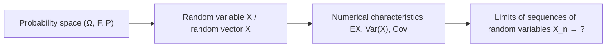

This chapter condenses the whole course into a few tables for review and reference: first the main line of the theory, then summaries of the common distributions, numerical characteristics and inequalities, the three generating functions, convergence and limit theorems, and the multivariate normal distribution, and finally the standard problem-solving methods and a few comprehensive examples. Definitions, conditions and proofs of the individual results can be found in the corresponding chapters.

## 16.1. The Structure of the Theory

The main line of probability theory has four steps:

| Stage | Core object | Main content | Chapters |
|---|---|---|---|
| Probability space | $(\Omega, \mathcal{F}, \mathbb{P})$ | Sample spaces and events, the axioms of probability and basic properties; classical and geometric probability models; permutations, combinations and sampling (ordered/unordered, with/without replacement) | [3.1.1](/3.1.1), [3.1.2](/3.1.2) |
| Conditioning and independence | $\mathbb{P}_A(\cdot) = \mathbb{P}(\cdot \mid A)$ | Conditional probability, the multiplication rule, the law of total probability, Bayes' theorem; independence and conditional independence of events | [3.1.2](/3.1.2), [3.1.3](/3.1.3) |
| Random variables | $X$ | PMF, PDF, CDF; the common distributions and their stories; memorylessness; distributions of functions of random variables; $p$-quantiles | [3.1.3](/3.1.3)–[3.1.5](/3.1.5) |
| Random vectors | $\boldsymbol{X}$ | Joint, marginal and conditional distributions; independence; the multinomial and bivariate normal distributions; distributions of functions of random vectors; order statistics | [3.1.6](/3.1.6), [3.1.7](/3.1.7) |
| Numerical characteristics | $\mathbb{E}X$ | Expectation, variance, moments; conditional expectation and conditional variance, the law of total expectation, the law of total variance; covariance, correlation coefficient; inequalities | [3.1.8](/3.1.8)–[3.1.10](/3.1.10) |
| Transform tools | $g, M, \varphi$ | Probability generating functions, moment generating functions, characteristic functions | [3.1.11](/3.1.11) |
| Limits | $X_n \to\ ?$ | Modes of convergence, laws of large numbers, central limit theorem | [3.1.12](/3.1.12)–[3.1.14](/3.1.14) |
| Multivariate normal | $\mathcal{N}(\boldsymbol{\mu}, \Sigma)$ | Definition, linear transformations, independence, conditional distributions; limit theorems for random vectors | [3.1.15](/3.1.15) |

There are three sets of tools that capture the complete information of a random variable: for discrete variables, the PMF, the distribution function and the characteristic function; for continuous variables, the density, the distribution function and the characteristic function; for general random variables, the distribution function and the characteristic function. Numerical characteristics (mean, variance, correlation coefficient) summarize only one aspect of a distribution.

## 16.2. Common Distributions

Discrete distributions ($q = 1 - p$):

| Distribution | PMF | Story | Mean | Variance | PGF |
|---|---|---|---|---|---|
| $\mathrm{Ber}(p)$ | $\mathbb{P}(X = 1) = p$, $\mathbb{P}(X = 0) = q$ | Success or failure of one trial; indicator functions | $p$ | $pq$ | $q + ps$ |
| $\mathrm{Bin}(n, p)$ | $\binom{n}{k}p^k q^{n-k}$, $0 \le k \le n$ | Number of successes in $n$ independent trials | $np$ | $npq$ | $(q + ps)^n$ |
| $\mathrm{Geo}(p)$ | $q^{k-1}p$, $k \ge 1$ | Number of trials until the first success; memoryless | $\frac{1}{p}$ | $\frac{q}{p^2}$ | $\frac{ps}{1 - qs}$ |
| $\mathrm{Pascal}(r, p)$ | $\binom{k-1}{r-1}p^r q^{k-r}$, $k \ge r$ | Number of trials until the $r$-th success | $\frac{r}{p}$ | $\frac{rq}{p^2}$ | $\left(\frac{ps}{1 - qs}\right)^r$ |
| $\mathrm{NB}(r, p)$ | $\binom{k+r-1}{k}p^r q^k$, $k \ge 0$ | Number of failures before the $r$-th success | $\frac{rq}{p}$ | $\frac{rq}{p^2}$ | $\left(\frac{p}{1 - qs}\right)^r$ |
| $\mathrm{H}(n, M, N)$ | $\binom{M}{k}\binom{N-M}{n-k}/\binom{N}{n}$ | Number of red balls among $n$ drawn without replacement | $\frac{nM}{N}$ | $\frac{nM}{N}\left(1 - \frac{M}{N}\right)\frac{N - n}{N - 1}$ | — |
| $\mathrm{Poi}(\lambda)$ | $\frac{\lambda^k}{k!}\mathrm{e}^{-\lambda}$, $k \ge 0$ | Number of occurrences of rare events; limit of the binomial | $\lambda$ | $\lambda$ | $\mathrm{e}^{\lambda(s-1)}$ |

Continuous distributions:

| Distribution | Density | Mean | Variance | Characteristic function |
|---|---|---|---|---|
| $\mathrm{U}(a, b)$ | $\frac{1}{b - a}$, $a < x < b$ | $\frac{a + b}{2}$ | $\frac{(b - a)^2}{12}$ | $\frac{\mathrm{e}^{\mathrm{i}tb} - \mathrm{e}^{\mathrm{i}ta}}{\mathrm{i}t(b - a)}$ |
| $\mathrm{Exp}(\lambda)$ | $\lambda\mathrm{e}^{-\lambda x}$, $x > 0$ | $\frac{1}{\lambda}$ | $\frac{1}{\lambda^2}$ | $\left(1 - \frac{\mathrm{i}t}{\lambda}\right)^{-1}$ |
| $\Gamma(\alpha, \lambda)$ | $\frac{\lambda^\alpha}{\Gamma(\alpha)}x^{\alpha-1}\mathrm{e}^{-\lambda x}$, $x > 0$ | $\frac{\alpha}{\lambda}$ | $\frac{\alpha}{\lambda^2}$ | $\left(1 - \frac{\mathrm{i}t}{\lambda}\right)^{-\alpha}$ |
| $\mathcal{N}(\mu, \sigma^2)$ | $\frac{1}{\sqrt{2\pi}\sigma}\mathrm{e}^{-(x-\mu)^2/(2\sigma^2)}$ | $\mu$ | $\sigma^2$ | $\mathrm{e}^{\mathrm{i}\mu t - \sigma^2 t^2/2}$ |
| $\mathrm{Beta}(\alpha, \beta)$ | $\frac{x^{\alpha-1}(1-x)^{\beta-1}}{\mathrm{B}(\alpha, \beta)}$, $0 < x < 1$ | $\frac{\alpha}{\alpha + \beta}$ | $\frac{\alpha\beta}{(\alpha + \beta)^2(\alpha + \beta + 1)}$ | — |
| $\chi^2_n = \Gamma(\frac{n}{2}, \frac{1}{2})$ | $\frac{x^{n/2-1}\mathrm{e}^{-x/2}}{2^{n/2}\Gamma(n/2)}$, $x > 0$ | $n$ | $2n$ | $(1 - 2\mathrm{i}t)^{-n/2}$ |
| $t_n$ | $\propto \left(1 + \frac{x^2}{n}\right)^{-(n+1)/2}$ | $0$ ($n > 1$) | $\frac{n}{n - 2}$ ($n > 2$) | — |
| $F_{m,n}$ | Distribution of $\frac{\chi^2_m/m}{\chi^2_n/n}$ | $\frac{n}{n - 2}$ ($n > 2$) | $\frac{2n^2(m + n - 2)}{m(n - 2)^2(n - 4)}$ ($n > 4$) | — |
| Standard Cauchy | $\frac{1}{\pi(1 + x^2)}$ | Does not exist | Does not exist | $\mathrm{e}^{-\lvert t \rvert}$ |

Relations among the distributions: the geometric and exponential distributions are memoryless; $\mathrm{Bin}(n, p) \approx \mathrm{Poi}(np)$ ($n$ large, $p$ small); $\mathrm{H}(n, M, N) \approx \mathrm{Bin}(n, M/N)$ ($N$ large); $\mathrm{Bin}(n, p) \approx \mathcal{N}(np, npq)$ ($npq$ large, [3.1.13](/3.1.13)); $t_1$ is the standard Cauchy distribution and $t_n \xrightarrow{d} \mathcal{N}(0, 1)$; $t_n^2 \sim F_{1,n}$.

Exact distributions of sums of independent random variables ($X_1, \dots, X_n$ mutually independent; the central limit theorem gives only an approximation):

| $X_i$ | $\sum_{i=1}^{n} X_i$ |
|---|---|
| $\mathrm{Ber}(p)$ | $\mathrm{Bin}(n, p)$ |
| $\mathrm{Bin}(m_i, p)$ | $\mathrm{Bin}\left(\sum m_i, p\right)$ |
| $\mathrm{Geo}(p)$ | $\mathrm{Pascal}(n, p)$, i.e., $n + \mathrm{NB}(n, p)$ |
| $\mathrm{NB}(r_i, p)$ | $\mathrm{NB}\left(\sum r_i, p\right)$ |
| $\mathrm{Poi}(\lambda_i)$ | $\mathrm{Poi}\left(\sum \lambda_i\right)$ |
| $\mathrm{U}(0, 1)$, $n = 2$ | Triangular distribution on $[0, 2]$ |
| $\mathcal{N}(\mu_i, \sigma_i^2)$ | $\mathcal{N}\left(\sum \mu_i, \sum \sigma_i^2\right)$ |
| $\mathrm{Exp}(\lambda)$ | $\Gamma(n, \lambda)$ |
| $\Gamma(\alpha_i, \lambda)$ | $\Gamma\left(\sum \alpha_i, \lambda\right)$ |
| $Z_i^2$, $Z_i \sim \mathcal{N}(0, 1)$ | $\chi^2_n$ |

## 16.3. Numerical Characteristics and Inequalities

Expectation, conditional expectation and the correlation coefficient each have an algebraic, a geometric and an optimization interpretation:

| | $\mathbb{E}Y$ | $\mathbb{E}(Y \mid X)$ | $\operatorname{Corr}(X, Y)$ |
|---|---|---|---|
| Algebraic | $\mathbb{E}Y = \int_{\mathbb{R}} y\,\mathrm{d}F(y)$ | $\mathbb{E}(Y \mid X) = m(X)$, $m(x) = \mathbb{E}(Y \mid X = x)$ | $\frac{\mathbb{E}[(X - \mathbb{E}X)(Y - \mathbb{E}Y)]}{\sqrt{\operatorname{Var}(X)\operatorname{Var}(Y)}}$ |
| Geometric | Center of mass | Projection | Cosine of an angle |
| Optimization | Best predictor among constants: $\mathbb{E}Y = \arg\min_{c \in \mathbb{R}}\mathbb{E}(Y - c)^2$ | Best predictor among functions $g(X)$: $\mathbb{E}(Y \mid X) = \arg\min_g \mathbb{E}[Y - g(X)]^2$ | Best predictor among fitted lines: $\rho\frac{\sqrt{\operatorname{Var}(Y)}}{\sqrt{\operatorname{Var}(X)}} = \arg\min_{b}\mathbb{E}[(Y - \mathbb{E}Y) - b(X - \mathbb{E}X)]^2$ |

Common formulas:

| Formula | Content |
|---|---|
| Linearity of expectation | $\mathbb{E}(aX + bY) = a\mathbb{E}X + b\mathbb{E}Y$ (independence not required) |
| Expectation of a function | $\mathbb{E}g(X) = \sum_j g(x_j)\mathbb{P}(X = x_j)$ or $\int g(x)f(x)\,\mathrm{d}x$ |
| Variance | $\operatorname{Var}(X) = \mathbb{E}X^2 - (\mathbb{E}X)^2$, $\operatorname{Var}(aX + b) = a^2\operatorname{Var}(X)$ |
| Variance of a sum | $\operatorname{Var}(X + Y) = \operatorname{Var}(X) + \operatorname{Var}(Y) + 2\operatorname{Cov}(X, Y)$ |
| Under independence | $\mathbb{E}(XY) = \mathbb{E}X\,\mathbb{E}Y$, $\operatorname{Cov}(X, Y) = 0$; not conversely (uncorrelated does not imply independent) |
| Law of total expectation | $\mathbb{E}X = \mathbb{E}[\mathbb{E}(X \mid Y)]$ |
| Law of total variance | $\operatorname{Var}(X) = \mathbb{E}[\operatorname{Var}(X \mid Y)] + \operatorname{Var}[\mathbb{E}(X \mid Y)]$ |
| Properties of conditional expectation | $\mathbb{E}[g(Y)X \mid Y] = g(Y)\mathbb{E}(X \mid Y)$; if $X$ and $Y$ are independent, $\mathbb{E}(X \mid Y) = \mathbb{E}X$ |
| Random vectors | $\mathbb{E}(A\boldsymbol{X} + \boldsymbol{b}) = A\mathbb{E}\boldsymbol{X} + \boldsymbol{b}$, $\operatorname{Cov}(A\boldsymbol{X} + \boldsymbol{b}) = A\Sigma A^{\mathsf T}$ |

Inequalities:

| Inequality | Content | Use |
|---|---|---|
| Markov | $\mathbb{P}(\lvert X \rvert \ge \varepsilon) \le \frac{\mathbb{E}\lvert X \rvert^\alpha}{\varepsilon^\alpha}$, $\varepsilon, \alpha > 0$ | Bounding tail probabilities by moments; $L^r$ convergence implies convergence in probability |
| Chebyshev | $\mathbb{P}(\lvert X - \mathbb{E}X \rvert \ge \varepsilon) \le \frac{\operatorname{Var}(X)}{\varepsilon^2}$ | Weak law of large numbers; conservative sample sizes |
| Cauchy–Schwarz | $\lvert \mathbb{E}(XY) \rvert \le \sqrt{\mathbb{E}X^2\,\mathbb{E}Y^2}$ | $\lvert \operatorname{Corr}(X, Y) \rvert \le 1$; $\mathbb{E}\lvert X \rvert \le \sqrt{\mathbb{E}X^2}$ |
| Jensen | $\psi(\mathbb{E}X) \le \mathbb{E}\psi(X)$ for convex $\psi$ | $(\mathbb{E}X)^2 \le \mathbb{E}X^2$; existence of a higher moment implies existence of the lower ones |

## 16.4. The Three Generating Functions

| | Probability generating function | Moment generating function | Characteristic function |
|---|---|---|---|
| Definition | $g(s) = \mathbb{E}s^X = p_0 + p_1 s + p_2 s^2 + \cdots$ | $M(s) = \mathbb{E}\mathrm{e}^{sX} = \sum_n \frac{\mathbb{E}X^n}{n!}s^n$ | $\varphi(t) = \mathbb{E}\mathrm{e}^{\mathrm{i}tX} = \sum_n \frac{\mathbb{E}X^n}{n!}(\mathrm{i}t)^n$ |
| Applies to | Nonnegative integer-valued variables | Most random variables (finite near $0$) | All random variables |
| Invertibility | One-to-one with the PMF | Determines the distribution function when finite in a neighborhood of $0$ | One-to-one with the distribution function |
| Moments | $\mathbb{E}X = g'(1)$ | $\mathbb{E}X^k = M^{(k)}(0)$ | $\mathbb{E}X^k = \varphi^{(k)}(0)/\mathrm{i}^k$ |
| Independent sum | $\prod_i g_i(s)$ | $\prod_i M_i(s)$ | $\prod_i \varphi_i(t)$ |
| $aX + b$ | $s^b g_X(s^a)$ | $\mathrm{e}^{sb}M_X(sa)$ | $\mathrm{e}^{\mathrm{i}tb}\varphi_X(ta)$ |
| Random sum $X_1 + \cdots + X_N$ | $g_N(g_X(s))$ | Replace $\mathrm{e}^s$ by $M_X(s)$ in $M_N$ | Replace $\mathrm{e}^{\mathrm{i}t}$ by $\varphi_X(t)$ in $\varphi_N$ |
| Two dimensions | $\mathbb{E}(s^X t^Y)$ | $\mathbb{E}(\mathrm{e}^{sX}\mathrm{e}^{tY})$ | $\mathbb{E}(\mathrm{e}^{\mathrm{i}t_1X}\mathrm{e}^{\mathrm{i}t_2Y})$ |

Uses: computing moments (by differentiation or Taylor expansion); identifying distributions (recognizing a product or composition, e.g., for mixtures, independent sums and random sums); checking independence (the joint generating function factors into a product); checking convergence in distribution (the continuity theorem).

## 16.5. Convergence and Limit Theorems

| Convergence | Notation | Definition | Relations |
|---|---|---|---|
| In distribution | $X_n \xrightarrow{d} X$ | $F_n(x) \to F(x)$ at continuity points of $F$; equivalent to pointwise convergence of characteristic functions | Weakest |
| In probability | $X_n \xrightarrow{p} X$ | $\forall \varepsilon > 0$, $\mathbb{P}(\lvert X_n - X \rvert \ge \varepsilon) \to 0$ | Implies convergence in distribution; equivalent to it when the limit is a constant |
| Almost surely | $X_n \xrightarrow{\text{a.s.}} X$ | $\mathbb{P}(\lim X_n = X) = 1$ | Implies convergence in probability |
| In $r$-th mean | $X_n \xrightarrow{L^r} X$ | $\mathbb{E}\lvert X_n - X \rvert^r \to 0$ | Implies convergence in probability; neither implies nor is implied by a.s. convergence |

Convergence theorems: the continuous mapping theorem (one sequence, any continuous function; preserves a.s., p and d convergence); Slutsky's theorem ($X_n \xrightarrow{d} X$ and $Y_n \xrightarrow{p} c$ imply convergence in distribution of the sum, product and quotient); the delta method ($\sqrt{n}(g(X_n) - g(a)) \xrightarrow{d} \mathcal{N}(0, g'(a)^2V)$); the continuity theorem (linking distribution functions and characteristic functions); the Cramér–Wold device (reducing vector problems to one dimension).

Limit theorems ($X_1, X_2, \dots$ iid, $S_n = X_1 + \cdots + X_n$, $M_n = S_n/n$):

| Theorem | Conditions | Conclusion | Meaning |
|---|---|---|---|
| Weak law of large numbers | $\operatorname{Var}(X_1) < \infty$ (Chebyshev's proof); can be relaxed to $\mathbb{E}\lvert X_1 \rvert < \infty$ (Khinchin) | $M_n \xrightarrow{p} \mathbb{E}X_1$ | The sample mean is ever more likely to be close to the population mean |
| Strong law of large numbers | $\mathbb{E}\lvert X_1 \rvert < \infty$ (necessary and sufficient) | $M_n \xrightarrow{\text{a.s.}} \mathbb{E}X_1$ | The sample mean almost surely approaches the population mean |
| Central limit theorem | $0 < \operatorname{Var}(X_1) = \sigma^2 < \infty$ | $\frac{S_n - n\mu}{\sigma\sqrt{n}} \xrightarrow{d} \mathcal{N}(0, 1)$ | $S_n \overset{\cdot}{\sim} \mathcal{N}(n\mu, n\sigma^2)$; error of order $\sigma/\sqrt{n}$ |
| de Moivre–Laplace | $S_n \sim \mathrm{Bin}(n, p)$ | $\mathbb{P}(k \le S_n \le m) \approx \Phi\left(\frac{m + 0.5 - np}{\sqrt{npq}}\right) - \Phi\left(\frac{k - 0.5 - np}{\sqrt{npq}}\right)$ | Continuity correction for discrete variables |
| Lindeberg–Feller | Independent, not identically distributed; Lindeberg condition | $\frac{1}{B_n}\sum (X_k - \mathbb{E}X_k) \xrightarrow{d} \mathcal{N}(0, 1)$ | No dominant term |

Applications: estimating probabilities by frequencies, the empirical distribution function, Monte Carlo methods (laws of large numbers); computing sample sizes (law of large numbers with Chebyshev's inequality, or the central limit theorem); normal approximations to sample means and partial sums (central limit theorem, with the correction for discrete variables). Of the proofs, one should master the simplest versions: the weak law of large numbers (via Chebyshev's inequality) and the central limit theorem (second-order expansion of the characteristic function plus the continuity theorem).

## 16.6. The Multivariate Normal Distribution

| Topic | Result |
|---|---|
| Definition | $\boldsymbol{X} = \boldsymbol{\mu} + B\boldsymbol{\varepsilon}$, $\varepsilon_j \overset{\text{iid}}{\sim} \mathcal{N}(0, 1)$, $\Sigma = BB^{\mathsf T}$ of full rank |
| Density | $f(\boldsymbol{x}) = (2\pi)^{-n/2}(\det\Sigma)^{-1/2}\exp\left[-\frac{1}{2}(\boldsymbol{x} - \boldsymbol{\mu})^{\mathsf T}\Sigma^{-1}(\boldsymbol{x} - \boldsymbol{\mu})\right]$ |
| Characteristic function | $\exp\left[\mathrm{i}\boldsymbol{t}^{\mathsf T}\boldsymbol{\mu} - \frac{1}{2}\boldsymbol{t}^{\mathsf T}\Sigma\boldsymbol{t}\right]$ |
| Linear transformations | $\boldsymbol{b} + A\boldsymbol{X} \sim \mathcal{N}(\boldsymbol{b} + A\boldsymbol{\mu}, A\Sigma A^{\mathsf T})$ ($A\Sigma A^{\mathsf T}$ of full rank) |
| Characterization | Multivariate normal $\Leftrightarrow$ every $\boldsymbol{a}^{\mathsf T}\boldsymbol{X} \sim \mathcal{N}(\boldsymbol{a}^{\mathsf T}\boldsymbol{\mu}, \boldsymbol{a}^{\mathsf T}\Sigma\boldsymbol{a})$ |
| Independence | Block $\Sigma_{12} = O$ $\Leftrightarrow$ $\boldsymbol{X}_1$ and $\boldsymbol{X}_2$ independent; $\Sigma$ diagonal $\Leftrightarrow$ components mutually independent |
| Conditional distribution | $\boldsymbol{X}_2 \mid \boldsymbol{X}_1 = \boldsymbol{x}_1 \sim \mathcal{N}(\boldsymbol{\mu}_2 + \Sigma_{21}\Sigma_{11}^{-1}(\boldsymbol{x}_1 - \boldsymbol{\mu}_1), \Sigma_{22} - \Sigma_{21}\Sigma_{11}^{-1}\Sigma_{12})$ |
| Quadratic form | $(\boldsymbol{X} - \boldsymbol{\mu})^{\mathsf T}\Sigma^{-1}(\boldsymbol{X} - \boldsymbol{\mu}) \sim \chi^2_n$ |
| Normal sample | $\bar X \sim \mathcal{N}(\mu, \sigma^2/n)$ is independent of $S_n^2$, and $(n-1)S_n^2/\sigma^2 \sim \chi^2_{n-1}$ |
| Limit theorems | $\frac{1}{n}\boldsymbol{S}_n \xrightarrow{\text{a.s.}} \mathbb{E}\boldsymbol{X}_1$; $\frac{\boldsymbol{S}_n - n\boldsymbol{\mu}}{\sqrt{n}} \xrightarrow{d} \mathcal{N}(\boldsymbol{0}, \Sigma)$ |

## 16.7. Problem-Solving Methods and Examples

Common techniques: conditioning (the law of total probability, the law of total expectation), symmetry, normalization (a density integrates to $1$, often used to evaluate integrals), linearity of expectation with indicator random variables (splitting a complicated count into a sum of indicators), recognizing a model from its story, and checking results against simple or extreme cases. The computations themselves mostly use Taylor expansions (especially of $\mathrm{e}^x$), geometric series, differentiation and integration.

Methods for finding distributions:

| Object | Method |
|---|---|
| A function $g(X)$ of a random variable | The distribution function method; the density formula for monotone transformations $f_Y(y) = f_X(h(y))\lvert h'(y) \rvert$ |
| A function $g(\boldsymbol{X})$ of a random vector | The distribution function method (with the law of total probability); change of variables in events; the differential element method; auxiliary variables with the Jacobian $\left\lvert \frac{\partial(x_1, x_2)}{\partial(y_1, y_2)} \right\rvert$; the convolution formula |
| Independent sums, random sums, mixtures | Generating functions (products, compositions, convex combinations) |
| Limiting distributions | Characteristic functions and the continuity theorem; the central limit theorem; Slutsky's theorem and the delta method |

**Example 16.7.1** A task is assigned at random, with equal probability, to one of two students. If it is assigned to student $i$, the time taken is $X_i \sim \mathrm{Exp}(\lambda_i)$, with $X_1, X_2$ independent. Let $T$ be the time needed to complete the task; find $\mathbb{E}T$ and $\operatorname{Var}(T)$. If instead the task is assigned to both students from the start, let $X$ be the time until it is completed. Given that 24 hours have passed and the task is not yet finished, what is the expected total completion time?

**Solution** $T$ has a mixture distribution: $\mathrm{Exp}(\lambda_1)$ with probability $\frac{1}{2}$ and $\mathrm{Exp}(\lambda_2)$ with probability $\frac{1}{2}$. By the law of total expectation,

$$
\mathbb{E}T = \frac{1}{2}\left(\frac{1}{\lambda_1} + \frac{1}{\lambda_2}\right), \qquad \mathbb{E}T^2 = \frac{1}{2}\left(\frac{2}{\lambda_1^2} + \frac{2}{\lambda_2^2}\right),
$$

$$
\operatorname{Var}(T) = \mathbb{E}T^2 - (\mathbb{E}T)^2 = \frac{3}{4}\left(\frac{1}{\lambda_1^2} + \frac{1}{\lambda_2^2}\right) - \frac{1}{2} \cdot \frac{1}{\lambda_1\lambda_2}.
$$
When the task is assigned to both, $X = \min(X_1, X_2) \sim \mathrm{Exp}(\lambda_1 + \lambda_2)$ (since $\mathbb{P}(X > x) = \mathrm{e}^{-\lambda_1x}\mathrm{e}^{-\lambda_2x}$), and by the memorylessness of the exponential distribution,

$$
\mathbb{E}(X \mid X > 24) = 24 + \frac{1}{\lambda_1 + \lambda_2}.
$$

**Example 16.7.2** Let $X_1, X_2, \dots, X_n$ be iid with $\mathbb{E}X_1 = 3$ and $S_n = X_1 + \cdots + X_n$. Find $\mathbb{E}(X_1X_2X_3 \mid X_1)$ and $\mathbb{E}(X_1 \mid S_n)$.

**Solution** By the properties of conditional expectation and independence, $\mathbb{E}(X_1X_2X_3 \mid X_1) = X_1\,\mathbb{E}(X_2X_3) = X_1\,\mathbb{E}X_2\,\mathbb{E}X_3 = 9X_1$. By symmetry, $\mathbb{E}(X_1 \mid S_n) = \cdots = \mathbb{E}(X_n \mid S_n)$, and their sum is $\mathbb{E}(S_n \mid S_n) = S_n$, so $\mathbb{E}(X_1 \mid S_n) = \frac{S_n}{n}$.

**Example 16.7.3** A lake originally contains $X$ fish, $X \sim \mathrm{Poi}(\lambda)$. A statistician, worried that the lake might have no fish, puts one fish into it. Let $Y$ be the current number of fish in the lake. Find $\mathbb{E}(1/Y)$.

**Solution** $Y = X + 1$, and

$$
\mathbb{E}\frac{1}{X + 1} = \sum_{k=0}^{\infty}\frac{1}{k + 1} \cdot \frac{\lambda^k}{k!}\mathrm{e}^{-\lambda} = \frac{\mathrm{e}^{-\lambda}}{\lambda}\sum_{k=0}^{\infty}\frac{\lambda^{k+1}}{(k + 1)!} = \frac{\mathrm{e}^{-\lambda}}{\lambda}(\mathrm{e}^\lambda - 1) = \frac{1}{\lambda}(1 - \mathrm{e}^{-\lambda}).
$$
The trick is to complete the Taylor series of $\mathrm{e}^\lambda$.

**Example 16.7.4** True or false: $\mathbb{E}\lvert X \rvert \ge \sqrt{\mathbb{E}(X^2)}$.

**Solution** False. By the Cauchy–Schwarz inequality (with $Y = 1$) or Jensen's inequality, $\mathbb{E}\lvert X \rvert \le \sqrt{\mathbb{E}X^2}$, with equality if and only if $\lvert X \rvert$ is almost surely constant.

**Example 16.7.5** Let $X_1, X_2, \dots$ be iid $\mathrm{Poi}(1)$ and $S_n = \sum_{i=1}^{n} X_i$. Use the central limit theorem to estimate $\mathbb{P}(S_n = n)$ and $\mathbb{P}(S_n \le n)$.

**Solution** $S_n \sim \mathrm{Poi}(n)$ with $\mathbb{E}S_n = \operatorname{Var}(S_n) = n$. With the continuity correction,

$$
\mathbb{P}(S_n = n) \approx \Phi\left(\frac{0.5}{\sqrt{n}}\right) - \Phi\left(-\frac{0.5}{\sqrt{n}}\right) \approx \frac{1}{\sqrt{2\pi n}}, \qquad \mathbb{P}(S_n \le n) \approx \Phi\left(\frac{0.5}{\sqrt{n}}\right) \to \frac{1}{2}.
$$
Comparing the former with the exact value $\mathrm{e}^{-n}n^n/n!$ gives Stirling's formula (Example 13.4.3).

**Example 16.7.6** Let $X_i \overset{\text{iid}}{\sim} \mathrm{Poi}(\lambda)$, $T_n = X_1 + \cdots + X_n$, and let $M_n(t)$ be the moment generating function of $T_n/n$. Find the limit of $M_n(t)$ as $n \to \infty$.

**Solution** $T_n \sim \mathrm{Poi}(n\lambda)$, so

$$
M_n(t) = \mathbb{E}\mathrm{e}^{tT_n/n} = \exp\left\{n\lambda\left(\mathrm{e}^{t/n} - 1\right)\right\} = \exp\left\{n\lambda\left(\frac{t}{n} + O\left(\frac{1}{n^2}\right)\right)\right\} \to \mathrm{e}^{\lambda t},
$$
which is the moment generating function of the constant $\lambda$, in agreement with the law of large numbers $T_n/n \to \lambda$.

## Summary

In review, concepts and understanding (especially the differences between similar concepts, such as the various modes of convergence, the weak and strong laws of large numbers, and uncorrelatedness versus independence) matter as much as computational skill. The general procedure for solving a problem is: model it (reduce the problem to a familiar model or distribution); choose the tools (PMF, density, distribution function or generating function; conditioning or symmetry); and carry out the computation. The three sets of tools for describing distributions, the two ways of computing expectations (directly or by conditioning) and the three kinds of limit theorems form the backbone of this course, and they constitute the entire probabilistic foundation of statistical inference ([3.2](/3.2)).
