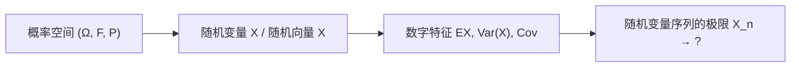

本章把整门课程压缩成几张表，供复习与查阅：先给出知识体系的主线，再依次汇总常见分布、数字特征与不等式、三种母函数、收敛性与极限定理、多元正态分布，最后整理常用的解题方法与几道综合例题。各条结论的定义、条件与证明见对应的章节。

## 16.1. 知识体系

概率论的主线是四步：

| 阶段 | 核心对象 | 主要内容 | 章节 |
|---|---|---|---|
| 概率空间 | $(\Omega, \mathcal{F}, \mathbb{P})$ | 样本空间与事件、概率公理与基本性质；古典概型与几何概型；排列组合与抽样（有序/无序、有放回/无放回） | [3.1.1](/3.1.1)、[3.1.2](/3.1.2) |
| 条件化与独立 | $\mathbb{P}_A(\cdot) = \mathbb{P}(\cdot \mid A)$ | 条件概率、乘法公式、全概率公式、Bayes 公式；事件的独立性与条件独立性 | [3.1.2](/3.1.2)、[3.1.3](/3.1.3) |
| 随机变量 | $X$ | 分布列（PMF）、密度（PDF）、分布函数（CDF）；常见分布及其背景；无记忆性；随机变量函数的分布；$p$ 分位数 | [3.1.3](/3.1.3)–[3.1.5](/3.1.5) |
| 随机向量 | $\boldsymbol{X}$ | 联合、边缘、条件分布；独立性；多项分布、二元正态分布；随机向量函数的分布；次序统计量 | [3.1.6](/3.1.6)、[3.1.7](/3.1.7) |
| 数字特征 | $\mathbb{E}X$ | 期望、方差、矩；条件期望与条件方差、重期望公式、全方差公式；协方差、相关系数；不等式 | [3.1.8](/3.1.8)–[3.1.10](/3.1.10) |
| 变换工具 | $g, M, \varphi$ | 概率母函数、矩母函数、特征函数 | [3.1.11](/3.1.11) |
| 极限 | $X_n \to\ ?$ | 收敛性、大数定律、中心极限定理 | [3.1.12](/3.1.12)–[3.1.14](/3.1.14) |
| 多元正态 | $\mathcal{N}(\boldsymbol{\mu}, \Sigma)$ | 定义、线性变换、独立性、条件分布；随机向量的极限定理 | [3.1.15](/3.1.15) |

刻画一个随机变量全部信息的工具有三套：离散型用分布列、分布函数、特征函数；连续型用密度、分布函数、特征函数；一般的随机变量用分布函数、特征函数。数字特征（期望、方差、相关系数）只是分布某一方面的总结。

## 16.2. 常见分布

离散型分布（$q = 1 - p$）：

| 分布 | 分布列 | 背景 | 期望 | 方差 | 概率母函数 |
|---|---|---|---|---|---|
| $\mathrm{Ber}(p)$ | $\mathbb{P}(X = 1) = p$，$\mathbb{P}(X = 0) = q$ | 一次试验是否成功；示性函数 | $p$ | $pq$ | $q + ps$ |
| $\mathrm{Bin}(n, p)$ | $\binom{n}{k}p^k q^{n-k}$，$0 \le k \le n$ | $n$ 次独立重复试验的成功次数 | $np$ | $npq$ | $(q + ps)^n$ |
| $\mathrm{Geo}(p)$ | $q^{k-1}p$，$k \ge 1$ | 首次成功所需的试验次数；无记忆 | $\frac{1}{p}$ | $\frac{q}{p^2}$ | $\frac{ps}{1 - qs}$ |
| $\mathrm{Pascal}(r, p)$ | $\binom{k-1}{r-1}p^r q^{k-r}$，$k \ge r$ | 第 $r$ 次成功所需的试验次数 | $\frac{r}{p}$ | $\frac{rq}{p^2}$ | $\left(\frac{ps}{1 - qs}\right)^r$ |
| $\mathrm{NB}(r, p)$ | $\binom{k+r-1}{k}p^r q^k$，$k \ge 0$ | 第 $r$ 次成功前的失败次数 | $\frac{rq}{p}$ | $\frac{rq}{p^2}$ | $\left(\frac{p}{1 - qs}\right)^r$ |
| $\mathrm{H}(n, M, N)$ | $\binom{M}{k}\binom{N-M}{n-k}/\binom{N}{n}$ | 无放回抽 $n$ 个，红球的个数 | $\frac{nM}{N}$ | $\frac{nM}{N}\left(1 - \frac{M}{N}\right)\frac{N - n}{N - 1}$ | — |
| $\mathrm{Poi}(\lambda)$ | $\frac{\lambda^k}{k!}\mathrm{e}^{-\lambda}$，$k \ge 0$ | 稀有事件的发生次数；二项分布的极限 | $\lambda$ | $\lambda$ | $\mathrm{e}^{\lambda(s-1)}$ |

连续型分布：

| 分布 | 密度 | 期望 | 方差 | 特征函数 |
|---|---|---|---|---|
| $\mathrm{U}(a, b)$ | $\frac{1}{b - a}$，$a < x < b$ | $\frac{a + b}{2}$ | $\frac{(b - a)^2}{12}$ | $\frac{\mathrm{e}^{\mathrm{i}tb} - \mathrm{e}^{\mathrm{i}ta}}{\mathrm{i}t(b - a)}$ |
| $\mathrm{Exp}(\lambda)$ | $\lambda\mathrm{e}^{-\lambda x}$，$x > 0$ | $\frac{1}{\lambda}$ | $\frac{1}{\lambda^2}$ | $\left(1 - \frac{\mathrm{i}t}{\lambda}\right)^{-1}$ |
| $\Gamma(\alpha, \lambda)$ | $\frac{\lambda^\alpha}{\Gamma(\alpha)}x^{\alpha-1}\mathrm{e}^{-\lambda x}$，$x > 0$ | $\frac{\alpha}{\lambda}$ | $\frac{\alpha}{\lambda^2}$ | $\left(1 - \frac{\mathrm{i}t}{\lambda}\right)^{-\alpha}$ |
| $\mathcal{N}(\mu, \sigma^2)$ | $\frac{1}{\sqrt{2\pi}\sigma}\mathrm{e}^{-(x-\mu)^2/(2\sigma^2)}$ | $\mu$ | $\sigma^2$ | $\mathrm{e}^{\mathrm{i}\mu t - \sigma^2 t^2/2}$ |
| $\mathrm{Beta}(\alpha, \beta)$ | $\frac{x^{\alpha-1}(1-x)^{\beta-1}}{\mathrm{B}(\alpha, \beta)}$，$0 < x < 1$ | $\frac{\alpha}{\alpha + \beta}$ | $\frac{\alpha\beta}{(\alpha + \beta)^2(\alpha + \beta + 1)}$ | — |
| $\chi^2_n = \Gamma(\frac{n}{2}, \frac{1}{2})$ | $\frac{x^{n/2-1}\mathrm{e}^{-x/2}}{2^{n/2}\Gamma(n/2)}$，$x > 0$ | $n$ | $2n$ | $(1 - 2\mathrm{i}t)^{-n/2}$ |
| $t_n$ | $\propto \left(1 + \frac{x^2}{n}\right)^{-(n+1)/2}$ | $0$（$n > 1$） | $\frac{n}{n - 2}$（$n > 2$） | — |
| $F_{m,n}$ | $\frac{\chi^2_m/m}{\chi^2_n/n}$ 的分布 | $\frac{n}{n - 2}$（$n > 2$） | $\frac{2n^2(m + n - 2)}{m(n - 2)^2(n - 4)}$（$n > 4$） | — |
| 标准 Cauchy | $\frac{1}{\pi(1 + x^2)}$ | 不存在 | 不存在 | $\mathrm{e}^{-\lvert t \rvert}$ |

分布之间的关系：几何分布与指数分布具有无记忆性；$\mathrm{Bin}(n, p) \approx \mathrm{Poi}(np)$（$n$ 大、$p$ 小）；$\mathrm{H}(n, M, N) \approx \mathrm{Bin}(n, M/N)$（$N$ 大）；$\mathrm{Bin}(n, p) \approx \mathcal{N}(np, npq)$（$npq$ 大，[3.1.13](/3.1.13)）；$t_1$ 是标准 Cauchy 分布，$t_n \xrightarrow{d} \mathcal{N}(0, 1)$；$t_n^2 \sim F_{1,n}$。

独立随机变量之和的精确分布（$X_1, \dots, X_n$ 相互独立；中心极限定理给出的只是近似）：

| $X_i$ | $\sum_{i=1}^{n} X_i$ |
|---|---|
| $\mathrm{Ber}(p)$ | $\mathrm{Bin}(n, p)$ |
| $\mathrm{Bin}(m_i, p)$ | $\mathrm{Bin}\left(\sum m_i, p\right)$ |
| $\mathrm{Geo}(p)$ | $\mathrm{Pascal}(n, p)$，即 $n + \mathrm{NB}(n, p)$ |
| $\mathrm{NB}(r_i, p)$ | $\mathrm{NB}\left(\sum r_i, p\right)$ |
| $\mathrm{Poi}(\lambda_i)$ | $\mathrm{Poi}\left(\sum \lambda_i\right)$ |
| $\mathrm{U}(0, 1)$，$n = 2$ | $[0, 2]$ 上的三角分布 |
| $\mathcal{N}(\mu_i, \sigma_i^2)$ | $\mathcal{N}\left(\sum \mu_i, \sum \sigma_i^2\right)$ |
| $\mathrm{Exp}(\lambda)$ | $\Gamma(n, \lambda)$ |
| $\Gamma(\alpha_i, \lambda)$ | $\Gamma\left(\sum \alpha_i, \lambda\right)$ |
| $Z_i^2$，$Z_i \sim \mathcal{N}(0, 1)$ | $\chi^2_n$ |

## 16.3. 数字特征与不等式

期望、条件期望与相关系数各有代数、几何、优化三种解读：

| | $\mathbb{E}Y$ | $\mathbb{E}(Y \mid X)$ | $\operatorname{Corr}(X, Y)$ |
|---|---|---|---|
| 代数 | $\mathbb{E}Y = \int_{\mathbb{R}} y\,\mathrm{d}F(y)$ | $\mathbb{E}(Y \mid X) = m(X)$，$m(x) = \mathbb{E}(Y \mid X = x)$ | $\frac{\mathbb{E}[(X - \mathbb{E}X)(Y - \mathbb{E}Y)]}{\sqrt{\operatorname{Var}(X)\operatorname{Var}(Y)}}$ |
| 几何 | 重心 | 投影 | 夹角余弦 |
| 优化 | 常数中的最佳预测：$\mathbb{E}Y = \arg\min_{c \in \mathbb{R}}\mathbb{E}(Y - c)^2$ | $g(X)$ 中的最佳预测：$\mathbb{E}(Y \mid X) = \arg\min_g \mathbb{E}[Y - g(X)]^2$ | 拟合直线中的最佳预测：$\rho\frac{\sqrt{\operatorname{Var}(Y)}}{\sqrt{\operatorname{Var}(X)}} = \arg\min_{b}\mathbb{E}[(Y - \mathbb{E}Y) - b(X - \mathbb{E}X)]^2$ |

常用公式：

| 公式 | 内容 |
|---|---|
| 期望的线性 | $\mathbb{E}(aX + bY) = a\mathbb{E}X + b\mathbb{E}Y$（不需要独立） |
| 函数的期望 | $\mathbb{E}g(X) = \sum_j g(x_j)\mathbb{P}(X = x_j)$ 或 $\int g(x)f(x)\,\mathrm{d}x$ |
| 方差 | $\operatorname{Var}(X) = \mathbb{E}X^2 - (\mathbb{E}X)^2$，$\operatorname{Var}(aX + b) = a^2\operatorname{Var}(X)$ |
| 和的方差 | $\operatorname{Var}(X + Y) = \operatorname{Var}(X) + \operatorname{Var}(Y) + 2\operatorname{Cov}(X, Y)$ |
| 独立时 | $\mathbb{E}(XY) = \mathbb{E}X\,\mathbb{E}Y$，$\operatorname{Cov}(X, Y) = 0$；反之不然（不相关不一定独立） |
| 重期望公式 | $\mathbb{E}X = \mathbb{E}[\mathbb{E}(X \mid Y)]$ |
| 全方差公式 | $\operatorname{Var}(X) = \mathbb{E}[\operatorname{Var}(X \mid Y)] + \operatorname{Var}[\mathbb{E}(X \mid Y)]$ |
| 条件期望的性质 | $\mathbb{E}[g(Y)X \mid Y] = g(Y)\mathbb{E}(X \mid Y)$；$X$ 与 $Y$ 独立时 $\mathbb{E}(X \mid Y) = \mathbb{E}X$ |
| 随机向量 | $\mathbb{E}(A\boldsymbol{X} + \boldsymbol{b}) = A\mathbb{E}\boldsymbol{X} + \boldsymbol{b}$，$\operatorname{Cov}(A\boldsymbol{X} + \boldsymbol{b}) = A\Sigma A^{\mathsf T}$ |

不等式：

| 不等式 | 内容 | 用途 |
|---|---|---|
| Markov | $\mathbb{P}(\lvert X \rvert \ge \varepsilon) \le \frac{\mathbb{E}\lvert X \rvert^\alpha}{\varepsilon^\alpha}$，$\varepsilon, \alpha > 0$ | 由矩控制尾概率；$L^r$ 收敛推依概率收敛 |
| Chebyshev | $\mathbb{P}(\lvert X - \mathbb{E}X \rvert \ge \varepsilon) \le \frac{\operatorname{Var}(X)}{\varepsilon^2}$ | 弱大数定律；保守的样本量估计 |
| Cauchy–Schwarz | $\lvert \mathbb{E}(XY) \rvert \le \sqrt{\mathbb{E}X^2\,\mathbb{E}Y^2}$ | $\lvert \operatorname{Corr}(X, Y) \rvert \le 1$；$\mathbb{E}\lvert X \rvert \le \sqrt{\mathbb{E}X^2}$ |
| Jensen | $\psi$ 凸时 $\psi(\mathbb{E}X) \le \mathbb{E}\psi(X)$ | $(\mathbb{E}X)^2 \le \mathbb{E}X^2$；高阶矩存在则低阶矩存在 |

## 16.4. 三种母函数

| | 概率母函数 | 矩母函数 | 特征函数 |
|---|---|---|---|
| 定义 | $g(s) = \mathbb{E}s^X = p_0 + p_1 s + p_2 s^2 + \cdots$ | $M(s) = \mathbb{E}\mathrm{e}^{sX} = \sum_n \frac{\mathbb{E}X^n}{n!}s^n$ | $\varphi(t) = \mathbb{E}\mathrm{e}^{\mathrm{i}tX} = \sum_n \frac{\mathbb{E}X^n}{n!}(\mathrm{i}t)^n$ |
| 适用 | 非负整值 | 大部分随机变量（$0$ 附近有限） | 所有随机变量 |
| 可逆性 | 与分布列一一对应 | $0$ 的邻域内有限时决定分布函数 | 与分布函数一一对应 |
| 矩 | $\mathbb{E}X = g'(1)$ | $\mathbb{E}X^k = M^{(k)}(0)$ | $\mathbb{E}X^k = \varphi^{(k)}(0)/\mathrm{i}^k$ |
| 独立和 | $\prod_i g_i(s)$ | $\prod_i M_i(s)$ | $\prod_i \varphi_i(t)$ |
| $aX + b$ | $s^b g_X(s^a)$ | $\mathrm{e}^{sb}M_X(sa)$ | $\mathrm{e}^{\mathrm{i}tb}\varphi_X(ta)$ |
| 随机和 $X_1 + \cdots + X_N$ | $g_N(g_X(s))$ | $M_N$ 中 $\mathrm{e}^s \to M_X(s)$ | $\varphi_N$ 中 $\mathrm{e}^{\mathrm{i}t} \to \varphi_X(t)$ |
| 二维 | $\mathbb{E}(s^X t^Y)$ | $\mathbb{E}(\mathrm{e}^{sX}\mathrm{e}^{tY})$ | $\mathbb{E}(\mathrm{e}^{\mathrm{i}t_1X}\mathrm{e}^{\mathrm{i}t_2Y})$ |

用途：求矩（求导或 Taylor 展开）；确定分布（乘积或复合后认出分布，例如混合分布、独立和、随机和）；判断独立性（联合母函数分解为乘积）；判断依分布收敛（连续性定理）。

## 16.5. 收敛性与极限定理

| 收敛 | 记号 | 定义 | 关系 |
|---|---|---|---|
| 依分布 | $X_n \xrightarrow{d} X$ | $F$ 的连续点处 $F_n(x) \to F(x)$；等价于特征函数逐点收敛 | 最弱 |
| 依概率 | $X_n \xrightarrow{p} X$ | $\forall \varepsilon > 0$，$\mathbb{P}(\lvert X_n - X \rvert \ge \varepsilon) \to 0$ | 推出依分布；极限为常数时与依分布等价 |
| 几乎处处 | $X_n \xrightarrow{\text{a.s.}} X$ | $\mathbb{P}(\lim X_n = X) = 1$ | 推出依概率 |
| $r$ 阶矩 | $X_n \xrightarrow{L^r} X$ | $\mathbb{E}\lvert X_n - X \rvert^r \to 0$ | 推出依概率；与几乎处处互不蕴含 |

收敛性定理：连续映射定理（一列变量、任意连续函数，保持 a.s.、p、d 三种收敛）；Slutsky 定理（$X_n \xrightarrow{d} X$，$Y_n \xrightarrow{p} c$，则和、积、商依分布收敛）；Delta 方法（$\sqrt{n}(g(X_n) - g(a)) \xrightarrow{d} \mathcal{N}(0, g'(a)^2V)$）；连续性定理（连接分布函数与特征函数）；Cramér–Wold 方法（向量问题化为一维）。

极限定理（$X_1, X_2, \dots$ 独立同分布，$S_n = X_1 + \cdots + X_n$，$M_n = S_n/n$）：

| 定理 | 条件 | 结论 | 意义 |
|---|---|---|---|
| 弱大数定律 | $\operatorname{Var}(X_1) < \infty$（Chebyshev 证明）；可放宽为 $\mathbb{E}\lvert X_1 \rvert < \infty$（Khinchin） | $M_n \xrightarrow{p} \mathbb{E}X_1$ | 样本均值接近总体均值的可能性越来越大 |
| 强大数定律 | $\mathbb{E}\lvert X_1 \rvert < \infty$（充要） | $M_n \xrightarrow{\text{a.s.}} \mathbb{E}X_1$ | 样本均值几乎一定渐近地接近总体均值 |
| 中心极限定理 | $0 < \operatorname{Var}(X_1) = \sigma^2 < \infty$ | $\frac{S_n - n\mu}{\sigma\sqrt{n}} \xrightarrow{d} \mathcal{N}(0, 1)$ | $S_n \overset{\cdot}{\sim} \mathcal{N}(n\mu, n\sigma^2)$；误差量级 $\sigma/\sqrt{n}$ |
| de Moivre–Laplace | $S_n \sim \mathrm{Bin}(n, p)$ | $\mathbb{P}(k \le S_n \le m) \approx \Phi\left(\frac{m + 0.5 - np}{\sqrt{npq}}\right) - \Phi\left(\frac{k - 0.5 - np}{\sqrt{npq}}\right)$ | 离散变量的连续性修正 |
| Lindeberg–Feller | 独立、不同分布，Lindeberg 条件 | $\frac{1}{B_n}\sum (X_k - \mathbb{E}X_k) \xrightarrow{d} \mathcal{N}(0, 1)$ | 没有占主导地位的项 |

应用：频率估计概率、经验分布函数、蒙特卡洛方法（大数定律）；样本量的计算（大数定律加 Chebyshev 不等式，或中心极限定理）；样本均值或前 $n$ 项和的正态近似（中心极限定理，离散变量要修正）。证明要求掌握最简单的版本：弱大数定律（Chebyshev 不等式）与中心极限定理（特征函数的二阶展开加连续性定理）。

## 16.6. 多元正态分布

| 内容 | 结论 |
|---|---|
| 定义 | $\boldsymbol{X} = \boldsymbol{\mu} + B\boldsymbol{\varepsilon}$，$\varepsilon_j \overset{\text{iid}}{\sim} \mathcal{N}(0, 1)$，$\Sigma = BB^{\mathsf T}$ 满秩 |
| 密度 | $f(\boldsymbol{x}) = (2\pi)^{-n/2}(\det\Sigma)^{-1/2}\exp\left[-\frac{1}{2}(\boldsymbol{x} - \boldsymbol{\mu})^{\mathsf T}\Sigma^{-1}(\boldsymbol{x} - \boldsymbol{\mu})\right]$ |
| 特征函数 | $\exp\left[\mathrm{i}\boldsymbol{t}^{\mathsf T}\boldsymbol{\mu} - \frac{1}{2}\boldsymbol{t}^{\mathsf T}\Sigma\boldsymbol{t}\right]$ |
| 线性变换 | $\boldsymbol{b} + A\boldsymbol{X} \sim \mathcal{N}(\boldsymbol{b} + A\boldsymbol{\mu}, A\Sigma A^{\mathsf T})$（$A\Sigma A^{\mathsf T}$ 满秩） |
| 判定法则 | 多元正态 $\Leftrightarrow$ 一切 $\boldsymbol{a}^{\mathsf T}\boldsymbol{X} \sim \mathcal{N}(\boldsymbol{a}^{\mathsf T}\boldsymbol{\mu}, \boldsymbol{a}^{\mathsf T}\Sigma\boldsymbol{a})$ |
| 独立性 | 分块 $\Sigma_{12} = O$ $\Leftrightarrow$ $\boldsymbol{X}_1$ 与 $\boldsymbol{X}_2$ 独立；$\Sigma$ 对角 $\Leftrightarrow$ 分量相互独立 |
| 条件分布 | $\boldsymbol{X}_2 \mid \boldsymbol{X}_1 = \boldsymbol{x}_1 \sim \mathcal{N}(\boldsymbol{\mu}_2 + \Sigma_{21}\Sigma_{11}^{-1}(\boldsymbol{x}_1 - \boldsymbol{\mu}_1), \Sigma_{22} - \Sigma_{21}\Sigma_{11}^{-1}\Sigma_{12})$ |
| 二次型 | $(\boldsymbol{X} - \boldsymbol{\mu})^{\mathsf T}\Sigma^{-1}(\boldsymbol{X} - \boldsymbol{\mu}) \sim \chi^2_n$ |
| 正态样本 | $\bar X \sim \mathcal{N}(\mu, \sigma^2/n)$ 与 $S_n^2$ 独立，$(n-1)S_n^2/\sigma^2 \sim \chi^2_{n-1}$ |
| 极限定理 | $\frac{1}{n}\boldsymbol{S}_n \xrightarrow{\text{a.s.}} \mathbb{E}\boldsymbol{X}_1$；$\frac{\boldsymbol{S}_n - n\boldsymbol{\mu}}{\sqrt{n}} \xrightarrow{d} \mathcal{N}(\boldsymbol{0}, \Sigma)$ |

## 16.7. 解题方法与例题

常用的技巧：条件化（全概率公式、重期望公式）、对称性、归一化（密度积分为 $1$，常用来算积分）、期望的线性与示性随机变量（把复杂的计数拆成示性变量之和）、利用故事或背景识别模型、用简单情形或极端情形检查结果。计算本身主要用到 Taylor 展开（特别是 $\mathrm{e}^x$）、几何级数、求导与积分。

求分布的方法：

| 对象 | 方法 |
|---|---|
| 随机变量的函数 $g(X)$ | 分布函数法；单调变换的密度公式 $f_Y(y) = f_X(h(y))\lvert h'(y) \rvert$ |
| 随机向量的函数 $g(\boldsymbol{X})$ | 分布函数法（加全概率公式）；事件换元法；微元法；增补变量法与 Jacobi 行列式 $\left\lvert \frac{\partial(x_1, x_2)}{\partial(y_1, y_2)} \right\rvert$；卷积公式 |
| 独立和、随机和、混合分布 | 母函数（乘积、复合、凸组合） |
| 极限分布 | 特征函数与连续性定理；中心极限定理；Slutsky 定理与 Delta 方法 |

**例 16.7.1** 一个任务等可能地随机分配给两位同学之一完成。若分配给第 $i$ 位同学，则其花费的时间 $X_i \sim \mathrm{Exp}(\lambda_i)$，且 $X_1, X_2$ 相互独立。设该任务完成花费的时间为 $T$，求 $\mathbb{E}T$、$\operatorname{Var}(T)$。若一开始就把任务同时分配给两位同学，以 $X$ 表示任务完成所花的时间，现在过去了 24 小时仍未完成，在这个条件下，期望一共花费多久完成？

**解** $T$ 是混合分布：以概率 $\frac{1}{2}$ 服从 $\mathrm{Exp}(\lambda_1)$，以概率 $\frac{1}{2}$ 服从 $\mathrm{Exp}(\lambda_2)$。由全期望公式，

$$
\mathbb{E}T = \frac{1}{2}\left(\frac{1}{\lambda_1} + \frac{1}{\lambda_2}\right), \qquad \mathbb{E}T^2 = \frac{1}{2}\left(\frac{2}{\lambda_1^2} + \frac{2}{\lambda_2^2}\right),
$$

$$
\operatorname{Var}(T) = \mathbb{E}T^2 - (\mathbb{E}T)^2 = \frac{3}{4}\left(\frac{1}{\lambda_1^2} + \frac{1}{\lambda_2^2}\right) - \frac{1}{2} \cdot \frac{1}{\lambda_1\lambda_2}.
$$
同时分配时 $X = \min(X_1, X_2) \sim \mathrm{Exp}(\lambda_1 + \lambda_2)$（$\mathbb{P}(X > x) = \mathrm{e}^{-\lambda_1x}\mathrm{e}^{-\lambda_2x}$），由指数分布的无记忆性，

$$
\mathbb{E}(X \mid X > 24) = 24 + \frac{1}{\lambda_1 + \lambda_2}.
$$

**例 16.7.2** $X_1, X_2, \dots, X_n$ 独立同分布，$\mathbb{E}X_1 = 3$，$S_n = X_1 + \cdots + X_n$。求 $\mathbb{E}(X_1X_2X_3 \mid X_1)$ 与 $\mathbb{E}(X_1 \mid S_n)$。

**解** 由条件期望的性质与独立性，$\mathbb{E}(X_1X_2X_3 \mid X_1) = X_1\,\mathbb{E}(X_2X_3) = X_1\,\mathbb{E}X_2\,\mathbb{E}X_3 = 9X_1$。由对称性，$\mathbb{E}(X_1 \mid S_n) = \cdots = \mathbb{E}(X_n \mid S_n)$，而它们的和为 $\mathbb{E}(S_n \mid S_n) = S_n$，所以 $\mathbb{E}(X_1 \mid S_n) = \frac{S_n}{n}$。

**例 16.7.3** 湖中原有 $X$ 条鱼，$X \sim \mathrm{Poi}(\lambda)$。一位统计学家担心湖里没有鱼了，就放了一条鱼到湖中。记湖中现有 $Y$ 条鱼，求 $\mathbb{E}(1/Y)$。

**解** $Y = X + 1$，

$$
\mathbb{E}\frac{1}{X + 1} = \sum_{k=0}^{\infty}\frac{1}{k + 1} \cdot \frac{\lambda^k}{k!}\mathrm{e}^{-\lambda} = \frac{\mathrm{e}^{-\lambda}}{\lambda}\sum_{k=0}^{\infty}\frac{\lambda^{k+1}}{(k + 1)!} = \frac{\mathrm{e}^{-\lambda}}{\lambda}(\mathrm{e}^\lambda - 1) = \frac{1}{\lambda}(1 - \mathrm{e}^{-\lambda}).
$$
这里的技巧是凑出 $\mathrm{e}^\lambda$ 的 Taylor 展开。

**例 16.7.4** 判断：$\mathbb{E}\lvert X \rvert \ge \sqrt{\mathbb{E}(X^2)}$。

**解** 错误。由 Cauchy–Schwarz 不等式（取 $Y = 1$）或 Jensen 不等式，$\mathbb{E}\lvert X \rvert \le \sqrt{\mathbb{E}X^2}$，等号当且仅当 $\lvert X \rvert$ 几乎必然为常数。

**例 16.7.5** $X_1, X_2, \dots$ 独立同分布于 $\mathrm{Poi}(1)$，$S_n = \sum_{i=1}^{n} X_i$。用中心极限定理估计 $\mathbb{P}(S_n = n)$ 与 $\mathbb{P}(S_n \le n)$。

**解** $S_n \sim \mathrm{Poi}(n)$，$\mathbb{E}S_n = \operatorname{Var}(S_n) = n$。由连续性修正，

$$
\mathbb{P}(S_n = n) \approx \Phi\left(\frac{0.5}{\sqrt{n}}\right) - \Phi\left(-\frac{0.5}{\sqrt{n}}\right) \approx \frac{1}{\sqrt{2\pi n}}, \qquad \mathbb{P}(S_n \le n) \approx \Phi\left(\frac{0.5}{\sqrt{n}}\right) \to \frac{1}{2}.
$$
前者与精确值 $\mathrm{e}^{-n}n^n/n!$ 比较即得 Stirling 公式（例 13.4.3）。

**例 16.7.6** 设 $X_i \overset{\text{iid}}{\sim} \mathrm{Poi}(\lambda)$，$T_n = X_1 + \cdots + X_n$，$M_n(t)$ 为 $T_n/n$ 的矩母函数。求 $n \to \infty$ 时 $M_n(t)$ 的极限。

**解** $T_n \sim \mathrm{Poi}(n\lambda)$，

$$
M_n(t) = \mathbb{E}\mathrm{e}^{tT_n/n} = \exp\left\{n\lambda\left(\mathrm{e}^{t/n} - 1\right)\right\} = \exp\left\{n\lambda\left(\frac{t}{n} + O\left(\frac{1}{n^2}\right)\right)\right\} \to \mathrm{e}^{\lambda t},
$$
这是常数 $\lambda$ 的矩母函数，与大数定律 $T_n/n \to \lambda$ 一致。

## 小结

复习时，概念与理解（尤其是相近概念的区别，如各种收敛、强弱大数定律、不相关与独立）和计算能力同样重要。解题的一般步骤是：建模（把问题归结为熟悉的模型或分布）；选择工具（分布列、密度、分布函数还是母函数，条件化还是对称性）；实施计算。三套刻画分布的工具、两种期望的计算方式（直接计算或条件化）、三类极限定理，构成了本课程的骨架，也是统计推断（[3.2](/3.2)）的全部概率基础。
