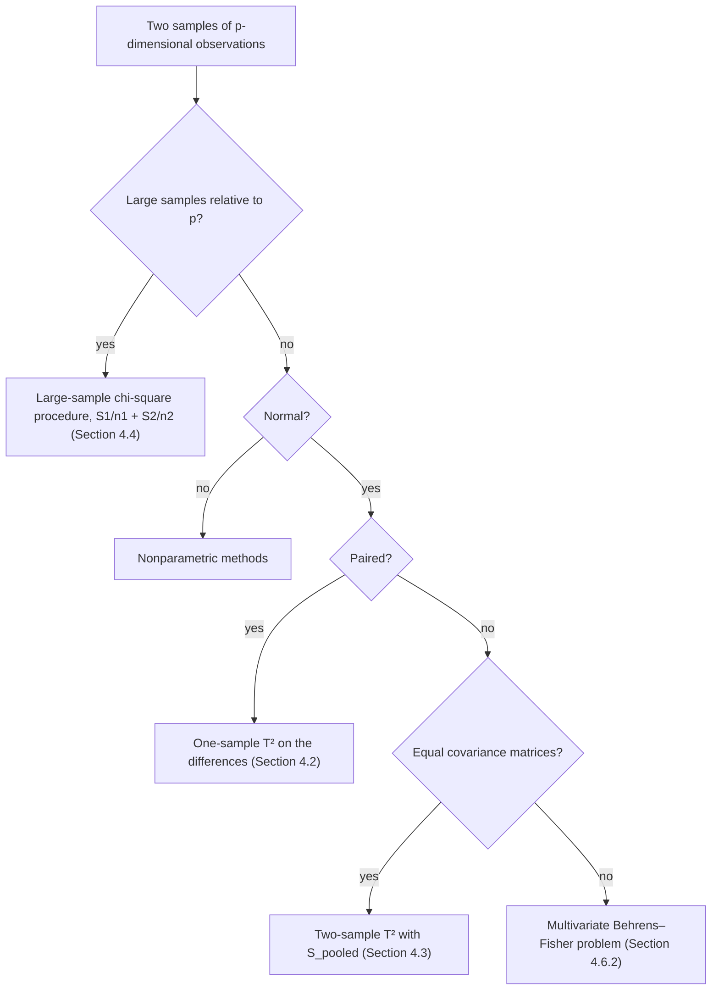

The previous chapter ([3.4.3](/3.4.3)) built the one-sample theory for a mean vector: **Hotelling's T² statistic**, its exact $F$ distribution under normality, the confidence ellipsoid, and **simultaneous confidence intervals** for linear combinations. This chapter applies the same ideas to the questions that arise most often in practice: do two groups differ in their mean vectors, by how much, and in which direction? The answer depends on the sampling design and on the assumptions we are willing to make: paired observations reduce to the one-sample problem; two independent normal samples with a common covariance matrix lead to a pooled $T^2$; and when the samples are large, the central limit theorem removes the need for normality and for equal covariances. The chapter ends with tools for checking the assumptions (equal covariance matrices, normality, outliers) and a workflow for real data. The univariate counterparts — the two-sample **t-test**, **Welch's t-test** and the **Behrens–Fisher problem** — were treated in [3.2.4](/3.2.4) and [3.2.5](/3.2.5); every result below reduces to one of them when $p = 1$.

As a running example, consider ratings of six work values (achievement, independence, recognition, relationships, support, working conditions) for occupations in two job families from the O\*NET database: architecture and engineering ($n_1 = 55$) and life, physical and social science ($n_2 = 57$). We ask whether the two families differ in their mean profiles, how confident we are about the size of the difference, both overall and for linear combinations of the six values, and which combination separates them best.

## 4.1. Review: Inference for One Mean Vector

Let $\boldsymbol{X}_1, \dots, \boldsymbol{X}_n \overset{\text{iid}}{\sim} \mathcal{N}_p(\boldsymbol{\mu}, \Sigma)$ with sample mean $\bar{\boldsymbol{X}}$ and sample covariance matrix

$$
S = \frac{1}{n-1}\sum_{j=1}^n (\boldsymbol{X}_j - \bar{\boldsymbol{X}})(\boldsymbol{X}_j - \bar{\boldsymbol{X}})^{\mathsf T}.
$$

Then $\sqrt{n}(\bar{\boldsymbol{X}} - \boldsymbol{\mu}) \sim \mathcal{N}_p(\boldsymbol{0}, \Sigma)$, $(n-1)S$ follows the **Wishart distribution** $W_p(n-1, \Sigma)$, and the two are independent. All of the one-sample procedures rest on the following fact, which we shall reuse with different "normal vectors" and "Wishart matrices".

**Theorem 4.1.1** Let $\boldsymbol{Z} \sim \mathcal{N}_p(\boldsymbol{0}, \Sigma)$ and $W \sim W_p(m, \Sigma)$ be independent, with $m \ge p$ and $\Sigma$ positive definite. Then

$$
\boldsymbol{Z}^{\mathsf T}\Big(\frac{W}{m}\Big)^{-1}\boldsymbol{Z} \sim \frac{mp}{m-p+1}F_{p,\,m-p+1}.
$$

Schematically, $T^2 = (\text{normal vector})^{\mathsf T}\,(\text{Wishart matrix}/\text{d.f.})^{-1}\,(\text{normal vector})$. With $\boldsymbol{Z} = \sqrt{n}(\bar{\boldsymbol{X}} - \boldsymbol{\mu}_0)$ and $W = (n-1)S$, $m = n - 1$, this gives the one-sample test of $H_0\colon \boldsymbol{\mu} = \boldsymbol{\mu}_0$:

$$
T^2 = n(\bar{\boldsymbol{X}} - \boldsymbol{\mu}_0)^{\mathsf T}S^{-1}(\bar{\boldsymbol{X}} - \boldsymbol{\mu}_0) \overset{H_0}{\sim} \frac{(n-1)p}{n-p}F_{p,\,n-p},
$$

where $n - p = (n-1) - (p-1)$. The level-$\alpha$ test rejects $H_0$ when $T^2 > c^2$, with $c^2 = \frac{(n-1)p}{n-p}F_{p,n-p,\alpha}$, and inverting it gives the $100(1-\alpha)\%$ confidence ellipsoid

$$
R(\boldsymbol{x}) = \{\boldsymbol{\mu}\colon n(\bar{\boldsymbol{x}} - \boldsymbol{\mu})^{\mathsf T}S^{-1}(\bar{\boldsymbol{x}} - \boldsymbol{\mu}) \le c^2\}.
$$

For a linear combination $\boldsymbol{a}^{\mathsf T}\boldsymbol{\mu}$ there are three kinds of intervals, all of the form $\boldsymbol{a}^{\mathsf T}\bar{\boldsymbol{x}} \pm (\text{critical value})\sqrt{\boldsymbol{a}^{\mathsf T}S\boldsymbol{a}/n}$:

| interval | critical value | guarantee |
|---|---|---|
| single $t$ interval | $t_{n-1,\alpha/2}$ | coverage $1-\alpha$ for one fixed $\boldsymbol{a}$ |
| Bonferroni intervals for $\boldsymbol{a}_1, \dots, \boldsymbol{a}_m$ | $t_{n-1,\alpha/(2m)}$ | joint coverage $\ge 1-\alpha$ for the $m$ combinations |
| $T^2$ intervals | $c = \sqrt{\frac{(n-1)p}{n-p}F_{p,n-p,\alpha}}$ | joint coverage $= 1-\alpha$ for all $\boldsymbol{a} \in \mathbb{R}^p$ |

The $T^2$ intervals are the shadows of the confidence ellipsoid: projecting $R(\boldsymbol{x})$ onto the direction $\boldsymbol{a}$ gives exactly the $T^2$ interval for $\boldsymbol{a}^{\mathsf T}\boldsymbol{\mu}$.

**Lemma 4.1.1** For every $\boldsymbol{a} \ne \boldsymbol{0}$,

$$
\max_{\boldsymbol{\mu} \in R(\boldsymbol{x})} \lvert \boldsymbol{a}^{\mathsf T}(\boldsymbol{\mu} - \bar{\boldsymbol{x}})\rvert = c\sqrt{\boldsymbol{a}^{\mathsf T}\frac{S}{n}\boldsymbol{a}}.
$$

**Proof** The maximum of a linear function over the ellipsoid is attained on its boundary $n(\bar{\boldsymbol{x}} - \boldsymbol{\mu})^{\mathsf T}S^{-1}(\bar{\boldsymbol{x}} - \boldsymbol{\mu}) = c^2$. Put $\boldsymbol{y} = \sqrt{n}S^{-1/2}(\boldsymbol{\mu} - \bar{\boldsymbol{x}})$ and $\boldsymbol{t} = n^{-1/2}S^{1/2}\boldsymbol{a}$; then $\boldsymbol{a}^{\mathsf T}(\boldsymbol{\mu} - \bar{\boldsymbol{x}}) = \boldsymbol{t}^{\mathsf T}\boldsymbol{y}$ and the boundary is the sphere $\boldsymbol{y}^{\mathsf T}\boldsymbol{y} = c^2$. By the Cauchy–Schwarz inequality, $\max_{\boldsymbol{y}^{\mathsf T}\boldsymbol{y} = c^2}\lvert\boldsymbol{t}^{\mathsf T}\boldsymbol{y}\rvert = c\|\boldsymbol{t}\|$, attained at $\boldsymbol{y} = c\,\boldsymbol{t}/\|\boldsymbol{t}\|$, and $\|\boldsymbol{t}\|^2 = \boldsymbol{a}^{\mathsf T}S\boldsymbol{a}/n$. $\square$

Equivalently, the event "$\boldsymbol{\mu} \in R(\boldsymbol{X})$" is the event "$\lvert\boldsymbol{a}^{\mathsf T}\bar{\boldsymbol{X}} - \boldsymbol{a}^{\mathsf T}\boldsymbol{\mu}\rvert \le c\sqrt{\boldsymbol{a}^{\mathsf T}S\boldsymbol{a}/n}$ for all $\boldsymbol{a}$", since

$$
\max_{\boldsymbol{a} \ne \boldsymbol{0}} \frac{\big(\boldsymbol{a}^{\mathsf T}(\bar{\boldsymbol{X}} - \boldsymbol{\mu})\big)^2}{\boldsymbol{a}^{\mathsf T}S\boldsymbol{a}/n} = n(\bar{\boldsymbol{X}} - \boldsymbol{\mu})^{\mathsf T}S^{-1}(\bar{\boldsymbol{X}} - \boldsymbol{\mu}),
$$

with the maximum attained at $\tilde{\boldsymbol{a}} \propto S^{-1}(\bar{\boldsymbol{X}} - \boldsymbol{\mu})$ (Lemma 4.3.1 below). Both probabilities therefore equal $1 - \alpha$.

**Remark 4.1.1** Is the $T^2$ interval for $\tilde{\boldsymbol{a}}^{\mathsf T}\boldsymbol{\mu}$ an exact $1-\alpha$ interval, where $\tilde{\boldsymbol{a}}$ maximizes the standardized difference above? The question looks paradoxical: for any fixed $\boldsymbol{a}$ the $T^2$ interval covers $\boldsymbol{a}^{\mathsf T}\boldsymbol{\mu}$ with probability larger than $1-\alpha$ (it is wider than the single $t$ interval), yet the derivation shows that coverage is exactly $1-\alpha$ in the maximizing direction. There is no contradiction: $\tilde{\boldsymbol{a}} \propto S^{-1}(\bar{\boldsymbol{X}} - \boldsymbol{\mu})$ depends on the sample, so it is not a fixed direction. A $95\%$ confidence ellipsoid covers $\boldsymbol{\mu}$ in about $95$ of $100$ repeated samples; projected onto any fixed direction it covers $\boldsymbol{a}^{\mathsf T}\boldsymbol{\mu}$ more often than that. No fixed direction has coverage exactly $1 - \alpha$.

Simultaneous intervals are still intervals, one for each linear combination, not a region: with $m = 2$ combinations, a rule (Bonferroni or $T^2$) produces two one-dimensional intervals $I_1, I_2$, and the guarantee concerns the probability that both cover their targets at once.

## 4.2. Paired Samples

### 4.2.1. Setting and Notation

In a **paired comparison** each experimental unit is measured under two treatments, for example the same subjects before and after an intervention, or the left and right hands of the same people. Let $\boldsymbol{X}_{1j}, \boldsymbol{X}_{2j} \in \mathbb{R}^p$ be the responses of unit $j$ to treatments $1$ and $2$ ($j = 1, \dots, n$); the $k$-th component $X_{ijk}$ is indexed by treatment $i$, unit $j$ and variable $k$. Define the differences

$$
\boldsymbol{D}_j = \boldsymbol{X}_{1j} - \boldsymbol{X}_{2j}, \qquad \mathbb{E}\boldsymbol{D}_j = \boldsymbol{\delta} = (\delta_1, \dots, \delta_p)^{\mathsf T}, \qquad \operatorname{Cov}(\boldsymbol{D}_j) = \Sigma_d,
$$

and their sample mean and sample covariance matrix

$$
\bar{\boldsymbol{D}} = \frac1n\sum_{j=1}^n \boldsymbol{D}_j, \qquad S_d = \frac{1}{n-1}\sum_{j=1}^n (\boldsymbol{D}_j - \bar{\boldsymbol{D}})(\boldsymbol{D}_j - \bar{\boldsymbol{D}})^{\mathsf T}.
$$

The hypothesis $H_0\colon \boldsymbol{\mu}_1 - \boldsymbol{\mu}_2 = \boldsymbol{\delta}_0$ becomes $H_0\colon \boldsymbol{\delta} = \boldsymbol{\delta}_0$, a one-sample problem for the differences: replace $\bar{\boldsymbol{X}}, \boldsymbol{\mu}_0, S$ by $\bar{\boldsymbol{D}}, \boldsymbol{\delta}_0, S_d$.

### 4.2.2. Test, Confidence Region and Simultaneous Intervals

**Theorem 4.2.1** Let the differences $\boldsymbol{D}_1, \dots, \boldsymbol{D}_n$ be a random sample from $\mathcal{N}_p(\boldsymbol{\delta}, \Sigma_d)$. Then, whatever the true $\boldsymbol{\delta}$ and $\Sigma_d$,

$$
T^2 = n(\bar{\boldsymbol{D}} - \boldsymbol{\delta})^{\mathsf T}S_d^{-1}(\bar{\boldsymbol{D}} - \boldsymbol{\delta}) \sim \frac{(n-1)p}{n-p}F_{p,\,n-p}.
$$

Consequently, $H_0\colon \boldsymbol{\delta} = \boldsymbol{\delta}_0$ is rejected at level $\alpha$ when $n(\bar{\boldsymbol{d}} - \boldsymbol{\delta}_0)^{\mathsf T}S_d^{-1}(\bar{\boldsymbol{d}} - \boldsymbol{\delta}_0) > \frac{(n-1)p}{n-p}F_{p,n-p,\alpha}$; the $100(1-\alpha)\%$ confidence region for $\boldsymbol{\delta}$ is the ellipsoid $\{\boldsymbol{\delta}\colon n(\bar{\boldsymbol{d}} - \boldsymbol{\delta})^{\mathsf T}S_d^{-1}(\bar{\boldsymbol{d}} - \boldsymbol{\delta}) \le \frac{(n-1)p}{n-p}F_{p,n-p,\alpha}\}$; and the simultaneous intervals for the components are

$$
\delta_i\colon\quad \bar d_i \pm \sqrt{\frac{(n-1)p}{n-p}F_{p,n-p,\alpha}}\,\sqrt{\frac{s_{d_i}^2}{n}} \quad (T^2), \qquad \bar d_i \pm t_{n-1,\alpha/(2p)}\sqrt{\frac{s_{d_i}^2}{n}} \quad (\text{Bonferroni}),
$$

where $s_{d_i}^2$ is the $i$-th diagonal entry of $S_d$. For large $n - p$, $\frac{(n-1)p}{n-p}F_{p,n-p,\alpha}$ may be replaced by $\chi^2_{p,\alpha}$ and normality is not needed (Section 4.4).

### 4.2.3. Why Pairing Matters

Pairing must be meaningful. If the two treatments were applied to unrelated units, the rows of the two data sets could be matched in any order, and the test would depend on that arbitrary order. In the occupation example, matching the first $55$ occupations of the second family to the $55$ occupations of the first family row by row gives $T^2 = 44.34$, and two other orderings of the same rows give $47.82$ and $49.15$: a statistic that changes when we shuffle the rows answers no well-posed question. The equal-covariance and large-sample procedures of Sections 4.3 and 4.4, by contrast, do not depend on the order of the observations.

When pairing is meaningful it can be far more powerful, because the differences remove the variation between units. A univariate illustration: the left and right hand sizes of $16$ people are strongly correlated across individuals, while within each person the right hand tends to be slightly larger. Welch's two-sample test ignores the pairing and sees only two heavily overlapping samples ($t = -0.34$, $p = 0.73$); the paired $t$-test on the $16$ differences detects the systematic difference ($t = -3.39$, $15$ d.f., $p = 0.004$). The figure shows the same phenomenon on simulated data.

## 4.3. Two Independent Normal Populations with a Common Covariance Matrix

### 4.3.1. Assumptions and the Pooled Covariance Matrix

Suppose now that the two samples come from different units:

$$
\boldsymbol{X}_{11}, \dots, \boldsymbol{X}_{1n_1} \overset{\text{iid}}{\sim} \mathcal{N}_p(\boldsymbol{\mu}_1, \Sigma_1), \qquad \boldsymbol{X}_{21}, \dots, \boldsymbol{X}_{2n_2} \overset{\text{iid}}{\sim} \mathcal{N}_p(\boldsymbol{\mu}_2, \Sigma_2),
$$

the two samples are independent, and, because $n_1$ and $n_2$ may be small, $\Sigma_1 = \Sigma_2 = \Sigma$. Write $\bar{\boldsymbol{X}}_1, \bar{\boldsymbol{X}}_2$ for the sample means and $S_1, S_2$ for the sample covariance matrices (with divisors $n_1 - 1$ and $n_2 - 1$). For $H_0\colon \boldsymbol{\mu}_1 - \boldsymbol{\mu}_2 = \boldsymbol{\delta}_0$ the natural estimator of $\boldsymbol{\mu}_1 - \boldsymbol{\mu}_2$ is $\bar{\boldsymbol{X}}_1 - \bar{\boldsymbol{X}}_2$, with

$$
\mathbb{E}(\bar{\boldsymbol{X}}_1 - \bar{\boldsymbol{X}}_2) = \boldsymbol{\mu}_1 - \boldsymbol{\mu}_2, \qquad \operatorname{Cov}(\bar{\boldsymbol{X}}_1 - \bar{\boldsymbol{X}}_2) = \operatorname{Cov}(\bar{\boldsymbol{X}}_1) + \operatorname{Cov}(\bar{\boldsymbol{X}}_2) = \Big(\frac{1}{n_1} + \frac{1}{n_2}\Big)\Sigma.
$$

Both $S_1$ and $S_2$ are unbiased for $\Sigma$, with $n_1 - 1$ and $n_2 - 1$ degrees of freedom; we combine them, weighting each by its degrees of freedom.

**Definition 4.3.1 (Pooled Sample Covariance Matrix)** The **pooled sample covariance matrix** of the two samples is

$$
S_{\mathrm{pooled}} = \frac{\sum_{j=1}^{n_1}(\boldsymbol{x}_{1j} - \bar{\boldsymbol{x}}_1)(\boldsymbol{x}_{1j} - \bar{\boldsymbol{x}}_1)^{\mathsf T} + \sum_{j=1}^{n_2}(\boldsymbol{x}_{2j} - \bar{\boldsymbol{x}}_2)(\boldsymbol{x}_{2j} - \bar{\boldsymbol{x}}_2)^{\mathsf T}}{n_1 + n_2 - 2} = \frac{n_1 - 1}{n_1 + n_2 - 2}S_1 + \frac{n_2 - 1}{n_1 + n_2 - 2}S_2.
$$

Since $(n_1 - 1)S_1 \sim W_p(n_1 - 1, \Sigma)$ and $(n_2 - 1)S_2 \sim W_p(n_2 - 1, \Sigma)$ are independent, their sum $(n_1 + n_2 - 2)S_{\mathrm{pooled}} \sim W_p(n_1 + n_2 - 2, \Sigma)$, and $S_{\mathrm{pooled}}$ is independent of $\bar{\boldsymbol{X}}_1 - \bar{\boldsymbol{X}}_2$. Up to the factor $\frac{n_1 + n_2 - 2}{n_1 + n_2}$, $S_{\mathrm{pooled}}$ is also the **maximum likelihood estimator** of $\Sigma$ under the common-covariance model. It is the matrix version of the pooled variance $S_w^2$ of the univariate two-sample $t$-test.

| | one population | two populations, $\Sigma_1 = \Sigma_2$ |
|---|---|---|
| normal vector | $\sqrt{n}(\bar{\boldsymbol{X}} - \boldsymbol{\mu}) \sim \mathcal{N}_p(\boldsymbol{0}, \Sigma)$ | $\big(\frac{1}{n_1} + \frac{1}{n_2}\big)^{-1/2}\big(\bar{\boldsymbol{X}}_1 - \bar{\boldsymbol{X}}_2 - (\boldsymbol{\mu}_1 - \boldsymbol{\mu}_2)\big) \sim \mathcal{N}_p(\boldsymbol{0}, \Sigma)$ |
| Wishart matrix | $(n-1)S \sim W_p(n-1, \Sigma)$ | $(n_1 + n_2 - 2)S_{\mathrm{pooled}} \sim W_p(n_1 + n_2 - 2, \Sigma)$ |
| degrees of freedom $m$ | $n - 1$ | $n_1 + n_2 - 2$ |

### 4.3.2. The Two-Sample Hotelling T² Test

**Theorem 4.3.1 (Two-Sample Hotelling T² Test)** Under the assumptions of Section 4.3.1, let

$$
T^2 = (\bar{\boldsymbol{X}}_1 - \bar{\boldsymbol{X}}_2 - \boldsymbol{\delta}_0)^{\mathsf T}\Big[\Big(\frac{1}{n_1} + \frac{1}{n_2}\Big)S_{\mathrm{pooled}}\Big]^{-1}(\bar{\boldsymbol{X}}_1 - \bar{\boldsymbol{X}}_2 - \boldsymbol{\delta}_0).
$$

Under $H_0\colon \boldsymbol{\mu}_1 - \boldsymbol{\mu}_2 = \boldsymbol{\delta}_0$,

$$
\frac{n_1 + n_2 - p - 1}{p(n_1 + n_2 - 2)}\,T^2 \sim F_{p,\,n_1 + n_2 - p - 1},
$$

so the level-$\alpha$ test rejects $H_0$ when

$$
T^2 > c^2 = \frac{(n_1 + n_2 - 2)p}{n_1 + n_2 - p - 1}F_{p,\,n_1 + n_2 - p - 1,\,\alpha}.
$$

**Proof** Write $T^2 = \boldsymbol{Z}^{\mathsf T}(W/m)^{-1}\boldsymbol{Z}$ with $\boldsymbol{Z} = \big(\frac{1}{n_1} + \frac{1}{n_2}\big)^{-1/2}(\bar{\boldsymbol{X}}_1 - \bar{\boldsymbol{X}}_2 - \boldsymbol{\delta}_0)$, $W = (n_1 + n_2 - 2)S_{\mathrm{pooled}}$ and $m = n_1 + n_2 - 2$. Under $H_0$, $\boldsymbol{Z} \sim \mathcal{N}_p(\boldsymbol{0}, \Sigma)$ and $W \sim W_p(m, \Sigma)$ are independent, and Theorem 4.1.1 gives the $\frac{mp}{m-p+1}F_{p,m-p+1}$ distribution with $m - p + 1 = n_1 + n_2 - p - 1$. $\square$

In the occupation example, $H_0\colon \boldsymbol{\mu}_1 = \boldsymbol{\mu}_2$ gives $T^2 = 43.23$, while $c^2 = \frac{110 \cdot 6}{105}F_{6,105,0.05} = 13.74$, so $H_0$ is rejected at the $5\%$ level. Unlike the paired statistic, this value does not depend on the order of the observations within each sample.

### 4.3.3. Confidence Region and Simultaneous Intervals

**Theorem 4.3.2** Under the assumptions of Section 4.3.1, with $c^2$ as in Theorem 4.3.1:

1. the $100(1-\alpha)\%$ confidence region for $\boldsymbol{\mu}_1 - \boldsymbol{\mu}_2$ is the ellipsoid

   $$
   \Big\{\boldsymbol{\delta}\colon (\bar{\boldsymbol{x}}_1 - \bar{\boldsymbol{x}}_2 - \boldsymbol{\delta})^{\mathsf T}\Big[\Big(\frac{1}{n_1} + \frac{1}{n_2}\Big)S_{\mathrm{pooled}}\Big]^{-1}(\bar{\boldsymbol{x}}_1 - \bar{\boldsymbol{x}}_2 - \boldsymbol{\delta}) \le c^2\Big\};
   $$

2. with probability $1 - \alpha$, the intervals

   $$
   \boldsymbol{a}^{\mathsf T}(\bar{\boldsymbol{X}}_1 - \bar{\boldsymbol{X}}_2) \pm c\sqrt{\boldsymbol{a}^{\mathsf T}\Big(\frac{1}{n_1} + \frac{1}{n_2}\Big)S_{\mathrm{pooled}}\,\boldsymbol{a}}
   $$

   cover $\boldsymbol{a}^{\mathsf T}(\boldsymbol{\mu}_1 - \boldsymbol{\mu}_2)$ simultaneously for all $\boldsymbol{a} \in \mathbb{R}^p$. In particular, $\mu_{1i} - \mu_{2i}$ is covered by $(\bar X_{1i} - \bar X_{2i}) \pm c\sqrt{\big(\frac{1}{n_1} + \frac{1}{n_2}\big)s_{ii,\mathrm{pooled}}}$ for $i = 1, \dots, p$.

The proof is the projection argument of Lemma 4.1.1 with $S/n$ replaced by $\big(\frac{1}{n_1} + \frac{1}{n_2}\big)S_{\mathrm{pooled}}$. When only the $p$ component differences matter, Bonferroni intervals with $t_{n_1 + n_2 - 2,\,\alpha/(2p)}$ in place of $c$ are usually shorter. The figure compares the three constructions in two dimensions.

### 4.3.4. The Direction of Largest Difference

Which linear combination of the variables separates the two populations best? We look for the direction $\boldsymbol{a}$ that maximizes the standardized difference

$$
\frac{\lvert\boldsymbol{a}^{\mathsf T}(\bar{\boldsymbol{x}}_1 - \bar{\boldsymbol{x}}_2)\rvert}{\sqrt{\boldsymbol{a}^{\mathsf T}\big(\frac{1}{n_1} + \frac{1}{n_2}\big)S_{\mathrm{pooled}}\,\boldsymbol{a}}}, \quad\text{equivalently}\quad \frac{\lvert\boldsymbol{a}^{\mathsf T}(\bar{\boldsymbol{x}}_1 - \bar{\boldsymbol{x}}_2)\rvert}{\sqrt{\boldsymbol{a}^{\mathsf T}S_{\mathrm{pooled}}\,\boldsymbol{a}}}.
$$

**Lemma 4.3.1 (Maximization Lemma)** Let $B$ be a positive definite $p \times p$ matrix and $\boldsymbol{d} \in \mathbb{R}^p$. Then

$$
\max_{\boldsymbol{x} \ne \boldsymbol{0}} \frac{(\boldsymbol{x}^{\mathsf T}\boldsymbol{d})^2}{\boldsymbol{x}^{\mathsf T}B\boldsymbol{x}} = \boldsymbol{d}^{\mathsf T}B^{-1}\boldsymbol{d},
$$

with the maximum attained at $\boldsymbol{x} = cB^{-1}\boldsymbol{d}$ for any constant $c \ne 0$.

**Proof** By the Cauchy–Schwarz inequality, $(\boldsymbol{x}^{\mathsf T}\boldsymbol{d})^2 = \big((B^{1/2}\boldsymbol{x})^{\mathsf T}(B^{-1/2}\boldsymbol{d})\big)^2 \le (\boldsymbol{x}^{\mathsf T}B\boldsymbol{x})(\boldsymbol{d}^{\mathsf T}B^{-1}\boldsymbol{d})$, with equality if and only if $B^{1/2}\boldsymbol{x} \propto B^{-1/2}\boldsymbol{d}$. $\square$

With $B = S_{\mathrm{pooled}}$ and $\boldsymbol{d} = \bar{\boldsymbol{x}}_1 - \bar{\boldsymbol{x}}_2$, the best direction is

$$
\hat{\boldsymbol{a}} \propto S_{\mathrm{pooled}}^{-1}(\bar{\boldsymbol{x}}_1 - \bar{\boldsymbol{x}}_2),
$$

and the maximal squared standardized difference equals $T^2$ itself (with $\boldsymbol{\delta}_0 = \boldsymbol{0}$): the two-sample $T^2$ is the largest squared univariate two-sample $t$ statistic over all linear combinations. The same vector reappears as Fisher's linear discriminant in [3.4.10](/3.4.10).

**Example 4.3.1** For the occupation data the sample means are

| | achievement | independence | recognition | relationships | support | working conditions |
|---|---|---|---|---|---|---|
| architecture and engineering | 5.118 | 5.021 | 4.717 | 3.668 | 4.592 | 5.101 |
| life, physical, social science | 5.041 | 4.936 | 4.599 | 4.117 | 3.906 | 4.777 |
| $S_{\mathrm{pooled}}^{-1}(\bar{\boldsymbol{x}}_1 - \bar{\boldsymbol{x}}_2)$ | 0.058 | 0.092 | $-0.146$ | $-0.669$ | 1.253 | 1.200 |

The direction of largest difference puts large positive weights on support and working conditions and a negative weight on relationships: engineering occupations are rated higher on support and working conditions and lower on relationships, while achievement, independence and recognition contribute little.

## 4.4. Large-Sample Inference

The exact results above require normality, and the two-sample test also requires $\Sigma_1 = \Sigma_2$. When the sample sizes are large relative to $p$, both requirements can be dropped.

### 4.4.1. Large-Sample Behavior of the Sample Mean and Covariance

**Theorem 4.4.1** Let $\boldsymbol{X}_1, \dots, \boldsymbol{X}_n$ be independent observations from a population with mean $\boldsymbol{\mu}$ and finite covariance matrix $\Sigma$. Then $\bar{\boldsymbol{X}} \xrightarrow{p} \boldsymbol{\mu}$ and $S \xrightarrow{p} \Sigma$.

**Proof** The first claim is the **weak law of large numbers** applied componentwise. For the second,

$$
S = \frac{1}{n-1}\sum_{i=1}^n (\boldsymbol{X}_i - \boldsymbol{\mu})(\boldsymbol{X}_i - \boldsymbol{\mu})^{\mathsf T} - \frac{n}{n-1}(\bar{\boldsymbol{X}} - \boldsymbol{\mu})(\bar{\boldsymbol{X}} - \boldsymbol{\mu})^{\mathsf T}.
$$

The first term converges in probability to $\mathbb{E}[(\boldsymbol{X}_1 - \boldsymbol{\mu})(\boldsymbol{X}_1 - \boldsymbol{\mu})^{\mathsf T}] = \Sigma$ by the law of large numbers, and the second to $O$ by the first claim and the **continuous mapping theorem**. $\square$

**Theorem 4.4.2** Let $\boldsymbol{X}_1, \dots, \boldsymbol{X}_n$ be independent observations from any population with mean $\boldsymbol{\mu}$ and finite positive definite covariance matrix $\Sigma$. Then, as $n \to \infty$,

1. $\sqrt{n}(\bar{\boldsymbol{X}} - \boldsymbol{\mu}) \xrightarrow{d} \mathcal{N}_p(\boldsymbol{0}, \Sigma)$;
2. $n(\bar{\boldsymbol{X}} - \boldsymbol{\mu})^{\mathsf T}S^{-1}(\bar{\boldsymbol{X}} - \boldsymbol{\mu}) \xrightarrow{d} \chi^2_p$.

In practice the approximation requires $n$ to be large relative to $p$.

**Proof** Part 1 is the multivariate **central limit theorem** ([3.1.15](/3.1.15)). For part 2, $S \xrightarrow{p} \Sigma$ implies $S^{-1/2} \xrightarrow{p} \Sigma^{-1/2}$ by continuous mapping, hence $S^{-1/2}\Sigma^{1/2} \xrightarrow{p} I_p$, a constant matrix. By **Slutsky's theorem**,

$$
\boldsymbol{Z}_n = S^{-1/2}\Sigma^{1/2}\cdot\Sigma^{-1/2}\sqrt{n}(\bar{\boldsymbol{X}} - \boldsymbol{\mu}) \xrightarrow{d} I_p\,\mathcal{N}_p(\boldsymbol{0}, I_p) = \mathcal{N}_p(\boldsymbol{0}, I_p),
$$

so the limit of $\boldsymbol{Z}_n = (Z_1, \dots, Z_p)^{\mathsf T}$ has iid $\mathcal{N}(0, 1)$ components, and $\boldsymbol{Z}_n^{\mathsf T}\boldsymbol{Z}_n = n(\bar{\boldsymbol{X}} - \boldsymbol{\mu})^{\mathsf T}S^{-1}(\bar{\boldsymbol{X}} - \boldsymbol{\mu}) \xrightarrow{d} Z_1^2 + \cdots + Z_p^2 \sim \chi^2_p$ by continuous mapping. $\square$

The step from exact to asymptotic theory is the same in one and in $p$ dimensions:

| | 1-dim | $p$-dim |
|---|---|---|
| exact (normal data) | $\frac{\sqrt{n}(\bar X - \mu)}{\sigma} \sim \mathcal{N}(0,1)$, $\frac{(n-1)S^2}{\sigma^2} \sim \chi^2_{n-1}$ $\Rightarrow$ $\frac{\sqrt{n}(\bar X - \mu)}{S} \sim t_{n-1}$ | $\Sigma^{-1/2}\sqrt{n}(\bar{\boldsymbol{X}} - \boldsymbol{\mu}) \sim \mathcal{N}_p(\boldsymbol{0}, I_p)$, $(n-1)S \sim W_p(n-1, \Sigma)$ $\Rightarrow$ $T^2 \sim \frac{(n-1)p}{n-p}F_{p,n-p}$ |
| asymptotic ($n \to \infty$) | CLT and $S^2/\sigma^2 \xrightarrow{p} 1$ $\Rightarrow$ $\frac{\sqrt{n}(\bar X - \mu)}{S} \xrightarrow{d} \mathcal{N}(0,1)$ | CLT and $\Sigma^{-1/2}S\Sigma^{-1/2} \xrightarrow{p} I_p$ $\Rightarrow$ $T^2 \xrightarrow{d} \chi^2_p$ |

### 4.4.2. One Population

**Theorem 4.4.3** Let $\boldsymbol{X}_1, \dots, \boldsymbol{X}_n$ be a random sample from a population with mean $\boldsymbol{\mu}$ and positive definite covariance matrix $\Sigma$. When $n - p$ is large:

1. $H_0\colon \boldsymbol{\mu} = \boldsymbol{\mu}_0$ is rejected in favor of $H_1\colon \boldsymbol{\mu} \ne \boldsymbol{\mu}_0$ at level approximately $\alpha$ if $n(\bar{\boldsymbol{x}} - \boldsymbol{\mu}_0)^{\mathsf T}S^{-1}(\bar{\boldsymbol{x}} - \boldsymbol{\mu}_0) > \chi^2_{p,\alpha}$, where $\chi^2_{p,\alpha}$ is the upper $\alpha$ quantile of $\chi^2_p$;
2. the intervals $\boldsymbol{a}^{\mathsf T}\bar{\boldsymbol{x}} \pm \sqrt{\chi^2_{p,\alpha}}\sqrt{\boldsymbol{a}^{\mathsf T}S\boldsymbol{a}/n}$ contain $\boldsymbol{a}^{\mathsf T}\boldsymbol{\mu}$ for all $\boldsymbol{a}$ simultaneously with probability approximately $1 - \alpha$.

When the data are in fact normal and $n$ is large, these procedures agree with the exact ones, because $\frac{(n-1)p}{n-p}F_{p,n-p,\alpha} \to \chi^2_{p,\alpha}$ as $n \to \infty$.

### 4.4.3. Two Populations with Unequal Covariance Matrices

Now let $\boldsymbol{X}_{11}, \dots, \boldsymbol{X}_{1n_1}$ be iid with mean $\boldsymbol{\mu}_1$ and covariance $\Sigma_1$, and $\boldsymbol{X}_{21}, \dots, \boldsymbol{X}_{2n_2}$ iid with mean $\boldsymbol{\mu}_2$ and covariance $\Sigma_2$, the samples being independent. No normality is assumed and, since $n_1, n_2$ are large relative to $p$, we allow $\Sigma_1 \ne \Sigma_2$. Then

$$
\mathbb{E}(\bar{\boldsymbol{X}}_1 - \bar{\boldsymbol{X}}_2) = \boldsymbol{\mu}_1 - \boldsymbol{\mu}_2, \qquad \operatorname{Cov}(\bar{\boldsymbol{X}}_1 - \bar{\boldsymbol{X}}_2) = \frac{1}{n_1}\Sigma_1 + \frac{1}{n_2}\Sigma_2;
$$

by the central limit theorem $\bar{\boldsymbol{X}}_1 - \bar{\boldsymbol{X}}_2$ is approximately $\mathcal{N}_p\big(\boldsymbol{\mu}_1 - \boldsymbol{\mu}_2, \frac{1}{n_1}\Sigma_1 + \frac{1}{n_2}\Sigma_2\big)$, and by the law of large numbers $S_1 \xrightarrow{p} \Sigma_1$, $S_2 \xrightarrow{p} \Sigma_2$. Precisely, if $n_1, n_2 \to \infty$, then

$$
\Big(\frac{\Sigma_1}{n_1} + \frac{\Sigma_2}{n_2}\Big)^{-1/2}\big[\bar{\boldsymbol{X}}_1 - \bar{\boldsymbol{X}}_2 - (\boldsymbol{\mu}_1 - \boldsymbol{\mu}_2)\big] \xrightarrow{d} \mathcal{N}_p(\boldsymbol{0}, I_p), \qquad \Big(\frac{\Sigma_1}{n_1} + \frac{\Sigma_2}{n_2}\Big)^{-1/2}\Big(\frac{S_1}{n_1} + \frac{S_2}{n_2}\Big)\Big(\frac{\Sigma_1}{n_1} + \frac{\Sigma_2}{n_2}\Big)^{-1/2} \xrightarrow{p} I_p,
$$

and the argument of Theorem 4.4.2 gives the following result.

**Theorem 4.4.4** Let $n_1 - p$ and $n_2 - p$ be large. Then:

1. an approximate $100(1-\alpha)\%$ confidence ellipsoid for $\boldsymbol{\mu}_1 - \boldsymbol{\mu}_2$ is

   $$
   \big[\bar{\boldsymbol{x}}_1 - \bar{\boldsymbol{x}}_2 - (\boldsymbol{\mu}_1 - \boldsymbol{\mu}_2)\big]^{\mathsf T}\Big(\frac{1}{n_1}S_1 + \frac{1}{n_2}S_2\Big)^{-1}\big[\bar{\boldsymbol{x}}_1 - \bar{\boldsymbol{x}}_2 - (\boldsymbol{\mu}_1 - \boldsymbol{\mu}_2)\big] \le \chi^2_{p,\alpha};
   $$

2. with $c^2 = \chi^2_{p,\alpha}$, the intervals $\boldsymbol{a}^{\mathsf T}(\bar{\boldsymbol{X}}_1 - \bar{\boldsymbol{X}}_2) \pm c\sqrt{\boldsymbol{a}^{\mathsf T}\big(\frac{1}{n_1}S_1 + \frac{1}{n_2}S_2\big)\boldsymbol{a}}$ cover $\boldsymbol{a}^{\mathsf T}(\boldsymbol{\mu}_1 - \boldsymbol{\mu}_2)$ for all $\boldsymbol{a}$ simultaneously with probability approximately $1 - \alpha$.

The test of $H_0\colon \boldsymbol{\mu}_1 = \boldsymbol{\mu}_2$ rejects when the left-hand side with $\boldsymbol{\mu}_1 - \boldsymbol{\mu}_2 = \boldsymbol{0}$ exceeds $\chi^2_{p,\alpha}$. For the occupation data the statistic is $43.49 > \chi^2_{6,0.05} = 12.59$, so $H_0$ is again rejected; the conclusion does not depend on the order of the observations.

### 4.4.4. Relation to the Normal-Theory Procedure

When $n_1 = n_2 = n$, the two covariance estimates coincide:

$$
\frac{1}{n_1}S_1 + \frac{1}{n_2}S_2 = \frac1n(S_1 + S_2) = \frac{(n-1)S_1 + (n-1)S_2}{n + n - 2}\Big(\frac1n + \frac1n\Big) = S_{\mathrm{pooled}}\Big(\frac1n + \frac1n\Big),
$$

so the large-sample statistic equals the two-sample $T^2$, and the two procedures differ only in their critical values, $\chi^2_{p,\alpha}$ versus $\frac{(2n-2)p}{2n-p-1}F_{p,2n-p-1,\alpha}$, which are close for large $n$. With equal sample sizes the pooled $T^2$ test is therefore robust to unequal covariance matrices; with very unequal sample sizes and unequal covariances it is not.

## 4.5. Checking the Assumptions

### 4.5.1. The Assumptions Behind T²

The small-sample two-sample $T^2$ procedures rely on three assumptions:

1. equal covariance matrices: both populations have the same covariance matrix $\Sigma$;
2. independence: the units of the two samples are sampled independently (this does not mean that the $p$ variables are independent of one another);
3. normality: both populations are multivariate normal.

### 4.5.2. Testing Equality of Covariance Matrices: Box's M Test

Consider two independent samples from $\mathcal{N}_p(\boldsymbol{\mu}_1, \Sigma_1)$ and $\mathcal{N}_p(\boldsymbol{\mu}_2, \Sigma_2)$ and the hypothesis $H_0\colon \Sigma_1 = \Sigma_2$. Recall the **likelihood ratio test** and **Wilks' theorem**: if $\Lambda = \max_{\theta \in \Theta_0}L(\theta)/\max_{\theta \in \Theta}L(\theta)$, then under $H_0$, asymptotically, $-2\ln\Lambda \sim \chi^2_{v - v_0}$, where $v - v_0 = \dim\Theta - \dim\Theta_0$. Here the models are nested: the full model has two free covariance matrices and the null model one, each with $\frac12p(p+1)$ free entries, so

$$
v - v_0 = 2\cdot\frac12p(p+1) - \frac12p(p+1) = \frac12p(p+1).
$$

**Theorem 4.5.1 (Box's M Test)** For samples from two multivariate normal populations, let

$$
\Lambda = \prod_{i=1}^2\Big(\frac{\lvert S_i\rvert}{\lvert S_{\mathrm{pooled}}\rvert}\Big)^{(n_i - 1)/2}, \qquad u = \Big[\sum_{i=1}^2\frac{1}{n_i - 1} - \frac{1}{\sum_{i=1}^2(n_i - 1)}\Big]\frac{2p^2 + 3p - 1}{6(p+1)(2-1)}.
$$

Under $H_0\colon \Sigma_1 = \Sigma_2$, the statistic $C = (1 - u)(-2\ln\Lambda)$ is approximately $\chi^2_v$ with $v = \frac12p(p+1)$, and $H_0$ is rejected when $C > \chi^2_{v,\alpha}$.

Here $M = -2\ln\Lambda$ is a likelihood-ratio type statistic built from the unbiased estimates $S_i$, and $1 - u$ is a correction factor that improves the $\chi^2$ approximation in finite samples; the factor $2 - 1$ is $g - 1$ for $g = 2$ groups, and the same formula with $g$ groups compares several covariance matrices. Only the idea is essential; the constants need not be memorized. For the occupation data $C = 36.59 > \chi^2_{21,0.05} = 32.67$, so equal covariance matrices are rejected, which supports the large-sample analysis of Section 4.4.3 for these data.

**Remark 4.5.1** Box's M test should be interpreted with care:

- it is extremely sensitive to departures from normality, so a rejection may reflect non-normality rather than unequal covariances;
- it has little power for small samples: a non-significant result does not show that the covariance matrices are equal;
- it is overly sensitive for large samples, rejecting for differences of no practical importance; a small level such as $\alpha = 0.001$ is often recommended.

Related univariate tests are Bartlett's test (normal samples) and Levene's test (non-normal samples) for equality of variances.

### 4.5.3. Assessing Normality

There are two complementary approaches: formal tests and graphical methods.

Formal tests in one dimension include goodness-of-fit tests based on the empirical distribution function (the **Kolmogorov–Smirnov test**, which applies to any continuous distribution; the **Shapiro–Wilk test**, whose statistic $W$ is small for non-normal samples and which works well for small samples and generally has high power); tests based on **skewness** and **kurtosis** (the D'Agostino–Pearson test, for $n > 20$, and the Jarque–Bera test, whose statistic grows as the data depart from normality); and consistent tests based on the empirical characteristic function (Epps–Pulley). In $p$ dimensions, goodness-of-fit tests based on the empirical distribution function are of limited use because multivariate data are inherently sparse. Mardia's measures of multivariate skewness and kurtosis,

$$
b_{1,p} = \frac{1}{n^2}\sum_{i=1}^n\sum_{j=1}^n\big[(\boldsymbol{y}_i - \bar{\boldsymbol{y}})^{\mathsf T}S^{-1}(\boldsymbol{y}_j - \bar{\boldsymbol{y}})\big]^3, \qquad b_{2,p} = \frac1n\sum_{i=1}^n\big[(\boldsymbol{y}_i - \bar{\boldsymbol{y}})^{\mathsf T}S^{-1}(\boldsymbol{y}_i - \bar{\boldsymbol{y}})\big]^2,
$$

satisfy, under multivariate normality, $\frac{n b_{1,p}}{6} \xrightarrow{d} \chi^2_{p(p+1)(p+2)/6}$ and $\frac{b_{2,p} - p(p+2)}{\sqrt{8p(p+2)/n}} \xrightarrow{d} \mathcal{N}(0, 1)$. Weighted $L^2$ statistics such as the BHEP test, $n\int\lvert\Phi_n(\boldsymbol{t}) - \Phi_0(\boldsymbol{t})\rvert^2\omega_\beta(\boldsymbol{t})\,\mathrm{d}\boldsymbol{t}$, compare the empirical characteristic function $\Phi_n$ of the standardized data with the normal one $\Phi_0$. These tests are mentioned for orientation only.

Graphical methods are used routinely. If $\boldsymbol{X} \sim \mathcal{N}_p(\boldsymbol{\mu}, \Sigma)$, then (1) each marginal $X_i$ is normal, (2) every linear combination of the $X_i$ is normal, and (3) $(\boldsymbol{X} - \boldsymbol{\mu})^{\mathsf T}\Sigma^{-1}(\boldsymbol{X} - \boldsymbol{\mu}) \sim \chi^2_p$. Properties (1) and (2) are checked with histograms or **Q–Q plots** of the variables or of selected linear combinations (for example the principal components $\hat{\boldsymbol{e}}_1^{\mathsf T}\boldsymbol{x}_j$ of [3.4.5](/3.4.5)); property (3) is checked with the squared **Mahalanobis distances** $d_j^2 = (\boldsymbol{x}_j - \bar{\boldsymbol{x}})^{\mathsf T}S^{-1}(\boldsymbol{x}_j - \bar{\boldsymbol{x}})$, $j = 1, \dots, n$.

**Algorithm 4.5.1 (Normal Q–Q Plot)** Let $x_{(1)} \le \cdots \le x_{(n)}$ be the ordered observations, $p_{(j)} = (j - \frac12)/n$ and $q_{(j)} = \Phi^{-1}(p_{(j)})$.

1. Order the observations to obtain $x_{(1)}, \dots, x_{(n)}$ and the probability levels $p_{(1)}, \dots, p_{(n)}$.
2. Compute the standard normal quantiles $q_{(1)}, \dots, q_{(n)}$.
3. Plot the pairs $(q_{(j)}, x_{(j)})$ and examine their straightness, for example through the correlation coefficient

   $$
   r_Q = \frac{\sum_{j=1}^n (x_{(j)} - \bar x)(q_{(j)} - \bar q)}{\sqrt{\sum_{j=1}^n (x_{(j)} - \bar x)^2}\sqrt{\sum_{j=1}^n (q_{(j)} - \bar q)^2}},
   $$

   rejecting normality when $r_Q$ is too small.

The idea is simple. If $X_1, \dots, X_n$ are iid with continuous distribution function $F$, then $X_j = F^{-1}(U_j)$ with $U_j \overset{\text{iid}}{\sim} \mathrm{U}(0,1)$, and the ordered $U_{(j)}$ sit near $p_{(j)}$. Under $H_0\colon X \sim \mathcal{N}(\mu, \sigma^2)$, $F^{-1}(u) = \mu + \sigma\Phi^{-1}(u)$, so $x_{(j)} \approx \mu + \sigma q_{(j)}$ and the points fall near a straight line with intercept $\mu$ and slope $\sigma$. For example, the five scores $75, 74, 81, 77, 70$ are ordered as $70, 74, 75, 77, 81$, with $p_{(j)} = 0.1, 0.3, 0.5, 0.7, 0.9$ and $q_{(j)} = -1.28, -0.52, 0, 0.52, 1.28$. The same construction, with $\Phi^{-1}$ replaced by another quantile function, checks whether data follow any given distribution.

**Algorithm 4.5.2 (Chi-Square Plot)** To check multivariate normality:

1. Order the squared distances as $d_{(1)}^2 \le \cdots \le d_{(n)}^2$, with probability levels $p_{(j)} = (j - \frac12)/n$.
2. Compute the $\chi^2_p$ quantiles $q_{(j)} = \chi^2_{p,\,1 - p_{(j)}}$, that is, the $p_{(j)}$ quantiles of $\chi^2_p$.
3. Plot the pairs $(q_{(j)}, d_{(j)}^2)$ and compare them with the line $y = x$.

The *chi-square plot* is the $\chi^2_p$ analogue of the Q–Q plot: under normality the $d_j^2$ are approximately $\chi^2_p$, and the points should lie near the $45°$ line. Points bending upward at the right indicate heavier tails than the normal; isolated points far above the line are candidates for outliers.

### 4.5.4. Transformations to Near Normality

When the data are clearly not normal, a transformation often helps. Standard choices are:

| original scale | transformed scale |
|---|---|
| counts $y$ | $\sqrt{y}$ |
| proportions $\hat p$ | $\operatorname{logit}(\hat p) = \log\frac{\hat p}{1 - \hat p}$ (a constant factor such as $\frac12$ does not matter) |
| correlations $r$ | Fisher's $z(r) = \frac12\log\frac{1 + r}{1 - r}$ |

When no transformation suggests itself, we let the data choose one within a family of power transformations.

**Definition 4.5.1 (Box–Cox Transformation)** For positive data $x$, the **Box–Cox transformation** with parameter $\lambda$ is

$$
x^{(\lambda)} = \begin{cases} \dfrac{x^\lambda - 1}{\lambda}, & \lambda \ne 0, \\ \log x, & \lambda = 0. \end{cases}
$$

Given observations $x_1, \dots, x_n$, $\lambda$ is chosen to maximize

$$
\ell(\lambda) = -\frac n2\ln\Big[\frac1n\sum_{j=1}^n\big(x_j^{(\lambda)} - \overline{x^{(\lambda)}}\big)^2\Big] + (\lambda - 1)\sum_{j=1}^n\ln x_j,
$$

which is, up to a constant, the profile log-likelihood of $\lambda$ when $x^{(\lambda)}$ is assumed normal; the last term is the logarithm of the Jacobian of the transformation. The $p$-dimensional version chooses one $\lambda_k$ per variable by maximizing

$$
\ell(\lambda_1, \dots, \lambda_p) = -\frac n2\ln\lvert S(\boldsymbol{\lambda})\rvert + (\lambda_1 - 1)\sum_{j=1}^n\ln x_{j1} + \cdots + (\lambda_p - 1)\sum_{j=1}^n\ln x_{jp},
$$

where $S(\boldsymbol{\lambda})$ is the sample covariance matrix (with divisor $n$) of the transformed data; the maximum is found iteratively.

### 4.5.5. Assessing Independence

Suppose $\boldsymbol{X}_1 \sim F_1$ and $\boldsymbol{X}_2 \sim F_2$ with joint distribution $F$; we test $H_0\colon F = F_1F_2$ against $H_1\colon F \ne F_1F_2$.

- Under multivariate normality, independence is equivalent to $\Sigma_{12} = \operatorname{Cov}(\boldsymbol{X}_1, \boldsymbol{X}_2) = O$, and the likelihood ratio approach leads to statistics based on $\frac{\lvert S\rvert}{\lvert S_{11}\rvert\lvert S_{22}\rvert}$, where $S$ is partitioned conformably.
- Rank-based versions replace $S$ by a matrix $T$ of Spearman rank correlations or of sign statistics and use $\frac{\lvert T\rvert}{\lvert T_{11}\rvert\lvert T_{22}\rvert}$.
- Tests based on the empirical characteristic function or distribution function measure a distance between the joint characteristic function of $(\boldsymbol{X}_1, \boldsymbol{X}_2)$ and the product of the marginal ones (for example the distance covariance test of Székely, Rizzo and Bakirov). Their null distributions are usually obtained by a permutation test: permuting the observations of $\boldsymbol{X}_2$ as $\boldsymbol{X}_{2,\pi(1)}, \dots, \boldsymbol{X}_{2,\pi(n)}$ destroys any dependence while keeping both marginals.

### 4.5.6. Outliers

Outliers can be detected in four steps:

1. make a dot plot of each variable;
2. make a scatter plot of each pair of variables;
3. compute the standardized values $z_{jk} = (x_{jk} - \bar x_k)/\sqrt{s_{kk}}$ and look for values that are large in absolute value relative to the sample size and the number of variables;
4. compute the squared Mahalanobis distances $(\boldsymbol{x}_j - \bar{\boldsymbol{x}})^{\mathsf T}S^{-1}(\boldsymbol{x}_j - \bar{\boldsymbol{x}})$ and look for values that are unusually large compared with a high quantile of $\chi^2_p$.

Step 4 can reveal observations that look ordinary in every single variable but are unusual in their combination. What to do with an outlier depends on its nature and on the aims of the study: it may be a recording error to be corrected or deleted, or a genuine observation to be kept and down-weighted in subsequent analysis.

## 4.6. Choosing a Procedure

### 4.6.1. Overview

The procedures of [3.4.3](/3.4.3) and this chapter differ in their assumptions but share one idea: a statistic of the form $(\text{estimate} - \text{target})^{\mathsf T}(\text{estimated covariance})^{-1}(\text{estimate} - \text{target})$, an exact $F$ or asymptotic $\chi^2$ reference distribution, a confidence ellipsoid obtained by inverting the test, and simultaneous intervals obtained by projecting the ellipsoid.

| situation | statistic | null distribution | $T^2$ simultaneous interval for $\boldsymbol{a}^{\mathsf T}(\cdot)$ |
|---|---|---|---|
| one population, $p = 1$, normal | $\frac{n(\bar x - \mu_0)^2}{s^2}$ | $F_{1,n-1}$ (that is, $t_{n-1}^2$) | not applicable |
| one population, normal | $n(\bar{\boldsymbol{x}} - \boldsymbol{\mu}_0)^{\mathsf T}S^{-1}(\bar{\boldsymbol{x}} - \boldsymbol{\mu}_0)$ | $\frac{(n-1)p}{n-p}F_{p,n-p}$ | $\boldsymbol{a}^{\mathsf T}\bar{\boldsymbol{x}} \pm c\sqrt{\boldsymbol{a}^{\mathsf T}S\boldsymbol{a}/n}$ |
| one population, large $n$ | same | $\approx\chi^2_p$ | same, $c^2 = \chi^2_{p,\alpha}$ |
| paired, normal differences | $n(\bar{\boldsymbol{d}} - \boldsymbol{\delta}_0)^{\mathsf T}S_d^{-1}(\bar{\boldsymbol{d}} - \boldsymbol{\delta}_0)$ | $\frac{(n-1)p}{n-p}F_{p,n-p}$ | $\boldsymbol{a}^{\mathsf T}\bar{\boldsymbol{d}} \pm c\sqrt{\boldsymbol{a}^{\mathsf T}S_d\boldsymbol{a}/n}$ |
| two populations, normal, $\Sigma_1 = \Sigma_2$ | $(\bar{\boldsymbol{x}}_1 - \bar{\boldsymbol{x}}_2 - \boldsymbol{\delta}_0)^{\mathsf T}\big[(\frac{1}{n_1} + \frac{1}{n_2})S_{\mathrm{pooled}}\big]^{-1}(\cdot)$ | $\frac{(n_1 + n_2 - 2)p}{n_1 + n_2 - p - 1}F_{p,n_1 + n_2 - p - 1}$ | $\boldsymbol{a}^{\mathsf T}(\bar{\boldsymbol{x}}_1 - \bar{\boldsymbol{x}}_2) \pm c\sqrt{\boldsymbol{a}^{\mathsf T}(\frac{1}{n_1} + \frac{1}{n_2})S_{\mathrm{pooled}}\boldsymbol{a}}$ |
| two populations, large samples | $(\bar{\boldsymbol{x}}_1 - \bar{\boldsymbol{x}}_2 - \boldsymbol{\delta}_0)^{\mathsf T}\big(\frac{S_1}{n_1} + \frac{S_2}{n_2}\big)^{-1}(\cdot)$ | $\approx\chi^2_p$ | $\boldsymbol{a}^{\mathsf T}(\bar{\boldsymbol{x}}_1 - \bar{\boldsymbol{x}}_2) \pm c\sqrt{\boldsymbol{a}^{\mathsf T}(\frac{S_1}{n_1} + \frac{S_2}{n_2})\boldsymbol{a}}$ |

In each row the confidence region is the set of targets for which the statistic does not exceed $c^2$, the upper $\alpha$ quantile of the null distribution. The choice among the rows follows the decision tree below; "parametric" procedures use exact normal-theory distributions, "asymptotic" ones the $\chi^2$ limit, and without normality and large samples one turns to nonparametric methods (rank or permutation tests, see [3.6](/3.6)).

### 4.6.2. The Multivariate Behrens–Fisher Problem

For normal populations with $\Sigma_1 \ne \Sigma_2$ and moderate sample sizes, the natural statistic is

$$
T^2 = (\bar{\boldsymbol{X}}_1 - \bar{\boldsymbol{X}}_2)^{\mathsf T}\tilde S^{-1}(\bar{\boldsymbol{X}}_1 - \bar{\boldsymbol{X}}_2), \qquad \tilde S = \frac{S_1}{n_1} + \frac{S_2}{n_2},
$$

but, as in the univariate **Behrens–Fisher problem**, its null distribution depends on the unknown $\Sigma_1, \Sigma_2$. Approximate solutions extend Welch's degrees-of-freedom idea: the tests of Johansen (1980), Nel and Van der Merwe (1986), Krishnamoorthy and Yu (2004), and Yao (1965). Yao's test, for example, uses

$$
T_Y = \frac{m - p + 1}{pm}T^2 \overset{H_0}{\approx} F_{p,\,m-p+1}, \qquad \frac1m = \frac{1}{(T^2)^2}\sum_{i=1}^2\frac{1}{n_i - 1}\Big[(\bar{\boldsymbol{X}}_1 - \bar{\boldsymbol{X}}_2)^{\mathsf T}\tilde S^{-1}\frac{S_i}{n_i}\tilde S^{-1}(\bar{\boldsymbol{X}}_1 - \bar{\boldsymbol{X}}_2)\Big]^2.
$$

These methods are mentioned only to show how the univariate theory generalizes.

### 4.6.3. A Workflow for Real Data

In practice a two-sample analysis may proceed as follows.

1. For small samples, assess multivariate normality with histograms, scatter plots, Q–Q and chi-square plots; if the data are clearly not normal, apply normalizing transformations; look for outliers.
2. Decide whether the samples are paired or independent; for independent samples, assess the equality of the covariance matrices.
3. Test the equality of the mean vectors:
   - if the data are normal and paired, or normal with equal covariance matrices, use the corresponding Hotelling $T^2$ test;
   - if normality or equal covariances fail but the samples are large, use the large-sample $\chi^2$ test;
   - otherwise use nonparametric methods.
   
   If the test is not significant, conclude that there is no statistically significant evidence of different mean vectors, and stop.
4. Otherwise compute simultaneous confidence intervals, and for the variables (or combinations) with significant differences, state which population has the larger mean.

## Summary

- All procedures for one or two mean vectors use the same idea in different settings: a squared standardized distance between an estimate and its target, an exact $F$ distribution under normality or an asymptotic $\chi^2$ distribution for large samples, a confidence ellipsoid, and $T^2$ simultaneous intervals obtained by projection.
- Paired samples reduce to a one-sample $T^2$ on the differences; the pairing must be meaningful.
- Two independent normal samples with a common covariance matrix use the pooled covariance matrix $S_{\mathrm{pooled}}$ and $\frac{n_1 + n_2 - p - 1}{p(n_1 + n_2 - 2)}T^2 \sim F_{p,n_1 + n_2 - p - 1}$; the direction $S_{\mathrm{pooled}}^{-1}(\bar{\boldsymbol{x}}_1 - \bar{\boldsymbol{x}}_2)$ shows the largest difference.
- For large samples, Slutsky's theorem gives $\chi^2_p$ limits without normality and with unequal covariance matrices, using $S_1/n_1 + S_2/n_2$.
- Assumptions are checked with Box's M test (equal covariances, but sensitive to non-normality), Q–Q and chi-square plots (normality), transformations such as Box–Cox, independence tests, and Mahalanobis distances (outliers).
