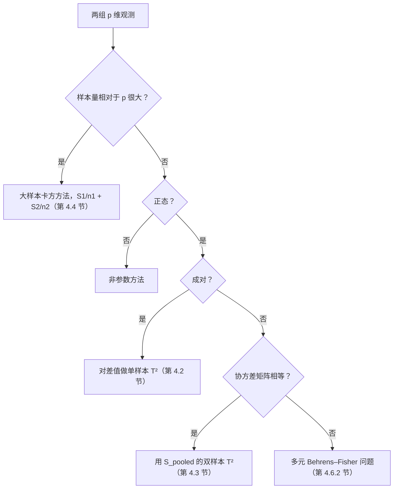

上一章（[3.4.3](/3.4.3)）建立了单个均值向量的推断理论：**Hotelling T² 统计量**、正态假设下它的精确 $F$ 分布、置信椭球，以及线性组合的**联合置信区间**。本章把同样的思想用于实践中最常见的问题：两组的均值向量是否不同？差多少？差在哪个方向？答案取决于抽样设计和我们愿意接受的假设：成对观测化为单样本问题；协方差矩阵相同的两个独立正态样本导出合并的 $T^2$；样本量大时，中心极限定理使我们不再需要正态性和协方差相等。本章最后介绍检查假设（协方差矩阵相等、正态性、离群值）的工具和处理实际数据的流程。一元情形的对应内容——两样本 **t 检验**、**Welch t 检验**和 **Behrens–Fisher 问题**——见 [3.2.4](/3.2.4) 与 [3.2.5](/3.2.5)；下面的每个结果在 $p = 1$ 时都退化为其中之一。

贯穿本章的例子是 O\*NET 数据库中两类职业对六项工作价值（成就、独立性、认可、人际关系、支持、工作条件）的评分：建筑与工程类（$n_1 = 55$）和生命、物理与社会科学类（$n_2 = 57$）。我们想知道：两类职业的均值剖面是否不同；对差异的大小，无论整体还是六项价值的线性组合，我们有多大把握；哪个线性组合最能区分两类职业。

## 4.1. 回顾：单个均值向量的推断

设 $\boldsymbol{X}_1, \dots, \boldsymbol{X}_n \overset{\text{iid}}{\sim} \mathcal{N}_p(\boldsymbol{\mu}, \Sigma)$，样本均值为 $\bar{\boldsymbol{X}}$，样本协方差矩阵为

$$
S = \frac{1}{n-1}\sum_{j=1}^n (\boldsymbol{X}_j - \bar{\boldsymbol{X}})(\boldsymbol{X}_j - \bar{\boldsymbol{X}})^{\mathsf T}.
$$

则 $\sqrt{n}(\bar{\boldsymbol{X}} - \boldsymbol{\mu}) \sim \mathcal{N}_p(\boldsymbol{0}, \Sigma)$，$(n-1)S$ 服从 **Wishart 分布** $W_p(n-1, \Sigma)$，且两者独立。所有单样本方法都建立在下面这个事实上，本章将以不同的"正态向量"和"Wishart 矩阵"反复使用它。

**定理 4.1.1** 设 $\boldsymbol{Z} \sim \mathcal{N}_p(\boldsymbol{0}, \Sigma)$ 与 $W \sim W_p(m, \Sigma)$ 独立，$m \ge p$，$\Sigma$ 正定。则

$$
\boldsymbol{Z}^{\mathsf T}\Big(\frac{W}{m}\Big)^{-1}\boldsymbol{Z} \sim \frac{mp}{m-p+1}F_{p,\,m-p+1}.
$$

示意地说，$T^2 = (\text{正态向量})^{\mathsf T}\,(\text{Wishart 矩阵}/\text{自由度})^{-1}\,(\text{正态向量})$。取 $\boldsymbol{Z} = \sqrt{n}(\bar{\boldsymbol{X}} - \boldsymbol{\mu}_0)$、$W = (n-1)S$、$m = n - 1$，就得到 $H_0\colon \boldsymbol{\mu} = \boldsymbol{\mu}_0$ 的单样本检验：

$$
T^2 = n(\bar{\boldsymbol{X}} - \boldsymbol{\mu}_0)^{\mathsf T}S^{-1}(\bar{\boldsymbol{X}} - \boldsymbol{\mu}_0) \overset{H_0}{\sim} \frac{(n-1)p}{n-p}F_{p,\,n-p},
$$

其中 $n - p = (n-1) - (p-1)$。水平 $\alpha$ 的检验在 $T^2 > c^2$ 时拒绝 $H_0$，$c^2 = \frac{(n-1)p}{n-p}F_{p,n-p,\alpha}$；反解检验得到 $100(1-\alpha)\%$ 置信椭球

$$
R(\boldsymbol{x}) = \{\boldsymbol{\mu}\colon n(\bar{\boldsymbol{x}} - \boldsymbol{\mu})^{\mathsf T}S^{-1}(\bar{\boldsymbol{x}} - \boldsymbol{\mu}) \le c^2\}.
$$

对线性组合 $\boldsymbol{a}^{\mathsf T}\boldsymbol{\mu}$ 有三种区间，形式都是 $\boldsymbol{a}^{\mathsf T}\bar{\boldsymbol{x}} \pm (\text{临界值})\sqrt{\boldsymbol{a}^{\mathsf T}S\boldsymbol{a}/n}$：

| 区间 | 临界值 | 保证 |
|---|---|---|
| 单个 $t$ 区间 | $t_{n-1,\alpha/2}$ | 对一个固定的 $\boldsymbol{a}$，覆盖概率 $1-\alpha$ |
| $\boldsymbol{a}_1, \dots, \boldsymbol{a}_m$ 的 Bonferroni 区间 | $t_{n-1,\alpha/(2m)}$ | 对这 $m$ 个组合，联合覆盖概率 $\ge 1-\alpha$ |
| $T^2$ 区间 | $c = \sqrt{\frac{(n-1)p}{n-p}F_{p,n-p,\alpha}}$ | 对所有 $\boldsymbol{a} \in \mathbb{R}^p$，联合覆盖概率 $= 1-\alpha$ |

$T^2$ 区间是置信椭球的"影子"：把 $R(\boldsymbol{x})$ 投影到方向 $\boldsymbol{a}$ 上，恰好得到 $\boldsymbol{a}^{\mathsf T}\boldsymbol{\mu}$ 的 $T^2$ 区间。

**引理 4.1.1** 对每个 $\boldsymbol{a} \ne \boldsymbol{0}$，

$$
\max_{\boldsymbol{\mu} \in R(\boldsymbol{x})} \lvert \boldsymbol{a}^{\mathsf T}(\boldsymbol{\mu} - \bar{\boldsymbol{x}})\rvert = c\sqrt{\boldsymbol{a}^{\mathsf T}\frac{S}{n}\boldsymbol{a}}.
$$

**证明** 线性函数在椭球上的最大值在边界 $n(\bar{\boldsymbol{x}} - \boldsymbol{\mu})^{\mathsf T}S^{-1}(\bar{\boldsymbol{x}} - \boldsymbol{\mu}) = c^2$ 上取到。令 $\boldsymbol{y} = \sqrt{n}S^{-1/2}(\boldsymbol{\mu} - \bar{\boldsymbol{x}})$，$\boldsymbol{t} = n^{-1/2}S^{1/2}\boldsymbol{a}$，则 $\boldsymbol{a}^{\mathsf T}(\boldsymbol{\mu} - \bar{\boldsymbol{x}}) = \boldsymbol{t}^{\mathsf T}\boldsymbol{y}$，边界变为球面 $\boldsymbol{y}^{\mathsf T}\boldsymbol{y} = c^2$。由 Cauchy–Schwarz 不等式，$\max_{\boldsymbol{y}^{\mathsf T}\boldsymbol{y} = c^2}\lvert\boldsymbol{t}^{\mathsf T}\boldsymbol{y}\rvert = c\|\boldsymbol{t}\|$，在 $\boldsymbol{y} = c\,\boldsymbol{t}/\|\boldsymbol{t}\|$ 处取到，而 $\|\boldsymbol{t}\|^2 = \boldsymbol{a}^{\mathsf T}S\boldsymbol{a}/n$。$\square$

等价地，事件"$\boldsymbol{\mu} \in R(\boldsymbol{X})$"就是事件"对所有 $\boldsymbol{a}$，$\lvert\boldsymbol{a}^{\mathsf T}\bar{\boldsymbol{X}} - \boldsymbol{a}^{\mathsf T}\boldsymbol{\mu}\rvert \le c\sqrt{\boldsymbol{a}^{\mathsf T}S\boldsymbol{a}/n}$"，因为

$$
\max_{\boldsymbol{a} \ne \boldsymbol{0}} \frac{\big(\boldsymbol{a}^{\mathsf T}(\bar{\boldsymbol{X}} - \boldsymbol{\mu})\big)^2}{\boldsymbol{a}^{\mathsf T}S\boldsymbol{a}/n} = n(\bar{\boldsymbol{X}} - \boldsymbol{\mu})^{\mathsf T}S^{-1}(\bar{\boldsymbol{X}} - \boldsymbol{\mu}),
$$

最大值在 $\tilde{\boldsymbol{a}} \propto S^{-1}(\bar{\boldsymbol{X}} - \boldsymbol{\mu})$ 处取到（见下文引理 4.3.1）。所以两个概率都等于 $1 - \alpha$。

**注 4.1.1** 设 $\tilde{\boldsymbol{a}}$ 使上面的标准化差最大，那么 $\tilde{\boldsymbol{a}}^{\mathsf T}\boldsymbol{\mu}$ 的 $T^2$ 区间是精确的 $1-\alpha$ 置信区间吗？这个问题看似矛盾：对任意固定的 $\boldsymbol{a}$，$T^2$ 区间覆盖 $\boldsymbol{a}^{\mathsf T}\boldsymbol{\mu}$ 的概率大于 $1-\alpha$（它比单个 $t$ 区间宽），而推导又表明在取最大值的方向上覆盖概率恰为 $1-\alpha$。其实并不矛盾：$\tilde{\boldsymbol{a}} \propto S^{-1}(\bar{\boldsymbol{X}} - \boldsymbol{\mu})$ 随样本而变，不是一个固定方向。$95\%$ 置信椭球的含义是：重复抽样 $100$ 次，约有 $95$ 次盖住 $\boldsymbol{\mu}$；投影到任何固定方向上，盖住 $\boldsymbol{a}^{\mathsf T}\boldsymbol{\mu}$ 的次数都更多。不存在覆盖概率恰为 $1 - \alpha$ 的固定方向。

联合置信区间仍然是区间，每个线性组合一个，而不是区域：对 $m = 2$ 个组合，按某种规则（Bonferroni 或 $T^2$）由样本得到两个一维区间 $I_1, I_2$，所保证的是两者同时盖住各自目标的概率。

## 4.2. 成对样本

### 4.2.1. 问题与记号

在**成对比较**中，每个试验单元都在两种处理下测量，例如同一批受试者干预前后的测量，或同一批人的左手与右手。设 $\boldsymbol{X}_{1j}, \boldsymbol{X}_{2j} \in \mathbb{R}^p$ 是单元 $j$ 在处理 $1$、$2$ 下的响应（$j = 1, \dots, n$），第 $k$ 个分量 $X_{ijk}$ 的三个下标依次表示处理 $i$、单元 $j$、变量 $k$。令差值为

$$
\boldsymbol{D}_j = \boldsymbol{X}_{1j} - \boldsymbol{X}_{2j}, \qquad \mathbb{E}\boldsymbol{D}_j = \boldsymbol{\delta} = (\delta_1, \dots, \delta_p)^{\mathsf T}, \qquad \operatorname{Cov}(\boldsymbol{D}_j) = \Sigma_d,
$$

其样本均值与样本协方差矩阵为

$$
\bar{\boldsymbol{D}} = \frac1n\sum_{j=1}^n \boldsymbol{D}_j, \qquad S_d = \frac{1}{n-1}\sum_{j=1}^n (\boldsymbol{D}_j - \bar{\boldsymbol{D}})(\boldsymbol{D}_j - \bar{\boldsymbol{D}})^{\mathsf T}.
$$

假设 $H_0\colon \boldsymbol{\mu}_1 - \boldsymbol{\mu}_2 = \boldsymbol{\delta}_0$ 变为 $H_0\colon \boldsymbol{\delta} = \boldsymbol{\delta}_0$，这是关于差值的单样本问题：把 $\bar{\boldsymbol{X}}, \boldsymbol{\mu}_0, S$ 换成 $\bar{\boldsymbol{D}}, \boldsymbol{\delta}_0, S_d$ 即可。

### 4.2.2. 检验、置信域与联合置信区间

**定理 4.2.1** 设差值 $\boldsymbol{D}_1, \dots, \boldsymbol{D}_n$ 是来自 $\mathcal{N}_p(\boldsymbol{\delta}, \Sigma_d)$ 的随机样本。则无论真实的 $\boldsymbol{\delta}$ 和 $\Sigma_d$ 是什么，

$$
T^2 = n(\bar{\boldsymbol{D}} - \boldsymbol{\delta})^{\mathsf T}S_d^{-1}(\bar{\boldsymbol{D}} - \boldsymbol{\delta}) \sim \frac{(n-1)p}{n-p}F_{p,\,n-p}.
$$

因此，当 $n(\bar{\boldsymbol{d}} - \boldsymbol{\delta}_0)^{\mathsf T}S_d^{-1}(\bar{\boldsymbol{d}} - \boldsymbol{\delta}_0) > \frac{(n-1)p}{n-p}F_{p,n-p,\alpha}$ 时，在水平 $\alpha$ 下拒绝 $H_0\colon \boldsymbol{\delta} = \boldsymbol{\delta}_0$；$\boldsymbol{\delta}$ 的 $100(1-\alpha)\%$ 置信域是椭球 $\{\boldsymbol{\delta}\colon n(\bar{\boldsymbol{d}} - \boldsymbol{\delta})^{\mathsf T}S_d^{-1}(\bar{\boldsymbol{d}} - \boldsymbol{\delta}) \le \frac{(n-1)p}{n-p}F_{p,n-p,\alpha}\}$；各分量的联合置信区间为

$$
\delta_i\colon\quad \bar d_i \pm \sqrt{\frac{(n-1)p}{n-p}F_{p,n-p,\alpha}}\,\sqrt{\frac{s_{d_i}^2}{n}} \quad (T^2), \qquad \bar d_i \pm t_{n-1,\alpha/(2p)}\sqrt{\frac{s_{d_i}^2}{n}} \quad (\text{Bonferroni}),
$$

其中 $s_{d_i}^2$ 是 $S_d$ 的第 $i$ 个对角元。当 $n - p$ 很大时，可以把 $\frac{(n-1)p}{n-p}F_{p,n-p,\alpha}$ 换成 $\chi^2_{p,\alpha}$，且不再需要正态性（第 4.4 节）。

### 4.2.3. 为什么要成对

成对必须有实际意义。如果两种处理施加在互不相关的单元上，两组数据的行可以按任意顺序配对，检验结果就取决于这个随意的顺序。在职业评分的例子中，把第二类的前 $55$ 个职业与第一类的 $55$ 个职业逐行配对，得到 $T^2 = 44.34$；同样的数据换两种行顺序，得到 $47.82$ 和 $49.15$：一个随行的打乱而改变的统计量，回答不了任何明确的问题。相反，第 4.3、4.4 节的等协方差方法和大样本方法与观测的顺序无关。

当成对有意义时，它可以大大提高功效，因为差值消去了单元之间的差异。一个一元的例子：$16$ 个人的左手与右手大小在个体之间高度相关，而在每个人身上右手往往略大一点。Welch 两样本检验忽略了配对，只看到两个严重重叠的样本（$t = -0.34$，$p = 0.73$）；对 $16$ 个差值做成对 $t$ 检验，则检出了系统性的差异（$t = -3.39$，自由度 $15$，$p = 0.004$）。下图在模拟数据上展示了同样的现象。

## 4.3. 协方差矩阵相同的两个独立正态总体

### 4.3.1. 假设与合并协方差矩阵

现在设两个样本来自不同的单元：

$$
\boldsymbol{X}_{11}, \dots, \boldsymbol{X}_{1n_1} \overset{\text{iid}}{\sim} \mathcal{N}_p(\boldsymbol{\mu}_1, \Sigma_1), \qquad \boldsymbol{X}_{21}, \dots, \boldsymbol{X}_{2n_2} \overset{\text{iid}}{\sim} \mathcal{N}_p(\boldsymbol{\mu}_2, \Sigma_2),
$$

两个样本相互独立，并且由于 $n_1, n_2$ 可能较小，假设 $\Sigma_1 = \Sigma_2 = \Sigma$。记 $\bar{\boldsymbol{X}}_1, \bar{\boldsymbol{X}}_2$ 为样本均值，$S_1, S_2$ 为样本协方差矩阵（除数分别为 $n_1 - 1$、$n_2 - 1$）。对 $H_0\colon \boldsymbol{\mu}_1 - \boldsymbol{\mu}_2 = \boldsymbol{\delta}_0$，$\boldsymbol{\mu}_1 - \boldsymbol{\mu}_2$ 的自然估计是 $\bar{\boldsymbol{X}}_1 - \bar{\boldsymbol{X}}_2$，且

$$
\mathbb{E}(\bar{\boldsymbol{X}}_1 - \bar{\boldsymbol{X}}_2) = \boldsymbol{\mu}_1 - \boldsymbol{\mu}_2, \qquad \operatorname{Cov}(\bar{\boldsymbol{X}}_1 - \bar{\boldsymbol{X}}_2) = \operatorname{Cov}(\bar{\boldsymbol{X}}_1) + \operatorname{Cov}(\bar{\boldsymbol{X}}_2) = \Big(\frac{1}{n_1} + \frac{1}{n_2}\Big)\Sigma.
$$

$S_1$ 与 $S_2$ 都是 $\Sigma$ 的无偏估计，自由度分别为 $n_1 - 1$ 和 $n_2 - 1$；按自由度加权，把它们合并起来。

**定义 4.3.1（合并样本协方差矩阵）** 两个样本的**合并样本协方差矩阵**为

$$
S_{\mathrm{pooled}} = \frac{\sum_{j=1}^{n_1}(\boldsymbol{x}_{1j} - \bar{\boldsymbol{x}}_1)(\boldsymbol{x}_{1j} - \bar{\boldsymbol{x}}_1)^{\mathsf T} + \sum_{j=1}^{n_2}(\boldsymbol{x}_{2j} - \bar{\boldsymbol{x}}_2)(\boldsymbol{x}_{2j} - \bar{\boldsymbol{x}}_2)^{\mathsf T}}{n_1 + n_2 - 2} = \frac{n_1 - 1}{n_1 + n_2 - 2}S_1 + \frac{n_2 - 1}{n_1 + n_2 - 2}S_2.
$$

由于 $(n_1 - 1)S_1 \sim W_p(n_1 - 1, \Sigma)$ 与 $(n_2 - 1)S_2 \sim W_p(n_2 - 1, \Sigma)$ 独立，它们的和 $(n_1 + n_2 - 2)S_{\mathrm{pooled}} \sim W_p(n_1 + n_2 - 2, \Sigma)$，并且 $S_{\mathrm{pooled}}$ 与 $\bar{\boldsymbol{X}}_1 - \bar{\boldsymbol{X}}_2$ 独立。相差因子 $\frac{n_1 + n_2 - 2}{n_1 + n_2}$，$S_{\mathrm{pooled}}$ 也是协方差相同模型下 $\Sigma$ 的**极大似然估计量**。它是一元两样本 $t$ 检验中合并方差 $S_w^2$ 的矩阵版本。

| | 单总体 | 双总体，$\Sigma_1 = \Sigma_2$ |
|---|---|---|
| 正态向量 | $\sqrt{n}(\bar{\boldsymbol{X}} - \boldsymbol{\mu}) \sim \mathcal{N}_p(\boldsymbol{0}, \Sigma)$ | $\big(\frac{1}{n_1} + \frac{1}{n_2}\big)^{-1/2}\big(\bar{\boldsymbol{X}}_1 - \bar{\boldsymbol{X}}_2 - (\boldsymbol{\mu}_1 - \boldsymbol{\mu}_2)\big) \sim \mathcal{N}_p(\boldsymbol{0}, \Sigma)$ |
| Wishart 矩阵 | $(n-1)S \sim W_p(n-1, \Sigma)$ | $(n_1 + n_2 - 2)S_{\mathrm{pooled}} \sim W_p(n_1 + n_2 - 2, \Sigma)$ |
| 自由度 $m$ | $n - 1$ | $n_1 + n_2 - 2$ |

### 4.3.2. 双样本 Hotelling T² 检验

**定理 4.3.1（双样本 Hotelling T² 检验）** 在第 4.3.1 节的假设下，令

$$
T^2 = (\bar{\boldsymbol{X}}_1 - \bar{\boldsymbol{X}}_2 - \boldsymbol{\delta}_0)^{\mathsf T}\Big[\Big(\frac{1}{n_1} + \frac{1}{n_2}\Big)S_{\mathrm{pooled}}\Big]^{-1}(\bar{\boldsymbol{X}}_1 - \bar{\boldsymbol{X}}_2 - \boldsymbol{\delta}_0).
$$

在 $H_0\colon \boldsymbol{\mu}_1 - \boldsymbol{\mu}_2 = \boldsymbol{\delta}_0$ 下，

$$
\frac{n_1 + n_2 - p - 1}{p(n_1 + n_2 - 2)}\,T^2 \sim F_{p,\,n_1 + n_2 - p - 1},
$$

因此水平 $\alpha$ 的检验在

$$
T^2 > c^2 = \frac{(n_1 + n_2 - 2)p}{n_1 + n_2 - p - 1}F_{p,\,n_1 + n_2 - p - 1,\,\alpha}
$$

时拒绝 $H_0$。

**证明** 记 $T^2 = \boldsymbol{Z}^{\mathsf T}(W/m)^{-1}\boldsymbol{Z}$，其中 $\boldsymbol{Z} = \big(\frac{1}{n_1} + \frac{1}{n_2}\big)^{-1/2}(\bar{\boldsymbol{X}}_1 - \bar{\boldsymbol{X}}_2 - \boldsymbol{\delta}_0)$，$W = (n_1 + n_2 - 2)S_{\mathrm{pooled}}$，$m = n_1 + n_2 - 2$。在 $H_0$ 下，$\boldsymbol{Z} \sim \mathcal{N}_p(\boldsymbol{0}, \Sigma)$ 与 $W \sim W_p(m, \Sigma)$ 独立，由定理 4.1.1 得到 $\frac{mp}{m-p+1}F_{p,m-p+1}$ 分布，而 $m - p + 1 = n_1 + n_2 - p - 1$。$\square$

在职业评分的例子中，检验 $H_0\colon \boldsymbol{\mu}_1 = \boldsymbol{\mu}_2$ 得 $T^2 = 43.23$，而 $c^2 = \frac{110 \cdot 6}{105}F_{6,105,0.05} = 13.74$，所以在 $5\%$ 水平下拒绝 $H_0$。与成对统计量不同，这个值与各样本内观测的顺序无关。

### 4.3.3. 置信域与联合置信区间

**定理 4.3.2** 在第 4.3.1 节的假设下，$c^2$ 如定理 4.3.1：

1. $\boldsymbol{\mu}_1 - \boldsymbol{\mu}_2$ 的 $100(1-\alpha)\%$ 置信域是椭球

   $$
   \Big\{\boldsymbol{\delta}\colon (\bar{\boldsymbol{x}}_1 - \bar{\boldsymbol{x}}_2 - \boldsymbol{\delta})^{\mathsf T}\Big[\Big(\frac{1}{n_1} + \frac{1}{n_2}\Big)S_{\mathrm{pooled}}\Big]^{-1}(\bar{\boldsymbol{x}}_1 - \bar{\boldsymbol{x}}_2 - \boldsymbol{\delta}) \le c^2\Big\};
   $$

2. 以概率 $1 - \alpha$，区间

   $$
   \boldsymbol{a}^{\mathsf T}(\bar{\boldsymbol{X}}_1 - \bar{\boldsymbol{X}}_2) \pm c\sqrt{\boldsymbol{a}^{\mathsf T}\Big(\frac{1}{n_1} + \frac{1}{n_2}\Big)S_{\mathrm{pooled}}\,\boldsymbol{a}}
   $$

   对所有 $\boldsymbol{a} \in \mathbb{R}^p$ 同时盖住 $\boldsymbol{a}^{\mathsf T}(\boldsymbol{\mu}_1 - \boldsymbol{\mu}_2)$。特别地，$\mu_{1i} - \mu_{2i}$ 被 $(\bar X_{1i} - \bar X_{2i}) \pm c\sqrt{\big(\frac{1}{n_1} + \frac{1}{n_2}\big)s_{ii,\mathrm{pooled}}}$ 盖住，$i = 1, \dots, p$。

证明就是引理 4.1.1 的投影论证，把 $S/n$ 换成 $\big(\frac{1}{n_1} + \frac{1}{n_2}\big)S_{\mathrm{pooled}}$。如果只关心 $p$ 个分量之差，以 $t_{n_1 + n_2 - 2,\,\alpha/(2p)}$ 代替 $c$ 的 Bonferroni 区间通常更短。下图在二维中比较了三种构造。

### 4.3.4. 差异最大的方向

哪个变量的线性组合最能区分两个总体？我们寻找使标准化差

$$
\frac{\lvert\boldsymbol{a}^{\mathsf T}(\bar{\boldsymbol{x}}_1 - \bar{\boldsymbol{x}}_2)\rvert}{\sqrt{\boldsymbol{a}^{\mathsf T}\big(\frac{1}{n_1} + \frac{1}{n_2}\big)S_{\mathrm{pooled}}\,\boldsymbol{a}}}, \quad\text{等价地}\quad \frac{\lvert\boldsymbol{a}^{\mathsf T}(\bar{\boldsymbol{x}}_1 - \bar{\boldsymbol{x}}_2)\rvert}{\sqrt{\boldsymbol{a}^{\mathsf T}S_{\mathrm{pooled}}\,\boldsymbol{a}}}
$$

最大的方向 $\boldsymbol{a}$。

**引理 4.3.1（最大化引理）** 设 $B$ 是 $p \times p$ 正定矩阵，$\boldsymbol{d} \in \mathbb{R}^p$。则

$$
\max_{\boldsymbol{x} \ne \boldsymbol{0}} \frac{(\boldsymbol{x}^{\mathsf T}\boldsymbol{d})^2}{\boldsymbol{x}^{\mathsf T}B\boldsymbol{x}} = \boldsymbol{d}^{\mathsf T}B^{-1}\boldsymbol{d},
$$

最大值在 $\boldsymbol{x} = cB^{-1}\boldsymbol{d}$（$c \ne 0$ 为任意常数）处取到。

**证明** 由 Cauchy–Schwarz 不等式，$(\boldsymbol{x}^{\mathsf T}\boldsymbol{d})^2 = \big((B^{1/2}\boldsymbol{x})^{\mathsf T}(B^{-1/2}\boldsymbol{d})\big)^2 \le (\boldsymbol{x}^{\mathsf T}B\boldsymbol{x})(\boldsymbol{d}^{\mathsf T}B^{-1}\boldsymbol{d})$，等号当且仅当 $B^{1/2}\boldsymbol{x} \propto B^{-1/2}\boldsymbol{d}$。$\square$

取 $B = S_{\mathrm{pooled}}$、$\boldsymbol{d} = \bar{\boldsymbol{x}}_1 - \bar{\boldsymbol{x}}_2$，最佳方向是

$$
\hat{\boldsymbol{a}} \propto S_{\mathrm{pooled}}^{-1}(\bar{\boldsymbol{x}}_1 - \bar{\boldsymbol{x}}_2),
$$

而标准化差平方的最大值恰为 $T^2$ 本身（取 $\boldsymbol{\delta}_0 = \boldsymbol{0}$）：双样本 $T^2$ 是所有线性组合的一元两样本 $t$ 统计量平方中的最大者。同一个向量将在 [3.4.10](/3.4.10) 中作为 Fisher 线性判别函数再次出现。

**例 4.3.1** 职业评分数据的样本均值为

| | 成就 | 独立性 | 认可 | 人际关系 | 支持 | 工作条件 |
|---|---|---|---|---|---|---|
| 建筑与工程 | 5.118 | 5.021 | 4.717 | 3.668 | 4.592 | 5.101 |
| 生命、物理与社会科学 | 5.041 | 4.936 | 4.599 | 4.117 | 3.906 | 4.777 |
| $S_{\mathrm{pooled}}^{-1}(\bar{\boldsymbol{x}}_1 - \bar{\boldsymbol{x}}_2)$ | 0.058 | 0.092 | $-0.146$ | $-0.669$ | 1.253 | 1.200 |

差异最大的方向在支持和工作条件上有很大的正权重，在人际关系上有负权重：工程类职业在支持和工作条件上评分更高，在人际关系上更低，而成就、独立性和认可的贡献很小。

## 4.4. 大样本推断

上面的精确结果要求正态性，两样本检验还要求 $\Sigma_1 = \Sigma_2$。当样本量相对于 $p$ 很大时，这两个要求都可以去掉。

### 4.4.1. 样本均值与样本协方差矩阵的大样本性质

**定理 4.4.1** 设 $\boldsymbol{X}_1, \dots, \boldsymbol{X}_n$ 是来自均值为 $\boldsymbol{\mu}$、协方差矩阵 $\Sigma$ 有限的总体的独立观测。则 $\bar{\boldsymbol{X}} \xrightarrow{p} \boldsymbol{\mu}$，$S \xrightarrow{p} \Sigma$。

**证明** 第一个结论是对各分量应用**弱大数定律**。对第二个结论，

$$
S = \frac{1}{n-1}\sum_{i=1}^n (\boldsymbol{X}_i - \boldsymbol{\mu})(\boldsymbol{X}_i - \boldsymbol{\mu})^{\mathsf T} - \frac{n}{n-1}(\bar{\boldsymbol{X}} - \boldsymbol{\mu})(\bar{\boldsymbol{X}} - \boldsymbol{\mu})^{\mathsf T}.
$$

由大数定律，第一项依概率收敛到 $\mathbb{E}[(\boldsymbol{X}_1 - \boldsymbol{\mu})(\boldsymbol{X}_1 - \boldsymbol{\mu})^{\mathsf T}] = \Sigma$；由第一个结论和**连续映射定理**，第二项依概率收敛到 $O$。$\square$

**定理 4.4.2** 设 $\boldsymbol{X}_1, \dots, \boldsymbol{X}_n$ 是来自任一均值为 $\boldsymbol{\mu}$、协方差矩阵 $\Sigma$ 有限且正定的总体的独立观测。则当 $n \to \infty$ 时，

1. $\sqrt{n}(\bar{\boldsymbol{X}} - \boldsymbol{\mu}) \xrightarrow{d} \mathcal{N}_p(\boldsymbol{0}, \Sigma)$；
2. $n(\bar{\boldsymbol{X}} - \boldsymbol{\mu})^{\mathsf T}S^{-1}(\bar{\boldsymbol{X}} - \boldsymbol{\mu}) \xrightarrow{d} \chi^2_p$。

实际使用时，近似要求 $n$ 相对于 $p$ 足够大。

**证明** 第 1 条是多元**中心极限定理**（[3.1.15](/3.1.15)）。对第 2 条，由连续映射，$S \xrightarrow{p} \Sigma$ 推出 $S^{-1/2} \xrightarrow{p} \Sigma^{-1/2}$，从而 $S^{-1/2}\Sigma^{1/2} \xrightarrow{p} I_p$，这是常数矩阵。由 **Slutsky 定理**，

$$
\boldsymbol{Z}_n = S^{-1/2}\Sigma^{1/2}\cdot\Sigma^{-1/2}\sqrt{n}(\bar{\boldsymbol{X}} - \boldsymbol{\mu}) \xrightarrow{d} I_p\,\mathcal{N}_p(\boldsymbol{0}, I_p) = \mathcal{N}_p(\boldsymbol{0}, I_p),
$$

所以 $\boldsymbol{Z}_n = (Z_1, \dots, Z_p)^{\mathsf T}$ 的极限的各分量独立同分布于 $\mathcal{N}(0, 1)$；再由连续映射，$\boldsymbol{Z}_n^{\mathsf T}\boldsymbol{Z}_n = n(\bar{\boldsymbol{X}} - \boldsymbol{\mu})^{\mathsf T}S^{-1}(\bar{\boldsymbol{X}} - \boldsymbol{\mu}) \xrightarrow{d} Z_1^2 + \cdots + Z_p^2 \sim \chi^2_p$。$\square$

从精确理论到渐近理论，一维与 $p$ 维的步骤完全相同：

| | 一维 | $p$ 维 |
|---|---|---|
| 精确（正态数据） | $\frac{\sqrt{n}(\bar X - \mu)}{\sigma} \sim \mathcal{N}(0,1)$，$\frac{(n-1)S^2}{\sigma^2} \sim \chi^2_{n-1}$ $\Rightarrow$ $\frac{\sqrt{n}(\bar X - \mu)}{S} \sim t_{n-1}$ | $\Sigma^{-1/2}\sqrt{n}(\bar{\boldsymbol{X}} - \boldsymbol{\mu}) \sim \mathcal{N}_p(\boldsymbol{0}, I_p)$，$(n-1)S \sim W_p(n-1, \Sigma)$ $\Rightarrow$ $T^2 \sim \frac{(n-1)p}{n-p}F_{p,n-p}$ |
| 渐近（$n \to \infty$） | 中心极限定理与 $S^2/\sigma^2 \xrightarrow{p} 1$ $\Rightarrow$ $\frac{\sqrt{n}(\bar X - \mu)}{S} \xrightarrow{d} \mathcal{N}(0,1)$ | 中心极限定理与 $\Sigma^{-1/2}S\Sigma^{-1/2} \xrightarrow{p} I_p$ $\Rightarrow$ $T^2 \xrightarrow{d} \chi^2_p$ |

### 4.4.2. 单总体

**定理 4.4.3** 设 $\boldsymbol{X}_1, \dots, \boldsymbol{X}_n$ 是来自均值为 $\boldsymbol{\mu}$、协方差矩阵 $\Sigma$ 正定的总体的随机样本。当 $n - p$ 很大时：

1. 若 $n(\bar{\boldsymbol{x}} - \boldsymbol{\mu}_0)^{\mathsf T}S^{-1}(\bar{\boldsymbol{x}} - \boldsymbol{\mu}_0) > \chi^2_{p,\alpha}$，则在近似水平 $\alpha$ 下拒绝 $H_0\colon \boldsymbol{\mu} = \boldsymbol{\mu}_0$，接受 $H_1\colon \boldsymbol{\mu} \ne \boldsymbol{\mu}_0$，其中 $\chi^2_{p,\alpha}$ 是 $\chi^2_p$ 的上 $\alpha$ 分位数；
2. 区间 $\boldsymbol{a}^{\mathsf T}\bar{\boldsymbol{x}} \pm \sqrt{\chi^2_{p,\alpha}}\sqrt{\boldsymbol{a}^{\mathsf T}S\boldsymbol{a}/n}$ 对所有 $\boldsymbol{a}$ 同时包含 $\boldsymbol{a}^{\mathsf T}\boldsymbol{\mu}$ 的概率近似为 $1 - \alpha$。

当数据确实正态且 $n$ 很大时，这些方法与精确方法一致，因为 $n \to \infty$ 时 $\frac{(n-1)p}{n-p}F_{p,n-p,\alpha} \to \chi^2_{p,\alpha}$。

### 4.4.3. 协方差矩阵不同的两个总体

现在设 $\boldsymbol{X}_{11}, \dots, \boldsymbol{X}_{1n_1}$ 独立同分布，均值 $\boldsymbol{\mu}_1$、协方差 $\Sigma_1$；$\boldsymbol{X}_{21}, \dots, \boldsymbol{X}_{2n_2}$ 独立同分布，均值 $\boldsymbol{\mu}_2$、协方差 $\Sigma_2$；两个样本相互独立。不假设正态性，并且由于 $n_1, n_2$ 相对于 $p$ 很大，允许 $\Sigma_1 \ne \Sigma_2$。于是

$$
\mathbb{E}(\bar{\boldsymbol{X}}_1 - \bar{\boldsymbol{X}}_2) = \boldsymbol{\mu}_1 - \boldsymbol{\mu}_2, \qquad \operatorname{Cov}(\bar{\boldsymbol{X}}_1 - \bar{\boldsymbol{X}}_2) = \frac{1}{n_1}\Sigma_1 + \frac{1}{n_2}\Sigma_2;
$$

由中心极限定理，$\bar{\boldsymbol{X}}_1 - \bar{\boldsymbol{X}}_2$ 近似服从 $\mathcal{N}_p\big(\boldsymbol{\mu}_1 - \boldsymbol{\mu}_2, \frac{1}{n_1}\Sigma_1 + \frac{1}{n_2}\Sigma_2\big)$；由大数定律，$S_1 \xrightarrow{p} \Sigma_1$，$S_2 \xrightarrow{p} \Sigma_2$。确切地说，当 $n_1, n_2 \to \infty$ 时，

$$
\Big(\frac{\Sigma_1}{n_1} + \frac{\Sigma_2}{n_2}\Big)^{-1/2}\big[\bar{\boldsymbol{X}}_1 - \bar{\boldsymbol{X}}_2 - (\boldsymbol{\mu}_1 - \boldsymbol{\mu}_2)\big] \xrightarrow{d} \mathcal{N}_p(\boldsymbol{0}, I_p), \qquad \Big(\frac{\Sigma_1}{n_1} + \frac{\Sigma_2}{n_2}\Big)^{-1/2}\Big(\frac{S_1}{n_1} + \frac{S_2}{n_2}\Big)\Big(\frac{\Sigma_1}{n_1} + \frac{\Sigma_2}{n_2}\Big)^{-1/2} \xrightarrow{p} I_p,
$$

与定理 4.4.2 同样的论证给出下面的结果。

**定理 4.4.4** 设 $n_1 - p$ 与 $n_2 - p$ 都很大。则：

1. $\boldsymbol{\mu}_1 - \boldsymbol{\mu}_2$ 的近似 $100(1-\alpha)\%$ 置信椭球为

   $$
   \big[\bar{\boldsymbol{x}}_1 - \bar{\boldsymbol{x}}_2 - (\boldsymbol{\mu}_1 - \boldsymbol{\mu}_2)\big]^{\mathsf T}\Big(\frac{1}{n_1}S_1 + \frac{1}{n_2}S_2\Big)^{-1}\big[\bar{\boldsymbol{x}}_1 - \bar{\boldsymbol{x}}_2 - (\boldsymbol{\mu}_1 - \boldsymbol{\mu}_2)\big] \le \chi^2_{p,\alpha};
   $$

2. 取 $c^2 = \chi^2_{p,\alpha}$，区间 $\boldsymbol{a}^{\mathsf T}(\bar{\boldsymbol{X}}_1 - \bar{\boldsymbol{X}}_2) \pm c\sqrt{\boldsymbol{a}^{\mathsf T}\big(\frac{1}{n_1}S_1 + \frac{1}{n_2}S_2\big)\boldsymbol{a}}$ 对所有 $\boldsymbol{a}$ 同时盖住 $\boldsymbol{a}^{\mathsf T}(\boldsymbol{\mu}_1 - \boldsymbol{\mu}_2)$ 的概率近似为 $1 - \alpha$。

检验 $H_0\colon \boldsymbol{\mu}_1 = \boldsymbol{\mu}_2$ 时，把左边的 $\boldsymbol{\mu}_1 - \boldsymbol{\mu}_2$ 取为 $\boldsymbol{0}$，超过 $\chi^2_{p,\alpha}$ 就拒绝。职业评分数据的统计量为 $43.49 > \chi^2_{6,0.05} = 12.59$，同样拒绝 $H_0$；这个结论也与观测的顺序无关。

### 4.4.4. 与正态理论方法的关系

当 $n_1 = n_2 = n$ 时，两种协方差估计相同：

$$
\frac{1}{n_1}S_1 + \frac{1}{n_2}S_2 = \frac1n(S_1 + S_2) = \frac{(n-1)S_1 + (n-1)S_2}{n + n - 2}\Big(\frac1n + \frac1n\Big) = S_{\mathrm{pooled}}\Big(\frac1n + \frac1n\Big),
$$

所以大样本统计量就等于双样本 $T^2$，两种方法只在临界值上不同：$\chi^2_{p,\alpha}$ 与 $\frac{(2n-2)p}{2n-p-1}F_{p,2n-p-1,\alpha}$，$n$ 大时两者接近。因此，样本量相等时合并的 $T^2$ 检验对协方差矩阵不等是稳健的；样本量相差悬殊且协方差不等时则不然。

## 4.5. 检查假设

### 4.5.1. T² 方法背后的假设

小样本的两样本 $T^2$ 方法依赖三个假设：

1. 协方差矩阵相等：两个总体有相同的协方差矩阵 $\Sigma$；
2. 独立性：两个样本的单元是独立抽取的（这并不是说 $p$ 个变量彼此独立）；
3. 正态性：两个总体都是多元正态的。

### 4.5.2. 协方差矩阵相等的检验：Box M 检验

考虑来自 $\mathcal{N}_p(\boldsymbol{\mu}_1, \Sigma_1)$ 与 $\mathcal{N}_p(\boldsymbol{\mu}_2, \Sigma_2)$ 的两个独立样本，以及假设 $H_0\colon \Sigma_1 = \Sigma_2$。回忆**似然比检验**与 **Wilks 定理**：若 $\Lambda = \max_{\theta \in \Theta_0}L(\theta)/\max_{\theta \in \Theta}L(\theta)$，则在 $H_0$ 下渐近地有 $-2\ln\Lambda \sim \chi^2_{v - v_0}$，其中 $v - v_0 = \dim\Theta - \dim\Theta_0$。这里的模型是嵌套的：全模型有两个自由的协方差矩阵，原假设模型有一个，每个有 $\frac12p(p+1)$ 个自由元素，所以

$$
v - v_0 = 2\cdot\frac12p(p+1) - \frac12p(p+1) = \frac12p(p+1).
$$

**定理 4.5.1（Box M 检验）** 对来自两个多元正态总体的样本，令

$$
\Lambda = \prod_{i=1}^2\Big(\frac{\lvert S_i\rvert}{\lvert S_{\mathrm{pooled}}\rvert}\Big)^{(n_i - 1)/2}, \qquad u = \Big[\sum_{i=1}^2\frac{1}{n_i - 1} - \frac{1}{\sum_{i=1}^2(n_i - 1)}\Big]\frac{2p^2 + 3p - 1}{6(p+1)(2-1)}.
$$

在 $H_0\colon \Sigma_1 = \Sigma_2$ 下，统计量 $C = (1 - u)(-2\ln\Lambda)$ 近似服从 $\chi^2_v$，$v = \frac12p(p+1)$；当 $C > \chi^2_{v,\alpha}$ 时拒绝 $H_0$。

这里 $M = -2\ln\Lambda$ 是由无偏估计 $S_i$ 构造的似然比型统计量，$1 - u$ 是改善有限样本下 $\chi^2$ 近似的校正因子；因子 $2 - 1$ 是组数 $g = 2$ 时的 $g - 1$，同一公式取 $g$ 组即可比较多个协方差矩阵。关键在于理解思想，常数不必记忆。职业评分数据的 $C = 36.59 > \chi^2_{21,0.05} = 32.67$，拒绝协方差矩阵相等，这支持对这组数据采用第 4.4.3 节的大样本分析。

**注 4.5.1** 解释 Box M 检验要谨慎：

- 它对偏离正态性极其敏感，拒绝可能反映的是非正态而不是协方差不等；
- 小样本下功效很低：不显著并不说明协方差矩阵相等；
- 大样本下又过于敏感，会因实际上无关紧要的差异而拒绝；常建议用较小的水平，如 $\alpha = 0.001$。

一元情形检验方差相等的相关方法有 Bartlett 检验（正态样本）和 Levene 检验（非正态样本）。

### 4.5.3. 评估正态性

有两类互补的方法：正式检验和图示方法。

一维的正式检验包括：基于经验分布函数的拟合优度检验（**Kolmogorov–Smirnov 检验**，适用于任何连续分布；**Shapiro–Wilk 检验**，样本非正态时其统计量 $W$ 偏小，适用于小样本，一般功效较高）；基于**偏度**和**峰度**的检验（D'Agostino–Pearson 检验，要求 $n > 20$；Jarque–Bera 检验，数据越偏离正态，统计量越大）；以及基于经验特征函数的相合检验（Epps–Pulley）。在 $p$ 维中，基于经验分布函数的拟合优度检验用处有限，因为多元数据天然是稀疏的。Mardia 的多元偏度与峰度

$$
b_{1,p} = \frac{1}{n^2}\sum_{i=1}^n\sum_{j=1}^n\big[(\boldsymbol{y}_i - \bar{\boldsymbol{y}})^{\mathsf T}S^{-1}(\boldsymbol{y}_j - \bar{\boldsymbol{y}})\big]^3, \qquad b_{2,p} = \frac1n\sum_{i=1}^n\big[(\boldsymbol{y}_i - \bar{\boldsymbol{y}})^{\mathsf T}S^{-1}(\boldsymbol{y}_i - \bar{\boldsymbol{y}})\big]^2,
$$

在多元正态下满足 $\frac{n b_{1,p}}{6} \xrightarrow{d} \chi^2_{p(p+1)(p+2)/6}$ 与 $\frac{b_{2,p} - p(p+2)}{\sqrt{8p(p+2)/n}} \xrightarrow{d} \mathcal{N}(0, 1)$。BHEP 检验等加权 $L^2$ 统计量，$n\int\lvert\Phi_n(\boldsymbol{t}) - \Phi_0(\boldsymbol{t})\rvert^2\omega_\beta(\boldsymbol{t})\,\mathrm{d}\boldsymbol{t}$，比较标准化数据的经验特征函数 $\Phi_n$ 与正态特征函数 $\Phi_0$。这些检验只作了解。

图示方法是常规手段。若 $\boldsymbol{X} \sim \mathcal{N}_p(\boldsymbol{\mu}, \Sigma)$，则 (1) 每个边缘 $X_i$ 是正态的，(2) $X_i$ 的每个线性组合是正态的，(3) $(\boldsymbol{X} - \boldsymbol{\mu})^{\mathsf T}\Sigma^{-1}(\boldsymbol{X} - \boldsymbol{\mu}) \sim \chi^2_p$。性质 (1)、(2) 用各变量或选定线性组合（例如 [3.4.5](/3.4.5) 中的主成分 $\hat{\boldsymbol{e}}_1^{\mathsf T}\boldsymbol{x}_j$）的直方图或 **QQ 图**检查；性质 (3) 用 **Mahalanobis 距离**的平方 $d_j^2 = (\boldsymbol{x}_j - \bar{\boldsymbol{x}})^{\mathsf T}S^{-1}(\boldsymbol{x}_j - \bar{\boldsymbol{x}})$（$j = 1, \dots, n$）检查。

**算法 4.5.1（正态 QQ 图）** 设 $x_{(1)} \le \cdots \le x_{(n)}$ 为排序后的观测，$p_{(j)} = (j - \frac12)/n$，$q_{(j)} = \Phi^{-1}(p_{(j)})$。

1. 将观测排序得到 $x_{(1)}, \dots, x_{(n)}$ 及概率水平 $p_{(1)}, \dots, p_{(n)}$。
2. 计算标准正态分位数 $q_{(1)}, \dots, q_{(n)}$。
3. 画出点对 $(q_{(j)}, x_{(j)})$，考察它们是否接近直线，例如用相关系数

   $$
   r_Q = \frac{\sum_{j=1}^n (x_{(j)} - \bar x)(q_{(j)} - \bar q)}{\sqrt{\sum_{j=1}^n (x_{(j)} - \bar x)^2}\sqrt{\sum_{j=1}^n (q_{(j)} - \bar q)^2}},
   $$

   $r_Q$ 过小时拒绝正态性。

思想很简单。若 $X_1, \dots, X_n$ 独立同分布，分布函数 $F$ 连续，则 $X_j = F^{-1}(U_j)$，$U_j \overset{\text{iid}}{\sim} \mathrm{U}(0,1)$，而排序后的 $U_{(j)}$ 落在 $p_{(j)}$ 附近。在 $H_0\colon X \sim \mathcal{N}(\mu, \sigma^2)$ 下 $F^{-1}(u) = \mu + \sigma\Phi^{-1}(u)$，所以 $x_{(j)} \approx \mu + \sigma q_{(j)}$，点落在截距为 $\mu$、斜率为 $\sigma$ 的直线附近。例如五个成绩 $75, 74, 81, 77, 70$ 排序为 $70, 74, 75, 77, 81$，$p_{(j)} = 0.1, 0.3, 0.5, 0.7, 0.9$，$q_{(j)} = -1.28, -0.52, 0, 0.52, 1.28$。把 $\Phi^{-1}$ 换成其他分位数函数，同样的构造可以检查数据是否服从任意给定的分布。

**算法 4.5.2（卡方图）** 检查多元正态性：

1. 将距离平方排序为 $d_{(1)}^2 \le \cdots \le d_{(n)}^2$，概率水平 $p_{(j)} = (j - \frac12)/n$。
2. 计算 $\chi^2_p$ 分位数 $q_{(j)} = \chi^2_{p,\,1 - p_{(j)}}$，即 $\chi^2_p$ 的 $p_{(j)}$ 分位数。
3. 画出点对 $(q_{(j)}, d_{(j)}^2)$，与直线 $y = x$ 比较。

卡方图（chi-square plot）是 QQ 图的 $\chi^2_p$ 版本：在正态性下 $d_j^2$ 近似服从 $\chi^2_p$，点应落在 $45°$ 线附近。右端向上弯曲说明尾部比正态更重；远在直线上方的孤立点是离群值的候选。

### 4.5.4. 近似正态化的变换

数据明显非正态时，变换往往有帮助。标准的选择有：

| 原尺度 | 变换后尺度 |
|---|---|
| 计数 $y$ | $\sqrt{y}$ |
| 比例 $\hat p$ | $\operatorname{logit}(\hat p) = \log\frac{\hat p}{1 - \hat p}$（常数因子如 $\frac12$ 无关紧要） |
| 相关系数 $r$ | Fisher $z(r) = \frac12\log\frac{1 + r}{1 - r}$ |

没有明显合适的变换时，就在幂变换族中让数据自己选择。

**定义 4.5.1（Box–Cox 变换）** 对正数据 $x$，参数为 $\lambda$ 的 **Box–Cox 变换**为

$$
x^{(\lambda)} = \begin{cases} \dfrac{x^\lambda - 1}{\lambda}, & \lambda \ne 0, \\ \log x, & \lambda = 0. \end{cases}
$$

给定观测 $x_1, \dots, x_n$，选取 $\lambda$ 使

$$
\ell(\lambda) = -\frac n2\ln\Big[\frac1n\sum_{j=1}^n\big(x_j^{(\lambda)} - \overline{x^{(\lambda)}}\big)^2\Big] + (\lambda - 1)\sum_{j=1}^n\ln x_j
$$

最大；在假设 $x^{(\lambda)}$ 正态时，它相差一个常数就是 $\lambda$ 的轮廓对数似然，最后一项是变换的 Jacobi 行列式的对数。$p$ 维版本对每个变量各取一个 $\lambda_k$，使

$$
\ell(\lambda_1, \dots, \lambda_p) = -\frac n2\ln\lvert S(\boldsymbol{\lambda})\rvert + (\lambda_1 - 1)\sum_{j=1}^n\ln x_{j1} + \cdots + (\lambda_p - 1)\sum_{j=1}^n\ln x_{jp}
$$

最大，其中 $S(\boldsymbol{\lambda})$ 是变换后数据的样本协方差矩阵（除数为 $n$）；最大值用迭代求得。

### 4.5.5. 评估独立性

设 $\boldsymbol{X}_1 \sim F_1$，$\boldsymbol{X}_2 \sim F_2$，联合分布为 $F$；检验 $H_0\colon F = F_1F_2$ 对 $H_1\colon F \ne F_1F_2$。

- 在多元正态下，独立等价于 $\Sigma_{12} = \operatorname{Cov}(\boldsymbol{X}_1, \boldsymbol{X}_2) = O$，似然比方法导出基于 $\frac{\lvert S\rvert}{\lvert S_{11}\rvert\lvert S_{22}\rvert}$ 的统计量，其中 $S$ 按相应方式分块。
- 基于秩的版本把 $S$ 换成 Spearman 秩相关系数或符号统计量组成的矩阵 $T$，使用 $\frac{\lvert T\rvert}{\lvert T_{11}\rvert\lvert T_{22}\rvert}$。
- 基于经验特征函数或经验分布函数的检验度量 $(\boldsymbol{X}_1, \boldsymbol{X}_2)$ 的联合特征函数与边缘特征函数之积之间的距离（例如 Székely、Rizzo 与 Bakirov 的距离协方差检验）。其零分布通常用置换检验得到：把 $\boldsymbol{X}_2$ 的观测置换为 $\boldsymbol{X}_{2,\pi(1)}, \dots, \boldsymbol{X}_{2,\pi(n)}$，在保持两个边缘分布不变的同时破坏任何相依性。

### 4.5.6. 离群值

检测离群值可分四步：

1. 对每个变量画点图；
2. 对每对变量画散点图；
3. 计算标准化值 $z_{jk} = (x_{jk} - \bar x_k)/\sqrt{s_{kk}}$，相对于样本量和变量个数，寻找绝对值很大的值；
4. 计算 Mahalanobis 距离的平方 $(\boldsymbol{x}_j - \bar{\boldsymbol{x}})^{\mathsf T}S^{-1}(\boldsymbol{x}_j - \bar{\boldsymbol{x}})$，与 $\chi^2_p$ 的高分位数比较，寻找异常大的值。

第 4 步能发现在每个单独变量上都正常、但组合起来不寻常的观测。如何处理离群值取决于它的性质和研究目的：它可能是需要更正或删除的记录错误，也可能是真实的观测，应保留并在后续分析中降低权重。

## 4.6. 如何选择方法

### 4.6.1. 总览

[3.4.3](/3.4.3) 与本章的方法假设各不相同，但思想只有一个：形如 $(\text{估计} - \text{目标})^{\mathsf T}(\text{估计的协方差})^{-1}(\text{估计} - \text{目标})$ 的统计量，精确的 $F$ 分布或渐近的 $\chi^2$ 分布作为参照，反解检验得到置信椭球，投影置信椭球得到联合置信区间。

| 情形 | 统计量 | 零分布 | $\boldsymbol{a}^{\mathsf T}(\cdot)$ 的 $T^2$ 联合区间 |
|---|---|---|---|
| 单总体，$p = 1$，正态 | $\frac{n(\bar x - \mu_0)^2}{s^2}$ | $F_{1,n-1}$（即 $t_{n-1}^2$） | 不适用 |
| 单总体，正态 | $n(\bar{\boldsymbol{x}} - \boldsymbol{\mu}_0)^{\mathsf T}S^{-1}(\bar{\boldsymbol{x}} - \boldsymbol{\mu}_0)$ | $\frac{(n-1)p}{n-p}F_{p,n-p}$ | $\boldsymbol{a}^{\mathsf T}\bar{\boldsymbol{x}} \pm c\sqrt{\boldsymbol{a}^{\mathsf T}S\boldsymbol{a}/n}$ |
| 单总体，$n$ 大 | 同上 | $\approx\chi^2_p$ | 同上，$c^2 = \chi^2_{p,\alpha}$ |
| 成对，差值正态 | $n(\bar{\boldsymbol{d}} - \boldsymbol{\delta}_0)^{\mathsf T}S_d^{-1}(\bar{\boldsymbol{d}} - \boldsymbol{\delta}_0)$ | $\frac{(n-1)p}{n-p}F_{p,n-p}$ | $\boldsymbol{a}^{\mathsf T}\bar{\boldsymbol{d}} \pm c\sqrt{\boldsymbol{a}^{\mathsf T}S_d\boldsymbol{a}/n}$ |
| 双总体，正态，$\Sigma_1 = \Sigma_2$ | $(\bar{\boldsymbol{x}}_1 - \bar{\boldsymbol{x}}_2 - \boldsymbol{\delta}_0)^{\mathsf T}\big[(\frac{1}{n_1} + \frac{1}{n_2})S_{\mathrm{pooled}}\big]^{-1}(\cdot)$ | $\frac{(n_1 + n_2 - 2)p}{n_1 + n_2 - p - 1}F_{p,n_1 + n_2 - p - 1}$ | $\boldsymbol{a}^{\mathsf T}(\bar{\boldsymbol{x}}_1 - \bar{\boldsymbol{x}}_2) \pm c\sqrt{\boldsymbol{a}^{\mathsf T}(\frac{1}{n_1} + \frac{1}{n_2})S_{\mathrm{pooled}}\boldsymbol{a}}$ |
| 双总体，大样本 | $(\bar{\boldsymbol{x}}_1 - \bar{\boldsymbol{x}}_2 - \boldsymbol{\delta}_0)^{\mathsf T}\big(\frac{S_1}{n_1} + \frac{S_2}{n_2}\big)^{-1}(\cdot)$ | $\approx\chi^2_p$ | $\boldsymbol{a}^{\mathsf T}(\bar{\boldsymbol{x}}_1 - \bar{\boldsymbol{x}}_2) \pm c\sqrt{\boldsymbol{a}^{\mathsf T}(\frac{S_1}{n_1} + \frac{S_2}{n_2})\boldsymbol{a}}$ |

每一行中，置信域是使统计量不超过 $c^2$（零分布的上 $\alpha$ 分位数）的目标值的集合。在各行之间如何选择见下面的决策树；"参数"方法使用正态理论下的精确分布，"渐近"方法使用 $\chi^2$ 极限；既非正态又非大样本时，就转向非参数方法（秩检验或置换检验，见 [3.6](/3.6)）。

### 4.6.2. 多元 Behrens–Fisher 问题

对于 $\Sigma_1 \ne \Sigma_2$、样本量中等的正态总体，自然的统计量是

$$
T^2 = (\bar{\boldsymbol{X}}_1 - \bar{\boldsymbol{X}}_2)^{\mathsf T}\tilde S^{-1}(\bar{\boldsymbol{X}}_1 - \bar{\boldsymbol{X}}_2), \qquad \tilde S = \frac{S_1}{n_1} + \frac{S_2}{n_2},
$$

但和一元的 **Behrens–Fisher 问题**一样，它的零分布依赖未知的 $\Sigma_1, \Sigma_2$。近似解法推广了 Welch 的自由度思想：Johansen（1980）、Nel 与 Van der Merwe（1986）、Krishnamoorthy 与 Yu（2004）以及 Yao（1965）的检验。例如 Yao 检验使用

$$
T_Y = \frac{m - p + 1}{pm}T^2 \overset{H_0}{\approx} F_{p,\,m-p+1}, \qquad \frac1m = \frac{1}{(T^2)^2}\sum_{i=1}^2\frac{1}{n_i - 1}\Big[(\bar{\boldsymbol{X}}_1 - \bar{\boldsymbol{X}}_2)^{\mathsf T}\tilde S^{-1}\frac{S_i}{n_i}\tilde S^{-1}(\bar{\boldsymbol{X}}_1 - \bar{\boldsymbol{X}}_2)\Big]^2.
$$

这些方法只用来说明一元理论如何推广。

### 4.6.3. 实际数据的分析流程

实践中，两样本分析可以按以下步骤进行。

1. 小样本时，用直方图、散点图、QQ 图和卡方图评估多元正态性；数据明显非正态时，做正态化变换；检查离群值。
2. 判断样本是成对的还是独立的；对独立样本，评估协方差矩阵是否相等。
3. 检验均值向量是否相等：
   - 数据正态且成对，或正态且协方差矩阵相等，用相应的 Hotelling $T^2$ 检验；
   - 正态性或协方差相等不成立但样本量大，用大样本 $\chi^2$ 检验；
   - 否则用非参数方法。

   若检验不显著，结论是没有统计上显著的证据表明两个均值向量不同，分析到此为止。
4. 否则计算联合置信区间，对差异显著的变量（或组合），指出哪个总体的均值更大。

## 小结

- 一个或两个均值向量的所有方法都是同一思想在不同情形下的应用：估计与目标之间的标准化距离平方，正态下的精确 $F$ 分布或大样本下的渐近 $\chi^2$ 分布，置信椭球，以及投影得到的 $T^2$ 联合置信区间。
- 成对样本化为差值的单样本 $T^2$；配对必须有实际意义。
- 协方差矩阵相同的两个独立正态样本使用合并协方差矩阵 $S_{\mathrm{pooled}}$，$\frac{n_1 + n_2 - p - 1}{p(n_1 + n_2 - 2)}T^2 \sim F_{p,n_1 + n_2 - p - 1}$；方向 $S_{\mathrm{pooled}}^{-1}(\bar{\boldsymbol{x}}_1 - \bar{\boldsymbol{x}}_2)$ 给出差异最大的组合。
- 大样本时，Slutsky 定理给出 $\chi^2_p$ 极限，不需要正态性，协方差矩阵也可以不等，使用 $S_1/n_1 + S_2/n_2$。
- 假设的检查：Box M 检验（协方差相等，但对非正态敏感）、QQ 图与卡方图（正态性）、Box–Cox 等变换、独立性检验，以及 Mahalanobis 距离（离群值）。
