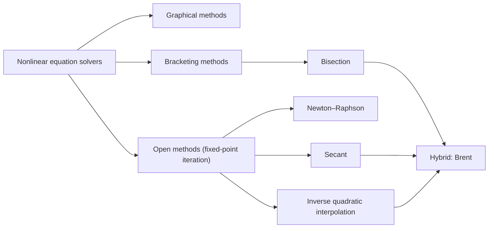

Statistical computing is, to a large extent, solving optimization problems: a **maximum likelihood estimation** maximizes a log-likelihood, least squares minimizes a sum of squares, a Bayesian analysis looks for the mode of a posterior. This chapter and the next one ([3.5.5](/3.5.5)) treat the numerical methods for such problems. This chapter first sets up the framework: which kinds of optimization problems there are and what makes a good algorithm, why optimization and root finding are two sides of the same problem, what the **gradient** tells us, how maximum likelihood fits in, and how the speed of an iterative method is measured by its order and rate of convergence. It then presents two families of methods that need little or no derivative information. Direct search methods only compare function values: golden-section search and parabolic interpolation in one dimension, the Nelder–Mead simplex method in several. Gradient methods turn optimization into finding a root of $f(x)=g'(x)=0$: bracketing methods such as bisection are reliable but slow, open methods such as fixed-point iteration are fast but may diverge (they include the classical iterations for linear systems and coordinate descent), and hybrid methods such as Brent's combine the advantages of both. Newton's method and its relatives, which use second derivatives, follow in [3.5.5](/3.5.5); the linear algebra they need is in [3.5.3](/3.5.3). Along the way we meet the default methods of R's `optimize`, `optim` and `uniroot`.

## 4.1. The Framework

### 4.1.1. Kinds of Optimization Problems

Before choosing a method, always be clear about two questions: are we seeking roots or extreme values, and is the problem one of maximization or minimization? Optimization problems come in several kinds, each with its own theory and algorithms:

- continuous versus discrete optimization;
- constrained versus unconstrained optimization;
- global versus local optimization;
- stochastic versus deterministic optimization;
- convex versus nonconvex optimization.

In each case we must pay attention both to the mathematical formulation and to the algorithms. Good algorithms should possess the following properties:

- *Robustness*: they should perform well on a wide variety of problems in their class, for all reasonable values of the starting point.
- *Efficiency*: they should not require excessive computer time or storage.
- Accuracy: they should identify a solution with precision, without being overly sensitive to errors in the data or to the rounding errors that occur when the algorithm is implemented on a computer ([3.5.1](/3.5.1)).

These goals conflict. Tradeoffs between convergence rate and storage requirements, and between robustness and speed, are central issues in numerical optimization.

### 4.1.2. Optimization and Root Finding

Solving an equation $\boldsymbol{f}(\boldsymbol{x})=\boldsymbol{0}$ can be transformed into the minimization problem

$$
\min_{\boldsymbol{x}}\boldsymbol{f}(\boldsymbol{x})^{\mathsf T}\boldsymbol{f}(\boldsymbol{x}),
$$
and minimizing a differentiable function $f(\boldsymbol{x})$ may be transformed into solving $f'(\boldsymbol{x})=\boldsymbol{0}$, whose solutions are the **stationary points** of $f$. When $f$ is a **quadratic form** plus a linear term,

$$
f(\boldsymbol{x})=\frac12\boldsymbol{x}^{\mathsf T}A\boldsymbol{x}-\boldsymbol{b}^{\mathsf T}\boldsymbol{x}+c,
$$
and $A$ is symmetric and positive definite, then $f$ is minimized by the solution of $A\boldsymbol{x}=\boldsymbol{b}$: the gradient is $f'(\boldsymbol{x})=A\boldsymbol{x}-\boldsymbol{b}$ and the Hessian $A$ is positive definite. The graph of $f$ is a bowl whose lowest point is the solution of $A\boldsymbol{x}=\boldsymbol{b}$, and its contours are concentric ellipses (ellipsoids in higher dimensions), each with a constant value of $f$. If $A$ is negative definite the bowl is upside down; if $A$ is positive semidefinite and singular, the minimum is attained along a whole line (a trough), and if $A$ is indefinite the surface is a saddle. If $A$ is not symmetric, only its symmetric part matters, since $\boldsymbol{x}^{\mathsf T}A\boldsymbol{x}=\boldsymbol{x}^{\mathsf T}\frac12(A+A^{\mathsf T})\boldsymbol{x}$: then $f'(\boldsymbol{x})=\frac12(A+A^{\mathsf T})\boldsymbol{x}-\boldsymbol{b}$, and we must solve $\frac12(A+A^{\mathsf T})\boldsymbol{x}=\boldsymbol{b}$ instead.

The gradient

$$
f'(\boldsymbol{x})=\nabla f(\boldsymbol{x})=\Bigl(\frac{\partial f}{\partial x_1},\frac{\partial f}{\partial x_2},\dots,\frac{\partial f}{\partial x_n}\Bigr)^{\mathsf T}
$$
points, at every $\boldsymbol{x}$, in the direction of steepest increase of $f$: by the first-order **Taylor's formula**, $f(\boldsymbol{x}+\Delta\boldsymbol{x})\approx f(\boldsymbol{x})+(\Delta\boldsymbol{x})^{\mathsf T}\nabla f(\boldsymbol{x})$, and among all steps of a given length, $\Delta\boldsymbol{x}=c\nabla f(\boldsymbol{x})$ with $c>0$ makes the increase largest. The gradient is orthogonal to the contour lines. This is why gradients are so useful: they tell us where to go.

### 4.1.3. Maximum Likelihood

In statistics, machine learning and data science we optimize a lot. The real-valued function $f(\boldsymbol{x})$ to be maximized may be a likelihood, a profile likelihood, a Bayesian posterior, and so on. In the most important case $f(\boldsymbol{x})=l(\boldsymbol{\theta})$ is the **log-likelihood function** of a parameter vector $\boldsymbol{\theta}$, and the MLE $\hat{\boldsymbol{\theta}}$ maximizes $l$. Usually $\hat{\boldsymbol{\theta}}$ is a solution of Fisher's score equation

$$
l'(\boldsymbol{\theta})=\frac{\partial}{\partial\boldsymbol{\theta}}\log L(\boldsymbol{\theta};\boldsymbol{x})=\Bigl(\frac{\partial l}{\partial\theta_1},\dots,\frac{\partial l}{\partial\theta_p}\Bigr)^{\mathsf T}=\boldsymbol{0}.
$$
Again optimization is intimately linked with solving (nonlinear) equations: finding an MLE amounts to finding a root of the score equation, since $\arg\max_{\boldsymbol{x}}f(\boldsymbol{x})$ is a solution of $f'(\boldsymbol{x})=\boldsymbol{0}$. The terminology ([3.2](/3.2)):

| Term | Notation |
|---|---|
| parameter | $\boldsymbol{\theta}$, a $p$-vector |
| data | $\boldsymbol{X}$ |
| log-likelihood | $l(\boldsymbol{\theta})=\log p(\boldsymbol{X}\mid\boldsymbol{\theta})$ |
| score function | $\boldsymbol{s}(\boldsymbol{\theta})=l'(\boldsymbol{\theta})=\bigl(\frac{\partial l}{\partial\theta_1},\dots,\frac{\partial l}{\partial\theta_p}\bigr)^{\mathsf T}$ |
| Hessian matrix | $l''(\boldsymbol{\theta})=\bigl(\partial^2l/\partial\theta_i\partial\theta_j\bigr)_{i,j=1,\dots,p}$ |
| Fisher information | $I(\boldsymbol{\theta})=\operatorname{Var}(\boldsymbol{s}(\boldsymbol{\theta}))=\mathbb{E}\bigl[l'(\boldsymbol{\theta})l'(\boldsymbol{\theta})^{\mathsf T}\bigr]=-\mathbb{E}\,l''(\boldsymbol{\theta})=\mathbb{E}J(\boldsymbol{\theta})$ |
| observed information | $J(\hat{\boldsymbol{\theta}})=-l''(\hat{\boldsymbol{\theta}})$ |

When $\boldsymbol{\theta}^*$ is a local maximum of $l$, $l'(\boldsymbol{\theta}^*)=\boldsymbol{0}$ and $l''(\boldsymbol{\theta}^*)$ is negative semidefinite (and negative definite at a strict, nondegenerate maximum).

**Example 4.1.1** Not every MLE solves the score equation. Let $X_1,\dots,X_n$ be an iid sample from $\mathrm{U}(0,b)$. The likelihood

$$
L(b)=\prod_{i=1}^n\frac1b\boldsymbol{1}_{[0,b]}(x_i)=\frac1{b^n}\boldsymbol{1}\{x_{(n)}\le b\}
$$
is zero for $b<x_{(n)}$ and decreasing for $b\ge x_{(n)}$, so the MLE is $\hat b=X_{(n)}$, the sample maximum; with $n=10$ and $\max(\boldsymbol{x})=2$, $\hat b=2$. The likelihood is not differentiable at its maximum, and the score equation has no root.

*Profile likelihood.* For a high-dimensional $\boldsymbol{\theta}$ the dimension can be reduced. Split $\boldsymbol{\theta}=(\boldsymbol{\theta}_1,\boldsymbol{\theta}_2)$ into parameters of interest $\boldsymbol{\theta}_1$ and nuisance parameters $\boldsymbol{\theta}_2$, and suppose that $\hat{\boldsymbol{\theta}}_2(\boldsymbol{\theta}_1)$, the maximizer over $\boldsymbol{\theta}_2$ for fixed $\boldsymbol{\theta}_1$, is easy to compute. Then

$$
\max_{\boldsymbol{\theta}}l(\boldsymbol{\theta})=\max_{\boldsymbol{\theta}_1,\boldsymbol{\theta}_2}l(\boldsymbol{\theta}_1,\boldsymbol{\theta}_2)=\max_{\boldsymbol{\theta}_1}l\bigl(\boldsymbol{\theta}_1,\hat{\boldsymbol{\theta}}_2(\boldsymbol{\theta}_1)\bigr),
$$
and $l\bigl(\boldsymbol{\theta}_1,\hat{\boldsymbol{\theta}}_2(\boldsymbol{\theta}_1)\bigr)$ is the *profile likelihood* (concentrated likelihood) of $\boldsymbol{\theta}_1$, in logarithmic form. For example, in regression with $\boldsymbol{\beta}=(\boldsymbol{\beta}_1,\boldsymbol{\beta}_2)$ and $X=[X_1\,|\,X_2]$, $\hat{\boldsymbol{\beta}}_2(\boldsymbol{\beta}_1)=(X_2^{\mathsf T}X_2)^{-1}X_2^{\mathsf T}(\boldsymbol{y}-X_1\boldsymbol{\beta}_1)$; with the **orthogonal projection matrix** $P_2=X_2(X_2^{\mathsf T}X_2)^{-1}X_2^{\mathsf T}$ onto $\mathcal{R}(X_2)$, maximizing the profile likelihood gives

$$
\hat{\boldsymbol{\beta}}_1=\bigl(X_1^{\mathsf T}(I-P_2)X_1\bigr)^{-1}X_1^{\mathsf T}(I-P_2)\boldsymbol{y}.
$$
If $\hat{\boldsymbol{\theta}}_1(\boldsymbol{\theta}_2)$ is also easy to obtain, as here $\hat{\boldsymbol{\beta}}_1(\boldsymbol{\beta}_2)=(X_1^{\mathsf T}X_1)^{-1}X_1^{\mathsf T}(\boldsymbol{y}-X_2\boldsymbol{\beta}_2)$, we can instead use the *block relaxation* method, cycling over the two parts:

$$
\boldsymbol{\beta}_1^{(0)}\Longrightarrow\boldsymbol{\beta}_2^{(0)}=\hat{\boldsymbol{\beta}}_2\bigl(\boldsymbol{\beta}_1^{(0)}\bigr)\Longrightarrow\boldsymbol{\beta}_1^{(1)}=\hat{\boldsymbol{\beta}}_1\bigl(\boldsymbol{\beta}_2^{(0)}\bigr)\Longrightarrow\boldsymbol{\beta}_2^{(1)}=\hat{\boldsymbol{\beta}}_2\bigl(\boldsymbol{\beta}_1^{(1)}\bigr)\Longrightarrow\cdots
$$
This is a block version of the coordinate descent of Section 4.3.5.

### 4.1.4. Iterative Methods

We will usually rely on successive approximation of the solution. For example, to minimize

$$
f(x)=\frac{x^3}3-\frac{x^2}2-x-1,\qquad x\in[1,2],
$$
an iterative method needs three elements.

- *Starting value*: here $x^{(0)}=1.6$ might be a reasonable initial guess.
- *Updating rule*: a procedure that produces an improved guess $x^{(t+1)}$ from the most recent value $x^{(t)}$, for $t=0,1,2,\dots$
- *Stopping criteria*: when the iterations are stopped.

(Here the answer is known: $f'(x)=x^2-x-1=0$ at the golden ratio $x^*=(1+\sqrt5)/2\approx1.618$.) The absolute convergence criterion stops when

$$
\lvert x^{(t+1)}-x^{(t)}\rvert<\varepsilon,
$$
where $\varepsilon$ is a constant chosen to indicate tolerable imprecision. The relative convergence criterion stops when

$$
\frac{\lvert x^{(t+1)}-x^{(t)}\rvert}{\lvert x^{(t)}\rvert}<\varepsilon;
$$
it allows a target precision to be specified (for example "within 1%") without worrying about the units of $x$, but fails when $x^{(t)}$ approaches $0$. A compromise is to stop when $\lvert x^{(t+1)}-x^{(t)}\rvert/(\lvert x^{(t)}\rvert+\varepsilon)<\varepsilon$.

In practice it is also important to include stopping rules that flag a failure to converge: stop after $N$ iterations regardless of convergence; stop if a convergence measure fails to decrease, or cycles, over several iterations, or if the solution itself cycles; and stop if the procedure appears to be converging to a point at which $f(x)$ is inferior to another value already found. Do not devote all affordable iterations to one attempt: budget time for many smaller attempts, anticipating convergence failures, data corrections and multiple starting values.

### 4.1.5. Order and Rate of Convergence

**Definition 4.1.1 (Order and Rate of Convergence)** Let $x^{(t)}\to x^*$ and $\varepsilon^{(t)}\triangleq x^{(t)}-x^*$. The sequence has **order of convergence** $\alpha\ge1$ and **rate of convergence** $c$ if

$$
\lim_{t\to\infty}\varepsilon^{(t)}=0\qquad\text{and}\qquad\lim_{t\to\infty}\frac{\lvert\varepsilon^{(t+1)}\rvert}{\lvert\varepsilon^{(t)}\rvert^\alpha}=c,
$$
where $c\in(0,1)$ if $\alpha=1$ and $c\in(0,\infty)$ if $\alpha>1$. Order $\alpha=1$ is **linear convergence**, order $\alpha=2$ **quadratic convergence**; if $\lvert\varepsilon^{(t+1)}\rvert/\lvert\varepsilon^{(t)}\rvert\to0$ the convergence is called **superlinear convergence**.

**Example 4.1.2** Let $\gamma\in(0,1)$.

- $\gamma^n\to0$ linearly: $\gamma^{n+1}/\gamma^n=\gamma$, so $\gamma^{n+1}=O(\gamma^n)$.
- $\gamma^{n^2}\to0$ superlinearly: $\gamma^{(n+1)^2}/\gamma^{n^2}=\gamma^{2n+1}\to0$; but not quadratically, since $\gamma^{(n+1)^2}/(\gamma^{n^2})^2=\gamma^{-n^2+2n+1}\to\infty$.
- $\gamma^{2^n}\to0$ quadratically: $\gamma^{2^{n+1}}/(\gamma^{2^n})^2=1$.

So a method with larger order $\alpha$ and, for equal order, smaller rate $c$ converges faster. The order matters much more than the rate.

**Example 4.1.3** Suppose $\lvert\varepsilon^{(t)}\rvert\le0.003$ and that for large $t$, method A has $\lvert\varepsilon^{(t+1)}\rvert/\lvert\varepsilon^{(t)}\rvert\approx0.5$ (linear) while method B has $\lvert\varepsilon^{(t+1)}\rvert/\lvert\varepsilon^{(t)}\rvert^2\approx0.5$ (quadratic). How many further iterations does each need for a precision of $10^{-9}$? For method A, $\lvert\varepsilon^{(t+k)}\rvert/\lvert\varepsilon^{(t)}\rvert\approx2^{-k}$ and $2^{-k}\cdot0.003=10^{-9}$ gives $k=\log_2(3\times10^6)\approx21.5$: $22$ iterations. For method B,

$$
\lvert\varepsilon^{(t+2)}\rvert\approx\frac{\lvert\varepsilon^{(t+1)}\rvert^2}2\approx\frac{\lvert\varepsilon^{(t)}\rvert^4}{2^3}=\frac{0.003^4}8\approx10^{-11}:
$$
only $2$ more steps.

Still, a higher order of convergence is not always preferable: the cost per iteration (derivatives, linear systems), the storage, the size of the region from which the method converges at all, and whether convergence is guaranteed all count as well.

## 4.2. Direct Search Methods

Direct search methods use no derivatives. They are usually applied when the function is not differentiable, when the derivatives are complicated to compute or do not even exist, when the function has few variables, or when the location of an optimal solution is roughly known. Such a method relies only on evaluating $f(x)$ on a sequence $x_1,x_2,\dots$ and comparing values in order to approach a minimizer of $f$. We begin with univariate functions.

### 4.2.1. Golden-Section Search

**Definition 4.2.1 (Unimodal Function)** A function $f$ is a **unimodal function** on $I=[a,b]$ if there exists a unique number $p\in I$ such that $f$ is decreasing on $[a,p]$ and increasing on $[p,b]$.

For a unimodal $f$, compare its values at two interior points $c<d$. If $f(c)\le f(d)$ the minimizer cannot lie in $(d,b]$, and the interval shrinks to $[a,d]$; otherwise it shrinks to $[c,b]$. The points are placed symmetrically,

$$
b-d=c-a\triangleq(1-r)(b-a),\qquad \tfrac12<r<1 .
$$
We want the ratio $r$ to stay constant on each subinterval, and to add only one new point each time, the other one being reused. If the new interval is $[a,d]$, its interior points must be $c$ and a new point, so

$$
r=\frac{d-a}{b-a}=\frac{c-a}{d-a}=\frac{(1-r)(b-a)}{r(b-a)}\ \Longrightarrow\ r^2+r-1=0\ \Longrightarrow\ r=\frac{-1+\sqrt5}2=\frac1\varphi\approx0.618,
$$
where $\varphi=\frac{1+\sqrt5}2\approx1.618$ is the golden ratio.

**Algorithm 4.2.1 (Golden-Section Search)** Step 1: set $r=0.618$, $i=1$; given an initial interval $[X_1^{(1)},X_4^{(1)}]$ and a precision $\varepsilon$, compute $X_2^{(1)}=X_4^{(1)}-r(X_4^{(1)}-X_1^{(1)})$ and $X_3^{(1)}=X_1^{(1)}+r(X_4^{(1)}-X_1^{(1)})$. Step 2: if $f(X_3^{(i)})\ge f(X_2^{(i)})$, set $X_1^{(i+1)}=X_1^{(i)}$, $X_3^{(i+1)}=X_2^{(i)}$, $X_4^{(i+1)}=X_3^{(i)}$ and compute the new point $X_2^{(i+1)}=X_4^{(i+1)}-r(X_4^{(i+1)}-X_1^{(i+1)})$; if $f(X_3^{(i)})<f(X_2^{(i)})$, set $X_1^{(i+1)}=X_2^{(i)}$, $X_2^{(i+1)}=X_3^{(i)}$, $X_4^{(i+1)}=X_4^{(i)}$ and compute $X_3^{(i+1)}=X_1^{(i+1)}+r(X_4^{(i+1)}-X_1^{(i+1)})$. Step 3: if $X_4^{(i+1)}-X_1^{(i+1)}\le\varepsilon$, stop; otherwise set $i=i+1$ and go to Step 2.

```r
golden <- function(f, a, b, eps = 1e-6) {
  r <- (sqrt(5) - 1) / 2
  x2 <- b - r * (b - a); x3 <- a + r * (b - a)
  f2 <- f(x2); f3 <- f(x3)
  while (b - a > eps) {
    if (f3 >= f2) {            # minimizer in [a, x3]
      b <- x3; x3 <- x2; f3 <- f2
      x2 <- b - r * (b - a); f2 <- f(x2)
    } else {                   # minimizer in [x2, b]
      a <- x2; x2 <- x3; f2 <- f3
      x3 <- a + r * (b - a); f3 <- f(x3)
    }
  }
  (a + b) / 2
}
golden(function(x) x^3 / 3 - x^2 / 2 - x - 1, 1, 2)   # 1.618034
```

Each iteration costs one function evaluation and multiplies the length of the interval by $r\approx0.618$, so golden-section search converges linearly, with order $1$ and rate $0.618$.

### 4.2.2. Parabolic Interpolation and `optimize`

**Definition 4.2.2 (Successive Parabolic Interpolation)** In **successive parabolic interpolation**, $f$ is evaluated at three points and a quadratic polynomial is fitted through them; the minimizer of the parabola replaces the point with the largest value of $f$, and the process repeats.

If $f$ has a continuous second derivative that is positive at the minimum (and the minimum is not at an endpoint of the interval), the convergence is superlinear, of order about $1.324$; but on its own the method can be unreliable. R's `optimize` (one-dimensional optimization) uses a combination of golden-section search and successive parabolic interpolation, designed for continuous functions: parabolic steps are taken when they behave well, golden-section steps otherwise.

```r
f <- function(x) x^3 / 3 - x^2 / 2 - x - 1
optimize(f, lower = 1, upper = 2)    # $minimum is about 1.618, the golden ratio
```

### 4.2.3. The Nelder–Mead Method

For $f\colon\mathbb{R}^p\to\mathbb{R}$, the same strategy of iterative approximation applies, with analogous stopping criteria

$$
D\bigl(\boldsymbol{x}^{(t+1)},\boldsymbol{x}^{(t)}\bigr)<\varepsilon,\qquad \frac{D\bigl(\boldsymbol{x}^{(t+1)},\boldsymbol{x}^{(t)}\bigr)}{D\bigl(\boldsymbol{x}^{(t)},\boldsymbol{0}\bigr)}<\varepsilon\qquad\text{or}\qquad \frac{D\bigl(\boldsymbol{x}^{(t+1)},\boldsymbol{x}^{(t)}\bigr)}{D\bigl(\boldsymbol{x}^{(t)},\boldsymbol{0}\bigr)+\varepsilon}<\varepsilon,
$$
for a distance such as $D(\boldsymbol{u},\boldsymbol{v})=\sum_{i=1}^p\lvert u_i-v_i\rvert$ or $D(\boldsymbol{u},\boldsymbol{v})=\sqrt{\sum_{i=1}^p(u_i-v_i)^2}$.

**Definition 4.2.3 (Nelder–Mead Method)** A $p$-simplex is a $p$-dimensional polytope, the convex hull of $p+1$ vertices (for $p=2$, a triangle). The **Nelder–Mead method** (simplex search method) uses a simplex as its "vehicle" to search the domain: at each step the worst vertex is rejected and replaced by a new one, by reflection, expansion or contraction, or the whole simplex shrinks toward the best vertex.

In the words of Nelder and Mead (1965), "the simplex adapts itself to the local landscape, elongating down long inclined planes, changing direction on encountering a valley at an angle, and contracting in the neighbourhood of a minimum." For $p=2$ a sequence of triangles is generated; the function values at their vertices decrease, the triangles shrink, and the minimum point is finally found.

**Algorithm 4.2.2 (Nelder–Mead for $p=2$)** Label the vertices of the current triangle so that $f(B)\le f(G)\le f(W)$ (best, good, worst). Let $M=(B+G)/2$ be the midpoint of the good side, and reflect the worst vertex through it, $R=M+(M-W)=2M-W$.

1. If $f(B)\le f(R)<f(G)$, replace $W$ by $R$.
2. If $f(R)<f(B)$, try the expansion $E=R+(R-M)=2R-M$, and replace $W$ by $E$ if $f(E)<f(R)$, otherwise by $R$.
3. If $f(R)\ge f(G)$, try a contraction $C$: the midpoint of $M$ and $R$ if $f(R)<f(W)$, the midpoint of $W$ and $M$ otherwise. If $f(C)$ is smaller than $\min(f(R),f(W))$, replace $W$ by $C$; otherwise shrink the triangle toward $B$, replacing $G$ and $W$ by the midpoints of $BG$ and $BW$.

In general dimension the three elements are: as starting value, an initial working simplex with $p+1$ vertices around an input point $\boldsymbol{x}_0\in\mathbb{R}^p$ ($\boldsymbol{x}_0$ is often one vertex, and the other $p$ are generated so that the simplex is right-angled at $\boldsymbol{x}_0$, or regular, with all edges of a specified length); as updating rules, reflection away from the worst vertex or shrinkage toward the best; as stopping criteria, convergence of the domain (the simplex becomes small) or of the function values (they become nearly equal). Nelder–Mead is the default method of R's `optim`.

**Example 4.2.1** Himmelblau's function $(x^2+y-11)^2+(x+y^2-7)^2$ has four local minima and one local maximum, at $(-0.270845,-0.923039)$. To find the maximum we minimize its negative:

```r
f <- function(x) -((x[1]^2) + x[2] - 11)^2 - (x[1] + (x[2]^2) - 7)^2
optim(c(0, 0), fn = f)
```

```text
$par
[1] -0.2711202 -0.9233435

$value
[1] -181.6165

$counts
function gradient
      53       NA

$convergence
[1] 0

$message
NULL
```

Fifty-three function evaluations and no gradient give the maximum to about three digits; `$convergence` equal to $0$ indicates successful completion.

## 4.3. Gradient Methods

Gradient methods turn the optimization of $g$ into finding a root of $f(x)=g'(x)=0$.

**Example 4.3.1** Maximize

$$
g(x)=\frac{\log x}{1+x}
$$
with respect to $x$. We cannot find the root of $g'(x)=\dfrac{1+1/x-\log x}{(1+x)^2}$ analytically; the maximum occurs at $x^*\approx3.59112$.

**Example 4.3.2** The data $1.77,-0.23,2.76,3.80,3.47,56.75,-1.34,4.24,-2.44,3.29,3.71,-2.40,4.53,-0.07,-1.05,-13.87,-2.53,-1.75,0.27,43.21$ are an iid sample from a **Cauchy distribution** $\mathrm{Cauchy}(\theta)$ with scale $1$. The likelihood function is $\prod_{i=1}^{20}\frac1{\pi(1+(x_i-\theta)^2)}$. Its **score function** $l'(\theta)$ has multiple roots (local maxima near $-0.19$, $2.82$ and $42.8$, and local minima between them), so the MLE requires a numerical solution and some care.

The methods for nonlinear equations fall into four groups:



### 4.3.1. Graphical Methods

Plotting the function and observing where it crosses the $x$-axis indicates where roots may be, and where some root-finding methods may fail: a function may touch the axis without crossing it (a double root, which bracketing cannot detect), have two roots close together, or have several roots in an interval whose endpoints have values of the same sign. Graphical interpretation is therefore useful for understanding the properties of the function and anticipating the pitfalls of the numerical methods. The estimate is a rough one, but it can be used as a starting guess for the other methods.

### 4.3.2. Bracketing Methods: Bisection

Both bracketing methods and open methods are iterative, with a starting value, an updating rule and stopping criteria. Bracketing methods start from two initial guesses that "bracket" the root, that is, lie on either side of it.

If $f=g'$ is continuous on $[a_0,b_0]$ and $f(a_0)f(b_0)\le0$, then the **intermediate value theorem** implies that there exists at least one $x^*\in[a_0,b_0]$ with $f(x^*)=0$; hence $x^*$ is a local optimum of $g$.

**Definition 4.3.1 (Bisection Method)** The **bisection method** shrinks the intervals $[a_0,b_0]\supset[a_1,b_1]\supset[a_2,b_2]\supset\cdots$, each half as long as the previous one, chosen to retain $f(a_t)f(b_t)\le0$ so that the $t$-th interval contains a root:

$$
[a_{t+1},b_{t+1}]=\begin{cases}[a_t,x^{(t)}]&\text{if }f(a_t)f(x^{(t)})\le0,\\{}[x^{(t)},b_t]&\text{if }f(a_t)f(x^{(t)})>0,\end{cases}\qquad x^{(t+1)}=\frac{a_{t+1}+b_{t+1}}2,
$$
starting from $x^{(0)}=(a_0+b_0)/2$.

The **nested interval theorem** guarantees that the intervals shrink to a single point, a root of $f$. For Example 4.3.1 we take $a_0=1$, $b_0=5$, so $x^{(0)}=3$, and stop at $t=1000$ or when $\lvert f(x)\rvert<\varepsilon$. The following function either receives the derivative $f$ directly or, with `minmax = TRUE`, receives $g$ and approximates $g'$ by central differences with step $h$:

```r
bisec <- function(f, b0 = 1, b1 = 5, minmax = FALSE, ...) {
  if (minmax == TRUE) {
    g <- f
    f <- function(x, h) (g(x + h) - g(x - h)) / 2 / h
  }
  eps <- .Machine$double.eps
  r <- seq(b0, b1, length = 3)
  y <- mapply(f, x = r, ...)
  if (y[1] * y[3] > 0) stop("f does not have opposite sign at endpoints")
  it <- 0
  while (it < 1000 & abs(y[2]) > eps) {
    it <- it + 1
    if (y[1] * y[2] < 0) {
      r[3] <- r[2]; y[3] <- y[2]
    } else {
      r[1] <- r[2]; y[1] <- y[2]
    }
    r[2] <- (r[1] + r[3]) / 2
    y[2] <- f(x = r[2], ...)
  }
  return(list(root = r[2], est = y[2], tol = y[3] - y[2], nit = it))
}

f <- function(x) (1 + 1/x - log(x)) / (1 + x)^2
bisec(f = f, b0 = 1, b1 = 5)
g <- function(x) log(x) / (1 + x)
bisec(f = g, b0 = 1, b1 = 5, minmax = TRUE, h = .05)
```

```text
        root           est           tol           nit
3.591121e+00 -1.790819e-16 -4.845744e-16  4.600000e+01
        root           est           tol           nit
3.591626e+00  0.000000e+00 -5.551115e-16  4.500000e+01
```

(`est` is the value of $f$ at the returned point and `tol` the difference of the values of $f$ at the two ends of the final bracket.) Both runs stop with $\lvert f\rvert$ at the level of rounding errors after about $45$ halvings, but the second one finds the root of the difference quotient, not of $g'$: its answer $3.5916$ is wrong in the fourth digit, because the central difference with $h=0.05$ has an error of order $h^2$. When the derivative is available, use it.

If $f=g'$ has more than one root in the starting interval, bisection will find one of them but not the rest. For continuous functions bisection is guaranteed to converge to a root of $f$ (an optimum of $g$), but the method is slow: the bracket is halved at each step, a linear convergence with rate $1/2$. Golden-section search shrinks its bracket by $0.618$ per step, so per iteration bisection is faster; but it needs the sign of the derivative, while golden-section search uses only values of $g$.

### 4.3.3. Open Methods: Fixed-Point Iteration

Unlike bracketing methods, open methods require only one starting value, or two starting values that do not necessarily bracket a root. Open methods may diverge as the computation progresses, but when they do converge, they usually do so much faster than bracketing methods.

How should the updating rule be set? Consider finding the root of $f(x)=x+\log x$. Since $x+\log x=0\iff x=-\log x\triangleq G(x)$, we may try the updating equation

$$
x^{(t+1)}=G\bigl(x^{(t)}\bigr)=-\log x^{(t)} .
$$

**Definition 4.3.2 (Fixed Point and Fixed-Point Iteration)** A point $x$ with $x=G(x)$ is called a **fixed point** of the function $G$. **Fixed-point iteration** computes $x^{(t+1)}=G(x^{(t)})$ from a starting value $x^{(0)}$.

To find the roots of $g'$, we can simply write $x=x+g'(x)\triangleq G(x)$ and iterate $x^{(t+1)}=x^{(t)}+g'(x^{(t)})$. But the choice of $G$ is not unique: for $f(x)=x+\log x$,

$$
x+\log x=0\iff x=-\log x\triangleq G_1(x)\iff x=\mathrm{e}^{-x}\triangleq G_2(x)\iff x=\frac{x+\mathrm{e}^{-x}}2\triangleq G_3(x).
$$
Which $G$ should we use? The cobweb diagrams show that the iteration is likely to converge only when the curve of $G$ is flat near the fixed point, and diverges when it is steep.


By the **mean value theorem**, for some $\xi$ between $x^{(t)}$ and $x^*$,

$$
\lvert x^{(t+1)}-x^*\rvert=\lvert G(x^{(t)})-G(x^*)\rvert=\lvert G'(\xi)\rvert\,\lvert x^{(t)}-x^*\rvert .
$$
The convergence of the algorithm is therefore guaranteed if $G$ is contractive, $\lvert G'(x)\rvert\le\lambda<1$ on an interval mapped into itself, and then

$$
\lvert x^{(t)}-x^*\rvert\le\frac{\lambda^t}{1-\lambda}\lvert x^{(1)}-x^{(0)}\rvert .
$$
Near $x^*$ the error is multiplied by approximately $\lvert G'(x^*)\rvert$ at each step: fixed-point iteration converges linearly with rate $\lvert G'(x^*)\rvert$ when $0<\lvert G'(x^*)\rvert<1$, and at least quadratically when $G'(x^*)=0$ and $G''$ is bounded near $x^*$. For $x^*=0.5671$, $\lvert G_1'(x^*)\rvert=1/x^*=1.76>1$, so $G_1$ diverges; $\lvert G_2'(x^*)\rvert=\mathrm{e}^{-x^*}=x^*=0.567$; and $\lvert G_3'(x^*)\rvert=(1-\mathrm{e}^{-x^*})/2=0.216$. In order of efficiency, $G_3>G_2>G_1$.

The general principle is the contraction mapping theorem.

**Definition 4.3.3 (Contraction Mapping)** Let $(M,d)$ be a metric space. A function $f\colon M\to M$ is a **contraction mapping** if there is a constant $\beta$ with $0\le\beta<1$ such that $d(f(x),f(y))\le\beta\,d(x,y)$ for all $x,y\in M$.

**Theorem 4.3.1 (Banach Fixed-Point Theorem)** Let $(M,d)$ be a complete metric space. Then every contraction $f$ on $M$ has a unique fixed point $x^*$, and for every $x\in M$

$$
d\bigl(f^n(x),x^*\bigr)\le\frac{\beta^n}{1-\beta}\,d\bigl(x,f(x)\bigr).
$$

The theorem, named after Stefan Banach, who first stated it in 1922, guarantees the existence and uniqueness of fixed points of certain self-maps of metric spaces and provides a constructive method to find them; it is also known as the contraction mapping principle and is an important tool in the theory of metric spaces.

*Scaled fixed-point iteration.* The effectiveness of fixed-point iteration depends strongly on the choice of $G$. For $G(x)=g'(x)+x$, $G'(x)=g''(x)+1$, which need not be smaller than $1$ in modulus. We can often fix a non-contractive function by rescaling $g$ or $G$: set

$$
G(x)=\alpha g'(x)+x,\qquad G'(x)=\alpha g''(x)+1,
$$
for a suitable $\alpha$, found by trial and error or by an analysis of $g''$. Each step $x^{(t+1)}=x^{(t)}+\alpha g'(x^{(t)})$ moves from the point $(x^{(t)},g'(x^{(t)}))$ along a line of slope $-1/\alpha$ to the axis: all these lines are parallel, and the method is also called the method of parallel chords. For Example 4.3.1 scaling with $\alpha=4$ works well. In maximum likelihood, if $l(\theta)$ is approximately quadratic, then $l'(\theta)$ is approximately linear and $l''(\theta)\approx\gamma$, a constant; taking $\alpha=-1/\gamma$ makes $G'(\theta^*)\approx0$, and the updating equation

$$
\theta^{(t+1)}=\theta^{(t)}-\frac{l'(\theta^{(t)})}{\gamma}
$$
is a step of Newton's method, $x_{n+1}=x_n-f(x_n)/f'(x_n)$ ([3.5.5](/3.5.5)), with the derivative held fixed. Many log-likelihoods are approximately quadratic near the maximum, so scaled fixed-point iteration can be very effective; it is also generally quite stable and easy to code. If $\gamma$ is replaced at each step by the current derivative, we obtain Newton's method itself; here with a forward-difference approximation of the derivative:

```r
newton <- function(f, x0 = 1, N = 20, h = .01, tol = 1E-12, ...) {
  i <- 1; x1 <- x0
  p <- numeric(N)
  while (i <= N) {
    df.dx <- (f(x0 + h, ...) - f(x0, ...)) / h
    x1 <- (x0 - (f(x0, ...) / df.dx))
    p[i] <- x1
    i <- i + 1
    if (abs(x1 - x0) < tol) break
    x0 <- x1
  }
  return(list(root = p[i - 1], process = p[1:(i - 1)], nit = i - 1))
}
f <- function(x) (1 + 1/x - log(x)) / (1 + x)^2
newton(f, x0 = 1, N = 50)
```

```text
$root
[1] 3.591121

$process
 [1] 1.506261 2.107604 2.736086 3.258855 3.533365 3.589484
 [7] 3.591130 3.591121 3.591121 3.591121 3.591121 3.591121

$nit
[1] 12
```

![Errors |x(t) - x*| for the root x* = 0.5671 of x + log(x) = 0 on a log scale. Bisection on [0.1, 1] and the fixed-point iterations G2 and G3 converge linearly, with rates 0.5, 0.567 and 0.216 (straight lines); the secant method and Newton's method converge superlinearly and reach machine precision in about six and four steps.](./plots/root-finding-convergence.py)

### 4.3.4. Linear Systems by Fixed-Point Iteration

To solve $A\boldsymbol{x}=\boldsymbol{b}$, rewrite it as $\boldsymbol{x}=B\boldsymbol{x}+\boldsymbol{d}$ and iterate

$$
\boldsymbol{x}^{(t+1)}=G(\boldsymbol{x}^{(t)})=B\boldsymbol{x}^{(t)}+\boldsymbol{d}.
$$

**Theorem 4.3.2** (a) If $\|B\|<1$ for some induced matrix norm, the iteration converges for every $\boldsymbol{x}^{(0)}$. (b) For $B\in\mathbb{C}^{n\times n}$, the iteration converges for every $\boldsymbol{x}^{(0)}$ if and only if the **spectral radius** satisfies $\rho(B)\triangleq\max\lvert\lambda_B\rvert<1$.

**Proof** (a) $\|G(\boldsymbol{x})-G(\boldsymbol{y})\|=\|B(\boldsymbol{x}-\boldsymbol{y})\|\le\|B\|\,\|\boldsymbol{x}-\boldsymbol{y}\|$, so $G$ is a contraction of the complete space $\mathbb{C}^n$, and Theorem 4.3.1 applies. (b) With the solution $\boldsymbol{x}^*=B\boldsymbol{x}^*+\boldsymbol{d}$ and $\boldsymbol{\varepsilon}^{(t)}=\boldsymbol{x}^{(t)}-\boldsymbol{x}^*$,

$$
\boldsymbol{\varepsilon}^{(t)}=(B\boldsymbol{x}^{(t-1)}+\boldsymbol{d})-(B\boldsymbol{x}^*+\boldsymbol{d})=B\boldsymbol{\varepsilon}^{(t-1)}=B^2\boldsymbol{\varepsilon}^{(t-2)}=\cdots=B^t\boldsymbol{\varepsilon}^{(0)},
$$
and $B^t\to O$ if and only if $\rho(B)<1$. $\square$

This is why numerical analysts attach so much importance to the spectral radius. If $\boldsymbol{v}$ is an **eigenvector** of $B$ with eigenvalue $-0.5$, then $B^t\boldsymbol{v}=(-0.5)^t\boldsymbol{v}$ converges to zero; with eigenvalue $2$ it diverges. A very important skill is to think of a vector as a sum of other vectors whose behavior is understood: if $\boldsymbol{x}=\boldsymbol{v}_1+\boldsymbol{v}_2$ with eigenvalues $\lambda_1=0.7$ and $\lambda_2=-2$, the effect of repeatedly applying $B$ is best understood through each eigenvector: one component converges to zero while the other diverges, hence $B^t\boldsymbol{x}$ diverges. For $\boldsymbol{x}^{(t)}$ to converge quickly, $\rho(B)$ should be less than one, and preferably as small as possible. The three classical choices of $B$ follow from splitting $A$.

**Definition 4.3.4 (Jacobi Method)** Write $A=D+E$ with $D=\operatorname{diag}(a_{11},\dots,a_{nn})$ and $E$ the off-diagonal part. The **Jacobi method** iterates $\boldsymbol{x}^{(t+1)}=D^{-1}(\boldsymbol{b}-E\boldsymbol{x}^{(t)})=-D^{-1}E\boldsymbol{x}^{(t)}+D^{-1}\boldsymbol{b}$, that is,

$$
x_i^{(t+1)}=\frac1{a_{ii}}\Bigl(b_i-\sum_{j\ne i}a_{ij}x_j^{(t)}\Bigr),\qquad i=1,\dots,n .
$$

**Definition 4.3.5 (Gauss–Seidel Method)** Write $A=L_*+U$ with $L_*$ the lower triangular part including the diagonal and $U$ the strictly upper triangular part. The **Gauss–Seidel method** (Liebmann method, method of successive displacement) iterates $L_*\boldsymbol{x}^{(t+1)}=\boldsymbol{b}-U\boldsymbol{x}^{(t)}$, that is, by forward substitution,

$$
x_i^{(t+1)}=\frac1{a_{ii}}\Bigl(b_i-\sum_{j=1}^{i-1}a_{ij}x_j^{(t+1)}-\sum_{j=i+1}^na_{ij}x_j^{(t)}\Bigr),\qquad i=1,\dots,n :
$$
each new component is used as soon as it is computed.

**Example 4.3.3** For the system $x_1+3x_2=6$, $2x_1-x_2=1$, solved for $x_1$ from the first equation and for $x_2$ from the second, the Gauss–Seidel iterates from $(0,0)$ are $(6,11)$, $(-27,-55)$, $(171,341)$, $(-1017,-2035)$, $(6111,12221)$, …: no convergence. The coefficient matrix has no dominant diagonal. After interchanging the two equations, $2x_1-x_2=1$, $x_1+3x_2=6$, the diagonal is dominant and the iterates $(0.5,1.833333)$, $(1.416667,1.527778)$, $(1.263889,1.578704)$, $(1.289352,1.570216)$, $(1.285108,1.571631)$, … converge to the solution $(9/7,11/7)=(1.285714,1.571429)$.

**Definition 4.3.6 (Successive Over-Relaxation)** Write $A=D+L+U$ (diagonal, strictly lower and strictly upper parts) and fix a relaxation factor $\omega\in(0,2)$. From $\omega A\boldsymbol{x}=\omega\boldsymbol{b}$, that is, $(D+\omega L)\boldsymbol{x}=\omega\boldsymbol{b}-[\omega U+(\omega-1)D]\boldsymbol{x}$, **successive over-relaxation** (SOR) iterates

$$
\boldsymbol{x}^{(t+1)}=(D+\omega L)^{-1}\bigl\{\omega\boldsymbol{b}-[\omega U+(\omega-1)D]\boldsymbol{x}^{(t)}\bigr\},
$$
that is, componentwise,

$$
x_i^{(t+1)}=(1-\omega)x_i^{(t)}+\frac\omega{a_{ii}}\Bigl(b_i-\sum_{j=1}^{i-1}a_{ij}x_j^{(t+1)}-\sum_{j=i+1}^na_{ij}x_j^{(t)}\Bigr),\qquad i=1,\dots,n .
$$

SOR takes a weighted average of the old value and the Gauss–Seidel value; $\omega=1$ is Gauss–Seidel. Its iteration matrix $B_\omega=-(D+\omega L)^{-1}[\omega U+(\omega-1)D]$ satisfies $\rho(B_\omega)\ge\lvert\omega-1\rvert$ (since $\det B_\omega=(1-\omega)^n$), so SOR can converge only for $0<\omega<2$. On convergence guarantees: if $A$ is a strictly **diagonally dominant matrix**, both Jacobi and Gauss–Seidel converge for every starting vector; if $A$ is symmetric positive definite, Gauss–Seidel converges, and so does SOR for every $\omega\in(0,2)$ (the Jacobi method need not).


### 4.3.5. Coordinate Descent

**Definition 4.3.7 (Coordinate Descent)** For a convex and differentiable $g(\boldsymbol{x})$, **coordinate descent** (cyclic coordinate descent, backfitting) starts from an initial guess $\boldsymbol{x}^{(0)}$ and repeats, for $k=1,2,3,\dots$,

$$
x_i^{(k)}\in\arg\min_{x_i}g\bigl(x_1^{(k)},\dots,x_{i-1}^{(k)},x_i,x_{i+1}^{(k-1)},\dots,x_n^{(k-1)}\bigr),\qquad i=1,\dots,n :
$$
after we solve for $x_i^{(k)}$, we use its new value from then on.

Gauss–Seidel is coordinate descent for the quadratic $\frac12\boldsymbol{x}^{\mathsf T}A\boldsymbol{x}-\boldsymbol{b}^{\mathsf T}\boldsymbol{x}$ with SPD $A$. If a convex, differentiable $g\colon\mathbb{R}^n\to\mathbb{R}$ is minimized along each coordinate axis at $\boldsymbol{x}$, that is, $g(\boldsymbol{x}+\delta\boldsymbol{e}_i)\ge g(\boldsymbol{x})$ for all $\delta$ and $i$, then $\boldsymbol{x}$ is a global minimizer: every partial derivative vanishes, so $\nabla g(\boldsymbol{x})=\boldsymbol{0}$, and for a **convex function** a stationary point is a global minimum. (Without differentiability this fails.)

One key application is the fitting of additive models. The equation $\nabla g(\boldsymbol{x})=\boldsymbol{0}$ is a system of $p$ nonlinear equations in $p$ unknowns. For $j=1,\dots,p$, any convenient univariate method can be used to solve for the one-dimensional root of the $j$-th component, $g'_j(x_j^{(t+1)})=0$; all $p$ components are cycled through in succession, and at each stage of the cycle the most recent values of the other coordinates are used. At the end of the cycle the complete set of most recent values constitutes $\boldsymbol{x}^{(t+1)}$. The advantages are that a potentially difficult problem is simplified, that each univariate problem is easier and more stable to solve, and that less clock time is often required because the computations are simple.

**Example 4.3.4 (A Survival Model)** Survival analysis arises in many contexts: time to death, time to recovery, time until failure. The data are often right-censored, because some experimental units have not yet "died" at the end of the study, and censoring often leads to difficult likelihoods. Let the *survival time* $T$, the time until some event of interest, have density $f$ and distribution function $F$. The *survival function* is $S(t)=\mathbb{P}(T>t)=1-F(t)$, and the *hazard function*

$$
h(t)=\lim_{\Delta\downarrow0}\frac{\mathbb{P}(t\le T<t+\Delta\mid T\ge t)}\Delta=\frac{f(t)}{S(t)}=-\frac{\mathrm{d}}{\mathrm{d}t}\log S(t)
$$
measures the instantaneous risk of dying at time $t$ given survival to time $t$. How do specified factors influence the hazard? A *proportional hazards model* (Cox, 1972) posits that the hazard depends on time and on a vector of covariates $\boldsymbol{x}$ through

$$
h(t\mid\boldsymbol{x})=\lambda(t)\exp\{\boldsymbol{x}^{\mathsf T}\boldsymbol{\beta}\},
$$
where $\boldsymbol{\beta}$ is a parameter vector and $h_0(t)\triangleq h(t\mid\boldsymbol{x}=\boldsymbol{0})=\lambda(t)$ is the baseline hazard (the $t$ reminds us that the hazard may vary over time). With the cumulative hazard $H(t)=\int_0^th(u)\,\mathrm{d}u$ and $\Lambda(t)\triangleq\int_0^t\lambda(u)\,\mathrm{d}u$, integrating $h=-\frac{\mathrm{d}}{\mathrm{d}t}\log S$ gives

$$
S(t)=\exp\Bigl\{-\int_0^th(u)\,\mathrm{d}u\Bigr\}=\exp\bigl\{-\Lambda(t)\exp\{\boldsymbol{x}^{\mathsf T}\boldsymbol{\beta}\}\bigr\}.
$$

Suppose we observe $(t_i,w_i,\delta_i)$ for individual $i$, where $t_i$ is the (possibly censored) failure time, $w_i$ the failure indicator ($1$ = failed, $0$ = censored) and $\delta_i$ the treatment indicator ($1$ = treatment, $0$ = control), which is the covariate here: $\boldsymbol{x}_i^{\mathsf T}\boldsymbol{\beta}=\beta_0+\delta_i\beta_1$. An individual censored at $t_i$ contributes $L_i(\boldsymbol{\beta})=S(t_i)=\exp\{-\Lambda(t_i)\exp\{\boldsymbol{x}_i^{\mathsf T}\boldsymbol{\beta}\}\}$, and an individual who fails at $t_i$ contributes $f(t_i)=h(t_i)S(t_i)=\lambda(t_i)\exp\{\boldsymbol{x}_i^{\mathsf T}\boldsymbol{\beta}\}S(t_i)$; the full likelihood is $\prod_{i=1}^nh(t_i)^{w_i}S(t_i)$. With $\mu_i\triangleq\Lambda(t_i)\exp\{\boldsymbol{x}_i^{\mathsf T}\boldsymbol{\beta}\}$, the log-likelihood is

$$
\sum_{i=1}^n\bigl(w_i\log\{\lambda(t_i)\exp\{\boldsymbol{x}_i^{\mathsf T}\boldsymbol{\beta}\}\}-\mu_i\bigr)=\sum_{i=1}^n(w_i\log\mu_i-\mu_i)+\sum_{i=1}^nw_i\log\frac{\lambda(t_i)}{\Lambda(t_i)} .
$$
Take $\Lambda(t)=t^\alpha$ for $\alpha>0$, so that $\lambda(t)=\alpha t^{\alpha-1}$ (a Weibull baseline) and $\lambda(t_i)/\Lambda(t_i)=\alpha/t_i$:

$$
l(\alpha,\beta_0,\beta_1)=\sum_{i=1}^n(w_i\log\mu_i-\mu_i)+\sum_{i=1}^nw_i\log\frac\alpha{t_i},\qquad \mu_i=t_i^\alpha\exp\{\beta_0+\delta_i\beta_1\}.
$$
The partial derivatives are

$$
\frac{\partial l}{\partial\alpha}=\sum_{i=1}^nw_i\log t_i-\sum_{i=1}^nt_i^\alpha\log t_i\,\mathrm{e}^{\beta_0+\delta_i\beta_1}+\sum_{i=1}^n\frac{w_i}\alpha,\qquad \frac{\partial l}{\partial\beta_0}=\sum_{i=1}^nw_i-\sum_{i=1}^nt_i^\alpha\mathrm{e}^{\beta_0+\delta_i\beta_1},\qquad \frac{\partial l}{\partial\beta_1}=\sum_{i=1}^nw_i\delta_i-\sum_{i=1}^n\delta_it_i^\alpha\mathrm{e}^{\beta_0+\delta_i\beta_1}.
$$
Coordinate descent cycles between these three equations, finding the univariate root for $\alpha$, $\beta_0$ or $\beta_1$ using the most recent values of the other parameters. The data are the times (in weeks) of $21$ patients in a treatment group and $21$ in a control group; parentheses mark censored times:

| Group | Times |
|---|---|
| Treatment | (6), 6, 6, 6, 7, (9), (10), 10, (11), 13, 16, (17), (19), (20), 22, 23, (25), (32), (32), (34), (35) |
| Control | 1, 1, 2, 2, 3, 4, 4, 5, 5, 8, 8, 8, 8, 11, 11, 12, 12, 15, 17, 22, 23 |

```r
t <- c(6, 6, 6, 6, 7, 9, 10,
       10, 11, 13, 16, 17, 19, 20,
       22, 23, 25, 32, 32, 34, 35,
       1, 1, 2, 2, 3, 4, 4,
       5, 5, 8, 8, 8, 8, 11,
       11, 12, 12, 15, 17, 22, 23)
n <- length(t)
tr <- rep(c(1, 0), each = n / 2)
w <- tr
w[2:5] <- 0
w[c(8, 10, 11, 15, 16)] <- 0
w <- 1 - w                      # failure indicator

da <- function(a, b0, b1) {
  sum(w * log(t)) - sum(t^a * log(t) * exp(b0 + b1 * tr)) + sum(w) / a
}
db0 <- function(a, b0, b1) {
  sum(w) - sum(t^a * exp(b0 + b1 * tr))
}
db1 <- function(a, b0, b1) {
  sum(w * tr) - sum(tr * t^a * exp(b0 + b1 * tr))
}

a <- 1; b0 <- 0; b1 <- 1
del <- 2; i <- 0
while ((del > 1e-4) & i <= 500) {
  a1  <- newton(da,  x0 = a,  h = .01, b0 = b0, b1 = b1)$root
  b01 <- newton(db0, x0 = b0, h = .01, a = a1,  b1 = b1)$root
  b11 <- newton(db1, x0 = b1, h = .01, a = a1,  b0 = b01)$root
  del <- (a - a1)^2 + (b0 - b01)^2 + (b1 - b11)^2
  a <- a1; b0 <- b01; b1 <- b11
  i <- i + 1
}
a; b0; b1
```

```text
[1] 1.338403
[1] -3.001792
[1] -1.715189
```

The cycle moves slowly: from $(1,0,1)$ the iterates are $(0.1380,-1.2985,0.0805)$ after one cycle, $(0.9975,-2.2097,-1.4689)$ after five, $(1.1851,-2.6214,-1.6250)$ after ten, $(1.3484,-3.0269,-1.7209)$ after thirty and $(1.36575,-3.07069,-1.73087)$ after a hundred, where they have converged. The stopping rule above (squared change below $10^{-4}$, that is, a change below $0.01$) stops too early, at about $(1.338,-3.002,-1.715)$; a criterion on the size of the step says little when the steps themselves are small. For comparison, the built-in function minimizes the negative log-likelihood directly:

```r
l <- function(theta) {
  a <- theta[1]; b0 <- theta[2]; b1 <- theta[3]
  mu <- t^a * exp(b0 + b1 * tr)
  -sum(w * log(mu) - mu) - sum(w * log(a / t))   # minus log-likelihood
}
optim(c(1, 0, 1), l)
```

```text
$par
[1]  1.365482 -3.069965 -1.730824

$value
[1] 106.5795
```

The treatment effect $\hat\beta_1\approx-1.73$ means that treatment multiplies the hazard by $\mathrm{e}^{-1.73}\approx0.18$.

### 4.3.6. Hybrid Methods: Brent's Method

Bracketing methods are reliable but slow, open methods fast but risky. Brent's method (the Brent–Dekker method), which R uses in `uniroot` and Matlab in `fzero`, combines the reliability of bracketing with the speed of open methods: it tries an open method and switches to bisection when needed. It is built from two interpolation steps.

**Definition 4.3.8 (Secant Method)** The **secant method** requires two starting points $x^{(0)}$ and $x^{(1)}$. Linear interpolation through $(x^{(0)},f(x^{(0)}))$ and $(x^{(1)},f(x^{(1)}))$ returns an estimated root $x^{(2)}$, which is used with $x^{(1)}$ to generate the next approximation; for $t\ge1$,

$$
x^{(t+1)}=x^{(t)}-f\bigl(x^{(t)}\bigr)\frac{x^{(t)}-x^{(t-1)}}{f\bigl(x^{(t)}\bigr)-f\bigl(x^{(t-1)}\bigr)} .
$$

The order of convergence is superlinear, $\alpha=(1+\sqrt5)/2\approx1.618$ (Theorem 5.1.2 of [3.5.5](/3.5.5)). But the secant method might fail. For $f(x)=x^3-x^2-x-1$ with $x_1=2$, $x_2=0$: the secant through $(2,1)$ and $(0,-1)$ gives $x_3=1$, with $f(1)=-2$; the secant through $(0,-1)$ and $(1,-2)$ gives $x_4=-1$, with $f(-1)=-2$; and the secant through $(1,-2)$ and $(-1,-2)$ is horizontal, with no intersection with the axis.

For three points the **Lagrange interpolation polynomial** with the basis functions

$$
V_0(x)=\frac{(x-x_1)(x-x_2)}{(x_0-x_1)(x_0-x_2)},\quad V_1(x)=\frac{(x-x_0)(x-x_2)}{(x_1-x_0)(x_1-x_2)},\quad V_2(x)=\frac{(x-x_0)(x-x_1)}{(x_2-x_0)(x_2-x_1)},
$$
which satisfy $V_j(x_i)=1$ if $i=j$ and $0$ otherwise, is $g(x)=y_0V_0(x)+y_1V_1(x)+y_2V_2(x)$, and $g(x_i)=y_i$ for $i=0,1,2$. In general, for $k+1$ points $(x_0,y_0),\dots,(x_k,y_k)$, $L(x)=\sum_{j=0}^ky_jl_j(x)$ with $l_j(x)=\prod_{0\le m\le k,\,m\ne j}\frac{x-x_m}{x_j-x_m}$ and $l_j(x_i)=\delta_{ij}$.

**Definition 4.3.9 (Inverse Quadratic Interpolation)** **Inverse quadratic interpolation** (IQI) swaps the roles of $x$ and $y$: it fits $x$ as a quadratic function of $y$ through three points $(a,f(a))$, $(b,f(b))$, $(c,f(c))$, with $b$ the current best estimate, and finds the next estimate of the root by setting $y=0$:

$$
x=a\frac{[y-f(b)][y-f(c)]}{[f(a)-f(b)][f(a)-f(c)]}+b\frac{[y-f(c)][y-f(a)]}{[f(b)-f(c)][f(b)-f(a)]}+c\frac{[y-f(a)][y-f(b)]}{[f(c)-f(a)][f(c)-f(b)]}\Bigg|_{y=0}.
$$

Unlike a parabola in $x$, the inverse parabola always crosses $y=0$ exactly once. Its order of convergence is about $1.84$, but it is seldom used alone, because far from the root the interpolating parabola can be a poor guide.

**Definition 4.3.10 (Brent's Method)** **Brent's method** starts with an interval $[a,b]$ on which $f$ changes sign; the objective is to reduce it to a tiny subinterval on which $f$ still changes sign. It keeps three points: $b$, the best zero so far, with $\lvert f(b)\rvert$ the smallest so far (if $\lvert f(a)\rvert<\lvert f(b)\rvert$, $a$ and $b$ are swapped); $c$, the previous $b$, so that $b$ and $c$ produce the secant (initially $c=a$); and $a$, which brackets the sign change with $b$, $f(a)f(b)\le0$, so that $a$ and $b$ provide the midpoint $m=(a+b)/2$. At each iteration the step is chosen among four possibilities: if $f(a)$, $f(b)$, $f(c)$ are distinct (three points), try inverse quadratic interpolation; otherwise (two points) try the secant step; if the interpolation step falls outside the interval or is not acceptable, use bisection; if the step would be smaller than the tolerance, use a step of the size of the tolerance.

An interpolated point $s$ is rejected in favor of bisection when interpolation behaves badly: $s$ must lie between $(3a+b)/4$ and $b$; if bisection was used in the last iteration, $s$ is accepted only if $\lvert s-b\rvert<\lvert b-c\rvert/2$; if interpolation was used in the last iteration, only if $\lvert s-b\rvert<\lvert c-d\rvert/2$, where $d$ is the previous value of $c$; and in either case the previous step must not have been smaller than the tolerance. These rules guarantee convergence: in the worst case Brent's method needs at most about the square of the number of steps of bisection, and usually far fewer.

**Algorithm 4.3.1 (Brent's Method)** Input $a$, $b$ and $f$. If $f(a)f(b)\ge0$, exit: the root is not bracketed. If $\lvert f(a)\rvert<\lvert f(b)\rvert$, swap $a$ and $b$. Set $c=a$ and set a flag recording that the last step was a bisection. Repeat until $f(b)=0$ or $f(s)=0$ or $\lvert b-a\rvert$ is small enough:

1. If $f(a)\ne f(c)$ and $f(b)\ne f(c)$, compute $s$ by inverse quadratic interpolation through $a,b,c$; otherwise compute $s=b-f(b)\frac{b-a}{f(b)-f(a)}$ by the secant method.
2. If $s$ is not between $(3a+b)/4$ and $b$, or one of the rejection rules above applies, set $s=(a+b)/2$ (bisection) and set the flag; otherwise clear the flag.
3. Compute $f(s)$; set $d=c$, $c=b$; if $f(a)f(s)<0$ set $b=s$, otherwise $a=s$; if $\lvert f(a)\rvert<\lvert f(b)\rvert$, swap $a$ and $b$.

Output $b$ (or $s$) as the root.

**Example 4.3.5** For $f(x)=x^3-x^2-x-1$ with starting points $1$ and $2$ and $\varepsilon=10^{-7}$:

| Method | Steps | Root found |
|---|---|---|
| Bisection | 24 | 1.8392867743968964 |
| Secant | 6 | 1.839286755226924 |
| IQI with $1,\frac32,2$ | 5 | 1.8392867552230825 |
| Brent | 6 | 1.8392867552141612 |

Brent's method is as fast as the open methods here, with the guarantee of bisection. In R, Example 4.3.1 becomes

```r
f <- function(x) (1 + 1/x - log(x)) / (1 + x)^2
out <- uniroot(f, lower = 1, upper = 5)
unlist(out)
```

```text
        root       f.root         iter       init.it   estim.prec
3.591121e+00 5.025867e-09 8.000000e+00           NA 6.103516e-05
```

and the Cauchy MLE of Example 4.3.2, with the score approximated by central differences,

```r
x <- c(1.77, -0.23, 2.76, 3.80, 3.47, 56.75, -1.34, 4.24, -2.44, 3.29,
       3.71, -2.40, 4.53, -0.07, -1.05, -13.87, -2.53, -1.75, 0.27, 43.21)
logL <- function(theta) -sum(log(1 + (x - theta)^2))
f <- function(x, h = .05) (logL(x + h) - logL(x - h)) / 2 / h
out <- uniroot(f, lower = -10, upper = 10, h = .01)
unlist(out)
```

```text
         root        f.root          iter       init.it    estim.prec
-1.922947e-01  6.670398e-08  7.000000e+00            NA  7.302101e-05
```

The root $-0.1923$ in $[-10,10]$ is the global maximum of the Cauchy likelihood; on another bracket `uniroot` might return a local maximum, or a local minimum, of $l$, so a plot of $l$ remains a useful first step. Note that `uniroot` stops when the bracket is shorter than its tolerance (by default `tol = .Machine$double.eps^0.25`, about $1.2\times10^{-4}$; the achieved precision is reported as `estim.prec`), not when $f$ is as small as possible: supply `tol` for more digits.

## Summary

- Optimization and root finding convert into each other: minimizing a differentiable $g$ means solving $g'(x)=0$, and solving $f(x)=0$ means minimizing $f^{\mathsf T}f$. The gradient points in the direction of steepest ascent and is orthogonal to the contours. An MLE is usually a root of the score equation.
- An iterative method has three elements: starting value, updating rule and stopping criteria (absolute or relative convergence, plus rules that detect failure). The order $\alpha$ and rate $c$ of convergence measure its speed: larger order and smaller rate converge faster.
- Direct search methods use only function values: golden-section search (linear, rate $0.618$), successive parabolic interpolation (superlinear, order about $1.324$), their combination in `optimize`, and the Nelder–Mead simplex method in `optim`.
- Gradient methods find a root of $f=g'$. Graphical methods locate roots roughly and give starting values. Bracketing methods (bisection, linear with rate $1/2$, justified by the nested interval theorem) are stable but slow. Open methods are fast but may diverge: fixed-point iteration converges if $G$ is a contraction ($\lvert G'\rvert<1$, Banach's theorem), scaled fixed-point iteration leads to Newton's method, the Jacobi, Gauss–Seidel and SOR iterations solve linear systems when $\rho(B)<1$, and coordinate descent solves systems of nonlinear equations one coordinate at a time.
- Brent's method combines bisection, the secant method and inverse quadratic interpolation; it is both safe and fast, and it is the method of `uniroot`.

| Method | Class | Order of convergence | Remarks |
|---|---|---|---|
| Golden-section search | direct search | linear, rate $0.618$ | unimodal $f$; one evaluation per step |
| Successive parabolic interpolation | direct search | about $1.324$ | combined with golden section in `optimize` |
| Nelder–Mead | direct search, multivariate | — | no derivatives; default of `optim` |
| Bisection | bracketing | linear, rate $1/2$ | always converges for continuous $f$ |
| Fixed-point iteration | open | linear, rate $\lvert G'(x^*)\rvert$ | needs a contraction |
| Secant | open | $1.618$ | may fail; no bracket |
| Inverse quadratic interpolation | open | about $1.84$ | seldom used alone |
| Brent | hybrid | superlinear | default of `uniroot` |
| Jacobi, Gauss–Seidel, SOR | linear systems | linear, rate $\rho(B)$ | diagonally dominant or SPD systems |
| Coordinate descent | systems of equations | usually linear | simple steps; can be slow |
