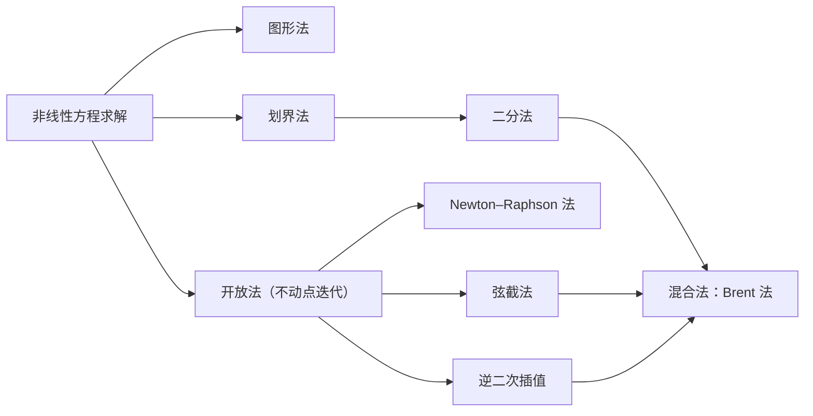

统计计算在很大程度上就是求解优化问题：**极大似然估计**要使对数似然最大，最小二乘要使平方和最小，Bayes 分析要寻找后验分布的众数。本章与下一章（[3.5.5](/3.5.5)）讨论这类问题的数值方法。本章先建立框架：优化问题有哪些类型，好算法应具备什么特质；为什么优化与求根是同一问题的两面；**梯度**告诉我们什么；极大似然如何纳入这一框架；迭代算法的快慢如何用收敛阶和收敛率来衡量。随后介绍两类几乎不需要导数信息的方法。直接搜索法只比较函数值：一维问题用黄金分割法和抛物线插值，多维问题用 Nelder–Mead 单纯形法。梯度方法把优化转化为求 $f(x)=g'(x)=0$ 的根：二分法之类的划界法可靠但慢，不动点迭代之类的开放法快但可能发散（其中包括线性方程组的经典迭代法和坐标下降法），Brent 法之类的混合法则兼取两者之长。使用二阶导数的牛顿法及其变形见 [3.5.5](/3.5.5)，它们所需的线性代数见 [3.5.3](/3.5.3)。其间我们还会认识 R 的 `optimize`、`optim` 和 `uniroot` 默认使用的方法。

## 4.1. 框架

### 4.1.1. 优化问题的类型

选择方法之前，始终要先弄清两个问题：是求根还是求极值？是求极大还是求极小？优化问题有多种类型，各有自己的理论和算法：

- 连续优化与离散优化；
- 约束优化与无约束优化；
- 全局优化与局部优化；
- 随机优化与确定性优化；
- 凸优化与非凸优化。

每种情形都既要注意数学表述，也要注意算法。好的算法应具备以下性质：

- 鲁棒性：对同类中的各种问题、对所有合理的初始值都表现良好。
- 效率：不过多耗费计算时间和存储空间。
- 精度：能够精确地找到解，对数据中的误差以及在计算机上实现算法时产生的舍入误差（[3.5.1](/3.5.1)）不过分敏感。

这些目标相互冲突。收敛速度与存储需求之间、鲁棒性与速度之间的权衡，是数值优化的核心议题。

### 4.1.2. 优化与求根

求解方程 $\boldsymbol{f}(\boldsymbol{x})=\boldsymbol{0}$ 可以转化为最小化问题

$$
\min_{\boldsymbol{x}}\boldsymbol{f}(\boldsymbol{x})^{\mathsf T}\boldsymbol{f}(\boldsymbol{x}),
$$
而最小化可微函数 $f(\boldsymbol{x})$ 可以转化为求解 $f'(\boldsymbol{x})=\boldsymbol{0}$，其解是 $f$ 的**驻点**。当 $f$ 是一个**二次型**加上线性项，

$$
f(\boldsymbol{x})=\frac12\boldsymbol{x}^{\mathsf T}A\boldsymbol{x}-\boldsymbol{b}^{\mathsf T}\boldsymbol{x}+c,
$$
且 $A$ 对称正定时，$f$ 在 $A\boldsymbol{x}=\boldsymbol{b}$ 的解处取最小值：梯度为 $f'(\boldsymbol{x})=A\boldsymbol{x}-\boldsymbol{b}$，Hesse 矩阵 $A$ 正定。$f$ 的图像是一个碗，最低点就是 $A\boldsymbol{x}=\boldsymbol{b}$ 的解，等高线是一族同心椭圆（高维时为椭球），每条上 $f$ 取常值。若 $A$ 负定，碗是倒扣的；若 $A$ 半正定且奇异，最小值沿一整条直线取到（一道槽）；若 $A$ 不定，曲面是马鞍形。若 $A$ 不对称，起作用的只有它的对称部分，因为 $\boldsymbol{x}^{\mathsf T}A\boldsymbol{x}=\boldsymbol{x}^{\mathsf T}\frac12(A+A^{\mathsf T})\boldsymbol{x}$：此时 $f'(\boldsymbol{x})=\frac12(A+A^{\mathsf T})\boldsymbol{x}-\boldsymbol{b}$，要解的是 $\frac12(A+A^{\mathsf T})\boldsymbol{x}=\boldsymbol{b}$。

梯度

$$
f'(\boldsymbol{x})=\nabla f(\boldsymbol{x})=\Bigl(\frac{\partial f}{\partial x_1},\frac{\partial f}{\partial x_2},\dots,\frac{\partial f}{\partial x_n}\Bigr)^{\mathsf T}
$$
在每一点 $\boldsymbol{x}$ 都指向 $f$ 增长最快的方向：由一阶 **Taylor 公式**，$f(\boldsymbol{x}+\Delta\boldsymbol{x})\approx f(\boldsymbol{x})+(\Delta\boldsymbol{x})^{\mathsf T}\nabla f(\boldsymbol{x})$，在给定长度的所有步长中，$\Delta\boldsymbol{x}=c\nabla f(\boldsymbol{x})$（$c>0$）使增量最大。梯度与等高线正交。这就是梯度如此有用的原因：它告诉我们往哪里走。

### 4.1.3. 极大似然

在统计、机器学习和数据科学中，我们大量地做优化。要极大化的实值函数 $f(\boldsymbol{x})$ 可以是似然、轮廓似然、Bayes 后验，等等。最重要的情形是 $f(\boldsymbol{x})=l(\boldsymbol{\theta})$，即参数向量 $\boldsymbol{\theta}$ 的**对数似然函数**，MLE $\hat{\boldsymbol{\theta}}$ 使 $l$ 最大。通常 $\hat{\boldsymbol{\theta}}$ 是 Fisher 得分方程

$$
l'(\boldsymbol{\theta})=\frac{\partial}{\partial\boldsymbol{\theta}}\log L(\boldsymbol{\theta};\boldsymbol{x})=\Bigl(\frac{\partial l}{\partial\theta_1},\dots,\frac{\partial l}{\partial\theta_p}\Bigr)^{\mathsf T}=\boldsymbol{0}
$$
的解。优化又一次与求解（非线性）方程紧密相连：求 MLE 相当于求得分方程的根，因为 $\arg\max_{\boldsymbol{x}}f(\boldsymbol{x})$ 是 $f'(\boldsymbol{x})=\boldsymbol{0}$ 的解。相关术语（[3.2](/3.2)）：

| 术语 | 记号 |
|---|---|
| 参数 | $\boldsymbol{\theta}$，$p$ 维向量 |
| 数据 | $\boldsymbol{X}$ |
| 对数似然 | $l(\boldsymbol{\theta})=\log p(\boldsymbol{X}\mid\boldsymbol{\theta})$ |
| 得分函数 | $\boldsymbol{s}(\boldsymbol{\theta})=l'(\boldsymbol{\theta})=\bigl(\frac{\partial l}{\partial\theta_1},\dots,\frac{\partial l}{\partial\theta_p}\bigr)^{\mathsf T}$ |
| Hesse 矩阵 | $l''(\boldsymbol{\theta})=\bigl(\partial^2l/\partial\theta_i\partial\theta_j\bigr)_{i,j=1,\dots,p}$ |
| Fisher 信息 | $I(\boldsymbol{\theta})=\operatorname{Var}(\boldsymbol{s}(\boldsymbol{\theta}))=\mathbb{E}\bigl[l'(\boldsymbol{\theta})l'(\boldsymbol{\theta})^{\mathsf T}\bigr]=-\mathbb{E}\,l''(\boldsymbol{\theta})=\mathbb{E}J(\boldsymbol{\theta})$ |
| 观测信息 | $J(\hat{\boldsymbol{\theta}})=-l''(\hat{\boldsymbol{\theta}})$ |

当 $\boldsymbol{\theta}^*$ 是 $l$ 的局部极大值点时，$l'(\boldsymbol{\theta}^*)=\boldsymbol{0}$，且 $l''(\boldsymbol{\theta}^*)$ 半负定（在严格的非退化极大值点处负定）。

**例 4.1.1** 并非每个 MLE 都是得分方程的解。设 $X_1,\dots,X_n$ 是来自 $\mathrm{U}(0,b)$ 的独立同分布样本。似然

$$
L(b)=\prod_{i=1}^n\frac1b\boldsymbol{1}_{[0,b]}(x_i)=\frac1{b^n}\boldsymbol{1}\{x_{(n)}\le b\}
$$
在 $b<x_{(n)}$ 时为零，在 $b\ge x_{(n)}$ 时递减，所以 MLE 是样本最大值 $\hat b=X_{(n)}$；若 $n=10$，$\max(\boldsymbol{x})=2$，则 $\hat b=2$。似然在最大值点不可微，得分方程没有根。

轮廓似然。 对高维的 $\boldsymbol{\theta}$ 可以降低维数。把 $\boldsymbol{\theta}=(\boldsymbol{\theta}_1,\boldsymbol{\theta}_2)$ 分成感兴趣的参数 $\boldsymbol{\theta}_1$ 和讨厌参数 $\boldsymbol{\theta}_2$，并设 $\boldsymbol{\theta}_1$ 固定时关于 $\boldsymbol{\theta}_2$ 的极大值点 $\hat{\boldsymbol{\theta}}_2(\boldsymbol{\theta}_1)$ 容易求出。于是

$$
\max_{\boldsymbol{\theta}}l(\boldsymbol{\theta})=\max_{\boldsymbol{\theta}_1,\boldsymbol{\theta}_2}l(\boldsymbol{\theta}_1,\boldsymbol{\theta}_2)=\max_{\boldsymbol{\theta}_1}l\bigl(\boldsymbol{\theta}_1,\hat{\boldsymbol{\theta}}_2(\boldsymbol{\theta}_1)\bigr),
$$
$l\bigl(\boldsymbol{\theta}_1,\hat{\boldsymbol{\theta}}_2(\boldsymbol{\theta}_1)\bigr)$ 是 $\boldsymbol{\theta}_1$ 的（对数形式的）轮廓似然（profile likelihood），也称集中似然。例如在回归中，$\boldsymbol{\beta}=(\boldsymbol{\beta}_1,\boldsymbol{\beta}_2)$，$X=[X_1\,|\,X_2]$，$\hat{\boldsymbol{\beta}}_2(\boldsymbol{\beta}_1)=(X_2^{\mathsf T}X_2)^{-1}X_2^{\mathsf T}(\boldsymbol{y}-X_1\boldsymbol{\beta}_1)$；利用到 $\mathcal{R}(X_2)$ 上的**正交投影矩阵** $P_2=X_2(X_2^{\mathsf T}X_2)^{-1}X_2^{\mathsf T}$，极大化轮廓似然得

$$
\hat{\boldsymbol{\beta}}_1=\bigl(X_1^{\mathsf T}(I-P_2)X_1\bigr)^{-1}X_1^{\mathsf T}(I-P_2)\boldsymbol{y}.
$$
若 $\hat{\boldsymbol{\theta}}_1(\boldsymbol{\theta}_2)$ 也容易求出，比如这里 $\hat{\boldsymbol{\beta}}_1(\boldsymbol{\beta}_2)=(X_1^{\mathsf T}X_1)^{-1}X_1^{\mathsf T}(\boldsymbol{y}-X_2\boldsymbol{\beta}_2)$，也可以改用块松弛法（block relaxation），在两部分之间轮流迭代：

$$
\boldsymbol{\beta}_1^{(0)}\Longrightarrow\boldsymbol{\beta}_2^{(0)}=\hat{\boldsymbol{\beta}}_2\bigl(\boldsymbol{\beta}_1^{(0)}\bigr)\Longrightarrow\boldsymbol{\beta}_1^{(1)}=\hat{\boldsymbol{\beta}}_1\bigl(\boldsymbol{\beta}_2^{(0)}\bigr)\Longrightarrow\boldsymbol{\beta}_2^{(1)}=\hat{\boldsymbol{\beta}}_2\bigl(\boldsymbol{\beta}_1^{(1)}\bigr)\Longrightarrow\cdots
$$
这是 4.3.5 节坐标下降法的分块版本。

### 4.1.4. 迭代算法

我们通常依靠逐次逼近来求解。例如要最小化

$$
f(x)=\frac{x^3}3-\frac{x^2}2-x-1,\qquad x\in[1,2],
$$
迭代算法需要三个要素。

- 初始值：这里取 $x^{(0)}=1.6$ 作为初始猜测是合理的。
- 更新规则：由最新的值 $x^{(t)}$ 得到改进的猜测 $x^{(t+1)}$ 的过程，$t=0,1,2,\dots$
- 终止准则：何时停止迭代。

（这里答案已知：$f'(x)=x^2-x-1$ 在黄金比 $x^*=(1+\sqrt5)/2\approx1.618$ 处为零。）绝对收敛准则在

$$
\lvert x^{(t+1)}-x^{(t)}\rvert<\varepsilon
$$
时停止，其中常数 $\varepsilon$ 表示可容忍的不精确程度。相对收敛准则在

$$
\frac{\lvert x^{(t+1)}-x^{(t)}\rvert}{\lvert x^{(t)}\rvert}<\varepsilon
$$
时停止；它可以设定目标精度（例如"在 1% 以内"）而不必顾虑 $x$ 的单位，但当 $x^{(t)}$ 趋于 $0$ 时失效。折中的办法是在 $\lvert x^{(t+1)}-x^{(t)}\rvert/(\lvert x^{(t)}\rvert+\varepsilon)<\varepsilon$ 时停止。

实际中还必须加入标示不收敛的终止规则：无论是否收敛，$N$ 次迭代后停止；若某个收敛度量在若干次迭代中不再下降或出现循环，或者解本身令人不满意地循环，就停止；若过程看起来正收敛到一个 $f(x)$ 劣于已找到的某个值的点，也应停止。不要把所有可用的迭代都押在一次尝试上：要为许多较小的尝试预留时间，预料到收敛失败、数据修正、多个初始值等情况。

### 4.1.5. 收敛阶与收敛率

**定义 4.1.1（收敛阶与收敛率）** 设 $x^{(t)}\to x^*$，记 $\varepsilon^{(t)}\triangleq x^{(t)}-x^*$。若

$$
\lim_{t\to\infty}\varepsilon^{(t)}=0\qquad\text{且}\qquad\lim_{t\to\infty}\frac{\lvert\varepsilon^{(t+1)}\rvert}{\lvert\varepsilon^{(t)}\rvert^\alpha}=c,
$$
其中 $\alpha=1$ 时 $c\in(0,1)$，$\alpha>1$ 时 $c\in(0,\infty)$，则称该序列的**收敛阶**为 $\alpha\ge1$，**收敛率**为 $c$。$\alpha=1$ 称为**线性收敛**，$\alpha=2$ 称为**二次收敛**；若 $\lvert\varepsilon^{(t+1)}\rvert/\lvert\varepsilon^{(t)}\rvert\to0$，称为**超线性收敛**。

**例 4.1.2** 设 $\gamma\in(0,1)$。

- $\gamma^n\to0$ 是线性收敛：$\gamma^{n+1}/\gamma^n=\gamma$，故 $\gamma^{n+1}=O(\gamma^n)$。
- $\gamma^{n^2}\to0$ 是超线性收敛：$\gamma^{(n+1)^2}/\gamma^{n^2}=\gamma^{2n+1}\to0$；但不是二次收敛，因为 $\gamma^{(n+1)^2}/(\gamma^{n^2})^2=\gamma^{-n^2+2n+1}\to\infty$。
- $\gamma^{2^n}\to0$ 是二次收敛：$\gamma^{2^{n+1}}/(\gamma^{2^n})^2=1$。

所以收敛阶 $\alpha$ 越大、同阶时收敛率 $c$ 越小，收敛越快。收敛阶远比收敛率重要。

**例 4.1.3** 设 $\lvert\varepsilon^{(t)}\rvert\le0.003$，且 $t$ 充分大时方法 A 满足 $\lvert\varepsilon^{(t+1)}\rvert/\lvert\varepsilon^{(t)}\rvert\approx0.5$（线性），方法 B 满足 $\lvert\varepsilon^{(t+1)}\rvert/\lvert\varepsilon^{(t)}\rvert^2\approx0.5$（二次）。要达到 $10^{-9}$ 的精度，各自还需要多少次迭代？对方法 A，$\lvert\varepsilon^{(t+k)}\rvert/\lvert\varepsilon^{(t)}\rvert\approx2^{-k}$，由 $2^{-k}\cdot0.003=10^{-9}$ 得 $k=\log_2(3\times10^6)\approx21.5$，需 $22$ 次。对方法 B，

$$
\lvert\varepsilon^{(t+2)}\rvert\approx\frac{\lvert\varepsilon^{(t+1)}\rvert^2}2\approx\frac{\lvert\varepsilon^{(t)}\rvert^4}{2^3}=\frac{0.003^4}8\approx10^{-11},
$$
只需再走 $2$ 步。

不过，收敛阶更高的方法并不总是更可取：每步的代价（导数、线性方程组）、存储、能够收敛的区域大小以及收敛有无保证，都同样重要。

## 4.2. 直接搜索法

直接搜索法不用导数。它们通常用于以下情形：函数不可微；导数计算复杂甚至不存在；函数的变量很少；最优解的位置大致已知。这类方法只在一列点 $x_1,x_2,\dots$ 上计算 $f(x)$ 并比较函数值，以逼近 $f$ 的极小值点。我们从一元函数开始。

### 4.2.1. 黄金分割法

**定义 4.2.1（单峰函数）** 若存在唯一的数 $p\in I$，使 $f$ 在 $[a,p]$ 上递减、在 $[p,b]$ 上递增，则称 $f$ 是 $I=[a,b]$ 上的**单峰函数**。

对单峰的 $f$，比较它在两个内点 $c<d$ 处的值。若 $f(c)\le f(d)$，极小值点不可能在 $(d,b]$ 中，区间缩为 $[a,d]$；否则缩为 $[c,b]$。两点对称放置：

$$
b-d=c-a\triangleq(1-r)(b-a),\qquad \tfrac12<r<1 .
$$
我们希望比例 $r$ 在每个子区间上保持不变，并且每次只增加一个新点，另一个点沿用。若新区间是 $[a,d]$，其内点应为 $c$ 和一个新点，于是

$$
r=\frac{d-a}{b-a}=\frac{c-a}{d-a}=\frac{(1-r)(b-a)}{r(b-a)}\ \Longrightarrow\ r^2+r-1=0\ \Longrightarrow\ r=\frac{-1+\sqrt5}2=\frac1\varphi\approx0.618,
$$
其中 $\varphi=\frac{1+\sqrt5}2\approx1.618$ 是黄金比。

**算法 4.2.1（黄金分割法）** 第 1 步：令 $r=0.618$，$i=1$；给定初始区间 $[X_1^{(1)},X_4^{(1)}]$ 和精度 $\varepsilon$，计算 $X_2^{(1)}=X_4^{(1)}-r(X_4^{(1)}-X_1^{(1)})$，$X_3^{(1)}=X_1^{(1)}+r(X_4^{(1)}-X_1^{(1)})$。第 2 步：若 $f(X_3^{(i)})\ge f(X_2^{(i)})$，令 $X_1^{(i+1)}=X_1^{(i)}$，$X_3^{(i+1)}=X_2^{(i)}$，$X_4^{(i+1)}=X_3^{(i)}$，并计算新点 $X_2^{(i+1)}=X_4^{(i+1)}-r(X_4^{(i+1)}-X_1^{(i+1)})$；若 $f(X_3^{(i)})<f(X_2^{(i)})$，令 $X_1^{(i+1)}=X_2^{(i)}$，$X_2^{(i+1)}=X_3^{(i)}$，$X_4^{(i+1)}=X_4^{(i)}$，并计算 $X_3^{(i+1)}=X_1^{(i+1)}+r(X_4^{(i+1)}-X_1^{(i+1)})$。第 3 步：若 $X_4^{(i+1)}-X_1^{(i+1)}\le\varepsilon$，停止；否则令 $i=i+1$，转第 2 步。

```r
golden <- function(f, a, b, eps = 1e-6) {
  r <- (sqrt(5) - 1) / 2
  x2 <- b - r * (b - a); x3 <- a + r * (b - a)
  f2 <- f(x2); f3 <- f(x3)
  while (b - a > eps) {
    if (f3 >= f2) {            # minimizer in [a, x3]
      b <- x3; x3 <- x2; f3 <- f2
      x2 <- b - r * (b - a); f2 <- f(x2)
    } else {                   # minimizer in [x2, b]
      a <- x2; x2 <- x3; f2 <- f3
      x3 <- a + r * (b - a); f3 <- f(x3)
    }
  }
  (a + b) / 2
}
golden(function(x) x^3 / 3 - x^2 / 2 - x - 1, 1, 2)   # 1.618034
```

每次迭代只计算一次函数值，区间长度乘以 $r\approx0.618$，所以黄金分割法线性收敛，收敛阶为 $1$，收敛率为 $0.618$。

### 4.2.2. 抛物线插值与 `optimize`

**定义 4.2.2（逐次抛物线插值）** **逐次抛物线插值**在三个点处计算 $f$，过这三点拟合一个二次多项式；以抛物线的极小值点替换 $f$ 值最大的那个点，如此重复。

若 $f$ 有连续的二阶导数，且它在极小值点（不在区间端点）处为正，则收敛是超线性的，阶约为 $1.324$；但单独使用时这个方法可能不可靠。R 的 `optimize`（一元优化）结合了黄金分割法与逐次抛物线插值，适用于连续函数：抛物线步表现良好时用抛物线步，否则用黄金分割步。

```r
f <- function(x) x^3 / 3 - x^2 / 2 - x - 1
optimize(f, lower = 1, upper = 2)    # $minimum is about 1.618, the golden ratio
```

### 4.2.3. Nelder–Mead 方法

对 $f\colon\mathbb{R}^p\to\mathbb{R}$，同样采用逐次逼近的策略，终止准则也类似：

$$
D\bigl(\boldsymbol{x}^{(t+1)},\boldsymbol{x}^{(t)}\bigr)<\varepsilon,\qquad \frac{D\bigl(\boldsymbol{x}^{(t+1)},\boldsymbol{x}^{(t)}\bigr)}{D\bigl(\boldsymbol{x}^{(t)},\boldsymbol{0}\bigr)}<\varepsilon\qquad\text{或}\qquad \frac{D\bigl(\boldsymbol{x}^{(t+1)},\boldsymbol{x}^{(t)}\bigr)}{D\bigl(\boldsymbol{x}^{(t)},\boldsymbol{0}\bigr)+\varepsilon}<\varepsilon,
$$
其中距离可取 $D(\boldsymbol{u},\boldsymbol{v})=\sum_{i=1}^p\lvert u_i-v_i\rvert$ 或 $D(\boldsymbol{u},\boldsymbol{v})=\sqrt{\sum_{i=1}^p(u_i-v_i)^2}$。

**定义 4.2.3（Nelder–Mead 方法）** $p$ 维单纯形是 $p+1$ 个顶点的凸包构成的 $p$ 维多面体（$p=2$ 时为三角形）。**Nelder–Mead 方法**（单纯形搜索法）以单纯形为"载具"搜索定义域：每一步舍弃最差的顶点，通过反射、扩张或收缩用一个新顶点替换它，或者把整个单纯形向最好的顶点收缩。

用 Nelder 和 Mead（1965）的话说，"单纯形会适应局部地形：沿着长长的斜面伸长，遇到斜交的山谷时改变方向，在极小值点附近收缩。"$p=2$ 时生成一列三角形；顶点处的函数值不断减小，三角形不断缩小，最终找到极小值点。

**算法 4.2.2（$p=2$ 时的 Nelder–Mead 方法）** 给当前三角形的顶点标号，使 $f(B)\le f(G)\le f(W)$（最好、较好、最差）。令 $M=(B+G)/2$ 为较好边的中点，把最差顶点关于它反射：$R=M+(M-W)=2M-W$。

1. 若 $f(B)\le f(R)<f(G)$，用 $R$ 替换 $W$。
2. 若 $f(R)<f(B)$，尝试扩张 $E=R+(R-M)=2R-M$：若 $f(E)<f(R)$，用 $E$ 替换 $W$，否则用 $R$ 替换。
3. 若 $f(R)\ge f(G)$，尝试收缩点 $C$：若 $f(R)<f(W)$，取 $M$ 与 $R$ 的中点，否则取 $W$ 与 $M$ 的中点。若 $f(C)$ 小于 $\min(f(R),f(W))$，用 $C$ 替换 $W$；否则把三角形向 $B$ 收缩，用 $BG$ 和 $BW$ 的中点替换 $G$ 和 $W$。

一般维数下的三要素为：初始值是围绕输入点 $\boldsymbol{x}_0\in\mathbb{R}^p$ 构造的有 $p+1$ 个顶点的初始工作单纯形（实际中常以 $\boldsymbol{x}_0$ 为一个顶点，其余 $p$ 个顶点使单纯形在 $\boldsymbol{x}_0$ 处成直角，或成为各边长度给定的正则单纯形）；更新规则是远离最差顶点的反射，或向最好顶点的收缩；终止准则是定义域收敛（单纯形变得很小）或函数值收敛（各顶点函数值几乎相等）。Nelder–Mead 是 R 的 `optim` 的默认方法。

**例 4.2.1** Himmelblau 函数 $(x^2+y-11)^2+(x+y^2-7)^2$ 有四个局部极小值点和一个局部极大值点 $(-0.270845,-0.923039)$。要找极大值，就最小化它的相反数：

```r
f <- function(x) -((x[1]^2) + x[2] - 11)^2 - (x[1] + (x[2]^2) - 7)^2
optim(c(0, 0), fn = f)
```

```text
$par
[1] -0.2711202 -0.9233435

$value
[1] -181.6165

$counts
function gradient
      53       NA

$convergence
[1] 0

$message
NULL
```

53 次函数求值、不用梯度，就得到约三位精度的极大值点；`$convergence` 为 $0$ 表示正常完成。

## 4.3. 梯度方法

梯度方法把 $g$ 的优化转化为求 $f(x)=g'(x)=0$ 的根。

**例 4.3.1** 关于 $x$ 极大化

$$
g(x)=\frac{\log x}{1+x}.
$$
$g'(x)=\dfrac{1+1/x-\log x}{(1+x)^2}$ 的根无法解析求出；极大值在 $x^*\approx3.59112$ 处。

**例 4.3.2** 数据 $1.77,-0.23,2.76,3.80,3.47,56.75,-1.34,4.24,-2.44,3.29,3.71,-2.40,4.53,-0.07,-1.05,-13.87,-2.53,-1.75,0.27,43.21$ 是来自尺度为 $1$ 的 **Cauchy 分布** $\mathrm{Cauchy}(\theta)$ 的独立同分布样本，似然函数为 $\prod_{i=1}^{20}\frac1{\pi(1+(x_i-\theta)^2)}$。它的**得分函数** $l'(\theta)$ 有多个根（局部极大值点在 $-0.19$、$2.82$ 和 $42.8$ 附近，其间夹着局部极小值点），所以 MLE 需要数值求解，而且要小心。

非线性方程的解法分为四类：



### 4.3.1. 图形法

画出函数图像、观察它与 $x$ 轴的交点，可以看出根可能在哪里，以及某些求根方法可能在哪里失效：函数可能与坐标轴相切而不穿过（二重根，划界法无法发现），可能有两个靠得很近的根，也可能在一个端点函数值同号的区间内有好几个根。因此图形解释有助于理解函数的性质、预见数值方法的陷阱。所得的估计虽然粗略，却可以用作其他方法的初始猜测。

### 4.3.2. 划界法：二分法

划界法和开放法都是迭代方法，都有初始值、更新规则和终止准则。划界法从两个"夹住"根、即位于根两侧的初始猜测出发。

若 $f=g'$ 在 $[a_0,b_0]$ 上连续且 $f(a_0)f(b_0)\le0$，由**介值定理**，至少存在一个 $x^*\in[a_0,b_0]$ 使 $f(x^*)=0$；于是 $x^*$ 是 $g$ 的一个局部最优点。

**定义 4.3.1（二分法）** **二分法**使区间 $[a_0,b_0]\supset[a_1,b_1]\supset[a_2,b_2]\supset\cdots$ 逐次缩小，每个区间长度是前一个的一半，并保持 $f(a_t)f(b_t)\le0$，使第 $t$ 个区间含有一个根：

$$
[a_{t+1},b_{t+1}]=\begin{cases}[a_t,x^{(t)}]&f(a_t)f(x^{(t)})\le0,\\{}[x^{(t)},b_t]&f(a_t)f(x^{(t)})>0,\end{cases}\qquad x^{(t+1)}=\frac{a_{t+1}+b_{t+1}}2,
$$
初始值为 $x^{(0)}=(a_0+b_0)/2$。

**区间套定理**保证这些区间收缩到一点，即 $f$ 的一个根。对例 4.3.1 取 $a_0=1$，$b_0=5$，于是 $x^{(0)}=3$；在 $t=1000$ 或 $\lvert f(x)\rvert<\varepsilon$ 时停止。下面的函数或者直接接收导数 $f$，或者在 `minmax = TRUE` 时接收 $g$，并用步长为 $h$ 的中心差商近似 $g'$：

```r
bisec <- function(f, b0 = 1, b1 = 5, minmax = FALSE, ...) {
  if (minmax == TRUE) {
    g <- f
    f <- function(x, h) (g(x + h) - g(x - h)) / 2 / h
  }
  eps <- .Machine$double.eps
  r <- seq(b0, b1, length = 3)
  y <- mapply(f, x = r, ...)
  if (y[1] * y[3] > 0) stop("f does not have opposite sign at endpoints")
  it <- 0
  while (it < 1000 & abs(y[2]) > eps) {
    it <- it + 1
    if (y[1] * y[2] < 0) {
      r[3] <- r[2]; y[3] <- y[2]
    } else {
      r[1] <- r[2]; y[1] <- y[2]
    }
    r[2] <- (r[1] + r[3]) / 2
    y[2] <- f(x = r[2], ...)
  }
  return(list(root = r[2], est = y[2], tol = y[3] - y[2], nit = it))
}

f <- function(x) (1 + 1/x - log(x)) / (1 + x)^2
bisec(f = f, b0 = 1, b1 = 5)
g <- function(x) log(x) / (1 + x)
bisec(f = g, b0 = 1, b1 = 5, minmax = TRUE, h = .05)
```

```text
        root           est           tol           nit
3.591121e+00 -1.790819e-16 -4.845744e-16  4.600000e+01
        root           est           tol           nit
3.591626e+00  0.000000e+00 -5.551115e-16  4.500000e+01
```

（`est` 是 $f$ 在返回点处的值，`tol` 是 $f$ 在最终区间两端的值之差。）两次运行都在约 $45$ 次折半后以舍入误差量级的 $\lvert f\rvert$ 停止，但第二次求出的是差商的根，而不是 $g'$ 的根：它的答案 $3.5916$ 在第四位就错了，因为 $h=0.05$ 的中心差商有 $h^2$ 量级的误差。有导数可用时，就用导数。

若 $f=g'$ 在初始区间内有不止一个根，二分法会找到其中一个，而找不到其余的。对连续函数，二分法保证收敛到 $f$ 的一个根（$g$ 的一个最优点），但方法很慢：每步区间折半，是收敛率为 $1/2$ 的线性收敛。黄金分割法每步把区间缩小为 $0.618$ 倍，所以按每次迭代计，二分法更快；但它需要导数的符号，而黄金分割法只用 $g$ 的值。

### 4.3.3. 开放法：不动点迭代

与划界法不同，开放法只需要一个初始值，或者两个不一定夹住根的初始值。开放法可能在计算过程中发散，但一旦收敛，通常比划界法快得多。

更新规则该怎样设定？考虑求 $f(x)=x+\log x$ 的根。由于 $x+\log x=0\iff x=-\log x\triangleq G(x)$，可以尝试更新方程

$$
x^{(t+1)}=G\bigl(x^{(t)}\bigr)=-\log x^{(t)} .
$$

**定义 4.3.2（不动点与不动点迭代）** 满足 $x=G(x)$ 的点 $x$ 称为函数 $G$ 的**不动点**。从初始值 $x^{(0)}$ 出发计算 $x^{(t+1)}=G(x^{(t)})$，称为**不动点迭代**。

要求 $g'$ 的根，可以简单地写成 $x=x+g'(x)\triangleq G(x)$，迭代 $x^{(t+1)}=x^{(t)}+g'(x^{(t)})$。但 $G$ 的选择并不唯一：对 $f(x)=x+\log x$，

$$
x+\log x=0\iff x=-\log x\triangleq G_1(x)\iff x=\mathrm{e}^{-x}\triangleq G_2(x)\iff x=\frac{x+\mathrm{e}^{-x}}2\triangleq G_3(x).
$$
应该用哪个 $G$？蛛网图表明，只有当 $G$ 的曲线在不动点附近平坦时迭代才可能收敛，陡峭时则发散。


由 **Lagrange 中值定理**，存在介于 $x^{(t)}$ 与 $x^*$ 之间的 $\xi$ 使

$$
\lvert x^{(t+1)}-x^*\rvert=\lvert G(x^{(t)})-G(x^*)\rvert=\lvert G'(\xi)\rvert\,\lvert x^{(t)}-x^*\rvert .
$$
因此只要 $G$ 是压缩的，即在一个被映入自身的区间上 $\lvert G'(x)\rvert\le\lambda<1$，算法就保证收敛，且

$$
\lvert x^{(t)}-x^*\rvert\le\frac{\lambda^t}{1-\lambda}\lvert x^{(1)}-x^{(0)}\rvert .
$$
在 $x^*$ 附近，误差每步大约乘以 $\lvert G'(x^*)\rvert$：当 $0<\lvert G'(x^*)\rvert<1$ 时不动点迭代线性收敛，收敛率为 $\lvert G'(x^*)\rvert$；当 $G'(x^*)=0$ 且 $G''$ 在 $x^*$ 附近有界时，至少二次收敛。对 $x^*=0.5671$，$\lvert G_1'(x^*)\rvert=1/x^*=1.76>1$，故 $G_1$ 发散；$\lvert G_2'(x^*)\rvert=\mathrm{e}^{-x^*}=x^*=0.567$；$\lvert G_3'(x^*)\rvert=(1-\mathrm{e}^{-x^*})/2=0.216$。按效率排序为 $G_3>G_2>G_1$。

背后的一般原理是压缩映射定理。

**定义 4.3.3（压缩映射）** 设 $(M,d)$ 是度量空间。若存在常数 $\beta$，$0\le\beta<1$，使对所有 $x,y\in M$ 有 $d(f(x),f(y))\le\beta\,d(x,y)$，则称函数 $f\colon M\to M$ 是**压缩映射**。

**定理 4.3.1（Banach 不动点定理）** 设 $(M,d)$ 是完备度量空间。则 $M$ 上的每个压缩映射 $f$ 都有唯一的不动点 $x^*$，且对每个 $x\in M$，

$$
d\bigl(f^n(x),x^*\bigr)\le\frac{\beta^n}{1-\beta}\,d\bigl(x,f(x)\bigr).
$$

该定理以 Stefan Banach 命名，他于 1922 年首先陈述了它。定理保证度量空间上某些自映射的不动点存在且唯一，并给出求这些不动点的构造性方法；它也称为压缩映射原理，是度量空间理论中的重要工具。

缩放不动点迭代。 不动点迭代的效果在很大程度上取决于 $G$ 的选择。对 $G(x)=g'(x)+x$，$G'(x)=g''(x)+1$ 的模不一定小于 $1$。不满足压缩条件的函数常常可以通过缩放 $g$ 或 $G$ 来补救：令

$$
G(x)=\alpha g'(x)+x,\qquad G'(x)=\alpha g''(x)+1,
$$
其中合适的 $\alpha$ 可以通过试错或分析 $g''$ 找到。每一步 $x^{(t+1)}=x^{(t)}+\alpha g'(x^{(t)})$ 都从点 $(x^{(t)},g'(x^{(t)}))$ 出发沿斜率为 $-1/\alpha$ 的直线走到横轴：这些直线互相平行，所以这一方法也称平行弦法。对例 4.3.1，用 $\alpha=4$ 缩放效果很好。在极大似然中，若 $l(\theta)$ 近似为二次函数，则 $l'(\theta)$ 近似为线性函数，$l''(\theta)\approx\gamma$ 为常数；取 $\alpha=-1/\gamma$ 使 $G'(\theta^*)\approx0$，更新方程

$$
\theta^{(t+1)}=\theta^{(t)}-\frac{l'(\theta^{(t)})}{\gamma}
$$
就是导数固定不变的牛顿法 $x_{n+1}=x_n-f(x_n)/f'(x_n)$（[3.5.5](/3.5.5)）的一步。许多对数似然在极大值点附近近似为二次函数，所以缩放不动点迭代可以非常有效；它通常也相当稳定，且易于编程。若每步都用当前的导数代替 $\gamma$，就得到牛顿法本身；下面用前向差商近似导数：

```r
newton <- function(f, x0 = 1, N = 20, h = .01, tol = 1E-12, ...) {
  i <- 1; x1 <- x0
  p <- numeric(N)
  while (i <= N) {
    df.dx <- (f(x0 + h, ...) - f(x0, ...)) / h
    x1 <- (x0 - (f(x0, ...) / df.dx))
    p[i] <- x1
    i <- i + 1
    if (abs(x1 - x0) < tol) break
    x0 <- x1
  }
  return(list(root = p[i - 1], process = p[1:(i - 1)], nit = i - 1))
}
f <- function(x) (1 + 1/x - log(x)) / (1 + x)^2
newton(f, x0 = 1, N = 50)
```

```text
$root
[1] 3.591121

$process
 [1] 1.506261 2.107604 2.736086 3.258855 3.533365 3.589484
 [7] 3.591130 3.591121 3.591121 3.591121 3.591121 3.591121

$nit
[1] 12
```

![x + log(x) = 0 的根 x* = 0.5671 的误差 |x(t) - x*|（对数刻度）。[0.1, 1] 上的二分法和不动点迭代 G2、G3 线性收敛，收敛率分别为 0.5、0.567 和 0.216（直线）；弦截法和牛顿法超线性收敛，分别约六步和四步达到机器精度。](./plots/root-finding-convergence.py)

### 4.3.4. 用不动点迭代解线性方程组

要解 $A\boldsymbol{x}=\boldsymbol{b}$，把它改写为 $\boldsymbol{x}=B\boldsymbol{x}+\boldsymbol{d}$ 并迭代

$$
\boldsymbol{x}^{(t+1)}=G(\boldsymbol{x}^{(t)})=B\boldsymbol{x}^{(t)}+\boldsymbol{d}.
$$

**定理 4.3.2** (a) 若对某个诱导矩阵范数有 $\|B\|<1$，则对每个 $\boldsymbol{x}^{(0)}$ 迭代都收敛。(b) 对 $B\in\mathbb{C}^{n\times n}$，迭代对每个 $\boldsymbol{x}^{(0)}$ 都收敛，当且仅当**谱半径** $\rho(B)\triangleq\max\lvert\lambda_B\rvert<1$。

**证明** (a) $\|G(\boldsymbol{x})-G(\boldsymbol{y})\|=\|B(\boldsymbol{x}-\boldsymbol{y})\|\le\|B\|\,\|\boldsymbol{x}-\boldsymbol{y}\|$，所以 $G$ 是完备空间 $\mathbb{C}^n$ 上的压缩映射，定理 4.3.1 适用。(b) 记解 $\boldsymbol{x}^*=B\boldsymbol{x}^*+\boldsymbol{d}$，$\boldsymbol{\varepsilon}^{(t)}=\boldsymbol{x}^{(t)}-\boldsymbol{x}^*$，则

$$
\boldsymbol{\varepsilon}^{(t)}=(B\boldsymbol{x}^{(t-1)}+\boldsymbol{d})-(B\boldsymbol{x}^*+\boldsymbol{d})=B\boldsymbol{\varepsilon}^{(t-1)}=B^2\boldsymbol{\varepsilon}^{(t-2)}=\cdots=B^t\boldsymbol{\varepsilon}^{(0)},
$$
而 $B^t\to O$ 当且仅当 $\rho(B)<1$。$\square$

这就是数值分析学家如此重视谱半径的原因。若 $\boldsymbol{v}$ 是 $B$ 的属于特征值 $-0.5$ 的**特征向量**，则 $B^t\boldsymbol{v}=(-0.5)^t\boldsymbol{v}$ 收敛到零；属于特征值 $2$ 时则发散。一个非常重要的技巧是把一个向量看作若干行为已知的向量之和：若 $\boldsymbol{x}=\boldsymbol{v}_1+\boldsymbol{v}_2$，对应的特征值为 $\lambda_1=0.7$ 和 $\lambda_2=-2$，反复作用 $B$ 的效果最好通过各个特征向量来理解：一个分量收敛到零，另一个发散，因而 $B^t\boldsymbol{x}$ 发散。要让 $\boldsymbol{x}^{(t)}$ 快速收敛，$\rho(B)$ 应小于 $1$，而且越小越好。$B$ 的三种经典取法来自对 $A$ 的分裂。

**定义 4.3.4（Jacobi 迭代法）** 记 $A=D+E$，其中 $D=\operatorname{diag}(a_{11},\dots,a_{nn})$，$E$ 为非对角部分。**Jacobi 迭代法**迭代 $\boldsymbol{x}^{(t+1)}=D^{-1}(\boldsymbol{b}-E\boldsymbol{x}^{(t)})=-D^{-1}E\boldsymbol{x}^{(t)}+D^{-1}\boldsymbol{b}$，即

$$
x_i^{(t+1)}=\frac1{a_{ii}}\Bigl(b_i-\sum_{j\ne i}a_{ij}x_j^{(t)}\Bigr),\qquad i=1,\dots,n .
$$

**定义 4.3.5（Gauss–Seidel 迭代法）** 记 $A=L_*+U$，其中 $L_*$ 是含对角线的下三角部分，$U$ 是严格上三角部分。**Gauss–Seidel 迭代法**（Liebmann 方法、逐次位移法）迭代 $L_*\boldsymbol{x}^{(t+1)}=\boldsymbol{b}-U\boldsymbol{x}^{(t)}$，即用前代法

$$
x_i^{(t+1)}=\frac1{a_{ii}}\Bigl(b_i-\sum_{j=1}^{i-1}a_{ij}x_j^{(t+1)}-\sum_{j=i+1}^na_{ij}x_j^{(t)}\Bigr),\qquad i=1,\dots,n :
$$
每个新分量一算出就立即使用。

**例 4.3.3** 对方程组 $x_1+3x_2=6$，$2x_1-x_2=1$，由第一个方程解出 $x_1$、第二个方程解出 $x_2$，从 $(0,0)$ 出发的 Gauss–Seidel 迭代为 $(6,11)$，$(-27,-55)$，$(171,341)$，$(-1017,-2035)$，$(6111,12221)$，……：不收敛。这个系数矩阵没有占优的对角线。交换两个方程得 $2x_1-x_2=1$，$x_1+3x_2=6$，对角线占优，迭代 $(0.5,1.833333)$，$(1.416667,1.527778)$，$(1.263889,1.578704)$，$(1.289352,1.570216)$，$(1.285108,1.571631)$，……收敛到解 $(9/7,11/7)=(1.285714,1.571429)$。

**定义 4.3.6（逐次超松弛迭代法）** 记 $A=D+L+U$（对角、严格下三角和严格上三角部分），取松弛因子 $\omega\in(0,2)$。由 $\omega A\boldsymbol{x}=\omega\boldsymbol{b}$，即 $(D+\omega L)\boldsymbol{x}=\omega\boldsymbol{b}-[\omega U+(\omega-1)D]\boldsymbol{x}$，**逐次超松弛迭代法**（SOR）迭代

$$
\boldsymbol{x}^{(t+1)}=(D+\omega L)^{-1}\bigl\{\omega\boldsymbol{b}-[\omega U+(\omega-1)D]\boldsymbol{x}^{(t)}\bigr\},
$$
写成分量形式即

$$
x_i^{(t+1)}=(1-\omega)x_i^{(t)}+\frac\omega{a_{ii}}\Bigl(b_i-\sum_{j=1}^{i-1}a_{ij}x_j^{(t+1)}-\sum_{j=i+1}^na_{ij}x_j^{(t)}\Bigr),\qquad i=1,\dots,n .
$$

SOR 取旧值与 Gauss–Seidel 值的加权平均；$\omega=1$ 就是 Gauss–Seidel。它的迭代矩阵 $B_\omega=-(D+\omega L)^{-1}[\omega U+(\omega-1)D]$ 满足 $\rho(B_\omega)\ge\lvert\omega-1\rvert$（因为 $\det B_\omega=(1-\omega)^n$），所以 SOR 只可能在 $0<\omega<2$ 时收敛。关于收敛的保证：若 $A$ 是严格**对角占优矩阵**，Jacobi 和 Gauss–Seidel 对任何初始向量都收敛；若 $A$ 对称正定，Gauss–Seidel 收敛，SOR 对每个 $\omega\in(0,2)$ 也收敛（Jacobi 则不一定）。


### 4.3.5. 坐标下降法

**定义 4.3.7（坐标下降法）** 对凸且可微的 $g(\boldsymbol{x})$，**坐标下降法**（循环坐标下降、后向拟合）从初始猜测 $\boldsymbol{x}^{(0)}$ 出发，对 $k=1,2,3,\dots$ 重复

$$
x_i^{(k)}\in\arg\min_{x_i}g\bigl(x_1^{(k)},\dots,x_{i-1}^{(k)},x_i,x_{i+1}^{(k-1)},\dots,x_n^{(k-1)}\bigr),\qquad i=1,\dots,n :
$$
求出 $x_i^{(k)}$ 之后，从此就用它的新值。

对 SPD 矩阵 $A$，Gauss–Seidel 就是二次函数 $\frac12\boldsymbol{x}^{\mathsf T}A\boldsymbol{x}-\boldsymbol{b}^{\mathsf T}\boldsymbol{x}$ 的坐标下降。若凸且可微的 $g\colon\mathbb{R}^n\to\mathbb{R}$ 在 $\boldsymbol{x}$ 处沿每个坐标轴都取最小值，即对所有 $\delta$ 和 $i$ 有 $g(\boldsymbol{x}+\delta\boldsymbol{e}_i)\ge g(\boldsymbol{x})$，则 $\boldsymbol{x}$ 是全局极小值点：每个偏导数都为零，故 $\nabla g(\boldsymbol{x})=\boldsymbol{0}$，而对**凸函数**，驻点就是全局最小值点。（没有可微性时这一结论不成立。）

一个重要的应用是拟合可加模型。方程 $\nabla g(\boldsymbol{x})=\boldsymbol{0}$ 是含 $p$ 个未知数的 $p$ 个非线性方程。对 $j=1,\dots,p$，可以用任何方便的一元方法求第 $j$ 个分量方程 $g'_j(x_j^{(t+1)})=0$ 的一维根；所有 $p$ 个分量依次循环，循环的每个阶段都使用其他坐标的最新值。一轮循环结束时，全部最新值组成 $\boldsymbol{x}^{(t+1)}$。其优点是：把可能很难的问题简化了；每个一元问题更容易、更稳定地求解；由于计算简单，往往所需的时间更少。

**例 4.3.4（一个生存模型）** 生存分析出现在许多场合：死亡时间、康复时间、失效时间。数据常常是右删失的，因为研究结束时有些试验单元还没有"死亡"，而删失往往导致难处理的似然。设生存时间（survival time）$T$，即某个关注事件发生之前的时间，有密度 $f$ 和分布函数 $F$。生存函数（survival function）为 $S(t)=\mathbb{P}(T>t)=1-F(t)$，风险函数（hazard function）

$$
h(t)=\lim_{\Delta\downarrow0}\frac{\mathbb{P}(t\le T<t+\Delta\mid T\ge t)}\Delta=\frac{f(t)}{S(t)}=-\frac{\mathrm{d}}{\mathrm{d}t}\log S(t)
$$
衡量在存活到时刻 $t$ 的条件下于时刻 $t$ 死亡的瞬时风险。给定的因素如何影响风险？比例风险模型（proportional hazards model）（Cox，1972）假定风险通过

$$
h(t\mid\boldsymbol{x})=\lambda(t)\exp\{\boldsymbol{x}^{\mathsf T}\boldsymbol{\beta}\}
$$
依赖于时间和协变量向量 $\boldsymbol{x}$，其中 $\boldsymbol{\beta}$ 是参数向量，$h_0(t)\triangleq h(t\mid\boldsymbol{x}=\boldsymbol{0})=\lambda(t)$ 是基线风险（$t$ 提醒我们风险可能随时间变化）。记累积风险 $H(t)=\int_0^th(u)\,\mathrm{d}u$，$\Lambda(t)\triangleq\int_0^t\lambda(u)\,\mathrm{d}u$，对 $h=-\frac{\mathrm{d}}{\mathrm{d}t}\log S$ 积分得

$$
S(t)=\exp\Bigl\{-\int_0^th(u)\,\mathrm{d}u\Bigr\}=\exp\bigl\{-\Lambda(t)\exp\{\boldsymbol{x}^{\mathsf T}\boldsymbol{\beta}\}\bigr\}.
$$

设对个体 $i$ 观测到 $(t_i,w_i,\delta_i)$，其中 $t_i$ 是（可能删失的）失效时间，$w_i$ 是失效指示（$1$ 为失效，$0$ 为删失），$\delta_i$ 是处理指示（$1$ 为处理组，$0$ 为对照组），这里它就是协变量：$\boldsymbol{x}_i^{\mathsf T}\boldsymbol{\beta}=\beta_0+\delta_i\beta_1$。在 $t_i$ 删失的个体贡献 $L_i(\boldsymbol{\beta})=S(t_i)=\exp\{-\Lambda(t_i)\exp\{\boldsymbol{x}_i^{\mathsf T}\boldsymbol{\beta}\}\}$，在 $t_i$ 失效的个体贡献 $f(t_i)=h(t_i)S(t_i)=\lambda(t_i)\exp\{\boldsymbol{x}_i^{\mathsf T}\boldsymbol{\beta}\}S(t_i)$；完整似然为 $\prod_{i=1}^nh(t_i)^{w_i}S(t_i)$。记 $\mu_i\triangleq\Lambda(t_i)\exp\{\boldsymbol{x}_i^{\mathsf T}\boldsymbol{\beta}\}$，对数似然为

$$
\sum_{i=1}^n\bigl(w_i\log\{\lambda(t_i)\exp\{\boldsymbol{x}_i^{\mathsf T}\boldsymbol{\beta}\}\}-\mu_i\bigr)=\sum_{i=1}^n(w_i\log\mu_i-\mu_i)+\sum_{i=1}^nw_i\log\frac{\lambda(t_i)}{\Lambda(t_i)} .
$$
取 $\Lambda(t)=t^\alpha$（$\alpha>0$），于是 $\lambda(t)=\alpha t^{\alpha-1}$（Weibull 型基线），$\lambda(t_i)/\Lambda(t_i)=\alpha/t_i$：

$$
l(\alpha,\beta_0,\beta_1)=\sum_{i=1}^n(w_i\log\mu_i-\mu_i)+\sum_{i=1}^nw_i\log\frac\alpha{t_i},\qquad \mu_i=t_i^\alpha\exp\{\beta_0+\delta_i\beta_1\}.
$$
偏导数为

$$
\frac{\partial l}{\partial\alpha}=\sum_{i=1}^nw_i\log t_i-\sum_{i=1}^nt_i^\alpha\log t_i\,\mathrm{e}^{\beta_0+\delta_i\beta_1}+\sum_{i=1}^n\frac{w_i}\alpha,\qquad \frac{\partial l}{\partial\beta_0}=\sum_{i=1}^nw_i-\sum_{i=1}^nt_i^\alpha\mathrm{e}^{\beta_0+\delta_i\beta_1},\qquad \frac{\partial l}{\partial\beta_1}=\sum_{i=1}^nw_i\delta_i-\sum_{i=1}^n\delta_it_i^\alpha\mathrm{e}^{\beta_0+\delta_i\beta_1}.
$$
坐标下降在这三个方程之间循环，用其他参数的最新值分别求 $\alpha$、$\beta_0$ 或 $\beta_1$ 的一元根。数据是处理组 $21$ 名和对照组 $21$ 名患者的时间（单位：周），括号表示删失：

| 组别 | 时间 |
|---|---|
| 处理组 | (6), 6, 6, 6, 7, (9), (10), 10, (11), 13, 16, (17), (19), (20), 22, 23, (25), (32), (32), (34), (35) |
| 对照组 | 1, 1, 2, 2, 3, 4, 4, 5, 5, 8, 8, 8, 8, 11, 11, 12, 12, 15, 17, 22, 23 |

```r
t <- c(6, 6, 6, 6, 7, 9, 10,
       10, 11, 13, 16, 17, 19, 20,
       22, 23, 25, 32, 32, 34, 35,
       1, 1, 2, 2, 3, 4, 4,
       5, 5, 8, 8, 8, 8, 11,
       11, 12, 12, 15, 17, 22, 23)
n <- length(t)
tr <- rep(c(1, 0), each = n / 2)
w <- tr
w[2:5] <- 0
w[c(8, 10, 11, 15, 16)] <- 0
w <- 1 - w                      # failure indicator

da <- function(a, b0, b1) {
  sum(w * log(t)) - sum(t^a * log(t) * exp(b0 + b1 * tr)) + sum(w) / a
}
db0 <- function(a, b0, b1) {
  sum(w) - sum(t^a * exp(b0 + b1 * tr))
}
db1 <- function(a, b0, b1) {
  sum(w * tr) - sum(tr * t^a * exp(b0 + b1 * tr))
}

a <- 1; b0 <- 0; b1 <- 1
del <- 2; i <- 0
while ((del > 1e-4) & i <= 500) {
  a1  <- newton(da,  x0 = a,  h = .01, b0 = b0, b1 = b1)$root
  b01 <- newton(db0, x0 = b0, h = .01, a = a1,  b1 = b1)$root
  b11 <- newton(db1, x0 = b1, h = .01, a = a1,  b0 = b01)$root
  del <- (a - a1)^2 + (b0 - b01)^2 + (b1 - b11)^2
  a <- a1; b0 <- b01; b1 <- b11
  i <- i + 1
}
a; b0; b1
```

```text
[1] 1.338403
[1] -3.001792
[1] -1.715189
```

循环推进得很慢：从 $(1,0,1)$ 出发，一轮后为 $(0.1380,-1.2985,0.0805)$，五轮后为 $(0.9975,-2.2097,-1.4689)$，十轮后为 $(1.1851,-2.6214,-1.6250)$，三十轮后为 $(1.3484,-3.0269,-1.7209)$，一百轮后为 $(1.36575,-3.07069,-1.73087)$，这时已经收敛。上面的终止规则（平方变化小于 $10^{-4}$，即变化小于 $0.01$）停得太早，停在约 $(1.338,-3.002,-1.715)$；当每步本身都很小时，以步长大小为依据的准则说明不了多少问题。作为比较，内置函数直接最小化负对数似然：

```r
l <- function(theta) {
  a <- theta[1]; b0 <- theta[2]; b1 <- theta[3]
  mu <- t^a * exp(b0 + b1 * tr)
  -sum(w * log(mu) - mu) - sum(w * log(a / t))   # minus log-likelihood
}
optim(c(1, 0, 1), l)
```

```text
$par
[1]  1.365482 -3.069965 -1.730824

$value
[1] 106.5795
```

处理效应 $\hat\beta_1\approx-1.73$ 意味着处理使风险乘以 $\mathrm{e}^{-1.73}\approx0.18$。

### 4.3.6. 混合法：Brent 法

划界法可靠但慢，开放法快但有风险。Brent 法（Brent–Dekker 方法）——R 的 `uniroot` 和 Matlab 的 `fzero` 所用的方法——把划界法的可靠性与开放法的速度结合起来：先尝试开放法，必要时切换到二分法。它由两种插值步构成。

**定义 4.3.8（弦截法）** **弦截法**需要两个初始点 $x^{(0)}$ 和 $x^{(1)}$。过 $(x^{(0)},f(x^{(0)}))$ 和 $(x^{(1)},f(x^{(1)}))$ 作线性插值，得到估计的根 $x^{(2)}$，再与 $x^{(1)}$ 一起产生下一个近似；对 $t\ge1$，

$$
x^{(t+1)}=x^{(t)}-f\bigl(x^{(t)}\bigr)\frac{x^{(t)}-x^{(t-1)}}{f\bigl(x^{(t)}\bigr)-f\bigl(x^{(t-1)}\bigr)} .
$$

其收敛阶是超线性的，$\alpha=(1+\sqrt5)/2\approx1.618$（[3.5.5](/3.5.5) 的定理 5.1.2）。但弦截法可能失败。对 $f(x)=x^3-x^2-x-1$，取 $x_1=2$，$x_2=0$：过 $(2,1)$ 和 $(0,-1)$ 的割线给出 $x_3=1$，$f(1)=-2$；过 $(0,-1)$ 和 $(1,-2)$ 的割线给出 $x_4=-1$，$f(-1)=-2$；过 $(1,-2)$ 和 $(-1,-2)$ 的割线是水平的，与横轴没有交点。

对三个点，用基函数

$$
V_0(x)=\frac{(x-x_1)(x-x_2)}{(x_0-x_1)(x_0-x_2)},\quad V_1(x)=\frac{(x-x_0)(x-x_2)}{(x_1-x_0)(x_1-x_2)},\quad V_2(x)=\frac{(x-x_0)(x-x_1)}{(x_2-x_0)(x_2-x_1)}
$$
（满足 $i=j$ 时 $V_j(x_i)=1$，否则为 $0$）构成的 **Lagrange 插值多项式**为 $g(x)=y_0V_0(x)+y_1V_1(x)+y_2V_2(x)$，且 $g(x_i)=y_i$，$i=0,1,2$。一般地，对 $k+1$ 个点 $(x_0,y_0),\dots,(x_k,y_k)$，$L(x)=\sum_{j=0}^ky_jl_j(x)$，其中 $l_j(x)=\prod_{0\le m\le k,\,m\ne j}\frac{x-x_m}{x_j-x_m}$，$l_j(x_i)=\delta_{ij}$。

**定义 4.3.9（逆二次插值）** **逆二次插值**（IQI）交换 $x$ 与 $y$ 的角色：过三个点 $(a,f(a))$、$(b,f(b))$、$(c,f(c))$（$b$ 为当前最好的估计）把 $x$ 拟合为 $y$ 的二次函数，令 $y=0$ 得到根的下一个估计：

$$
x=a\frac{[y-f(b)][y-f(c)]}{[f(a)-f(b)][f(a)-f(c)]}+b\frac{[y-f(c)][y-f(a)]}{[f(b)-f(c)][f(b)-f(a)]}+c\frac{[y-f(a)][y-f(b)]}{[f(c)-f(a)][f(c)-f(b)]}\Bigg|_{y=0}.
$$

与关于 $x$ 的抛物线不同，这条"逆抛物线"总是恰好与 $y=0$ 相交一次。它的收敛阶约为 $1.84$，但很少单独使用，因为远离根时插值抛物线可能是很差的向导。

**定义 4.3.10（Brent 法）** **Brent 法**从一个 $f$ 变号的区间 $[a,b]$ 出发，目标是把它缩小为一个 $f$ 仍然变号的极小子区间。它保留三个点：$b$ 是迄今最好的零点，$\lvert f(b)\rvert$ 迄今最小（若 $\lvert f(a)\rvert<\lvert f(b)\rvert$ 则交换 $a$ 与 $b$）；$c$ 是上一个 $b$，使 $b$ 与 $c$ 给出割线（初始时 $c=a$）；$a$ 与 $b$ 夹住变号点，$f(a)f(b)\le0$，从而 $a$ 与 $b$ 给出中点 $m=(a+b)/2$。每次迭代在四种可能的步中选择：若 $f(a)$、$f(b)$、$f(c)$ 互不相同（三个点），尝试逆二次插值；否则（两个点）尝试弦截步；若插值步落在区间之外或不可接受，用二分法；若步长小于容差，就用容差大小的步长。

插值得到的点 $s$ 在插值表现不好时被舍弃而改用二分：$s$ 必须位于 $(3a+b)/4$ 与 $b$ 之间；若上一次迭代用的是二分法，只有当 $\lvert s-b\rvert<\lvert b-c\rvert/2$ 时才接受 $s$；若上一次用的是插值，只有当 $\lvert s-b\rvert<\lvert c-d\rvert/2$ 时才接受，其中 $d$ 是 $c$ 的前一个值；两种情形下上一步都不能小于容差。这些规则保证了收敛：最坏情况下 Brent 法所需的步数不超过二分法步数的平方量级，通常则少得多。

**算法 4.3.1（Brent 法）** 输入 $a$、$b$ 和 $f$。若 $f(a)f(b)\ge0$，退出：根没有被夹住。若 $\lvert f(a)\rvert<\lvert f(b)\rvert$，交换 $a$ 与 $b$。令 $c=a$，并设置一个标志，记录上一步为二分。重复以下步骤，直到 $f(b)=0$ 或 $f(s)=0$ 或 $\lvert b-a\rvert$ 足够小：

1. 若 $f(a)\ne f(c)$ 且 $f(b)\ne f(c)$，用过 $a,b,c$ 的逆二次插值计算 $s$；否则用弦截法计算 $s=b-f(b)\frac{b-a}{f(b)-f(a)}$。
2. 若 $s$ 不在 $(3a+b)/4$ 与 $b$ 之间，或者上述某条舍弃规则适用，令 $s=(a+b)/2$（二分）并设置标志；否则清除标志。
3. 计算 $f(s)$；令 $d=c$，$c=b$；若 $f(a)f(s)<0$ 令 $b=s$，否则令 $a=s$；若 $\lvert f(a)\rvert<\lvert f(b)\rvert$，交换 $a$ 与 $b$。

输出 $b$（或 $s$）作为根。

**例 4.3.5** 对 $f(x)=x^3-x^2-x-1$，初始点为 $1$ 和 $2$，$\varepsilon=10^{-7}$：

| 方法 | 步数 | 求得的根 |
|---|---|---|
| 二分法 | 24 | 1.8392867743968964 |
| 弦截法 | 6 | 1.839286755226924 |
| 逆二次插值，初始点 $1,\frac32,2$ | 5 | 1.8392867552230825 |
| Brent 法 | 6 | 1.8392867552141612 |

在这里 Brent 法与开放法一样快，同时又有二分法的保证。在 R 中，例 4.3.1 写成

```r
f <- function(x) (1 + 1/x - log(x)) / (1 + x)^2
out <- uniroot(f, lower = 1, upper = 5)
unlist(out)
```

```text
        root       f.root         iter       init.it   estim.prec
3.591121e+00 5.025867e-09 8.000000e+00           NA 6.103516e-05
```

而例 4.3.2 的 Cauchy MLE（得分用中心差商近似）为

```r
x <- c(1.77, -0.23, 2.76, 3.80, 3.47, 56.75, -1.34, 4.24, -2.44, 3.29,
       3.71, -2.40, 4.53, -0.07, -1.05, -13.87, -2.53, -1.75, 0.27, 43.21)
logL <- function(theta) -sum(log(1 + (x - theta)^2))
f <- function(x, h = .05) (logL(x + h) - logL(x - h)) / 2 / h
out <- uniroot(f, lower = -10, upper = 10, h = .01)
unlist(out)
```

```text
         root        f.root          iter       init.it    estim.prec
-1.922947e-01  6.670398e-08  7.000000e+00            NA  7.302101e-05
```

$[-10,10]$ 中的根 $-0.1923$ 是 Cauchy 似然的全局极大值点；在别的区间上 `uniroot` 可能返回 $l$ 的局部极大值点甚至局部极小值点，所以先画出 $l$ 的图像仍是有益的第一步。注意 `uniroot` 在区间短于容差时停止（默认 `tol = .Machine$double.eps^0.25`，约为 $1.2\times10^{-4}$；实际达到的精度报告为 `estim.prec`），而不是在 $f$ 尽可能小时停止：要更多位数需指定 `tol`。

## 小结

- 优化与求根可以互相转化：最小化可微的 $g$ 就是解 $g'(x)=0$，解 $f(x)=0$ 就是最小化 $f^{\mathsf T}f$。梯度指向最速上升方向，并与等高线正交。MLE 通常是得分方程的根。
- 迭代算法有三要素：初始值、更新规则和终止准则（绝对或相对收敛，外加检测失败的规则）。收敛阶 $\alpha$ 和收敛率 $c$ 衡量其快慢：阶越大、率越小，收敛越快。
- 直接搜索法只用函数值：黄金分割法（线性，收敛率 $0.618$），逐次抛物线插值（超线性，阶约 $1.324$），两者在 `optimize` 中的结合，以及 `optim` 中的 Nelder–Mead 单纯形法。
- 梯度方法求 $f=g'$ 的根。图形法粗略定位根并提供初始值。划界法（二分法，线性，收敛率 $1/2$，由区间套定理保证）稳定但慢。开放法快但可能发散：$G$ 为压缩映射（$\lvert G'\rvert<1$，Banach 定理）时不动点迭代收敛，缩放不动点迭代通向牛顿法，$\rho(B)<1$ 时 Jacobi、Gauss–Seidel 和 SOR 迭代解出线性方程组，坐标下降法则逐个坐标地解非线性方程组。
- Brent 法结合二分法、弦截法和逆二次插值，既稳又快，是 `uniroot` 所用的方法。

| 方法 | 类别 | 收敛阶 | 说明 |
|---|---|---|---|
| 黄金分割法 | 直接搜索 | 线性，收敛率 $0.618$ | 单峰 $f$；每步一次函数求值 |
| 逐次抛物线插值 | 直接搜索 | 约 $1.324$ | 在 `optimize` 中与黄金分割结合 |
| Nelder–Mead | 直接搜索，多元 | — | 不用导数；`optim` 的默认方法 |
| 二分法 | 划界法 | 线性，收敛率 $1/2$ | 对连续 $f$ 总是收敛 |
| 不动点迭代 | 开放法 | 线性，收敛率 $\lvert G'(x^*)\rvert$ | 需要压缩映射 |
| 弦截法 | 开放法 | $1.618$ | 可能失败；不保持区间 |
| 逆二次插值 | 开放法 | 约 $1.84$ | 很少单独使用 |
| Brent 法 | 混合法 | 超线性 | `uniroot` 的默认方法 |
| Jacobi、Gauss–Seidel、SOR | 线性方程组 | 线性，收敛率 $\rho(B)$ | 对角占优或 SPD 方程组 |
| 坐标下降法 | 方程组 | 通常为线性 | 每步简单；可能很慢 |
