This chapter adds no new methods. It arranges those of [3.6.1](/3.6.1)–[3.6.14](/3.6.14) by the question a data analyst starts from: what kind of data, what design, and what hypothesis or quantity is of interest. For each problem a table lists the null hypothesis, the methods, the assumptions that the methods actually need and the numbered statements where they are developed. Section 15.7 condenses the tables into a decision guide, and Section 15.8 collects the few ideas from which almost every method of the course is built. The tables are a map of the course, not a substitute for it: a method should be chosen for the question it answers, which the chapters explain, and not from a table alone.

Two warnings from the first chapter apply to every row. "Distribution-free" means that the null distribution of a statistic does not depend on the population, not that the method makes no assumptions: independence, a common center, symmetry, identical shapes or exchangeability under $H_0$ are still required, and they are listed in the tables. And a test answers the question its statistic is sensitive to: the WMW test, for example, tests $\mathbb{P}(X>Y)=\frac12$, which is a statement about medians only under a shift model (Definition 9.5.1).

## 15.1. One Sample

| Question | Null hypothesis | Methods | Key assumptions | Where |
|---|---|---|---|---|
| Is a proportion equal to $p_0$? | $p=p_0$ | binomial test (exact); $z$ test with continuity correction; Clopper–Pearson, Wilson, Agresti–Coull intervals | independent trials with a common $p$ | Definition 3.1.1; Definitions 5.4.1–5.4.3 |
| Is the median $\theta_0$? | $\mathbb{P}(X>\theta_0)=\frac12$ | sign test; interval $\bigl(X_{(k+1)},X_{(n-k)}\bigr)$; sample median | independence, common median; zeros dropped | Definition 3.4.1; Theorem 4.2.1 |
| Is the center of a symmetric distribution $\theta_0$? | $\theta=\theta_0$, symmetry | Wilcoxon signed-rank test; Walsh-average interval; Hodges–Lehmann estimate; normal scores; Pitman test on raw data | independence, symmetry about a common $\theta$ | Definitions 3.5.1, 4.3.1, 5.1.2, 5.5.1, 5.5.2; Corollary 4.3.1 |
| Is the $q$-quantile $Q_0$? | $\mathbb{P}(X<Q_0)=q$ | quantile test; interval between order statistics | independence | Definition 7.2.1; Proposition 7.2.1 |
| Does the sample come from $F_0$? | $F=F_0$ | Kolmogorov–Smirnov test (fully specified continuous $F_0$); EDF with DKW band; Q–Q plot | independence; $F_0$ continuous and completely specified | Definition 6.1.1; Theorem 2.6.3; Definition 2.7.1 |
| Is it normal, with unknown parameters? | normality | Lilliefors test; Shapiro–Wilk test; Q–Q plot with band | independence; ordinary KS tables are far too conservative here | Definition 6.4.1; Section 6.4 |
| Does a discrete distribution fit? | $p_j=p_j(\boldsymbol\theta)$ | Pearson $\chi^2$, $r-1-s$ degrees of freedom | expected counts about $5$ or more (merge cells) | Section 6.5 |
| Is there a trend over time? | no trend | Cox–Stuart test (monotone, periodic, specified pattern) | independence under $H_0$; pairs at lag $n/2$ | Definition 7.3.1 |
| Is the sequence random? | random order of two (or $k$) symbols | runs test, exact or normal approximation | counts treated as fixed | Definitions 7.4.1, 7.4.2; Theorems 7.4.1–7.4.3 |
| Are directions uniform? | uniform on the circle | Kuiper's test (independent of the origin) | circular data, continuous | Definitions 7.5.1, 7.5.2; Theorem 7.5.1 |

The one-sample problems show the course's first trade-off most clearly. The sign test uses only signs and needs almost nothing; the signed-rank test uses ranks of absolute values and needs symmetry; the $t$ and Pitman tests use the values themselves and are most efficient under normality but least robust. Their asymptotic relative efficiencies against the $t$ test, $2/\pi$ and $3/\pi$ under normality, $2$ and $1.5$ under the Laplace distribution (Theorem 4.7.1), and the bound $0.864$ for the Wilcoxon test, summarize the trade-off; the corresponding estimators (median, Hodges–Lehmann, mean) have the same efficiencies (Theorem 5.2.1 and Section 5.2). All three tests belong to one family, the linear signed rank statistics (Definition 5.5.3), which differ only in their scores.

## 15.2. Paired Samples

Pairing reduces a two-sample comparison to a one-sample problem for the differences, so the methods of Section 15.1 apply; what changes is what the assumptions mean.

| Question | Methods | Key assumptions | Where |
|---|---|---|---|
| Is the median difference $0$? | sign test on the differences | independent pairs, common median of the differences | Definition 3.4.1 |
| Is the center of the differences $0$? | Wilcoxon signed-rank test; paired permutation test ($2^n$ sign flips); paired $t$ under normality | symmetric differences, which holds when the two members of a pair are exchangeable under $H_0$ | Proposition 8.2.1; Definition 8.2.1 |
| Paired binary outcomes: same proportion? | McNemar's test on the discordant pairs | independent pairs | Definition 8.3.1 |
| Two-period crossover trial | WMW on period sums (carryover), then on period differences (treatment effect) | randomized sequences, washout period, no differential carryover | Definition 8.1.1; Proposition 8.1.1 |
| Are two variables associated? | Spearman's $r_s$, Kendall's $\tau$ (any monotone relation, robust); Pearson's $r$ (linear; its $t$ test needs bivariate normality or large $n$); Cox–Stuart or runs after ordering by one variable | independent pairs | Definitions 8.4.1–8.4.3; Examples 8.3.1–8.3.2 |

## 15.3. Two Independent Samples

| Question | Null hypothesis | Methods | Key assumptions | Where |
|---|---|---|---|---|
| Do the distributions differ (any statistic)? | $F=G$ | two-sample permutation test, for example on $\bar X-\bar Y$ | exchangeability under $H_0$ (random assignment or i.i.d. sampling) | Definition 1.2.1; Proposition 9.2.1 |
| Does one population tend to give larger values? | $\mathbb{P}(X>Y)+\frac12\mathbb{P}(X=Y)=\frac12$ | WMW test; Brunner–Munzel test when spreads or sizes differ | WMW null distribution needs $F=G$; BM is approximately valid without equal shapes | Definitions 9.3.1, 9.5.2, 9.6.1; Theorem 9.3.1 |
| How large is a shift? | — | Hodges–Lehmann shift estimate and interval from the $x_i-y_j$ | location-shift model | Definition 9.5.1; Proposition 9.4.1 |
| Are the medians equal? | equal medians | Mood's median test (robust, low power); bootstrap interval for the difference of medians | independence; the bootstrap needs moderate samples | Definition 9.7.1; Section 9.8 |
| Is one sample more dispersed? | equal spread, common center | Siegel–Tukey test; squared ranks test for two or more samples | common or known center (align first) | Definition 10.1.1; Definition 11.4.1 |
| Are the distributions identical, against any difference? | $F=G$ | Smirnov test (omnibus); two-sample runs test (weak) | continuous distributions; both samples large for the asymptotic form | Definition 10.2.1; Theorem 10.2.1; Section 10.2.1 |
| How do the quantiles of $Y$ depend on $x$? | — | quantile regression with the check loss | conditional quantiles linear in $\boldsymbol{x}$; robust in $Y$, not in $\boldsymbol{x}$ | Definitions 10.3.1, 10.3.2; Theorem 10.3.1 |

The choice of a two-sample test starts from the target (Section 9.9): a difference of means (Welch $t$, permutation test on means), a difference of medians (bootstrap, Mood), or stochastic dominance (WMW, Brunner–Munzel). The WMW statistic divided by $n_1n_2$ is the U-statistic estimate of $\mathbb{P}(X>Y)$ (Definition 2.4.1), the empirical area under the ROC curve.

## 15.4. Several Samples

| Design and alternative | Method | Key assumptions | Where |
|---|---|---|---|
| Independent samples, any difference in location | Kruskal–Wallis $H$, $\chi^2_{k-1}$ or exact | independence; identical distributions under $H_0$; medians only under shifts | Definition 11.1.1; Proposition 11.1.1 |
| Independent samples, ordered alternative | Jonckheere–Terpstra $J$ | ordering specified in advance | Definition 11.2.1; Theorem 11.2.1 |
| Which samples differ? | Dunn's test on pooled ranks with Holm or BH adjustment; many-to-one comparisons | as for Kruskal–Wallis | Definition 11.1.2 |
| Randomized complete blocks, any difference | Friedman $T$; Quade test when blocks differ in variability | independent blocks; ranking within blocks | Definition 11.3.1; Section 11.3.3 |
| Blocks, ordered alternative | Page $L$ | ordering specified in advance | Definition 11.3.2 |
| Blocks, binary response | Cochran's $Q$ (McNemar for two conditions) | independent blocks | Definition 11.3.3; Proposition 11.3.1 |
| Equality of spread | squared ranks test | independence; deviations from estimated centers | Definition 11.4.1 |

Section 11.5 arranges these tests as a two-by-two scheme of design (completely randomized or blocks) and alternative (general or ordered). The rule behind it is that the ranking follows the design: rank all observations together for independent samples, within blocks for related ones.

## 15.5. Categorical Data

| Question | Methods | Key assumptions | Where |
|---|---|---|---|
| Paired categorical responses: symmetric table? | McNemar ($2\times2$); Bowker's test ($k\times k$); Cochran's $Q$ (several binary conditions) | independent subjects | Definitions 8.3.1, 12.2.1, 11.3.3 |
| Independence or homogeneity in an $r\times c$ table | Pearson $\chi^2$; likelihood ratio $G^2$ | expected counts not too small | Proposition 12.3.1 |
| Sparse tables | Fisher's exact test ($2\times2$); Fisher–Freeman–Halton ($r\times c$), Monte Carlo for large tables | conditioning on the margins | Definitions 12.4.1, 12.4.2 |
| Several $2\times2$ tables (strata) | Mantel–Haenszel test and common odds ratio; check homogeneity (Breslow–Day) | odds ratios homogeneous across strata, otherwise report strata | Definitions 12.5.1, 12.5.2 |
| Ordered categories | WMW with midranks and tie correction; ridit analysis | ordinal response | Section 12.6; Definition 12.6.1 |
| Multi-way tables | log-linear models (Poisson GLM), likelihood ratio tests between nested hierarchical models; Poisson rate regression with an offset for person-time | Poisson or multinomial sampling | Definition 12.7.1; Proposition 12.7.1 |

## 15.6. Estimation and Curve Fitting

| Goal | Methods | Smoothing parameter or tuning | Where |
|---|---|---|---|
| Robust center and scale | median, MAD (outlier screening), Hodges–Lehmann, trimmed mean, Huber M-estimator | Huber constant $k$ (efficiency versus robustness) | Definitions 13.1.1, 13.1.4, 13.1.5; Definition 5.1.2 |
| Robustness measures | influence function (local), breakdown point (global) | — | Definitions 13.1.2, 13.1.3; Theorem 13.1.1 |
| Standard errors and intervals without formulas | nonparametric bootstrap | number of resamples $B$ | Section 13.1.5 |
| A density | histogram; kernel density estimator; local polynomial (hard boundary); k-nearest neighbors (long tails) | bin width, bandwidth $h$, number of neighbors $k$ | Definitions 13.2.1–13.2.3; Proposition 13.2.1 |
| A linear trend, robustly | Theil–Sen estimator | — | Definition 14.2.1; Theorem 14.2.1 |
| A monotone trend | isotonic regression by PAVA | — | Definition 14.3.1; Algorithm 14.3.1 |
| A smooth trend | Nadaraya–Watson; local linear regression and LOESS; smoothing spline | bandwidth, span and degree, penalty $\lambda$ | Definitions 14.4.1, 14.5.1, 14.5.2, 14.6.1 |

## 15.7. A Decision Guide

The following chart covers the testing problems; for estimation and curve fitting see Section 15.6, Section 13.2.7 and Section 14.7.

```mermaid
flowchart TD
  A[What is the design?] --> B[One sample]
  A --> C[Paired samples]
  A --> D[Two independent samples]
  A --> E[Three or more samples]
  A --> F[Counts in a table]
  B --> B1["Center: sign test; signed-rank test if symmetric"]
  B --> B2["Whole distribution: KS if fully specified; Lilliefors or Shapiro-Wilk for normality; chi-squared if discrete"]
  B --> B3["Order in time: Cox-Stuart for trend; runs test for randomness"]
  C --> C1["Differences: sign, signed-rank or paired permutation test"]
  C --> C2["Binary pairs: McNemar"]
  C --> C3["Association: Spearman or Kendall"]
  D --> D1["Larger values: WMW; Brunner-Munzel if spreads differ"]
  D --> D2["Spread: Siegel-Tukey"]
  D --> D3["Any difference: Smirnov"]
  E --> E1["Independent groups: Kruskal-Wallis; Jonckheere-Terpstra if ordered"]
  E --> E2["Blocks: Friedman; Page if ordered; Cochran Q if binary"]
  F --> F1["Large counts: Pearson chi-squared or G-squared"]
  F --> F2["Sparse: Fisher or Fisher-Freeman-Halton"]
  F --> F3["Strata: Mantel-Haenszel; ordered: WMW or ridits; multi-way: log-linear"]
```

Three questions refine every branch. Is the hypothesis really the one the statistic tests (medians, $\mathbb{P}(X>Y)$, or a whole distribution)? Are the assumptions of the chosen method plausible, in particular symmetry, equal shapes and exchangeability under $H_0$? And is the sample small enough that an exact or Monte Carlo $p$-value is needed instead of an asymptotic approximation?

## 15.8. Ideas That Run Through the Course

Five ideas account for almost every method of the course. Computation has changed what is practical, since exact permutation distributions, Monte Carlo $p$-values, the bootstrap and data-driven smoothing were once impractical and are now routine; but the ideas are the same for the classical rank tests, which remain the method of choice for small samples, and for the modern methods that extend them to large and complex data.

### 15.8.1. The Permutation Principle and Exchangeability

If, under $H_0$, the observations are exchangeable (Definition 1.4.1), every rearrangement allowed by the design is equally likely, and the proportion of rearrangements giving a statistic at least as extreme as the observed one is an exact $p$-value (Theorem 1.3.1). Random assignment guarantees exchangeability under the null hypothesis of no effect; i.i.d. sampling implies it but is not required. Almost every test of the course is a permutation test of some statistic: the sign test permutes signs, the WMW and Kruskal–Wallis tests permute group labels, the Friedman test permutes within blocks, Fisher's exact test permutes the cells of a table with fixed margins. The reference set must follow the design, which is why paired data flip signs and blocked data are ranked within blocks.

### 15.8.2. Ranks and Distribution-Freeness

Replacing the observations by their ranks makes the permutation distribution the same for every continuous population (Theorem 2.2.1, Theorem 2.3.1), so it can be tabulated once; the price is the loss of the information in the values, which the efficiency results measure. Ties break the exact distribution-freeness and are handled by midranks with variance corrections (Definition 3.5.2, Theorem 3.5.2). The EDF plays the same role for distributions: the Kolmogorov distance is distribution-free for continuous $F$ (Theorem 2.6.1), with Donsker's theorem and the Brownian bridge behind its limit (Theorem 6.2.1).

### 15.8.3. Test Inversion: From Tests to Intervals and Point Estimates

The set of hypothesized values not rejected by a test is a confidence interval (Theorem 4.1.1), and the value that is "least rejected" is a point estimate. The sign test gives the median and order-statistic intervals, the signed-rank test the Hodges–Lehmann estimator and the Walsh-average interval, the WMW test the shift estimate and its interval, Kendall's tau the Theil–Sen slope. The intervals inherit both the assumptions and, through discreteness, the actual confidence levels of the tests.

### 15.8.4. Efficiency Against Robustness

A method that uses more of the data is more efficient when its model holds and more easily misled when it does not. Pitman's asymptotic relative efficiency (Definition 4.7.1) makes the first half precise; the influence function and the breakdown point (Definitions 13.1.2, 13.1.3) make the second. Rank methods sit in a favorable position: the Wilcoxon and WMW tests lose at most $13.6\%$ against the $t$ test for any continuous symmetric shift family and can gain a great deal for heavy-tailed data, and the Huber estimator keeps $95\%$ efficiency at the normal with bounded influence.

### 15.8.5. The Bias–Variance Trade-Off of Smoothing

Every curve estimator of the last two chapters averages over a neighborhood, whose size (bin width, bandwidth, number of neighbors, span, penalty) trades bias against variance; at the edges of the data the averaging window is cut off and local fitting is needed against boundary bias (Proposition 13.2.1, Proposition 14.4.1, Theorem 14.5.1). The same trade-off reappears throughout statistics and machine learning wherever a model's flexibility must be tuned.

## Summary

- One sample (Section 15.1): binomial and sign tests (independence, common median), signed-rank test (symmetry), quantile test, Kolmogorov–Smirnov, Lilliefors and Shapiro–Wilk tests for distributions, Cox–Stuart and runs tests for order in time, Kuiper's test for directions.
- Paired samples (Section 15.2): one-sample tests on the differences, paired permutation test, McNemar's test, crossover analysis, Spearman's and Kendall's correlations.
- Two independent samples (Section 15.3): permutation tests for $F=G$, WMW and Brunner–Munzel for $\mathbb{P}(X>Y)$, Hodges–Lehmann shift estimate under a shift model, Mood's test for medians, Siegel–Tukey for spread, Smirnov for any difference, quantile regression for conditional quantiles.
- Several samples (Section 15.4): Kruskal–Wallis and Jonckheere–Terpstra (independent samples), Friedman, Page and Cochran's $Q$ (blocks), Dunn's test for follow-up, squared ranks for spread.
- Categorical data (Section 15.5): McNemar, Bowker and Cochran's $Q$ for paired data; Pearson $\chi^2$ and $G^2$; Fisher and Fisher–Freeman–Halton for sparse tables; Mantel–Haenszel for strata; WMW and ridits for ordered categories; log-linear models for multi-way tables.
- Estimation and curve fitting (Section 15.6): robust estimators with influence function and breakdown point, the bootstrap, density estimators, Theil–Sen, isotonic regression, kernel and local linear smoothers, smoothing splines.
- Common ideas (Section 15.8): exchangeability and permutation, ranks and distribution-freeness, test inversion, efficiency versus robustness, the bias–variance trade-off.

## Questions

1. A physiologist measures a hormone level in $8$ patients before and after a treatment. The differences are strongly skewed, with one very large value. Which test of "no change" would you use, and what exactly does it test?

   **Answer** The sign test on the eight differences (Definition 3.4.1): it needs only independent patients and tests whether the median difference is $0$, $\mathbb{P}(D>0)=\frac12$, whatever the shape. The signed-rank test would require symmetry of the differences (Proposition 8.2.1), which strong skewness makes doubtful; the paired $t$ test would be dominated by the large value. With $n=8$ the sign test has little power (the smallest two-sided $p$-value is $2/2^8=0.008$, reached only if all eight differences have the same sign), so the result should be reported with the median difference and its order-statistic interval (Theorem 4.2.1), and a larger study may be needed.
2. Two teaching methods are compared on exam scores of $12$ and $15$ students. One group's scores are much more spread out than the other's. A colleague reports a WMW test with $p=0.03$ as evidence that "the median scores differ". Comment.

   **Answer** The WMW test assesses $\mathbb{P}(X>Y)+\frac12\mathbb{P}(X=Y)=\frac12$ and its null distribution assumes $F=G$ (Definitions 9.3.1, 9.5.2). With unequal spreads and unequal group sizes its level can be wrong, and a significant result need not mean different medians: it may reflect the difference in spread. Better options are the Brunner–Munzel test (Definition 9.6.1) for stochastic equality without equal shapes, a bootstrap interval for the difference of medians if medians are the target (Section 9.8), and, if the spread itself is of interest, the Siegel–Tukey test after aligning the centers (Definition 10.1.1). The conclusion should name the quantity tested.
3. In a field trial, $5$ fertilizer levels in increasing order are applied in each of $6$ blocks of land, one plot per level, and yields are recorded. The researcher expects yield to increase with the level. Which test is appropriate, and why not Kruskal–Wallis?

   **Answer** This is a randomized complete block design with an ordered alternative, so Page's test (Definition 11.3.2) applies: rank the five yields within each block and use $L=\sum_ii\,s_i$, the rank sums weighted by the level. Kruskal–Wallis ignores the blocks (ranking all $30$ yields together lets the differences between blocks inflate the within-treatment variability) and ignores the ordering; the Friedman test respects the blocks but not the ordering. Using the prespecified order concentrates the power on the expected alternative.
4. A $2\times2$ table of a rare side effect (present or absent) by drug (A or B) has the counts $1,19$ and $6,14$. Which test should be used, and how would you analyze the same comparison if the patients came from three hospitals with different baseline rates?

   **Answer** Some expected counts are below $5$ (for the side effect, $3.5$ per drug), so Fisher's exact test (Definition 12.4.1) is appropriate rather than the $\chi^2$ approximation. With three hospitals, the hospital is a potential confounder: analyze the three $2\times2$ tables with the Mantel–Haenszel test and common odds ratio (Definition 12.5.2), after checking that the odds ratios are reasonably homogeneous (Breslow–Day); if they are not, report the hospitals separately. Pooling the tables could produce Simpson's paradox (Section 12.5.1).
5. Monthly river nitrate concentrations over $10$ years include a few values from a malfunctioning sensor. Two questions are asked: is there a trend, and what does the seasonal pattern look like? Suggest methods for each and the assumptions they make.

   **Answer** For the trend: the Cox–Stuart test applied to values $12$ months apart, or to the deseasonalized series (Definition 7.3.1), or Kendall's test of association with time with the Theil–Sen slope as an estimate of the rate of change (Theorem 14.2.1): these need only independence under $H_0$ (serial correlation would make them anticonservative) and are insensitive to the faulty values; the Theil–Sen slope tolerates up to $29\%$ bad values. For the seasonal pattern: a robust LOESS smooth of concentration against month of the year (Definition 14.5.2, Algorithm 14.5.1), which needs only smoothness and downweights the sensor errors; because month is circular, the smooth should wrap around from December to January, and the span sets the bias–variance balance.
