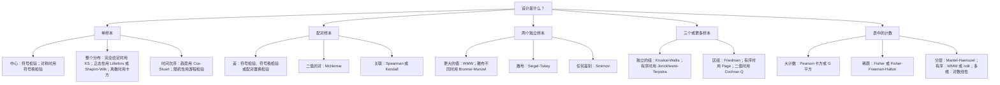

本章不增加新方法。它按数据分析者出发时的问题来整理 [3.6.1](/3.6.1)–[3.6.14](/3.6.14) 的方法：数据是什么类型，设计是什么，关心的是什么假设或什么量。对每类问题，表中列出原假设、方法、这些方法实际需要的假定，以及展开它们的编号语句。15.7 节把这些表浓缩成决策指南，15.8 节汇集几乎所有方法所由构成的少数思想。这些表是课程的地图，不能代替课程本身：选择方法应当依据它所回答的问题（各章对此有说明），而不能只靠一张表。

第一章的两个警告适用于每一行。"无分布"的意思是统计量的零分布不依赖于总体，而不是方法不作假定：独立性、共同的中心、对称性、相同的形状或 $H_0$ 下的可交换性仍然是需要的，它们都列在表中。并且检验回答的是它的统计量所敏感的问题：例如 WMW 检验检验的是 $\mathbb{P}(X>Y)=\frac12$，只有在平移模型下它才是关于中位数的陈述（定义 9.5.1）。

## 15.1. 单样本

| 问题 | 原假设 | 方法 | 主要假定 | 出处 |
|---|---|---|---|---|
| 比例等于 $p_0$ 吗？ | $p=p_0$ | 二项检验（精确）；带连续性校正的 $z$ 检验；Clopper–Pearson、Wilson、Agresti–Coull 区间 | 独立试验，$p$ 相同 | 定义 3.1.1；定义 5.4.1–5.4.3 |
| 中位数是 $\theta_0$ 吗？ | $\mathbb{P}(X>\theta_0)=\frac12$ | 符号检验；区间 $\bigl(X_{(k+1)},X_{(n-k)}\bigr)$；样本中位数 | 独立，中位数相同；零被舍去 | 定义 3.4.1；定理 4.2.1 |
| 对称分布的中心是 $\theta_0$ 吗？ | $\theta=\theta_0$，对称 | Wilcoxon 符号秩检验；Walsh 平均区间；Hodges–Lehmann 估计；正态得分；对原始数据的 Pitman 检验 | 独立，关于共同的 $\theta$ 对称 | 定义 3.5.1、4.3.1、5.1.2、5.5.1、5.5.2；推论 4.3.1 |
| $q$ 分位数是 $Q_0$ 吗？ | $\mathbb{P}(X<Q_0)=q$ | 分位数检验；次序统计量之间的区间 | 独立 | 定义 7.2.1；命题 7.2.1 |
| 样本来自 $F_0$ 吗？ | $F=F_0$ | Kolmogorov–Smirnov 检验（完全给定的连续 $F_0$）；带 DKW 带的经验分布函数；Q–Q 图 | 独立；$F_0$ 连续且完全给定 | 定义 6.1.1；定理 2.6.3；定义 2.7.1 |
| 参数未知时是正态的吗？ | 正态性 | Lilliefors 检验；Shapiro–Wilk 检验；带区间带的 Q–Q 图 | 独立；这里普通的 KS 表保守得多 | 定义 6.4.1；6.4 节 |
| 离散分布拟合吗？ | $p_j=p_j(\boldsymbol\theta)$ | Pearson $\chi^2$，自由度 $r-1-s$ | 期望计数约为 $5$ 或更大（合并单元） | 6.5 节 |
| 随时间有趋势吗？ | 无趋势 | Cox–Stuart 检验（单调、周期、给定模式） | $H_0$ 下独立；间隔 $n/2$ 的点对 | 定义 7.3.1 |
| 序列是随机的吗？ | 两种（或 $k$ 种）符号的随机排列 | 游程检验，精确或正态近似 | 计数视为固定 | 定义 7.4.1、7.4.2；定理 7.4.1–7.4.3 |
| 方向是均匀的吗？ | 圆上均匀 | Kuiper 检验（与起点无关） | 圆形数据，连续 | 定义 7.5.1、7.5.2；定理 7.5.1 |

单样本问题最清楚地显示了课程的第一个折中。符号检验只用符号，几乎什么也不需要；符号秩检验用绝对值的秩，需要对称性；$t$ 检验和 Pitman 检验用数值本身，在正态下效率最高但最不稳健。它们相对于 $t$ 检验的渐近相对效率概括了这个折中：正态下为 $2/\pi$ 和 $3/\pi$，Laplace 分布下为 $2$ 和 $1.5$（定理 4.7.1），Wilcoxon 检验的下界为 $0.864$；对应的估计量（中位数、Hodges–Lehmann 估计、均值）有同样的效率（定理 5.2.1 与 5.2 节）。三种检验同属一个族，即线性符号秩统计量（定义 5.5.3），它们只在得分上不同。

## 15.2. 配对样本

配对把两样本的比较化为对差的单样本问题，所以 15.1 节的方法适用；改变的是假定的含义。

| 问题 | 方法 | 主要假定 | 出处 |
|---|---|---|---|
| 差的中位数为 $0$ 吗？ | 对差的符号检验 | 独立的对，差的中位数相同 | 定义 3.4.1 |
| 差的中心为 $0$ 吗？ | Wilcoxon 符号秩检验；配对置换检验（$2^n$ 种符号翻转）；正态下的配对 $t$ | 差对称，当 $H_0$ 下一对中的两个成员可交换时成立 | 命题 8.2.1；定义 8.2.1 |
| 配对的二值结果：比例相同吗？ | 对不一致对的 McNemar 检验 | 独立的对 | 定义 8.3.1 |
| 两阶段交叉试验 | 对阶段和的 WMW（延滞效应），再对阶段差的 WMW（处理效应） | 序列随机化，有洗脱期，无差别延滞 | 定义 8.1.1；命题 8.1.1 |
| 两个变量有关联吗？ | Spearman $r_s$、Kendall $\tau$（任何单调关系，稳健）；Pearson $r$（线性；它的 $t$ 检验需要二元正态或大 $n$）；按一个变量排序后的 Cox–Stuart 或游程检验 | 独立的对 | 定义 8.4.1–8.4.3；例 8.3.1–8.3.2 |

## 15.3. 两个独立样本

| 问题 | 原假设 | 方法 | 主要假定 | 出处 |
|---|---|---|---|---|
| 分布有差别吗（任何统计量）？ | $F=G$ | 两样本置换检验，例如对 $\bar X-\bar Y$ | $H_0$ 下可交换（随机分配或独立同分布抽样） | 定义 1.2.1；命题 9.2.1 |
| 一个总体倾向于给出更大的值吗？ | $\mathbb{P}(X>Y)+\frac12\mathbb{P}(X=Y)=\frac12$ | WMW 检验；散布或样本量不同时用 Brunner–Munzel 检验 | WMW 的零分布需要 $F=G$；BM 在形状不等时近似有效 | 定义 9.3.1、9.5.2、9.6.1；定理 9.3.1 |
| 平移有多大？ | — | 由 $x_i-y_j$ 得到的 Hodges–Lehmann 平移估计与区间 | 位置平移模型 | 定义 9.5.1；命题 9.4.1 |
| 中位数相等吗？ | 中位数相等 | Mood 中位数检验（稳健，功效低）；中位数之差的自助区间 | 独立；自助法需要中等样本 | 定义 9.7.1；9.8 节 |
| 一个样本更分散吗？ | 散布相等，中心相同 | Siegel–Tukey 检验；用于两个或更多样本的平方秩检验 | 中心相同或已知（先对齐） | 定义 10.1.1；定义 11.4.1 |
| 分布相同吗，对立假设是任何差别？ | $F=G$ | Smirnov 检验（综合性）；两样本游程检验（弱） | 连续分布；渐近形式要求两个样本都大 | 定义 10.2.1；定理 10.2.1；10.2.1 节 |
| $Y$ 的分位数怎样依赖 $x$？ | — | 带分位数损失的分位数回归 | 条件分位数关于 $\boldsymbol{x}$ 线性；对 $Y$ 稳健，对 $\boldsymbol{x}$ 不稳健 | 定义 10.3.1、10.3.2；定理 10.3.1 |

两样本检验的选择从目标出发（9.9 节）：均值之差（Welch $t$、对均值的置换检验）、中位数之差（自助法、Mood）或随机占优（WMW、Brunner–Munzel）。WMW 统计量除以 $n_1n_2$ 是 $\mathbb{P}(X>Y)$ 的 U 统计量估计，即经验的 ROC 曲线下面积（定义 2.4.1）。

## 15.4. 多个样本

| 设计与对立假设 | 方法 | 主要假定 | 出处 |
|---|---|---|---|
| 独立样本，位置上的任何差别 | Kruskal–Wallis $H$，$\chi^2_{k-1}$ 或精确 | 独立；$H_0$ 下分布相同；只有在平移下才是中位数 | 定义 11.1.1；命题 11.1.1 |
| 独立样本，有序对立假设 | Jonckheere–Terpstra $J$ | 事先给定的次序 | 定义 11.2.1；定理 11.2.1 |
| 哪些样本有差别？ | 对合并秩的 Dunn 检验，加 Holm 或 BH 调整；多对一比较 | 同 Kruskal–Wallis | 定义 11.1.2 |
| 随机化完全区组，任何差别 | Friedman $T$；区组的变异性不同时用 Quade 检验 | 独立的区组；在区组内排秩 | 定义 11.3.1；11.3.3 节 |
| 区组，有序对立假设 | Page $L$ | 事先给定的次序 | 定义 11.3.2 |
| 区组，二值响应 | Cochran $Q$（两个条件时即 McNemar） | 独立的区组 | 定义 11.3.3；命题 11.3.1 |
| 散布相等 | 平方秩检验 | 独立；与估计的中心的偏差 | 定义 11.4.1 |

11.5 节把这些检验排成设计（完全随机或区组）与对立假设（一般或有序）的二乘二格式。背后的规则是排秩遵循设计：独立样本把所有观测一起排秩，相关的样本在区组内排秩。

## 15.5. 分类数据

| 问题 | 方法 | 主要假定 | 出处 |
|---|---|---|---|
| 配对的分类响应：表对称吗？ | McNemar（$2\times2$）；Bowker 检验（$k\times k$）；Cochran $Q$（几个二值条件） | 独立的受试者 | 定义 8.3.1、12.2.1、11.3.3 |
| $r\times c$ 表的独立性或齐一性 | Pearson $\chi^2$；似然比 $G^2$ | 期望计数不太小 | 命题 12.3.1 |
| 稀疏表 | Fisher 精确检验（$2\times2$）；Fisher–Freeman–Halton（$r\times c$），大表用 Monte Carlo | 以边缘为条件 | 定义 12.4.1、12.4.2 |
| 几个 $2\times2$ 表（分层） | Mantel–Haenszel 检验与共同优势比；检查齐性（Breslow–Day） | 各层的优势比齐性，否则分层报告 | 定义 12.5.1、12.5.2 |
| 有序类别 | 带平均秩和结校正的 WMW；ridit 分析 | 有序响应 | 12.6 节；定义 12.6.1 |
| 多维表 | 对数线性模型（Poisson GLM），嵌套的层次模型之间的似然比检验；带偏移的 Poisson 率回归（人时） | Poisson 或多项抽样 | 定义 12.7.1；命题 12.7.1 |

## 15.6. 估计与曲线拟合

| 目标 | 方法 | 光滑参数或调节参数 | 出处 |
|---|---|---|---|
| 稳健的中心与尺度 | 中位数、MAD（离群值筛查）、Hodges–Lehmann、截尾均值、Huber M 估计 | Huber 常数 $k$（效率对稳健性） | 定义 13.1.1、13.1.4、13.1.5；定义 5.1.2 |
| 稳健性的度量 | 影响函数（局部）、崩溃点（全局） | — | 定义 13.1.2、13.1.3；定理 13.1.1 |
| 无公式的标准误与区间 | 非参数自助法 | 重抽样次数 $B$ | 13.1.5 节 |
| 一个密度 | 直方图；核密度估计；局部多项式（硬边界）；k 近邻（长尾） | 组宽、带宽 $h$、近邻数 $k$ | 定义 13.2.1–13.2.3；命题 13.2.1 |
| 稳健的线性趋势 | Theil–Sen 估计 | — | 定义 14.2.1；定理 14.2.1 |
| 单调趋势 | 用 PAVA 的保序回归 | — | 定义 14.3.1；算法 14.3.1 |
| 光滑趋势 | Nadaraya–Watson；局部线性回归与 LOESS；光滑样条 | 带宽、跨度与次数、惩罚 $\lambda$ | 定义 14.4.1、14.5.1、14.5.2、14.6.1 |

## 15.7. 决策指南

下面的图覆盖检验问题；估计与曲线拟合见 15.6 节、13.2.7 节和 14.7 节。

三个问题能细化每一个分支。假设真的是统计量所检验的那个假设吗（中位数、$\mathbb{P}(X>Y)$ 还是整个分布）？所选方法的假定是否合理，特别是对称性、形状相等和 $H_0$ 下的可交换性？样本是否小到需要精确的或 Monte Carlo 的 $p$ 值，而不是渐近近似？

## 15.8. 贯穿课程的思想

五个思想几乎说明了课程中的每一种方法。计算改变了什么是可行的：精确的置换分布、Monte Carlo $p$ 值、自助法和数据驱动的光滑，过去都不切实际，现在已成为常规；但思想是相同的，无论对于仍是小样本首选方法的经典秩检验，还是把它们推广到大型复杂数据的现代方法。

### 15.8.1. 置换原理与可交换性

如果在 $H_0$ 下观测是可交换的（定义 1.4.1），设计所允许的每一种重排都是等可能的，给出至少与观测值一样极端的统计量的重排所占的比例就是精确的 $p$ 值（定理 1.3.1）。随机分配保证在无效应的原假设下可交换；独立同分布抽样蕴涵可交换，但并不是必需的。课程中几乎每个检验都是对某个统计量的置换检验：符号检验置换符号，WMW 和 Kruskal–Wallis 检验置换组标签，Friedman 检验在区组内置换，Fisher 精确检验置换边缘固定的表的单元。参照集必须遵循设计，这就是为什么配对数据翻转符号，区组数据在区组内排秩。

### 15.8.2. 秩与无分布性

用秩代替观测使置换分布对每个连续总体都相同（定理 2.2.1、定理 2.3.1），所以它可以一次性列成表；代价是损失数值中的信息，效率结果度量的就是这种损失。结破坏精确的无分布性，用平均秩和方差校正来处理（定义 3.5.2、定理 3.5.2）。经验分布函数对分布起同样的作用：Kolmogorov 距离对连续的 $F$ 是无分布的（定理 2.6.1），它的极限背后是 Donsker 定理和 Brown 桥（定理 6.2.1）。

### 15.8.3. 检验的反转：从检验到区间和点估计

检验不拒绝的假设值的集合是置信区间（定理 4.1.1），而"最不被拒绝"的值是点估计。符号检验给出中位数和次序统计量区间，符号秩检验给出 Hodges–Lehmann 估计和 Walsh 平均区间，WMW 检验给出平移估计及其区间，Kendall 秩相关系数给出 Theil–Sen 斜率。这些区间继承了检验的假定，并且由于离散性，也继承了检验的实际置信水平。

### 15.8.4. 效率对稳健性

使用更多数据的方法在其模型成立时更有效，在模型不成立时更容易被误导。Pitman 渐近相对效率（定义 4.7.1）使前一半精确化；影响函数和崩溃点（定义 13.1.2、13.1.3）使后一半精确化。秩方法处于有利的位置：对任何连续对称的平移族，Wilcoxon 和 WMW 检验相对于 $t$ 检验至多损失 $13.6\%$，对重尾数据可以得到很大的增益，而 Huber 估计在正态下保持 $95\%$ 的效率，且影响有界。

### 15.8.5. 光滑的偏差–方差权衡

最后两章的每一种曲线估计量都在邻域内取平均，邻域的大小（组宽、带宽、近邻数、跨度、惩罚）在偏差与方差之间折中；在数据的边缘，平均的窗口被截断，需要用局部拟合来对付边界偏误（命题 13.2.1、命题 14.4.1、定理 14.5.1）。凡是需要调节模型的灵活性的地方，同样的折中在统计学和机器学习中处处重现。

## 小结

- 单样本（15.1 节）：二项检验和符号检验（独立，中位数相同）、符号秩检验（对称）、分位数检验、检验分布的 Kolmogorov–Smirnov、Lilliefors 和 Shapiro–Wilk 检验、检验时间次序的 Cox–Stuart 和游程检验、检验方向的 Kuiper 检验。
- 配对样本（15.2 节）：对差的单样本检验、配对置换检验、McNemar 检验、交叉试验分析、Spearman 与 Kendall 相关。
- 两个独立样本（15.3 节）：对 $F=G$ 的置换检验、对 $\mathbb{P}(X>Y)$ 的 WMW 与 Brunner–Munzel、平移模型下的 Hodges–Lehmann 平移估计、对中位数的 Mood 检验、对散布的 Siegel–Tukey、对任何差别的 Smirnov、对条件分位数的分位数回归。
- 多个样本（15.4 节）：Kruskal–Wallis 与 Jonckheere–Terpstra（独立样本）、Friedman、Page 与 Cochran $Q$（区组）、用于事后比较的 Dunn 检验、用于散布的平方秩。
- 分类数据（15.5 节）：用于配对数据的 McNemar、Bowker 与 Cochran $Q$；Pearson $\chi^2$ 与 $G^2$；用于稀疏表的 Fisher 与 Fisher–Freeman–Halton；用于分层的 Mantel–Haenszel；用于有序类别的 WMW 与 ridit；用于多维表的对数线性模型。
- 估计与曲线拟合（15.6 节）：带影响函数和崩溃点的稳健估计量、自助法、密度估计量、Theil–Sen、保序回归、核光滑器与局部线性光滑器、光滑样条。
- 共同的思想（15.8 节）：可交换性与置换、秩与无分布性、检验的反转、效率对稳健性、偏差–方差权衡。

## 思考题

1. 一位生理学家测量了 $8$ 名患者治疗前后的激素水平。差强烈偏斜，有一个很大的值。你会用哪个检验来检验"没有变化"，它究竟检验什么？

   **答** 对八个差用符号检验（定义 3.4.1）：它只需要患者独立，检验差的中位数是否为 $0$，即 $\mathbb{P}(D>0)=\frac12$，与形状无关。符号秩检验要求差对称（命题 8.2.1），强烈的偏斜使这一点可疑；配对 $t$ 检验会被大值支配。$n=8$ 时符号检验的功效很低（最小的双侧 $p$ 值是 $2/2^8=0.008$，只有在八个差同号时才达到），所以报告结果时应附上差的中位数及其次序统计量区间（定理 4.2.1），也许还需要更大的研究。
2. 用两种教学方法分别对 $12$ 名和 $15$ 名学生的考试成绩作比较。一组的成绩比另一组分散得多。一位同事报告 WMW 检验 $p=0.03$，作为"中位成绩有差别"的证据。请评论。

   **答** WMW 检验评估的是 $\mathbb{P}(X>Y)+\frac12\mathbb{P}(X=Y)=\frac12$，它的零分布假定 $F=G$（定义 9.3.1、9.5.2）。散布和组的大小都不相等时，它的水平可能是错的，显著的结果也不一定意味着中位数不同：它可能反映的是散布的差别。较好的选择有：对不要求形状相等的随机相等用 Brunner–Munzel 检验（定义 9.6.1）；若目标是中位数，用中位数之差的自助区间（9.8 节）；若关心的是散布本身，在对齐中心之后用 Siegel–Tukey 检验（定义 10.1.1）。结论应当说明所检验的是哪个量。
3. 在一次田间试验中，$6$ 块地中的每一块都按递增顺序施用 $5$ 个肥料水平，每个水平一个小区，记录产量。研究者预期产量随水平增加。应当用哪个检验，为什么不用 Kruskal–Wallis？

   **答** 这是带有序对立假设的随机化完全区组设计，所以适用 Page 检验（定义 11.3.2）：在每个区组内对五个产量排秩，用 $L=\sum_ii\,s_i$，即以水平加权的秩和。Kruskal–Wallis 忽略区组（把 $30$ 个产量一起排秩，使区组之间的差别抬高处理内的变异性）并且忽略次序；Friedman 检验尊重区组但不尊重次序。使用事先给定的次序，把功效集中在预期的对立假设上。
4. 罕见副作用（有或无）与药物（A 或 B）的 $2\times2$ 表的计数为 $1,19$ 与 $6,14$。应当用哪个检验？如果患者来自三家基线率不同的医院，同样的比较应怎样分析？

   **答** 有些期望计数小于 $5$（每种药物的有副作用的期望数为 $3.5$），所以应当用 Fisher 精确检验（定义 12.4.1），而不是 $\chi^2$ 近似。有三家医院时，医院是潜在的混杂因素：用 Mantel–Haenszel 检验和共同优势比（定义 12.5.2）分析三个 $2\times2$ 表，并事先检查优势比是否大致齐性（Breslow–Day）；若不齐性，就分别报告各医院。把表合并可能产生 Simpson 悖论（12.5.1 节）。
5. 十年的河流硝酸盐月浓度中包含少数来自失灵传感器的值。提出两个问题：有趋势吗？季节模式是什么样的？为每个问题提出方法，并说明它们作了什么假定。

   **答** 对趋势：对相隔 $12$ 个月的值，或对去季节性的序列，用 Cox–Stuart 检验（定义 7.3.1）；或用与时间的 Kendall 关联检验，以 Theil–Sen 斜率估计变化率（定理 14.2.1）：这些方法在 $H_0$ 下只需要独立（序列相关会使它们偏于反保守），并且对有故障的值不敏感；Theil–Sen 斜率可以容忍至多 $29\%$ 的坏值。对季节模式：浓度对一年中月份的稳健 LOESS 光滑（定义 14.5.2、算法 14.5.1），它只需要光滑，并且对传感器的误差降权；因为月份是圆形的，光滑应当从 12 月接回到 1 月，跨度设定偏差–方差的平衡。
