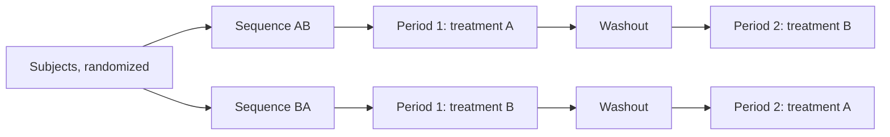

Two treatments can be compared on two independent groups of units, or on the same units (or on closely matched pairs of units). The second way, a **paired design**, removes the variation between units from the comparison, and it is often far more sensitive. This chapter studies the nonparametric analysis of paired data. Section 8.1 starts from the design, with the crossover trial, where each subject receives both treatments in sequence; its analysis already uses the two-sample rank-sum test that [3.6.9](/3.6.9) develops in detail. Section 8.2 treats the most common analysis, which reduces the pairs to one sample of differences and applies the one-sample methods of [3.6.3](/3.6.3)–[3.6.5](/3.6.5), and adds the paired version of the **permutation test** of [3.6.1](/3.6.1). Section 8.3 shows how the sign test reappears, in the Cox–Stuart and runs tests of [3.6.7](/3.6.7) applied to correlation and in McNemar's test for paired binary outcomes. Section 8.4 turns from comparing the two members of a pair to measuring how they move together: Pearson's **correlation coefficient** (3.1.10) and its rank-based alternatives, Spearman's rho and Kendall's tau.

The design side of pairing (why blocks reduce error, and the paired $t$-test) is treated in [3.8.2](/3.8.2); crossover trials in clinical research, with their parametric analysis, in [7.7.17](/7.7.17).

## 8.1. Comparisons in Pairs

### 8.1.1. Parallel Groups and Crossover Trials

A dentist wishes to compare two mouthwashes for the treatment of ulcerative gingivitis. The obvious design divides the patients at random into two groups, one for each mouthwash, ideally in a randomized double-blind trial in which neither the patients nor the assessors know who received which mouthwash. Its weakness is that patients differ a great deal in the severity of their condition and in how they respond, and this variation between patients enters the comparison of the two groups and may hide a real difference between the mouthwashes.

If it is practicable, both mouthwashes can be applied to each patient, one after the other. The patients are divided at random into two groups that receive the mouthwashes in opposite orders.

**Definition 8.1.1 (Crossover Design)** In a two-period **crossover design**, each subject receives two treatments A and B in two successive periods, and the subjects are randomized to the sequence AB (A in period 1, B in period 2) or BA. Each subject acts as his or her own control. A **carryover effect** is a residual influence of the period-1 treatment on the response in period 2. To reduce it, a **washout period** without treatment is placed between the two periods, long enough for the effect of the first treatment to wear off. The design is balanced when equally many subjects follow each sequence.



The advantage is that the only planned difference between the two periods for a subject is the treatment, so the comparison is within subjects. The disadvantages are that the treatment effect must be reversible, the condition stable over both periods, and that a carryover effect, if present and different for the two treatments, biases the comparison. The order of the treatments matters too: responses may change between periods for reasons unrelated to treatment (a period effect). Running both sequences, in balance, lets the analysis separate the treatment effect from the period effect.

### 8.1.2. Analysis of a Two-Period Crossover

**Example 8.1.1 (Grapefruit Juice and Pentobarbital)** Ten children were randomly assigned to two groups of five (Koch 1972). Each child received two treatments, in the order AB or BA:

- A: $100\,\mathrm{ml}$ of grapefruit juice followed by an elixir of pentobarbital;
- B: $100\,\mathrm{ml}$ of water followed by the same elixir.

The response is the concentration of the drug ($\mu\mathrm{g/ml}$) in a blood sample taken $15$ minutes after administration.

| Child | 1 | 2 | 3 | 4 | 5 | 6 | 7 | 8 | 9 | 10 |
|---|---|---|---|---|---|---|---|---|---|---|
| Sequence | AB | AB | AB | AB | AB | BA | BA | BA | BA | BA |
| Period I | 1.75 | 0.30 | 0.35 | 0.20 | 0.30 | 7.20 | 7.10 | 0.75 | 2.15 | 3.35 |
| Period II | 0.55 | 1.05 | 0.63 | 1.55 | 8.20 | 0.35 | 1.55 | 0.25 | 0.35 | 1.50 |

The main question is whether the treatments differ in their effect; a secondary but logically prior question is whether they differ in their carryover effects (for example, whether grapefruit juice has a lasting effect on drug metabolism). With five children per group and clearly skewed values, a normal-theory analysis is hard to justify, and rank methods are natural.
:::

The analysis rests on a simple model. For child $i$ in period $j$ receiving treatment $k\in\{\mathrm{A},\mathrm{B}\}$,

$$
Y_{ijk}=\mu+S_i+P_j+T_k+C_k+\varepsilon_{ijk},
$$
where $\mu$ is the overall mean, $S_i$ the subject effect, $P_j$ the period effect, $T_k$ the treatment effect, $C_k$ the carryover effect of treatment $k$ (present only in period 2, from the treatment of period 1) and $\varepsilon_{ijk}$ i.i.d. errors. Thus in sequence AB

$$
Y_{i1}=\mu+S_i+P_1+T_{\mathrm{A}}+\varepsilon_{i1},\qquad
Y_{i2}=\mu+S_i+P_2+T_{\mathrm{B}}+C_{\mathrm{A}}+\varepsilon_{i2},
$$
and in sequence BA the roles of A and B are exchanged.

**Proposition 8.1.1** In the model above, with the subject effects $S_i$ i.i.d. and children randomized to the sequences:

1. The sum $Y_{i1}+Y_{i2}$ equals $2\mu+2S_i+P_1+P_2+T_{\mathrm{A}}+T_{\mathrm{B}}+C_{\mathrm{A}}+\varepsilon_{i1}+\varepsilon_{i2}$ in sequence AB, and the same with $C_{\mathrm{B}}$ in place of $C_{\mathrm{A}}$ in sequence BA. The sums in the two sequences have the same distribution if and only if $C_{\mathrm{A}}=C_{\mathrm{B}}$.
2. The difference $Y_{i1}-Y_{i2}$ equals $(P_1-P_2)+(T_{\mathrm{A}}-T_{\mathrm{B}})-C_{\mathrm{A}}+\varepsilon_{i1}-\varepsilon_{i2}$ in sequence AB and $(P_1-P_2)-(T_{\mathrm{A}}-T_{\mathrm{B}})-C_{\mathrm{B}}+\varepsilon_{i1}-\varepsilon_{i2}$ in sequence BA. The subject effect cancels. If $C_{\mathrm{A}}=C_{\mathrm{B}}$, the two distributions of differences differ only by a shift of $2(T_{\mathrm{A}}-T_{\mathrm{B}})$, and the period effect drops out of the comparison.

**Proof** Substitute the model and compare the two sequences term by term. $\square$

So differential carryover is tested by comparing the sums of the two sequences, and the treatment effect by comparing the differences, in both cases with a two-sample test between the five AB children and the five BA children; the Wilcoxon–Mann–Whitney test of [3.6.9](/3.6.9) is the natural choice. Note what does and does not cancel. In the sums the subject effects remain (as noise), and only the carryover terms can make the sequences differ. In the differences the subject effects cancel, but the carryover terms cancel from the comparison only if they are equal.

**Example 8.1.2 (Grapefruit Juice, Continued)** The sums and differences (period I minus period II) are:

| Sequence | Sums | Differences |
|---|---|---|
| AB | 2.30, 1.35, 0.98, 1.75, 8.50 | 1.20, $-0.75$, $-0.28$, $-1.35$, $-7.90$ |
| BA | 7.55, 8.65, 1.00, 2.50, 4.85 | 6.85, 5.55, 0.50, 1.80, 1.85 |

```r
per1 <- c(1.75, 0.30, 0.35, 0.20, 0.30, 7.20, 7.10, 0.75, 2.15, 3.35)
per2 <- c(0.55, 1.05, 0.63, 1.55, 8.20, 0.35, 1.55, 0.25, 0.35, 1.50)
s <- per1 + per2
wilcox.test(s[1:5], s[6:10])      # differential carryover
d <- per1 - per2
wilcox.test(d[1:5], d[6:10])      # treatment effect
```

```text
W = 7, p-value = 0.3095
W = 1, p-value = 0.01587
```

There is no evidence of a differential carryover effect ($p=0.31$), but evidence of a treatment effect ($p=0.016$). The differences are smaller in sequence AB than in BA, so by Proposition 8.1.1 $T_{\mathrm{A}}<T_{\mathrm{B}}$: the drug concentration at $15$ minutes is lower after grapefruit juice than after water. The median of the $25$ differences between an AB difference and a BA difference (the Hodges–Lehmann shift estimate of [3.6.9](/3.6.9)) is $-4.35$, which estimates $2(T_{\mathrm{A}}-T_{\mathrm{B}})$; so the effect is about $-2.2\,\mu\mathrm{g/ml}$.
:::

**Remark 8.1.1** The strategy "first test for differential carryover, and only if it is not significant compare the differences" is common but has well-known problems. The carryover test compares sums between subjects, so it inherits the full between-subject variation and has little power; with five children per group, $p=0.31$ is far from evidence that the carryover effects are equal. And the two-stage procedure as a whole (Grizzle 1965), which switches to a comparison of first-period responses only when carryover is significant, was shown by Freeman (1989) to have an inflated type I error. The sound approach is to prevent carryover by design, with an adequate washout period and treatments whose effects are known to be short-lived, and to analyse the differences.

## 8.2. Location Inference for Matched Pairs

### 8.2.1. Why Pair

**Example 8.2.1 (Response to Digital Information)** Numbers were presented in random order to the right visual field (RVF) or the left visual field (LVF) of $12$ subjects, to find out whether they are perceived more rapidly in one field than in the other. The mean response times (ms) were:

| Subject | 1 | 2 | 3 | 4 | 5 | 6 | 7 | 8 | 9 | 10 | 11 | 12 |
|---|---|---|---|---|---|---|---|---|---|---|---|---|
| LVF $x_i$ | 564 | 521 | 495 | 564 | 560 | 481 | 545 | 478 | 580 | 484 | 539 | 467 |
| RVF $y_i$ | 557 | 505 | 465 | 562 | 544 | 448 | 531 | 458 | 560 | 485 | 520 | 445 |
| $d_i=x_i-y_i$ | 7 | 16 | 30 | 2 | 16 | 33 | 14 | 20 | 20 | $-1$ | 19 | 22 |

All subjects but subject 10 respond more quickly in the RVF, and no difference exceeds $33\,\mathrm{ms}$. The differences between subjects are much larger: subjects 9 and 12 differ by more than $100\,\mathrm{ms}$ in either field ($580-467=113$).
:::

This is the typical situation for pairing. The variation within the $x_i$ and within the $y_i$ is mostly variation between subjects, which is large compared with the effect of interest and would mask it in a comparison of two independent groups. Taking differences within subjects removes it. More generally, a **randomized block design** (3.8.6) divides the units into homogeneous blocks, here blocks of size two, so that the variation within blocks is small, and assigns the treatments at random within each block (for pairs of different units, for example by tossing a fair coin).

### 8.2.2. Reduction to One Sample

With $d_i=x_i-y_i$ and $\theta$ a centre of the distribution of the differences, the hypotheses are $H_0\colon\theta=0$ against $H_1\colon\theta\ne0$ (or a one-sided alternative). The choice of test depends on what can be assumed about the $d_i$:

- if each $d_i$ is equally likely to be positive or negative under $H_0$, the **sign test**;
- if the $d_i$ are symmetrically distributed about $0$ under $H_0$, the **Wilcoxon signed-rank test**;
- if the $d_i$ are normal, the **paired t-test**.

What is being tested is a property of the distribution of the differences $X-Y$: for the sign test its median, for the signed-rank test its centre of symmetry. This is not the same as the difference between the median of $X$ and the median of $Y$, since the median of a difference is not in general the difference of the medians.

The symmetry required by the signed-rank test is often natural for paired data, for the following reason.

**Proposition 8.2.1** Let $D=X-Y$.

1. If the pair is exchangeable, $(X,Y)\overset{d}{=}(Y,X)$, then $D$ is symmetric about $0$. This holds, for instance, when $X=S+E_1$ and $Y=S+E_2$ with $E_1,E_2$ i.i.d. and independent of the subject effect $S$, so $X$ and $Y$ may be strongly dependent.
2. If $X$ and $Y$ are independent and each is symmetric about the same centre $\theta$ (their distributions may differ), then $D$ is symmetric about $0$.

**Proof** (1) $D=X-Y\overset{d}{=}Y-X=-D$. (2) $X-\theta\overset{d}{=}\theta-X$ and $Y-\theta\overset{d}{=}\theta-Y$, and by independence $D=(X-\theta)-(Y-\theta)\overset{d}{=}(\theta-X)-(\theta-Y)=-D$. $\square$

Case 1 is exactly the null hypothesis of no treatment effect in a randomized paired experiment: if the treatment does nothing, the two responses of a subject are interchangeable. Under the symmetry assumption the alternative of interest is usually a shift of the centre only. Whether symmetry is plausible is checked on the $d_i$ themselves, for example with a plot or by comparing the mean and the median of the differences.

**Example 8.2.2 (Response to Digital Information, Continued)** The ordered differences and their signed ranks (midranks for the ties) are

$$
\begin{aligned}
&-1,\ 2,\ 7,\ 14,\ 16,\ 16,\ 19,\ 20,\ 20,\ 22,\ 30,\ 33,\\
&-1,\ 2,\ 3,\ 4,\ 5.5,\ 5.5,\ 7,\ 8.5,\ 8.5,\ 10,\ 11,\ 12 .
\end{aligned}
$$

1. Sign test: one negative difference among $12$, two-sided $p=2\,\mathbb{P}(\mathrm{Bin}(12,1/2)\le1)=0.0063$ (`binom.test(1, 12)`).
2. $t$-test: the **Lilliefors test** of normality ([3.6.6](/3.6.6)) gives $D=0.152$, well below the $20\%$ critical value $0.199$ for $n=12$, so there is no evidence of non-normality. The $t$-test gives $t=5.64$, $p=0.00015$, and the $95\%$ interval $(10.1,\,22.9)$ around the mean $16.5$.
3. Wilcoxon signed-rank test: $S_-=1$. Only two of the $2^{12}=4096$ equally likely sign patterns of the twelve signed ranks give $S_-\le1$ (no negative rank, or only rank $1$ negative), so the exact two-sided $p$-value, conditional on the midranks, is $2\times2/4096=0.00098$.

```r
library(nortest)
lillie.test(x)
t.test(x, conf.level = 0.95)
wilcox.test(x, conf.int = TRUE)
```

```text
Wilcoxon signed rank test with continuity correction
V = 77, p-value = 0.00324
alternative hypothesis: true location is not equal to 0
95 percent confidence interval:
  9.499991 23.499979
sample estimates:
(pseudo)median
      17.11191
Warning messages:
cannot compute exact p-value with ties
cannot compute exact confidence interval with ties
```

Here `x` holds the twelve differences. Because of the ties, R falls back on the normal approximation with a continuity correction ($V=S_+=77$, $p=0.0032$) and computes the interval and the estimate from it; the median of the $78$ **Walsh averages**, the Hodges–Lehmann estimate of [3.6.5](/3.6.5), is $17.25$. All three tests give strong evidence against $H_0$: responses are faster in the RVF. For these differences, which look roughly symmetric with no outliers, the signed-rank test and the $t$-test are both appropriate and agree; the sign test, which ignores the sizes, gives the weakest (though still strong) evidence.
:::

### 8.2.3. Order Effects and Balance

Suppose we learn that every subject was tested first in the LVF and then in the RVF. If people learn to react more quickly with practice, the faster RVF responses may reflect learning rather than an inherent difference between the fields; the order is confounded with the field (**confounding**, 3.8.2). The remedy is part of the design: decide at random, for each subject, which field is tested first; or, better, achieve balance by choosing six subjects (preferably at random) to be tested first in the LVF and the other six first in the RVF. A balanced order makes a learning effect add to the differences of one half of the subjects and subtract from the other half, and it can then be estimated and removed as in Section 8.1.2.

### 8.2.4. The Paired Permutation Test

The permutation idea of [3.6.1](/3.6.1) applies directly. Under the null hypothesis of no treatment effect, the two responses of a subject are exchangeable (Proposition 8.2.1), so either one could equally well have been the $x$. Swapping them changes the sign of $d_i$ and nothing else.

**Definition 8.2.1 (Paired Permutation Test)** Given differences $d_1,\dots,d_n$ and a statistic such as $\bar D=\sum_id_i/n$ (or the median of the $d_i$), the paired permutation test:

1. computes the observed value $\bar D_{\mathrm{obs}}$;
2. forms all $2^n$ assignments of signs to the $d_i$ (or a random sample of $M$ of them);
3. computes $\bar D^*$ for each assignment;
4. reports the proportion of assignments with $\bar D^*\ge\bar D_{\mathrm{obs}}$ (upper-tailed), $\bar D^*\le\bar D_{\mathrm{obs}}$ (lower-tailed) or $\lvert\bar D^*\rvert\ge\lvert\bar D_{\mathrm{obs}}\rvert$ (two-sided).

Because the permutation distribution of $\bar D$ is symmetric about $0$, the two-sided $p$-value is twice the smaller one-sided one.

The number of rearrangements is $2^n$, not $\binom{2n}{n}$: the two values of a subject can only be exchanged with each other, never with those of another subject, because the pairing is part of the design. For the visual field data only four of the $4096$ assignments give $\lvert\bar D^*\rvert\ge16.5$: the observed one, the one with all signs positive (mean $16.67$), and their mirror images; so $p=4/4096=0.00098$. The signed-rank test is the same procedure applied to signed ranks instead of the differences themselves, and the Pitman test of [3.6.5](/3.6.5) is the paired permutation test of the mean; the sign test corresponds to giving every difference the same score.

## 8.3. Less Obvious Uses of the Sign Test

### 8.3.1. The Cox–Stuart Test for Correlation

If two variables are positively correlated, then listing the pairs in increasing order of one variable makes the other show an upward trend. The **Cox–Stuart test** of [3.6.7](/3.6.7) can therefore test correlation:

1. arrange the pairs in increasing order of the variable with fewer ties, keeping each pair intact;
2. apply the one-sided Cox–Stuart test for trend to the sequence of the other variable (upward for positive correlation, downward for negative).

**Example 8.3.1 (Reactions to Two Drugs)** Cochran (1937) compared the reactions of $10$ patients to each of two drugs, to see whether the two reactions of a patient are positively correlated:

| Patient | 1 | 2 | 3 | 4 | 5 | 6 | 7 | 8 | 9 | 10 |
|---|---|---|---|---|---|---|---|---|---|---|
| Drug 1 | 0.7 | $-1.6$ | $-0.2$ | $-1.2$ | $-0.1$ | 3.4 | 3.7 | 0.8 | 0.0 | 2.0 |
| Drug 2 | 1.9 | 0.8 | 1.1 | 0.1 | $-0.1$ | 4.4 | 5.5 | 1.6 | 4.6 | 3.4 |

Ordered by drug 1, the drug-2 values are

$$
0.8,\ 0.1,\ 1.1,\ -0.1,\ 4.6\ \big|\ 1.9,\ 1.6,\ 3.4,\ 4.4,\ 5.5 .
$$
The Cox–Stuart differences between the second and the first half are $1.1, 1.5, 2.3, 4.5, 0.9$, all positive, so the one-sided $p$-value is $2^{-5}=0.031$: evidence of a positive correlation.
:::

### 8.3.2. A Runs Test for Correlation

The runs test of [3.6.7](/3.6.7) can be used in the same way: after ordering by one variable, dichotomize the other at its median and count runs. A positive or negative correlation puts the low values of the second variable at one end and the high values at the other, which produces few runs; the null hypothesis is that the sequence is random (no association). The runs test is more general than the Cox–Stuart test, since it reacts to any kind of non-random order and not only to a monotone trend, but for that reason it is less powerful against a monotone relationship.

**Example 8.3.2 (Reactions to Two Drugs, Continued)** The median of the drug-2 values is $1.75$. In the order of drug 1, the drug-2 values are below (L) or above (H) it as

$$
\mathrm{L\,L\,L\,L\,H\,H\,L\,H\,H\,H},
$$
with $m=n=5$ and $R=4$ runs. From the exact distribution ([3.6.7](/3.6.7), Theorem 7.4.1), $\mathbb{P}(R\le4)=(2+8+32)/252=1/6$, so the one-sided $p$-value is $0.17$. The samples are far too small for the normal approximation, and the exact distribution must be used. The runs test does not detect the association that the Cox–Stuart test found, and the rank correlations of Section 8.4 find it even more clearly (Spearman $r_s=0.78$, two-sided $p=0.008$; Kendall $\tau=0.60$, $p=0.017$).
:::

Both tests answer the question "does the second variable change non-randomly along the order of the first", and a significant result in either supports a correlation; but they discard most of the information in the data, and the rank correlation tests below are usually preferred.

### 8.3.3. McNemar's Test

**Example 8.3.3 (Two Rock Climbs)** Members of a mountaineering club have long argued about which of two rock climbs is more difficult. The club's log book records, for each of $108$ members who attempted both climbs, whether each climb was successfully completed:

| | First climb succeeded | First climb failed |
|---|---|---|
| Second climb succeeded | 73 | 14 |
| Second climb failed | 9 | 12 |

A climber who succeeded on both climbs, or failed on both, provides no information about their relative difficulty; such pairs play the role of ties. The information lies in the $9+14=23$ climbers who succeeded on exactly one climb: $9$ succeeded only on the first (a "+" for the first climb being easier) and $14$ only on the second. Under $H_0$ (the climbs are equally difficult), each of these $23$ climbers is equally likely to have succeeded on either one, so the number of "+" is $\mathrm{Bin}(23,1/2)$. The exact two-sided $p$-value is $0.405$ (`binom.test(9, 23)`), and there is no evidence that one climb is harder.

With the normal approximation and continuity correction, $z=(9.5-11.5)/\sqrt{23/4}=-0.83$ and $p=0.404$, close to the exact value; without the correction, $z=-1.04$ and $p=0.297$, so here the continuity correction matters. The $85$ climbers with equal outcomes are not wasted: they show how small the difference can be, since the success rates are $82/108=0.76$ and $87/108=0.81$. Finally, if members tended to attempt the climbs in a particular order, a learning effect could be involved, as in Section 8.2.3.
:::

**Definition 8.3.1 (McNemar's Test)** Let each of $n$ units give a pair of binary outcomes $(Y_1,Y_2)$, summarized in a $2\times2$ table with counts $a$ (both $1$), $b$ ($Y_1=1$, $Y_2=0$), $c$ ($Y_1=0$, $Y_2=1$) and $d$ (both $0$). **McNemar's test** of marginal homogeneity, $H_0\colon\mathbb{P}(Y_1=1)=\mathbb{P}(Y_2=1)$, which is equivalent to $H_0\colon\mathbb{P}(Y_1=1,Y_2=0)=\mathbb{P}(Y_1=0,Y_2=1)$, uses only the discordant counts $b$ and $c$: conditionally on $b+c$, $b\sim\mathrm{Bin}(b+c,1/2)$ under $H_0$. The large-sample form is

$$
\chi^2=\frac{(\lvert b-c\rvert-1)^2}{b+c}\ \overset{H_0}{\approx}\ \chi^2_1 ,
$$
with the continuity correction (omit the $-1$ without it); this is the square of the corrected $z$ statistic.

For the climbs, $\chi^2=(5-1)^2/23=0.70$ with $p=0.404$, the same as above. McNemar's test is the sign test for paired binary data, used for before–after comparisons and for comparing two diagnostic methods on the same subjects. It must be distinguished from **Fisher's exact test** and the chi-squared **test of independence** for a $2\times2$ table ([3.6.12](/3.6.12), 3.2.6). Those tables classify units from two independent samples, or one sample by two different variables, and the question is association between rows and columns. Applied to the paired table above, a test of independence would ask whether success on one climb is associated with success on the other (it surely is: good climbers succeed on both), which is a different question from whether the two climbs are equally difficult. McNemar's test is generalized to more than two categories by Bowker's test and to more than two conditions by Cochran's $Q$ test ([3.6.11](/3.6.11), [3.6.12](/3.6.12)).

## 8.4. Rank Correlation

### 8.4.1. Pearson's Correlation and Its Tests

Consider the pairs

| $x_i$ | 1 | 2 | 3 | 4 | 5 | 6 | 7 |
|---|---|---|---|---|---|---|---|
| $y_i$ | 1 | 16 | 81 | 256 | 625 | 1296 | 2401 |

The sample **correlation coefficient** is $r=0.89$, yet the relationship is perfect: $y_i=x_i^4$. Pearson's coefficient measures linear association only. If we want to measure only the extent to which $Y$ increases with $X$, we should look at the ranks: here the ranks of $x_i$ and of $y_i$ are both $1,2,\dots,7$.

Recall that

$$
r=\hat\rho=\frac{\sum_{i=1}^n(X_i-\bar X)(Y_i-\bar Y)}{\sqrt{\sum_{i=1}^n(X_i-\bar X)^2\sum_{i=1}^n(Y_i-\bar Y)^2}}=\frac{S_{xy}}{S_xS_y}.
$$
As a descriptive measure of linear association $r$ requires no distributional assumption. Its classical test of $H_0\colon\rho=0$ does: if $(X_i,Y_i)$ is a random sample from a **bivariate normal distribution**, then

$$
t=r\sqrt{\frac{n-2}{1-r^2}}\ \overset{H_0}{\sim}\ t_{n-2},
$$
and for large $n$, $\operatorname{Var}(r)\approx(1-\rho^2)^2/(n-1)$, so that $z=r\sqrt{n-1}$ is approximately $\mathcal{N}(0,1)$ under $H_0$. (The $t$ result holds more generally when $X$ and $Y$ are independent and one of them is normal.) Without normality, a permutation test provides the null distribution: under $H_0$ of independence, $Y_i$ is as likely to appear with $X_j$ as with $X_i$, so all $n!$ pairings of the $Y$'s with the $X$'s are equally likely. Keep the $X$'s fixed, permute the $Y$'s, compute $r^*$ for each permutation (or for a random sample of them), and report the proportion with $r^*\ge r_{\mathrm{obs}}$ (for $H_1\colon\rho>0$), $r^*\le r_{\mathrm{obs}}$ (for $\rho<0$) or $\lvert r^*\rvert\ge\lvert r_{\mathrm{obs}}\rvert$ (two-sided).

### 8.4.2. Spearman's Rank Correlation

**Definition 8.4.1 (Spearman's Rank Correlation Coefficient)** Let $R_i$ be the **rank** of $X_i$ among $X_1,\dots,X_n$ and $Q_i$ the rank of $Y_i$ among $Y_1,\dots,Y_n$, with **midranks** for ties. **Spearman's rank correlation coefficient** is the Pearson correlation of the ranks,

$$
r_s=\operatorname{corr}(R,Q)=\frac{\sum_i(R_i-\bar R)(Q_i-\bar Q)}{\sqrt{\sum_i(R_i-\bar R)^2\sum_i(Q_i-\bar Q)^2}} .
$$
It measures how well one variable is a monotone function of the other: without ties, $r_s=1$ ($-1$) if and only if $Y$ is a strictly increasing (decreasing) function of $X$ on the sample.

**Proposition 8.4.1** Without ties, with $d_i=R_i-Q_i$,

$$
r_s=1-\frac{6\sum_{i=1}^nd_i^2}{n(n^2-1)} .
$$

**Proof** Without ties both rank vectors are permutations of $1,\dots,n$, so $\bar R=\bar Q=(n+1)/2$ and $\sum_i(R_i-\bar R)^2=\sum_i(Q_i-\bar Q)^2=n(n^2-1)/12$. Expanding $\sum_id_i^2=\sum_iR_i^2+\sum_iQ_i^2-2\sum_iR_iQ_i$ with $\sum_iR_i^2=\sum_iQ_i^2=n(n+1)(2n+1)/6$ gives

$$
\sum_iR_iQ_i=\frac{n(n+1)(2n+1)}{6}-\frac12\sum_id_i^2 .
$$
Hence

$$
r_s=\frac{\sum_iR_iQ_i-n\bigl(\frac{n+1}2\bigr)^2}{n(n^2-1)/12}
=\frac{\frac{n(n+1)(2n+1)}{6}-\frac{n(n+1)^2}{4}-\frac12\sum_id_i^2}{n(n^2-1)/12}
=1-\frac{6\sum_id_i^2}{n(n^2-1)},
$$
since $\frac{n(n+1)(2n+1)}6-\frac{n(n+1)^2}4=\frac{n(n^2-1)}{12}$. $\square$

With ties the shortcut formula is no longer exact, and $r_s$ should be computed as the correlation of the midranks.

The Spearman test of independence is the permutation test of Section 8.4.1 applied to the ranks. Because the ranks are fixed numbers, its null distribution depends only on $n$ (for data without ties) and can be tabulated; under $H_0$, $\mathbb{E}r_s=0$ and $\operatorname{Var}(r_s)=1/(n-1)$ exactly, and $r_s\sqrt{n-1}$ is approximately $\mathcal{N}(0,1)$ for large $n$. The $t$ approximation $r_s\sqrt{(n-2)/(1-r_s^2)}\approx t_{n-2}$ is also used.

**Example 8.4.1 (Coursework and Examination Marks)** The coursework marks $x$ and examination marks $y$ of $20$ students were:

```r
x <- c(82, 75, 90, 68, 85, 70, 92, 65, 80, 77, 88, 72, 95, 62, 83, 73, 91, 66, 81, 76)
y <- c(78, 80, 88, 72, 83, 73, 93, 67, 79, 81, 86, 74, 94, 66, 84, 75, 90, 69, 82, 77)
cor.test(x, y)
cor.test(x, y, method = "spearman")
cor.test(rank(x), rank(y))
```

```text
Pearson's product-moment correlation
t = 19.297, df = 18, p-value = 1.786e-13
95 percent confidence interval:
 0.9407347 0.9909197
      cor
0.9766721

Spearman's rank correlation rho
S = 34, p-value = 6.561e-06
     rho
0.9744361

Pearson's product-moment correlation
t = 18.402, df = 18, p-value = 4.037e-13
      cor
0.9744361
```

R's statistic $S=\sum_id_i^2=34$ gives $r_s=1-6\times34/(20\times399)=0.974$. The relationship "higher coursework mark, higher examination mark" is very clear by any measure. Note what the third call does. `cor.test(rank(x), rank(y))` computes the correct value of $r_s$, but its $p$-value is that of the $t$-test for Pearson's correlation, which assumes bivariate normal data, an assumption that ranks never satisfy; the second call refers $r_s$ to (an approximation of) its permutation distribution. In the extreme tail the two approximations differ by orders of magnitude, but here both are far below any conventional level. The difference between the two calls is the difference between a $t$-test and a permutation test, that is, between their assumptions.
:::

### 8.4.3. Kendall's Tau

Spearman's coefficient still uses the sizes of rank differences. Kendall's coefficient uses only the direction of the comparison between each two units. If student A scores $X_1=43$ and $Y_1=64$ on two examinations and student B scores $X_2=89$ and $Y_2=72$, then B does better than A on both, and the pair of students is in agreement.

**Definition 8.4.2 (Concordant and Discordant Pairs)** Two observations $(X_i,Y_i)$ and $(X_j,Y_j)$ form a **concordant pair** if $(X_i-X_j)(Y_i-Y_j)>0$ (the one larger in $X$ is also larger in $Y$), and a **discordant pair** if $(X_i-X_j)(Y_i-Y_j)<0$. If $X_i=X_j$ or $Y_i=Y_j$ the pair is tied (in $X$, in $Y$ or in both).

**Definition 8.4.3 (Kendall's Tau)** For two independent copies $(X_1,Y_1)$, $(X_2,Y_2)$ of a bivariate distribution, **Kendall's tau** is

$$
\tau=\mathbb{P}\bigl((X_1-X_2)(Y_1-Y_2)>0\bigr)-\mathbb{P}\bigl((X_1-X_2)(Y_1-Y_2)<0\bigr)\in[-1,1],
$$
which for a continuous distribution equals $2\,\mathbb{P}\bigl((X_1-X_2)(Y_1-Y_2)>0\bigr)-1$. Let $C$ and $D$ be the numbers of concordant and discordant pairs among the $\binom n2$ pairs of a sample. Without ties, $C+D=\binom n2$ and the estimate is Kendall's $\tau_a$ (tau-a):

$$
\tau_a=\frac{C-D}{\binom n2}=\frac{2C}{\binom n2}-1 .
$$
With ties, Kendall's $\tau_b$ (tau-b) excludes the pairs tied in each variable from the corresponding normalization:

$$
\tau_b=\frac{C-D}{\sqrt{\Bigl(\binom n2-t_x\Bigr)\Bigl(\binom n2-t_y\Bigr)}},\qquad t_x=\sum_g\binom{u_g}2,\quad t_y=\sum_h\binom{v_h}2,
$$
where $u_g$ are the sizes of the groups of tied $x$ values and $v_h$ those of the $y$ values.

To compute $\tau_a$ by hand, order the pairs so that $X_1<X_2<\dots<X_n$; then $C$ is the number of pairs $i<j$ with $Y_i<Y_j$.

**Example 8.4.2** For $x=(1,2,3,4,5)$ and $y=(1,3,2,5,4)$, the counts of later $y$ values exceeding each $y_i$ are $4,2,2,0$, so $C=8$, $D=2$ and $\tau_a=2\times8/10-1=0.6$ (`cor(x, y, method = "kendall")`).

For $x=(7,2,2,2,4,4)$ and $y=(1,2,2,4,6,5)$ there are $\binom62=15$ pairs, with $C=6$ and $D=5$. The $x$ values contain one group of three ties and one of two, so $t_x=3+1=4$; the $y$ values one pair of ties, $t_y=1$. Hence

$$
\tau_b=\frac{6-5}{\sqrt{(15-4)(15-1)}}=0.0806 .
$$

**Example 8.4.3 (Homework and Final Examination)** For five students, homework scores $x=(0,96,65,58,56)$ and final scores $y=(0,166,130,118,130)$ give $C=8$, $D=1$ and one pair tied in $y$, so $\tau_b=7/\sqrt{10\times9}=0.738$.

```r
cor.test(x, y, method = "kendall")
```

```text
Kendall's rank correlation tau
z = 1.7685, p-value = 0.07697
alternative hypothesis: true tau is not equal to 0
      tau
0.7378648
```

With five observations the agreement is high but not significant at the $5\%$ level.
:::

The test of $H_0\colon\tau=0$ (independence) is again a permutation test, with $\tau$ (equivalently $C-D$) as the statistic. Without ties its null distribution depends only on $n$, with $\mathbb{E}\tau_a=0$ and $\operatorname{Var}(\tau_a)=2(2n+5)/\bigl(9n(n-1)\bigr)$, and the normal approximation is good already for moderate $n$. With ties, as above, R uses the normal approximation with a variance corrected for ties.

### 8.4.4. Comparing the Three Coefficients

A correlation coefficient is meant to measure the strength of the tendency of two variables to move in the same (or opposite) direction. The three coefficients measure different versions of this tendency.

| Aspect | Pearson's $r$ | Spearman's $r_s$ | Kendall's $\tau$ |
|---|---|---|---|
| Measures | linear association | monotone association (overall trend) | monotone association (pairwise ordinal agreement) |
| Computed from | values | ranks | signs of pairwise comparisons |
| Sensitivity to outliers | high | low | low |
| Assumptions for the classical test | bivariate normality, or large $n$ | none beyond independence of the pairs (permutation) | none beyond independence of the pairs (permutation) |
| Interpretation | proportion of variance explained by a line, $r^2$ | correlation of ranks | $\mathbb{P}(\text{concordant})-\mathbb{P}(\text{discordant})$ |

Spearman's $r_s$ is a function of the squared rank differences, so a few large displacements in rank weigh heavily. For two judges ranking five candidates, with rankings $(1,2,3,4,5)$ and $(5,2,3,4,1)$, the judges agree on three candidates and swap the two extremes. Then $\sum d_i^2=32$ and $r_s=1-6\times32/120=-0.6$, while $C=3$, $D=7$ and $\tau=-0.4$. Kendall's $\tau$ only counts how many pairs are in the wrong order and is less affected by large rank differences.

Kendall's $\tau$ has further advantages (Noether 1981). It can be computed from the observations directly, without converting them to ranks. It has a simple interpretation: in a population with $\tau=1/3$, a randomly chosen pair of units is twice as likely to be concordant as discordant ($2/3$ against $1/3$). Its estimator has a well-behaved sampling distribution that approaches normality quickly, and $\tau_b$ handles small samples with many ties gracefully. Spearman's $r_s$ is easier to explain to those who know Pearson's correlation. The two usually lead to the same conclusion. For bivariate normal data with correlation $\rho$ they are related to $\rho$ by $\tau=\frac2\pi\arcsin\rho$ and $\mathbb{E}r_s\to\frac6\pi\arcsin(\rho/2)$, so $\lvert\tau\rvert$ is typically smaller than $\lvert r_s\rvert$, which is close to $\lvert\rho\rvert$.


In choosing among them, the question comes first. For two judges ranking the same candidates, where only the order matters and agreement is in pairwise comparisons, Kendall's $\tau$ is natural. For a strongly monotone but nonlinear relationship, such as job grade and income, a rank coefficient (Spearman's) describes the strength of the relationship better than $r$. For roughly bivariate normal data with a linear relationship, such as weekly study time and examination marks, Pearson's $r$ uses all the information and is the most efficient.

## Summary

- Pairing (a **paired design**) removes the variation between units from the comparison (Example 8.2.1). In a crossover design (Definition 8.1.1) every subject receives both treatments; randomized sequences AB and BA, a washout period against carryover, and balance are essential.
- Two-period crossover analysis (Proposition 8.1.1):

  | Comparison between sequences AB and BA | Tests | Valid if |
  |---|---|---|
  | Sums $Y_{i1}+Y_{i2}$ | differential carryover $C_{\mathrm{A}}=C_{\mathrm{B}}$ | (low power) |
  | Differences $Y_{i1}-Y_{i2}$ | treatment effect $T_{\mathrm{A}}=T_{\mathrm{B}}$ | $C_{\mathrm{A}}=C_{\mathrm{B}}$ |

  A preliminary carryover test is not a substitute for a washout period (Remark 8.1.1).
- Paired location: reduce to the differences $d_i$ and test their centre. Assumptions: independence and a common median (sign test); symmetry about the centre (signed-rank test; Proposition 8.2.1: exchangeable pairs, or independent components symmetric about the same centre); normality (paired $t$). The paired permutation test (Definition 8.2.1) flips the signs of the $d_i$: $2^n$ rearrangements. Randomize or balance the order of the two measurements.
- Sign tests in disguise: Cox–Stuart and runs tests for correlation after ordering by one variable (Examples 8.3.1–8.3.2; the runs test is more general but weaker); McNemar's test (Definition 8.3.1) for paired binary data uses only the discordant counts, $b\sim\mathrm{Bin}(b+c,1/2)$, and tests marginal homogeneity, not independence.
- Correlation: Pearson's $r$ measures linear association, and its $t$-test needs bivariate normality (or large $n$); Spearman's $r_s$ (Definition 8.4.1) is the correlation of (mid)ranks, $1-6\sum d_i^2/(n(n^2-1))$ without ties (Proposition 8.4.1); Kendall's $\tau$ (Definition 8.4.3) is based on concordant and discordant pairs (Definition 8.4.2), $\tau_a=(C-D)/\binom n2$, with $\tau_b$ for ties. Rank coefficients are tested by permutation, are robust to outliers and capture any monotone relation.

## Questions

1. In Example 8.2.1, how many rearrangements does the paired permutation test use, and why is it wrong to pool the $24$ response times and split them into two groups of $12$ as in a two-sample permutation test?

   **Answer** $2^{12}=4096$: within each subject the two values can be swapped or not. Pooling and splitting into two groups of $12$ ($\binom{24}{12}=2\,704\,156$ ways) treats the $24$ values as exchangeable across subjects, but under $H_0$ only the two values of the same subject are exchangeable; the pairing is part of the design. The two-sample split would also mix the large between-subject variation into the null distribution, so it would be valid only for a completely randomized design and would have far less power here.
2. In a two-period crossover with no carryover, what is the role of the period effect $P_1-P_2$, and what would go wrong if all subjects received the treatments in the order AB?

   **Answer** With both sequences, the period effect adds the same constant $P_1-P_2$ to the differences in both sequences, so it cancels when the sequences are compared and the shift between them is $2(T_{\mathrm{A}}-T_{\mathrm{B}})$ (Proposition 8.1.1). If everyone received AB, each difference would estimate $(P_1-P_2)+(T_{\mathrm{A}}-T_{\mathrm{B}})$ (minus any carryover), and the treatment effect would be completely confounded with the period effect (learning, seasonal change, natural course of the disease). No analysis could separate them.
3. A before–after survey asks $200$ people whether they support a policy. $120$ support it both times, $50$ neither time, $22$ switch from support to opposition and $8$ from opposition to support. Test whether support has changed.

   **Answer** McNemar's test uses only the $30$ switchers, with $b=22$, $c=8$. Exactly, $p=2\,\mathbb{P}(\mathrm{Bin}(30,1/2)\le8)=0.016$; with the continuity correction, $\chi^2=(\lvert22-8\rvert-1)^2/30=5.63$, $p=0.018$. Support has fallen, from $142/200=71\%$ to $128/200=64\%$. A chi-squared test of independence on the same $2\times2$ table would test whether the two answers of a person are associated, which they obviously are, and is not an answer to the question.
4. Show that for two continuous variables with no ties, $\tau_a=\tau_b$, and compute both for the drug data of Example 8.3.1 in principle: what does $C$ count there?

   **Answer** Without ties $t_x=t_y=0$, so the denominators coincide. For the drug data, $C$ is the number of the $45$ pairs of patients in which the patient with the larger reaction to drug 1 also has the larger reaction to drug 2, and $D$ the number in which the order is reversed; there are no ties within either drug, so $C+D=45$, and $\tau=0.60$ means $C=36$, $D=9$.
5. Why is the Pearson correlation of the ranks, tested with the $t$-test (`cor.test(rank(x), rank(y))`), not exactly Spearman's test, and when does the difference matter?

   **Answer** The estimate is the same, $r_s$. The $t$-test assumes bivariate normal data; ranks are uniform on $\{1,\dots,n\}$ and discrete, so the $t$ distribution is only an approximation to the permutation distribution of $r_s$. For moderate $n$ and moderate $p$-values the two agree well; for small $n$ (where the exact permutation distribution is available and should be used) and in the far tail they can differ substantially, as in Example 8.4.1.
