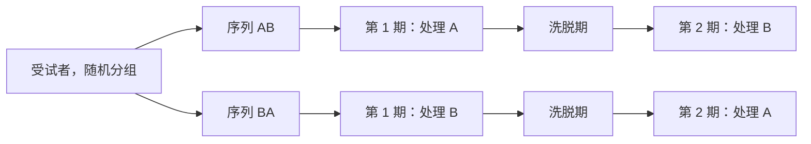

比较两种处理，可以用两个独立的单元组，也可以用同一批单元（或紧密匹配的单元对）。第二种方式即**配对设计**，它把单元之间的变异从比较中去掉，往往灵敏得多。本章研究配对数据的非参数分析。第 8.1 节从设计出发讲交叉试验，每个受试者依次接受两种处理；其分析已经用到 [3.6.9](/3.6.9) 详细展开的两样本秩和检验。第 8.2 节处理最常见的分析：把数对归结为一个差的样本，再用 [3.6.3](/3.6.3)–[3.6.5](/3.6.5) 的单样本方法，并补充 [3.6.1](/3.6.1) 的**置换检验**的配对形式。第 8.3 节说明符号检验怎样再度出现：用于相关的 [3.6.7](/3.6.7) 的 Cox–Stuart 检验与游程检验，以及用于配对二元结果的 McNemar 检验。第 8.4 节从比较一对的两个成员转向度量它们如何一起变化：Pearson **相关系数**（3.1.10）及其基于秩的替代，即 Spearman 的 rho 与 Kendall 的 tau。

配对的设计方面（为什么区组能减小误差，以及配对 $t$ 检验）见 [3.8.2](/3.8.2)；临床研究中的交叉试验及其参数分析见 [7.7.17](/7.7.17)。

## 8.1. 成对比较

### 8.1.1. 平行组与交叉试验

一位牙医想比较两种漱口水对溃疡性牙龈炎的疗效。显而易见的设计是把病人随机分成两组，每组用一种漱口水，最好是随机化双盲试验，病人和评估者都不知道谁用了哪种漱口水。其弱点是病人的病情严重程度与反应差别很大，病人之间的这种变异进入两组的比较，可能掩盖两种漱口水之间真正的差别。

如果可行，可以让每位病人先后使用两种漱口水。把病人随机分成两组，两组使用漱口水的次序相反。

**定义 8.1.1（交叉设计）** 在两期**交叉设计**中，每个受试者在两个相继的时期内接受两种处理 A 与 B，受试者被随机分到序列 AB（第 1 期 A、第 2 期 B）或 BA。每个受试者以自身为对照。**遗留效应**是第 1 期的处理对第 2 期反应的残余影响。为了减小它，在两个时期之间安排一段不给处理的**洗脱期**，其长度应足以使第一种处理的作用消退。当两个序列的受试者人数相等时，设计是平衡的。



其优点是对每个受试者，两个时期之间唯一计划内的差别就是处理，所以比较是在受试者内部进行的。缺点是处理效应必须是可逆的，病情在两个时期内必须稳定，并且若存在遗留效应而两种处理的遗留效应不同，会使比较产生偏倚。处理的次序也有影响：反应可能因与处理无关的原因在两个时期之间发生变化（时期效应）。平衡地运行两个序列，分析就能把处理效应与时期效应分开。

### 8.1.2. 两期交叉试验的分析

**例 8.1.1（葡萄柚汁与戊巴比妥）** 把十名儿童随机分成两组，每组五人（Koch，1972）。每名儿童依 AB 或 BA 的次序接受两种处理：

- A：$100\,\mathrm{ml}$ 葡萄柚汁，随后服用戊巴比妥酏剂；
- B：$100\,\mathrm{ml}$ 水，随后服用同样的酏剂。

反应是给药后 $15$ 分钟所取血样中药物的浓度（$\mu\mathrm{g/ml}$）。

| 儿童 | 1 | 2 | 3 | 4 | 5 | 6 | 7 | 8 | 9 | 10 |
|---|---|---|---|---|---|---|---|---|---|---|
| 序列 | AB | AB | AB | AB | AB | BA | BA | BA | BA | BA |
| 第 I 期 | 1.75 | 0.30 | 0.35 | 0.20 | 0.30 | 7.20 | 7.10 | 0.75 | 2.15 | 3.35 |
| 第 II 期 | 0.55 | 1.05 | 0.63 | 1.55 | 8.20 | 0.35 | 1.55 | 0.25 | 0.35 | 1.50 |

主要问题是两种处理的效应有无差别；次要的、但在逻辑上在先的问题是它们的遗留效应有无差别（例如葡萄柚汁对药物代谢有无持久的作用）。每组只有五名儿童，数值又明显偏斜，正态理论的分析很难成立，秩方法是自然的选择。
:::

分析建立在一个简单的模型上。对第 $i$ 名儿童在第 $j$ 期接受处理 $k\in\{\mathrm{A},\mathrm{B}\}$，

$$
Y_{ijk}=\mu+S_i+P_j+T_k+C_k+\varepsilon_{ijk},
$$
其中 $\mu$ 是总均值，$S_i$ 是受试者效应，$P_j$ 是时期效应，$T_k$ 是处理效应，$C_k$ 是处理 $k$ 的遗留效应（只在第 2 期出现，来自第 1 期的处理），$\varepsilon_{ijk}$ 是独立同分布的误差。于是在序列 AB 中

$$
Y_{i1}=\mu+S_i+P_1+T_{\mathrm{A}}+\varepsilon_{i1},\qquad
Y_{i2}=\mu+S_i+P_2+T_{\mathrm{B}}+C_{\mathrm{A}}+\varepsilon_{i2},
$$
而在序列 BA 中 A 与 B 的角色互换。

**命题 8.1.1** 在上述模型中，设受试者效应 $S_i$ 独立同分布，且儿童被随机分配到各序列：

1. 和 $Y_{i1}+Y_{i2}$ 在序列 AB 中等于 $2\mu+2S_i+P_1+P_2+T_{\mathrm{A}}+T_{\mathrm{B}}+C_{\mathrm{A}}+\varepsilon_{i1}+\varepsilon_{i2}$，在序列 BA 中同样，只是以 $C_{\mathrm{B}}$ 代替 $C_{\mathrm{A}}$。两个序列中的和同分布当且仅当 $C_{\mathrm{A}}=C_{\mathrm{B}}$。
2. 差 $Y_{i1}-Y_{i2}$ 在序列 AB 中等于 $(P_1-P_2)+(T_{\mathrm{A}}-T_{\mathrm{B}})-C_{\mathrm{A}}+\varepsilon_{i1}-\varepsilon_{i2}$，在序列 BA 中等于 $(P_1-P_2)-(T_{\mathrm{A}}-T_{\mathrm{B}})-C_{\mathrm{B}}+\varepsilon_{i1}-\varepsilon_{i2}$。受试者效应相消。若 $C_{\mathrm{A}}=C_{\mathrm{B}}$，两个差的分布只相差一个平移 $2(T_{\mathrm{A}}-T_{\mathrm{B}})$，时期效应在比较中消失。

**证明** 代入模型，逐项比较两个序列。$\square$

所以，两个序列的和相比较检验的是遗留效应的差异，差相比较检验的是处理效应，两者都在五名 AB 儿童与五名 BA 儿童之间作两样本检验；自然的选择是 [3.6.9](/3.6.9) 的 Wilcoxon–Mann–Whitney 检验。注意哪些项相消、哪些不相消。在和中，受试者效应仍然存在（作为噪声），只有遗留效应项才能使两个序列不同。在差中，受试者效应相消，但遗留效应项只有在它们相等时才会在比较中相消。

**例 8.1.2（葡萄柚汁，续）** 和与差（第 I 期减第 II 期）为：

| 序列 | 和 | 差 |
|---|---|---|
| AB | 2.30, 1.35, 0.98, 1.75, 8.50 | 1.20, $-0.75$, $-0.28$, $-1.35$, $-7.90$ |
| BA | 7.55, 8.65, 1.00, 2.50, 4.85 | 6.85, 5.55, 0.50, 1.80, 1.85 |

```r
per1 <- c(1.75, 0.30, 0.35, 0.20, 0.30, 7.20, 7.10, 0.75, 2.15, 3.35)
per2 <- c(0.55, 1.05, 0.63, 1.55, 8.20, 0.35, 1.55, 0.25, 0.35, 1.50)
s <- per1 + per2
wilcox.test(s[1:5], s[6:10])      # differential carryover
d <- per1 - per2
wilcox.test(d[1:5], d[6:10])      # treatment effect
```

```text
W = 7, p-value = 0.3095
W = 1, p-value = 0.01587
```

没有遗留效应存在差异的证据（$p=0.31$），但有处理效应的证据（$p=0.016$）。差在序列 AB 中比在 BA 中小，所以由命题 8.1.1 得 $T_{\mathrm{A}}<T_{\mathrm{B}}$：喝葡萄柚汁后 $15$ 分钟时的药物浓度低于喝水之后。AB 的一个差与 BA 的一个差之间的 $25$ 个差的中位数（[3.6.9](/3.6.9) 的 Hodges–Lehmann 平移估计）为 $-4.35$，它估计 $2(T_{\mathrm{A}}-T_{\mathrm{B}})$；所以效应约为 $-2.2\,\mu\mathrm{g/ml}$。
:::

**注 8.1.1** “先检验遗留效应是否存在差异，只有当它不显著时才比较差”这一策略很常见，但有众所周知的问题。遗留效应的检验比较的是受试者之间的和，因此承受了全部的受试者间变异，功效很低；每组五名儿童时，$p=0.31$ 远不足以证明遗留效应相等。而整个两阶段程序（Grizzle，1965）在遗留效应显著时才转而比较第一期的反应，Freeman（1989）证明它的第一类错误率膨胀。稳妥的做法是通过设计来防止遗留效应，即采用足够长的洗脱期和已知作用短暂的处理，并分析差。

## 8.2. 配对数据的位置推断

### 8.2.1. 为什么要配对

**例 8.2.1（对数字信息的反应）** 把数字按随机次序呈现在 $12$ 名受试者的右视野（RVF）或左视野（LVF），以考察它们在一个视野中是否比在另一个视野中感知得更快。平均反应时间（ms）为：

| 受试者 | 1 | 2 | 3 | 4 | 5 | 6 | 7 | 8 | 9 | 10 | 11 | 12 |
|---|---|---|---|---|---|---|---|---|---|---|---|---|
| LVF $x_i$ | 564 | 521 | 495 | 564 | 560 | 481 | 545 | 478 | 580 | 484 | 539 | 467 |
| RVF $y_i$ | 557 | 505 | 465 | 562 | 544 | 448 | 531 | 458 | 560 | 485 | 520 | 445 |
| $d_i=x_i-y_i$ | 7 | 16 | 30 | 2 | 16 | 33 | 14 | 20 | 20 | $-1$ | 19 | 22 |

除受试者 10 之外，所有受试者在 RVF 中反应更快，且没有一个差超过 $33\,\mathrm{ms}$。受试者之间的差别要大得多：受试者 9 与 12 在任一视野中都相差超过 $100\,\mathrm{ms}$（$580-467=113$）。
:::

这是需要配对的典型情形。$x_i$ 内部与 $y_i$ 内部的变异主要是受试者之间的变异，它比感兴趣的效应大，在两个独立组的比较中会掩盖效应。对受试者内部取差就把它消除了。更一般地，**随机化区组设计**（3.8.6）把单元分成同质的区组，这里是大小为二的区组，使区组内部的变异很小，并在每个区组内随机分配处理（对不同单元的数对，例如抛一枚均匀硬币）。

### 8.2.2. 归结为单样本

记 $d_i=x_i-y_i$，$\theta$ 为差的分布的中心，假设为 $H_0\colon\theta=0$ 对 $H_1\colon\theta\ne0$（或单侧备择假设）。检验的选择取决于对 $d_i$ 能作什么假定：

- 若在 $H_0$ 下每个 $d_i$ 为正或为负的可能性相同，用**符号检验**；
- 若在 $H_0$ 下 $d_i$ 关于 $0$ 对称分布，用 **Wilcoxon 符号秩检验**；
- 若 $d_i$ 服从正态分布，用**配对 t 检验**。

被检验的是差 $X-Y$ 的分布的性质：对符号检验是其中位数，对符号秩检验是其对称中心。这与 $X$ 的中位数和 $Y$ 的中位数之差并不相同，因为差的中位数一般不等于中位数之差。

符号秩检验所要求的对称性对配对数据往往是自然的，理由如下。

**命题 8.2.1** 设 $D=X-Y$。

1. 若数对可交换，即 $(X,Y)\overset{d}{=}(Y,X)$，则 $D$ 关于 $0$ 对称。例如当 $X=S+E_1$，$Y=S+E_2$，其中 $E_1,E_2$ 独立同分布且与受试者效应 $S$ 独立时就是如此，这时 $X$ 与 $Y$ 可以强相依。
2. 若 $X$ 与 $Y$ 独立，且各自关于同一中心 $\theta$ 对称（它们的分布可以不同），则 $D$ 关于 $0$ 对称。

**证明** (1) $D=X-Y\overset{d}{=}Y-X=-D$。(2) $X-\theta\overset{d}{=}\theta-X$，$Y-\theta\overset{d}{=}\theta-Y$，由独立性，$D=(X-\theta)-(Y-\theta)\overset{d}{=}(\theta-X)-(\theta-Y)=-D$。$\square$

情形 1 正是随机化配对试验中“无处理效应”的原假设：若处理不起作用，同一受试者的两个反应是可交换的。在对称性假定下，感兴趣的备择假设通常只是中心的平移。对称性是否合理，要在 $d_i$ 本身上检查，例如用图，或比较差的均值与中位数。

**例 8.2.2（对数字信息的反应，续）** 排序后的差及其带符号的秩（结取平均秩）为

$$
\begin{aligned}
&-1,\ 2,\ 7,\ 14,\ 16,\ 16,\ 19,\ 20,\ 20,\ 22,\ 30,\ 33,\\
&-1,\ 2,\ 3,\ 4,\ 5.5,\ 5.5,\ 7,\ 8.5,\ 8.5,\ 10,\ 11,\ 12 .
\end{aligned}
$$

1. 符号检验：$12$ 个差中有一个为负，双侧 $p=2\,\mathbb{P}(\mathrm{Bin}(12,1/2)\le1)=0.0063$（`binom.test(1, 12)`）。
2. $t$ 检验：正态性的 **Lilliefors 检验**（[3.6.6](/3.6.6)）给出 $D=0.152$，远低于 $n=12$ 时 $20\%$ 的临界值 $0.199$，所以没有非正态的证据。$t$ 检验给出 $t=5.64$，$p=0.00015$，均值 $16.5$ 附近的 $95\%$ 区间为 $(10.1,\,22.9)$。
3. Wilcoxon 符号秩检验：$S_-=1$。在十二个带符号秩的 $2^{12}=4096$ 种等可能符号模式中，只有两种使 $S_-\le1$（没有负秩，或仅秩 $1$ 为负），所以在平均秩的条件下，精确的双侧 $p$ 值为 $2\times2/4096=0.00098$。

```r
library(nortest)
lillie.test(x)
t.test(x, conf.level = 0.95)
wilcox.test(x, conf.int = TRUE)
```

```text
Wilcoxon signed rank test with continuity correction
V = 77, p-value = 0.00324
alternative hypothesis: true location is not equal to 0
95 percent confidence interval:
  9.499991 23.499979
sample estimates:
(pseudo)median
      17.11191
Warning messages:
cannot compute exact p-value with ties
cannot compute exact confidence interval with ties
```

这里 `x` 是十二个差。由于有结，R 退而采用带连续性修正的正态近似（$V=S_+=77$，$p=0.0032$），并据此计算区间与估计；$78$ 个 **Walsh 平均**的中位数，即 [3.6.5](/3.6.5) 的 Hodges–Lehmann 估计，为 $17.25$。三个检验都给出反对 $H_0$ 的有力证据：RVF 中的反应更快。对这些看起来大致对称且没有离群值的差，符号秩检验与 $t$ 检验都合适，且结果一致；忽略大小的符号检验给出的证据最弱（但仍很强）。
:::

### 8.2.3. 次序效应与平衡

假设我们得知每个受试者都是先在 LVF、后在 RVF 中受测。若人们随着练习会反应得更快，则 RVF 中较快的反应可能反映的是学习而不是两个视野之间固有的差别；次序与视野**混杂**（3.8.2）。补救措施是设计的一部分：对每个受试者随机决定先测哪个视野；或者更好地，通过选取六名受试者（最好随机选取）先在 LVF 中受测、其余六名先在 RVF 中受测来达到平衡。平衡的次序使学习效应对一半受试者的差是加上去的，对另一半则是减掉的，于是可以像第 8.1.2 节那样把它估计出来并去除。

### 8.2.4. 配对置换检验

[3.6.1](/3.6.1) 的置换思想可以直接应用。在无处理效应的原假设下，同一受试者的两个反应是可交换的（命题 8.2.1），所以其中任何一个都同样可能是 $x$。交换它们只改变 $d_i$ 的符号，其他都不变。

**定义 8.2.1（配对置换检验）** 给定差 $d_1,\dots,d_n$ 与统计量，如 $\bar D=\sum_id_i/n$（或 $d_i$ 的中位数），配对置换检验：

1. 计算观测值 $\bar D_{\mathrm{obs}}$；
2. 构造给 $d_i$ 赋符号的全部 $2^n$ 种方式（或其中随机的 $M$ 种）；
3. 对每种赋值计算 $\bar D^*$；
4. 报告满足 $\bar D^*\ge\bar D_{\mathrm{obs}}$（上侧）、$\bar D^*\le\bar D_{\mathrm{obs}}$（下侧）或 $\lvert\bar D^*\rvert\ge\lvert\bar D_{\mathrm{obs}}\rvert$（双侧）的赋值所占的比例。

由于 $\bar D$ 的置换分布关于 $0$ 对称，双侧 $p$ 值是较小的单侧 $p$ 值的两倍。

重排的个数是 $2^n$，而不是 $\binom{2n}{n}$：同一受试者的两个值只能彼此交换，不能与另一受试者的值交换，因为配对是设计的一部分。对视野数据，在 $4096$ 种赋值中只有四种使 $\lvert\bar D^*\rvert\ge16.5$：观测到的赋值、全部取正号的赋值（均值 $16.67$），以及它们的镜像；所以 $p=4/4096=0.00098$。符号秩检验是同一程序用于带符号的秩而不是差本身；[3.6.5](/3.6.5) 的 Pitman 检验是均值的配对置换检验；符号检验相当于给每个差同样的得分。

## 8.3. 符号检验的不那么明显的用途

### 8.3.1. 检验相关的 Cox–Stuart 检验

若两个变量正相关，则按其中一个变量递增的次序排列数对，另一个变量就呈上升趋势。因此 [3.6.7](/3.6.7) 的 **Cox–Stuart 检验**可以用来检验相关：

1. 按结较少的那个变量递增的次序排列数对，保持每个数对不拆开；
2. 对另一个变量的序列作单侧 Cox–Stuart 趋势检验（正相关取上升，负相关取下降）。

**例 8.3.1（对两种药物的反应）** Cochran（1937）比较了 $10$ 名病人对两种药物各自的反应，以考察一名病人的两种反应是否正相关：

| 病人 | 1 | 2 | 3 | 4 | 5 | 6 | 7 | 8 | 9 | 10 |
|---|---|---|---|---|---|---|---|---|---|---|
| 药物 1 | 0.7 | $-1.6$ | $-0.2$ | $-1.2$ | $-0.1$ | 3.4 | 3.7 | 0.8 | 0.0 | 2.0 |
| 药物 2 | 1.9 | 0.8 | 1.1 | 0.1 | $-0.1$ | 4.4 | 5.5 | 1.6 | 4.6 | 3.4 |

按药物 1 排序，药物 2 的值为

$$
0.8,\ 0.1,\ 1.1,\ -0.1,\ 4.6\ \big|\ 1.9,\ 1.6,\ 3.4,\ 4.4,\ 5.5 .
$$
后半与前半之间的 Cox–Stuart 差为 $1.1, 1.5, 2.3, 4.5, 0.9$，全为正，所以单侧 $p$ 值为 $2^{-5}=0.031$：存在正相关的证据。
:::

### 8.3.2. 检验相关的游程检验

[3.6.7](/3.6.7) 的游程检验可以同样使用：按一个变量排序后，把另一个变量以其中位数二分，再数游程。正相关或负相关会把第二个变量的低值放在一端、高值放在另一端，从而产生很少的游程；原假设是序列随机（无关联）。游程检验比 Cox–Stuart 检验更一般，因为它对任何类型的非随机次序都有反应，而不仅限于单调趋势，但正因如此，它对单调关系的功效较低。

**例 8.3.2（对两种药物的反应，续）** 药物 2 的值的中位数为 $1.75$。按药物 1 的次序，药物 2 的值低于（L）或高于（H）它，排成

$$
\mathrm{L\,L\,L\,L\,H\,H\,L\,H\,H\,H},
$$
其中 $m=n=5$，$R=4$ 个游程。由精确分布（[3.6.7](/3.6.7)，定理 7.4.1），$\mathbb{P}(R\le4)=(2+8+32)/252=1/6$，所以单侧 $p$ 值为 $0.17$。样本远不足以使用正态近似，必须用精确分布。游程检验没有检测出 Cox–Stuart 检验所发现的关联，而第 8.4 节的秩相关发现得更清楚（Spearman $r_s=0.78$，双侧 $p=0.008$；Kendall $\tau=0.60$，$p=0.017$）。
:::

两个检验回答的都是“第二个变量沿第一个变量的次序是否非随机地变化”，任一个显著都支持存在相关；但它们丢弃了数据中的大部分信息，下面的秩相关检验通常更受青睐。

### 8.3.3. McNemar 检验

**例 8.3.3（两条攀岩路线）** 某登山俱乐部的会员长期争论两条攀岩路线哪一条更难。俱乐部的记录簿为每一位两条路线都尝试过的 $108$ 名会员记录了每条路线是否成功完成：

| | 第一条路线成功 | 第一条路线失败 |
|---|---|---|
| 第二条路线成功 | 73 | 14 |
| 第二条路线失败 | 9 | 12 |

两条路线都成功或都失败的攀岩者，对两条路线的相对难度不提供信息；这样的数对起着结的作用。信息在于恰好成功了一条路线的 $9+14=23$ 名攀岩者：$9$ 人只在第一条上成功（“+”表示第一条路线更容易），$14$ 人只在第二条上成功。在 $H_0$（两条路线同样困难）下，这 $23$ 人中的每一位在两条路线中成功于哪一条的可能性相同，所以“+”的个数服从 $\mathrm{Bin}(23,1/2)$。精确的双侧 $p$ 值为 $0.405$（`binom.test(9, 23)`），没有证据表明某一条路线更难。

用带连续性修正的正态近似，$z=(9.5-11.5)/\sqrt{23/4}=-0.83$，$p=0.404$，与精确值接近；不作修正则 $z=-1.04$，$p=0.297$，所以这里连续性修正是有影响的。结果相同的 $85$ 名攀岩者并没有白费：他们说明差别可以有多小，因为成功率分别为 $82/108=0.76$ 与 $87/108=0.81$。最后，若会员们倾向于按某一特定次序尝试这两条路线，就可能涉及学习效应，如第 8.2.3 节。
:::

**定义 8.3.1（McNemar 检验）** 设 $n$ 个单元各给出一对二元结果 $(Y_1,Y_2)$，汇总在 $2\times2$ 表中，计数 $a$（均为 $1$）、$b$（$Y_1=1$，$Y_2=0$）、$c$（$Y_1=0$，$Y_2=1$）与 $d$（均为 $0$）。检验边缘齐性 $H_0\colon\mathbb{P}(Y_1=1)=\mathbb{P}(Y_2=1)$（它等价于 $H_0\colon\mathbb{P}(Y_1=1,Y_2=0)=\mathbb{P}(Y_1=0,Y_2=1)$）的 **McNemar 检验**只使用不一致的计数 $b$ 与 $c$：在 $H_0$ 下，以 $b+c$ 为条件，$b\sim\mathrm{Bin}(b+c,1/2)$。其大样本形式为

$$
\chi^2=\frac{(\lvert b-c\rvert-1)^2}{b+c}\ \overset{H_0}{\approx}\ \chi^2_1 ,
$$
带连续性修正（不作修正则略去 $-1$）；它是修正后的 $z$ 统计量的平方。

对攀岩路线，$\chi^2=(5-1)^2/23=0.70$，$p=0.404$，与上面相同。McNemar 检验是配对二元数据的符号检验，用于前后比较，以及在同一批受试者上比较两种诊断方法。它必须与 $2\times2$ 表的 **Fisher 精确检验**和卡方**独立性检验**（[3.6.12](/3.6.12)，3.2.6）区分开。那些表对来自两个独立样本的单元，或按两个不同变量分类的一个样本的单元进行分类，问题是行与列之间有无关联。把独立性检验用于上面的配对表，问的是在一条路线上成功是否与在另一条上成功相关联（当然相关联：好的攀岩者两条都成功），这与两条路线是否同样困难是不同的问题。McNemar 检验可推广到多于两个类别，即 Bowker 检验，也可推广到多于两个条件，即 Cochran $Q$ 检验（[3.6.11](/3.6.11)，[3.6.12](/3.6.12)）。

## 8.4. 秩相关

### 8.4.1. Pearson 相关及其检验

考虑数对

| $x_i$ | 1 | 2 | 3 | 4 | 5 | 6 | 7 |
|---|---|---|---|---|---|---|---|
| $y_i$ | 1 | 16 | 81 | 256 | 625 | 1296 | 2401 |

样本**相关系数**为 $r=0.89$，然而这个关系是完美的：$y_i=x_i^4$。Pearson 系数只度量线性关联。若只想度量 $Y$ 随 $X$ 增大的程度，就应看秩：这里 $x_i$ 的秩与 $y_i$ 的秩都是 $1,2,\dots,7$。

回顾

$$
r=\hat\rho=\frac{\sum_{i=1}^n(X_i-\bar X)(Y_i-\bar Y)}{\sqrt{\sum_{i=1}^n(X_i-\bar X)^2\sum_{i=1}^n(Y_i-\bar Y)^2}}=\frac{S_{xy}}{S_xS_y}.
$$
作为线性关联的描述性度量，$r$ 不需要任何分布假定。但它的经典检验 $H_0\colon\rho=0$ 需要：若 $(X_i,Y_i)$ 是来自**二元正态分布**的随机样本，则

$$
t=r\sqrt{\frac{n-2}{1-r^2}}\ \overset{H_0}{\sim}\ t_{n-2},
$$
并且当 $n$ 大时 $\operatorname{Var}(r)\approx(1-\rho^2)^2/(n-1)$，所以在 $H_0$ 下 $z=r\sqrt{n-1}$ 近似服从 $\mathcal{N}(0,1)$。（当 $X$ 与 $Y$ 独立且其中之一服从正态分布时，$t$ 的结论更一般地成立。）没有正态性时，置换检验提供零分布：在独立性的 $H_0$ 下，$Y_i$ 与 $X_j$ 一同出现的可能性和与 $X_i$ 一同出现的可能性一样，所以 $Y$ 与 $X$ 的全部 $n!$ 种配对等可能。固定 $X$，置换 $Y$，对每个置换（或其中随机的一些）计算 $r^*$，报告满足 $r^*\ge r_{\mathrm{obs}}$（对 $H_1\colon\rho>0$）、$r^*\le r_{\mathrm{obs}}$（对 $\rho<0$）或 $\lvert r^*\rvert\ge\lvert r_{\mathrm{obs}}\rvert$（双侧）的比例。

### 8.4.2. Spearman 秩相关

**定义 8.4.1（Spearman 秩相关系数）** 设 $R_i$ 是 $X_i$ 在 $X_1,\dots,X_n$ 中的**秩**，$Q_i$ 是 $Y_i$ 在 $Y_1,\dots,Y_n$ 中的秩，结取**平均秩**。**Spearman 秩相关系数**是秩的 Pearson 相关，

$$
r_s=\operatorname{corr}(R,Q)=\frac{\sum_i(R_i-\bar R)(Q_i-\bar Q)}{\sqrt{\sum_i(R_i-\bar R)^2\sum_i(Q_i-\bar Q)^2}} .
$$
它度量一个变量在多大程度上是另一个变量的单调函数：没有结时，$r_s=1$（$-1$）当且仅当 $Y$ 在样本上是 $X$ 的严格增（减）函数。

**命题 8.4.1** 没有结时，记 $d_i=R_i-Q_i$，

$$
r_s=1-\frac{6\sum_{i=1}^nd_i^2}{n(n^2-1)} .
$$

**证明** 没有结时两个秩向量都是 $1,\dots,n$ 的排列，所以 $\bar R=\bar Q=(n+1)/2$，$\sum_i(R_i-\bar R)^2=\sum_i(Q_i-\bar Q)^2=n(n^2-1)/12$。展开 $\sum_id_i^2=\sum_iR_i^2+\sum_iQ_i^2-2\sum_iR_iQ_i$，并用 $\sum_iR_i^2=\sum_iQ_i^2=n(n+1)(2n+1)/6$，得

$$
\sum_iR_iQ_i=\frac{n(n+1)(2n+1)}{6}-\frac12\sum_id_i^2 .
$$
因此

$$
r_s=\frac{\sum_iR_iQ_i-n\bigl(\frac{n+1}2\bigr)^2}{n(n^2-1)/12}
=\frac{\frac{n(n+1)(2n+1)}{6}-\frac{n(n+1)^2}{4}-\frac12\sum_id_i^2}{n(n^2-1)/12}
=1-\frac{6\sum_id_i^2}{n(n^2-1)},
$$
这里用了 $\frac{n(n+1)(2n+1)}6-\frac{n(n+1)^2}4=\frac{n(n^2-1)}{12}$。$\square$

有结时这个简便公式不再精确，应把 $r_s$ 算作平均秩的相关系数。

Spearman 独立性检验是第 8.4.1 节的置换检验用于秩。因为秩是固定的数，其零分布（对没有结的数据）只依赖于 $n$，可以制成表；在 $H_0$ 下 $\mathbb{E}r_s=0$，$\operatorname{Var}(r_s)=1/(n-1)$ 是精确的，且当 $n$ 大时 $r_s\sqrt{n-1}$ 近似服从 $\mathcal{N}(0,1)$。也使用 $t$ 近似 $r_s\sqrt{(n-2)/(1-r_s^2)}\approx t_{n-2}$。

**例 8.4.1（平时成绩与考试成绩）** $20$ 名学生的平时成绩 $x$ 与考试成绩 $y$ 为：

```r
x <- c(82, 75, 90, 68, 85, 70, 92, 65, 80, 77, 88, 72, 95, 62, 83, 73, 91, 66, 81, 76)
y <- c(78, 80, 88, 72, 83, 73, 93, 67, 79, 81, 86, 74, 94, 66, 84, 75, 90, 69, 82, 77)
cor.test(x, y)
cor.test(x, y, method = "spearman")
cor.test(rank(x), rank(y))
```

```text
Pearson's product-moment correlation
t = 19.297, df = 18, p-value = 1.786e-13
95 percent confidence interval:
 0.9407347 0.9909197
      cor
0.9766721

Spearman's rank correlation rho
S = 34, p-value = 6.561e-06
     rho
0.9744361

Pearson's product-moment correlation
t = 18.402, df = 18, p-value = 4.037e-13
      cor
0.9744361
```

R 的统计量 $S=\sum_id_i^2=34$ 给出 $r_s=1-6\times34/(20\times399)=0.974$。“平时成绩越高、考试成绩越高”这一关系用任何度量看都非常清楚。注意第三个调用做了什么。`cor.test(rank(x), rank(y))` 算出的 $r_s$ 值是正确的，但它的 $p$ 值是 Pearson 相关的 $t$ 检验的 $p$ 值，而该检验假定数据服从二元正态分布，秩永远不满足这个假定；第二个调用则把 $r_s$ 参照其置换分布（的近似）。在极端尾部，两种近似相差若干个数量级，但这里两者都远低于任何常用的水平。两次调用的差别就是 $t$ 检验与置换检验的差别，也就是它们假定的差别。
:::

### 8.4.3. Kendall 的 tau

Spearman 系数仍然使用秩之差的大小。Kendall 系数则只使用每两个单元之间比较的方向。若学生 A 在两次考试中得分 $X_1=43$ 与 $Y_1=64$，学生 B 得分 $X_2=89$ 与 $Y_2=72$，则 B 在两次考试中都比 A 好，这对学生是一致的。

**定义 8.4.2（一致对与不一致对）** 两个观测 $(X_i,Y_i)$ 与 $(X_j,Y_j)$ 在 $(X_i-X_j)(Y_i-Y_j)>0$ 时构成**一致对**（$X$ 较大的那个 $Y$ 也较大），在 $(X_i-X_j)(Y_i-Y_j)<0$ 时构成**不一致对**。若 $X_i=X_j$ 或 $Y_i=Y_j$，则该对为结（在 $X$ 上、在 $Y$ 上或两者都是）。

**定义 8.4.3（Kendall 的 tau）** 对二元分布的两个独立副本 $(X_1,Y_1)$、$(X_2,Y_2)$，**Kendall 秩相关系数** $\tau$ 为

$$
\tau=\mathbb{P}\bigl((X_1-X_2)(Y_1-Y_2)>0\bigr)-\mathbb{P}\bigl((X_1-X_2)(Y_1-Y_2)<0\bigr)\in[-1,1],
$$
对连续分布它等于 $2\,\mathbb{P}\bigl((X_1-X_2)(Y_1-Y_2)>0\bigr)-1$。设 $C$ 与 $D$ 为样本的 $\binom n2$ 个数对中一致对与不一致对的个数。没有结时 $C+D=\binom n2$，其估计是 Kendall 的 $\tau_a$（tau-a）：

$$
\tau_a=\frac{C-D}{\binom n2}=\frac{2C}{\binom n2}-1 .
$$
有结时，Kendall 的 $\tau_b$（tau-b）在相应的归一化中把各变量中的结对排除：

$$
\tau_b=\frac{C-D}{\sqrt{\Bigl(\binom n2-t_x\Bigr)\Bigl(\binom n2-t_y\Bigr)}},\qquad t_x=\sum_g\binom{u_g}2,\quad t_y=\sum_h\binom{v_h}2,
$$
其中 $u_g$ 是 $x$ 的相同值各组的大小，$v_h$ 是 $y$ 的相同值各组的大小。

手算 $\tau_a$ 时，把数对排成 $X_1<X_2<\dots<X_n$；则 $C$ 是满足 $Y_i<Y_j$ 的数对 $i<j$ 的个数。

**例 8.4.2** 对 $x=(1,2,3,4,5)$，$y=(1,3,2,5,4)$，每个 $y_i$ 之后比它大的 $y$ 值的个数为 $4,2,2,0$，所以 $C=8$，$D=2$，$\tau_a=2\times8/10-1=0.6$（`cor(x, y, method = "kendall")`）。

对 $x=(7,2,2,2,4,4)$，$y=(1,2,2,4,6,5)$，共有 $\binom62=15$ 个数对，$C=6$，$D=5$。$x$ 的值含一组三个相同值与一组两个相同值，所以 $t_x=3+1=4$；$y$ 的值含一对相同值，$t_y=1$。因此

$$
\tau_b=\frac{6-5}{\sqrt{(15-4)(15-1)}}=0.0806 .
$$

**例 8.4.3（家庭作业与期末考试）** 五名学生的作业得分 $x=(0,96,65,58,56)$ 与期末得分 $y=(0,166,130,118,130)$ 给出 $C=8$，$D=1$，且有一对在 $y$ 上为结，所以 $\tau_b=7/\sqrt{10\times9}=0.738$。

```r
cor.test(x, y, method = "kendall")
```

```text
Kendall's rank correlation tau
z = 1.7685, p-value = 0.07697
alternative hypothesis: true tau is not equal to 0
      tau
0.7378648
```

只有五个观测时，一致程度虽高，但在 $5\%$ 水平上不显著。
:::

检验 $H_0\colon\tau=0$（独立性）仍是置换检验，统计量为 $\tau$（等价地，$C-D$）。没有结时其零分布只依赖于 $n$，$\mathbb{E}\tau_a=0$，$\operatorname{Var}(\tau_a)=2(2n+5)/\bigl(9n(n-1)\bigr)$，且在 $n$ 适中时正态近似就已很好。有结时，如上面那样，R 使用方差经结修正的正态近似。

### 8.4.4. 三个系数的比较

相关系数的用意，是度量两个变量朝同一（或相反）方向变化的趋势有多强。三个系数度量的是这种趋势的不同版本。

| 方面 | Pearson 的 $r$ | Spearman 的 $r_s$ | Kendall 的 $\tau$ |
|---|---|---|---|
| 度量 | 线性关联 | 单调关联（整体趋势） | 单调关联（成对的次序一致性） |
| 由什么计算 | 数值 | 秩 | 成对比较的符号 |
| 对离群值的敏感性 | 高 | 低 | 低 |
| 经典检验的假定 | 二元正态，或 $n$ 大 | 除数对独立之外无其他假定（置换） | 除数对独立之外无其他假定（置换） |
| 解释 | 一条直线所解释的方差比例 $r^2$ | 秩的相关 | $\mathbb{P}(\text{一致})-\mathbb{P}(\text{不一致})$ |

Spearman 的 $r_s$ 是秩之差的平方的函数，所以少数几个秩的大位移影响很大。两位评委对五位候选人排序，排名为 $(1,2,3,4,5)$ 与 $(5,2,3,4,1)$，他们对三位候选人意见一致，而把两个极端互换。此时 $\sum d_i^2=32$，$r_s=1-6\times32/120=-0.6$，而 $C=3$，$D=7$，$\tau=-0.4$。Kendall 的 $\tau$ 只计数有多少数对次序颠倒，受秩的大差异的影响较小。

Kendall 的 $\tau$ 还有其他优点（Noether，1981）。它可以直接由观测计算，而无需先转成秩。它有简单的解释：在 $\tau=1/3$ 的总体中，随机选取的一对单元一致的可能性是不一致的两倍（$2/3$ 对 $1/3$）。它的估计量有性质良好的抽样分布，很快趋于正态，而 $\tau_b$ 能很好地处理结很多的小样本。Spearman 的 $r_s$ 则更容易向了解 Pearson 相关的人解释。两者通常导致相同的结论。对相关系数为 $\rho$ 的二元正态数据，它们与 $\rho$ 的关系是 $\tau=\frac2\pi\arcsin\rho$ 与 $\mathbb{E}r_s\to\frac6\pi\arcsin(\rho/2)$，所以 $\lvert\tau\rvert$ 通常小于 $\lvert r_s\rvert$，后者接近 $\lvert\rho\rvert$。


选择它们时，问题本身是第一位的。对两位评委给同一批候选人排序，只有次序重要、一致性体现在成对比较上，Kendall 的 $\tau$ 是自然的选择。对强单调但非线性的关系，如职级与收入，秩系数（Spearman）比 $r$ 更好地描述了关系的强度。对大致二元正态且线性关系的数据，如每周学习时间与考试成绩，Pearson 的 $r$ 用到了全部信息，效率最高。

## 小结

- 配对（**配对设计**）把单元之间的变异从比较中去掉（例 8.2.1）。在交叉设计（定义 8.1.1）中每个受试者接受两种处理；随机化的序列 AB 与 BA、针对遗留效应的洗脱期以及平衡都是必不可少的。
- 两期交叉试验的分析（命题 8.1.1）：

  | 序列 AB 与 BA 之间的比较 | 检验 | 有效的条件 |
  |---|---|---|
  | 和 $Y_{i1}+Y_{i2}$ | 遗留效应的差异 $C_{\mathrm{A}}=C_{\mathrm{B}}$ | （功效低） |
  | 差 $Y_{i1}-Y_{i2}$ | 处理效应 $T_{\mathrm{A}}=T_{\mathrm{B}}$ | $C_{\mathrm{A}}=C_{\mathrm{B}}$ |

  预先的遗留效应检验不能代替洗脱期（注 8.1.1）。
- 配对的位置问题：归结为差 $d_i$，检验其中心。假定：独立且有共同的中位数（符号检验）；关于中心对称（符号秩检验；命题 8.2.1：可交换的数对，或关于同一中心对称的独立分量）；正态（配对 $t$）。配对置换检验（定义 8.2.1）翻转 $d_i$ 的符号：$2^n$ 种重排。对两次测量的次序要随机化或使之平衡。
- 伪装的符号检验：按一个变量排序后检验相关的 Cox–Stuart 检验与游程检验（例 8.3.1–8.3.2；游程检验更一般但更弱）；McNemar 检验（定义 8.3.1）对配对二元数据只用不一致的计数，$b\sim\mathrm{Bin}(b+c,1/2)$，检验的是边缘齐性而不是独立性。
- 相关：Pearson 的 $r$ 度量线性关联，其 $t$ 检验需要二元正态（或 $n$ 大）；Spearman 的 $r_s$（定义 8.4.1）是（平均）秩的相关，没有结时为 $1-6\sum d_i^2/(n(n^2-1))$（命题 8.4.1）；Kendall 的 $\tau$（定义 8.4.3）基于一致对与不一致对（定义 8.4.2），$\tau_a=(C-D)/\binom n2$，有结时用 $\tau_b$。秩系数用置换来检验，对离群值稳健，并能刻画任何单调关系。

## 思考题

1. 在例 8.2.1 中，配对置换检验用了多少种重排？为什么像两样本置换检验那样把这 $24$ 个反应时间合并后分成两个 $12$ 个的组是错误的？

   **答** $2^{12}=4096$ 种：在每个受试者内部，两个值可以交换，也可以不交换。合并后分成两个 $12$ 个的组（$\binom{24}{12}=2\,704\,156$ 种方式），是把这 $24$ 个值看作跨受试者可交换的，但在 $H_0$ 下只有同一受试者的两个值是可交换的；配对是设计的一部分。两样本的分法还会把很大的受试者间变异混进零分布，所以它只对完全随机化设计有效，在这里功效要低得多。
2. 在没有遗留效应的两期交叉试验中，时期效应 $P_1-P_2$ 起什么作用？如果所有受试者都按 AB 的次序接受处理，会出什么问题？

   **答** 有两个序列时，时期效应给两个序列中的差都加上同一个常数 $P_1-P_2$，所以在序列之间比较时它相消，两个序列之间的平移是 $2(T_{\mathrm{A}}-T_{\mathrm{B}})$（命题 8.1.1）。若所有人都接受 AB，则每个差估计的是 $(P_1-P_2)+(T_{\mathrm{A}}-T_{\mathrm{B}})$（减去任何遗留效应），处理效应与时期效应（学习、季节变化、病程的自然发展）完全混杂。任何分析都无法把它们分开。
3. 一项前后对照的调查询问 $200$ 人是否支持某项政策。两次都支持的有 $120$ 人，两次都不支持的有 $50$ 人，由支持转为反对的有 $22$ 人，由反对转为支持的有 $8$ 人。检验支持率有无变化。

   **答** McNemar 检验只用 $30$ 名改变态度的人，$b=22$，$c=8$。精确地，$p=2\,\mathbb{P}(\mathrm{Bin}(30,1/2)\le8)=0.016$；带连续性修正，$\chi^2=(\lvert22-8\rvert-1)^2/30=5.63$，$p=0.018$。支持率下降了，从 $142/200=71\%$ 降到 $128/200=64\%$。对同一 $2\times2$ 表作卡方独立性检验，检验的是一个人的两次回答是否相关联，它们显然是相关联的，这并不回答所问的问题。
4. 证明对没有结的两个连续变量，$\tau_a=\tau_b$，并原则上对例 8.3.1 的药物数据计算两者：那里 $C$ 计数的是什么？

   **答** 没有结时 $t_x=t_y=0$，所以分母相同。对药物数据，$C$ 是 $45$ 个病人对中，对药物 1 反应较大的那位病人对药物 2 的反应也较大的对数，$D$ 是次序颠倒的对数；两种药物内部都没有结，所以 $C+D=45$，$\tau=0.60$ 意味着 $C=36$，$D=9$。
5. 为什么秩的 Pearson 相关用 $t$ 检验（`cor.test(rank(x), rank(y))`）所得的并不恰好是 Spearman 检验，差别在什么时候重要？

   **答** 估计值相同，都是 $r_s$。$t$ 检验假定数据服从二元正态分布；秩在 $\{1,\dots,n\}$ 上均匀且离散，所以 $t$ 分布只是 $r_s$ 的置换分布的一个近似。对适中的 $n$ 与适中的 $p$ 值，两者吻合得很好；对小的 $n$（此时有精确的置换分布可用，也应当使用）以及在远尾处，它们可能相差很大，如例 8.4.1。
