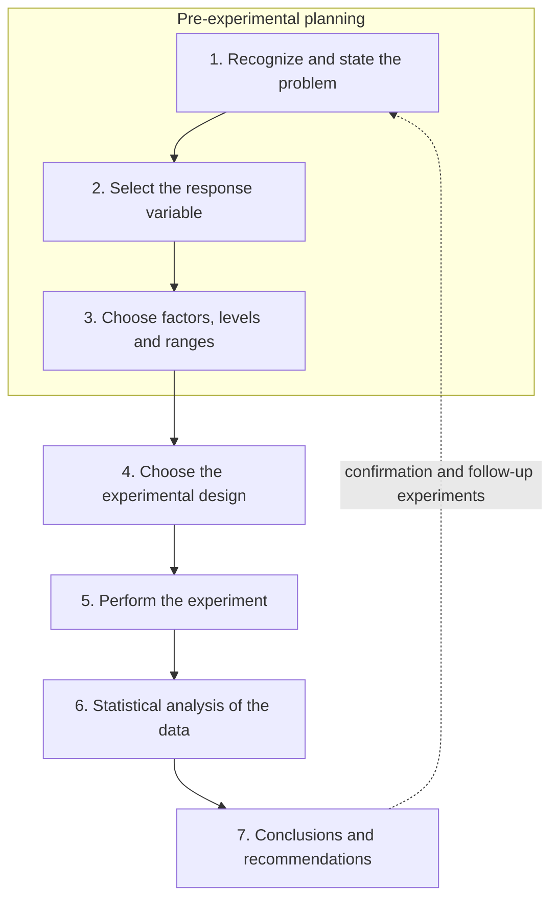

An experiment is a way of learning in which we deliberately change the inputs of a system and watch what happens to its outputs. The adjective "deliberately" is the whole point: when the experimenter decides which conditions occur, differences in the outputs can be attributed to the inputs, which is what we mean by learning about cause and effect. Statistics enters long before the data exist. How many units to use, how to allocate the conditions to them and in what order to run them decide what the data can and cannot reveal, and no analysis can repair a study that left out a key factor or let two factors change together. As the slogan goes, no clever analysis can make up for a poorly designed study.

This chapter sets up the language of the course. Section 1.1 defines an experiment and contrasts it with the two other ways of collecting data, Section 1.2 sketches how the subject grew from agricultural field trials into a tool of industry, science and computation, Section 1.3 introduces the terminology used in every later chapter, and Section 1.4 discusses what experiments are for and how to plan one. Section 1.5 ends with a small experiment in which all the terms appear at once. In linear regression ([3.3](/3.3)) the data were usually given to us; from here on the question is how to produce data that answer a question. The three basic principles of design, randomization, replication and blocking, are the subject of the next chapter ([3.8.2](/3.8.2)).

## 1.1. What Is an Experiment

### 1.1.1. Experiment and Test

In everyday technical language, "experiment" and "test" (or "trial") are used with slightly different emphases. An experiment is usually aimed at a scientific question, a theory or a hypothesis: we change the conditions on purpose and observe the results in order to learn a law or check a conjecture, as in a physics or chemistry experiment. A test or trial is usually aimed at a particular object, method or product: we try it out to see how well it performs, as in a pressure test, a field trial of a new crop variety or a clinical trial of a new drug. The first asks whether a law or hypothesis holds; the second asks how this thing actually performs. This is a tendency of usage, not a sharp boundary, and statistically the two are designed and analyzed in the same way. The Chinese national standard for the vocabulary of the field, GB/T 3358.3–2009, made the same choice of emphasis when it replaced the 1993 edition: the earlier title spoke of the design of tests, the current one of the design of experiments.

### 1.1.2. Experiments and the Ways of Collecting Data

**Definition 1.1.1 (Experiment)** An experiment is a test or a series of tests in which the investigator deliberately changes the input variables of a process or system and observes the corresponding changes in the output variables, in order to understand cause-and-effect relationships. A study in which the investigator plans in advance which input conditions are applied, to which units and in what order, is a **designed experiment**.

An experiment is a learning process: it gathers knowledge, solves problems and tests conjectures. Its results consist of a deterministic and a random component,

$$
Y=f(X_1,\dots,X_p)+\varepsilon,
$$

where $f$ is an unknown but fixed function of the inputs $X_1,\dots,X_p$ and $\varepsilon$ collects the variation that the inputs do not explain. After fitting, the same decomposition reads $Y=\hat Y+\hat\varepsilon$: a fitted value plus a residual.

A designed experiment is one of three ways of obtaining data about a process. They differ in who determines the values of the inputs.

**Definition 1.1.2 (Retrospective and Observational Studies)** A **retrospective study** uses data that were collected in the past for other purposes, such as historical production records. An **observational study** observes the process or population as it runs, recording the inputs and outputs of interest, but does not intervene: the investigator chooses what to measure, not the values of the inputs.

| | Retrospective study | Observational study | Designed experiment |
|---|---|---|---|
| Who sets the inputs $X$ | nobody: historical record | the process itself | the experimenter |
| When the data are collected | before the question is asked | while observing, with planned measurements | after planning, under chosen conditions |
| Typical weaknesses | missing or unreliable variables, inputs that hardly varied, unrecorded changes in the process | inputs vary only over their natural range; changes in $Y$ may be due to unmeasured variables that move together with $X$ | cost; the conditions may not be feasible or ethical |
| Can it establish cause and effect | rarely | only under strong assumptions | yes, when the treatments are randomized |
| Example | relate last year's yield records to the operating temperatures in the log | record the temperature and the yield of each batch for a month | run batches at temperatures chosen by the engineer, in random order |

A sample survey is observational in the same sense: it measures a population as it is and assigns nothing. This distinction will matter again in [3.8.2](/3.8.2), where a comparison is called a comparative experiment only if the conditions being compared are assigned by the experimenter.

### 1.1.3. The Phases of an Experiment

Every experiment passes through three phases.

1. Planning: Formulate the hypotheses to be tested, the conditions under which the study is performed, the factors to be considered and those to be ignored, the ethical issues, and the financial and time constraints.
2. Execution: The treatments are actually applied and the responses measured.
3. Analysis and interpretation: The data are analyzed statistically and the conclusions are drawn.

The phases are not equally important. A flaw in the analysis can be corrected by analyzing the same data again; a flaw in the plan, such as a key factor left out, or two factors that always changed together so that their effects are confounded, cannot. This is why most of this course is about the first phase.

## 1.2. A Short History

The history of experimental design is usually divided into four eras, each defined by the question it tried to answer.

| Era | Central question | Representative ideas |
|---|---|---|
| Agricultural origins, 1908–1940s | How can treatments be compared fairly, and how can a treatment effect be distinguished from natural variation? | randomization, replication, blocking, the analysis of variance, factorial experiments (Fisher) |
| First industrial era, 1951–late 1970s | How should experiments be run to model a process and move it toward better operating conditions? | response surface methodology (Box and Wilson) |
| Second industrial era, late 1970s–1990 | How can good performance be made insensitive to uncontrollable variation? | robust parameter design (Taguchi), quality improvement |
| Modern era, about 1990 to the present | How should we decide what to run next when experiments are large, expensive, computational or automated? | screening designs for many factors, computer experiments with surrogate models and space-filling designs, sequential and adaptive designs, Bayesian optimization |

The subject in its modern form was created by R. A. Fisher (1890–1962) at the Rothamsted Experimental Station in England, where he worked from 1919 to 1933 on decades of agricultural field data. The fundamental problem there was how to tell the effect of a fertilizer or a crop variety from the natural variation between plots and seasons. Fisher's answer was to design the experiment so that the data can answer the question: randomization protects the comparisons from systematic bias, replication reveals the size of the experimental variation, blocking makes the comparisons more precise, the analysis of variance separates the sources of variation, and factorial experiments study several factors at once. His *Statistical Methods for Research Workers* (1925) also popularized the convention of judging a deviation of about two standard deviations, the point where $P=0.05$, as significant. The famous illustration of his design ideas, the lady who claimed she could tell whether the milk or the tea had been poured first into the cup, appears in his book *The Design of Experiments* (1935): she is given eight cups in random order, four of each kind, and told that there are four of each. If she has no ability at all, the probability of identifying all four milk-first cups is $1/\binom{8}{4}=1/70$. The example already contains a null hypothesis, a randomization of the order and a probability computed from the randomization itself.

In the chemical and process industries of the 1950s the question changed from comparing treatments to optimizing a process. G. E. P. Box and K. B. Wilson (1951) introduced *response surface methodology*: fit an empirical, usually low-order polynomial, model of the response as a function of a few continuous factors from a small designed experiment, explore the fitted surface, move the operating conditions in the direction of improvement, and repeat. From the late 1970s, the methods of the Japanese engineer Genichi Taguchi spread through manufacturing and electronics. His *robust parameter design* chooses the settings of the controllable factors so that the performance of a product or process stays good despite variation in uncontrollable (noise) factors; the goal moved from optimization to robustness. The modern era deals with experiments of a new scale and kind: high-dimensional screening in biotechnology and drug development, expensive computer simulations analyzed through surrogate models, and sequential, AI-guided and automated experimentation, where the design decides after each run what to try next.

## 1.3. Terminology

### 1.3.1. Responses, Factors and Treatments

The vocabulary of regression and the analysis of variance carries over. The output of the process is the **response variable** (the response, or dependent variable). A **factor** is an input that the investigator manipulates in order to cause a change in the response; in an experiment it takes only a few values, its **factor levels**, even when it is a continuous variable such as temperature. The effect of a factor is the change in the response produced by changing the level of the factor (the **treatment effect** of a level in a one-factor study, the **main effect** in a factorial one). Some factors cannot be controlled by the experimenter but may still affect the response; they should be measured and used in the analysis if their effect is important.

**Definition 1.3.1 (Treatment)** A **treatment factor** is a factor whose levels are of direct interest and are to be compared. A **treatment** is a treatment factor at a specified level. When several factors are studied, a **treatment combination** (level combination) is a choice of one level for each factor, that is, the set of experimental conditions in a given run; the word treatment is often used for a treatment combination as well.

If there are $s$ factors with $q_1,\dots,q_s$ levels, there are

$$
N=\prod_{i=1}^{s}q_i
$$

treatment combinations. A treatment combination is a point of the $s$-dimensional space of factor levels, hence the following name.

**Definition 1.3.2 (Design Point and Factorial Designs)** A treatment combination regarded as a point in the space of the factor levels is a **design point**. A **factorial design** studies several factors by running combinations of their levels. In a **full factorial design** all $N=\prod q_i$ treatment combinations are run, each the same number of times; in a **fractional factorial design** only a subset of the treatment combinations is run.

For example, three factors at two levels each give $2^3=8$ design points, the vertices of a cube; a full factorial design runs all eight, and a half fraction would run four of them. The full factorial design grows quickly with the number of factors: seven two-level factors already have $128$ combinations, which is why fractional designs are needed for screening many factors.

### 1.3.2. Experimental Units and Runs

**Definition 1.3.3 (Experimental Unit and Run)** An **experimental unit** is the basic object to which a treatment is applied; experimental units that are people are called **subjects**. A **run** (trial) is the application of a treatment to an experimental unit, that is, one set of experimental conditions used to collect one experimental observation.

The experimental unit is the object that receives the treatment independently of the other objects, which is not always the object that is measured. If a fertilizer is applied to a whole field and ten plants are measured, the field is the experimental unit and the ten plants are measurements on it; this distinction is the subject of replication versus repetition in [3.8.2](/3.8.2).

Two factors can be related in two ways.

**Definition 1.3.4 (Crossed and Nested Factors)** Two factors are **crossed factors** if every level of one factor occurs in combination with every level of the other. A factor $A$ is a **nested factor** within a factor $B$ if the levels of $A$ are different for every level of $B$.

In a full factorial design all factors are crossed. Nesting arises from the structure of the units: batches of raw material within suppliers, students within classes, or measurements within patients. For nested factors there is no interaction between $A$ and $B$ to estimate, because the levels of $A$ never meet more than one level of $B$.

### 1.3.3. Error

Observations collected under the same conditions are not identical. The unexplained variation in a collection of observations is called error, and it has two different sources.

**Definition 1.3.5 (Lack-of-Fit Error and Experimental Error)** The **lack-of-fit error** is the error that occurs when the analysis omits one or more important terms or factors from the model of the process. The **experimental error** (random error) is the variation caused by the natural variation of the process: responses of experimental units that receive the same treatment differ even under similar conditions, because of extraneous factors (noise).

The experimental error is usually modeled as a normal random variable with mean zero and constant variance, and one aim of design is to make it small. The lack-of-fit error, in contrast, is a systematic error of the model and is removed by a better model. With replicated runs the two can be separated: the residual sum of squares of a regression model splits into a **pure error sum of squares** and a **lack-of-fit sum of squares** ([3.3.6](/3.3.6)).

Two measures of variation must be kept apart. The **standard deviation** describes the variation of the observations on individual units. The **standard error** describes the random variation of an estimate computed from the whole experiment: it is the standard deviation of the sampling distribution of the estimate, or an estimate of that standard deviation ([3.3.3](/3.3.3)). For the **sample mean** of $n$ observations, the true standard deviation of $\bar X$ is $\sigma/\sqrt n$ and its standard error is $s/\sqrt n$. The standard deviation is a property of the population and does not shrink as more data are collected; the standard error shrinks like $1/\sqrt n$. Standard errors are what **confidence intervals** are built from.

## 1.4. Basic Concepts

### 1.4.1. Objectives of Experiments

In engineering, experiments are used for process characterization and optimization, the evaluation of material properties, product design and development, and the determination of component and system tolerances; in science they are the main way of testing hypotheses. Whatever the field, the results depend entirely on the data collected, and the data depend on the design. In this sense all experiments are designed experiments: some are designed well and some poorly.

The design and the analysis depend on the question being asked. Experiments are commonly classified by objective into five types.

| Objective | Question | Typical design |
|---|---|---|
| Treatment comparison | Do several treatments of a factor differ, and how? | comparative experiments, one-factor and blocked designs |
| Variable screening | Which few of a large number of factors are important? | fractional factorial and other screening designs |
| Response surface exploration | How do the important factors affect the response, quantitatively? | designs for fitting first- and second-order models |
| System optimization | Which conditions give the best response? | sequential response surface designs |
| System robustness | Which settings optimize the system and also reduce the impact of uncontrollable (noise) factors? | robust parameter designs with control and noise factors |

The types often follow each other in a sequence of experiments: screening first reduces the list of factors, a response surface experiment then models the important ones, and the model is used to optimize the system.

### 1.4.2. The Role of Statistics

Statistics has its greatest impact on the quality of a study during planning. The statistician is rarely the lead investigator, but statistical thinking supplies answers to questions that every experimenter faces:

1. How many experimental units should be examined, and how much replication should there be?
2. How should the experiment be constructed to give as broad a basis for inference as possible?
3. How can the natural variability among the experimental units be taken into account?
4. How should the treatments be allocated to the units?
5. How is the statistical analysis to be performed?

Conversely, the statistician needs the experimenter's knowledge of the subject: what the factors are, what can be measured, which levels are realistic. The more a statistician understands the perspective of the experimenter, the better the design will be.

### 1.4.3. Planning an Experiment

A widely used guideline breaks the planning and execution of an experiment into seven steps.

1. Recognition and statement of the problem: What is the scientific question, and what are the objectives?
2. Selection of the response variable: What is to be measured and how? How good is the measurement system? A surrogate response may be used when the response of real interest cannot be measured directly.
3. Choice of factors, levels and ranges: Identify the possible sources of variation in the response, for instance with a flow chart or a cause-and-effect diagram (below). The experimental range of each factor is crucial: too narrow a range hides an effect, too wide a range may leave the region where the process works at all.
4. Choice of design: Choose the design points, the number of replicates and the restrictions on randomization, collected in a design matrix.
5. Performing the experiment: Use a planning matrix that lists the treatments and the order in which the runs are made, and monitor the process to make sure that everything is done according to plan.
6. Statistical analysis: With a good design the analysis is usually efficient and simple.
7. Conclusions and recommendations: Interpret the results in the language of the problem and recommend actions, typically confirmed by follow-up runs.

Steps 1–3 together are called pre-experimental planning, and they are where most failed experiments fail. Experimentation is iterative: it is usually better to run a small first experiment, learn from it and design the next, than to put all resources into one large experiment based on initial guesses. Keep it simple, and involve statistical thinking early.

The general model of a process makes the roles of the different inputs explicit (figure below). Experimental units enter the process and come out with a response $y$. Controllable factors $x_1,\dots,x_p$ can be set by the experimenter; uncontrollable factors $z_1,\dots,z_q$ cannot be set during normal operation, although some of them may be controlled for the purpose of the experiment. The response is modeled as $y=f(x_1,\dots,x_p)+\varepsilon$, where $f$ is unknown and fixed and the influence of the $z$'s is part of $\varepsilon$ or enters as noise factors in a robustness study.

**Definition 1.4.1 (Cause-and-Effect Diagram)** A **cause-and-effect diagram** (fishbone or Ishikawa diagram) is a chart in which the response is placed at the head of a horizontal spine and the potential causes of its variation are attached as branches, grouped into categories. It is drawn backwards, from $y$ to the potential $x$'s.

The traditional categories are measurement, materials, methods, environment, personnel and machines. For planning an experiment it is more useful to sort the causes by how they will be handled in the design. The figure shows such a diagram for an experiment on turbine blades produced by a computer-numerical-controlled (CNC) machine, with the blade profile, surface finish and defects as responses: the controllable design factors are varied in the experiment, held-constant factors are fixed at one level, nuisance factors such as the operator or the tool vendor are known sources of variation that can be handled by blocking ([3.8.2](/3.8.2)), and uncontrollable factors such as the ambient temperature are left to randomization or measured as covariates.

### 1.4.4. Ethical Considerations

Ethical questions arise in all studies and become prominent when animals or humans are involved. Good design is itself an ethical matter: a responsible use of design principles (blocking, adequate but not excessive replication, factorial rather than one-at-a-time experiments) can greatly reduce the number of animals needed in biomedical and safety studies, of which tens of millions are used every year. In experiments with human subjects, as in clinical trials or education research, the decision whether to randomize the allocation of treatments is entangled with ethics. If the investigator already has evidence that one treatment is better than another, it is questionable whether the experiment should be performed at all; randomization is ethical only under genuine uncertainty about which treatment is better.

## 1.5. Example: Three Romeos

A light-hearted example contains every term of this chapter. Three young men, Ravi, Naren and Deepak, each believe that Renu smiles at him, but only one of them is the one she likes. To find out, they run an experiment: in each run some of them are present and some are absent, and they record whether Renu smiles.

Each man is a factor with two levels, present ($1$) and absent ($0$), and the response is whether Renu smiles ($1$) or not ($0$). Of the $2^3=8$ treatment combinations, the one in which all three are absent is meaningless, so the remaining seven design points of the cube were each run twice, $14$ runs in all, and the order of the runs within each replicate was decided by rolling a die.

| Ravi | Naren | Deepak | Smiles in replicate 1 | Smiles in replicate 2 |
|:-:|:-:|:-:|:-:|:-:|
| 1 | 1 | 1 | 1 | 1 |
| 0 | 1 | 1 | 1 | 1 |
| 1 | 0 | 1 | 1 | 0 |
| 1 | 1 | 0 | 0 | 0 |
| 0 | 1 | 0 | 0 | 0 |
| 1 | 0 | 0 | 0 | 0 |
| 0 | 0 | 1 | 0 | 1 |

Each man is present in $8$ runs and absent in $6$. The numbers of smiles are:

| Factor | Present | Absent | Proportion present | Proportion absent |
|---|:-:|:-:|:-:|:-:|
| Ravi | 3 | 3 | $3/8$ | $3/6$ |
| Naren | 4 | 2 | $4/8$ | $2/6$ |
| Deepak | 6 | 0 | $6/8$ | $0/6$ |

Renu never smiled when Deepak was absent, and smiled in $6$ of the $8$ runs in which he was present; Ravi's presence made no difference, and Naren's apparent effect comes from the runs in which he was present together with Deepak. Deepak is the true Romeo. (In the story, he married Renu.) Two of Deepak's eight runs, the first run with Deepak alone and the second run with Ravi and Deepak, show no smile: this is experimental error, attributed to Renu's mood.

The elements of the design are:

| Term | In the story |
|---|---|
| Response | Renu smiles or not ($1$ or $0$) |
| Factors | Ravi, Naren and Deepak |
| Levels | present or absent |
| Design | the seven meaningful points of a $2^3$ factorial, each run twice |
| Randomization | a die determines the order of the runs |
| Replication | two runs for each treatment combination |
| Balance | the three factors are treated symmetrically: each is present in $8$ runs and absent in $6$ |
| Lurking variable | Renu's father, whose presence could also affect whether she smiles |
| Experimental error | Renu's mood |

The randomized order protects the comparison from a lurking variable such as the father, whose comings and goings are unrelated to the order chosen by the die; replication makes it possible to see that a single run can mislead, and the factorial arrangement lets all three hypotheses be examined in the same $14$ runs. The principles behind these choices are the subject of [3.8.2](/3.8.2).

## Summary

- An experiment deliberately changes the inputs of a process and observes the outputs in order to learn cause and effect. Data can also be collected by a retrospective study (historical records) or an observational study (observing without intervening); only the designed experiment sets the inputs itself, which is why it can support causal conclusions.
- An experiment has a planning, an execution and an analysis phase; errors in planning cannot be repaired by analysis.
- The history of the subject runs from Fisher's agricultural experiments (randomization, replication, blocking, ANOVA, factorial experiments) through response surface methodology and robust parameter design to computer, sequential and adaptive experiments.
- Terminology:

  | Term | Meaning |
  |---|---|
  | response | output of the process |
  | factor, level | manipulated input and its values |
  | treatment factor, treatment | factor of direct interest; such a factor at a given level |
  | treatment combination, design point | one level of each factor; $\prod q_i$ of them, points in the factor space |
  | full / fractional factorial design | all / some treatment combinations are run |
  | experimental unit, subject | object to which a treatment is applied; a human unit |
  | run | one application of a treatment to a unit |
  | crossed / nested factors | all level combinations occur / levels of one factor are specific to a level of the other |
  | lack-of-fit / experimental error | systematic error of the model / natural variation among units treated alike |
  | standard deviation / standard error | variation of individual observations / of an estimate |

- Objectives of experiments: treatment comparison, variable screening, response surface exploration, system optimization, system robustness.
- Planning follows seven steps, of which the first three (problem, response, factors and levels) are the most important; experimentation is sequential. The cause-and-effect diagram organizes the potential factors into design, held-constant, nuisance and uncontrollable factors.

## Questions

1. For each study, decide whether it is a retrospective study, an observational study or a designed experiment. (a) An engineer relates the tensile strength of last year's production batches, taken from the quality records, to the curing temperatures written in the operators' log. (b) An agency records, for a month, the age and the weekly hours of online gaming of randomly sampled secondary school students. (c) A teacher randomly assigns two classes to a new teaching method and two to the old one and compares the exam scores.

   **Answer** (a) Retrospective study: the data were collected earlier for another purpose. (b) Observational study (a sample survey): the variables are measured as they are, nothing is assigned. (c) Designed experiment: the teacher assigns the methods. Note that here the experimental unit is the class, not the student, since the method is applied to whole classes; with only two classes per method there are just two replicates of each treatment.
2. To which type of experiment does each problem belong? (a) Improving a medical treatment so that it works well for patients whose illness has different degrees of severity. (b) An engineer studies how the percentage of cotton in a synthetic fiber affects its tensile strength: (i) Does the cotton percentage affect the strength? (ii) If so, what model describes the effect, and what are its parameters? (iii) Which cotton percentage maximizes the strength?

   **Answer** (a) System robustness: the severity of the illness is a noise factor that the doctor cannot choose, and the goal is a treatment whose effect is insensitive to it. (b) (i) Treatment comparison: compare the strength at several cotton percentages. (ii) Response surface exploration: model the response as a function of the factor. (iii) System optimization: find the best setting. The three questions are typically answered in this order by a sequence of experiments.
3. A bakery tests cookie sales. (a) Factor $A$ is the flavor (chocolate chip or matcha) and factor $B$ is the shop (city or suburb); both flavors are sold in both shops. (b) Factor $B$ is the shop as before, but factor $A$ is the supplier, and the city shop uses only suppliers 1 and 2 while the suburban shop uses only suppliers 3 and 4. Are $A$ and $B$ crossed or nested in each case?

   **Answer** (a) Crossed: every flavor occurs with every shop. (b) $A$ is nested within $B$: each supplier appears in only one shop, so supplier $1$ in the city shop and supplier $3$ in the suburban shop are different levels, and an interaction between supplier and shop cannot be defined.
4. A plant scientist compares three fertilizers. She has $12$ pots with one seedling each, assigns each fertilizer to $4$ pots by drawing lots, and after six weeks measures the height of each plant twice and records the average. Identify the treatment factor, its levels, the treatments, the experimental units, the runs, the response and the number of replicates. Is this a full factorial design?

   **Answer** The treatment factor is the fertilizer with $3$ levels, which are also the treatments. The experimental units are the $12$ pots (with their seedlings), and there are $12$ runs, one per pot. The response is the plant height after six weeks (the average of the two measurements); measuring twice reduces measurement error but does not add replicates. Each treatment is replicated $4$ times. With one factor, running all levels the same number of times is trivially a full factorial design.
5. The fill weights of $n=25$ bottles from a filling line have sample mean $\bar x=502.3\,\mathrm{g}$ and sample standard deviation $s=4.0\,\mathrm{g}$. What are the standard deviation and the standard error here, and how do they change if $100$ bottles are measured?

   **Answer** The standard deviation $s=4.0\,\mathrm{g}$ estimates how much individual bottles vary around the line's mean. The standard error of the mean is $s/\sqrt n=4.0/5=0.8\,\mathrm{g}$, the uncertainty of $\bar x$ as an estimate of the mean fill weight. With $100$ bottles the sample standard deviation stays around $4\,\mathrm{g}$ (the bottles do not become more uniform), while the standard error falls to about $4.0/10=0.4\,\mathrm{g}$.
6. Explain the statement "all experiments are designed experiments; some are poorly designed and some are well designed."

   **Answer** Every experiment involves decisions about which factors and levels to use, how many units, how treatments are allocated and in what order the runs are made, whether these decisions are made consciously or not. Leaving them to habit or convenience is also a design, usually a poor one: for example, running all the runs of one treatment first confounds the treatment with time, and a one-run-per-condition plan gives no estimate of the experimental error. The question is never whether to design but how well.
