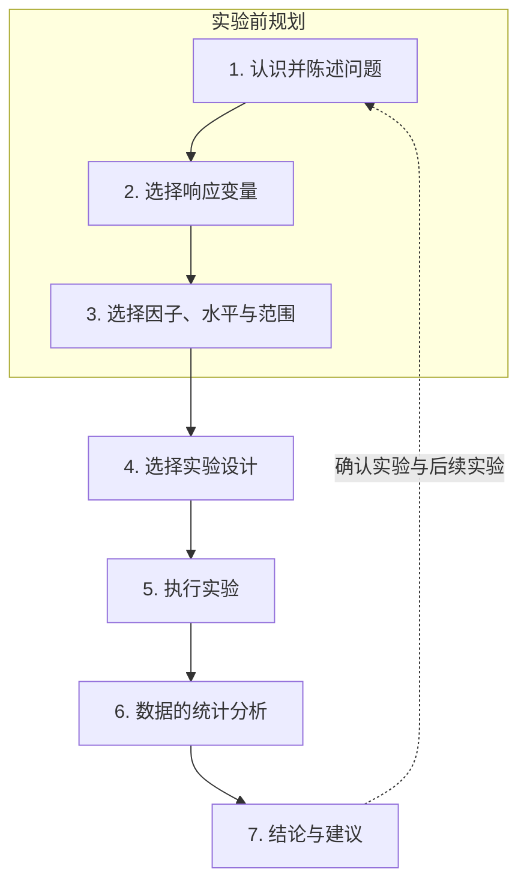

实验是一种学习方式：我们有意改变系统的输入，观察输出如何变化。"有意"二字是关键：当实验者决定出现哪些条件时，输出的差异才可以归因于输入，这正是我们所说的了解因果关系。统计学的介入远早于数据的产生。用多少个单位、如何把各种条件分配给它们、按什么顺序试验，决定了数据能揭示什么、不能揭示什么；如果研究遗漏了关键因子，或让两个因子同时变化，任何巧妙的分析都无法补救。正如那句口号所说：再高明的分析也弥补不了糟糕的设计。

本章建立全课程的语言。1.1 节给出实验的定义，并与另外两种收集数据的方式对比；1.2 节简述这门学科如何从农业田间试验发展为工业、科学与计算领域的工具；1.3 节引入后续各章使用的术语；1.4 节讨论实验的目的与规划方法；1.5 节以一个同时用到全部术语的小实验作结。在线性回归（[3.3](/3.3)）中，数据通常是现成给定的；从这里开始，问题变成如何产生能回答问题的数据。设计的三条基本原则，即随机化、重复与分区组，是下一章（[3.8.2](/3.8.2)）的主题。

## 1.1. 什么是实验

### 1.1.1. 实验与试验

在日常的技术用语中，"实验"与"试验"（"试行"）的侧重略有不同。实验通常针对科学问题、理论或假设：我们有目的地改变条件并观察结果，以认识规律或检验猜想，如物理、化学实验。试验通常针对某个具体的对象、方法或产品：试用它以考察其表现，如压力试验、新作物品种的田间试验或新药的临床试验。前者问的是某条规律或假设是否成立，后者问的是这个东西实际表现如何。这只是用法上的倾向，并非截然的界线，在统计学上两者的设计与分析方式相同。我国关于本领域词汇的国家标准 GB/T 3358.3–2009 取代 1993 年版时也体现了这种侧重：旧版标题说的是试验设计，现行版说的是实验设计。

### 1.1.2. 实验与收集数据的方式

**定义 1.1.1（实验）** 实验是一次或一系列试验，其中研究者有意改变某个过程或系统的输入变量，并观察输出变量的相应变化，以了解因果关系。研究者事先计划好施加哪些输入条件、施加于哪些单位、按什么顺序进行的研究，称为**设计实验**。

实验是一个学习过程：它积累知识、解决问题、检验猜想。其结果由确定性成分与随机成分构成，

$$
Y=f(X_1,\dots,X_p)+\varepsilon,
$$

其中 $f$ 是输入 $X_1,\dots,X_p$ 的未知但固定的函数，$\varepsilon$ 汇集了输入无法解释的变异。拟合之后，同一分解写成 $Y=\hat Y+\hat\varepsilon$：拟合值加残差。

设计实验是获得过程数据的三种方式之一。它们的区别在于由谁来决定输入的取值。

**定义 1.1.2（回顾性研究与观察性研究）** **回顾性研究**使用过去为其他目的收集的数据，例如历史生产记录。**观察性研究**观察运行中的过程或总体，记录感兴趣的输入与输出，但不加干预：研究者决定测量什么，而不决定输入取什么值。

| | 回顾性研究 | 观察性研究 | 设计实验 |
|---|---|---|---|
| 谁设定输入 $X$ | 无人：历史记录 | 过程本身 | 实验者 |
| 何时收集数据 | 提出问题之前 | 观察过程中，按计划测量 | 计划之后，在选定的条件下 |
| 典型缺陷 | 变量缺失或不可靠，输入几乎没有变化，过程的改变未被记录 | 输入只在其自然范围内变化；$Y$ 的变化可能源于与 $X$ 同步变动的未测量变量 | 成本高；条件可能无法实现或不符合伦理 |
| 能否确立因果关系 | 很少 | 只在很强的假设下 | 能，只要处理是随机分配的 |
| 例 | 把去年的产量记录与日志中的操作温度联系起来 | 一个月内记录每批的温度与产量 | 由工程师选定温度，按随机顺序生产各批 |

抽样调查在同样的意义上也是观察性的：它测量的是现状下的总体，不分配任何条件。这一区别在 [3.8.2](/3.8.2) 中还会用到：只有被比较的条件由实验者分配时，这种比较才称为对比实验。

### 1.1.3. 实验的阶段

每个实验都经历三个阶段。

1. 规划：确定要检验的假设、研究进行的条件、要考虑和可以忽略的因子、伦理问题，以及经费与时间的限制。
2. 执行：实际施加处理并测量响应。
3. 分析与解释：对数据作统计分析并得出结论。

这三个阶段并不同等重要。分析中的缺陷可以通过重新分析同一批数据来纠正；计划中的缺陷，例如遗漏关键因子，或两个因子总是一起变化而使它们的效应混杂，则无法纠正。这就是本课程大部分内容讨论第一阶段的原因。

## 1.2. 简史

实验设计的历史通常分为四个时期，每个时期由它试图回答的问题界定。

| 时期 | 核心问题 | 代表性思想 |
|---|---|---|
| 农业起源，1908–1940 年代 | 如何公平地比较各种处理，如何把处理效应与自然变异区分开？ | 随机化、重复、分区组、方差分析、析因实验（Fisher） |
| 第一个工业时期，1951–1970 年代末 | 如何通过实验为过程建模，并把它推向更好的操作条件？ | 响应曲面法（Box 与 Wilson） |
| 第二个工业时期，1970 年代末–1990 | 如何使良好的性能对不可控的变异不敏感？ | 稳健参数设计（Taguchi）、质量改进 |
| 现代，约 1990 年至今 | 实验规模大、成本高、基于计算或自动化时，如何决定下一步做什么？ | 多因子筛选设计、带代理模型与空间填充设计的计算机实验、序贯与自适应设计、Bayes 优化 |

现代形式的这门学科由 R. A. Fisher（1890–1962）创立。他于 1919 年至 1933 年在英国 Rothamsted 试验站，处理了数十年的农业田间数据。那里的根本问题是：如何把肥料或作物品种的效应与小区之间、年份之间的自然变异区分开。Fisher 的回答是设计实验，使数据能够回答问题：随机化使比较免受系统偏差的影响，重复揭示实验变异的大小，分区组使比较更精确，方差分析分离各种变异来源，析因实验同时研究多个因子。他的《研究工作者的统计方法》（1925）还普及了一个惯例：偏离约两个标准差、即 $P=0.05$ 处，就认为显著。他的设计思想有一个著名的例子：一位女士声称能分辨奶茶是先倒茶还是先倒奶，此事载于他的《实验设计》（1935）一书。她得到随机排序的八杯茶，两种各四杯，并被告知两种各有四杯。如果她毫无分辨能力，则把四杯先倒奶的茶全部辨认出来的概率是 $1/\binom{8}{4}=1/70$。这个例子已经包含了原假设、对顺序的随机化，以及由随机化本身算出的概率。

在 1950 年代的化学与过程工业中，问题从比较处理变为优化过程。G. E. P. Box 与 K. B. Wilson（1951）提出了**响应曲面法**（response surface methodology）：用小型设计实验，为响应关于少数连续因子的函数拟合一个经验的、通常是低阶多项式的模型，探索拟合出的曲面，把操作条件向改进的方向移动，如此反复。自 1970 年代末起，日本工程师田口玄一（Genichi Taguchi）的方法在制造业与电子业中传播。他的**稳健参数设计**（robust parameter design）选择可控因子的设置，使产品或过程的性能在不可控（噪声）因子的变异下依然良好；目标从优化转向稳健。现代则面对新规模、新类型的实验：生物技术与药物研发中的高维筛选，经代理模型分析的昂贵计算机模拟，以及序贯的、由人工智能指导的、自动化的实验，其中设计在每次试验之后决定下一步尝试什么。

## 1.3. 术语

### 1.3.1. 响应、因子与处理

回归与方差分析的词汇可以沿用。过程的输出称为**响应变量**（简称响应，或因变量）。**因子**是研究者为了引起响应变化而操纵的输入；在实验中它只取少数几个值，即它的**因子水平**，即使它是温度这样的连续变量。因子的效应是改变因子水平所引起的响应变化（单因子研究中某个水平的**处理效应**，析因研究中的**主效应**）。有些因子无法由实验者控制，但仍可能影响响应；如果它们的影响重要，就应加以测量并用于分析。

**定义 1.3.1（处理）** **处理因子**是水平本身受到直接关注、需要加以比较的因子。**处理**是处于某个指定水平的处理因子。当研究多个因子时，**水平组合**（处理组合）是为每个因子选定一个水平，即某次试验中的实验条件的集合；处理一词也常用来指水平组合。

若有 $s$ 个因子，水平数分别为 $q_1,\dots,q_s$，则共有

$$
N=\prod_{i=1}^{s}q_i
$$

个水平组合。水平组合是因子水平空间中 $s$ 维的一个点，因此有如下的名称。

**定义 1.3.2（设计点与析因设计）** 视为因子水平空间中一个点的水平组合称为**设计点**。**析因设计**通过试验各因子水平的组合来同时研究多个因子。在**完全析因设计**中，全部 $N=\prod q_i$ 个水平组合都要试验，且次数相同；在**部分析因设计**中，只试验水平组合的一个子集。

例如，三个二水平因子有 $2^3=8$ 个设计点，即立方体的顶点；完全析因设计试验全部八个，半部分只试验其中四个。完全析因设计的规模随因子数迅速增长：七个二水平因子已有 $128$ 个组合，所以筛选许多因子时需要部分析因设计。

### 1.3.2. 实验单位与试验

**定义 1.3.3（实验单位与试验）** **实验单位**是接受处理的基本对象；作为实验单位的人称为被试。**试验**（run，trial）是把一个处理施加于一个实验单位，即为采集一个实验观测值而使用的一组实验条件。

实验单位是独立于其他对象而接受处理的对象，它不一定就是被测量的对象。如果肥料施于整块田地，而测量其中十株植物，那么田地是实验单位，十株植物只是对它的测量；这一区别就是 [3.8.2](/3.8.2) 中重复与重复测定之分的主题。

两个因子可以有两种关系。

**定义 1.3.4（交叉因子与嵌套因子）** 如果一个因子的每个水平都与另一个因子的每个水平搭配出现，则称这两个因子为**交叉因子**。如果因子 $A$ 的水平对因子 $B$ 的每个水平都不相同，则称 $A$ 是 $B$ 内的**嵌套因子**。

在完全析因设计中，所有因子都是交叉的。嵌套源于单位的结构：供应商内的原料批次、班级内的学生、患者内的测量。对于嵌套因子，不存在可估计的 $A$ 与 $B$ 的交互效应，因为 $A$ 的水平从不与 $B$ 的多个水平相遇。

### 1.3.3. 误差

在相同条件下收集的观测值并不完全相同。一组观测值中无法解释的变异称为误差，它有两种不同的来源。

**定义 1.3.5（失拟误差与实验误差）** 当分析在过程的模型中遗漏了一个或多个重要的项或因子时产生的误差，称为**失拟误差**。**实验误差**（随机误差）是由过程自身的自然变异引起的变异：由于外来因素（噪声），接受相同处理的实验单位的响应即使在相似条件下也会不同。

实验误差通常建模为均值为零、方差为常数的正态随机变量，设计的目的之一就是使它变小。相反，失拟误差是模型的系统误差，需要靠更好的模型来消除。有重复试验时，两者可以分离：回归模型的残差平方和分解为**纯误差平方和**与**失拟平方和**（[3.3.6](/3.3.6)）。

必须区分两种变异的度量。**标准差**描述个别单位上观测值的变异。**标准误**描述由整个实验算出的估计量的随机变异：它是估计量抽样分布的标准差，或该标准差的估计（[3.3.3](/3.3.3)）。对 $n$ 个观测的**样本均值**，$\bar X$ 的真实标准差是 $\sigma/\sqrt n$，其标准误是 $s/\sqrt n$。标准差是总体的性质，不随数据增多而变小；标准误则按 $1/\sqrt n$ 缩小。**置信区间**就是由标准误构造的。

## 1.4. 基本概念

### 1.4.1. 实验的目的

在工程中，实验用于过程的表征与优化、材料性质的评价、产品的设计与开发，以及元件与系统公差的确定；在科学中，实验是检验假设的主要手段。无论在哪个领域，结果完全取决于所收集的数据，而数据取决于设计。在这个意义上，所有实验都是设计实验：有的设计得好，有的设计得差。

设计与分析取决于所问的问题。实验按目的通常分为五类。

| 目的 | 问题 | 典型设计 |
|---|---|---|
| 处理比较 | 一个因子的若干处理是否有差异，差异如何？ | 对比实验、单因子设计与分区组设计 |
| 变量筛选 | 大量因子中哪几个是重要的？ | 部分析因设计及其他筛选设计 |
| 响应曲面探索 | 重要因子如何定量地影响响应？ | 拟合一阶与二阶模型的设计 |
| 系统优化 | 什么条件给出最佳响应？ | 序贯响应曲面设计 |
| 系统稳健性 | 什么设置既使系统最优，又降低不可控（噪声）因子的影响？ | 带控制因子与噪声因子的稳健参数设计 |

这几类实验常常在一系列实验中依次出现：先用筛选缩短因子清单，再用响应曲面实验为重要因子建模，最后用模型优化系统。

### 1.4.2. 统计学的作用

统计学对研究质量的影响在规划阶段最大。统计学家很少是主要研究者，但统计思维为每个实验者都面临的问题提供答案：

1. 应检查多少个实验单位，应有多少重复？
2. 如何构造实验，才能给推断提供尽可能广泛的基础？
3. 如何考虑实验单位之间的自然变异？
4. 应如何把处理分配给各单位？
5. 如何进行统计分析？

反过来，统计学家也需要实验者的专业知识：因子是什么、能测量什么、哪些水平是现实的。统计学家越了解实验者的视角，设计就越好。

### 1.4.3. 规划实验

一个广泛使用的指南把实验的规划与执行分成七步。

1. 认识并陈述问题：科学问题是什么，目标是什么？
2. 选择响应变量：要测量什么，如何测量？测量系统有多好？如果真正感兴趣的响应无法直接测量，可以使用替代响应。
3. 选择因子、水平与范围：找出响应变异的可能来源，例如借助流程图或鱼骨图（见下）。每个因子的实验范围至关重要：范围太窄会掩盖效应，范围太宽则可能超出过程能够运行的区域。
4. 选择设计：选定设计点、重复次数以及对随机化的限制，汇集成设计矩阵。
5. 执行实验：使用列出各处理及试验顺序的计划矩阵，并监控过程，确保一切按计划进行。
6. 统计分析：有了好的设计，分析通常高效而简单。
7. 结论与建议：用问题本身的语言解释结果并提出行动建议，通常还要用后续试验加以确认。

第 1–3 步合称实验前规划，大多数失败的实验就失败在这里。实验是迭代的：先做一个小的初步实验，从中学习再设计下一个，通常好于把全部资源押在一个基于初始猜测的大实验上。保持简单，并尽早引入统计思维。

过程的一般模型使各种输入的角色一目了然（见下图）。实验单位进入过程，输出响应 $y$。可控因子 $x_1,\dots,x_p$ 可由实验者设定；不可控因子 $z_1,\dots,z_q$ 在正常运行中无法设定，不过其中一些可以为实验之故而加以控制。响应建模为 $y=f(x_1,\dots,x_p)+\varepsilon$，其中 $f$ 未知而固定，$z$ 的影响包含在 $\varepsilon$ 中，或在稳健性研究中作为噪声因子进入模型。

**定义 1.4.1（鱼骨图）** **鱼骨图**（Ishikawa 图）是这样一种图：响应放在水平主干的头部，其变异的潜在原因按类别作为分支连在主干上。它是倒着画的，从 $y$ 画向潜在的 $x$。

传统的类别是测量、材料、方法、环境、人员与机器。为规划实验，更有用的是按设计中将如何处理这些原因来分类。图中给出了一个这样的图，针对计算机数控（CNC）机床加工涡轮叶片的实验，响应为叶片轮廓、表面光洁度与缺陷：可控的设计因子在实验中变动，保持不变的因子固定在一个水平，操作员或刀具供应商等干扰因子是已知的变异来源，可以用分区组处理（[3.8.2](/3.8.2)），环境温度等不可控因子则交给随机化，或作为协变量测量。

### 1.4.4. 伦理问题

所有研究中都会出现伦理问题，涉及动物或人类时尤为突出。良好的设计本身就是伦理问题：负责任地运用设计原则（分区组、足够但不过量的重复、析因实验而非一次一个因子的实验），可以大大减少生物医学与安全性研究中所需的动物数量，这类研究每年要用掉数千万只动物。在以人为对象的实验中，如临床试验或教育研究，是否对处理的分配进行随机化的决定与伦理纠缠在一起。如果研究者已经有证据表明一种处理优于另一种，那么是否还应进行该实验就值得怀疑；只有在对哪种处理更好确实存在不确定性时，随机化才是合乎伦理的。

## 1.5. 例：三个 Romeo

一个轻松的例子包含了本章的所有术语。三个年轻人 Ravi、Naren 和 Deepak 各自相信 Renu 在对他微笑，但她真正喜欢的只有其中一位。为了弄清楚，他们做了一个实验：每次试验中有些人在场，有些人不在场，并记录 Renu 是否微笑。

每个人是一个二水平因子，在场（$1$）或不在场（$0$），响应是 Renu 是否微笑（$1$ 或 $0$）。在 $2^3=8$ 个水平组合中，三人都不在场的那个没有意义，因此对立方体其余的七个设计点各试验两次，共 $14$ 次试验，每个重复内的试验顺序由掷骰子决定。

| Ravi | Naren | Deepak | 重复 1 中是否微笑 | 重复 2 中是否微笑 |
|:-:|:-:|:-:|:-:|:-:|
| 1 | 1 | 1 | 1 | 1 |
| 0 | 1 | 1 | 1 | 1 |
| 1 | 0 | 1 | 1 | 0 |
| 1 | 1 | 0 | 0 | 0 |
| 0 | 1 | 0 | 0 | 0 |
| 1 | 0 | 0 | 0 | 0 |
| 0 | 0 | 1 | 0 | 1 |

每个人在 $8$ 次试验中在场，在 $6$ 次中不在场。微笑的次数如下：

| 因子 | 在场 | 不在场 | 在场时的比例 | 不在场时的比例 |
|---|:-:|:-:|:-:|:-:|
| Ravi | 3 | 3 | $3/8$ | $3/6$ |
| Naren | 4 | 2 | $4/8$ | $2/6$ |
| Deepak | 6 | 0 | $6/8$ | $0/6$ |

Deepak 不在场时，Renu 从未微笑；他在场的 $8$ 次试验中，她有 $6$ 次微笑；Ravi 在不在场没有区别，Naren 的表观效应来自他与 Deepak 同时在场的那些试验。Deepak 才是真正的 Romeo（故事里，他娶了 Renu）。Deepak 的八次在场试验中有两次没有微笑，即第一个重复中只有 Deepak 在场的那次，以及第二个重复中 Ravi 与 Deepak 在场的那次：这是实验误差，归因于 Renu 的情绪。

设计的各要素如下：

| 术语 | 在故事中 |
|---|---|
| 响应 | Renu 是否微笑（$1$ 或 $0$） |
| 因子 | Ravi、Naren 与 Deepak |
| 水平 | 在场或不在场 |
| 设计 | $2^3$ 析因设计的七个有意义的点，每点试验两次 |
| 随机化 | 用骰子决定试验的顺序 |
| 重复 | 每个水平组合试验两次 |
| 平衡 | 三个因子地位对称：每个在 $8$ 次试验中在场，在 $6$ 次中不在场 |
| 潜伏变量 | Renu 的父亲，他在场与否也可能影响她是否微笑 |
| 实验误差 | Renu 的情绪 |

随机化的顺序使比较免受潜伏变量（如父亲）的干扰，因为他的来去与骰子选定的顺序无关；重复使我们看到单次试验可能误导人；析因的安排使三个假设可以在同样的 $14$ 次试验中同时考察。这些选择背后的原则是 [3.8.2](/3.8.2) 的主题。

## 小结

- 实验有意改变过程的输入并观察输出，以了解因果关系。数据也可以由回顾性研究（历史记录）或观察性研究（只观察不干预）获得；只有设计实验自己设定输入，因此只有它能支持因果结论。
- 实验有规划、执行与分析三个阶段；规划中的错误无法靠分析弥补。
- 这门学科的历史从 Fisher 的农业实验（随机化、重复、分区组、方差分析、析因实验）出发，经响应曲面法与稳健参数设计，到计算机实验、序贯实验与自适应实验。
- 术语：

  | 术语 | 含义 |
  |---|---|
  | 响应 | 过程的输出 |
  | 因子，水平 | 被操纵的输入及其取值 |
  | 处理因子，处理 | 直接关注的因子；处于给定水平的这种因子 |
  | 水平组合，设计点 | 每个因子取一个水平；共 $\prod q_i$ 个，是因子空间中的点 |
  | 完全 / 部分析因设计 | 试验全部 / 部分水平组合 |
  | 实验单位，被试 | 接受处理的对象；作为单位的人 |
  | 试验 | 把一个处理施加于一个单位一次 |
  | 交叉 / 嵌套因子 | 所有水平组合都出现 / 一个因子的水平专属于另一个因子的某个水平 |
  | 失拟误差 / 实验误差 | 模型的系统误差 / 同样处理的单位之间的自然变异 |
  | 标准差 / 标准误 | 个别观测值的变异 / 估计量的变异 |

- 实验的目的：处理比较、变量筛选、响应曲面探索、系统优化、系统稳健性。
- 规划分七步，其中前三步（问题、响应、因子与水平）最重要；实验是序贯的。鱼骨图把潜在因子整理为设计因子、保持不变的因子、干扰因子与不可控因子。

## 思考题

1. 判断下列每项研究是回顾性研究、观察性研究还是设计实验。(a) 一位工程师把质量记录中去年各生产批次的抗拉强度与操作员日志上记录的固化温度联系起来。(b) 某机构用一个月时间记录随机抽取的中学生的年龄与每周网络游戏时长。(c) 一位教师随机指定两个班使用新教学法、两个班使用旧教学法，并比较考试成绩。

   **答** (a) 回顾性研究：数据是此前为其他目的收集的。(b) 观察性研究（抽样调查）：变量按现状测量，没有分配任何条件。(c) 设计实验：教学法由教师分配。注意这里的实验单位是班而不是学生，因为教学法是施于整个班级的；每种教学法只有两个班，所以每个处理只有两个重复。
2. 下列问题各属于哪类实验？(a) 改进一种医疗方案，使它对病情严重程度不同的患者都有良好效果。(b) 一位工程师研究合成纤维中棉的百分比如何影响其抗拉强度：(i) 棉的百分比是否影响强度？(ii) 若是，什么模型描述这种影响，参数是什么？(iii) 棉的百分比取多少时强度最大？

   **答** (a) 系统稳健性：病情的严重程度是医生无法选择的噪声因子，目标是找到效果对它不敏感的疗法。(b) (i) 处理比较：比较若干棉百分比下的强度。(ii) 响应曲面探索：把响应建模为该因子的函数。(iii) 系统优化：找出最佳设置。这三个问题通常由一系列实验按此顺序回答。
3. 一家面包店测试饼干的销量。(a) 因子 $A$ 是口味（巧克力豆或抹茶），因子 $B$ 是门店（市区或郊区）；两种口味在两家店都有售。(b) 因子 $B$ 仍是门店，但因子 $A$ 是供应商，市区店只用供应商 1 和 2，郊区店只用供应商 3 和 4。两种情形中 $A$ 与 $B$ 是交叉的还是嵌套的？

   **答** (a) 交叉：每种口味都与每家店搭配出现。(b) $A$ 嵌套于 $B$：每个供应商只出现在一家店中，所以市区店的供应商 $1$ 与郊区店的供应商 $3$ 是不同的水平，供应商与门店的交互效应无从定义。
4. 一位植物学家比较三种肥料。她有 $12$ 个花盆，每盆一株幼苗，用抽签的方式把每种肥料分给 $4$ 个花盆，六周后对每株植物的高度测量两次并记录平均值。指出处理因子、它的水平、处理、实验单位、试验、响应以及重复的次数。这是完全析因设计吗？

   **答** 处理因子是肥料，有 $3$ 个水平，也就是处理。实验单位是 $12$ 个花盆（连同幼苗），共 $12$ 次试验，每盆一次。响应是六周后的植株高度（两次测量的平均值）；测量两次减小了测量误差，但没有增加重复。每个处理重复 $4$ 次。只有一个因子时，每个水平试验相同次数自然就是完全析因设计。
5. 某灌装线上 $n=25$ 个瓶子的灌装重量的样本均值为 $\bar x=502.3\,\mathrm{g}$，样本标准差为 $s=4.0\,\mathrm{g}$。这里的标准差和标准误各是多少？如果测量 $100$ 个瓶子，它们将如何变化？

   **答** 标准差 $s=4.0\,\mathrm{g}$ 估计单个瓶子围绕灌装线均值的变异程度。均值的标准误是 $s/\sqrt n=4.0/5=0.8\,\mathrm{g}$，即作为平均灌装重量估计的 $\bar x$ 的不确定性。测量 $100$ 个瓶子时，样本标准差仍在 $4\,\mathrm{g}$ 左右（瓶子并不会变得更均匀），而标准误降为约 $4.0/10=0.4\,\mathrm{g}$。
6. 解释这句话："所有实验都是设计实验，有的设计得差，有的设计得好。"

   **答** 每个实验都涉及决定：用哪些因子与水平、多少个单位、如何分配处理、按什么顺序试验，无论这些决定是否是有意识作出的。把它们交给习惯或方便，同样也是一种设计，而且通常是差的设计：例如先做完某个处理的所有试验，就使处理与时间混杂；每种条件只做一次试验的计划则无法估计实验误差。问题从来不是要不要设计，而是设计得有多好。
