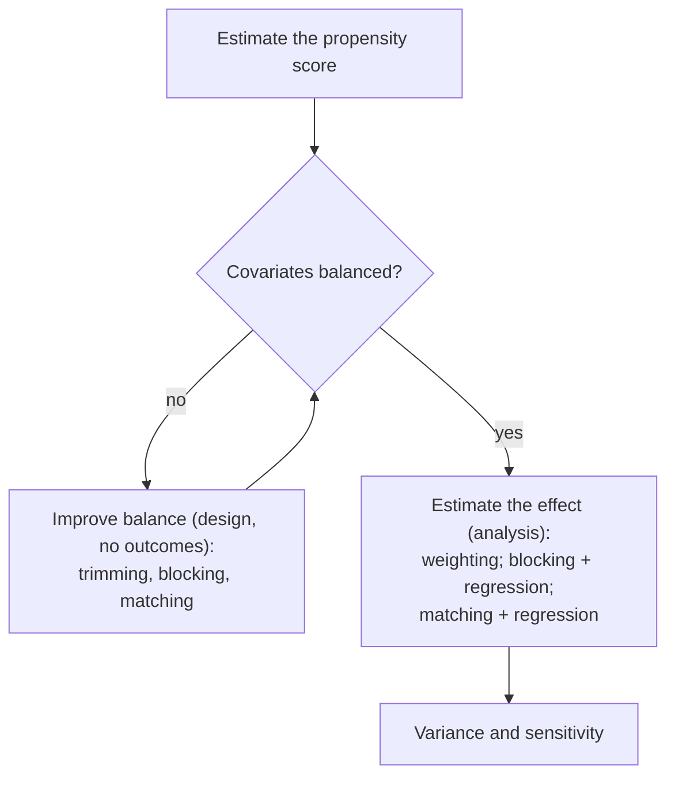

The course has developed two frameworks for causal questions. The potential outcomes framework of Neyman and Rubin starts from a treatment and an outcome, defines causal effects as comparisons of potential outcomes, and asks what the assignment mechanism allows us to infer ([3.9.1](/3.9.1)–[3.9.10](/3.9.10)). The graphical framework of Pearl starts from a system of variables, represents its causal structure by a directed acyclic graph, and asks which effects the graph allows us to compute, or what graph the data allow us to learn ([3.9.11](/3.9.11)–[3.9.13](/3.9.13)). Instrumental variables ([3.9.14](/3.9.14)) sit at the meeting point. This chapter first connects the parts of the course in one overview, without repeating them, and then introduces six directions in which the subject has grown. Each is treated briefly: the question it answers, its central definitions, and one representative result, with references to the original papers for the rest.

## 15.1. The Two Frameworks in Review

### 15.1.1. An Overview

| | Rubin: randomized experiments | Rubin: observational studies (RAM) | Pearl: causal graphs |
|---|---|---|---|
| question | average effect of a given treatment | average effect of a given treatment | the causal structure; any interventional quantity |
| main difficulty | half of the potential outcomes are missing | missing outcomes, unknown assignment probabilities, covariate imbalance (Simpson's paradox) | learning the graph from data; identifying effects with unobserved variables |
| assumptions | SUTVA; a known, individualistic, probabilistic, unconfounded assignment | SUTVA; an unknown but individualistic, probabilistic, unconfounded assignment | Markov compatibility, faithfulness; the causal diagram |
| tools | Fisher's exact p-values, Neyman's estimators, regression, Bayesian imputation; stratified and paired designs | the propensity score: weighting, blocking, matching, each with regression adjustment | d-separation; backdoor and front-door criteria, do-calculus; IC/PC and score-based learning |
| chapters | [3.9.3](/3.9.3)–[3.9.7](/3.9.7) | [3.9.8](/3.9.8)–[3.9.10](/3.9.10) | [3.9.11](/3.9.11)–[3.9.13](/3.9.13) |

The frameworks agree on their basic objects: a potential outcome $Y_i(w)$ is the counterfactual of a structural model, $\mathbb{E}[Y(1)] - \mathbb{E}[Y(0)] = \mathbb{E}[Y \mid \operatorname{do}(W = 1)] - \mathbb{E}[Y \mid \operatorname{do}(W = 0)]$, and the **unconfoundedness** of an assignment given covariates $X$ is what the **backdoor criterion** certifies when $X$ blocks every backdoor path ([3.9.12](/3.9.12)). Instrumental variables use both: the compliance types and the CACE are defined with potential outcomes, the exclusion restriction and the independence of the instrument from the unmeasured confounder are read off a graph $Z \to W \to Y$, $W \leftarrow U \to Y$ ([3.9.14](/3.9.14)).

For observational studies under a regular assignment mechanism the course followed one workflow, whose goal is valid inference through covariate balance, judged by two rules: higher precision is better, and a larger range of validity (a larger population to which the estimate applies) is better.

The design choices trade bias against variance: matching with replacement reduces bias and increases variance; using $M > 1$ matches per unit reduces variance and increases bias; trimming narrows the population but makes the estimate more credible.

### 15.1.2. Three Kinds of Bias as Graphs

Causal diagrams classify the threats to a causal conclusion by their structure (Hernán and Robins 2020). Let $A$ be the exposure and $Y$ the outcome.

| Bias | Structure | Example | Remedy |
|---|---|---|---|
| **confounding** | a common cause: $A \leftarrow L \to Y$ | age affects both medication and outcome | block the backdoor path: adjust for $L$ |
| **selection bias** | conditioning on a common effect: $A \to C \leftarrow U \to Y$, analysis restricted to $C = 1$ | smoking ($A$) and dementia ($Y$): only those who have not died ($C$) can be diagnosed, and death depends on smoking and on cardiovascular risk factors ($U$) that also affect dementia | avoid conditioning on $C$, or weight by the inverse probability of selection |
| measurement bias | the outcome (or exposure) is measured through a proxy: $A \to Y \to Y^*$ | vaccination ($A$), onset of multiple sclerosis ($Y$), diagnosis code in a database ($Y^*$) | validation data, models for the error, in particular when the error depends on $A$ |

In the selection example, restricting to survivors opens the path $A \to C \leftarrow U \to Y$, an instance of **collider bias**, and can make smoking look protective against dementia. Measurement bias is harmless for testing the null hypothesis when the error is independent of everything else, but it biases the effect estimate, and it becomes differential, a source of spurious association, when $A$ affects the measurement ($A \to Y^*$). Drawing the diagram before choosing an analysis makes such structures visible; deciding which arrows to draw is a question about the subject matter, not about the data.

## 15.2. Rerandomization

### 15.2.1. The Idea

The designs of [3.9.2](/3.9.2) differ in their sets $\mathcal{W}^+$ of allowed assignment vectors: a stratified experiment excludes the assignments that would put too many treated units in one stratum, a paired experiment excludes still more. With many covariates, stratifying on all of them is impossible, but a completely randomized assignment is then likely to be unbalanced on some covariate by chance. With $10$ independent covariates each tested at level $0.05$, the probability that at least one shows a significant difference between the groups is $1 - 0.95^{10} \approx 0.40$; this is not bad luck but the expected behavior of complete randomization. The remedy proposed by Morgan and Rubin (2012), and practised informally since Fisher's time, is to reject unbalanced assignments before the experiment is run.

**Definition 15.2.1 (Rerandomization)** Let $\hat{\boldsymbol{\tau}}_x = \bar X_{\mathrm{t}} - \bar X_{\mathrm{c}}$ be the difference in covariate means between the groups for an assignment of a CRE with $N_{\mathrm{t}}$ treated and $N_{\mathrm{c}}$ control units among $N$, and $S_x^2$ the sample covariance matrix of the covariates. **Rerandomization** with threshold $a$ draws assignments from the CRE until

$$
M = \hat{\boldsymbol{\tau}}_x^{\mathsf T}\Bigl(\frac{N}{N_{\mathrm{t}}N_{\mathrm{c}}}S_x^2\Bigr)^{-1}\hat{\boldsymbol{\tau}}_x \le a,
$$
and uses the first acceptable one. The acceptance criterion and the threshold must be fixed before the randomization.

$M$ is the **Mahalanobis distance** between the two covariate mean vectors, scaled by the covariance of $\hat{\boldsymbol{\tau}}_x$ under complete randomization; by the **finite population central limit theorem** it is approximately $\chi^2_K$ for $K$ covariates, so the acceptance probability is $p_a \approx \mathbb{P}(\chi^2_K \le a)$, and $a$ is usually chosen to give $p_a$ between $0.001$ and $0.1$. In terms of [3.9.2](/3.9.2), rerandomization is a randomized experiment whose $\mathcal{W}^+$ is the set of balanced assignments, each of which has the same probability.

### 15.2.2. Properties

**Theorem 15.2.1 (Rerandomization; Morgan and Rubin 2012)** Under rerandomization with the criterion $M \le a$ and $N_{\mathrm{t}} = N_{\mathrm{c}}$:

1. the difference in means $\hat\tau^{\mathrm{dif}}$ is unbiased for $\tau_{\mathrm{fs}}$, and $\mathbb{E}[\hat{\boldsymbol{\tau}}_x \mid M \le a] = \boldsymbol{0}$;
2. if the covariate means are approximately normal, each covariate difference has its variance reduced by the same factor,
   $$
   \operatorname{Var}(\hat{\boldsymbol{\tau}}_x \mid M \le a) = v_a\operatorname{Var}(\hat{\boldsymbol{\tau}}_x), \qquad v_a = \frac{\mathbb{P}(\chi^2_{K+2} \le a)}{\mathbb{P}(\chi^2_K \le a)} < 1;
   $$
3. if in addition the treatment effect is additive, the variance of the estimated effect is reduced to
   $$
   \operatorname{Var}(\hat\tau^{\mathrm{dif}} \mid M \le a) = \bigl[1 - (1 - v_a)R^2\bigr]\operatorname{Var}(\hat\tau^{\mathrm{dif}}),
   $$
   where $R^2$ is the squared multiple correlation between the outcomes and the covariates.

Unbiasedness follows from symmetry: with equal group sizes, an assignment and its mirror image (treatment and control swapped) have the same $M$, so both are accepted or both rejected, and the average of $\hat\tau^{\mathrm{dif}}$ over an assignment and its mirror image is exactly $\tau_{\mathrm{fs}}$ (the two estimates together use every unit's $Y_i(1)$ and $Y_i(0)$ once). The variance reduction is the part of the outcome explained by the covariates, times the reduction in the covariate imbalance; covariates unrelated to the outcome cost nothing but also gain nothing. Rerandomization thus achieves in the design what regression adjustment ([3.9.5](/3.9.5)) achieves in the analysis, without any model for the outcome.

The inference must respect the design. Under rerandomization, $\hat\tau^{\mathrm{dif}}$ is no longer asymptotically normal but a sum of a normal variable and a truncated one, and the usual Neyman interval is too wide, conservative but wasteful. Li, Ding and Rubin (2018) derived the asymptotic distribution, which gives confidence intervals that are shorter, often substantially, and still valid. Fisher's exact test remains exact if the reference distribution is computed over the accepted assignments only.

## 15.3. Negative Controls

The methods of the course assume that all confounders are measured, or that an instrument is available. Negative controls offer a third way to deal with an unmeasured confounder $U$ of the exposure $X$ and the outcome $Y$: use other variables that are known to be unrelated to the causal question but share the confounding.

**Definition 15.3.1 (Negative Control)** A **negative control exposure** is a variable $Z$ that is associated with the exposure through the unmeasured confounder but has no causal effect on the outcome. A **negative control outcome** is a variable $W$ that is affected by the unmeasured confounder but not by the exposure. Both serve as proxies of $U$.

Classical uses detect confounding: in a study of the effect of influenza vaccination on mortality, a "protective effect" of the vaccine on deaths before the influenza season (a negative control outcome) reveals that healthier people are vaccinated. Miao, Geng and Tchetgen Tchetgen (2018) showed that a pair of proxies can do more: identify the effect.

**Theorem 15.3.1 (Identification with Two Proxies)** Let $U$, $Z$, $W$ be discrete with the same number $k$ of categories, and suppose that

$$
W \perp (Z, X) \mid U, \qquad Z \perp Y \mid (U, X),
$$
that $U$ satisfies the backdoor criterion for $(X, Y)$, and that the $k \times k$ matrix $\mathbb{P}(W \mid x, Z)$ with entries $\mathbb{P}(W = w_i \mid x, Z = z_j)$ is invertible. Then, writing $\mathbb{P}(y \mid x, Z)$ for the row vector $(\mathbb{P}(y \mid x, z_j))_j$ and $\mathbb{P}(W)$ for the column vector $(\mathbb{P}(w_i))_i$,

$$
\mathbb{P}(y \mid \operatorname{do}(x)) = \mathbb{P}(y \mid x, Z)\,\mathbb{P}(W \mid x, Z)^{-1}\,\mathbb{P}(W).
$$

**Proof** By the backdoor adjustment, $\mathbb{P}(y \mid \operatorname{do}(x)) = \sum_u \mathbb{P}(y \mid x, u)\,\mathbb{P}(u) = \mathbb{P}(y \mid x, U)\,\mathbb{P}(U)$ in vector notation. The two independencies give two matrix identities:

$$
\mathbb{P}(W \mid x, Z) = \mathbb{P}(W \mid U)\,\mathbb{P}(U \mid x, Z), \qquad \mathbb{P}(y \mid x, Z) = \mathbb{P}(y \mid x, U)\,\mathbb{P}(U \mid x, Z),
$$
from $\mathbb{P}(w \mid x, z) = \sum_u \mathbb{P}(w \mid u)\,\mathbb{P}(u \mid x, z)$ and $\mathbb{P}(y \mid x, z) = \sum_u \mathbb{P}(y \mid x, u)\,\mathbb{P}(u \mid x, z)$. Invertibility of the left-hand matrix implies that $\mathbb{P}(W \mid U)$ and $\mathbb{P}(U \mid x, Z)$ are invertible, so $\mathbb{P}(y \mid x, U) = \mathbb{P}(y \mid x, Z)\,\mathbb{P}(U \mid x, Z)^{-1} = \mathbb{P}(y \mid x, Z)\,\mathbb{P}(W \mid x, Z)^{-1}\,\mathbb{P}(W \mid U)$. Multiplying by $\mathbb{P}(U)$ and using $\mathbb{P}(W \mid U)\,\mathbb{P}(U) = \mathbb{P}(W)$ gives the formula, in which everything is observable. $\square$

The proxies stand in for the unmeasured $U$: $W$ measures it without being affected by the treatment, and $Z$ supplies a second, independent view of it, so that the confounding can be "solved for". For continuous variables the matrix inverse becomes the solution of an integral equation (the outcome confounding bridge of proximal causal inference). Instrumental variables use an extra variable too, but with different assumptions: an instrument must be independent of $U$ and affect $Y$ only through $X$, whereas a negative control exposure may depend on $U$, and the negative control method requires the second proxy $W$ and no effect of $Z$ on $Y$. In general neither set of assumptions contains the other, and each design should be judged on whether its own assumptions are credible.

## 15.4. Principal Stratification

The key idea of the instrumental variables analysis of [3.9.14](/3.9.14) was to classify the units by how they would respond to the assignment, $(W_i(0), W_i(1))$, a characteristic that is not affected by the assignment and can therefore play the role of a pre-treatment covariate, even though it is only partly observed.

**Definition 15.4.1 (Principal Stratification)** Let $S$ be a post-treatment variable with potential values $S_i(0)$, $S_i(1)$. The **principal strata** are the subpopulations defined by the joint potential values $G_i = (S_i(1), S_i(0))$; **principal stratification** (Frangakis and Rubin 2002) defines causal effects within these strata, $\mathbb{E}[Y_i(1) - Y_i(0) \mid G_i = g]$. These are well-defined causal effects, because $G_i$ is not affected by the treatment, in contrast with comparisons conditional on the observed $S_i$.

For binary $S$ there are four strata. With $S = W$, the treatment received, they are the compliance types, and the CACE is the principal stratum effect for compliers:

| Stratum | $W(1)$ | $W(0)$ | $Y(1)$ observable | $Y(0)$ observable |
|---|---|---|---|---|
| never-taker | 0 | 0 | no effect defined ($W = 0$ either way) | |
| complier | 1 | 0 | yes | yes |
| defier | 0 | 1 | yes | yes |
| always-taker | 1 | 1 | no effect defined ($W = 1$ either way) | |

A second application is truncation by death. In a clinical trial of a drug $Z$ for a severe disease, the outcome of interest is quality of life $Y$, measured only for patients who survive ($S = 1$); in an educational experiment, a scholarship $Z$ and a test score $Y$ observed only for students who did not drop out. Comparing the surviving patients of the two arms compares different kinds of patients if the drug affects survival, a form of **selection bias**.

**Definition 15.4.2 (Survivor Average Causal Effect)** With survival $S$ and outcome $Y$ defined only when $S = 1$, the principal strata are $\mathrm{LL}$ (survives under both treatments), $\mathrm{LD}$ (survives only with treatment), $\mathrm{DL}$ (survives only without) and $\mathrm{DD}$ (dies under both). The **survivor average causal effect** is

$$
\mathrm{SACE} = \mathbb{E}[Y(1) - Y(0) \mid S(1) = S(0) = 1],
$$
the effect in the only stratum in which both potential outcomes exist.

| Stratum | $S(1)$ | $S(0)$ | $Y(1)$ defined | $Y(0)$ defined |
|---|---|---|---|---|
| DD | 0 | 0 | no | no |
| LD | 1 | 0 | yes | no |
| DL | 0 | 1 | no | yes |
| LL | 1 | 1 | yes | yes |

The stratum of a unit is not observed: a survivor in the treatment arm may be LL or LD. The SACE is therefore not identified without further assumptions. Under monotonicity ($S(1) \ge S(0)$, no DL stratum) the proportions of the strata are identified, and sharp bounds on the SACE follow (Zhang and Rubin 2003); with additional assumptions or auxiliary variables, point identification is possible.

## 15.5. Mediation Analysis

Many scientific questions ask not only whether but how a treatment works. Does cognitive behavioral therapy ($Z$) reduce delusions ($Y$) by reducing worry ($S$) (Freeman et al. 2015)? How much of the effect of race on survival after a cancer diagnosis is due to differences in tumor subtype and stage at diagnosis? *Mediation analysis* decomposes a total effect into a part that goes through a mediator $S$ and a part that does not.

**Definition 15.5.1 (Natural Direct and Indirect Effects)** Let $Y(z, s)$ be the potential outcome under treatment $z$ and mediator value $s$, and $S(z)$ the potential mediator, so that $Y(z) = Y(z, S(z))$. For binary $Z$, the total effect $\mathrm{TE} = \mathbb{E}[Y(1, S(1))] - \mathbb{E}[Y(0, S(0))]$ splits as

$$
\mathrm{TE} = \underbrace{\mathbb{E}[Y(1, S(0))] - \mathbb{E}[Y(0, S(0))]}_{\text{natural direct effect (NDE)}} + \underbrace{\mathbb{E}[Y(1, S(1))] - \mathbb{E}[Y(1, S(0))]}_{\text{natural indirect effect (NIE)}}.
$$
The **natural direct effect** changes the treatment while keeping the mediator at the value it would naturally take without treatment; the **natural indirect effect** keeps the treatment and changes the mediator from its untreated to its treated value (Robins and Greenland 1992; Pearl 2001).

The **controlled direct effect** of [3.9.12](/3.9.12), $\mathbb{E}[Y(1, s) - Y(0, s)]$, fixes the mediator at a value $s$ chosen by the investigator; it is a policy quantity ("what if we set the mediator to $s$ for everyone"), and there is no corresponding indirect effect. The natural effects describe mechanisms, and their sum is the total effect; but they involve the cross-world quantity $Y(1, S(0))$, the outcome under treatment with the mediator at the value it would have without treatment, which can never be observed for any unit, even in an experiment that randomizes both $Z$ and $S$. Their identification therefore needs, besides no unmeasured confounding of the treatment–outcome, treatment–mediator and mediator–outcome relations, a cross-world independence such as $Y(z, s) \perp S(z') \mid X$, and in particular no mediator–outcome confounder that is itself affected by the treatment. Under these assumptions

$$
\mathbb{E}[Y(1, S(0))] = \sum_{x, s} \mathbb{E}[Y \mid Z = 1, S = s, X = x]\,\mathbb{P}(S = s \mid Z = 0, X = x)\,\mathbb{P}(x),
$$
the mediation formula. In a linear model $S = \alpha_0 + \alpha Z + \varepsilon_S$, $Y = \beta_0 + \theta Z + \beta S + \varepsilon_Y$ without interaction, $\mathrm{NDE} = \theta$ and $\mathrm{NIE} = \alpha\beta$, the product of coefficients of the social science literature; with an interaction between $Z$ and $S$ the natural effects differ from these coefficients, which is where the counterfactual definitions are needed (VanderWeele 2015).

## 15.6. The Surrogate Paradox

### 15.6.1. A Real Example

Clinical endpoints such as death take long to observe, so trials often measure a surrogate: a variable $S$ that is affected by the treatment $T$ and predicts the true endpoint $Y$, such as blood pressure, a tumor marker or the viral load. The surrogate paradox is the possibility that $T$ has a positive effect on $S$, $S$ has a positive effect on $Y$, and yet $T$ has a negative effect on $Y$.

The best known case concerns antiarrhythmic drugs. Irregular heartbeats after a heart attack predict sudden cardiac death, and drugs that suppress them were approved and widely prescribed in the United States on the premise that correcting the arrhythmia, a **surrogate endpoint**, would prevent deaths. The Cardiac Arrhythmia Suppression Trial (CAST), begun in 1987, randomized patients who had had a heart attack to encainide, flecainide or moricizine versus placebo. The drugs did suppress the arrhythmias, but the encainide and flecainide arms were stopped in 1989 because mortality was higher than with placebo, and the moricizine arm was stopped later for the same reason. Moore (1995) estimated that the drugs, during the years of wide use, caused tens of thousands of deaths in the United States.

### 15.6.2. How It Can Happen

**Definition 15.6.1 (Surrogate Paradox)** For a treatment $T$, a surrogate $S$ and an endpoint $Y$, the **surrogate paradox** (intermediate variable paradox) occurs when $\mathrm{ACE}(T \to S) > 0$ and $\mathrm{ACE}(S \to Y) > 0$, but $\mathrm{ACE}(T \to Y) < 0$.

The paradox does not require a direct effect of $T$ on $Y$; it can arise when the units for which $T$ raises $S$ are not the units for which $S$ raises $Y$. In the second form of the name, it is an intermediate variable paradox, of the same nature as **Simpson's paradox**: an unobserved variable $U$ that modifies both effects can reverse the conclusion.

**Example 15.6.1** Suppose $T$ acts on $Y$ only through $S$, so that $Y_{s,t} = Y_s$ and $Y_t = Y_{S_t}$, with three groups of units:

| Group | Size | $S_{T=0}$ | $S_{T=1}$ | $Y_{S=0}$ | $Y_{S=1}$ | $Y_{T=0}$ | $Y_{T=1}$ |
|---|---|---|---|---|---|---|---|
| 1 | 100 | 0 | 1 | 1 | 0 | 1 | 0 |
| 2 | 100 | 1 | 0 | 0 | 1 | 1 | 0 |
| 3 | 150 | 0 | 1 | 0 | 1 | 0 | 1 |

Among the 350 units, $\mathrm{ACE}(T \to S) = (250 - 100)/350 = 150/350 > 0$ (groups 1 and 3 have $S_{T=1} = 1$, group 2 has $S_{T=0} = 1$), and $\mathrm{ACE}(S \to Y) = (250 - 100)/350 = 150/350 > 0$ (groups 2 and 3 benefit from $S$). But $\mathrm{ACE}(T \to Y) = (150 - 200)/350 = -50/350 < 0$: the treatment raises the surrogate in group 1, where the surrogate is harmful, and lowers it in group 2, where it is beneficial.

:::

The example also shows how to exclude the paradox. If $T$ does not lower $S$ for any unit ($S_{T=1} \ge S_{T=0}$), $S$ does not lower $Y$ for any unit (monotone $Y_s$), and $T$ acts on $Y$ only through $S$, then $Y_{T=1} = Y_{S_{T=1}} \ge Y_{S_{T=0}} = Y_{T=0}$ for every unit and $\mathrm{ACE}(T \to Y) \ge 0$. Chen, Geng and Jia (2007) and later work gave criteria of this kind, some of them checkable from data, for when a surrogate can be trusted. Population-level correlations between $S$ and $Y$, however strong, are not enough.

## 15.7. Causal Inference and Machine Learning

Two lines of work connect causal inference with modern machine learning. The first uses optimization to learn causal structure. Finding the DAG with the best score is **NP-hard** ([3.9.13](/3.9.13)), because acyclicity is a combinatorial constraint. Zheng et al. (2018), in the method known as NOTEARS, observed that a weighted adjacency matrix $W \in \mathbb{R}^{d \times d}$ represents a DAG if and only if

$$
h(W) = \operatorname{tr}\bigl(\mathrm{e}^{W \circ W}\bigr) - d = 0,
$$
where $\circ$ is the elementwise product and $\mathrm{e}^{A}$ the matrix exponential: $\operatorname{tr}((W \circ W)^k)$ is a weighted count of closed walks of length $k$, all zero exactly when there is no directed cycle. Structure learning then becomes a continuous optimization problem, minimizing a least-squares or likelihood loss subject to $h(W) = 0$, which can be solved with standard numerical methods and combined with neural networks. The result is a local optimum of a nonconvex problem, and the method is sensitive to the scale of the variables, so it complements rather than replaces the methods of [3.9.13](/3.9.13).

The second line asks what causality can do for machine learning (Schölkopf et al. 2021). Statistical learning assumes that training and test data come from the same distribution, and it fails out of distribution; its models are black boxes whose internal variables have no causal meaning. A causal model, by contrast, says which parts of a system stay the same when other parts change.

**Definition 15.7.1 (Independent Causal Mechanisms Principle)** The **independent causal mechanisms principle** states that the causal generative process of a system's variables is composed of autonomous modules, the conditional distributions $\mathbb{P}(x_i \mid \mathrm{pa}_i)$ of each variable given its causes, that do not inform or influence each other. The related sparse mechanism shift hypothesis states that changes in the distribution, such as a change of environment or an intervention, typically affect only a few of these mechanisms.

The principle is a reformulation of the invariance of the factors in a **causal Bayesian network** (condition 3 of Definition 11.4.2). It suggests that models factored along causal directions adapt to new environments with few changes, which is the basis of methods for transfer learning and domain adaptation. Applying it requires causal variables, but the inputs of machine learning are often raw data such as the pixels of an image, in which no single variable is a cause. *Causal representation learning* is the problem of learning, from such low-level observations, high-level variables together with the causal relations among them, so that interventions and counterfactuals become meaningful in the learned representation; it extends **representation learning** by the requirement that the learned variables be causal.

## 15.8. Milestones

The table lists the main contributions of some of the researchers who shaped the field, with the methods and concepts that this course has used or mentioned.

| Period | Rubin and coauthors | Robins and coauthors | Pearl and coauthors | Others |
|---|---|---|---|---|
| 1920s–1930s | | | | Neyman (1923): potential outcomes in experiments; Fisher (1935): randomization as the basis of inference |
| 1970s | potential outcomes for observational studies (1974); ignorability (1978) | | | |
| 1980s | propensity score (Rosenbaum and Rubin 1983) | g-formula and g-estimation for time-varying treatments (1986) | Bayesian networks (1985, 1988) | Spirtes and Glymour: PC algorithm (1991) |
| 1990s | instrumental variables in the potential outcomes framework (Angrist, Imbens and Rubin 1996) | natural direct and indirect effects (Robins and Greenland 1992) | causal Bayesian networks, do-calculus (1995), structural counterfactuals; *Causality* (2000) | Verma and Pearl: observational equivalence (1990); Meek's rules (1995); Balke and Pearl: IV bounds (1997) |
| 2000s | principal stratification (Frangakis and Rubin 2002) | marginal structural models (2000) | natural effects and the mediation formula (Pearl 2001); identification algorithm (Shpitser and Pearl 2006) | Geng and coauthors: collapsibility and criteria for confounders, surrogate paradox criteria (Chen, Geng and Jia 2007), decomposition learning of DAGs (Xie and Geng 2008) |
| 2010s | rerandomization (Morgan and Rubin 2012) | single-world intervention graphs (Richardson and Robins 2013) | transportability; *The Book of Why* (2018) | negative controls for identification (Miao, Geng and Tchetgen Tchetgen 2018); NOTEARS (Zheng et al. 2018) |
| 2020s | | | | causal representation learning (Schölkopf et al. 2021); Nobel Prize in Economics 2021 to Card, Angrist and Imbens |

Pearl received the Turing Award in 2011 for his work on probabilistic and causal reasoning. The table is selective; the field has grown in economics, epidemiology, computer science and statistics at the same time, and many results were found independently in several of them.

## Summary

- The two frameworks share their basic objects (potential outcomes are structural counterfactuals; unconfoundedness is certified by the backdoor criterion) and differ in their starting point and emphasis; instrumental variables connect them. Confounding, selection and measurement bias correspond to forks, conditioned colliders and proxies in a causal diagram.
- Extensions:

  | Topic | Question | Key definition and result |
  |---|---|---|
  | rerandomization (15.2) | balance many covariates by design | accept assignments with Mahalanobis distance $M \le a$; $\hat\tau^{\mathrm{dif}}$ unbiased, variance factor $1 - (1 - v_a)R^2$ (Theorem 15.2.1) |
  | negative controls (15.3) | unmeasured confounder $U$ | proxies $Z$, $W$ with $W \perp (Z, X) \mid U$, $Z \perp Y \mid (U, X)$ give $\mathbb{P}(y \mid \operatorname{do}(x)) = \mathbb{P}(y \mid x, Z)\,\mathbb{P}(W \mid x, Z)^{-1}\,\mathbb{P}(W)$ (Theorem 15.3.1) |
  | principal stratification (15.4) | effects with post-treatment variables | strata $(S(1), S(0))$; compliance types; SACE in the always-surviving stratum (Definitions 15.4.1, 15.4.2) |
  | mediation (15.5) | how a treatment works | $\mathrm{TE} = \mathrm{NDE} + \mathrm{NIE}$ via $Y(1, S(0))$; cross-world assumptions (Definition 15.5.1) |
  | surrogate paradox (15.6) | can a surrogate mislead? | positive $T \to S$ and $S \to Y$ effects with negative $T \to Y$ effect (Definition 15.6.1, Example 15.6.1); excluded by individual-level monotonicity |
  | machine learning (15.7) | continuous structure learning; robustness | acyclicity $\operatorname{tr}(\mathrm{e}^{W \circ W}) = d$; independent causal mechanisms (Definition 15.7.1); causal representation learning |

## Questions

1. With 20 independent covariates, each compared between the groups of a CRE by a test at level $0.05$, what is the probability that at least one comparison is significant? If rerandomization accepts 5% of the assignments, how many randomizations are needed on average?

   **Answer** $1 - 0.95^{20} \approx 0.64$. The number of draws until the first acceptance is geometric with success probability $p_a = 0.05$, so on average $1/p_a = 20$ randomizations, which is cheap on a computer.
2. For $K = 2$ covariates and $p_a = 0.1$, compute $v_a$ and the variance reduction of $\hat\tau^{\mathrm{dif}}$ when $R^2 = 0.5$.

   **Answer** $\chi^2_2$ is exponential with mean $2$, so $a = -2\log 0.9 \approx 0.211$. $\mathbb{P}(\chi^2_4 \le a) = 1 - \mathrm{e}^{-a/2}(1 + a/2) = 1 - 0.9 \times 1.105 \approx 0.0052$, hence $v_a \approx 0.0052/0.1 = 0.052$: the covariate imbalance has about 5% of its variance under complete randomization. The variance of $\hat\tau^{\mathrm{dif}}$ is multiplied by $1 - (1 - 0.052)(0.5) \approx 0.53$, almost the full gain $1 - R^2 = 0.5$ that a perfect regression adjustment could achieve.
3. Why must the rerandomization criterion be fixed before the experiment, and how should Fisher's exact test be carried out after rerandomization?

   **Answer** If the criterion were chosen after looking at assignments, or at outcomes, the assignment mechanism would be unknown and could depend on the potential outcomes, destroying the basis of randomization inference. With a preset criterion the mechanism is known: uniform on the accepted assignments. Fisher's test then uses the distribution of the test statistic over accepted assignments only (simulated by drawing complete randomizations and keeping those with $M \le a$); using all CRE assignments would give a reference distribution that is too wide and a conservative test.
4. In Theorem 15.3.1 with binary $U$, $Z$, $W$, explain in words why one proxy alone is not enough to identify $\mathbb{P}(y \mid \operatorname{do}(x))$.

   **Answer** With $W$ alone we know $\mathbb{P}(W \mid x)$ but not how $W$ relates to $U$: the matrix $\mathbb{P}(W \mid U)$ and the distribution of $U$ are not determined by the distribution of $(X, Y, W)$, so adjusting for $W$ in place of $U$ leaves residual confounding of unknown size. The second proxy $Z$ supplies a second set of equations, $\mathbb{P}(y \mid x, Z)$ and $\mathbb{P}(W \mid x, Z)$, in which the unknown $\mathbb{P}(U \mid x, Z)$ appears in both and can be eliminated, provided the matrix $\mathbb{P}(W \mid x, Z)$ is invertible, that is, the proxies are informative enough about $U$.
5. In a trial with one-sided noncompliance (no control patient can obtain the treatment), which principal strata exist? Which can be identified from the observed data for a given patient?

   **Answer** $W_i(0) = 0$ for all units, so only never-takers $(W(1), W(0)) = (0, 0)$ and compliers $(1, 0)$ exist. In the treatment arm the stratum is observed: $W_i^{\mathrm{obs}} = 1$ means complier, $W_i^{\mathrm{obs}} = 0$ never-taker. In the control arm everyone has $W_i^{\mathrm{obs}} = 0$ and the stratum is unknown; but by randomization the proportion of compliers is the same as in the treatment arm, which is how the CACE is identified ([3.9.14](/3.9.14)).
6. In a trial of a drug for a severe disease, the mean quality of life among survivors is lower in the treatment arm than in the control arm. The drug increases survival. Does the drug lower quality of life?

   **Answer** Not necessarily. If the drug saves patients who would otherwise die (stratum LD) and these patients are the most severely ill, the treated survivors include them while the control survivors do not, so the comparison of survivors compares LL + LD patients with LL patients only. Even if the drug has no effect on quality of life within any stratum, the treated survivors can have lower quality of life. The causal question is answered by the SACE, the comparison within the LL stratum, which needs additional assumptions to be bounded or identified.
7. In the linear mediation model $S = \alpha Z + \varepsilon_S$, $Y = \theta Z + \beta S + \gamma ZS + \varepsilon_Y$ (binary $Z$, no confounding), compute the NDE and NIE.

   **Answer** $S(0) = \varepsilon_S$, $S(1) = \alpha + \varepsilon_S$, and $\mathbb{E}[Y(z, s)] = \theta z + \beta s + \gamma z s$. With $\mathbb{E}[\varepsilon_S] = 0$: $\mathrm{NDE} = \mathbb{E}[Y(1, S(0))] - \mathbb{E}[Y(0, S(0))] = \theta + \gamma\,\mathbb{E}[S(0)] = \theta$, and $\mathrm{NIE} = \mathbb{E}[Y(1, S(1))] - \mathbb{E}[Y(1, S(0))] = (\beta + \gamma)\alpha$. The total effect is $\theta + \alpha(\beta + \gamma)$. Without interaction ($\gamma = 0$) the NIE is the product $\alpha\beta$; with interaction the indirect effect depends on which treatment level is held fixed (the "pure" indirect effect at $z = 0$ would be $\alpha\beta$).
8. Does the surrogate paradox contradict the instrumental variables results of [3.9.14](/3.9.14)? Consider $T$ as an instrument for the effect of $S$ on $Y$.

   **Answer** No. With $Y_{s,t} = Y_s$ the exclusion restriction holds, and the Wald ratio $\mathrm{ACE}(T \to Y)/\mathrm{ACE}(T \to S)$ estimates the effect of $S$ on $Y$ for compliers only if there are no defiers. In Example 15.6.1 group 2 consists of defiers ($S_{T=0} = 1$, $S_{T=1} = 0$), so monotonicity fails, and the ratio $(-50/350)/(150/350) = -1/3$ is not a causal effect of any subgroup. Even under monotonicity there is no contradiction: then $\mathrm{ACE}(T \to Y) = \pi_{\mathrm{co}}\tau_{\mathrm{co}}$, so a negative effect of $T$ on $Y$ means that $S$ is harmful for the compliers, which is compatible with a positive average effect of $S$ in the whole population. The IV estimand is local; the paradox is about the gap between local and population effects.
9. Show that a $2 \times 2$ weighted adjacency matrix $W = \begin{bmatrix}0 & a\\ b & 0\end{bmatrix}$ satisfies $h(W) = \operatorname{tr}(\mathrm{e}^{W \circ W}) - 2 = 0$ if and only if $ab = 0$.

   **Answer** Let $A = W \circ W = \begin{bmatrix}0 & a^2\\ b^2 & 0\end{bmatrix}$. Then $A^2 = a^2b^2 I_2$, so $A^{2m} = (a^2b^2)^m I_2$ and the odd powers have zero diagonal. Hence $\operatorname{tr}(\mathrm{e}^{A}) = 2\sum_{m \ge 0}(a^2b^2)^m/(2m)! = 2\cosh(\lvert ab\rvert)$, and $h(W) = 2\cosh(\lvert ab\rvert) - 2 \ge 0$, with equality if and only if $ab = 0$, that is, if at most one of the arcs $1 \to 2$, $2 \to 1$ is present.
