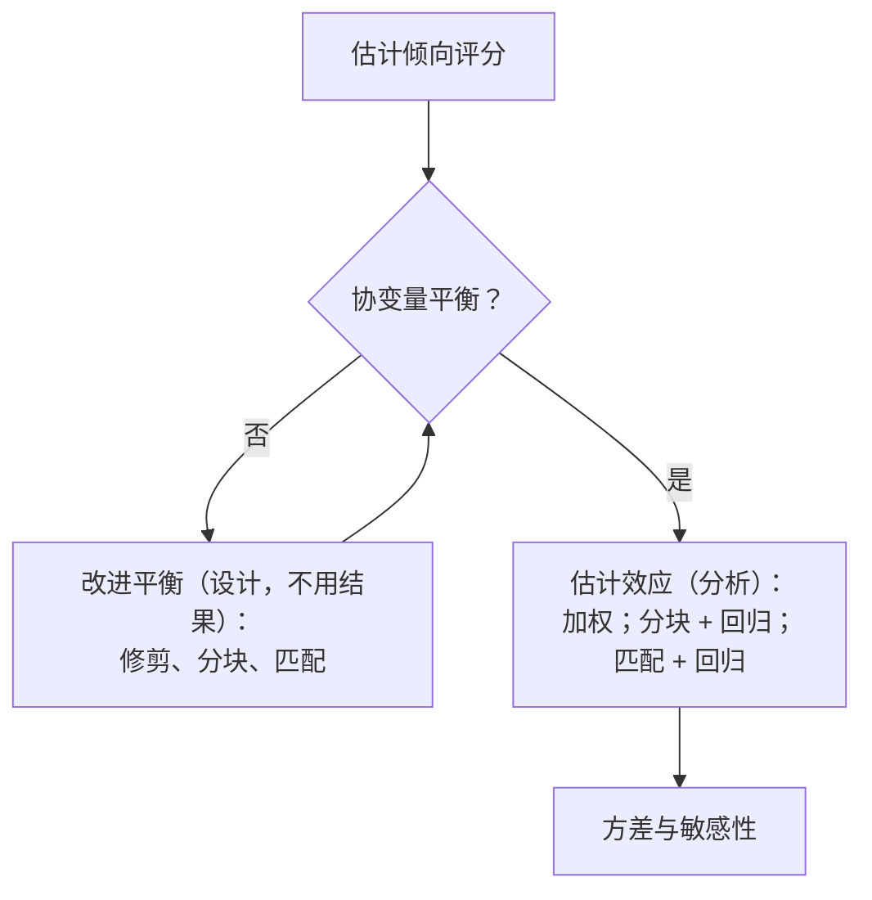

本课程发展了处理因果问题的两个框架。Neyman 与 Rubin 的潜在结果框架从一个处理和一个结果出发，把因果效应定义为潜在结果的比较，并问分配机制允许我们推断什么（[3.9.1](/3.9.1)–[3.9.10](/3.9.10)）。Pearl 的图框架从一个变量系统出发，用有向无环图表示它的因果结构，并问图允许我们计算哪些效应，或者数据允许我们学到什么样的图（[3.9.11](/3.9.11)–[3.9.13](/3.9.13)）。工具变量（[3.9.14](/3.9.14)）位于二者的交汇处。本章先在一个总览中把课程的各部分联系起来，不重复它们，然后介绍这门学科发展出来的六个方向。每个方向只作简略的讨论：它回答的问题、核心定义与一个代表性结果，其余部分请参阅原始论文。

## 15.1. 两个框架回顾

### 15.1.1. 总览

| | Rubin：随机化实验 | Rubin：观察性研究（RAM） | Pearl：因果图 |
|---|---|---|---|
| 问题 | 给定处理的平均效应 | 给定处理的平均效应 | 因果结构；任何干预量 |
| 主要困难 | 一半的潜在结果缺失 | 缺失的结果、未知的分配概率、协变量不平衡（Simpson 悖论） | 从数据中学习图；在有未观测变量时识别效应 |
| 假设 | SUTVA；已知的、个体化的、概率性的、无混杂的分配 | SUTVA；未知但个体化的、概率性的、无混杂的分配 | Markov 相容、忠实性；因果图 |
| 工具 | Fisher 精确 p 值、Neyman 估计量、回归、Bayes 插补；分层与配对设计 | 倾向评分：加权、分块、匹配，各自配合回归调整 | d-分离；后门与前门准则、do 演算；IC/PC 与基于得分的学习 |
| 章节 | [3.9.3](/3.9.3)–[3.9.7](/3.9.7) | [3.9.8](/3.9.8)–[3.9.10](/3.9.10) | [3.9.11](/3.9.11)–[3.9.13](/3.9.13) |

两个框架在基本对象上是一致的：潜在结果 $Y_i(w)$ 是结构模型的反事实，$\mathbb{E}[Y(1)] - \mathbb{E}[Y(0)] = \mathbb{E}[Y \mid \operatorname{do}(W = 1)] - \mathbb{E}[Y \mid \operatorname{do}(W = 0)]$；给定协变量 $X$ 的分配的**无混杂性**，正是当 $X$ 阻断每条后门路径时**后门准则**所保证的（[3.9.12](/3.9.12)）。工具变量二者兼用：依从类型与 CACE 用潜在结果定义，排他性约束以及工具与未测混杂变量的独立性则从图 $Z \to W \to Y$、$W \leftarrow U \to Y$ 读出（[3.9.14](/3.9.14)）。

对正则分配机制下的观察性研究，课程遵循同一个工作流程，其目标是通过协变量平衡得到有效的推断，并按两条规则评判：精度越高越好，有效范围越大（估计适用的总体越大）越好。

设计上的选择是在偏差与方差之间权衡：有放回匹配减小偏差、增大方差；每个个体用 $M > 1$ 个匹配减小方差、增大偏差；修剪缩小了总体，但使估计更可信。

### 15.1.2. 作为图的三类偏倚

因果图按结构对因果结论所面临的威胁进行分类（Hernán 与 Robins 2020）。设 $A$ 为暴露，$Y$ 为结果。

| 偏倚 | 结构 | 例 | 补救 |
|---|---|---|---|
| **混杂** | 共同原因：$A \leftarrow L \to Y$ | 年龄同时影响用药与结果 | 阻断后门路径：对 $L$ 做调整 |
| **选择偏倚** | 对共同结果取条件：$A \to C \leftarrow U \to Y$，分析限于 $C = 1$ | 吸烟（$A$）与痴呆（$Y$）：只有没有死亡的人（$C$）才能被诊断，而死亡取决于吸烟，也取决于同样影响痴呆的心血管危险因素（$U$） | 避免对 $C$ 取条件，或按选择概率的逆加权 |
| 测量偏倚 | 结果（或暴露）是通过代理测量的：$A \to Y \to Y^*$ | 疫苗接种（$A$）、多发性硬化的发病（$Y$）、数据库中的诊断编码（$Y^*$） | 验证数据、误差模型，尤其是误差依赖于 $A$ 时 |

在选择的例子中，限于幸存者会打开路径 $A \to C \leftarrow U \to Y$，这是**对撞偏倚**的一个例子，可以使吸烟看起来对痴呆有保护作用。当误差与其余一切独立时，测量偏倚对检验原假设无害，但它使效应估计有偏；而当 $A$ 影响测量（$A \to Y^*$）时，它就成为差异性的，是虚假关联的来源。在选择分析方法之前先画图，可以使这样的结构显现出来；决定画哪些箭头是关于研究对象的问题，而不是关于数据的问题。

## 15.2. 再随机化

### 15.2.1. 思想

[3.9.2](/3.9.2) 的各种设计的区别在于允许的分配向量集合 $\mathcal{W}^+$：分层实验排除了会使某一层中被处理个体过多的分配，配对实验排除得更多。协变量很多时，不可能对全部协变量分层，而完全随机化的分配则很可能在某个协变量上偶然地不平衡。若有 $10$ 个独立的协变量，每个都在水平 $0.05$ 下检验，则至少有一个在两组之间出现显著差异的概率为 $1 - 0.95^{10} \approx 0.40$；这不是运气不好，而是完全随机化的预期表现。Morgan 与 Rubin（2012）提出的补救办法（自 Fisher 的时代起就有人非正式地使用）是在实验进行之前，拒绝不平衡的分配。

**定义 15.2.1（再随机化）** 设 $\hat{\boldsymbol{\tau}}_x = \bar X_{\mathrm{t}} - \bar X_{\mathrm{c}}$ 为 CRE 的一个分配下两组协变量均值之差，其中 $N$ 个个体中有 $N_{\mathrm{t}}$ 个被处理、$N_{\mathrm{c}}$ 个为对照，$S_x^2$ 为协变量的样本协方差矩阵。阈值为 $a$ 的**再随机化**从 CRE 中抽取分配，直到

$$
M = \hat{\boldsymbol{\tau}}_x^{\mathsf T}\Bigl(\frac{N}{N_{\mathrm{t}}N_{\mathrm{c}}}S_x^2\Bigr)^{-1}\hat{\boldsymbol{\tau}}_x \le a,
$$
并使用第一个可接受的分配。接受准则与阈值必须在随机化之前确定。

$M$ 是两个协变量均值向量之间的**马氏距离**，按完全随机化下 $\hat{\boldsymbol{\tau}}_x$ 的协方差标度；由**有限总体中心极限定理**，对 $K$ 个协变量它近似服从 $\chi^2_K$，所以接受概率为 $p_a \approx \mathbb{P}(\chi^2_K \le a)$，通常选择 $a$ 使 $p_a$ 介于 $0.001$ 与 $0.1$ 之间。就 [3.9.2](/3.9.2) 而言，再随机化是一个随机化实验，其 $\mathcal{W}^+$ 是平衡分配的集合，其中每个分配的概率相同。

### 15.2.2. 性质

**定理 15.2.1（再随机化；Morgan 与 Rubin 2012）** 在以 $M \le a$ 为准则的再随机化与 $N_{\mathrm{t}} = N_{\mathrm{c}}$ 之下：

1. 均值差 $\hat\tau^{\mathrm{dif}}$ 是 $\tau_{\mathrm{fs}}$ 的无偏估计，并且 $\mathbb{E}[\hat{\boldsymbol{\tau}}_x \mid M \le a] = \boldsymbol{0}$；
2. 若协变量均值近似正态，则每个协变量差的方差都按同一个因子缩小，
   $$
   \operatorname{Var}(\hat{\boldsymbol{\tau}}_x \mid M \le a) = v_a\operatorname{Var}(\hat{\boldsymbol{\tau}}_x), \qquad v_a = \frac{\mathbb{P}(\chi^2_{K+2} \le a)}{\mathbb{P}(\chi^2_K \le a)} < 1;
   $$
3. 若处理效应还是可加的，则所估计效应的方差缩小为
   $$
   \operatorname{Var}(\hat\tau^{\mathrm{dif}} \mid M \le a) = \bigl[1 - (1 - v_a)R^2\bigr]\operatorname{Var}(\hat\tau^{\mathrm{dif}}),
   $$
   其中 $R^2$ 是结果与协变量之间的复相关系数的平方。

无偏性来自对称性：组大小相等时，一个分配与它的镜像（处理与对照互换）有相同的 $M$，所以两者要么都被接受，要么都被拒绝，而 $\hat\tau^{\mathrm{dif}}$ 在一个分配与其镜像上的平均恰为 $\tau_{\mathrm{fs}}$（两个估计合起来把每个个体的 $Y_i(1)$ 与 $Y_i(0)$ 各用一次）。方差的缩小量等于结果中被协变量解释的部分乘以协变量不平衡的缩小量；与结果无关的协变量没有代价，也没有收益。因此，再随机化在设计中实现了回归调整（[3.9.5](/3.9.5)）在分析中实现的效果，而且不需要结果的任何模型。

推断必须尊重设计。在再随机化下，$\hat\tau^{\mathrm{dif}}$ 不再渐近正态，而是一个正态变量与一个截尾变量之和，通常的 Neyman 区间过宽，偏保守而且浪费。Li、Ding 与 Rubin（2018）导出了其渐近分布，由它得到的置信区间更短（常常短得多）而依然有效。如果参考分布只在被接受的分配上计算，Fisher 精确检验仍然是精确的。

## 15.3. 负对照

课程的方法假定所有混杂变量都已测量，或者有工具可用。对于暴露 $X$ 与结果 $Y$ 的未测混杂变量 $U$，负对照提供了第三种处理途径：使用已知与因果问题无关、但共享该混杂的其他变量。

**定义 15.3.1（负对照）** **负对照暴露**是通过未测混杂变量与暴露相关联、但对结果没有因果效应的变量 $Z$。**负对照结局**是受未测混杂变量影响、但不受暴露影响的变量 $W$。两者都充当 $U$ 的代理。

经典的用途是检测混杂：在研究流感疫苗对死亡率的效应时，疫苗对流感季之前死亡的"保护效应"（负对照结局）表明，更健康的人接种了疫苗。Miao、Geng 与 Tchetgen Tchetgen（2018）证明，一对代理能做得更多：识别效应。

**定理 15.3.1（用两个代理识别）** 设 $U$、$Z$、$W$ 是离散的，类别数同为 $k$，并设

$$
W \perp (Z, X) \mid U, \qquad Z \perp Y \mid (U, X),
$$
$U$ 对 $(X, Y)$ 满足后门准则，并且 $k \times k$ 矩阵 $\mathbb{P}(W \mid x, Z)$（其元素为 $\mathbb{P}(W = w_i \mid x, Z = z_j)$）可逆。则记 $\mathbb{P}(y \mid x, Z)$ 为行向量 $(\mathbb{P}(y \mid x, z_j))_j$，$\mathbb{P}(W)$ 为列向量 $(\mathbb{P}(w_i))_i$，有

$$
\mathbb{P}(y \mid \operatorname{do}(x)) = \mathbb{P}(y \mid x, Z)\,\mathbb{P}(W \mid x, Z)^{-1}\,\mathbb{P}(W).
$$

**证明** 由后门调整，$\mathbb{P}(y \mid \operatorname{do}(x)) = \sum_u \mathbb{P}(y \mid x, u)\,\mathbb{P}(u)$，用向量记号即 $\mathbb{P}(y \mid x, U)\,\mathbb{P}(U)$。两个独立性给出两个矩阵恒等式：

$$
\mathbb{P}(W \mid x, Z) = \mathbb{P}(W \mid U)\,\mathbb{P}(U \mid x, Z), \qquad \mathbb{P}(y \mid x, Z) = \mathbb{P}(y \mid x, U)\,\mathbb{P}(U \mid x, Z),
$$
它们来自 $\mathbb{P}(w \mid x, z) = \sum_u \mathbb{P}(w \mid u)\,\mathbb{P}(u \mid x, z)$ 与 $\mathbb{P}(y \mid x, z) = \sum_u \mathbb{P}(y \mid x, u)\,\mathbb{P}(u \mid x, z)$。左边的矩阵可逆，推出 $\mathbb{P}(W \mid U)$ 与 $\mathbb{P}(U \mid x, Z)$ 可逆，所以 $\mathbb{P}(y \mid x, U) = \mathbb{P}(y \mid x, Z)\,\mathbb{P}(U \mid x, Z)^{-1} = \mathbb{P}(y \mid x, Z)\,\mathbb{P}(W \mid x, Z)^{-1}\,\mathbb{P}(W \mid U)$。乘以 $\mathbb{P}(U)$，并用 $\mathbb{P}(W \mid U)\,\mathbb{P}(U) = \mathbb{P}(W)$，得到公式，其中的一切都是可观测的。$\square$

代理代替了未测的 $U$：$W$ 度量它，而不受处理的影响；$Z$ 提供对它的第二个独立的视角，于是混杂可以被"解出来"。对连续变量，矩阵的逆变为积分方程的解（近端因果推断中的结果混杂桥）。工具变量也用到一个额外变量，但假设不同：工具必须与 $U$ 独立，并且只通过 $X$ 影响 $Y$，而负对照暴露可以依赖于 $U$，负对照方法则需要第二个代理 $W$，并要求 $Z$ 对 $Y$ 没有效应。一般地，两组假设互不包含，每种设计都应根据它自己的假设是否可信来评判。

## 15.4. 主分层

[3.9.14](/3.9.14) 的工具变量分析的关键思想，是按个体对分配的响应方式 $(W_i(0), W_i(1))$ 把个体分类；这一特征不受分配影响，因此即使它只被部分观测，也可以起到处理前协变量的作用。

**定义 15.4.1（主分层）** 设 $S$ 是处理后变量，潜在取值为 $S_i(0)$、$S_i(1)$。**主层**是由联合潜在取值 $G_i = (S_i(1), S_i(0))$ 定义的子总体；**主分层**（Frangakis 与 Rubin 2002）在这些层内定义因果效应，$\mathbb{E}[Y_i(1) - Y_i(0) \mid G_i = g]$。这些是良定义的因果效应，因为 $G_i$ 不受处理的影响，这与以观测到的 $S_i$ 为条件的比较不同。

对二值的 $S$ 有四个层。取 $S = W$（接受的处理）时，它们就是依从类型，CACE 就是依从者这一主层的效应：

| 层 | $W(1)$ | $W(0)$ | $Y(1)$ 可观测 | $Y(0)$ 可观测 |
|---|---|---|---|---|
| 永不接受者 | 0 | 0 | 没有定义效应（无论如何 $W = 0$） | |
| 依从者 | 1 | 0 | 是 | 是 |
| 违抗者 | 0 | 1 | 是 | 是 |
| 总是接受者 | 1 | 1 | 没有定义效应（无论如何 $W = 1$） | |

第二个应用是死亡截断。在一项针对严重疾病的药物 $Z$ 的临床试验中，所关心的结果是生活质量 $Y$，只对存活的病人（$S = 1$）测量；又如教育实验中，奖学金 $Z$ 与只对没有辍学的学生观测到的考试成绩 $Y$。如果药物影响生存，比较两组中存活的病人，就是在比较不同类型的病人，这是一种**选择偏倚**。

**定义 15.4.2（生存者平均因果效应）** 设有生存状态 $S$，结果 $Y$ 只在 $S = 1$ 时有定义，则主层为 $\mathrm{LL}$（在两种处理下都存活）、$\mathrm{LD}$（只有在处理下才存活）、$\mathrm{DL}$（只有在不处理时才存活）和 $\mathrm{DD}$（在两种处理下都死亡）。**生存者平均因果效应**为

$$
\mathrm{SACE} = \mathbb{E}[Y(1) - Y(0) \mid S(1) = S(0) = 1],
$$
即在唯一一个两个潜在结果都存在的层中的效应。

| 层 | $S(1)$ | $S(0)$ | $Y(1)$ 有定义 | $Y(0)$ 有定义 |
|---|---|---|---|---|
| DD | 0 | 0 | 否 | 否 |
| LD | 1 | 0 | 是 | 否 |
| DL | 0 | 1 | 否 | 是 |
| LL | 1 | 1 | 是 | 是 |

个体所在的层是不可观测的：处理组中的幸存者可能属于 LL，也可能属于 LD。因此，没有进一步的假设时 SACE 是不可识别的。在单调性（$S(1) \ge S(0)$，没有 DL 层）之下，各层的比例是可识别的，并可得到 SACE 的尖锐界（Zhang 与 Rubin 2003）；若有额外的假设或辅助变量，则可以点识别。

## 15.5. 中介分析

许多科学问题不仅问处理是否起作用，还问它如何起作用。认知行为疗法（$Z$）是否通过减少忧虑（$S$）来减少妄想（$Y$）（Freeman 等 2015）？种族对癌症确诊后生存的影响中，有多少归因于肿瘤亚型和确诊时分期的差异？中介分析（mediation analysis）把总效应分解为经过中介变量 $S$ 的部分和不经过 $S$ 的部分。

**定义 15.5.1（自然直接效应与自然间接效应）** 设 $Y(z, s)$ 为处理 $z$ 与中介变量取值 $s$ 下的潜在结果，$S(z)$ 为潜在中介变量，使得 $Y(z) = Y(z, S(z))$。对二值的 $Z$，总效应 $\mathrm{TE} = \mathbb{E}[Y(1, S(1))] - \mathbb{E}[Y(0, S(0))]$ 分解为

$$
\mathrm{TE} = \underbrace{\mathbb{E}[Y(1, S(0))] - \mathbb{E}[Y(0, S(0))]}_{\text{自然直接效应（NDE）}} + \underbrace{\mathbb{E}[Y(1, S(1))] - \mathbb{E}[Y(1, S(0))]}_{\text{自然间接效应（NIE）}}.
$$
**自然直接效应**改变处理，而把中介变量保持在不处理时它自然取的值；**自然间接效应**保持处理不变，把中介变量从未处理时的值改变为处理时的值（Robins 与 Greenland 1992；Pearl 2001）。

[3.9.12](/3.9.12) 的**受控直接效应** $\mathbb{E}[Y(1, s) - Y(0, s)]$ 把中介变量固定在研究者选定的值 $s$ 上；它是一个政策量（"如果让每个人的中介变量都取 $s$ 会怎样"），并且没有对应的间接效应。自然效应描述机制，它们的和是总效应；但它们涉及跨世界量 $Y(1, S(0))$，即处理下、中介变量取不处理时本应取的值的结果，对任何个体它都永远观测不到，即使在同时随机化 $Z$ 与 $S$ 的实验中也是如此。因此，它们的识别除了需要处理–结果、处理–中介变量与中介变量–结果各个关系都无未测混杂之外，还需要一个跨世界独立性，例如 $Y(z, s) \perp S(z') \mid X$，特别是需要没有本身受处理影响的中介变量–结果混杂因素。在这些假设下，

$$
\mathbb{E}[Y(1, S(0))] = \sum_{x, s} \mathbb{E}[Y \mid Z = 1, S = s, X = x]\,\mathbb{P}(S = s \mid Z = 0, X = x)\,\mathbb{P}(x),
$$
这就是中介公式。在不含交互作用的线性模型 $S = \alpha_0 + \alpha Z + \varepsilon_S$、$Y = \beta_0 + \theta Z + \beta S + \varepsilon_Y$ 中，$\mathrm{NDE} = \theta$，$\mathrm{NIE} = \alpha\beta$，即社会科学文献中的系数乘积；若 $Z$ 与 $S$ 之间有交互作用，自然效应就与这些系数不同，这时就需要反事实的定义（VanderWeele 2015）。

## 15.6. 替代指标悖论

### 15.6.1. 一个真实的例子

死亡这样的临床终点要很久才能观测到，所以试验常常测量替代指标：一个受处理 $T$ 影响、并能预测真实终点 $Y$ 的变量 $S$，如血压、肿瘤标志物或病毒载量。替代指标悖论是指这样的可能性：$T$ 对 $S$ 有正的效应，$S$ 对 $Y$ 有正的效应，而 $T$ 对 $Y$ 却有负的效应。

最著名的案例涉及抗心律失常药物。心肌梗死后的心律不齐预示心源性猝死，在纠正心律失常这一**替代终点**就能预防死亡的前提下，抑制心律不齐的药物在美国被批准并被广泛处方。始于 1987 年的心律失常抑制试验（CAST）把心肌梗死患者随机分配到恩卡尼、氟卡尼或莫雷西嗪与安慰剂。这些药物确实抑制了心律失常，但恩卡尼与氟卡尼组在 1989 年因死亡率高于安慰剂而被终止，莫雷西嗪组后来也因同样的理由被终止。Moore（1995）估计，这些药物在广泛使用的年份里，在美国造成了数万人死亡。

### 15.6.2. 它如何发生

**定义 15.6.1（替代指标悖论）** 对处理 $T$、替代指标 $S$ 与终点 $Y$，当 $\mathrm{ACE}(T \to S) > 0$、$\mathrm{ACE}(S \to Y) > 0$，但 $\mathrm{ACE}(T \to Y) < 0$ 时，出现**替代指标悖论**（中间变量悖论）。

这个悖论并不要求 $T$ 对 $Y$ 有直接效应；当 $T$ 使 $S$ 升高的那些个体并不是 $S$ 使 $Y$ 升高的那些个体时，它就可能出现。就第二种名称而言，它是一种中间变量悖论，与 **Simpson 悖论**性质相同：一个同时调节两个效应的未观测变量 $U$ 可以使结论反转。

**例 15.6.1** 设 $T$ 只通过 $S$ 作用于 $Y$，使得 $Y_{s,t} = Y_s$，$Y_t = Y_{S_t}$，有三组个体：

| 组 | 大小 | $S_{T=0}$ | $S_{T=1}$ | $Y_{S=0}$ | $Y_{S=1}$ | $Y_{T=0}$ | $Y_{T=1}$ |
|---|---|---|---|---|---|---|---|
| 1 | 100 | 0 | 1 | 1 | 0 | 1 | 0 |
| 2 | 100 | 1 | 0 | 0 | 1 | 1 | 0 |
| 3 | 150 | 0 | 1 | 0 | 1 | 0 | 1 |

在 350 个个体中，$\mathrm{ACE}(T \to S) = (250 - 100)/350 = 150/350 > 0$（组 1 与组 3 有 $S_{T=1} = 1$，组 2 有 $S_{T=0} = 1$），$\mathrm{ACE}(S \to Y) = (250 - 100)/350 = 150/350 > 0$（组 2 与组 3 从 $S$ 获益）。但 $\mathrm{ACE}(T \to Y) = (150 - 200)/350 = -50/350 < 0$：处理使组 1 的替代指标升高，而在该组中替代指标是有害的；又使组 2 的替代指标降低，而在该组中替代指标是有益的。

:::

这个例子也表明怎样排除悖论。如果 $T$ 对任何个体都不会降低 $S$（$S_{T=1} \ge S_{T=0}$），$S$ 对任何个体都不会降低 $Y$（$Y_s$ 单调），并且 $T$ 只通过 $S$ 作用于 $Y$，则对每个个体 $Y_{T=1} = Y_{S_{T=1}} \ge Y_{S_{T=0}} = Y_{T=0}$，并且 $\mathrm{ACE}(T \to Y) \ge 0$。Chen、Geng 与 Jia（2007）及后续工作给出了这一类准则，用来判断替代指标何时可信，其中一些可以由数据检验。$S$ 与 $Y$ 在总体层面的相关性，无论多强，都是不够的。

## 15.7. 因果推断与机器学习

有两条工作路线把因果推断与现代机器学习联系起来。第一条用最优化来学习因果结构。寻找得分最高的 DAG 是 **NP 难**的（[3.9.13](/3.9.13)），因为无圈性是一个组合约束。Zheng 等（2018）在称为 NOTEARS 的方法中观察到，加权邻接矩阵 $W \in \mathbb{R}^{d \times d}$ 表示一个 DAG 当且仅当

$$
h(W) = \operatorname{tr}\bigl(\mathrm{e}^{W \circ W}\bigr) - d = 0,
$$
其中 $\circ$ 是逐元素乘积，$\mathrm{e}^{A}$ 是矩阵指数：$\operatorname{tr}((W \circ W)^k)$ 是长为 $k$ 的闭途径的加权计数，恰在没有有向圈时全为零。于是结构学习成为连续最优化问题，即在 $h(W) = 0$ 的约束下最小化最小二乘或似然损失，可以用标准数值方法求解，并与神经网络结合。结果是非凸问题的局部最优，并且该方法对变量的尺度敏感，所以它是对 [3.9.13](/3.9.13) 方法的补充而不是替代。

第二条路线问的是，因果性能为机器学习做什么（Schölkopf 等 2021）。统计学习假定训练数据与测试数据来自同一分布，在分布外就失效；它的模型是黑箱，其内部变量没有因果意义。相比之下，因果模型说明，当系统的其他部分改变时，哪些部分保持不变。

**定义 15.7.1（独立因果机制原则）** **独立因果机制原则**指出，系统各变量的因果生成过程由自治的模块组成，即每个变量在给定其原因时的条件分布 $\mathbb{P}(x_i \mid \mathrm{pa}_i)$，它们彼此不提供信息，也不相互影响。与之相关的稀疏机制转移假设指出，分布的变化（例如环境的改变或干预）通常只影响其中少数几个机制。

该原则是**因果 Bayes 网络**中各因子的不变性（定义 11.4.2 的条件 3）的重新表述。它表明，沿因果方向分解的模型只需很少的改动就能适应新环境，这是迁移学习与领域适应方法的基础。应用它需要因果变量，但机器学习的输入往往是原始数据，例如图像的像素，其中没有哪个单独的变量是原因。因果表示学习（causal representation learning）的问题是，从这样的低层观测中学习高层变量及其间的因果关系，使干预与反事实在所学的表示中有意义；它在**表示学习**之上增加了所学变量必须是因果的要求。

## 15.8. 里程碑

下表列出了塑造这一领域的一些研究者的主要贡献，以及本课程使用或提到的方法与概念。

| 时期 | Rubin 及合作者 | Robins 及合作者 | Pearl 及合作者 | 其他 |
|---|---|---|---|---|
| 1920–1930 年代 | | | | Neyman（1923）：实验中的潜在结果；Fisher（1935）：以随机化作为推断的基础 |
| 1970 年代 | 观察性研究的潜在结果（1974）；可忽略性（1978） | | | |
| 1980 年代 | 倾向评分（Rosenbaum 与 Rubin 1983） | 时变处理的 g 公式与 g 估计（1986） | Bayes 网络（1985，1988） | Spirtes 与 Glymour：PC 算法（1991） |
| 1990 年代 | 潜在结果框架中的工具变量（Angrist、Imbens 与 Rubin 1996） | 自然直接与间接效应（Robins 与 Greenland 1992） | 因果 Bayes 网络、do 演算（1995）、结构反事实；*Causality*（2000） | Verma 与 Pearl：观测等价（1990）；Meek 规则（1995）；Balke 与 Pearl：IV 的界（1997） |
| 2000 年代 | 主分层（Frangakis 与 Rubin 2002） | 边际结构模型（2000） | 自然效应与中介公式（Pearl 2001）；识别算法（Shpitser 与 Pearl 2006） | Geng 及合作者：可压缩性与混杂因素的准则、替代指标悖论的准则（Chen、Geng 与 Jia 2007）、DAG 的分解学习（Xie 与 Geng 2008） |
| 2010 年代 | 再随机化（Morgan 与 Rubin 2012） | 单世界干预图（Richardson 与 Robins 2013） | 可迁移性；*The Book of Why*（2018） | 用负对照做识别（Miao、Geng 与 Tchetgen Tchetgen 2018）；NOTEARS（Zheng 等 2018） |
| 2020 年代 | | | | 因果表示学习（Schölkopf 等 2021）；2021 年诺贝尔经济学奖授予 Card、Angrist 与 Imbens |

Pearl 因其在概率推理与因果推理方面的工作，于 2011 年获得图灵奖。该表是有选择的；这一领域同时在经济学、流行病学、计算机科学与统计学中成长，许多结果是在其中几个领域里独立发现的。

## 小结

- 两个框架共享基本对象（潜在结果就是结构反事实；无混杂性由后门准则保证），而起点与侧重不同；工具变量把它们联系起来。混杂、选择与测量偏倚分别对应因果图中的分叉、被取条件的对撞因子与代理。
- 拓展：

  | 主题 | 问题 | 关键定义与结果 |
  |---|---|---|
  | 再随机化（15.2） | 在设计中平衡许多协变量 | 接受马氏距离 $M \le a$ 的分配；$\hat\tau^{\mathrm{dif}}$ 无偏，方差因子 $1 - (1 - v_a)R^2$（定理 15.2.1） |
  | 负对照（15.3） | 未测混杂变量 $U$ | 代理 $Z$、$W$ 满足 $W \perp (Z, X) \mid U$、$Z \perp Y \mid (U, X)$，给出 $\mathbb{P}(y \mid \operatorname{do}(x)) = \mathbb{P}(y \mid x, Z)\,\mathbb{P}(W \mid x, Z)^{-1}\,\mathbb{P}(W)$（定理 15.3.1） |
  | 主分层（15.4） | 含处理后变量的效应 | 层 $(S(1), S(0))$；依从类型；始终存活层中的 SACE（定义 15.4.1、15.4.2） |
  | 中介（15.5） | 处理如何起作用 | 经 $Y(1, S(0))$ 得 $\mathrm{TE} = \mathrm{NDE} + \mathrm{NIE}$；跨世界假设（定义 15.5.1） |
  | 替代指标悖论（15.6） | 替代指标会误导吗？ | $T \to S$ 与 $S \to Y$ 的效应为正而 $T \to Y$ 的效应为负（定义 15.6.1、例 15.6.1）；个体层面的单调性可排除 |
  | 机器学习（15.7） | 连续的结构学习；稳健性 | 无圈性 $\operatorname{tr}(\mathrm{e}^{W \circ W}) = d$；独立因果机制（定义 15.7.1）；因果表示学习 |

## 思考题

1. 有 20 个独立的协变量，在 CRE 的两组之间各用水平 $0.05$ 的检验比较，至少有一个比较显著的概率是多少？如果再随机化接受 5% 的分配，平均需要多少次随机化？

   **答** $1 - 0.95^{20} \approx 0.64$。直到第一次被接受所需的抽取次数是成功概率 $p_a = 0.05$ 的几何分布，所以平均 $1/p_a = 20$ 次随机化，这在计算机上代价很小。
2. 对 $K = 2$ 个协变量与 $p_a = 0.1$，计算 $v_a$，以及 $R^2 = 0.5$ 时 $\hat\tau^{\mathrm{dif}}$ 的方差缩小量。

   **答** $\chi^2_2$ 是均值为 $2$ 的指数分布，所以 $a = -2\log 0.9 \approx 0.211$。$\mathbb{P}(\chi^2_4 \le a) = 1 - \mathrm{e}^{-a/2}(1 + a/2) = 1 - 0.9 \times 1.105 \approx 0.0052$，于是 $v_a \approx 0.0052/0.1 = 0.052$：协变量不平衡的方差只有完全随机化下的约 5%。$\hat\tau^{\mathrm{dif}}$ 的方差乘以 $1 - (1 - 0.052)(0.5) \approx 0.53$，几乎达到完美的回归调整所能获得的全部收益 $1 - R^2 = 0.5$。
3. 为什么再随机化的准则必须在实验之前确定？再随机化之后应如何进行 Fisher 精确检验？

   **答** 如果准则是在看过分配或结果之后才选定的，分配机制就是未知的，并且可能依赖于潜在结果，随机化推断的基础就被破坏了。准则预先设定时，机制是已知的：在被接受的分配上均匀。于是 Fisher 检验只用检验统计量在被接受分配上的分布（通过抽取完全随机化并保留 $M \le a$ 的分配来模拟）；用所有的 CRE 分配会得到过宽的参考分布和保守的检验。
4. 在二值 $U$、$Z$、$W$ 的定理 15.3.1 中，用文字解释为什么只有一个代理不足以识别 $\mathbb{P}(y \mid \operatorname{do}(x))$。

   **答** 只有 $W$ 时，我们知道 $\mathbb{P}(W \mid x)$，但不知道 $W$ 与 $U$ 如何相关：矩阵 $\mathbb{P}(W \mid U)$ 与 $U$ 的分布并不由 $(X, Y, W)$ 的分布决定，所以用 $W$ 代替 $U$ 做调整会留下大小未知的残余混杂。第二个代理 $Z$ 提供第二组方程，即 $\mathbb{P}(y \mid x, Z)$ 与 $\mathbb{P}(W \mid x, Z)$，其中未知的 $\mathbb{P}(U \mid x, Z)$ 在两者中都出现，可以消去，条件是矩阵 $\mathbb{P}(W \mid x, Z)$ 可逆，也就是代理对 $U$ 的信息足够多。
5. 在带单侧不依从的试验中（对照组的病人不可能得到处理），存在哪些主层？对于给定的病人，哪些可以由观测数据识别？

   **答** 对所有个体 $W_i(0) = 0$，所以只有永不接受者 $(W(1), W(0)) = (0, 0)$ 与依从者 $(1, 0)$。在处理组中，层是可观测的：$W_i^{\mathrm{obs}} = 1$ 为依从者，$W_i^{\mathrm{obs}} = 0$ 为永不接受者。在对照组中，每个人都有 $W_i^{\mathrm{obs}} = 0$，层是未知的；但由随机化，依从者的比例与处理组中相同，CACE 就是这样被识别的（[3.9.14](/3.9.14)）。
6. 在一项严重疾病的药物试验中，处理组幸存者的平均生活质量低于对照组。药物提高了生存率。药物会降低生活质量吗？

   **答** 不一定。若药物挽救了本来会死亡的病人（LD 层），而这些病人病情最重，则处理组的幸存者包括他们，对照组的幸存者不包括，所以对幸存者的比较是把 LL + LD 病人与只有 LL 的病人相比较。即使药物在任何一层内对生活质量都没有效应，处理组的幸存者的生活质量也可能更低。因果问题由 SACE 回答，即在 LL 层内的比较，要给出它的界或识别它，需要额外的假设。
7. 在线性中介模型 $S = \alpha Z + \varepsilon_S$、$Y = \theta Z + \beta S + \gamma ZS + \varepsilon_Y$（二值 $Z$，无混杂）中，计算 NDE 与 NIE。

   **答** $S(0) = \varepsilon_S$，$S(1) = \alpha + \varepsilon_S$，$\mathbb{E}[Y(z, s)] = \theta z + \beta s + \gamma z s$。取 $\mathbb{E}[\varepsilon_S] = 0$：$\mathrm{NDE} = \mathbb{E}[Y(1, S(0))] - \mathbb{E}[Y(0, S(0))] = \theta + \gamma\,\mathbb{E}[S(0)] = \theta$，$\mathrm{NIE} = \mathbb{E}[Y(1, S(1))] - \mathbb{E}[Y(1, S(0))] = (\beta + \gamma)\alpha$。总效应为 $\theta + \alpha(\beta + \gamma)$。没有交互作用（$\gamma = 0$）时，NIE 就是乘积 $\alpha\beta$；有交互作用时，间接效应取决于固定在哪个处理水平（$z = 0$ 处的"纯"间接效应是 $\alpha\beta$）。
8. 替代指标悖论与 [3.9.14](/3.9.14) 的工具变量结果矛盾吗？把 $T$ 看作 $S$ 对 $Y$ 的效应的工具来考虑。

   **答** 不矛盾。当 $Y_{s,t} = Y_s$ 时排他性约束成立，Wald 比值 $\mathrm{ACE}(T \to Y)/\mathrm{ACE}(T \to S)$ 只有在没有违抗者时才估计 $S$ 对 $Y$ 的依从者效应。在例 15.6.1 中，组 2 由违抗者构成（$S_{T=0} = 1$，$S_{T=1} = 0$），所以单调性不成立，比值 $(-50/350)/(150/350) = -1/3$ 不是任何子群的因果效应。即使在单调性之下也没有矛盾：此时 $\mathrm{ACE}(T \to Y) = \pi_{\mathrm{co}}\tau_{\mathrm{co}}$，所以 $T$ 对 $Y$ 的负效应意味着 $S$ 对依从者有害，这与 $S$ 在整个总体中的平均效应为正是相容的。IV 估计的目标是局部的；悖论涉及的是局部效应与总体效应之间的差距。
9. 证明 $2 \times 2$ 加权邻接矩阵 $W = \begin{bmatrix}0 & a\\ b & 0\end{bmatrix}$ 满足 $h(W) = \operatorname{tr}(\mathrm{e}^{W \circ W}) - 2 = 0$ 当且仅当 $ab = 0$。

   **答** 设 $A = W \circ W = \begin{bmatrix}0 & a^2\\ b^2 & 0\end{bmatrix}$。则 $A^2 = a^2b^2 I_2$，所以 $A^{2m} = (a^2b^2)^m I_2$，奇数次幂的对角元为零。于是 $\operatorname{tr}(\mathrm{e}^{A}) = 2\sum_{m \ge 0}(a^2b^2)^m/(2m)! = 2\cosh(\lvert ab\rvert)$，$h(W) = 2\cosh(\lvert ab\rvert) - 2 \ge 0$，当且仅当 $ab = 0$ 时取等号，也就是弧 $1 \to 2$ 与 $2 \to 1$ 至多有一条存在。
