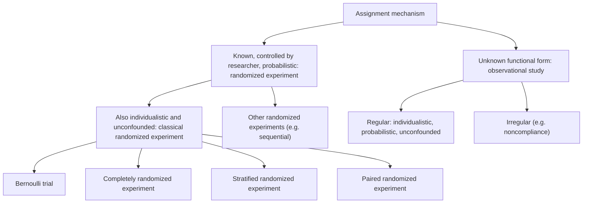

In [3.9.1](/3.9.1) we saw that causal inference is a missing data problem: for each unit only one of the two **potential outcomes** is observed. Whether the missing ones can be predicted from the observed ones depends on how the units came to receive their treatments. If a coin decided, the treated and the control units are comparable and the observed outcomes of one group tell us about the missing outcomes of the other; if each patient's doctor chose the treatment expected to work best, they are not. The rule that determines which units receive which treatment is the assignment mechanism. Rubin's second contribution, after placing potential outcomes at the center of the analysis, was to make the assignment mechanism an explicit mathematical object, a probability distribution of the treatment vector given the covariates and the potential outcomes. This chapter defines it, introduces the restrictions that distinguish good assignment mechanisms from bad ones, and classifies the designs used in the rest of the course: randomized experiments ([3.9.3](/3.9.3)–[3.9.7](/3.9.7)) and observational studies ([3.9.8](/3.9.8)–[3.9.10](/3.9.10)).

## 2.1. Why the Assignment Mechanism Matters

### 2.1.1. Assignment Related to the Potential Outcomes

Recall Example 1.5.1: four patients, a drug ($W_i = 0$) and surgery ($W_i = 1$), with average treatment effect $\tau_{\mathrm{fs}} = 2$. When each patient receives the treatment that is better for him or her, the observed difference in means is $-1$. The assignment is deterministic and depends on the potential outcomes, $W_i = \boldsymbol{1}\{Y_i(1) > Y_i(0)\}$, so the treated units are exactly those with large $Y_i(1)$ relative to $Y_i(0)$, and the observed outcomes of the two groups are not representative of the potential outcomes of all units. Good medical practice is bad experimental design: it is precisely the dependence of the assignment on the potential outcomes that makes the naive comparison misleading.

### 2.1.2. Assignment Related to Covariates: Simpson's Paradox

The assignment can also be related to the potential outcomes indirectly, through a covariate. Then the comparison of the groups as a whole and the comparisons within levels of the covariate can point in opposite directions, which is **Simpson's paradox** ([3.3.10](/3.3.10#def-10.2.1)).

**Example 2.1.1** The 1992 National Assessment of Educational Progress reported the following eighth-grade mathematics scores for two states (data analyzed by Wainer and Brown 2004).

| | State average | White | Black | Other nonwhite | Standardized |
|---|---|---|---|---|---|
| Nebraska | 277 | 281 | 236 | 259 | 271 |
| New Jersey | 271 | 283 | 242 | 260 | 273 |
| Share of population, Nebraska | | 87% | 5% | 8% | |
| Share of population, New Jersey | | 66% | 15% | 19% | |
| Share of population, nation | | 69% | 16% | 15% | |

Nebraska has the higher state average, yet New Jersey scores higher in every one of the three groups. The reason is the composition: Nebraska's students are mostly in the group with the highest scores. If both states had the national composition, the averages would be $281 \times 0.69 + 236 \times 0.16 + 259 \times 0.15 \approx 271$ for Nebraska and $283 \times 0.69 + 242 \times 0.16 + 260 \times 0.15 \approx 273$ for New Jersey, reversing the order.

:::

Which comparison is "right" depends on the question. To describe how the average eighth-grader in each state performs, the state averages are the answer. To compare the schools of the two states for students of a given background, the within-group or standardized comparisons are relevant. In causal terms, if the "treatment" (the state's school system) is associated with a covariate that also affects the outcome, a comparison that ignores the covariate mixes the effect of the treatment with the effect of the covariate; this is the **confounding** of [3.8.2](/3.8.2).

A second example has the same structure. Among students who took the Medical College Admission Test (MCAT) in the mid-1990s, the proportion who later took the first step of the United States Medical Licensing Examination (USMLE) was at least as high for black students as for white students within every MCAT score band (for example 0.51 versus 0.43 in the top band), but lower overall (0.23 versus 0.27), because the distribution of MCAT scores differed between the two groups (Wainer and Brown 2004). Simpson's paradox raises two questions that recur throughout the course: is a finer stratification always more accurate, and can we always stratify? Both are answered, in different ways, by the propensity score of [3.9.8](/3.9.8).

## 2.2. Definitions

### 2.2.1. The Assignment Mechanism

We consider a finite population of $N$ units, with covariates $\boldsymbol{X}$ (an $N \times K$ array, written in bold like the vectors although it is a matrix, because it collects the random covariates of all units), potential outcomes $\boldsymbol{Y}(0)$, $\boldsymbol{Y}(1)$ and treatment vector $\boldsymbol{W} \in \mathcal{W} = \{0, 1\}^N$, and we assume SUTVA.

**Definition 2.2.1 (Assignment Mechanism)** Given a population of $N$ units, the **assignment mechanism** is a row-exchangeable function $\mathbb{P}(\boldsymbol{W} \mid \boldsymbol{X}, \boldsymbol{Y}(0), \boldsymbol{Y}(1))$ taking values in $[0, 1]$ and satisfying

$$
\sum_{\boldsymbol{W} \in \{0,1\}^N} \mathbb{P}\bigl(\boldsymbol{W} \mid \boldsymbol{X}, \boldsymbol{Y}(0), \boldsymbol{Y}(1)\bigr) = 1 \quad \text{for all } \boldsymbol{X}, \boldsymbol{Y}(0), \boldsymbol{Y}(1).
$$
Row-exchangeable means that the function is unchanged when the units are relabeled, that is, when the same permutation is applied to the rows of $\boldsymbol{W}$, $\boldsymbol{X}$, $\boldsymbol{Y}(0)$ and $\boldsymbol{Y}(1)$. The set of assignment vectors with positive probability is denoted $\mathcal{W}^+ \subseteq \mathcal{W}$.

The assignment mechanism is a function of all covariates and all potential outcomes that gives the probability of every possible vector of assignments. It determines which units receive which treatments, and hence which potential outcomes are realized and observed and which are missing. In a randomized experiment it is known, because the researcher chose it; in an observational study it is unknown, and much of the second part of the course is about what can be done without knowing it. Row-exchangeability only says that the order in which the units are listed carries no information; any dependence of the assignment on the units' characteristics must go through $\boldsymbol{X}$ or the potential outcomes.

**Definition 2.2.2 (Unit-Level Assignment Probability)** The **unit-level assignment probability** of unit $i$ is

$$
p_i\bigl(\boldsymbol{X}, \boldsymbol{Y}(0), \boldsymbol{Y}(1)\bigr) = \sum_{\boldsymbol{W}:W_i = 1} \mathbb{P}\bigl(\boldsymbol{W} \mid \boldsymbol{X}, \boldsymbol{Y}(0), \boldsymbol{Y}(1)\bigr) = \mathbb{E}_W\bigl[W_i \mid \boldsymbol{X}, \boldsymbol{Y}(0), \boldsymbol{Y}(1)\bigr].
$$

The unit-level probability is a marginal of the assignment mechanism, and in general it does not determine the joint distribution: different mechanisms can have the same $p_i$, as Examples 2.2.1 and 2.2.2 below show. Like the mechanism itself, $p_i$ may depend on the covariates and the potential outcomes of all units, not only of unit $i$.

**Definition 2.2.3 (Finite-Population Propensity Score)** The **propensity score** at $x$ is the average unit-level assignment probability of the units with $X_i = x$,

$$
e(x) = \frac{1}{N(x)} \sum_{i:X_i = x} p_i\bigl(\boldsymbol{X}, \boldsymbol{Y}(0), \boldsymbol{Y}(1)\bigr),
$$
where $N(x) = \#\{i = 1, \dots, N : X_i = x\}$ is the number of units with $X_i = x$. For values $x$ with $N(x) = 0$ the propensity score is defined to be zero.

The propensity score is written as a function of the covariate value $x$ alone, but in general its values still depend on the potential outcomes of the units. The letter $e$ is a function name (for "exposure"), not the constant $\mathrm{e}$.

### 2.2.2. Four Examples

The following examples have two or three units, so that the mechanism can be written down completely.

**Example 2.2.1 (Two Units, Independent Fair Coins)** With $N = 2$ there are four assignment vectors, $\boldsymbol{W} \in \{(0,0), (0,1), (1,0), (1,1)\}$. A randomized experiment that tosses a fair coin for each unit gives each of them probability $1/4$, whatever the potential outcomes. Then $p_1 = p_2 = 1/2$, and since there are no covariates, $e(x) = 1/2$.

**Example 2.2.2 (Two Units, One Treated)** A randomized experiment that allows only assignments with exactly one treated and one control unit has $\mathbb{P}(\boldsymbol{W}) = 1/2$ for $\boldsymbol{W} \in \{(0,1), (1,0)\}$ and $0$ for $(0,0)$ and $(1,1)$. Again $p_1 = p_2 = 1/2$ and $e(x) = 1/2$, although the mechanism differs from that of Example 2.2.1.

**Example 2.2.3 (The Unit with More to Gain Is Treated)** Suppose that the unit with the larger unit-level effect receives the treatment and the other unit the control, with a coin toss in case of a tie:

$$
\mathbb{P}\bigl(\boldsymbol{W} \mid \boldsymbol{X}, \boldsymbol{Y}(0), \boldsymbol{Y}(1)\bigr) =
\begin{cases}
1 & \text{if } \tau_2 > \tau_1 \text{ and } \boldsymbol{W} = (0,1), \text{ or } \tau_2 < \tau_1 \text{ and } \boldsymbol{W} = (1,0),\\
1/2 & \text{if } \tau_2 = \tau_1 \text{ and } \boldsymbol{W} \in \{(0,1), (1,0)\},\\
0 & \text{otherwise},
\end{cases}
$$
where $\tau_i = Y_i(1) - Y_i(0)$. Now $p_1$ and $p_2$ take the values $0$, $1/2$ or $1$ depending on the potential outcomes of both units. Since exactly one unit is treated, $p_1 + p_2 = 1$, and the propensity score is still $e(x) = 1/2$: the propensity score alone does not reveal that this mechanism is very different from the first two.

**Example 2.2.4 (A Sequential Experiment)** Three units have covariates $X_i = i$ and are treated in order. Unit 1 is assigned by a fair coin toss and unit 2 receives the opposite treatment; their outcomes $Y_1^{\mathrm{obs}}$ and $Y_2^{\mathrm{obs}}$ are observed. Unit 3 then receives whichever treatment appears better, with ties going to the active treatment. If $W_1 = 1$, the comparison is between $Y_1(1)$ and $Y_2(0)$; if $W_1 = 0$, between $Y_2(1)$ and $Y_1(0)$. Hence $p_1 = p_2 = 1/2$ and

$$
p_3 = \tfrac{1}{2}\,\boldsymbol{1}\{Y_1(1) \ge Y_2(0)\} + \tfrac{1}{2}\,\boldsymbol{1}\{Y_2(1) \ge Y_1(0)\} \in \bigl\{0, \tfrac{1}{2}, 1\bigr\}.
$$
Each covariate value is held by one unit, so $e(1) = e(2) = 1/2$ and $e(3) = p_3$, which depends on the potential outcomes of the other two units.

:::

| Example | $\mathcal{W}^+$ | $p_i$ | $e(x)$ |
|---|---|---|---|
| 2.2.1 | all 4 vectors | $1/2, 1/2$ | $1/2$ |
| 2.2.2 | $(0,1), (1,0)$ | $1/2, 1/2$ | $1/2$ |
| 2.2.3 | one or two of $(0,1), (1,0)$, depending on $\boldsymbol{Y}$ | $0$, $1/2$ or $1$ | $1/2$ |
| 2.2.4 | vectors with $W_2 = 1 - W_1$ | $1/2, 1/2, p_3(\boldsymbol{Y})$ | $1/2, 1/2, p_3$ |

## 2.3. Restrictions on the Assignment Mechanism

Without restrictions the assignment mechanism can be arbitrary, and nothing can be learned about causal effects. Three restrictions make it tractable. They are properties of the mechanism, not of the data, and in observational studies they are assumptions.

### 2.3.1. Individualistic, Probabilistic and Unconfounded Assignment

**Definition 2.3.1 (Individualistic Assignment)** An assignment mechanism is **individualistic** if, for some function $q(\cdot) \in [0, 1]$,

$$
p_i\bigl(\boldsymbol{X}, \boldsymbol{Y}(0), \boldsymbol{Y}(1)\bigr) = q\bigl(X_i, Y_i(0), Y_i(1)\bigr) \quad \text{for all } i = 1, \dots, N,
$$
and

$$
\mathbb{P}\bigl(\boldsymbol{W} \mid \boldsymbol{X}, \boldsymbol{Y}(0), \boldsymbol{Y}(1)\bigr) = c \cdot \prod_{i=1}^{N} q\bigl(X_i, Y_i(0), Y_i(1)\bigr)^{W_i}\bigl(1 - q(X_i, Y_i(0), Y_i(1))\bigr)^{1 - W_i}
$$
for $(\boldsymbol{W}, \boldsymbol{X}, \boldsymbol{Y}(0), \boldsymbol{Y}(1))$ in some set $\mathbb{A}$, and zero elsewhere, where $c$ is a normalizing constant.

In words, a unit's assignment probability does not depend on the covariates or potential outcomes of other units, and the mechanism is proportional to the product of the unit-level probabilities on the set $\mathbb{A}$ of allowed assignments. The set and the constant allow designs in which the number of treated units is fixed: in Example 2.2.2, $q = 1/2$, $\mathbb{A}$ consists of the assignments with one treated unit, and $c = 2$. Individualistic assignment is violated in sequential experiments such as Example 2.2.4, where unit 3's probability depends on the outcomes of units 1 and 2, and in Example 2.2.3. Under individualistic assignment the propensity score simplifies to

$$
e(x) = \frac{1}{N(x)} \sum_{i:X_i = x} q\bigl(x, Y_i(0), Y_i(1)\bigr).
$$

**Definition 2.3.2 (Probabilistic Assignment)** An assignment mechanism is **probabilistic** if every unit has a positive probability of receiving each treatment:

$$
0 < p_i\bigl(\boldsymbol{X}, \boldsymbol{Y}(0), \boldsymbol{Y}(1)\bigr) < 1 \quad \text{for all } i = 1, \dots, N.
$$
This condition is also called **positivity** or overlap.

If some unit can only receive the treatment, its control outcome is never observed and nothing in the data can stand in for it unless we make assumptions about how similar it is to other units. Examples 2.2.1 and 2.2.2 are probabilistic; Example 2.2.3 is not, unless the two unit-level effects are equal, and Example 2.2.4 is not when $p_3 \in \{0, 1\}$.

**Definition 2.3.3 (Unconfounded Assignment)** An assignment mechanism is **unconfounded** if it does not depend on the potential outcomes:

$$
\mathbb{P}\bigl(\boldsymbol{W} \mid \boldsymbol{X}, \boldsymbol{Y}(0), \boldsymbol{Y}(1)\bigr) = \mathbb{P}\bigl(\boldsymbol{W} \mid \boldsymbol{X}, \boldsymbol{Y}'(0), \boldsymbol{Y}'(1)\bigr) \quad \text{for all } \boldsymbol{W}, \boldsymbol{X}, \boldsymbol{Y}(0), \boldsymbol{Y}(1), \boldsymbol{Y}'(0), \boldsymbol{Y}'(1).
$$
We can then drop the potential outcomes from the notation and write the mechanism as $\mathbb{P}(\boldsymbol{W} \mid \boldsymbol{X})$.

Unconfoundedness is the most important of the three restrictions. Examples 2.2.1 and 2.2.2 are unconfounded; Examples 2.2.3 and 2.2.4 are not. The individual restrictions are logically independent of each other: Example 2.2.2 is individualistic, probabilistic and unconfounded; a mechanism that treats unit 1 for sure and unit 2 with probability $1/2$ is individualistic and unconfounded but not probabilistic.

**Theorem 2.3.1** If the assignment mechanism is individualistic and unconfounded, then $q$ depends on $x$ only, the propensity score equals it, $e(x) = q(x)$, and

$$
\mathbb{P}\bigl(\boldsymbol{W} \mid \boldsymbol{X}, \boldsymbol{Y}(0), \boldsymbol{Y}(1)\bigr) = c \cdot \prod_{i=1}^{N} e(X_i)^{W_i}\bigl(1 - e(X_i)\bigr)^{1 - W_i} \quad \text{on } \mathbb{A}.
$$

**Proof** Under unconfoundedness the mechanism does not depend on the potential outcomes, and neither does its marginal $p_i = \sum_{\boldsymbol{W}:W_i = 1}\mathbb{P}(\boldsymbol{W} \mid \boldsymbol{X}, \boldsymbol{Y}(0), \boldsymbol{Y}(1))$. Under individualistic assignment $p_i = q(X_i, Y_i(0), Y_i(1))$; since the left side does not change when $(Y_i(0), Y_i(1))$ changes, $q(x, y_0, y_1) = q(x)$ for all values $(y_0, y_1)$ that occur. Then all units with $X_i = x$ have the same probability $q(x)$, so their average is $e(x) = q(x)$. Substituting $q(X_i) = e(X_i)$ in the product of Definition 2.3.1 gives the formula. $\square$

Two consequences are used again and again. First, the assignment mechanism is a product of propensity scores, up to the constant and the set $\mathbb{A}$. Second, the propensity score $e(x)$ is no longer only an average: it is the assignment probability of each individual unit with $X_i = x$. Units with the same covariate values then have the same chance of treatment, exactly as in a randomized experiment within each covariate stratum.

### 2.3.2. Strong Ignorability and Ignorability

**Definition 2.3.4 (Strongly Ignorable Treatment Assignment)** An assignment mechanism that is individualistic, probabilistic and unconfounded is called **strongly ignorable** (Rosenbaum and Rubin 1983). In the super-population formulation of Section 2.5 this is the pair of conditions

$$
\bigl(Y_i(0), Y_i(1)\bigr) \perp W_i \mid X_i, \qquad 0 < e(x) < 1 \text{ for all } x.
$$

**Definition 2.3.5 (Ignorable Treatment Assignment)** An assignment mechanism is **ignorable** (Rubin 1978) if it can be written in terms of $\boldsymbol{W}$, $\boldsymbol{X}$ and the observed outcomes $\boldsymbol{Y}^{\mathrm{obs}}$ only, without dependence on the missing outcomes $\boldsymbol{Y}^{\mathrm{mis}}$.

Ignorability is weaker than unconfoundedness. The sequential experiment of Example 2.2.4 is ignorable but not unconfounded: the assignment of unit 3 depends on the potential outcomes of units 1 and 2, but only through their observed values. The name comes from Bayesian inference, where an ignorable mechanism can be left out of the likelihood ([3.9.6](/3.9.6)), just as data that are missing at random can be ignored in likelihood inference about the data model.

| Example | Individualistic | Probabilistic | Unconfounded | Ignorable |
|---|---|---|---|---|
| 2.2.1 (independent coins) | yes | yes | yes | yes |
| 2.2.2 (one treated) | yes | yes | yes | yes |
| 2.2.3 (more to gain is treated) | no | no (unless $\tau_1 = \tau_2$) | no | no |
| 2.2.4 (sequential) | no | not always | no | yes |

## 2.4. A Classification of Assignment Mechanisms

### 2.4.1. Randomized Experiments and Observational Studies

**Definition 2.4.1 (Randomized Experiment)** A **randomized experiment** is an assignment mechanism that is probabilistic and has a known functional form that is controlled by the researcher.

**Definition 2.4.2 (Classical Randomized Experiment)** A **classical randomized experiment** is a randomized experiment whose assignment mechanism is, in addition, individualistic and unconfounded.

Randomized experiments are the most credible basis for causal inference: the researcher controls the assignment and can guarantee the restrictions by design rather than assume them. Regulators such as the U.S. Food and Drug Administration typically rely on such experiments in approving new drugs. Example 2.2.4 is a randomized experiment that is not classical.

**Definition 2.4.3 (Observational Study)** An assignment mechanism corresponds to an **observational study** if its functional form is unknown.

The key difference from an experiment is not whether chance plays a role but whether the researcher knows the mechanism. In an observational study the assignment is made by the units themselves, their doctors, teachers or governments, and the restrictions of Section 2.3 cannot be guaranteed. The most tractable observational studies are those in which they can at least be assumed.

**Definition 2.4.4 (Regular Assignment Mechanism)** An assignment mechanism is **regular** if it is individualistic, probabilistic and unconfounded. An assignment mechanism that does not satisfy these conditions is irregular.

A regular assignment mechanism (RAM) is a classical randomized experiment whose propensity score is unknown; [3.9.8](/3.9.8) shows that it behaves like a stratified randomized experiment with unknown assignment probabilities within strata. An important class of irregular mechanisms arises from noncompliance: the assignment to treatment may be randomized and unconfounded, but the receipt of treatment differs from the assignment for some units and may depend on their potential outcomes. Such designs are the subject of [3.9.14](/3.9.14).

### 2.4.2. Four Classical Randomized Experiments

A classical randomized experiment has an assignment mechanism that is individualistic, probabilistic and unconfounded, with a known functional form controlled by the researcher. Four special cases are important. Their key difference is the set $\mathcal{W}^+$ of assignment vectors with positive probability.

**Definition 2.4.5 (Bernoulli Trial)** A **Bernoulli trial** is a classical randomized experiment with an assignment mechanism such that the assignments of all units are independent.

**Theorem 2.4.1 (Assignment Mechanism of a Bernoulli Trial)** If the assignment mechanism is a Bernoulli trial, then

$$
\mathbb{P}\bigl(\boldsymbol{W} \mid \boldsymbol{X}, \boldsymbol{Y}(0), \boldsymbol{Y}(1)\bigr) = \prod_{i=1}^{N} e(X_i)^{W_i}\bigl(1 - e(X_i)\bigr)^{1 - W_i},
$$
where the propensity score $e(x)$ is strictly between zero and one for all $x$, so that $\mathcal{W}^+ = \{0, 1\}^N$.

**Proof** Because the assignments are independent, the mechanism is the product of the marginal distributions of the $W_i$, which are Bernoulli with success probabilities $p_i$. By Theorem 2.3.1 (with $\mathbb{A}$ the set of all vectors and $c = 1$), $p_i = e(X_i)$. Probabilistic assignment gives $0 < e(X_i) < 1$, so every vector has positive probability. $\square$

Independent tosses of a fair coin give $\mathbb{P}(\boldsymbol{W}) = 0.5^N$; tosses of a coin with probability $q$ give $q^{N_{\mathrm{t}}}(1 - q)^{N_{\mathrm{c}}}$; coins whose probability depends on the covariates give the general form. The drawback of a Bernoulli trial is that the number of treated units is random. With positive probability ($2 \cdot 0.5^N$ for fair coins) all units end up in the same group, and in any case the groups may be very unequal, which makes the comparison imprecise.

**Definition 2.4.6 (Completely Randomized Experiment)** In a completely randomized experiment (CRE) a fixed number $N_{\mathrm{t}}$ of units is selected at random from the $N$ units to receive the active treatment, and the remaining $N_{\mathrm{c}} = N - N_{\mathrm{t}}$ units receive the control:

$$
\mathbb{P}\bigl(\boldsymbol{W} \mid \boldsymbol{X}, \boldsymbol{Y}(0), \boldsymbol{Y}(1)\bigr) =
\begin{cases}
\dbinom{N}{N_{\mathrm{t}}}^{-1} & \text{if } \boldsymbol{W} \in \mathcal{W}^+,\\[1ex]
0 & \text{otherwise},
\end{cases}
\qquad
\mathcal{W}^+ = \Bigl\{\boldsymbol{W} \in \mathcal{W} : \sum_{i=1}^{N} W_i = N_{\mathrm{t}}\Bigr\}.
$$

This is the **completely randomized design** of [3.8.3](/3.8.3) with two treatments, now described through its assignment mechanism. Each unit has assignment probability $q = N_{\mathrm{t}}/N$, the mechanism is individualistic with $c = \binom{N}{N_{\mathrm{t}}}^{-1} q^{-N_{\mathrm{t}}}(1 - q)^{-N_{\mathrm{c}}}$, and Example 2.2.2 is the case $N = 2$, $N_{\mathrm{t}} = 1$. The CRE fixes the group sizes, but it ignores the covariates: by chance the treated group may contain most of the older patients, and the more covariates there are, the more likely some imbalance is.

**Definition 2.4.7 (Stratified Randomized Experiment)** The $N$ units are partitioned into $J$ blocks (strata) on the basis of their covariates; $B_i = B(X_i) \in \{1, \dots, J\}$ is the block of unit $i$ and $N(j)$ the size of block $j$. A **stratified randomized experiment** (SRE) with $J$ blocks is a classical randomized experiment in which, within each block $j$, a CRE assigns $N_{\mathrm{t}}(j)$ units to treatment, for preset numbers with $0 < N_{\mathrm{t}}(j) < N(j)$:

$$
\mathbb{P}\bigl(\boldsymbol{W} \mid \boldsymbol{X}, \boldsymbol{Y}(0), \boldsymbol{Y}(1)\bigr) =
\begin{cases}
\displaystyle\prod_{j=1}^{J}\binom{N(j)}{N_{\mathrm{t}}(j)}^{-1} & \text{if } \boldsymbol{W} \in \mathcal{W}^+,\\[1ex]
0 & \text{otherwise},
\end{cases}
\qquad
\mathcal{W}^+ = \Bigl\{\boldsymbol{W} \in \mathcal{W} : \sum_{i:B_i = j} W_i = N_{\mathrm{t}}(j),\ j = 1, \dots, J\Bigr\}.
$$
The propensity score is $e(X_i) = N_{\mathrm{t}}(j)/N(j)$ for $B_i = j$.

The SRE is the randomized counterpart of **blocking** in [3.8.2](/3.8.2): it removes from the comparison the differences between blocks, which in a CRE would add to the variability of the estimate. The assignment probabilities may differ between blocks.

**Definition 2.4.8 (Paired Randomized Experiment)** A **paired randomized experiment** (PRE) is a stratified randomized experiment with $N(j) = 2$ and $N_{\mathrm{t}}(j) = 1$ for $j = 1, \dots, N/2$, so that

$$
\mathbb{P}\bigl(\boldsymbol{W} \mid \boldsymbol{X}, \boldsymbol{Y}(0), \boldsymbol{Y}(1)\bigr) =
\begin{cases}
2^{-N/2} & \text{if } \boldsymbol{W} \in \mathcal{W}^+,\\
0 & \text{otherwise},
\end{cases}
\qquad
\mathcal{W}^+ = \Bigl\{\boldsymbol{W} \in \mathcal{W} : \sum_{i:B_i = j} W_i = 1,\ j = 1, \dots, N/2\Bigr\}.
$$

The PRE is the extreme version of stratification. In an educational experiment with a pre-test score as covariate, the students are ranked by their pre-test scores, the top two form the first pair, the next two the second pair, and so on, and within each pair a fair coin decides which student receives the new teaching method. It corresponds to the **paired design** of [3.8.2](/3.8.2).

### 2.4.3. Comparing the Designs

The four designs differ in how many assignment vectors they allow. Consider $N$ units with a covariate taking $N/2$ values, two units for each value, and propensity score $e(x) = 1/2$; for the SRE use two blocks of $N/2$ units each, and for the PRE use the $N/2$ pairs of units with equal covariate values.

| Design | $\lvert\mathcal{W}^+\rvert$ | $N = 4$ | $N = 8$ | $N = 16$ | $N = 32$ |
|---|---|---|---|---|---|
| Bernoulli trial | $2^N$ | 16 | 256 | 65,536 | $4.3 \times 10^9$ |
| Completely randomized experiment | $\binom{N}{N/2}$ | 6 | 70 | 12,870 | $6.0 \times 10^8$ |
| Stratified randomized experiment | $\binom{N/2}{N/4}^2$ | 4 | 36 | 4,900 | $1.7 \times 10^8$ |
| Paired randomized experiment | $2^{N/2}$ | 4 | 16 | 256 | 65,536 |

Moving down the table, the designs eliminate more and more assignment vectors that are a priori unhelpful, those that would put very different units in the two groups and therefore unlikely to lead to precise causal inferences: the CRE excludes the very unbalanced group sizes, the SRE also the imbalance between blocks, and the PRE all imbalance in the pairing covariate. The price is that each restriction must be respected in the analysis ([3.9.7](/3.9.7)).

The comparison with [3.8](/3.8) is instructive. There, the completely randomized and randomized block designs are introduced together with a statistical model for the responses (the one-way or two-way analysis of variance), and randomization justifies the model's error assumptions. Here the starting point is the assignment mechanism itself, and the potential outcomes are fixed; the inference in [3.9.3](/3.9.3) and [3.9.4](/3.9.4) uses only the randomization, without any model for the outcomes.

## 2.5. The Super-Population

### 2.5.1. Sampling Units from a Super-Population

So far the $N$ units and their potential outcomes have been fixed, and the only randomness has been the assignment. Often we want conclusions about a larger population, of which the units at hand are a sample.

**Definition 2.5.1 (Super-Population)** The finite population of $N$ units can be viewed as a random sample from an infinite **super-population**: the quadruples $(Y_i(0), Y_i(1), W_i, X_i)$, $i = 1, \dots, N$, are independent and identically distributed with a distribution indexed by a global parameter $(\phi, \theta, \psi)$ of the form

$$
f_{W \mid Y(0), Y(1), X}\bigl(W_i \mid Y_i(0), Y_i(1), X_i; \phi\bigr) \cdot f_{Y(0), Y(1) \mid X}\bigl(Y_i(0), Y_i(1) \mid X_i; \theta\bigr) \cdot f_X(X_i; \psi).
$$
The super-population average treatment effect is

$$
\tau_{\mathrm{sp}} = \mathbb{E}_{\mathrm{sp}}\bigl[Y_i(1) - Y_i(0)\bigr].
$$

The first factor is the assignment mechanism for a single unit, with parameter $\phi$; the second is the joint distribution of the potential outcomes given the covariates, with parameter $\theta$; the third is the covariate distribution. Because the quadruples are independent across units, the assignment is automatically individualistic in the super-population. The finite-sample estimand $\tau_{\mathrm{fs}}$ is now a random variable with $\mathbb{E}_{\mathrm{sp}}[\tau_{\mathrm{fs}}] = \tau_{\mathrm{sp}}$.

**Definition 2.5.2 (Super-Population Propensity Score)** The super-population propensity score at $x$ is the population average assignment probability of units with $X_i = x$,

$$
e(x) = \mathbb{E}_{\mathrm{sp}}\Bigl[\mathbb{E}_W\bigl[W_i \mid X_i = x, Y_i(0), Y_i(1)\bigr]\Bigm| X_i = x\Bigr] = \mathbb{E}_{\mathrm{sp}}[W_i \mid X_i = x] = \mathbb{P}(W_i = 1 \mid X_i = x; \phi, \theta)
$$
for all $x$ in the support of $X_i$.

It is the super-population analogue of Definition 2.2.3: there the average over units with $X_i = x$ was a finite average, here it is an expectation over the conditional distribution of the potential outcomes given $X_i = x$. It depends on $\phi$ (and in general on $\theta$), a dependence we usually suppress.

### 2.5.2. Restrictions in the Super-Population

**Definition 2.5.3 (Super-Population Restrictions)** The assignment mechanism is super-population probabilistic if

$$
0 < f_{W \mid Y(0), Y(1), X}\bigl(1 \mid Y_i(0), Y_i(1), X_i; \phi\bigr) < 1 \quad \text{for all possible } X_i, Y_i(0), Y_i(1),
$$
and super-population unconfounded if it does not depend on the potential outcomes:

$$
f_{W \mid Y(0), Y(1), X}(w \mid y_0, y_1, x; \phi) = f_{W \mid Y(0), Y(1), X}(w \mid y_0', y_1', x; \phi) \quad \text{for all } y_0, y_1, y_0', y_1', x, \phi \text{ and } w = 0, 1.
$$

Super-population unconfoundedness is the **conditional independence** $W_i \perp (Y_i(0), Y_i(1)) \mid X_i$: given the covariates, the treatment carries no information about the potential outcomes. Under it, $e(x) = f_{W \mid Y(0), Y(1), X}(1 \mid y_0, y_1, x; \phi)$ for any $(y_0, y_1)$, and strong ignorability (Definition 2.3.4) is unconfoundedness plus $0 < e(x) < 1$. Note that unconfoundedness is a statement about the joint distribution of $W_i$ and the potential outcomes, not about $W_i$ and the observed outcome: $W_i$ is generally not independent of $Y_i^{\mathrm{obs}}$, because $Y_i^{\mathrm{obs}}$ depends on $W_i$ whenever the treatment has an effect.

### 2.5.3. Finite Sample and Super-Population Compared

| | Finite sample | Super-population |
|---|---|---|
| Fixed quantities | $\boldsymbol{X}, \boldsymbol{Y}(0), \boldsymbol{Y}(1)$ | parameters $\phi, \theta, \psi$ |
| Random quantities | $\boldsymbol{W}$ | $\boldsymbol{W}$ and $(X_i, Y_i(0), Y_i(1))$ |
| Sources of randomness | assignment only | sampling of units and assignment |
| Average effect | $\tau_{\mathrm{fs}} = \frac{1}{N}\sum_i (Y_i(1) - Y_i(0))$ | $\tau_{\mathrm{sp}} = \mathbb{E}_{\mathrm{sp}}[Y_i(1) - Y_i(0)]$ |
| Propensity score | average of $p_i$ over units with $X_i = x$ | $\mathbb{P}(W_i = 1 \mid X_i = x)$ |
| Moments | $\mathbb{E}_W$, $\operatorname{Var}_W$ | $\mathbb{E}_{\mathrm{sp}}$, $\operatorname{Var}_{\mathrm{sp}}$ |

Both views are useful. The finite-sample view requires no assumption about where the units came from and gives exact results based on the randomization alone ([3.9.3](/3.9.3), [3.9.4](/3.9.4)). The super-population view is needed when we want to generalize, and it makes the regression and model-based methods of [3.9.5](/3.9.5) and [3.9.6](/3.9.6) natural. An estimator can be unbiased in both senses, but its variance is different, as [3.9.4](/3.9.4) shows.

## 2.6. Example: Lord's Paradox Revisited

In **Lord's paradox** (Example 1.6.1) the units are the students, the treatment is the university diet from September to June, the observed June weight is $Y_i(1)$, and the control and therefore $Y_i(0)$ are not defined; the covariates are sex $G_i$ ($1$ for males, $2$ for females) and September weight $X_i$; the assignment gave everyone the treatment. The assignment mechanism is degenerate, $\mathbb{P}(\boldsymbol{W} = \boldsymbol{1}) = 1$, and violates probabilistic assignment as badly as possible. Whatever the two statisticians conclude must therefore come from assumptions about $Y_i(0)$. Writing them out shows what each of them estimates.

**Example 2.6.1 (Statistician 1)** The effect of the diet for sex $g$ is $D_g = \mathbb{E}[Y(1) - Y(0) \mid G = g]$, and the differential effect is

$$
D = D_1 - D_2 = \bigl(\mathbb{E}[Y(1) \mid G = 1] - \mathbb{E}[Y(1) \mid G = 2]\bigr) - \bigl(\mathbb{E}[Y(0) \mid G = 1] - \mathbb{E}[Y(0) \mid G = 2]\bigr).
$$
The first difference involves only observed outcomes. For the second, Statistician 1 implicitly assumes that without the diet a student's June weight would equal the September weight, $Y_i(0) = X_i$, so that $\mathbb{E}[Y(0) \mid G = g] = \mathbb{E}[X \mid G = g]$. The estimate is

$$
\hat D = \bigl(\bar Y_{G=1} - \bar Y_{G=2}\bigr) - \bigl(\bar X_{G=1} - \bar X_{G=2}\bigr) = 0,
$$
because in each sex the mean June weight equals the mean September weight.

**Example 2.6.2 (Statistician 2)** Statistician 2 adjusts for September weight and considers the conditional effects $\mathbb{E}[Y(1) - Y(0) \mid X, G = g]$. The parallel regression fits

$$
\mathbb{E}[Y(1) \mid X, G = g] = a_g + bX, \qquad g = 1, 2,
$$
an assumption about observed quantities that the data can check. The causal interpretation needs a second assumption, about the unobservable control outcomes: that they follow a common linear function of September weight for both sexes,

$$
\mathbb{E}[Y(0) \mid X, G = g] = a + b'X, \qquad g = 1, 2.
$$
The differential conditional effect is then

$$
D(X) = \bigl(a_1 + bX - a - b'X\bigr) - \bigl(a_2 + bX - a - b'X\bigr) = a_1 - a_2,
$$
the vertical distance between the parallel lines, which is positive in Lord's data.

:::

The two answers concern different estimands, an average effect and a conditional one, and are based on different assumptions about $Y_i(0)$; neither assumption can be tested, because no student was observed under the control. The two assumptions really conflict. Under Statistician 2's assumption the average effects are $D_g = a_g - a + (b - b')\mu_g$, where $\mu_g$ is the mean September weight of sex $g$, so $D = a_1 - a_2 + (b - b')(\mu_1 - \mu_2)$. If, for instance, $b' = b$ (the control weights regress on September weight in the same way as the observed June weights), then $D = a_1 - a_2 \neq 0$, contradicting Statistician 1. Statistician 1's assumption, $Y_i(0) = X_i$, is the special case $a = 0$, $b' = 1$; since $\mu_g = a_g + b\mu_g$, the formula gives $D = (1 - b)(\mu_1 - \mu_2) + (b - 1)(\mu_1 - \mu_2) = 0$, while the conditional difference $D(X) = a_1 - a_2$ is still nonzero. So a positive gap between the regression lines is compatible with no average differential effect at all. The data cannot decide between the statisticians; only substantive knowledge about what would have happened under an alternative diet could. Lord's paradox is resolved once the potential outcomes and the assignment mechanism are made explicit.

## Summary

- The assignment mechanism $\mathbb{P}(\boldsymbol{W} \mid \boldsymbol{X}, \boldsymbol{Y}(0), \boldsymbol{Y}(1))$ (Definition 2.2.1) determines which potential outcomes are observed. Its marginals are the unit-level assignment probabilities $p_i$, and their averages over units with $X_i = x$ form the propensity score $e(x)$ (Definitions 2.2.2, 2.2.3). Different mechanisms can share the same $p_i$ and $e(x)$ (Examples 2.2.1–2.2.3).
- When the assignment depends on the potential outcomes, directly (Example 1.5.1) or through covariates (Simpson's paradox, Example 2.1.1), naive comparisons mislead.
- Restrictions:

  | Restriction | Meaning | Formula |
  |---|---|---|
  | Individualistic (Def. 2.3.1) | $p_i$ depends only on unit $i$ | $p_i = q(X_i, Y_i(0), Y_i(1))$, product form |
  | Probabilistic (Def. 2.3.2) | everyone can get both treatments | $0 < p_i < 1$ |
  | Unconfounded (Def. 2.3.3) | no dependence on potential outcomes | $\mathbb{P}(\boldsymbol{W} \mid \boldsymbol{X}, \boldsymbol{Y}(0), \boldsymbol{Y}(1)) = \mathbb{P}(\boldsymbol{W} \mid \boldsymbol{X})$ |
  | Strongly ignorable (Def. 2.3.4) | all three | $(Y(0), Y(1)) \perp W \mid X$, $0 < e(x) < 1$ |
  | Ignorable (Def. 2.3.5) | no dependence on $\boldsymbol{Y}^{\mathrm{mis}}$ | depends on $\boldsymbol{W}, \boldsymbol{X}, \boldsymbol{Y}^{\mathrm{obs}}$ only |

  Individualistic and unconfounded together give $\mathbb{P} = c\prod_i e(X_i)^{W_i}(1 - e(X_i))^{1 - W_i}$ (Theorem 2.3.1).
- Classification: randomized experiments (known, probabilistic), classical randomized experiments (also individualistic and unconfounded), observational studies (unknown mechanism), regular assignment mechanisms (unknown but individualistic, probabilistic and unconfounded) and irregular ones (noncompliance).

  | Classical design | $\mathcal{W}^+$ | $\mathbb{P}(\boldsymbol{W})$ on $\mathcal{W}^+$ |
  |---|---|---|
  | Bernoulli trial | $\{0, 1\}^N$ | $\prod_i e(X_i)^{W_i}(1 - e(X_i))^{1 - W_i}$ |
  | CRE | $\sum_i W_i = N_{\mathrm{t}}$ | $\binom{N}{N_{\mathrm{t}}}^{-1}$ |
  | SRE | $\sum_{i:B_i = j} W_i = N_{\mathrm{t}}(j)$ for all $j$ | $\prod_j \binom{N(j)}{N_{\mathrm{t}}(j)}^{-1}$ |
  | PRE | one treated unit per pair | $2^{-N/2}$ |
- Super-population: $(Y_i(0), Y_i(1), W_i, X_i)$ i.i.d., $\tau_{\mathrm{sp}} = \mathbb{E}_{\mathrm{sp}}[Y_i(1) - Y_i(0)]$, $e(x) = \mathbb{P}(W_i = 1 \mid X_i = x)$; unconfoundedness becomes $W_i \perp (Y_i(0), Y_i(1)) \mid X_i$.
- Lord's paradox: the two statisticians answer different questions under different untestable assumptions about $Y_i(0)$ (Examples 2.6.1, 2.6.2).

## Questions

1. Three units are assigned as follows: a fair coin decides unit 1; unit 2 receives the treatment if and only if $X_2 > X_1$; unit 3 receives the treatment with probability $0.3$ independently of everything else. Is the mechanism individualistic, probabilistic, unconfounded? Compute $p_1, p_2, p_3$.

   **Answer** $p_1 = 1/2$, $p_2 = \boldsymbol{1}\{X_2 > X_1\} \in \{0, 1\}$, $p_3 = 0.3$. The mechanism does not depend on the potential outcomes, so it is unconfounded. It is not probabilistic, since $p_2 \in \{0, 1\}$. It is not individualistic, because $p_2$ depends on the covariate of unit 1.
2. A doctor treats every patient whose blood pressure exceeds $140$ and no one else. Discuss the three restrictions. What does this imply for estimating the effect of the treatment?

   **Answer** With blood pressure as the covariate, $p_i = \boldsymbol{1}\{X_i > 140\}$: individualistic and unconfounded (given $X$), but not probabilistic, since $e(x) \in \{0, 1\}$. Treated and untreated patients never share a covariate value, so a comparison at the same $x$ is impossible; the effect can only be estimated by extrapolating outcome models across the threshold, for example near $x = 140$ under continuity assumptions (a regression discontinuity design). If blood pressure is not recorded, the mechanism is not unconfounded given the recorded covariates.
3. In a CRE with $N = 6$ and $N_{\mathrm{t}} = 2$, write down $\lvert\mathcal{W}^+\rvert$, $p_i$ and the constant $c$ in the individualistic representation.

   **Answer** $\lvert\mathcal{W}^+\rvert = \binom{6}{2} = 15$, each with probability $1/15$; $p_i = 2/6 = 1/3$. The product $\prod_i q^{W_i}(1 - q)^{1 - W_i} = (1/3)^2(2/3)^4 = 16/729$ for every allowed vector, so $c = (1/15)/(16/729) = 729/240 = 243/80$.
4. A school has 40 students, 24 boys and 16 girls. Compare $\lvert\mathcal{W}^+\rvert$ for a CRE with 20 treated students and an SRE with 12 treated boys and 8 treated girls. What is the propensity score in each design?

   **Answer** CRE: $\binom{40}{20} \approx 1.38 \times 10^{11}$, with $e(x) = 1/2$ for everyone. SRE: $\binom{24}{12}\binom{16}{8} = 2{,}704{,}156 \times 12{,}870 \approx 3.48 \times 10^{10}$, also with $e(\text{boy}) = 12/24 = e(\text{girl}) = 8/16 = 1/2$. The SRE excludes the about three quarters of the CRE assignments in which the treated group is not exactly 60% boys.
5. Show that in a Bernoulli trial with fair coins the probability that all units end up in the same group is $2^{1-N}$, and compute the probability that the treated group has at most 2 units when $N = 10$.

   **Answer** All treated has probability $2^{-N}$, all control likewise, so together $2^{1-N}$. For $N = 10$, $\mathbb{P}(N_{\mathrm{t}} \le 2) = \bigl[\binom{10}{0} + \binom{10}{1} + \binom{10}{2}\bigr]/2^{10} = 56/1024 \approx 0.055$.
6. Explain why unconfoundedness $W_i \perp (Y_i(0), Y_i(1)) \mid X_i$ does not imply $W_i \perp Y_i^{\mathrm{obs}} \mid X_i$. Give a numerical example.

   **Answer** $Y_i^{\mathrm{obs}} = Y_i(W_i)$ depends on $W_i$. In a CRE without covariates where every unit has $Y_i(0) = 0$ and $Y_i(1) = 1$, $W_i$ is independent of the potential outcomes, which are constant, but $Y_i^{\mathrm{obs}} = W_i$ is perfectly dependent on $W_i$. The dependence of the observed outcome on the treatment is exactly the causal effect we want to estimate.
7. Is a finer stratification always more accurate? Can we always stratify? Discuss briefly in the light of Simpson's paradox.

   **Answer** Stratifying on a covariate that affects both treatment and outcome removes the bias that Simpson's paradox exhibits, and stratifying on a covariate that predicts the outcome increases precision. But finer strata are not always better: with many or continuous covariates most strata contain only treated or only control units (or none), so within-stratum comparisons are impossible; stratifying on a variable affected by the treatment introduces bias; and stratifying on irrelevant covariates costs degrees of freedom. With $K$ binary covariates there are already $2^K$ strata. The propensity score ([3.9.8](/3.9.8)) reduces the stratification to one dimension.
8. In Lord's paradox, suppose that Statistician 2's control model holds with $b' = 1$ but $a \neq 0$. What do $D$ and $D(X)$ equal?

   **Answer** With $b' = 1$, $D = a_1 - a_2 + (b - 1)(\mu_1 - \mu_2)$, and using $a_g = (1 - b)\mu_g$ (because the mean June weight equals the mean September weight in each sex), $D = (1 - b)(\mu_1 - \mu_2) - (1 - b)(\mu_1 - \mu_2) = 0$. The conditional difference is $D(X) = a_1 - a_2 = (1 - b)(\mu_1 - \mu_2)$. The intercept $a$ cancels in both, so the conclusions are the same as Statistician 1's: no average differential effect, although the conditional effects differ by sex.
