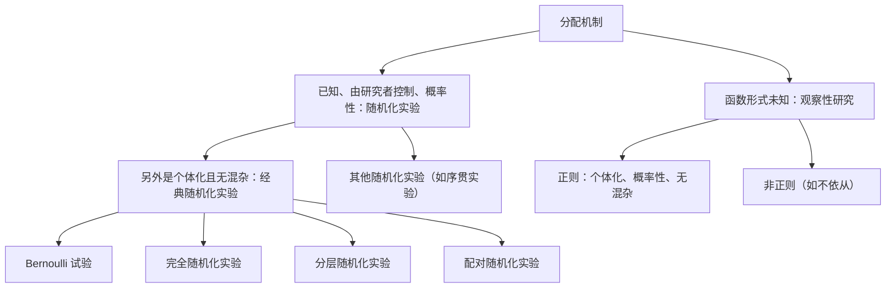

在 [3.9.1](/3.9.1) 中我们看到，因果推断是一个缺失数据问题：对每个单元，两个**潜在结果**中只观测到一个。缺失的结果能否由观测到的结果预测，取决于各单元是如何得到各自处理的。如果由抛硬币决定，处理单元与对照单元就是可比的，一组的观测结果可以告诉我们另一组的缺失结果；如果由每位患者的医生选择预期效果最好的处理，则不然。决定哪些单元接受哪种处理的规则就是分配机制。Rubin 的第二项贡献，继把潜在结果置于分析的核心之后，是使分配机制成为一个明确的数学对象，即给定协变量与潜在结果时处理向量的概率分布。本章给出它的定义，引入区分好的与坏的分配机制的限制条件，并对本课程余下部分所用的设计进行分类：随机化实验（[3.9.3](/3.9.3)–[3.9.7](/3.9.7)）与观察性研究（[3.9.8](/3.9.8)–[3.9.10](/3.9.10)）。

## 2.1. 为什么分配机制很重要

### 2.1.1. 与潜在结果相关的分配

回顾例 1.5.1：四名患者，药物（$W_i = 0$）与手术（$W_i = 1$），平均处理效应 $\tau_{\mathrm{fs}} = 2$。当每名患者接受对其更好的处理时，观测到的均值差是 $-1$。这种分配是确定性的，并依赖于潜在结果，$W_i = \boldsymbol{1}\{Y_i(1) > Y_i(0)\}$，所以处理单元恰是那些 $Y_i(1)$ 相对于 $Y_i(0)$ 较大的单元，两组的观测结果不能代表所有单元的潜在结果。好的医疗实践是坏的实验设计：正是分配对潜在结果的依赖使朴素的比较产生误导。

### 2.1.2. 与协变量相关的分配：Simpson 悖论

分配还可以通过协变量间接地与潜在结果相关。这时，总体上的组间比较与协变量各水平内的比较可能指向相反的方向，这就是 **Simpson 悖论**（[3.3.10](/3.3.10#def-10.2.1)）。

**例 2.1.1** 1992 年全国教育进展评估报告了两个州八年级的数学成绩（数据由 Wainer 与 Brown 2004 分析）。

| | 全州平均 | 白人 | 黑人 | 其他非白人 | 标准化 |
|---|---|---|---|---|---|
| Nebraska | 277 | 281 | 236 | 259 | 271 |
| New Jersey | 271 | 283 | 242 | 260 | 273 |
| Nebraska 的人口构成 | | 87% | 5% | 8% | |
| New Jersey 的人口构成 | | 66% | 15% | 19% | |
| 全国的人口构成 | | 69% | 16% | 15% | |

Nebraska 的全州平均更高，然而 New Jersey 在三个群体的每一个中成绩都更高。原因在于构成：Nebraska 的学生大多属于成绩最高的群体。如果两个州都具有全国的构成，则 Nebraska 的平均为 $281 \times 0.69 + 236 \times 0.16 + 259 \times 0.15 \approx 271$，New Jersey 的平均为 $283 \times 0.69 + 242 \times 0.16 + 260 \times 0.15 \approx 273$，次序反了过来。

:::

哪种比较“正确”取决于所问的问题。要描述每个州的普通八年级学生表现如何，应当用全州平均。要比较两个州的学校对给定背景的学生的作用，相关的是组内比较或标准化比较。用因果的语言说，如果“处理”（州的学校体系）与一个同样影响结果的协变量相关联，忽略该协变量的比较就把处理的效应与协变量的效应混在一起；这就是 [3.8.2](/3.8.2) 的**混杂**。

第二个例子有同样的结构。在 20 世纪 90 年代中期参加医学院入学考试（MCAT）的学生中，后来参加美国医师执照考试（USMLE）第一步的比例，在每个 MCAT 分数段内黑人学生都不低于白人学生（例如最高分段为 0.51 对 0.43），但总体上更低（0.23 对 0.27），因为两组的 MCAT 分数分布不同（Wainer 与 Brown 2004）。Simpson 悖论提出了本课程中反复出现的两个问题：更细的分层是否总是更准确，以及我们是否总能分层？两者都由 [3.9.8](/3.9.8) 的倾向评分以不同的方式回答。

## 2.2. 定义

### 2.2.1. 分配机制

考虑由 $N$ 个单元组成的有限总体，协变量为 $\boldsymbol{X}$（$N \times K$ 数组，虽是矩阵但与向量一样写成粗体，因为它汇集了所有单元的随机协变量），潜在结果为 $\boldsymbol{Y}(0)$、$\boldsymbol{Y}(1)$，处理向量为 $\boldsymbol{W} \in \mathcal{W} = \{0, 1\}^N$，并假定 SUTVA。

**定义 2.2.1（分配机制）** 给定由 $N$ 个单元组成的总体，**分配机制**是取值于 $[0, 1]$ 的行可交换函数 $\mathbb{P}(\boldsymbol{W} \mid \boldsymbol{X}, \boldsymbol{Y}(0), \boldsymbol{Y}(1))$，满足

$$
\sum_{\boldsymbol{W} \in \{0,1\}^N} \mathbb{P}\bigl(\boldsymbol{W} \mid \boldsymbol{X}, \boldsymbol{Y}(0), \boldsymbol{Y}(1)\bigr) = 1 \quad \text{对一切 } \boldsymbol{X}, \boldsymbol{Y}(0), \boldsymbol{Y}(1).
$$
行可交换指单元重新标号时函数不变，即对 $\boldsymbol{W}$、$\boldsymbol{X}$、$\boldsymbol{Y}(0)$ 与 $\boldsymbol{Y}(1)$ 的各行施加同一个置换。概率为正的分配向量的集合记作 $\mathcal{W}^+ \subseteq \mathcal{W}$。

分配机制是全体协变量与全体潜在结果的函数，给出每个可能的分配向量的概率。它决定哪些单元接受哪些处理，从而决定哪些潜在结果被实现并被观测到、哪些缺失。在随机化实验中它是已知的，因为是研究者选定的；在观察性研究中它是未知的，本课程第二部分的大部分内容讨论在不知道它时能做什么。行可交换只是说单元列出的先后次序不携带信息；分配对单元特征的任何依赖都必须通过 $\boldsymbol{X}$ 或潜在结果。

**定义 2.2.2（单位分配概率）** 单元 $i$ 的**单位分配概率**为

$$
p_i\bigl(\boldsymbol{X}, \boldsymbol{Y}(0), \boldsymbol{Y}(1)\bigr) = \sum_{\boldsymbol{W}:W_i = 1} \mathbb{P}\bigl(\boldsymbol{W} \mid \boldsymbol{X}, \boldsymbol{Y}(0), \boldsymbol{Y}(1)\bigr) = \mathbb{E}_W\bigl[W_i \mid \boldsymbol{X}, \boldsymbol{Y}(0), \boldsymbol{Y}(1)\bigr].
$$

单位概率是分配机制的边缘分布，一般并不决定联合分布：不同的机制可以有相同的 $p_i$，如下面的例 2.2.1 与 2.2.2 所示。与机制本身一样，$p_i$ 可以依赖于所有单元的协变量与潜在结果，而不仅是单元 $i$ 的。

**定义 2.2.3（有限总体倾向评分）** 在 $x$ 处的**倾向评分**是满足 $X_i = x$ 的单元的单位分配概率的平均，

$$
e(x) = \frac{1}{N(x)} \sum_{i:X_i = x} p_i\bigl(\boldsymbol{X}, \boldsymbol{Y}(0), \boldsymbol{Y}(1)\bigr),
$$
其中 $N(x) = \#\{i = 1, \dots, N : X_i = x\}$ 是满足 $X_i = x$ 的单元个数。对 $N(x) = 0$ 的取值 $x$，规定倾向评分为零。

倾向评分只通过其指标依赖于协变量取值 $x$；一般而言，它的取值仍依赖于各单元的潜在结果。字母 $e$ 是函数名（取自 exposure，“暴露”），不是常数 $\mathrm{e}$。

### 2.2.2. 四个例子

下面的例子有两个或三个单元，因此可以把机制完整地写出来。

**例 2.2.1（两个单元，独立的公平硬币）** 当 $N = 2$ 时有四个分配向量，$\boldsymbol{W} \in \{(0,0), (0,1), (1,0), (1,1)\}$。为每个单元抛一枚公平硬币的随机化实验，不论潜在结果如何，使每个向量的概率都是 $1/4$。于是 $p_1 = p_2 = 1/2$，又因为没有协变量，$e(x) = 1/2$。

**例 2.2.2（两个单元，一个处理）** 只允许恰好一个处理单元、一个对照单元的随机化实验，对 $\boldsymbol{W} \in \{(0,1), (1,0)\}$ 有 $\mathbb{P}(\boldsymbol{W}) = 1/2$，对 $(0,0)$ 与 $(1,1)$ 为 $0$。同样 $p_1 = p_2 = 1/2$，$e(x) = 1/2$，尽管机制与例 2.2.1 不同。

**例 2.2.3（收益更大的单元接受处理）** 设个体效应较大的单元接受处理，另一个单元接受对照，相等时抛硬币决定：

$$
\mathbb{P}\bigl(\boldsymbol{W} \mid \boldsymbol{X}, \boldsymbol{Y}(0), \boldsymbol{Y}(1)\bigr) =
\begin{cases}
1 & \text{若 } \tau_2 > \tau_1 \text{ 且 } \boldsymbol{W} = (0,1), \text{ 或 } \tau_2 < \tau_1 \text{ 且 } \boldsymbol{W} = (1,0),\\
1/2 & \text{若 } \tau_2 = \tau_1 \text{ 且 } \boldsymbol{W} \in \{(0,1), (1,0)\},\\
0 & \text{其他},
\end{cases}
$$
其中 $\tau_i = Y_i(1) - Y_i(0)$。现在 $p_1$ 与 $p_2$ 依赖于两个单元的潜在结果，取值 $0$、$1/2$ 或 $1$。因为恰有一个单元接受处理，$p_1 + p_2 = 1$，倾向评分仍是 $e(x) = 1/2$：单看倾向评分并不能显示这个机制与前两个有多大不同。

**例 2.2.4（序贯实验）** 三个单元的协变量为 $X_i = i$，依次接受处理。单元 1 由公平硬币分配，单元 2 接受相反的处理；观测它们的结果 $Y_1^{\mathrm{obs}}$ 与 $Y_2^{\mathrm{obs}}$。然后单元 3 接受看起来更好的处理，打成平手时给主动处理。若 $W_1 = 1$，比较的是 $Y_1(1)$ 与 $Y_2(0)$；若 $W_1 = 0$，比较的是 $Y_2(1)$ 与 $Y_1(0)$。于是 $p_1 = p_2 = 1/2$，并且

$$
p_3 = \tfrac{1}{2}\,\boldsymbol{1}\{Y_1(1) \ge Y_2(0)\} + \tfrac{1}{2}\,\boldsymbol{1}\{Y_2(1) \ge Y_1(0)\} \in \bigl\{0, \tfrac{1}{2}, 1\bigr\}.
$$
每个协变量取值只有一个单元，故 $e(1) = e(2) = 1/2$，$e(3) = p_3$，它依赖于另外两个单元的潜在结果。

:::

| 例 | $\mathcal{W}^+$ | $p_i$ | $e(x)$ |
|---|---|---|---|
| 2.2.1 | 全部 4 个向量 | $1/2, 1/2$ | $1/2$ |
| 2.2.2 | $(0,1), (1,0)$ | $1/2, 1/2$ | $1/2$ |
| 2.2.3 | $(0,1), (1,0)$ 之一或两者，视 $\boldsymbol{Y}$ 而定 | $0$、$1/2$ 或 $1$ | $1/2$ |
| 2.2.4 | $W_2 = 1 - W_1$ 的向量 | $1/2, 1/2, p_3(\boldsymbol{Y})$ | $1/2, 1/2, p_3$ |

## 2.3. 对分配机制的限制

不加限制时分配机制可以是任意的，关于因果效应什么也学不到。三个限制使它变得易于处理。它们是机制的性质，而不是数据的性质，在观察性研究中它们是假设。

### 2.3.1. 个体化分配、概率性分配与无混杂分配

**定义 2.3.1（个体化分配）** 若对某个函数 $q(\cdot) \in [0, 1]$，

$$
p_i\bigl(\boldsymbol{X}, \boldsymbol{Y}(0), \boldsymbol{Y}(1)\bigr) = q\bigl(X_i, Y_i(0), Y_i(1)\bigr) \quad \text{对一切 } i = 1, \dots, N,
$$
并且

$$
\mathbb{P}\bigl(\boldsymbol{W} \mid \boldsymbol{X}, \boldsymbol{Y}(0), \boldsymbol{Y}(1)\bigr) = c \cdot \prod_{i=1}^{N} q\bigl(X_i, Y_i(0), Y_i(1)\bigr)^{W_i}\bigl(1 - q(X_i, Y_i(0), Y_i(1))\bigr)^{1 - W_i}
$$
对某个集合 $\mathbb{A}$ 中的 $(\boldsymbol{W}, \boldsymbol{X}, \boldsymbol{Y}(0), \boldsymbol{Y}(1))$ 成立，在其余处为零，其中 $c$ 是归一化常数，则称分配机制为**个体化分配**。

用语言说，一个单元的分配概率不依赖于其他单元的协变量或潜在结果，并且机制在允许分配的集合 $\mathbb{A}$ 上正比于单位概率的乘积。集合与常数使处理单元个数固定的设计成为可能：在例 2.2.2 中，$q = 1/2$，$\mathbb{A}$ 由恰有一个处理单元的分配组成，$c = 2$。个体化分配在序贯实验（如例 2.2.4，其中单元 3 的概率依赖于单元 1 与 2 的结果）与例 2.2.3 中不成立。在个体化分配下，倾向评分简化为

$$
e(x) = \frac{1}{N(x)} \sum_{i:X_i = x} q\bigl(x, Y_i(0), Y_i(1)\bigr).
$$

**定义 2.3.2（概率性分配）** 若每个单元接受每种处理的概率都为正：

$$
0 < p_i\bigl(\boldsymbol{X}, \boldsymbol{Y}(0), \boldsymbol{Y}(1)\bigr) < 1 \quad \text{对一切 } i = 1, \dots, N,
$$
则称分配机制为**概率性分配**。这一条件也称**正值性**或重叠。

如果某个单元只可能接受处理，它的对照结果就永远观测不到，除非对它与其他单元有多相似作出假设，数据中没有任何东西可以替代它。例 2.2.1 与 2.2.2 是概率性分配；例 2.2.3 不是，除非两个个体效应相等；例 2.2.4 在 $p_3 \in \{0, 1\}$ 时不是。

**定义 2.3.3（无混杂分配）** 若分配机制不依赖于潜在结果：

$$
\mathbb{P}\bigl(\boldsymbol{W} \mid \boldsymbol{X}, \boldsymbol{Y}(0), \boldsymbol{Y}(1)\bigr) = \mathbb{P}\bigl(\boldsymbol{W} \mid \boldsymbol{X}, \boldsymbol{Y}'(0), \boldsymbol{Y}'(1)\bigr) \quad \text{对一切 } \boldsymbol{W}, \boldsymbol{X}, \boldsymbol{Y}(0), \boldsymbol{Y}(1), \boldsymbol{Y}'(0), \boldsymbol{Y}'(1),
$$
则称它为**无混杂分配**。这时可以在记号中去掉潜在结果，把机制写成 $\mathbb{P}(\boldsymbol{W} \mid \boldsymbol{X})$。

无混杂性是三个限制中最重要的一个。例 2.2.1 与 2.2.2 是无混杂的；例 2.2.3 与 2.2.4 不是。这些限制在逻辑上彼此独立：例 2.2.2 是个体化、概率性且无混杂的；一个确定地处理单元 1、以概率 $1/2$ 处理单元 2 的机制是个体化且无混杂的，但不是概率性的。

**定理 2.3.1** 若分配机制是个体化且无混杂的，则 $q$ 只依赖于 $x$，倾向评分等于它，$e(x) = q(x)$，并且

$$
\mathbb{P}\bigl(\boldsymbol{W} \mid \boldsymbol{X}, \boldsymbol{Y}(0), \boldsymbol{Y}(1)\bigr) = c \cdot \prod_{i=1}^{N} e(X_i)^{W_i}\bigl(1 - e(X_i)\bigr)^{1 - W_i} \quad \text{在 } \mathbb{A} \text{ 上}.
$$

**证明** 在无混杂性下，机制不依赖于潜在结果，它的边缘分布 $p_i = \sum_{\boldsymbol{W}:W_i = 1}\mathbb{P}(\boldsymbol{W} \mid \boldsymbol{X}, \boldsymbol{Y}(0), \boldsymbol{Y}(1))$ 也不依赖。在个体化分配下 $p_i = q(X_i, Y_i(0), Y_i(1))$；由于 $(Y_i(0), Y_i(1))$ 变化时左端不变，对所有出现的值 $(y_0, y_1)$ 有 $q(x, y_0, y_1) = q(x)$。于是所有满足 $X_i = x$ 的单元有相同的概率 $q(x)$，它们的平均为 $e(x) = q(x)$。把 $q(X_i) = e(X_i)$ 代入定义 2.3.1 中的乘积，得到公式。$\square$

有两个推论会被反复用到。第一，分配机制是倾向评分的乘积，至多相差一个常数与集合 $\mathbb{A}$。第二，倾向评分 $e(x)$ 不再只是平均：它是每个满足 $X_i = x$ 的单元的分配概率。协变量取值相同的单元于是有相同的受处理机会，恰如在每个协变量层内的随机化实验。

### 2.3.2. 强可忽略性与可忽略性

**定义 2.3.4（强可忽略的处理分配）** 个体化、概率性且无混杂的分配机制称为**强可忽略分配**（Rosenbaum 与 Rubin 1983）。在 2.5 节的超总体表述中，这是一对条件

$$
\bigl(Y_i(0), Y_i(1)\bigr) \perp W_i \mid X_i, \qquad 0 < e(x) < 1 \text{ 对一切 } x.
$$

**定义 2.3.5（可忽略的处理分配）** 若分配机制可以只用 $\boldsymbol{W}$、$\boldsymbol{X}$ 与观测结果 $\boldsymbol{Y}^{\mathrm{obs}}$ 写出，而不依赖于缺失的结果 $\boldsymbol{Y}^{\mathrm{mis}}$，则称它是**可忽略分配**（Rubin 1978）。

可忽略性弱于无混杂性。例 2.2.4 的序贯实验是可忽略的，但不是无混杂的：单元 3 的分配依赖于单元 1 与 2 的潜在结果，但只通过它们的观测值。这个名称来自 Bayes 推断，其中可忽略的机制可以从似然中略去（[3.9.6](/3.9.6)），就像随机缺失的数据在关于数据模型的似然推断中可以忽略一样。

| 例 | 个体化 | 概率性 | 无混杂 | 可忽略 |
|---|---|---|---|---|
| 2.2.1（独立硬币） | 是 | 是 | 是 | 是 |
| 2.2.2（一个处理） | 是 | 是 | 是 | 是 |
| 2.2.3（收益更大者接受处理） | 否 | 否（除非 $\tau_1 = \tau_2$） | 否 | 否 |
| 2.2.4（序贯） | 否 | 并不总是 | 否 | 是 |

## 2.4. 分配机制的分类

### 2.4.1. 随机化实验与观察性研究

**定义 2.4.1（随机化实验）** **随机化实验**是概率性的、且具有由研究者控制的已知函数形式的分配机制。

**定义 2.4.2（经典随机化实验）** **经典随机化实验**是分配机制另外还是个体化且无混杂的随机化实验。

随机化实验是因果推断最可信的基础：研究者控制分配，可以通过设计来保证这些限制，而不必去假定。美国食品药品管理局等监管机构批准新药时通常依赖这类实验。例 2.2.4 是不属于经典类型的随机化实验。

**定义 2.4.3（观察性研究）** 若分配机制的函数形式未知，则它对应**观察性研究**。

与实验的关键区别不在于机会是否起作用，而在于研究者是否知道机制。在观察性研究中，分配由单元自己、他们的医生、教师或政府作出，2.3 节的限制不能得到保证。最易处理的观察性研究是那些至少可以假定这些限制成立的研究。

**定义 2.4.4（正则分配机制）** 个体化、概率性且无混杂的分配机制称为**正则分配机制**。不满足这些条件的分配机制称为非正则的。

正则分配机制（RAM）是倾向评分未知的经典随机化实验；[3.9.8](/3.9.8) 表明它的行为像层内分配概率未知的分层随机化实验。一类重要的非正则机制来自不依从：处理的分派可以是随机且无混杂的，但对一些单元，实际接受的处理与分派不同，并且可能依赖于它们的潜在结果。这类设计是 [3.9.14](/3.9.14) 的主题。

### 2.4.2. 四种经典随机化实验

经典随机化实验的分配机制是个体化、概率性且无混杂的，函数形式已知并由研究者控制。四种特殊情形很重要。它们的关键区别是概率为正的分配向量集合 $\mathcal{W}^+$。

**定义 2.4.5（Bernoulli 试验）** **Bernoulli 试验**是经典随机化实验，其分配机制使所有单元的分配相互独立。

**定理 2.4.1（Bernoulli 试验的分配机制）** 若分配机制是 Bernoulli 试验，则

$$
\mathbb{P}\bigl(\boldsymbol{W} \mid \boldsymbol{X}, \boldsymbol{Y}(0), \boldsymbol{Y}(1)\bigr) = \prod_{i=1}^{N} e(X_i)^{W_i}\bigl(1 - e(X_i)\bigr)^{1 - W_i},
$$
其中倾向评分 $e(x)$ 对一切 $x$ 严格介于零与一之间，因此 $\mathcal{W}^+ = \{0, 1\}^N$。

**证明** 由于各分配相互独立，机制是 $W_i$ 的边缘分布的乘积，它们是成功概率为 $p_i$ 的 Bernoulli 分布。由定理 2.3.1（取 $\mathbb{A}$ 为全体向量，$c = 1$），$p_i = e(X_i)$。概率性分配给出 $0 < e(X_i) < 1$，所以每个向量的概率都为正。$\square$

公平硬币的独立抛掷给出 $\mathbb{P}(\boldsymbol{W}) = 0.5^N$；概率为 $q$ 的硬币的抛掷给出 $q^{N_{\mathrm{t}}}(1 - q)^{N_{\mathrm{c}}}$；概率依赖于协变量的硬币给出一般形式。Bernoulli 试验的缺点是处理单元的个数是随机的。以正的概率（公平硬币时为 $2 \cdot 0.5^N$）所有单元落入同一组，并且无论如何两组可能极不相等，使比较不精确。

**定义 2.4.6（完全随机化实验）** 在完全随机化实验（CRE）中，从 $N$ 个单元中随机选取固定个数 $N_{\mathrm{t}}$ 的单元接受主动处理，其余 $N_{\mathrm{c}} = N - N_{\mathrm{t}}$ 个单元接受对照：

$$
\mathbb{P}\bigl(\boldsymbol{W} \mid \boldsymbol{X}, \boldsymbol{Y}(0), \boldsymbol{Y}(1)\bigr) =
\begin{cases}
\dbinom{N}{N_{\mathrm{t}}}^{-1} & \text{若 } \boldsymbol{W} \in \mathcal{W}^+,\\[1ex]
0 & \text{其他},
\end{cases}
\qquad
\mathcal{W}^+ = \Bigl\{\boldsymbol{W} \in \mathcal{W} : \sum_{i=1}^{N} W_i = N_{\mathrm{t}}\Bigr\}.
$$

这就是 [3.8.3](/3.8.3) 的两种处理的**完全随机化设计**，现在通过它的分配机制来描述。每个单元的分配概率为 $q = N_{\mathrm{t}}/N$，机制是个体化的，$c = \binom{N}{N_{\mathrm{t}}}^{-1} q^{-N_{\mathrm{t}}}(1 - q)^{-N_{\mathrm{c}}}$，例 2.2.2 是 $N = 2$、$N_{\mathrm{t}} = 1$ 的情形。CRE 固定了组的大小，但忽略了协变量：处理组可能偶然包含大部分年长的患者，协变量越多，出现某种不平衡的可能性就越大。

**定义 2.4.7（分层随机化实验）** 依据协变量把 $N$ 个单元划分为 $J$ 个区组（层）；$B_i = B(X_i) \in \{1, \dots, J\}$ 是单元 $i$ 所在的区组，$N(j)$ 是区组 $j$ 的大小。有 $J$ 个区组的**分层随机化实验**（SRE）是经典随机化实验，其中在每个区组 $j$ 内由一个 CRE 把 $N_{\mathrm{t}}(j)$ 个单元分配给处理，预设的个数满足 $0 < N_{\mathrm{t}}(j) < N(j)$：

$$
\mathbb{P}\bigl(\boldsymbol{W} \mid \boldsymbol{X}, \boldsymbol{Y}(0), \boldsymbol{Y}(1)\bigr) =
\begin{cases}
\displaystyle\prod_{j=1}^{J}\binom{N(j)}{N_{\mathrm{t}}(j)}^{-1} & \text{若 } \boldsymbol{W} \in \mathcal{W}^+,\\[1ex]
0 & \text{其他},
\end{cases}
\qquad
\mathcal{W}^+ = \Bigl\{\boldsymbol{W} \in \mathcal{W} : \sum_{i:B_i = j} W_i = N_{\mathrm{t}}(j),\ j = 1, \dots, J\Bigr\}.
$$
倾向评分为：当 $B_i = j$ 时 $e(X_i) = N_{\mathrm{t}}(j)/N(j)$。

SRE 是 [3.8.2](/3.8.2) 中**分区组**的随机化对应：它把区组之间的差异从比较中去掉，这些差异在 CRE 中会增加估计的变异。各区组的分配概率可以不同。

**定义 2.4.8（配对随机化实验）** **配对随机化实验**（PRE）是 $N(j) = 2$、$N_{\mathrm{t}}(j) = 1$（$j = 1, \dots, N/2$）的分层随机化实验，因此

$$
\mathbb{P}\bigl(\boldsymbol{W} \mid \boldsymbol{X}, \boldsymbol{Y}(0), \boldsymbol{Y}(1)\bigr) =
\begin{cases}
2^{-N/2} & \text{若 } \boldsymbol{W} \in \mathcal{W}^+,\\
0 & \text{其他},
\end{cases}
\qquad
\mathcal{W}^+ = \Bigl\{\boldsymbol{W} \in \mathcal{W} : \sum_{i:B_i = j} W_i = 1,\ j = 1, \dots, N/2\Bigr\}.
$$

PRE 是分层的极端形式。在以前测分数为协变量的教育实验中，把学生按前测分数排序，前两名组成第一对，接下来两名组成第二对，依此类推，在每一对内由一枚公平硬币决定哪名学生接受新的教学方法。它对应于 [3.8.2](/3.8.2) 的**配对设计**。

### 2.4.3. 设计的比较

四种设计允许的分配向量个数不同。考虑 $N$ 个单元，协变量取 $N/2$ 个值，每个值有两个单元，倾向评分 $e(x) = 1/2$；对 SRE 取两个区组，每个含 $N/2$ 个单元；对 PRE 取协变量值相同的 $N/2$ 对单元。

| 设计 | $\lvert\mathcal{W}^+\rvert$ | $N = 4$ | $N = 8$ | $N = 16$ | $N = 32$ |
|---|---|---|---|---|---|
| Bernoulli 试验 | $2^N$ | 16 | 256 | 65,536 | $4.3 \times 10^9$ |
| 完全随机化实验 | $\binom{N}{N/2}$ | 6 | 70 | 12,870 | $6.0 \times 10^8$ |
| 分层随机化实验 | $\binom{N/2}{N/4}^2$ | 4 | 36 | 4,900 | $1.7 \times 10^8$ |
| 配对随机化实验 | $2^{N/2}$ | 4 | 16 | 256 | 65,536 |

沿表向下，各设计排除越来越多事先无益的分配向量，即把差别很大的单元放进两组、因而不大可能导出精确因果推断的那些向量：CRE 排除了组大小极不平衡的向量，SRE 还排除了区组之间的不平衡，PRE 则排除了配对协变量上的所有不平衡。代价是，每一个限制在分析中都必须遵守（[3.9.7](/3.9.7)）。

与 [3.8](/3.8) 的比较颇有启发。那里，完全随机化设计与随机区组设计是与响应的统计模型（单因素或双因素方差分析）一起引入的，随机化为模型的误差假设提供依据。这里的出发点是分配机制本身，潜在结果是固定的；[3.9.3](/3.9.3) 与 [3.9.4](/3.9.4) 的推断只用随机化，不需要任何关于结果的模型。

## 2.5. 超总体

### 2.5.1. 从超总体中抽取单元

到目前为止，$N$ 个单元及其潜在结果是固定的，唯一的随机性是分配。我们常常想得到关于更大总体的结论，手头的单元是它的一个样本。

**定义 2.5.1（超总体）** 由 $N$ 个单元组成的有限总体可以看作从无限的**超总体**中抽取的随机样本：四元组 $(Y_i(0), Y_i(1), W_i, X_i)$，$i = 1, \dots, N$，独立同分布，其分布由形如下式的全局参数 $(\phi, \theta, \psi)$ 索引

$$
f_{W \mid Y(0), Y(1), X}\bigl(W_i \mid Y_i(0), Y_i(1), X_i; \phi\bigr) \cdot f_{Y(0), Y(1) \mid X}\bigl(Y_i(0), Y_i(1) \mid X_i; \theta\bigr) \cdot f_X(X_i; \psi).
$$
超总体平均处理效应为

$$
\tau_{\mathrm{sp}} = \mathbb{E}_{\mathrm{sp}}\bigl[Y_i(1) - Y_i(0)\bigr].
$$

第一个因子是单个单元的分配机制，参数为 $\phi$；第二个是给定协变量时潜在结果的联合分布，参数为 $\theta$；第三个是协变量的分布。由于四元组在单元之间独立，在超总体中分配自动是个体化的。有限样本估计目标 $\tau_{\mathrm{fs}}$ 现在是一个随机变量，$\mathbb{E}_{\mathrm{sp}}[\tau_{\mathrm{fs}}] = \tau_{\mathrm{sp}}$。

**定义 2.5.2（超总体倾向评分）** 在 $x$ 处的超总体倾向评分是满足 $X_i = x$ 的单元的总体平均分配概率，

$$
e(x) = \mathbb{E}_{\mathrm{sp}}\Bigl[\mathbb{E}_W\bigl[W_i \mid X_i = x, Y_i(0), Y_i(1)\bigr]\Bigm| X_i = x\Bigr] = \mathbb{E}_{\mathrm{sp}}[W_i \mid X_i = x] = \mathbb{P}(W_i = 1 \mid X_i = x; \phi, \theta)
$$
对 $X_i$ 的支撑中的一切 $x$ 成立。

它是定义 2.2.3 的超总体类比：那里对满足 $X_i = x$ 的单元取的平均是有限平均，这里则是对给定 $X_i = x$ 时潜在结果的条件分布取的期望。它依赖于 $\phi$（一般也依赖于 $\theta$），这一依赖我们通常略去。

### 2.5.2. 超总体中的限制

**定义 2.5.3（超总体限制）** 若

$$
0 < f_{W \mid Y(0), Y(1), X}\bigl(1 \mid Y_i(0), Y_i(1), X_i; \phi\bigr) < 1 \quad \text{对一切可能的 } X_i, Y_i(0), Y_i(1),
$$
则称分配机制是超总体概率性的；若它不依赖于潜在结果：

$$
f_{W \mid Y(0), Y(1), X}(w \mid y_0, y_1, x; \phi) = f_{W \mid Y(0), Y(1), X}(w \mid y_0', y_1', x; \phi) \quad \text{对一切 } y_0, y_1, y_0', y_1', x, \phi \text{ 与 } w = 0, 1,
$$
则称它是超总体无混杂的。

超总体无混杂性就是**条件独立** $W_i \perp (Y_i(0), Y_i(1)) \mid X_i$：给定协变量，处理不携带关于潜在结果的信息。在它之下，对任意 $(y_0, y_1)$ 有 $e(x) = f_{W \mid Y(0), Y(1), X}(1 \mid y_0, y_1, x; \phi)$，强可忽略性（定义 2.3.4）就是无混杂性加上 $0 < e(x) < 1$。注意，无混杂性是关于 $W_i$ 与潜在结果的联合分布的陈述，而不是关于 $W_i$ 与观测结果的陈述：$W_i$ 一般不与 $Y_i^{\mathrm{obs}}$ 独立，因为只要处理有效应，$Y_i^{\mathrm{obs}}$ 就依赖于 $W_i$。

### 2.5.3. 有限样本与超总体的比较

| | 有限样本 | 超总体 |
|---|---|---|
| 固定的量 | $\boldsymbol{X}, \boldsymbol{Y}(0), \boldsymbol{Y}(1)$ | 参数 $\phi, \theta, \psi$ |
| 随机的量 | $\boldsymbol{W}$ | $\boldsymbol{W}$ 与 $(X_i, Y_i(0), Y_i(1))$ |
| 随机性的来源 | 仅分配 | 单元的抽样与分配 |
| 平均效应 | $\tau_{\mathrm{fs}} = \frac{1}{N}\sum_i (Y_i(1) - Y_i(0))$ | $\tau_{\mathrm{sp}} = \mathbb{E}_{\mathrm{sp}}[Y_i(1) - Y_i(0)]$ |
| 倾向评分 | $X_i = x$ 的单元上 $p_i$ 的平均 | $\mathbb{P}(W_i = 1 \mid X_i = x)$ |
| 矩 | $\mathbb{E}_W$、$\operatorname{Var}_W$ | $\mathbb{E}_{\mathrm{sp}}$、$\operatorname{Var}_{\mathrm{sp}}$ |

两种观点都有用。有限样本观点不需要关于单元来源的任何假设，并只基于随机化给出精确的结果（[3.9.3](/3.9.3)、[3.9.4](/3.9.4)）。想要推广结论时需要超总体观点，它也使 [3.9.5](/3.9.5) 与 [3.9.6](/3.9.6) 的回归与基于模型的方法顺理成章。一个估计量可以在两种意义下都是无偏的，但它的方差不同，[3.9.4](/3.9.4) 将会说明。

## 2.6. 例：再论 Lord 悖论

在 **Lord 悖论**（例 1.6.1）中，单元是学生，处理是 9 月到 6 月的大学膳食，观测到的 6 月体重是 $Y_i(1)$，而对照以及 $Y_i(0)$ 没有定义；协变量是性别 $G_i$（男为 $1$，女为 $2$）与 9 月体重 $X_i$；分配使每个人都接受了处理。分配机制是退化的，$\mathbb{P}(\boldsymbol{W} = \boldsymbol{1}) = 1$，最彻底地违反了概率性分配。因此，两位统计学家得出的任何结论都必然来自关于 $Y_i(0)$ 的假设。把它们写出来，就能看出各自估计的是什么。

**例 2.6.1（统计学家 1）** 性别 $g$ 的膳食效应为 $D_g = \mathbb{E}[Y(1) - Y(0) \mid G = g]$，差别效应为

$$
D = D_1 - D_2 = \bigl(\mathbb{E}[Y(1) \mid G = 1] - \mathbb{E}[Y(1) \mid G = 2]\bigr) - \bigl(\mathbb{E}[Y(0) \mid G = 1] - \mathbb{E}[Y(0) \mid G = 2]\bigr).
$$
第一个差只涉及观测到的结果。对第二个差，统计学家 1 隐含地假定，没有这种膳食时学生 6 月的体重等于 9 月的体重，$Y_i(0) = X_i$，所以 $\mathbb{E}[Y(0) \mid G = g] = \mathbb{E}[X \mid G = g]$。估计为

$$
\hat D = \bigl(\bar Y_{G=1} - \bar Y_{G=2}\bigr) - \bigl(\bar X_{G=1} - \bar X_{G=2}\bigr) = 0,
$$
因为在每个性别内，6 月平均体重都等于 9 月平均体重。

**例 2.6.2（统计学家 2）** 统计学家 2 对 9 月体重进行调整，考虑条件效应 $\mathbb{E}[Y(1) - Y(0) \mid X, G = g]$。平行回归拟合

$$
\mathbb{E}[Y(1) \mid X, G = g] = a_g + bX, \qquad g = 1, 2,
$$
这是关于观测量的假设，数据可以检验它。因果解释需要关于不可观测的对照结果的第二个假设：对两个性别，它们遵循同一个 9 月体重的线性函数，

$$
\mathbb{E}[Y(0) \mid X, G = g] = a + b'X, \qquad g = 1, 2.
$$
于是条件差别效应为

$$
D(X) = \bigl(a_1 + bX - a - b'X\bigr) - \bigl(a_2 + bX - a - b'X\bigr) = a_1 - a_2,
$$
即两条平行线之间的垂直距离，在 Lord 的数据中它为正。

:::

这两个答案涉及不同的估计目标，一个是平均效应，一个是条件效应，并且基于关于 $Y_i(0)$ 的不同假设；两个假设都不能检验，因为没有学生是在对照下被观测的。两个假设确实相互冲突。在统计学家 2 的假设下，平均效应为 $D_g = a_g - a + (b - b')\mu_g$，其中 $\mu_g$ 是性别 $g$ 的 9 月平均体重，所以 $D = a_1 - a_2 + (b - b')(\mu_1 - \mu_2)$。例如，若 $b' = b$（对照体重对 9 月体重的回归与观测到的 6 月体重相同），则 $D = a_1 - a_2 \neq 0$，与统计学家 1 矛盾。统计学家 1 的假设 $Y_i(0) = X_i$ 是 $a = 0$、$b' = 1$ 的特殊情形；由于 $\mu_g = a_g + b\mu_g$，公式给出 $D = (1 - b)(\mu_1 - \mu_2) + (b - 1)(\mu_1 - \mu_2) = 0$，而条件差 $D(X) = a_1 - a_2$ 仍不为零。所以回归线之间的正差距，与根本没有平均差别效应是相容的。数据无法在两位统计学家之间裁决；只有关于另一种膳食下会发生什么的实质性知识才能做到。一旦把潜在结果与分配机制明确写出，Lord 悖论就得到了解决。

## 小结

- 分配机制 $\mathbb{P}(\boldsymbol{W} \mid \boldsymbol{X}, \boldsymbol{Y}(0), \boldsymbol{Y}(1))$（定义 2.2.1）决定哪些潜在结果被观测到。它的边缘分布是单位分配概率 $p_i$，它们在 $X_i = x$ 的单元上的平均构成倾向评分 $e(x)$（定义 2.2.2、2.2.3）。不同的机制可以有相同的 $p_i$ 与 $e(x)$（例 2.2.1–2.2.3）。
- 当分配直接地（例 1.5.1）或通过协变量（Simpson 悖论，例 2.1.1）依赖于潜在结果时，朴素的比较会产生误导。
- 限制：

  | 限制 | 含义 | 公式 |
  |---|---|---|
  | 个体化（定义 2.3.1） | $p_i$ 只依赖于单元 $i$ | $p_i = q(X_i, Y_i(0), Y_i(1))$，乘积形式 |
  | 概率性（定义 2.3.2） | 每个单元都可能接受两种处理 | $0 < p_i < 1$ |
  | 无混杂（定义 2.3.3） | 不依赖于潜在结果 | $\mathbb{P}(\boldsymbol{W} \mid \boldsymbol{X}, \boldsymbol{Y}(0), \boldsymbol{Y}(1)) = \mathbb{P}(\boldsymbol{W} \mid \boldsymbol{X})$ |
  | 强可忽略（定义 2.3.4） | 三者皆备 | $(Y(0), Y(1)) \perp W \mid X$，$0 < e(x) < 1$ |
  | 可忽略（定义 2.3.5） | 不依赖于 $\boldsymbol{Y}^{\mathrm{mis}}$ | 只依赖于 $\boldsymbol{W}, \boldsymbol{X}, \boldsymbol{Y}^{\mathrm{obs}}$ |

  个体化与无混杂合起来给出 $\mathbb{P} = c\prod_i e(X_i)^{W_i}(1 - e(X_i))^{1 - W_i}$（定理 2.3.1）。
- 分类：随机化实验（已知、概率性）、经典随机化实验（另外是个体化且无混杂的）、观察性研究（机制未知）、正则分配机制（未知，但个体化、概率性且无混杂）与非正则分配机制（不依从）。

  | 经典设计 | $\mathcal{W}^+$ | $\mathcal{W}^+$ 上的 $\mathbb{P}(\boldsymbol{W})$ |
  |---|---|---|
  | Bernoulli 试验 | $\{0, 1\}^N$ | $\prod_i e(X_i)^{W_i}(1 - e(X_i))^{1 - W_i}$ |
  | CRE | $\sum_i W_i = N_{\mathrm{t}}$ | $\binom{N}{N_{\mathrm{t}}}^{-1}$ |
  | SRE | 对一切 $j$，$\sum_{i:B_i = j} W_i = N_{\mathrm{t}}(j)$ | $\prod_j \binom{N(j)}{N_{\mathrm{t}}(j)}^{-1}$ |
  | PRE | 每对一个处理单元 | $2^{-N/2}$ |
- 超总体：$(Y_i(0), Y_i(1), W_i, X_i)$ 独立同分布，$\tau_{\mathrm{sp}} = \mathbb{E}_{\mathrm{sp}}[Y_i(1) - Y_i(0)]$，$e(x) = \mathbb{P}(W_i = 1 \mid X_i = x)$；无混杂性成为 $W_i \perp (Y_i(0), Y_i(1)) \mid X_i$。
- Lord 悖论：两位统计学家在关于 $Y_i(0)$ 的不同的不可检验假设下回答不同的问题（例 2.6.1、2.6.2）。

## 思考题

1. 三个单元的分配如下：单元 1 由一枚公平硬币决定；当且仅当 $X_2 > X_1$ 时单元 2 接受处理；单元 3 以概率 $0.3$ 接受处理，与其他一切独立。该机制是否是个体化、概率性、无混杂的？计算 $p_1, p_2, p_3$。

   **答** $p_1 = 1/2$，$p_2 = \boldsymbol{1}\{X_2 > X_1\} \in \{0, 1\}$，$p_3 = 0.3$。机制不依赖于潜在结果，所以是无混杂的。它不是概率性的，因为 $p_2 \in \{0, 1\}$。它也不是个体化的，因为 $p_2$ 依赖于单元 1 的协变量。
2. 一位医生治疗血压超过 $140$ 的每位患者，不治疗其他任何人。讨论三个限制。这对估计处理效应意味着什么？

   **答** 以血压为协变量，$p_i = \boldsymbol{1}\{X_i > 140\}$：它是个体化的、（给定 $X$ 时）无混杂的，但不是概率性的，因为 $e(x) \in \{0, 1\}$。受治与未受治患者从不具有相同的协变量取值，因此不可能在同一 $x$ 处比较；只能通过在阈值两侧外推结果模型来估计效应，例如在连续性假设下取 $x = 140$ 附近（断点回归设计）。如果血压没有被记录，则给定已记录的协变量，机制不是无混杂的。
3. 在 $N = 6$、$N_{\mathrm{t}} = 2$ 的 CRE 中，写出 $\lvert\mathcal{W}^+\rvert$、$p_i$ 与个体化表示中的常数 $c$。

   **答** $\lvert\mathcal{W}^+\rvert = \binom{6}{2} = 15$，每个的概率为 $1/15$；$p_i = 2/6 = 1/3$。对每个允许的向量，乘积 $\prod_i q^{W_i}(1 - q)^{1 - W_i} = (1/3)^2(2/3)^4 = 16/729$，所以 $c = (1/15)/(16/729) = 729/240 = 243/80$。
4. 一所学校有 40 名学生，其中男生 24 名、女生 16 名。比较处理 20 名学生的 CRE 与处理 12 名男生和 8 名女生的 SRE 的 $\lvert\mathcal{W}^+\rvert$。每种设计的倾向评分是多少？

   **答** CRE：$\binom{40}{20} \approx 1.38 \times 10^{11}$，每人 $e(x) = 1/2$。SRE：$\binom{24}{12}\binom{16}{8} = 2{,}704{,}156 \times 12{,}870 \approx 3.48 \times 10^{10}$，同样 $e(\text{男}) = 12/24 = e(\text{女}) = 8/16 = 1/2$。SRE 排除了 CRE 的分配中大约四分之三那些处理组中男生不恰好占 60% 的分配。
5. 证明在公平硬币的 Bernoulli 试验中，所有单元落入同一组的概率是 $2^{1-N}$，并计算 $N = 10$ 时处理组至多有 2 个单元的概率。

   **答** 全部处理的概率为 $2^{-N}$，全部对照同样，合起来是 $2^{1-N}$。对 $N = 10$，$\mathbb{P}(N_{\mathrm{t}} \le 2) = \bigl[\binom{10}{0} + \binom{10}{1} + \binom{10}{2}\bigr]/2^{10} = 56/1024 \approx 0.055$。
6. 解释为什么无混杂性 $W_i \perp (Y_i(0), Y_i(1)) \mid X_i$ 并不蕴含 $W_i \perp Y_i^{\mathrm{obs}} \mid X_i$。给出一个数值例子。

   **答** $Y_i^{\mathrm{obs}} = Y_i(W_i)$ 依赖于 $W_i$。在没有协变量、每个单元都有 $Y_i(0) = 0$ 与 $Y_i(1) = 1$ 的 CRE 中，$W_i$ 与潜在结果独立（后者是常数），但 $Y_i^{\mathrm{obs}} = W_i$ 与 $W_i$ 完全相依。观测结果对处理的依赖，恰恰是我们想要估计的因果效应。
7. 更细的分层是否总是更准确？我们是否总能分层？结合 Simpson 悖论简要讨论。

   **答** 对既影响处理又影响结果的协变量分层，可以消除 Simpson 悖论所显示的偏倚；对预测结果的协变量分层，可以提高精度。但更细的层并不总是更好：协变量很多或连续时，大多数层只含处理单元或只含对照单元（或为空），层内比较不可能；对受处理影响的变量分层会引入偏倚；对无关协变量分层会损失自由度。有 $K$ 个二值协变量时就已有 $2^K$ 个层。倾向评分（[3.9.8](/3.9.8)）把分层降到一维。
8. 在 Lord 悖论中，设统计学家 2 的对照模型在 $b' = 1$ 但 $a \neq 0$ 时成立。$D$ 与 $D(X)$ 等于多少？

   **答** $b' = 1$ 时，$D = a_1 - a_2 + (b - 1)(\mu_1 - \mu_2)$，并利用 $a_g = (1 - b)\mu_g$（因为每个性别内 6 月平均体重等于 9 月平均体重），$D = (1 - b)(\mu_1 - \mu_2) - (1 - b)(\mu_1 - \mu_2) = 0$。条件差为 $D(X) = a_1 - a_2 = (1 - b)(\mu_1 - \mu_2)$。截距 $a$ 在两者中都抵消，所以结论与统计学家 1 相同：没有平均差别效应，尽管条件效应因性别而异。
