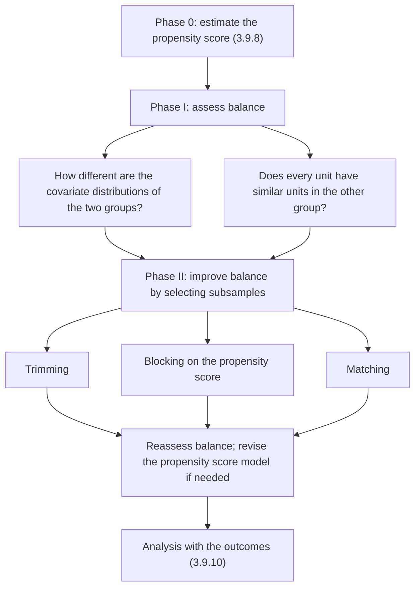

In a randomized experiment the design comes first: the researcher decides on blocks or pairs and randomizes, and only then are the outcomes measured. An observational study under a **regular assignment mechanism** ([3.9.8](/3.9.8)) can imitate this order. Before any outcome is looked at, the covariates and the treatment indicators alone tell us how different the treated and control groups are and whether every unit has comparable units in the other group. Where the groups differ, we select or arrange the units so that the comparison becomes more like one within a **stratified randomized experiment** or a **paired randomized experiment** ([3.9.7](/3.9.7)). Because the outcomes are not used, the design cannot be tuned toward a desired answer. This chapter describes the tools of the design phase: measures of balance and overlap (§9.2), trimming (§9.3), blocking (§9.4) and matching (§9.5). The estimators that use the resulting subsamples are the subject of [3.9.10](/3.9.10). The running example is the barbiturate exposure data of [3.9.8](/3.9.8) (Example 8.1.1), with $N_{\mathrm{t}} = 742$ exposed and $N_{\mathrm{c}} = 4462$ unexposed children and 17 covariates.

## 9.1. The Design Phase

The design of an observational study proceeds in three phases, all of which use only $(W_i, X_i)$:

The phases are iterated: if balance in the selected subsample is unsatisfactory, the specification of the propensity score is changed (for example by adding interaction terms for covariates that remain unbalanced) and the subsamples are constructed again. Only when the design is fixed are the outcomes brought in.

## 9.2. Assessing Balance

Let $f_{\mathrm{c}}(x)$ and $f_{\mathrm{t}}(x)$ be the covariate distributions of the control and treated subpopulations. Balance means that the two are close. We measure the difference first one covariate at a time, then for all covariates together, and finally ask the more local question of overlap.

### 9.2.1. Univariate Measures

For a single covariate the natural first summaries are histograms of the two groups, followed by numerical measures of the difference in location and in dispersion. Let $\bar X_{\mathrm{t}}$, $\bar X_{\mathrm{c}}$ be the group means and $s_{\mathrm{t}}^2$, $s_{\mathrm{c}}^2$ the group sample variances of the covariate.

**Definition 9.2.1 (Normalized Difference)** The **normalized difference** of a covariate between the treated and control groups is

$$
\hat\Delta_{\mathrm{ct}} = \frac{\bar X_{\mathrm{t}} - \bar X_{\mathrm{c}}}{\sqrt{(s_{\mathrm{t}}^2 + s_{\mathrm{c}}^2)/2}}.
$$
It is the difference in means measured in units of the average within-group standard deviation, also called the standardized mean difference.

The normalized difference is invariant under affine transformations of the covariate, so its value does not depend on the units of measurement. A tempting alternative is the two-sample $t$-statistic

$$
T = \frac{\bar X_{\mathrm{t}} - \bar X_{\mathrm{c}}}{\sqrt{s_{\mathrm{t}}^2/N_{\mathrm{t}} + s_{\mathrm{c}}^2/N_{\mathrm{c}}}},
$$
which tests $H_0\colon \mu_{\mathrm{t}} = \mu_{\mathrm{c}}$. But that is not our question. The $t$-statistic grows like $\sqrt N$ for a fixed difference between the populations: it measures whether we have enough data to detect a difference, not whether the difference is large enough to make the adjustment difficult. A normalized difference of $0.5$ is a serious imbalance whatever the sample size, because linear adjustment then relies heavily on the functional form; a difference of $0.05$ is harmless even if, with a million units, its $t$-statistic is large. As a rule of thumb, normalized differences below about $0.1$ in absolute value are considered small and differences above about $0.25$ make regression adjustment unreliable. Within the small blocks of §9.4 the sample sizes are modest and the two measures behave similarly, which is why $t$-statistics are used there.

The normalized difference compares locations. To compare dispersions we use the log ratio of standard deviations,

$$
\hat\Gamma_{\mathrm{ct}} = \log s_{\mathrm{t}} - \log s_{\mathrm{c}},
$$
which is zero when the spreads are equal and is closer to normally distributed than the ratio $s_{\mathrm{t}}/s_{\mathrm{c}}$ itself. Large values in either direction mean that one group covers covariate values the other rarely reaches, a warning that overlap may be poor in the tails.

### 9.2.2. Multivariate Measures

With $K$ covariates, $K$ univariate summaries can each be small while the joint distributions differ, and conversely one large value among many may matter little. Two scalar summaries of the multivariate difference are used. The first is the **Mahalanobis distance** ([3.4.1](/3.4.1)) between the two mean vectors, measured with the average of the two within-group covariance matrices $\hat\Sigma_{\mathrm{t}}$ and $\hat\Sigma_{\mathrm{c}}$:

$$
\hat\Delta_{\mathrm{ct}}^{\mathrm{mv}} = \sqrt{(\bar X_{\mathrm{t}} - \bar X_{\mathrm{c}})\left(\frac{\hat\Sigma_{\mathrm{c}} + \hat\Sigma_{\mathrm{t}}}{2}\right)^{-1}(\bar X_{\mathrm{t}} - \bar X_{\mathrm{c}})^{\mathsf T}}.
$$
With a single covariate it reduces to the absolute normalized difference. It accounts for correlations among the covariates, but it still compares only means.

The second summary uses the propensity score.

**Definition 9.2.2 (Linearized Propensity Score)** The **linearized propensity score** is the log odds of the propensity score,

$$
\ell(x) = \log\frac{e(x)}{1 - e(x)},
$$
and its estimate is $\hat\ell(x) = \log(\hat e(x)/(1 - \hat e(x)))$. For a logistic regression model it is the linear predictor $h(x)\hat{\boldsymbol{\phi}}$.

The linearized score is preferred to $e(x)$ itself because its distribution is closer to normal and it stretches out the regions near zero and one, where the differences that matter for overlap are compressed on the probability scale. The balance measure is the normalized difference of $\hat\ell(X_i)$ between the groups, $\hat\Delta_{\mathrm{ct}}^{\ell}$. Its justification is Theorem 8.2.4 of [3.9.8](/3.9.8): the difference in mean propensity score between the groups equals $\operatorname{Var}(e(X_i))/(p(1 - p))$, which is zero exactly when the propensity score is constant, and that happens exactly when $f_{\mathrm{t}} = f_{\mathrm{c}}$. Since $\ell$ is a monotone function of $e$, a normalized difference of the linearized score close to zero indicates, approximately, that the propensity score varies little and hence that the whole covariate distributions are close:

$$
\hat\Delta_{\mathrm{ct}}^{\ell} \approx 0 \;\Longleftrightarrow\; \mathbb{E}[e(X_i) \mid W_i = 1] - \mathbb{E}[e(X_i) \mid W_i = 0] \approx 0 \;\Longleftrightarrow\; \operatorname{Var}(e(X_i)) \approx 0 \;\Longleftrightarrow\; f_{\mathrm{t}} \approx f_{\mathrm{c}}.
$$
A single number thus summarizes the difference between two $K$-dimensional distributions, including differences in variances and dependence, as long as they are captured by the propensity score model. The price is that the measure is only as good as that model.

### 9.2.3. Overlap

Even if the two distributions differ, causal effects can be estimated credibly for units that have comparable units in the other group. The second question of Phase I is therefore local. For each unit $i$ we ask whether there is a unit $i'$ with the opposite treatment, $W_{i'} = 1 - W_i$, and a similar linearized propensity score,

$$
\bigl\lvert \hat\ell(X_i) - \hat\ell(X_{i'})\bigr\rvert \le \ell_u
$$
for a chosen threshold $\ell_u$. Let $q_{\mathrm{c}}$ be the proportion of control units with such a comparable treated unit, and $q_{\mathrm{t}}$ the proportion of treated units with a comparable control unit. For units without comparable units it is difficult to obtain credible estimates of the causal effect, whatever method is used, because any estimate for them extrapolates. If there are many such units, the sample can be trimmed (§9.3).

**Example 9.2.1 (Balance and Overlap in the Barbiturate Data)** In the full sample, most covariates have normalized differences below $0.2$ in absolute value (socioeconomic status has $0.28$), but three are clearly unbalanced: the mother's age ($0.53$), the covariate recorded as `lpbc420` ($1.63$) and the indicator recorded as `psydrug` ($0.41$). The Mahalanobis measure is $0.43$, and the normalized difference of the linearized propensity score is $1.65$: the histograms of $\hat\ell$ in the two groups are substantially apart. With $\ell_u = 0.10$, the proportions of units with comparable units in the other group are:

| | Barbiturate | Lottery | LaLonde experimental | LaLonde non-experimental |
|---|---|---|---|---|
| $q_{\mathrm{c}}$ | $0.60$ | $0.75$ | $0.98$ | $0.21$ |
| $q_{\mathrm{t}}$ | $0.98$ | $0.69$ | $0.97$ | $0.97$ |

For the barbiturate data, almost all exposed children have comparable unexposed children, so the effect on the exposed subpopulation (the **average treatment effect on the treated**) can be estimated credibly; for 40% of the unexposed children there are no comparable exposed children, so the average effect for the whole population cannot. In this application the exposed children are the natural population of interest, so this is not a concern. The other columns, from data sets discussed in [3.9.6](/3.9.6) and [3.9.10](/3.9.10), show the range: in the experimental LaLonde data both proportions are near one, as randomization guarantees, while in the non-experimental version, where the controls come from a general survey, only a fifth of the controls resemble any trainee.

:::

## 9.3. Trimming

If the propensity score of a unit is close to zero or one, its effect is hard to estimate precisely: a unit with $e(X_i) \approx 1$ has almost no comparable controls, and every estimator either relies on a model to extrapolate or gives such a unit an enormous weight. The remedy is to give up on these units.

**Definition 9.3.1 (Trimming)** **Trimming** removes from the analysis the units whose estimated propensity score lies outside an interval $[\alpha, 1 - \alpha]$, or more generally outside a region $\mathbb{A}$ of the covariate space where both groups are well represented. The estimand changes accordingly, from the average effect over all units to the average effect over the units with covariates in $\mathbb{A}$:

$$
\tau_{\mathrm{fs}} = \frac{1}{N}\sum_{i=1}^{N}\bigl(Y_i(1) - Y_i(0)\bigr) \quad\longrightarrow\quad \tau_{\mathrm{fs}}(\mathbb{A}) = \frac{1}{N(\mathbb{A})}\sum_{i:X_i \in \mathbb{A}}\bigl(Y_i(1) - Y_i(0)\bigr),
$$
where $N(\mathbb{A})$ is the number of units with $X_i \in \mathbb{A}$.

The simplest form trims at the two ends. If the treated units have estimated scores in $[b_0', b_J']$ and the controls in $[b_0'', b_J'']$, control units below the smallest treated score and treated units above the largest control score have no counterparts at all and are removed. More aggressive trimming also removes units in the thin tails of the overlap region. A widely used rule, derived by Crump, Hotz, Imbens and Mitnik (2009) as the choice that minimizes the asymptotic variance of the estimated average effect under homoskedasticity, keeps the units with $\hat e(X_i) \in [\alpha, 1 - \alpha]$ for a data-dependent $\alpha$; in many applications $\alpha$ is close to $0.1$, and $[0.1, 0.9]$ is a common default.

Trimming changes the question being answered, and this has to be stated. The new estimand is defined by the covariates, not by the outcomes, so it is a well-defined causal quantity, but it may not be the one originally of interest. The trade is between an answer to a slightly different question with credible precision and an answer to the original question that rests on extrapolation. When the population of interest is the treated, as in Example 9.2.1, one-sided trimming removes only control units, and the estimand is unchanged. In the barbiturate data, the units in the covariate cell with no exposed children, whose estimated propensity score is exactly zero ([3.9.8](/3.9.8), Example 8.4.2), are removed in this way. A second example, the lottery data, is trimmed in [3.9.10](/3.9.10).

## 9.4. Blocking on the Propensity Score

### 9.4.1. Constructing the Blocks

Trimming removes units; blocking arranges the remaining ones into groups that can be analyzed like the strata of a stratified randomized experiment.

**Definition 9.4.1 (Subclassification)** **Subclassification**, or blocking on the propensity score, partitions the (trimmed) sample into $J$ blocks by boundaries $b_0 < b_1 < \dots < b_J$ on the estimated propensity score, with block indicators $B_i(j) = \boldsymbol{1}\{b_{j-1} \le \hat e(X_i) < b_j\}$, so that within each block the treated and control units have similar propensity scores and, by the balancing property, similar covariate distributions.

Cochran (1968) showed that five blocks on a single covariate remove about 90% of the bias due to that covariate, and five blocks of equal size became a standard choice. A data-driven procedure adapts the number and the boundaries of the blocks to the data.

**Algorithm 9.4.1 (Recursive Splitting)** Start with a single block containing all units of the trimmed sample.

1. For each current block $j$, compute the $t$-statistic $t(j)$ for the difference in the mean linearized propensity score between the treated and control units of the block.
2. If $\lvert t(j)\rvert > t_{\max}$, consider splitting the block at the median of $\hat e(X_i)$ within the block. Split it if each of the two new blocks contains at least a minimum number of treated and of control units (and a minimum total size); otherwise leave it.
3. Repeat steps 1–2 until no block is split. A block is final when it is adequately balanced ($\lvert t(j)\rvert \le t_{\max}$) or too small to split.

:::

A common choice is $t_{\max} = 1$, with minimum sizes of a few treated and control units per block. The rule tends to produce many narrow blocks where the propensity score changes quickly with the covariates and the groups differ most, and few wide blocks elsewhere.

**Example 9.4.1 (Blocks for the Barbiturate Data)** With $t_{\max} = 1$, the first block contains all 4462 controls and 742 treated units, with propensity scores from $0.00$ to $0.94$ and $t = 36.3$. It is split at its median into $[0, 0.06)$ and $[0.06, 0.94]$, with $t$-statistics $3.2$ and $23.7$, and both are split again. After six rounds the procedure stops with ten blocks:

| Block | 1 | 2 | 3 | 4 | 5 | 6 | 7 | 8 | 9 | 10 |
|---|---|---|---|---|---|---|---|---|---|---|
| Range of $\hat e$ | $0$–$0.01$ | $0.01$–$0.02$ | $0.02$–$0.06$ | $0.06$–$0.11$ | $0.11$–$0.20$ | $0.20$–$0.37$ | $0.37$–$0.42$ | $0.42$–$0.50$ | $0.50$–$0.61$ | $0.61$–$0.94$ |
| Controls | 644 | 636 | 1260 | 604 | 559 | 458 | 101 | 80 | 73 | 47 |
| Treated | 6 | 14 | 41 | 46 | 92 | 192 | 61 | 83 | 90 | 117 |
| $t$-statistic | $-0.0$ | $1.7$ | $0.5$ | $-0.3$ | $1.0$ | $1.2$ | $0.3$ | $0.7$ | $0.8$ | $-0.3$ |

Blocks 2 and 6 still have $t > 1$ but are not split further because a split would leave too few treated units in one half. The proportion of treated units rises from about 1% in block 1 to 71% in block 10: the blocks resemble the strata of a stratified experiment with very different, but within each stratum roughly constant, assignment probabilities.

:::

### 9.4.2. Balance Given the Estimated Propensity Score

Splitting until the linearized propensity score is balanced within the blocks does not guarantee that each covariate is balanced. The balancing property (Theorem 8.2.1) holds for the true propensity score; for an estimated score it holds only to the extent that the model is adequate. The blocks are therefore checked covariate by covariate, in two ways.

The first way checks balance within blocks. For covariate $k$ in block $j$, let

$$
\bar X_{\mathrm{c},k}(j) = \frac{1}{N_{\mathrm{c}}(j)}\sum_{i:W_i = 0}B_i(j)X_{ik}, \qquad \bar X_{\mathrm{t},k}(j) = \frac{1}{N_{\mathrm{t}}(j)}\sum_{i:W_i = 1}B_i(j)X_{ik},
$$
$\hat\tau_k^X(j) = \bar X_{\mathrm{t},k}(j) - \bar X_{\mathrm{c},k}(j)$, and estimate its variance with the pooled within-block variance,

$$
\widehat{\operatorname{Var}}{}_k^X(j) = s_k^2(j)\left(\frac{1}{N_{\mathrm{c}}(j)} + \frac{1}{N_{\mathrm{t}}(j)}\right), \quad s_k^2(j) = \frac{1}{N(j) - 2}\sum_{i:B_i(j) = 1}\Bigl((1 - W_i)\bigl(X_{ik} - \bar X_{\mathrm{c},k}(j)\bigr)^2 + W_i\bigl(X_{ik} - \bar X_{\mathrm{t},k}(j)\bigr)^2\Bigr).
$$
The statistic $\hat\tau_k^X(j)/\sqrt{\widehat{\operatorname{Var}}{}_k^X(j)}$ gives $KJ$ values, which should look like draws from a standard normal distribution if the propensity score model is adequate. A **normal Q–Q plot** of them is a convenient diagnostic: a few values far outside the line point to covariates and blocks where the model should be refined.

The second way checks balance across blocks. Treat the covariate $X_{ik}$ as if it were an outcome and estimate the "effect" of the treatment on it with the stratified estimator of [3.9.7](/3.9.7):

$$
\hat\tau_k^X = \sum_{j=1}^{J}\frac{N(j)}{N}\hat\tau_k^X(j), \qquad \widehat{\operatorname{Var}}{}_k^X = \sum_{j=1}^{J}\left(\frac{N(j)}{N}\right)^2\widehat{\operatorname{Var}}{}_k^X(j), \qquad Z_k = \frac{\hat\tau_k^X}{\sqrt{\widehat{\operatorname{Var}}{}_k^X}}.
$$
Since the covariates are measured before the treatment, the treatment cannot affect them, and their pseudo-average causal effect $\tau_k^X$ is zero. A large $\lvert Z_k\rvert$, judged against the standard normal distribution in a two-sided test, indicates that the blocks have not removed the imbalance in covariate $k$.

**Example 9.4.2 (Balance Tests for the Barbiturate Data)** With the final propensity score specification of [3.9.8](/3.9.8) and the ten blocks of Example 9.4.1, the overall statistics $Z_k$ for the 17 covariates all lie between $-1.5$ and $1.1$. Without blocking, the $t$-statistics for the same covariates reach $8.56$ for the mother's age, $6.32$ for `psydrug`, $5.19$ for socioeconomic status and $32.0$ for `lpbc420`. The within-block statistics are mostly below 2 in absolute value, with a handful between 2 and 2.4, about what 170 draws from a standard normal distribution would give; their Q–Q plot is close to the diagonal, much closer than for a simple propensity score model with linear terms only. The blocking has achieved the balance one would expect in a stratified randomized experiment.

:::

## 9.5. Matching

### 9.5.1. Closest Unit Matching

Blocking groups units in a few broad classes; matching pairs each unit with its closest counterparts. In the most common setting the estimand is the average effect on the treated, the treated units are kept, and for each treated unit we look for control units.

**Definition 9.5.1 (Matching)** **Matching** assigns to each unit $i$ of one group (usually each treated unit) one or more units of the other group whose covariates are close to $X_i$ according to a distance $d(\cdot, \cdot)$, the matches, and compares the outcomes within the resulting matched sets.

The variants are:

- with or without replacement: without replacement, each control can be used once, so the result depends on the order in which treated units are matched; with replacement, each treated unit gets its closest control, and a control may serve several treated units;
- one or several matches: each treated unit may be matched to $M \ge 1$ controls; more matches reduce the variance but use worse matches.

The two standard distances are the Mahalanobis distance and the propensity score distance:

$$
d_{\mathrm{M}}(x, x') = \sqrt{(x - x')\hat\Sigma^{-1}(x - x')^{\mathsf T}}, \qquad d_{\ell}(x, x') = \bigl\lvert \hat\ell(x) - \hat\ell(x')\bigr\rvert,
$$
where $\hat\Sigma$ is a sample covariance matrix of the covariates (often that of the control group, or a diagonal matrix of variances, which gives the standardized Euclidean distance). The Mahalanobis distance treats all covariates as equally important after standardization; it finds close matches in a few dimensions but deteriorates quickly as their number grows. The propensity score distance reduces the problem to one dimension and, by the balancing property, balances the covariates in the matched sample on average, although individual matched pairs may differ substantially in their covariates.

### 9.5.2. Hybrid Matching and Calipers

The two ideas can be combined. Hybrid matching first partitions the sample by a few key covariates (for example sex, or a categorical variable such as the chain of a restaurant) and then matches on the estimated propensity score within each partition: the key covariates are matched exactly and the others balanced on average. Matching can also be combined with trimming: if the closest match for a treated unit is far away, it may be better to drop that unit than to use a bad match.

**Definition 9.5.2 (Caliper Matching)** **Caliper matching** accepts a match $m(i)$ for unit $i$ only if $d(X_i, X_{m(i)}) \le c$ for a chosen caliper $c$, and drops unit $i$ from the analysis if no unit of the other group lies within the caliper.

On the propensity score scale, a caliper of about $0.2$ standard deviations of the linearized propensity score is a common choice (Austin 2011). As with trimming, dropping treated units changes the estimand, from the effect on all treated units to the effect on those with good matches.

**Example 9.5.1 (Matching the Barbiturate Data)** Each of the 742 exposed children is matched, without replacement, to one unexposed child, first by the Mahalanobis distance on all 17 covariates, then by the linearized propensity score distance. The normalized differences before and after matching are:

| | Full sample | Mahalanobis matching | Propensity score matching |
|---|---|---|---|
| Mother's age | $0.53$ | $0.13$ | $0.02$ |
| `lpbc420` | $1.63$ | $0.59$ | $0.10$ |
| `psydrug` | $0.41$ | $0.00$ | $0.13$ |
| Multivariate measure $\hat\Delta_{\mathrm{ct}}^{\mathrm{mv}}$ | $0.43$ | $0.24$ | $0.05$ |
| Linearized propensity score | $1.65$ | $0.45$ | $0.02$ |

Mahalanobis matching balances most covariates almost exactly (normalized differences of $0.00$ for many binary covariates) but leaves the most important one, `lpbc420`, badly unbalanced, because it treats it as one of 17 equally weighted dimensions. Propensity score matching gives up exact agreement on individual covariates but balances all of them in the matched sample, the most important one included. In both matched samples the log ratios of standard deviations are close to zero.

:::

The figure shows the same comparison for simulated data, in the form of a "Love plot" of the absolute normalized differences before and after matching.

A final design decision is whether to match or to block. Matching gives the closest comparisons and is natural for the effect on the treated when the control pool is large; blocking uses all units and is natural for the population average effect. Both are followed in the analysis by a regression adjustment within the matched sets or blocks, which removes much of the bias that the design leaves ([3.9.10](/3.9.10)).

## Summary

| Phase | Tool | Formula or rule | What it tells or does |
|---|---|---|---|
| 0 | estimated propensity score | logistic regression, three-step selection ([3.9.8](/3.9.8)) | the summary of the covariates used for design |
| I | normalized difference | $(\bar X_{\mathrm{t}} - \bar X_{\mathrm{c}})/\sqrt{(s_{\mathrm{t}}^2 + s_{\mathrm{c}}^2)/2}$ | size of location imbalance, scale-free, not sample-size driven |
| I | log ratio of standard deviations | $\log s_{\mathrm{t}} - \log s_{\mathrm{c}}$ | imbalance in dispersion |
| I | multivariate measures | Mahalanobis distance of means; normalized difference of $\hat\ell$ | joint imbalance; $\hat\Delta^{\ell} \approx 0 \Leftrightarrow f_{\mathrm{t}} \approx f_{\mathrm{c}}$ (Theorem 8.2.4) |
| I | overlap | $q_{\mathrm{c}}$, $q_{\mathrm{t}}$: share of units with a counterpart within $\ell_u$ | for which subpopulation effects are credible |
| II | trimming | keep $\hat e \in [\alpha, 1 - \alpha]$, often $\approx [0.1, 0.9]$ | removes units without counterparts; changes the estimand |
| II | blocking | split at medians while $\lvert t\rvert > t_{\max} = 1$ and blocks are large enough | strata analyzed like an SRE; check $t_{kj}$, Q–Q plot, $Z_k$ |
| II | matching | nearest neighbors by $d_{\mathrm{M}}$ or $d_{\ell}$, with or without replacement, $M$ matches, calipers | close comparisons, mostly for the effect on the treated |

- Every step uses only $W$ and $X$; the outcomes enter only in the analysis.
- Balance is a property of the sample, assessed after each step; poor balance leads back to the propensity score model, not to the outcomes.

## Questions

1. Two covariates have, in a study with $N_{\mathrm{t}} = N_{\mathrm{c}} = 50$, normalized differences $0.4$ and $0.05$. The study is replicated with $N_{\mathrm{t}} = N_{\mathrm{c}} = 5000$ from the same populations. What happens to the normalized differences and to the $t$-statistics? Which measure answers the design question?

   **Answer** The normalized differences estimate fixed population quantities and stay near $0.4$ and $0.05$. With equal variances, $T \approx \hat\Delta_{\mathrm{ct}}\sqrt{N_{\mathrm{t}}N_{\mathrm{c}}/(N_{\mathrm{t}} + N_{\mathrm{c}})} = \hat\Delta_{\mathrm{ct}}\sqrt{N/4}$, so they grow from about $2.0$ and $0.25$ to $20$ and $2.5$. The second covariate would now be "significant" although its imbalance is negligible. The design question is how much the adjustment must rely on modeling, which depends on the size of the difference, so the normalized difference answers it.
2. Show that with a single covariate the Mahalanobis measure $\hat\Delta_{\mathrm{ct}}^{\mathrm{mv}}$ equals $\lvert\hat\Delta_{\mathrm{ct}}\rvert$, and give an example with two covariates in which both univariate normalized differences are $0.2$ but the Mahalanobis measure is much larger.

   **Answer** With $K = 1$, $\hat\Sigma_{\mathrm{c}} = s_{\mathrm{c}}^2$, $\hat\Sigma_{\mathrm{t}} = s_{\mathrm{t}}^2$, and the formula gives $\lvert\bar X_{\mathrm{t}} - \bar X_{\mathrm{c}}\rvert/\sqrt{(s_{\mathrm{t}}^2 + s_{\mathrm{c}}^2)/2}$. With two standardized covariates of correlation $\rho = 0.9$ and mean differences $(0.2, -0.2)$, $\Sigma^{-1} = \frac{1}{1 - \rho^2}\begin{bmatrix} 1 & -\rho \\ -\rho & 1 \end{bmatrix}$ and $\hat\Delta^{\mathrm{mv}} = \sqrt{0.08(1 + \rho)/(1 - \rho^2)} = \sqrt{0.08/0.1} \approx 0.89$: a difference against the strong correlation is a large multivariate imbalance.
3. Why does trimming at $[0.1, 0.9]$ change the estimand, but trimming only control units with $\hat e(X_i)$ below the smallest treated score does not change the average effect on the treated?

   **Answer** Trimming at $[0.1, 0.9]$ removes treated and control units, so the average is over a covariate-defined subpopulation $\mathbb{A}$, not the full population. The average effect on the treated averages over treated units only; removing controls that are unlike every treated unit does not remove any term of this average, and those controls could not have served as comparisons for any treated unit anyway.
4. In Algorithm 9.4.1, why is a block not split when one half would contain very few treated units, even though its $t$-statistic exceeds $t_{\max}$?

   **Answer** Within each block the effect is estimated from the treated and control units of that block, and a block with, say, two treated units gives a very imprecise block estimate, and its variance estimate is unstable or undefined. A small residual imbalance in the linearized propensity score can be removed by regression within the block ([3.9.10](/3.9.10)); a block that is too small cannot be repaired. The minimum size trades a little bias for much variance.
5. Explain why a balance check $Z_k$ that treats the covariate as an outcome has a known "true effect", and what a rejection means.

   **Answer** The covariates are measured before the treatment, so the treatment cannot change them: $X_{ik}(1) = X_{ik}(0)$ and the pseudo causal effect $\tau_k^X$ is zero. If the blocks were strata of an SRE, the stratified estimator of this zero effect would have mean zero and $Z_k$ would be approximately standard normal. A large $\lvert Z_k\rvert$ shows that within blocks the treated and controls still differ in covariate $k$, so the propensity score model (or the blocking) is inadequate for that covariate.
6. Five treated units have linearized propensity scores $-1.0, -0.2, 0.1, 0.4, 1.5$, and the control pool has scores $-1.1, -0.9, -0.3, 0.0, 0.2, 0.9$. Match each treated unit to one control without replacement in the order listed, then with replacement, and with a caliper of $0.3$.

   **Answer** Without replacement: $-1.0 \to -1.1$ (or $-0.9$, a tie at distance $0.1$; take $-1.1$), $-0.2 \to -0.3$, $0.1 \to 0.0$ (tie with $0.2$; take $0.0$), $0.4 \to 0.2$, $1.5 \to 0.9$ (distance $0.6$). With replacement the matches are the same here, because no control is closest to two treated units except in ties. With the caliper $0.3$, the unit with $1.5$ has no acceptable match and is dropped; the estimand becomes the effect on the four treated units with scores up to $0.4$.
7. In Example 9.5.1, propensity score matching leaves a normalized difference of $0.13$ for `psydrug`, larger than after Mahalanobis matching. How could the design be improved without abandoning the propensity score?

   **Answer** Use hybrid matching: match exactly on the binary indicator `psydrug` (and possibly other key binary covariates) and on the linearized propensity score within each category. Alternatively, add interactions involving `psydrug` to the propensity score model and rematch, or match on the propensity score with a Mahalanobis distance on a few key covariates within a caliper. Any residual imbalance is then reduced by regression adjustment in the analysis.
8. A researcher reports that after matching, all $t$-statistics for the covariates are below $1.96$, and concludes that the design is adequate. What is incomplete about this check?

   **Answer** Matching reduces the sample, which by itself shrinks $t$-statistics without improving balance; the sizes of the differences (normalized differences, log ratios of standard deviations) are what matter. Balance of means does not imply balance of variances or of the joint distribution, so dispersions and the linearized propensity score should be checked as well. Finally, no balance check addresses unobserved covariates; the design can only make the comparison as good as unconfoundedness given $X$ allows.
