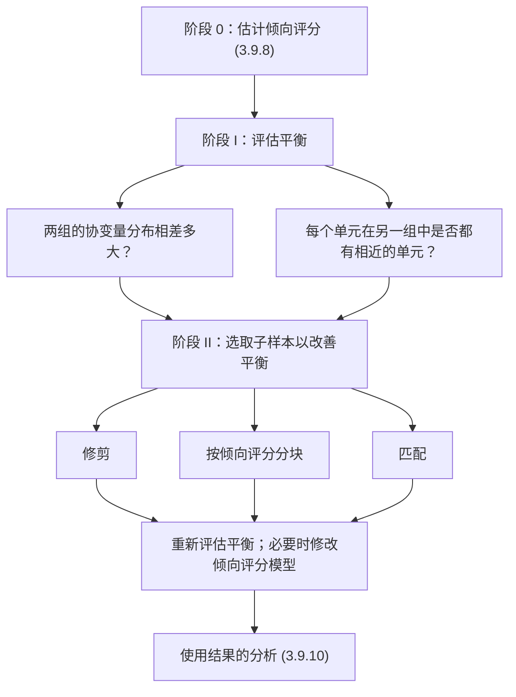

在随机化实验中，设计在先：研究者确定区组或配对并随机分配，之后才测量结果。**正则分配机制**（[3.9.8](/3.9.8)）下的观察性研究可以模仿这一顺序。在查看任何结果之前，仅凭协变量与处理指示变量，就能告诉我们处理组与对照组相差多大，以及每个单元在另一组中是否都有可比的单元。在两组存在差异之处，我们选取或安排单元，使比较更像是在**分层随机化实验**或**配对随机化实验**（[3.9.7](/3.9.7)）之内进行。由于不使用结果，设计不会被调整得趋向某个期望的答案。本章介绍设计阶段的工具：平衡与重叠的度量（9.2 节）、修剪（9.3 节）、分块（9.4 节）与匹配（9.5 节）。使用所得子样本的估计量是 [3.9.10](/3.9.10) 的主题。贯穿全章的例子是 [3.9.8](/3.9.8) 的巴比妥类药物暴露数据（例 8.1.1），其中暴露儿童 $N_{\mathrm{t}} = 742$ 名，未暴露儿童 $N_{\mathrm{c}} = 4462$ 名，协变量 17 个。

## 9.1. 设计阶段

观察性研究的设计分三个阶段，都只使用 $(W_i, X_i)$：

各阶段是迭代的：若所选子样本中的平衡不能令人满意，就改变倾向评分的设定（例如为仍不平衡的协变量添加交互项），并重新构造子样本。只有设计确定之后才引入结果。

## 9.2. 评估平衡

设 $f_{\mathrm{c}}(x)$ 与 $f_{\mathrm{t}}(x)$ 分别是对照子总体与处理子总体的协变量分布。平衡就是两者接近。我们先逐个协变量度量差异，再对全部协变量一起度量，最后提出更局部的重叠问题。

### 9.2.1. 单变量度量

对单个协变量，自然的第一步概括是两组的直方图，再配以位置与离散程度之差的数值度量。设 $\bar X_{\mathrm{t}}$、$\bar X_{\mathrm{c}}$ 为各组均值，$s_{\mathrm{t}}^2$、$s_{\mathrm{c}}^2$ 为该协变量的各组样本方差。

**定义 9.2.1（标准化均差）** 协变量在处理组与对照组之间的**标准化均差**为

$$
\hat\Delta_{\mathrm{ct}} = \frac{\bar X_{\mathrm{t}} - \bar X_{\mathrm{c}}}{\sqrt{(s_{\mathrm{t}}^2 + s_{\mathrm{c}}^2)/2}}.
$$
它是以组内平均标准差为单位度量的均值差，也称标准化均值差。

标准化均差在协变量的仿射变换下不变，所以其值不依赖于度量单位。一个诱人的替代是两样本 $t$ 统计量

$$
T = \frac{\bar X_{\mathrm{t}} - \bar X_{\mathrm{c}}}{\sqrt{s_{\mathrm{t}}^2/N_{\mathrm{t}} + s_{\mathrm{c}}^2/N_{\mathrm{c}}}},
$$
它检验 $H_0\colon \mu_{\mathrm{t}} = \mu_{\mathrm{c}}$。但这并不是我们的问题。当两个总体之间的差异固定时，$t$ 统计量以 $\sqrt N$ 的速度增长：它度量的是我们的数据是否足以检测出差异，而不是差异是否大到使调整变得困难。无论样本量多大，$0.5$ 的标准化均差都是严重的不平衡，因为此时线性调整强烈依赖于函数形式；$0.05$ 的差异则是无害的，即使在一百万个单元的样本中它的 $t$ 统计量很大。作为经验法则，绝对值小于约 $0.1$ 的标准化均差被认为是小的，超过约 $0.25$ 的差异会使回归调整不可靠。在 9.4 节的小块内，样本量不大，两种度量表现相近，所以在那里使用 $t$ 统计量。

标准化均差比较的是位置。比较离散程度时，我们使用标准差的对数比，

$$
\hat\Gamma_{\mathrm{ct}} = \log s_{\mathrm{t}} - \log s_{\mathrm{c}},
$$
当两组的散布相等时它为零，并且比比值 $s_{\mathrm{t}}/s_{\mathrm{c}}$ 本身更接近正态分布。任一方向上的大值都意味着一组覆盖了另一组很少达到的协变量取值，这是尾部重叠可能不佳的警告。

### 9.2.2. 多变量度量

有 $K$ 个协变量时，$K$ 个单变量概括可能各自都很小而联合分布却不同，反过来，许多值中的一个大值也可能无关紧要。多变量差异常用两个标量概括。第一个是两个均值向量之间的**马氏距离**（[3.4.1](/3.4.1)），用两个组内协方差矩阵 $\hat\Sigma_{\mathrm{t}}$ 与 $\hat\Sigma_{\mathrm{c}}$ 的平均来度量：

$$
\hat\Delta_{\mathrm{ct}}^{\mathrm{mv}} = \sqrt{(\bar X_{\mathrm{t}} - \bar X_{\mathrm{c}})\left(\frac{\hat\Sigma_{\mathrm{c}} + \hat\Sigma_{\mathrm{t}}}{2}\right)^{-1}(\bar X_{\mathrm{t}} - \bar X_{\mathrm{c}})^{\mathsf T}}.
$$
只有一个协变量时，它化为标准化均差的绝对值。它考虑了协变量之间的相关性，但仍然只比较均值。

第二个概括使用倾向评分。

**定义 9.2.2（线性化倾向评分）** **线性化倾向评分**是倾向评分的对数几率，

$$
\ell(x) = \log\frac{e(x)}{1 - e(x)},
$$
其估计为 $\hat\ell(x) = \log(\hat e(x)/(1 - \hat e(x)))$。对 logistic 回归模型，它就是线性预测量 $h(x)\hat{\boldsymbol{\phi}}$。

线性化评分比 $e(x)$ 本身更可取，因为其分布更接近正态，并且它把接近零和一的区域拉开，而在概率尺度上，那里对重叠至关重要的差异被压缩了。平衡的度量是 $\hat\ell(X_i)$ 在两组之间的标准化均差 $\hat\Delta_{\mathrm{ct}}^{\ell}$。其依据是 [3.9.8](/3.9.8) 的定理 8.2.4：两组之间平均倾向评分之差等于 $\operatorname{Var}(e(X_i))/(p(1 - p))$，它恰在倾向评分为常数时为零，而这又恰在 $f_{\mathrm{t}} = f_{\mathrm{c}}$ 时发生。由于 $\ell$ 是 $e$ 的单调函数，线性化评分的标准化均差接近零，就近似地表明倾向评分变化很小，因而整个协变量分布接近：

$$
\hat\Delta_{\mathrm{ct}}^{\ell} \approx 0 \;\Longleftrightarrow\; \mathbb{E}[e(X_i) \mid W_i = 1] - \mathbb{E}[e(X_i) \mid W_i = 0] \approx 0 \;\Longleftrightarrow\; \operatorname{Var}(e(X_i)) \approx 0 \;\Longleftrightarrow\; f_{\mathrm{t}} \approx f_{\mathrm{c}}.
$$
于是一个数就概括了两个 $K$ 维分布之间的差异，包括方差与相依性的差异，只要它们被倾向评分模型所捕捉。代价是这一度量的好坏取决于该模型。

### 9.2.3. 重叠

即使两个分布不同，对于在另一组中有可比单元的那些单元，仍可可靠地估计因果效应。因此阶段 I 的第二个问题是局部的。对每个单元 $i$，我们问是否存在处理相反的单元 $i'$，$W_{i'} = 1 - W_i$，其线性化倾向评分相近，

$$
\bigl\lvert \hat\ell(X_i) - \hat\ell(X_{i'})\bigr\rvert \le \ell_u
$$
这里 $\ell_u$ 是选定的阈值。设 $q_{\mathrm{c}}$ 为有这样可比处理单元的对照单元所占比例，$q_{\mathrm{t}}$ 为有可比对照单元的处理单元所占比例。对没有可比单元的单元，无论用什么方法都难以得到可靠的因果效应估计，因为对它们的任何估计都是外推。若这样的单元很多，可以对样本作修剪（9.3 节）。

**例 9.2.1（巴比妥类药物数据中的平衡与重叠）** 在全样本中，大多数协变量的标准化均差的绝对值小于 $0.2$（社会经济地位为 $0.28$），但有三个明显不平衡：母亲的年龄（$0.53$）、记为 `lpbc420` 的协变量（$1.63$）与记为 `psydrug` 的指示变量（$0.41$）。马氏度量为 $0.43$，线性化倾向评分的标准化均差为 $1.65$：两组中 $\hat\ell$ 的直方图相距甚远。取 $\ell_u = 0.10$，在另一组中有可比单元的单元所占比例为：

| | 巴比妥 | 彩票 | LaLonde 实验数据 | LaLonde 非实验数据 |
|---|---|---|---|---|
| $q_{\mathrm{c}}$ | $0.60$ | $0.75$ | $0.98$ | $0.21$ |
| $q_{\mathrm{t}}$ | $0.98$ | $0.69$ | $0.97$ | $0.97$ |

对巴比妥数据，几乎所有暴露儿童都有可比的未暴露儿童，所以对暴露子总体的效应（**处理组平均处理效应**）可以可靠地估计；而 40% 的未暴露儿童没有可比的暴露儿童，所以对全体总体的平均效应不能估计。在这一应用中，暴露儿童是自然的关注对象，所以这并不是问题。其余各列取自 [3.9.6](/3.9.6) 与 [3.9.10](/3.9.10) 中讨论的数据集，显示了变化的范围：在 LaLonde 实验数据中，两个比例都接近一，这是随机化所保证的；而在非实验版本中，对照来自一般性调查，只有五分之一的对照与任何受训者相似。

:::

## 9.3. 修剪

若一个单元的倾向评分接近零或一，它的效应就难以精确估计：$e(X_i) \approx 1$ 的单元几乎没有可比的对照，每种估计量要么依赖模型外推，要么给这样的单元一个巨大的权重。补救办法是放弃这些单元。

**定义 9.3.1（修剪）** **修剪**把估计倾向评分落在区间 $[\alpha, 1 - \alpha]$ 之外的单元，或更一般地，落在协变量空间中两组都有良好代表的区域 $\mathbb{A}$ 之外的单元，从分析中去掉。估计目标随之改变，从对全体单元的平均效应变为对协变量落在 $\mathbb{A}$ 中的单元的平均效应：

$$
\tau_{\mathrm{fs}} = \frac{1}{N}\sum_{i=1}^{N}\bigl(Y_i(1) - Y_i(0)\bigr) \quad\longrightarrow\quad \tau_{\mathrm{fs}}(\mathbb{A}) = \frac{1}{N(\mathbb{A})}\sum_{i:X_i \in \mathbb{A}}\bigl(Y_i(1) - Y_i(0)\bigr),
$$
其中 $N(\mathbb{A})$ 是满足 $X_i \in \mathbb{A}$ 的单元数。

最简单的形式是在两端修剪。若处理单元的估计评分落在 $[b_0', b_J']$，对照单元的落在 $[b_0'', b_J'']$，则低于最小处理评分的对照单元和高于最大对照评分的处理单元完全没有对应者，被去掉。更激进的修剪还去掉重叠区域稀薄尾部的单元。Crump、Hotz、Imbens 与 Mitnik（2009）导出了一条被广泛使用的规则，它在同方差性下使估计平均效应的渐近方差最小，保留满足 $\hat e(X_i) \in [\alpha, 1 - \alpha]$ 的单元，其中 $\alpha$ 依赖于数据；在许多应用中 $\alpha$ 接近 $0.1$，$[0.1, 0.9]$ 是常见的缺省选择。

修剪改变了所回答的问题，这一点必须说明。新的估计目标由协变量而不是结果定义，所以它是定义明确的因果量，但可能不是最初关心的那个。这是一种权衡：在对略有不同的问题给出精度可靠的回答，与对原问题给出依赖于外推的回答之间取舍。当关注的总体是处理组时，如例 9.2.1，单侧修剪只去掉对照单元，估计目标不变。在巴比妥数据中，估计倾向评分恰为零、且协变量单元格内没有暴露儿童的那些单元（[3.9.8](/3.9.8)，例 8.4.2），就是这样被去掉的。第二个例子，即彩票数据，在 [3.9.10](/3.9.10) 中修剪。

## 9.4. 按倾向评分分块

### 9.4.1. 构造块

修剪去掉单元；分块则把其余的单元安排成可以像分层随机化实验的层那样分析的组。

**定义 9.4.1（子类化）** **子类化**，即按倾向评分分块，是用估计倾向评分上的边界 $b_0 < b_1 < \dots < b_J$ 把（修剪后的）样本划分成 $J$ 块，块指示变量为 $B_i(j) = \boldsymbol{1}\{b_{j-1} \le \hat e(X_i) < b_j\}$，使每块内的处理单元与对照单元具有相近的倾向评分，并由平衡性质，具有相近的协变量分布。

Cochran（1968）证明，对单个协变量分五块能消除该协变量所致偏差的约 90%，五个等大的块于是成为标准选择。数据驱动的程序则使块的个数与边界适应数据。

**算法 9.4.1（递归分裂）** 从含修剪后样本全部单元的一个块出发。

1. 对当前的每个块 $j$，计算该块的处理单元与对照单元之间平均线性化倾向评分之差的 $t$ 统计量 $t(j)$。
2. 若 $\lvert t(j)\rvert > t_{\max}$，考虑在块内 $\hat e(X_i)$ 的中位数处分裂该块。若两个新块中的处理单元数与对照单元数都至少达到某个最小值（且总大小也达到某个最小值），就分裂；否则保持不变。
3. 重复步骤 1–2，直到没有块被分裂。当一个块已经充分平衡（$\lvert t(j)\rvert \le t_{\max}$），或太小而无法分裂时，它就是最终的块。

:::

常见的选择是 $t_{\max} = 1$，每块中处理单元与对照单元的最小个数各取几个。该规则倾向于在倾向评分随协变量变化迅速、两组差异最大之处产生许多窄块，在其他地方产生少数宽块。

**例 9.4.1（巴比妥数据的分块）** 取 $t_{\max} = 1$，第一个块含全部 4462 个对照单元与 742 个处理单元，倾向评分从 $0.00$ 到 $0.94$，$t = 36.3$。它在中位数处被分裂为 $[0, 0.06)$ 与 $[0.06, 0.94]$，$t$ 统计量分别为 $3.2$ 与 $23.7$，两者又各自被再次分裂。经过六轮，程序停止，得到十个块：

| 块 | 1 | 2 | 3 | 4 | 5 | 6 | 7 | 8 | 9 | 10 |
|---|---|---|---|---|---|---|---|---|---|---|
| $\hat e$ 的范围 | $0$–$0.01$ | $0.01$–$0.02$ | $0.02$–$0.06$ | $0.06$–$0.11$ | $0.11$–$0.20$ | $0.20$–$0.37$ | $0.37$–$0.42$ | $0.42$–$0.50$ | $0.50$–$0.61$ | $0.61$–$0.94$ |
| 对照单元 | 644 | 636 | 1260 | 604 | 559 | 458 | 101 | 80 | 73 | 47 |
| 处理单元 | 6 | 14 | 41 | 46 | 92 | 192 | 61 | 83 | 90 | 117 |
| $t$ 统计量 | $-0.0$ | $1.7$ | $0.5$ | $-0.3$ | $1.0$ | $1.2$ | $0.3$ | $0.7$ | $0.8$ | $-0.3$ |

块 2 与块 6 的 $t$ 仍大于 $1$，但没有再分裂，因为分裂会使某一半中的处理单元太少。处理单元的比例从块 1 的约 1% 上升到块 10 的 71%：这些块像是分层实验的层，各层的分配概率差别很大，但在每层内大致为常数。

:::

### 9.4.2. 给定估计倾向评分下的平衡

分裂到块内线性化倾向评分平衡为止，并不保证每个协变量都平衡。平衡性质（定理 8.2.1）对真实的倾向评分成立；对估计的评分，只有在模型适当的程度上才成立。因此要逐个协变量地检查各块，方式有两种。

第一种检查块内的平衡。对第 $j$ 块中的协变量 $k$，令

$$
\bar X_{\mathrm{c},k}(j) = \frac{1}{N_{\mathrm{c}}(j)}\sum_{i:W_i = 0}B_i(j)X_{ik}, \qquad \bar X_{\mathrm{t},k}(j) = \frac{1}{N_{\mathrm{t}}(j)}\sum_{i:W_i = 1}B_i(j)X_{ik},
$$
$\hat\tau_k^X(j) = \bar X_{\mathrm{t},k}(j) - \bar X_{\mathrm{c},k}(j)$，并用合并的块内方差估计其方差，

$$
\widehat{\operatorname{Var}}{}_k^X(j) = s_k^2(j)\left(\frac{1}{N_{\mathrm{c}}(j)} + \frac{1}{N_{\mathrm{t}}(j)}\right), \quad s_k^2(j) = \frac{1}{N(j) - 2}\sum_{i:B_i(j) = 1}\Bigl((1 - W_i)\bigl(X_{ik} - \bar X_{\mathrm{c},k}(j)\bigr)^2 + W_i\bigl(X_{ik} - \bar X_{\mathrm{t},k}(j)\bigr)^2\Bigr).
$$
统计量 $\hat\tau_k^X(j)/\sqrt{\widehat{\operatorname{Var}}{}_k^X(j)}$ 共给出 $KJ$ 个值，若倾向评分模型适当，它们应当像来自标准正态分布的抽样。它们的**正态 QQ 图**是方便的诊断工具：少数远离直线的值，指出了应当改进模型的协变量与块。

第二种检查块间的平衡。把协变量 $X_{ik}$ 当作结果，用 [3.9.7](/3.9.7) 的分层估计量估计处理对它的"效应"：

$$
\hat\tau_k^X = \sum_{j=1}^{J}\frac{N(j)}{N}\hat\tau_k^X(j), \qquad \widehat{\operatorname{Var}}{}_k^X = \sum_{j=1}^{J}\left(\frac{N(j)}{N}\right)^2\widehat{\operatorname{Var}}{}_k^X(j), \qquad Z_k = \frac{\hat\tau_k^X}{\sqrt{\widehat{\operatorname{Var}}{}_k^X}}.
$$
由于协变量在处理之前测得，处理不可能影响它们，其伪平均因果效应 $\tau_k^X$ 为零。$\lvert Z_k\rvert$ 很大，按标准正态分布作双侧检验来判断，就表明分块没有消除协变量 $k$ 上的不平衡。

**例 9.4.2（巴比妥数据的平衡检验）** 取 [3.9.8](/3.9.8) 的最终倾向评分设定与例 9.4.1 的十个块，17 个协变量的总体统计量 $Z_k$ 全部落在 $-1.5$ 与 $1.1$ 之间。不分块时，同样这些协变量的 $t$ 统计量，母亲年龄达 $8.56$，`psydrug` 为 $6.32$，社会经济地位为 $5.19$，`lpbc420` 为 $32.0$。块内统计量的绝对值大多小于 2，少数在 2 与 2.4 之间，与从标准正态分布抽取 170 个值所得的情形相当；它们的 QQ 图接近对角线，比只含线性项的简单倾向评分模型接近得多。分块达到了分层随机化实验中所期望的平衡。

:::

## 9.5. 匹配

### 9.5.1. 最近单元匹配

分块把单元归入少数几个宽泛的类；匹配则为每个单元配上与它最接近的对应单元。在最常见的设定中，估计目标是处理组的平均效应，保留处理单元，并为每个处理单元寻找对照单元。

**定义 9.5.1（匹配）** **匹配**为一组中的每个单元 $i$（通常是每个处理单元）指定另一组中协变量按距离 $d(\cdot, \cdot)$ 与 $X_i$ 接近的一个或多个单元，称为匹配对象，并在所得的匹配集内比较结果。

其变体有：

- 有放回或无放回：无放回时每个对照只能使用一次，所以结果依赖于处理单元被匹配的顺序；有放回时每个处理单元取得与它最近的对照，一个对照可以服务于几个处理单元；
- 一个或多个匹配对象：每个处理单元可以匹配 $M \ge 1$ 个对照；匹配对象越多方差越小，但所用的匹配越差。

两个标准的距离是马氏距离与倾向评分距离：

$$
d_{\mathrm{M}}(x, x') = \sqrt{(x - x')\hat\Sigma^{-1}(x - x')^{\mathsf T}}, \qquad d_{\ell}(x, x') = \bigl\lvert \hat\ell(x) - \hat\ell(x')\bigr\rvert,
$$
其中 $\hat\Sigma$ 是协变量的样本协方差矩阵（常取对照组的，或取方差的对角矩阵，这就给出标准化欧氏距离）。马氏距离在标准化后把所有协变量视为同等重要；它在维数少时能找到接近的匹配，但维数增大时迅速变差。倾向评分距离把问题化为一维，并由平衡性质，使匹配样本中的协变量在平均意义下平衡，尽管单个匹配对在协变量上可能相差很大。

### 9.5.2. 混合匹配与卡钳

两种想法可以结合。混合匹配先按少数几个关键协变量（例如性别，或像餐馆所属连锁店这样的分类变量）划分样本，再在每个划分内按估计倾向评分匹配：关键协变量被精确匹配，其余协变量在平均意义下平衡。匹配也可以与修剪结合：若某个处理单元最近的匹配对象很远，丢弃该单元也许比使用一个糟糕的匹配更好。

**定义 9.5.2（卡钳匹配）** **卡钳匹配**只在 $d(X_i, X_{m(i)}) \le c$ 时才接受单元 $i$ 的匹配 $m(i)$，其中 $c$ 为选定的卡钳；若另一组中没有单元落在卡钳之内，就把单元 $i$ 从分析中去掉。

在倾向评分尺度上，卡钳取线性化倾向评分标准差的约 $0.2$ 倍是常见的选择（Austin 2011）。与修剪一样，丢弃处理单元会改变估计目标，从对全体处理单元的效应变为对有良好匹配的那些单元的效应。

**例 9.5.1（匹配巴比妥数据）** 把 742 名暴露儿童中的每一名无放回地匹配到一名未暴露儿童，先按 17 个协变量的马氏距离，再按线性化倾向评分距离。匹配前后的标准化均差为：

| | 全样本 | 马氏匹配 | 倾向评分匹配 |
|---|---|---|---|
| 母亲年龄 | $0.53$ | $0.13$ | $0.02$ |
| `lpbc420` | $1.63$ | $0.59$ | $0.10$ |
| `psydrug` | $0.41$ | $0.00$ | $0.13$ |
| 多变量度量 $\hat\Delta_{\mathrm{ct}}^{\mathrm{mv}}$ | $0.43$ | $0.24$ | $0.05$ |
| 线性化倾向评分 | $1.65$ | $0.45$ | $0.02$ |

马氏匹配使大多数协变量几乎完全平衡（许多二值协变量的标准化均差为 $0.00$），但让最重要的一个 `lpbc420` 仍严重不平衡，因为它把该变量当作 17 个等权维度之一。倾向评分匹配放弃了个别协变量上的精确一致，却使它们全都在匹配样本中平衡，包括最重要的那个。在两个匹配样本中，标准差的对数比都接近零。

:::

图中以模拟数据给出同样的比较，形式是匹配前后标准化均差绝对值的 Love 图。

最后一个设计决策是匹配还是分块。匹配给出最接近的比较，对照池很大时适合估计处理组的效应；分块使用所有单元，适合估计总体平均效应。分析中两者之后都要在匹配集或块内作回归调整，它消除了设计留下的大部分偏差（[3.9.10](/3.9.10)）。

## 小结

| 阶段 | 工具 | 公式或规则 | 作用 |
|---|---|---|---|
| 0 | 估计倾向评分 | logistic 回归，三步选择（[3.9.8](/3.9.8)） | 设计所用的协变量概括 |
| I | 标准化均差 | $(\bar X_{\mathrm{t}} - \bar X_{\mathrm{c}})/\sqrt{(s_{\mathrm{t}}^2 + s_{\mathrm{c}}^2)/2}$ | 位置不平衡的大小，无量纲，不受样本量驱动 |
| I | 标准差的对数比 | $\log s_{\mathrm{t}} - \log s_{\mathrm{c}}$ | 离散程度的不平衡 |
| I | 多变量度量 | 均值的马氏距离；$\hat\ell$ 的标准化均差 | 联合不平衡；$\hat\Delta^{\ell} \approx 0 \Leftrightarrow f_{\mathrm{t}} \approx f_{\mathrm{c}}$（定理 8.2.4） |
| I | 重叠 | $q_{\mathrm{c}}$、$q_{\mathrm{t}}$：在 $\ell_u$ 之内有对应单元的单元所占比例 | 对哪个子总体的效应是可信的 |
| II | 修剪 | 保留 $\hat e \in [\alpha, 1 - \alpha]$，常取 $\approx [0.1, 0.9]$ | 去掉没有对应者的单元；改变估计目标 |
| II | 分块 | 当 $\lvert t\rvert > t_{\max} = 1$ 且块足够大时在中位数处分裂 | 像 SRE 那样分析的层；检查 $t_{kj}$、QQ 图、$Z_k$ |
| II | 匹配 | 按 $d_{\mathrm{M}}$ 或 $d_{\ell}$ 取最近邻，有放回或无放回，$M$ 个匹配对象，卡钳 | 接近的比较，主要用于处理组的效应 |

- 每一步都只用 $W$ 与 $X$；结果只在分析中进入。
- 平衡是样本的性质，每一步之后都要评估；平衡不佳时回到倾向评分模型，而不是去看结果。

## 思考题

1. 在 $N_{\mathrm{t}} = N_{\mathrm{c}} = 50$ 的研究中，两个协变量的标准化均差分别为 $0.4$ 与 $0.05$。从同样的总体中以 $N_{\mathrm{t}} = N_{\mathrm{c}} = 5000$ 重复该研究。标准化均差与 $t$ 统计量会怎样？哪种度量回答了设计问题？

   **答** 标准化均差估计固定的总体量，仍在 $0.4$ 与 $0.05$ 附近。方差相等时，$T \approx \hat\Delta_{\mathrm{ct}}\sqrt{N_{\mathrm{t}}N_{\mathrm{c}}/(N_{\mathrm{t}} + N_{\mathrm{c}})} = \hat\Delta_{\mathrm{ct}}\sqrt{N/4}$，所以它们从约 $2.0$ 与 $0.25$ 增长到 $20$ 与 $2.5$。第二个协变量现在会"显著"，尽管其不平衡可以忽略。设计问题是调整在多大程度上必须依赖建模，这取决于差异的大小，所以标准化均差回答了它。
2. 证明只有一个协变量时，马氏度量 $\hat\Delta_{\mathrm{ct}}^{\mathrm{mv}}$ 等于 $\lvert\hat\Delta_{\mathrm{ct}}\rvert$，并给出一个含两个协变量的例子，其中两个单变量标准化均差都是 $0.2$，而马氏度量大得多。

   **答** 当 $K = 1$ 时，$\hat\Sigma_{\mathrm{c}} = s_{\mathrm{c}}^2$，$\hat\Sigma_{\mathrm{t}} = s_{\mathrm{t}}^2$，公式给出 $\lvert\bar X_{\mathrm{t}} - \bar X_{\mathrm{c}}\rvert/\sqrt{(s_{\mathrm{t}}^2 + s_{\mathrm{c}}^2)/2}$。取两个相关系数为 $\rho = 0.9$ 的标准化协变量，均值差为 $(0.2, -0.2)$，则 $\Sigma^{-1} = \frac{1}{1 - \rho^2}\begin{bmatrix} 1 & -\rho \\ -\rho & 1 \end{bmatrix}$，$\hat\Delta^{\mathrm{mv}} = \sqrt{0.08(1 + \rho)/(1 - \rho^2)} = \sqrt{0.08/0.1} \approx 0.89$：与强相关相悖的差异是很大的多变量不平衡。
3. 为什么在 $[0.1, 0.9]$ 处修剪会改变估计目标，而只修剪 $\hat e(X_i)$ 低于最小处理评分的对照单元，却不改变处理组的平均效应？

   **答** 在 $[0.1, 0.9]$ 处修剪同时去掉处理单元与对照单元，所以平均是对由协变量定义的子总体 $\mathbb{A}$ 而不是对全体总体取的。处理组的平均效应只对处理单元求平均；去掉与每个处理单元都不相像的对照单元，并没有去掉这一平均中的任何一项，而且这些对照单元本来也不可能成为任何处理单元的比较对象。
4. 在算法 9.4.1 中，为什么当某一半中的处理单元很少时，即使该块的 $t$ 统计量超过 $t_{\max}$，也不分裂？

   **答** 每个块内的效应由该块的处理单元与对照单元来估计，若一个块只有比如两个处理单元，块估计就极不精确，其方差估计不稳定或无定义。线性化倾向评分上少量残余的不平衡，可以用块内的回归消除（[3.9.10](/3.9.10)）；而太小的块则无法修补。最小大小用一点偏差换取了大量的方差。
5. 解释为什么把协变量当作结果的平衡检验 $Z_k$ 有已知的"真实效应"，以及拒绝意味着什么。

   **答** 协变量在处理之前测得，所以处理不可能改变它们：$X_{ik}(1) = X_{ik}(0)$，伪因果效应 $\tau_k^X$ 为零。若各块是 SRE 的层，则对这一零效应的分层估计量均值为零，$Z_k$ 近似服从标准正态分布。$\lvert Z_k\rvert$ 很大表明，在块内处理单元与对照单元在协变量 $k$ 上仍然不同，所以倾向评分模型（或分块）对该协变量不适当。
6. 五个处理单元的线性化倾向评分为 $-1.0, -0.2, 0.1, 0.4, 1.5$，对照池的评分为 $-1.1, -0.9, -0.3, 0.0, 0.2, 0.9$。按所列顺序把每个处理单元无放回地匹配到一个对照，再作有放回的匹配，以及取卡钳 $0.3$ 的匹配。

   **答** 无放回：$-1.0 \to -1.1$（或 $-0.9$，距离同为 $0.1$，取 $-1.1$），$-0.2 \to -0.3$，$0.1 \to 0.0$（与 $0.2$ 同距，取 $0.0$），$0.4 \to 0.2$，$1.5 \to 0.9$（距离 $0.6$）。有放回时匹配结果在这里相同，因为除了并列的情形外，没有对照与两个处理单元同为最近。取卡钳 $0.3$ 时，评分为 $1.5$ 的单元没有可接受的匹配而被丢弃；估计目标成为评分至多为 $0.4$ 的四个处理单元上的效应。
7. 在例 9.5.1 中，倾向评分匹配使 `psydrug` 的标准化均差为 $0.13$，大于马氏匹配之后的值。如何在不放弃倾向评分的前提下改进设计？

   **答** 使用混合匹配：对二值指示变量 `psydrug`（以及可能的其他关键二值协变量）作精确匹配，并在每一类别内按线性化倾向评分匹配。也可以把含 `psydrug` 的交互项加入倾向评分模型后重新匹配，或在卡钳之内按倾向评分匹配，并对少数几个关键协变量使用马氏距离。残余的不平衡再由分析中的回归调整来减小。
8. 一位研究者报告说，匹配之后所有协变量的 $t$ 统计量都小于 $1.96$，并由此得出设计适当的结论。这一检查有什么不完整之处？

   **答** 匹配缩小了样本，这本身就会使 $t$ 统计量变小，却不改善平衡；重要的是差异的大小（标准化均差、标准差的对数比）。均值的平衡并不意味着方差或联合分布的平衡，所以还应检查离散程度与线性化倾向评分。最后，任何平衡检查都没有涉及未观测的协变量；设计只能使比较达到给定 $X$ 时无混杂性所允许的好。
