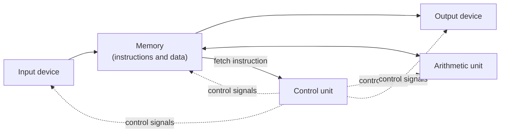
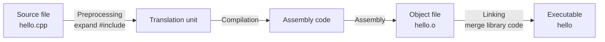

This chapter answers three basic questions: what a program is, how a computer executes it, and what tools we use to write it. We first distinguish algorithms from programs, then start from the von Neumann architecture to explain why programming languages are needed and how compilation and interpretation turn a high-level language into machine actions. Finally we set up the C++ and Python toolchains and write a first program. The ideas of this chapter run through the whole course: from [4.1.2](/4.1.2) on we treat data, control structures and functions step by step, [4.2](/4.2) covers object-oriented programming, [4.3](/4.3) studies algorithms and data structures systematically, and [4.4](/4.4) uses Python for scientific computing; the internal details of the computer are left to [4.10 Computer Organization](/4.10) and [4.11 Operating Systems](/4.11).

This course gives implementations in both C++ and Python. C++ is a compiled language close to the machine, which lets us see what data looks like in memory; Python is an interpreted language with a concise syntax and is the common language of scientific computing and artificial intelligence. Putting the two side by side shows which parts are ideas of programming and which are merely the syntax of one language.

## 1.1. Programs and Algorithms

**Definition 1.1.1 (Program)** A **program** is a sequence of instructions, written in some language, that describes data and the steps of operations; a computer can execute it mechanically to accomplish a specified computational task.

The "method" that a program describes is called an algorithm. The same algorithm can be written as different programs in different languages, or expressed only in natural language or as a flowchart.

**Definition 1.1.2 (Algorithm)** An **algorithm** is a finite sequence of well-defined steps for solving a class of problems. It usually has the following properties:

- Finiteness: for every valid input, it terminates after a finite number of steps;
- Definiteness: each step has a precise meaning, free of ambiguity;
- Effectiveness: each step can be carried out by a finite number of basic operations;
- Input: it has zero or more inputs;
- Output: it has one or more outputs, related to the input in a definite way.

**Example 1.1.1 (Euclidean Algorithm)** To find the greatest common divisor of two positive integers $a, b$: if $b = 0$, the answer is $a$; otherwise replace $(a, b)$ by $(b, a \bmod b)$ and repeat. Since the remainder strictly decreases, $b$ becomes $0$ after finitely many steps, so the procedure is finite. Written as programs in two languages:

```cpp tab
#include <iostream>

int main() {
    int a = 252, b = 105;
    while (b != 0) {      // repeat until the remainder is zero
        int r = a % b;
        a = b;
        b = r;
    }
    std::cout << a << '\n';   // prints 21
    return 0;
}
```

```python tab
a, b = 252, 105
while b != 0:          # repeat until the remainder is zero
    a, b = b, a % b
print(a)               # prints 21
```

The two programs differ greatly in syntax, yet the algorithm is exactly the same. The core of programming is designing algorithms and organizing data; Wirth summarized this as "algorithms + data structures = programs", and the language is only a tool of expression. A systematic analysis of the correctness and efficiency of algorithms is in [4.3.1](/4.3.1).

## 1.2. How a Computer Executes a Program

### 1.2.1. The von Neumann Architecture

In 1945, von Neumann proposed the basic structure of the modern electronic computer in his report on the EDVAC, now called the *von Neumann architecture*. It has two key points:

1. A computer consists of five parts: an arithmetic unit, a control unit, memory, input devices and output devices (today the arithmetic unit and the control unit are integrated in the central processing unit, the CPU);
2. Stored program: both the instructions of a program and the data it processes are stored in binary form in the same memory, and the control unit fetches instructions from memory one by one and executes them.



Memory consists of a large number of **bytes**, each with a number called its address. While a program runs, the CPU repeats the same cycle over and over: fetch the instruction at the address given by the program counter, decode it, execute it (arithmetic, reading or writing memory, jumping, and so on), and fetch the next one. Branches and loops in a program are, in the end, nothing but "changing the address of the next instruction according to a condition".

The significance of the stored program is that changing the task only requires putting a different program into memory, with no change to the hardware. The early ENIAC (1946) still had to be "programmed" by rewiring cables, whereas the stored program made the computer a general-purpose machine.

### 1.2.2. From Machine Language to High-Level Languages

A CPU can execute only the instructions in its own instruction set, and the binary encoding of these instructions is called *machine language*. Writing programs in binary is hard to read and error-prone, so several levels of programming languages appeared:

| Level | Example (computing `c = a + b`) | Characteristics |
|---|---|---|
| Machine language | `8B 45 F8 03 45 FC 89 45 F4` | Executed directly by the CPU; tied to a particular processor |
| Assembly language | `mov eax, [rbp-8]`<br/>`add eax, [rbp-4]`<br/>`mov [rbp-12], eax` | Mnemonics replace binary codes; corresponds one to one with machine instructions |
| High-level language | `c = a + b;` | Close to mathematics and natural language; machine independent, must be translated into machine language |

*Assembly language* is only a symbolic notation for machine language and still requires the programmer to think about registers and memory addresses; it is discussed in [4.10](/4.10). A *high-level language* lets programmers think about problems in terms of abstractions such as variables, expressions and functions, with tools doing the translation.

Some high-level languages that still matter today: Fortran (1957, scientific computing), C (1972, designed to write Unix, the foundation of systems programming), C++ (1985, adding object-oriented and generic programming to C), Python (1991, a general-purpose language that emphasizes readability) and Java (1995, "write once, run anywhere"). C++ is standardized by ISO, with a new version about every three years (C++11, 14, 17, 20, 23, ...); the C++ code on this site follows C++20. Python releases a version every year, and this site follows Python 3.12 and later.

## 1.3. Compilation and Interpretation

A program written in a high-level language is called *source code*. There are two basic ways to turn source code into machine actions.

**Definition 1.3.1 (Compiler and Interpreter)** A **compiler** is a program that translates a program in one language as a whole into an equivalent program in another (usually lower-level) language; the translation is completed before execution, and the resulting object program can run independently of the compiler. An **interpreter** is a program that reads the source program directly and executes it as it analyzes it; the interpreter must be present throughout execution.

C++ is compiled. From a source file to an executable file there are usually four stages, all completed by a single command in everyday use:



How a multi-file program is compiled separately and then merged by the linker, together with build tools such as Make and CMake, is in [4.2.2](/4.2.2).

The standard implementation of Python, CPython, takes a hybrid approach: it first compiles the source code into machine-independent *bytecode*, caches it in `__pycache__/*.pyc`, and then the CPython virtual machine interprets the bytecode instruction by instruction. Python is still conventionally called an interpreted language.

| | Compiled execution (C++) | Interpreted execution (Python) |
|---|---|---|
| When translation happens | Once, before running | During running, translating as it executes |
| Speed | Fast, executes machine instructions directly | Slow, usually one to two orders of magnitude slower |
| Finding errors | Syntax and type errors reported at compile time | Many errors are found only when the offending line executes |
| After a change | Recompile and relink | Simply rerun; interactive experiments are possible |
| Distribution | Executables are platform specific | Source code is cross-platform, but an interpreter must be installed |

Compilation and interpretation are ways of implementing a language, not properties of the language itself: PyPy executes Python with *just-in-time compilation* (JIT), CPython has included an experimental JIT since 3.13, and conversely there are tools that interpret C++. A common practice in scientific computing is to combine the two: write the body of the program in Python and hand the time-consuming computations to libraries precompiled from C, C++ or Fortran ([4.4](/4.4)).

By the ideas used to organize programs, languages can also be divided into paradigms: procedural (C, organizing the steps of operations with functions), object-oriented (encapsulating data and operations into objects, [4.2.1](/4.2.1)), functional (Haskell, based mainly on the composition of functions) and logic (Prolog, describing facts and rules and letting the system do the inference). C++ and Python are both multi-paradigm languages. In this course, [4.1](/4.1) covers the procedural approach and [4.2](/4.2) the object-oriented approach.

## 1.4. Toolchain and the First Program

### 1.4.1. The Toolchain

The set of tools used to write, compile, run and debug programs is called a toolchain. Common current combinations:

| | C++ | Python |
|---|---|---|
| Compiler / interpreter | GCC (`g++`), Clang (`clang++`), MSVC | CPython (`python3`), installed from python.org or with uv ([4.4.1](/4.4.1)) |
| Editor | VS Code + the C/C++ extension or the clangd extension | VS Code + the Python extension |
| Build | Call the compiler directly for a single file; CMake for multiple files ([4.2.2](/4.2.2)) | No build needed; manage dependencies with virtual environments |
| Debugger | GDB, LLDB ([4.1.5](/4.1.5)) | pdb, the built-in debugger of VS Code ([4.1.5](/4.1.5)) |

An *integrated development environment* (IDE) integrates editing, building and debugging in a single interface, such as Visual Studio, CLion and PyCharm; VS Code is itself an editor and acts as an IDE once extensions are installed. On Windows one can write C++ with Visual Studio, or use GCC inside WSL (the Windows Subsystem for Linux), which matches the environment of a Linux server.

To compile and run a C++ program on the command line:

```bash
g++ -std=c++20 -Wall -Wextra -g hello.cpp -o hello   # compile with warnings and debug info
./hello                                                 # run the executable
python3 hello.py                                        # run a Python script
```

`-std=c++20` selects the language standard, `-Wall -Wextra` turn on the commonly used warnings (many errors can be caught early by warnings), `-g` adds debugging information, and `-o` names the output file. Typing `python3` alone starts the interactive interpreter (REPL), in which expressions can be tried line by line.

### 1.4.2. The First Program

```cpp tab
#include <iostream>   // the header that declares std::cout

int main() {          // execution starts here
    std::cout << "Hello, world!\n";
    return 0;         // exit status 0 means success
}
```

```python tab
print("Hello, world!")
```

The structure of a C++ program:

- `#include <iostream>` is a preprocessor directive that brings in the declarations of the input and output part of the standard library. Whichever part of the library is used (math functions `<cmath>`, strings `<string>`, and so on), the corresponding header is included.
- `int main()` is the main function; every C++ program has exactly one, and execution begins there. The braces enclose the function body.
- `std::cout << ...` writes to standard output (usually the screen). The prefix `std::` means the name belongs to the namespace of the standard library; many textbooks write `using namespace std;` to omit the prefix, which is convenient in small programs but should be avoided in large programs and headers ([4.2.10](/4.2.10)).
- Something that ends with a semicolon is a statement; what follows `//` is a comment, written for humans and ignored by the compiler.
- `return 0;` ends the main function and hands $0$ to the operating system as the *exit status*. By convention $0$ means success and a nonzero value means an error; in the shell, `./a && ./b` runs `b` only if `a` exits successfully. If `return` is omitted in `main`, it is equivalent to returning $0$.

A Python program executes sequentially from the first line of the file and needs no main function. Larger scripts usually put the main logic in a function and then use the following idiom, so that the file can both be run directly and be imported by other files ([4.1.4](/4.1.4)):

```python
def main():
    print("Hello, world!")

if __name__ == "__main__":
    main()
```

Expressions in programs are written much like mathematical formulas: from left to right, with parentheses to change the order of operations, `*` for multiplication and `/` for division; common mathematical functions are in `<cmath>` in C++ and the `math` module in Python. For example, to compute $\sin 20^\circ \cos 20^\circ - \dfrac{\cos 10^\circ}{\tan 10^\circ}$:

```cpp tab
#include <cmath>
#include <iostream>
#include <numbers>   // std::numbers::pi (C++20)

int main() {
    constexpr double deg = std::numbers::pi / 180.0;   // one degree in radians
    double value = std::sin(20 * deg) * std::cos(20 * deg)
                 - std::cos(10 * deg) / std::tan(10 * deg);
    std::cout << value << '\n';   // prints -5.26373
    return 0;
}
```

```python tab
import math

deg = math.pi / 180   # one degree in radians
value = math.sin(20 * deg) * math.cos(20 * deg) - math.cos(10 * deg) / math.tan(10 * deg)
print(value)          # prints -5.263728500633433
```

The arguments of trigonometric functions are in radians. If the angle is written as `20/180*3.14159`, C++ first evaluates the integer division `20/180`, whose result is $0$; only `20.0/180` gives a fraction. Problems of this kind, where "the program computes something other than what you think", come from data types and are the subject of [4.1.2](/4.1.2). The default number of output digits also differs between the two languages: `std::cout` prints 6 significant digits by default, while Python prints the shortest decimal representation that uniquely identifies the floating-point number.

### 1.4.3. Standard Input and Output and Online Judges

The most basic channels through which a program exchanges data with the outside world are *standard input* (by default from the keyboard) and *standard output* (by default to the screen). Both can be redirected to files:

```bash
./solve < input.txt > output.txt     # read from input.txt, write to output.txt
python3 solve.py < input.txt
```

An *online judge* (OJ) system makes use of exactly this to check programs automatically: for each problem it prepares several sets of test data, feeds an input file to the submitted program, compares its output character by character with the reference answer, and limits the running time and memory. Common verdicts:

| Verdict | Meaning | Common causes |
|---|---|---|
| AC (Accepted) | All tests passed | |
| WA (Wrong Answer) | Output differs from the answer | Wrong algorithm, missed boundary cases, wrong output format |
| TLE (Time Limit Exceeded) | Time limit exceeded | Algorithm too complex, infinite loop |
| RE (Runtime Error) | Crash at run time | Array out of bounds, division by zero, stack overflow |
| CE (Compile Error) | Compilation failed | Syntax error, different compiler version on the judge |

Therefore a program written for an online judge outputs the result only in the format the problem prescribes, and does not print prompts such as "Please enter ...". A judge tells us only that the answer is wrong, not where; methods for designing our own test data and locating errors are in [4.1.5](/4.1.5).

## 1.5. Code Style and Program Errors

A program is written first for people to read and only second for machines to execute. Good code style includes:

- Indentation: indent one level for each level of braces (in Python, for each code block), usually 4 spaces. Python uses indentation to denote code blocks, so an indentation error is a syntax error; C++ does not depend on indentation, but wrong indentation can hide logic errors.
- Naming: variable and function names express meaning, such as `celsius` and `is_prime`, rather than `a1` and `f2`; keep one naming style within a project.
- Comments: explain intent and non-obvious reasons, rather than restating the code.
- Format with tools: clang-format for C++, Ruff or Black for Python; editors can format automatically on save.

Program errors fall into three kinds according to when they are found:

| Kind | When found | Examples |
|---|---|---|
| Compile error | At compile time (for Python, during the syntax check before running) | Missing semicolon, unmatched parentheses, misspelled keyword, use of an undeclared variable |
| Runtime error | At run time, the program terminates abnormally | Division by zero, array out of bounds, reading a nonexistent file |
| Logic error | The program ends normally, but the result is wrong | Truncation in integer division, off-by-one loop condition, wrong formula |

A compile error is located by the compiler and is the easiest to fix: read from the first error message, because later errors are often a chain reaction caused by it. Logic errors are the hardest to find and require testing and debugging, which is the content of [4.1.5](/4.1.5).

## Summary

- An algorithm is a finite, well-defined sequence of steps for solving a class of problems; a program is the implementation of an algorithm in some language, "algorithms + data structures = programs".
- The core of the von Neumann architecture is the stored program: instructions and data both reside in memory, and the CPU repeatedly fetches, decodes and executes instructions.
- High-level languages must be translated into machine language: a compiler translates the whole program before execution (C++), while an interpreter analyzes and executes while running (Python first compiles to bytecode and then interprets it).
- The current C++ toolchain is GCC / Clang + VS Code (or an IDE), compiling with warnings turned on; Python is run directly by the interpreter.
- Every C++ program starts executing at `main`, whose return value is the exit status; program errors are divided into compile errors, runtime errors and logic errors.
