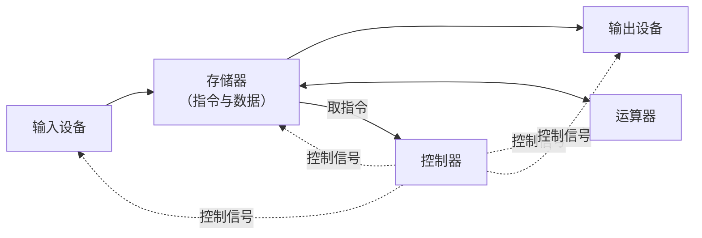
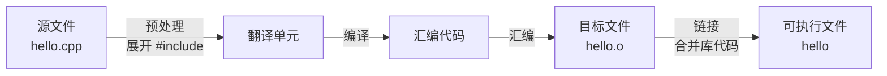

本章回答三个最基本的问题：程序是什么，计算机怎样执行程序，我们用什么工具写程序。先区分算法与程序，再从冯·诺依曼结构出发，说明为什么需要程序设计语言，以及编译和解释这两种把高级语言变成机器动作的方式；最后搭好 C++ 与 Python 的工具链，写出第一个程序。本章的概念贯穿整门课程：[4.1.2](/4.1.2) 起逐步讲数据、控制结构与函数，[4.2](/4.2) 讲面向对象，[4.3](/4.3) 系统研究算法与数据结构，[4.4](/4.4) 用 Python 做科学计算；计算机内部的细节则留给 [4.10 计算机组成](/4.10)与 [4.11 操作系统](/4.11)。

本课程同时给出 C++ 与 Python 的实现。C++ 是编译型语言，贴近机器，能看清数据在内存中的样子；Python 是解释型语言，写法简洁，是科学计算和人工智能的通用语言。两者对照，能分清哪些是程序设计的思想，哪些只是某种语言的语法。

## 1.1. 程序与算法

**定义 1.1.1（程序）** **程序**（program）是用某种语言写成的、描述数据和操作步骤的指令序列，计算机可以按照它机械地执行，完成指定的计算任务。

程序所描述的"做法"本身称为算法。同一个算法可以用不同的语言写成不同的程序，也可以只用自然语言或流程图表达。

**定义 1.1.2（算法）** **算法**（algorithm）是求解某一类问题的有限条明确的操作步骤。它通常具有以下特征：

- 有穷性：对任何合法输入，在执行有限步之后结束；
- 确定性：每一步的含义明确，没有歧义；
- 可行性：每一步都能通过有限次基本操作实现；
- 输入：有零个或多个输入；
- 输出：有一个或多个输出，与输入有确定的关系。

**例 1.1.1（Euclid 算法）** 求两个正整数 $a, b$ 的最大公因数：若 $b = 0$，答案是 $a$；否则用 $(b, a \bmod b)$ 代替 $(a, b)$，重复这一步。由于余数严格减小，有限步之后 $b$ 必然变为 $0$，所以它满足有穷性。用两种语言写成程序：

```cpp tab
#include <iostream>

int main() {
    int a = 252, b = 105;
    while (b != 0) {      // repeat until the remainder is zero
        int r = a % b;
        a = b;
        b = r;
    }
    std::cout << a << '\n';   // prints 21
    return 0;
}
```

```python tab
a, b = 252, 105
while b != 0:          # repeat until the remainder is zero
    a, b = b, a % b
print(a)               # prints 21
```

两段程序的语法差别很大，算法却完全相同。程序设计的核心是设计算法和组织数据，Wirth 把它概括为"算法 + 数据结构 = 程序"；语言只是表达的工具。算法正确性与效率的系统分析见 [4.3.1](/4.3.1)。

## 1.2. 计算机怎样执行程序

### 1.2.1. 冯·诺依曼结构

1945 年，von Neumann 在关于 EDVAC 的报告中提出了现代电子计算机的基本结构，称为冯·诺依曼结构（von Neumann architecture）。它有两个要点：

1. 计算机由运算器、控制器、存储器、输入设备和输出设备五部分组成（今天运算器和控制器集成在中央处理器 CPU 中）；
2. 存储程序：程序的指令和它处理的数据都以二进制形式存放在同一个存储器中，控制器从存储器中逐条取出指令执行。



存储器由大量**字节**组成，每个字节有一个编号，称为地址。程序运行时，CPU 不断重复同一个循环：按程序计数器给出的地址取出一条指令，译码，执行（算术运算、读写存储器、跳转等），再取下一条。程序中的分支和循环，归根结底都是"按条件改变下一条指令的地址"。

存储程序的意义在于：换一个任务只需在存储器里换一段程序，而不必改动硬件。早期的 ENIAC（1946）还要靠重新连接电缆来"编程"，而存储程序使计算机成为通用的机器。

### 1.2.2. 从机器语言到高级语言

CPU 只能执行它自己的指令集中的指令，这些指令的二进制编码称为机器语言（machine language）。用二进制写程序既难读又容易出错，于是出现了几个层次的程序设计语言：

| 层次 | 例子（计算 `c = a + b`） | 特点 |
|---|---|---|
| 机器语言 | `8B 45 F8 03 45 FC 89 45 F4` | CPU 直接执行；与具体处理器绑定 |
| 汇编语言 | `mov eax, [rbp-8]`<br/>`add eax, [rbp-4]`<br/>`mov [rbp-12], eax` | 用助记符代替二进制编码，与机器指令一一对应 |
| 高级语言 | `c = a + b;` | 接近数学和自然语言；与机器无关，需要翻译成机器语言 |

汇编语言（assembly language）只是机器语言的符号写法，仍然要求程序员考虑寄存器和内存地址；它在 [4.10](/4.10) 中讨论。高级语言（high-level language）让程序员用变量、表达式、函数这些抽象概念思考问题，由工具负责翻译。

几个对今天仍有影响的高级语言：Fortran（1957，科学计算）、C（1972，为编写 Unix 而设计，系统程序设计的基础）、C++（1985，在 C 的基础上加入面向对象和泛型编程）、Python（1991，强调可读性的通用语言）、Java（1995，"一次编写，到处运行"）。C++ 由 ISO 标准化，大约每三年发布一个新版本（C++11、14、17、20、23……）；本站的 C++ 代码以 C++20 为准。Python 每年发布一个版本，本站以 Python 3.12 及以后的版本为准。

## 1.3. 编译与解释

高级语言写成的程序称为源代码（source code）。把源代码变成机器动作有两种基本方式。

**定义 1.3.1（编译器与解释器）** **编译器**（compiler）是把一种语言的程序整体翻译成另一种（通常是更低层的）语言的等价程序的程序；翻译在运行之前完成，产生的目标程序可以脱离编译器独立运行。**解释器**（interpreter）是直接读入源程序、边分析边执行的程序；运行时始终需要解释器在场。

C++ 采用编译方式。从源文件到可执行文件，通常经过四个阶段，平时一条命令就全部完成：



多文件程序怎样分别编译、再由链接器合并，以及 Make、CMake 等构建工具，见 [4.2.2](/4.2.2)。

Python 的标准实现 CPython 采用混合方式：先把源代码编译成与机器无关的字节码（bytecode，缓存在 `__pycache__/*.pyc` 中），再由 CPython 虚拟机逐条解释执行字节码。习惯上仍称 Python 为解释型语言。

| | 编译执行（C++） | 解释执行（Python） |
|---|---|---|
| 翻译时机 | 运行前一次完成 | 运行时边翻译边执行 |
| 运行速度 | 快，直接执行机器指令 | 慢，通常慢一到两个数量级 |
| 发现错误 | 语法和类型错误在编译时报告 | 很多错误到执行那一行才发现 |
| 修改后 | 重新编译、链接 | 直接重新运行，可交互试验 |
| 分发 | 可执行文件与平台有关 | 源代码跨平台，但需要安装解释器 |

编译和解释是语言的实现方式，不是语言本身的属性：PyPy 用即时编译（just-in-time compilation，JIT）执行 Python，CPython 3.13 起也加入了实验性的 JIT；反过来也有解释执行 C++ 的工具。科学计算中常见的做法是两者结合：用 Python 写程序的主体，把耗时的计算交给用 C、C++ 或 Fortran 编译好的库（[4.4](/4.4)）。

按照组织程序的思想，语言还可以分为不同的范式：过程式（C，用函数组织操作步骤）、面向对象（把数据和操作封装为对象，[4.2.1](/4.2.1)）、函数式（Haskell，以函数的组合为主）、逻辑式（Prolog，描述事实和规则，由系统推理）。C++ 和 Python 都是多范式语言。本课程 [4.1](/4.1) 讲面向过程的思想，[4.2](/4.2) 讲面向对象的思想。

## 1.4. 工具链与第一个程序

### 1.4.1. 工具链

写、编译、运行、调试程序所用的一组工具称为工具链。现行的常用组合：

| | C++ | Python |
|---|---|---|
| 编译器 / 解释器 | GCC（`g++`）、Clang（`clang++`）、MSVC | CPython（`python3`），从 python.org 或用 uv 安装（[4.4.1](/4.4.1)） |
| 编辑器 | VS Code + C/C++ 扩展或 clangd 扩展 | VS Code + Python 扩展 |
| 构建 | 单文件直接调用编译器；多文件用 CMake（[4.2.2](/4.2.2)） | 不需要构建；用虚拟环境管理依赖 |
| 调试器 | GDB、LLDB（[4.1.5](/4.1.5)） | pdb、VS Code 内置调试（[4.1.5](/4.1.5)） |

集成开发环境（integrated development environment，IDE）把编辑、构建、调试集成在一个界面中，如 Visual Studio、CLion、PyCharm；VS Code 本身是编辑器，装上扩展后起到 IDE 的作用。Windows 上写 C++ 可以用 Visual Studio，或在 WSL（Windows 中的 Linux 子系统）里使用 GCC，与 Linux 服务器上的环境一致。

在命令行中编译并运行一个 C++ 程序：

```bash
g++ -std=c++20 -Wall -Wextra -g hello.cpp -o hello   # compile with warnings and debug info
./hello                                                 # run the executable
python3 hello.py                                        # run a Python script
```

`-std=c++20` 指定语言标准，`-Wall -Wextra` 打开常用警告（很多错误能由警告提前发现），`-g` 加入调试信息，`-o` 指定输出文件名。直接输入 `python3` 进入交互式解释器（REPL），可以逐行试验表达式。

### 1.4.2. 第一个程序

```cpp tab
#include <iostream>   // the header that declares std::cout

int main() {          // execution starts here
    std::cout << "Hello, world!\n";
    return 0;         // exit status 0 means success
}
```

```python tab
print("Hello, world!")
```

C++ 程序的结构：

- `#include <iostream>` 是预处理指令，把标准库中输入输出部分的声明包含进来。用到哪部分库（数学函数 `<cmath>`、字符串 `<string>` 等），就包含相应的头文件。
- `int main()` 是主函数，每个 C++ 程序有且只有一个，程序从这里开始执行。花括号括起的是函数体。
- `std::cout << ...` 把内容输出到标准输出（通常是屏幕）。`std::` 表示名字属于标准库的命名空间；很多教材写 `using namespace std;` 以省去前缀，这在小程序中方便，在大程序和头文件中应当避免（[4.2.10](/4.2.10)）。
- 以分号结尾的是语句；`//` 之后是注释，写给人看，编译器忽略它。
- `return 0;` 结束主函数，把 $0$ 作为退出状态（exit status）交给操作系统。约定 $0$ 表示成功，非零表示出错；在 shell 中 `./a && ./b` 只在 `a` 成功退出时才运行 `b`。`main` 省略 `return` 时等同于返回 $0$。

Python 程序从文件第一行开始顺序执行，不需要主函数。较大的脚本通常把主要逻辑写在函数中，再用下面的写法，使文件既能直接运行，又能被别的文件导入（[4.1.4](/4.1.4)）：

```python
def main():
    print("Hello, world!")

if __name__ == "__main__":
    main()
```

程序中的表达式与数学公式写法接近：从左到右书写，用圆括号改变运算次序，乘法写 `*`，除法写 `/`，常用数学函数在 C++ 的 `<cmath>` 和 Python 的 `math` 模块中。例如计算 $\sin 20^\circ \cos 20^\circ - \dfrac{\cos 10^\circ}{\tan 10^\circ}$：

```cpp tab
#include <cmath>
#include <iostream>
#include <numbers>   // std::numbers::pi (C++20)

int main() {
    constexpr double deg = std::numbers::pi / 180.0;   // one degree in radians
    double value = std::sin(20 * deg) * std::cos(20 * deg)
                 - std::cos(10 * deg) / std::tan(10 * deg);
    std::cout << value << '\n';   // prints -5.26373
    return 0;
}
```

```python tab
import math

deg = math.pi / 180   # one degree in radians
value = math.sin(20 * deg) * math.cos(20 * deg) - math.cos(10 * deg) / math.tan(10 * deg)
print(value)          # prints -5.263728500633433
```

三角函数的参数以弧度为单位。如果把角度写成 `20/180*3.14159`，C++ 会先计算整数除法 `20/180`，结果是 $0$；写成 `20.0/180` 才得到小数。这类"程序算出的不是你以为的值"的问题来自数据类型，是 [4.1.2](/4.1.2) 的主题。两种语言默认的输出位数也不同：`std::cout` 默认输出 6 位有效数字，Python 输出能唯一确定该浮点数的最短十进制表示。

### 1.4.3. 标准输入输出与在线评测

程序与外界交换数据最基本的渠道是标准输入（standard input，默认来自键盘）和标准输出（standard output，默认送往屏幕）。两者都可以重定向到文件：

```bash
./solve < input.txt > output.txt     # read from input.txt, write to output.txt
python3 solve.py < input.txt
```

在线评测（online judge，OJ）系统正是利用这一点自动检查程序：对每道题准备若干组测试数据，把输入文件交给提交的程序，把它的输出与标准答案逐字比较，并限制运行时间和内存。常见的评测结果：

| 结果 | 含义 | 常见原因 |
|---|---|---|
| AC（Accepted） | 全部测试通过 | |
| WA（Wrong Answer） | 输出与答案不符 | 算法错误、边界情况遗漏、输出格式不对 |
| TLE（Time Limit Exceeded） | 超出时间限制 | 算法复杂度过高、死循环 |
| RE（Runtime Error） | 运行时崩溃 | 数组越界、除以零、栈溢出 |
| CE（Compile Error） | 编译失败 | 语法错误、评测系统的编译器版本不同 |

因此，为在线评测写的程序只按题目规定的格式输出结果，不要输出"请输入……"之类的提示。评测系统只说明"错了"而不说明"错在哪里"，自己设计测试数据、定位错误的方法见 [4.1.5](/4.1.5)。

## 1.5. 代码风格与程序错误

程序首先是写给人读的，其次才是给机器执行的。良好的代码风格包括：

- 缩进：每进入一层花括号（Python 中每进入一个代码块）缩进一级，通常是 4 个空格。Python 用缩进表示代码块，缩进错误就是语法错误；C++ 不依赖缩进，但错误的缩进会掩盖逻辑错误。
- 命名：变量和函数名表达含义，如 `celsius`、`is_prime`，而不是 `a1`、`f2`；同一项目内保持一种命名风格。
- 注释：说明意图和不显然的理由，而不是复述代码。
- 用工具统一格式：C++ 用 clang-format，Python 用 Ruff 或 Black，编辑器可以在保存时自动格式化。

程序的错误按发现的时机分为三类：

| 种类 | 何时发现 | 例子 |
|---|---|---|
| 编译错误 | 编译时（Python 在运行前的语法检查时） | 漏写分号、括号不配对、拼错关键字、使用未声明的变量 |
| 运行时错误 | 运行时，程序异常终止 | 除以零、数组越界、读不存在的文件 |
| 逻辑错误 | 程序正常结束，但结果不对 | 整数除法截断、循环条件差一、公式写错 |

编译错误由编译器指出位置，最容易修正：从第一条错误信息读起，因为后面的错误往往是由它引起的连锁反应。逻辑错误最难发现，需要测试和调试，这是 [4.1.5](/4.1.5) 的内容。

## 小结

- 算法是解决一类问题的有限、明确的步骤；程序是算法在某种语言中的实现，"算法 + 数据结构 = 程序"。
- 冯·诺依曼结构的核心是存储程序：指令和数据都存放在存储器中，CPU 循环地取指令、译码、执行。
- 高级语言需要翻译成机器语言：编译器在运行前整体翻译（C++），解释器在运行时边分析边执行（Python 先编译为字节码再解释）。
- C++ 的现行工具链是 GCC / Clang + VS Code（或 IDE），编译时打开警告；Python 直接用解释器运行。
- 每个 C++ 程序从 `main` 开始执行，返回值是退出状态；程序错误分为编译错误、运行时错误和逻辑错误。
