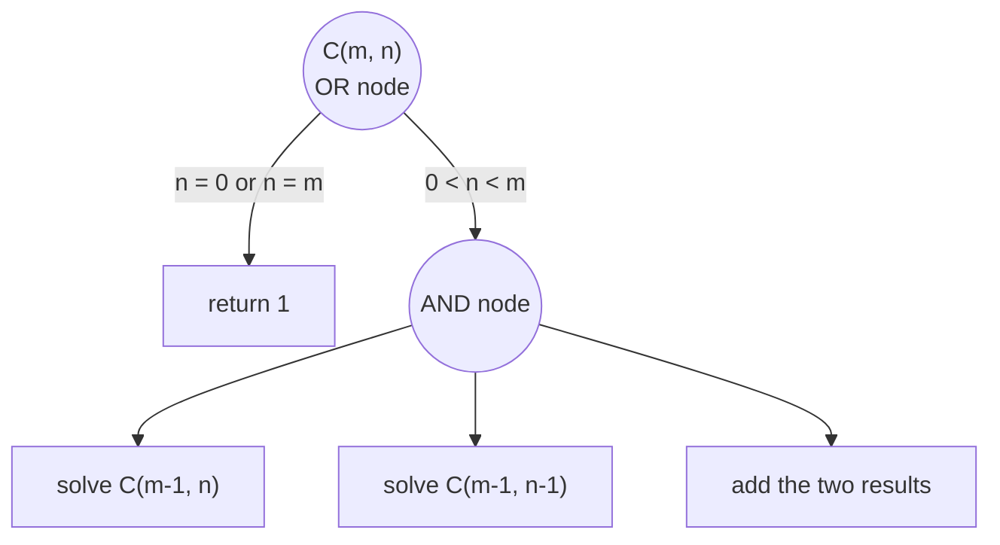
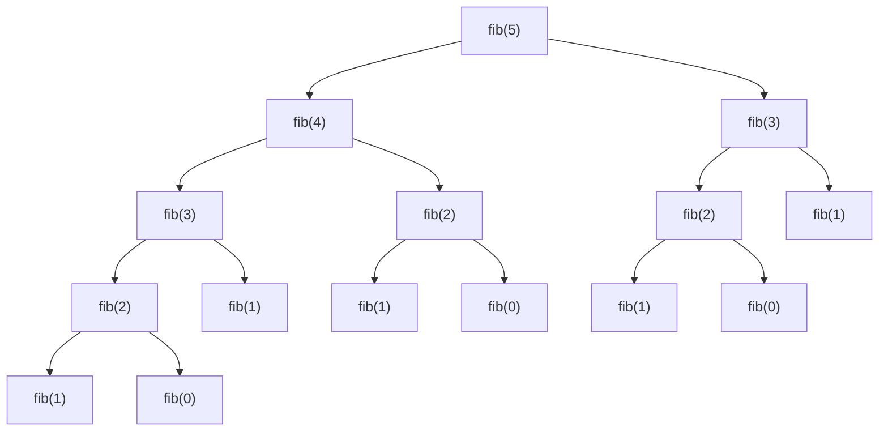

From this chapter on, the emphasis shifts from "what the language provides" to "how to come up with a solution". The next five chapters discuss several basic problem-solving strategies: recursion and decrease and conquer in this chapter, divide and conquer in [4.1.11](/4.1.11), enumeration and backtracking in [4.1.12](/4.1.12), dynamic programming in [4.1.13](/4.1.13), and state-space search in [4.1.14](/4.1.14). They share one starting point: reduce a problem to smaller problems of the same kind. Recursion is the most direct program structure for expressing this idea, and it is two sides of the same coin as mathematical induction: induction derives larger cases from smaller ones, whereas recursion reduces larger cases to smaller ones. This chapter first explains what a recursive function is and how it executes, then the decrease-and-conquer strategy of shrinking the problem a little at a time and the AND-OR graph as a tool for analyzing recursion; it then uses binomial coefficients and the Fibonacci sequence to show the repeated computation in recursion and how to remove it, and finally discusses the Tower of Hanoi. These chapters concentrate on ideas and modeling; complexity analysis of algorithms is only touched on, and a systematic treatment is in [4.3 Data Structures and Algorithms](/4.3).

## 10.1. Recursion

### 10.1.1. From Induction to Recursion

Take the factorial as an example. By definition $n! = 1 \times 2 \times \cdots \times n$, which can be computed by multiplying in a loop; alternatively, we can look at the relation between adjacent terms:

$$
n! =
\begin{cases}
1, & n = 0, \\
n \cdot (n-1)!, & n \geq 1.
\end{cases}
$$

This formula is itself an algorithm: to compute $n!$, first compute $(n-1)!$ and multiply by $n$; and $(n-1)!$ can be computed the same way, down to $0! = 1$. Written directly as a program, the function calls itself within its own body.

**Definition 10.1.1 (Recursion)** A function that calls itself, directly or indirectly, in its definition is said to use **recursion**, and such a function is called a **recursive function**. A recursive function must contain a case that does not recurse and gives the result directly, called the **base case**; the remaining cases reduce the problem to one or several smaller problems of the same kind, called the recursive step.

```cpp tab
#include <iostream>

long long factorial(int n) {
    if (n == 0) return 1;            // base case
    return n * factorial(n - 1);     // recursive step
}

int main() {
    for (int n = 0; n <= 10; ++n) std::cout << factorial(n) << ' ';
    std::cout << '\n';
}
```

```python tab
def factorial(n: int) -> int:
    if n == 0:
        return 1                     # base case
    return n * factorial(n - 1)      # recursive step

print(*(factorial(n) for n in range(11)))
```

The correspondence between recursion and mathematical induction is as follows:

| Mathematical induction | Recursive function |
|---|---|
| Basis: the statement holds for $n = 0$ | Base case: return directly when `n == 0` |
| Inductive step: if it holds for $n - 1$, it holds for $n$ | Recursive step: assume `f(n - 1)` is correct and use it to compute `f(n)` |
| Conclusion: it holds for all $n \geq 0$ | The size strictly decreases with each call, so the base case is eventually reached |

This correspondence also shows how to prove a recursive function correct: by induction on the size. When writing a recursive function we likewise have to "trust" the recursive call: when writing `factorial(n)`, assume that `factorial(n - 1)` has correctly returned $(n-1)!$ and consider only how to obtain $n!$ from it, instead of trying to unfold every level of calls in our heads.

### 10.1.2. How Recursion Executes: The Call Stack

Recursion works because every function call has its own **stack frame** on the **call stack** ([4.1.4](/4.1.4), [4.1.8](/4.1.8)): when `factorial(3)` calls `factorial(2)`, its `n = 3` is kept in its own stack frame and is not overwritten by the `n = 2` of the next level. Execution has two phases: repeatedly calling and pushing frames until the base case is reached (the "descent"), then returning level by level and popping frames, computing the result of each level from that of the level below (the "ascent").

```text
factorial(3)
  factorial(2)
    factorial(1)
      factorial(0)    -> 1        (base case reached; start returning)
    factorial(1)      -> 1 * 1 = 1
  factorial(2)        -> 2 * 1 = 2
factorial(3)          -> 3 * 2 = 6
```

Setting a **breakpoint** in a recursive function in a **debugger**, the call stack window lists every pending call together with its local variables; this is the most direct way to understand recursion ([4.1.5](/4.1.5)).

The cost of recursion also comes from the call stack: each level occupies one stack frame, so a recursion depth of $n$ occupies $n$ frames. The stack has limited capacity; when the recursion depth reaches tens of thousands to hundreds of thousands of levels (depending on frame size and system settings), a C++ program crashes with a **stack overflow**. The Python interpreter imposes a recursion depth limit (1000 by default) and raises `RecursionError` when it is exceeded; it can be raised with `sys.setrecursionlimit`, but problems of great depth should be rewritten as loops. Moreover, neither the Python nor the C++ standard guarantees tail-call optimization (automatically turning a function whose last step is a recursive call into a loop), so we must not rely on it.

### 10.1.3. Key Points in Designing Recursive Functions

1. Define the meaning of the function: state in one sentence what its parameters are and what it returns (or accomplishes), for example "`fill(num, begin, size)` fills the numbers starting from `num` into the square whose upper-left corner is at `(begin, begin)` and whose side length is `size`". The parameters must suffice to describe a subproblem of any size.
2. Find the recursive step: how to obtain the result for the original problem from the results of one or several smaller subproblems.
3. Determine the base case: the smallest cases that can be answered directly; check that every recursive path reaches one.
4. Check that the size really decreases; missing this leads to infinite recursion.

Every program that can be written recursively can be rewritten as a loop (using an explicit stack to simulate the call stack if necessary, see [4.3.4](/4.3.4)). The value of recursion is that it corresponds directly to the structure of the problem, giving short and clear code; when the problem itself has recursive structure (trees, nested expressions, divide and conquer), recursion is often the most natural way to write it.

## 10.2. Decrease and Conquer

### 10.2.1. The Idea of Decrease and Conquer

**Definition 10.2.1 (Decrease and Conquer)** The strategy of reducing a problem of size $n$ to one smaller problem of the same kind, solving it, and then extending its solution to a solution of the original problem is called **decrease and conquer**. By the way the size decreases, it falls into three kinds: decrease by a constant (usually 1), decrease by a constant factor (usually one half), and decrease by a variable amount.

| Type | Examples | Subproblem |
|---|---|---|
| Decrease by a constant | factorial, recursive selection sort, number square | size $n - 1$ or $n - 2$ |
| Decrease by a constant factor | binary search ([4.1.6](/4.1.6)) | size $n / 2$ |
| Decrease by a variable amount | Euclidean algorithm $\gcd(a, b) = \gcd(b, a \bmod b)$ | depends on the data |

Decrease and conquer differs from the divide and conquer of the next chapter in the number of subproblems: decrease and conquer keeps only one subproblem each time, whereas divide and conquer splits the problem into several subproblems, solves each, and combines the results.

**Example 10.2.1 (Recursive Selection Sort)** Sort the array $A[0..n-1]$ in ascending order: find the smallest element and swap it with $A[0]$; now $A[0]$ is in place, and the remaining $A[1..n-1]$ is the same problem of size $n - 1$.

```cpp tab
#include <iostream>
#include <span>
#include <utility>

void selection_sort(std::span<int> a) {
    if (a.size() <= 1) return;                   // base case
    std::size_t smallest = 0;
    for (std::size_t i = 1; i < a.size(); ++i)
        if (a[i] < a[smallest]) smallest = i;
    std::swap(a[0], a[smallest]);                // a[0] is now in place
    selection_sort(a.subspan(1));                // sort the rest
}

int main() {
    int a[] = {5, 2, 6, 1, 7, 3, 4};
    selection_sort(a);
    for (int x : a) std::cout << x << ' ';
    std::cout << '\n';
}
```

```python tab
def selection_sort(a: list[int], start: int = 0) -> None:
    if len(a) - start <= 1:                      # base case
        return
    smallest = min(range(start, len(a)), key=a.__getitem__)
    a[start], a[smallest] = a[smallest], a[start]  # a[start] is now in place
    selection_sort(a, start + 1)                 # sort the rest

a = [5, 2, 6, 1, 7, 3, 4]
selection_sort(a)
print(a)
```

In the C++ version, `subspan(1)` of `std::span` means "the segment after removing the first element", which corresponds exactly to the subproblem; the Python version describes the subproblem by a starting index `start` rather than the slice `a[1:]`, because a slice copies out a new list, and sorting it would not change the original list. The depth of this recursion is $n$, so in practice it is implemented with a loop; we use it here to show the structure of decrease and conquer.

### 10.2.2. Example: Spiral Filling of a Number Square

**Example 10.2.2** Output an $N \times N$ square in which $1, 2, \dots, N^2$ are filled in counterclockwise, ring by ring, starting from the upper-left corner. For $N = 6$ the result is

```text
 1 20 19 18 17 16
 2 21 32 31 30 15
 3 22 33 36 29 14
 4 23 34 35 28 13
 5 24 25 26 27 12
 6  7  8  9 10 11
```

It is hard to write a formula directly from the coordinate pattern, but observe: after the outermost ring is filled, what remains is a square of side $N - 2$, to be filled exactly as in the original problem, with only the starting number and position changed. So we define `fill(num, begin, size)`: fill the numbers starting from `num` counterclockwise into the square whose upper-left corner is `(begin, begin)` and whose side is `size`. Each of the four sides of the outer ring has `size - 1` numbers (each side excludes its last corner, so the four sides cover the ring exactly, with no overlap or omission), and after filling we call recursively `fill(num + 4 * (size - 1), begin + 1, size - 2)`. There are two base cases: `size == 0` (even order, do nothing) and `size == 1` (odd order, only one number at the center).

```cpp tab
#include <iomanip>
#include <iostream>
#include <vector>

using Matrix = std::vector<std::vector<int>>;

void fill(Matrix& m, int num, int begin, int size) {
    if (size == 0) return;
    if (size == 1) { m[begin][begin] = num; return; }
    int last = begin + size - 1;
    for (int k = 0; k < size - 1; ++k) {
        m[begin + k][begin] = num + k;                     // left side, downwards
        m[last][begin + k] = num + (size - 1) + k;         // bottom, rightwards
        m[last - k][last] = num + 2 * (size - 1) + k;      // right side, upwards
        m[begin][last - k] = num + 3 * (size - 1) + k;     // top, leftwards
    }
    fill(m, num + 4 * (size - 1), begin + 1, size - 2);    // the inner square
}

int main() {
    const int n = 6;
    Matrix m(n, std::vector<int>(n));
    fill(m, 1, 0, n);
    for (const auto& row : m) {
        for (int x : row) std::cout << std::setw(3) << x;
        std::cout << '\n';
    }
}
```

```python tab
def fill(m: list[list[int]], num: int, begin: int, size: int) -> None:
    if size == 0:
        return
    if size == 1:
        m[begin][begin] = num
        return
    last = begin + size - 1
    for k in range(size - 1):
        m[begin + k][begin] = num + k                    # left side, downwards
        m[last][begin + k] = num + (size - 1) + k        # bottom, rightwards
        m[last - k][last] = num + 2 * (size - 1) + k     # right side, upwards
        m[begin][last - k] = num + 3 * (size - 1) + k    # top, leftwards
    fill(m, num + 4 * (size - 1), begin + 1, size - 2)   # the inner square

n = 6
m = [[0] * n for _ in range(n)]
fill(m, 1, 0, n)
for row in m:
    print("".join(f"{x:3}" for x in row))
```

This example shows the typical use of decrease and conquer: first find the part such that "once it is done, what remains is the same problem", and then put the parameters needed to describe the subproblem (here the starting number, position, and side length) into the function's parameter list.

### 10.2.3. AND-OR Graphs

When analyzing a recursive algorithm, we can draw "how the problem decomposes into subproblems" as a graph.

**Definition 10.2.2 (AND-OR Graph)** A graph in which nodes represent problems, edges represent the decomposition relation between a problem and its subproblems, and the nodes are of two kinds is called an **AND-OR graph**. An **OR node** represents a problem with several possible solution methods, one of which is chosen according to the conditions (such as the choice between the base case and the recursive step, or the various choices in enumeration); an **AND node** represents a problem whose solution requires solving all of its subproblems in turn, the subproblems being solved from left to right, with the result of the last one usually taken as the value of the node. A node that is not decomposed further and can be solved directly is called a terminal node.

AND-OR graphs come from problem reduction in artificial intelligence ([4.5](/4.5)); here they serve only as a tool for sketching: an OR node corresponds to an `if` or an enumeration loop in the program, an AND node to several steps executed in sequence, and an edge to a node of the same kind as the original problem is a recursive call. Once the AND-OR graph is drawn, translating it into code is almost mechanical. The binomial coefficient in the next section is a simple example.

## 10.3. Repeated Subproblems and Memoization

### 10.3.1. Binomial Coefficients

The number of combinations of $n$ elements chosen from $m$ distinct elements satisfies Pascal's formula

$$
\binom{m}{n} = \binom{m-1}{n} + \binom{m-1}{n-1}, \qquad 0 < n < m,
$$

meaning: consider a particular element; there are $\binom{m-1}{n}$ selections that do not take it and $\binom{m-1}{n-1}$ selections that do. The boundary values are $\binom{m}{0} = \binom{m}{m} = 1$. Its AND-OR graph is shown below: the root is an OR node that, according to the boundary condition, either returns 1 directly or enters an AND node, "solve the two subproblems, then add".



```cpp
long long binom(int m, int n) {
    if (n < 0 || n > m) return 0;
    if (n == 0 || n == m) return 1;
    return binom(m - 1, n) + binom(m - 1, n - 1);
}
```

This program is correct but very slow: `binom(30, 15)` makes over a hundred million calls. The reason is that the same subproblem is solved repeatedly; for example, `binom(m-2, n-1)` is a subproblem of both `binom(m-1, n)` and `binom(m-1, n-1)`.

### 10.3.2. The Fibonacci Sequence

**Example 10.3.1 (Fibonacci Sequence)** In 1202 Fibonacci posed the following problem: a newborn pair of rabbits matures after one month and from the next month on produces a new pair every month, and rabbits never die; how many pairs are there each month? Let there be $F_n$ pairs in month $n$. The rabbits of month $n$ consist of two parts: all the rabbits of month $n-1$ (all still alive), and the offspring born this month to the rabbits of month $n-2$ (one pair per pair). Hence

$$
F_0 = 0, \quad F_1 = 1, \quad F_n = F_{n-1} + F_{n-2} \ (n \geq 2),
$$

and the sequence is $0, 1, 1, 2, 3, 5, 8, 13, \dots$; in month 12 there are $F_{12} = 144$ pairs.

Written directly from the definition as a recursive function, the calls of `fib(5)` form a tree:



`fib(3)` is computed 2 times and `fib(2)` 3 times. In general, the total number of calls for computing `fib(n)` is $2F_{n+1} - 1$, which grows exponentially in $n$ (at a rate of about $1.618^n$): `fib(30)` takes about 2.69 million calls and `fib(50)` about 40 billion. On an **online judge**, such a program fails by exceeding the time limit.

### 10.3.3. Memoization

Since the problem is that the same subproblem is solved repeatedly, the remedy is to record the results already computed.

**Definition 10.3.1 (Memoization)** The technique of recording, in a table, the results of subproblems already solved in a recursive function, so that each call first looks up the table and returns directly if the result is found, and otherwise computes the result and stores it in the table, is called **memoization**; the table that records the results is called the memo.

```cpp tab
#include <iostream>
#include <vector>

// memo[n] == -1 means fib(n) has not been computed yet.
long long fib(int n, std::vector<long long>& memo) {
    if (memo[n] != -1) return memo[n];           // look it up
    memo[n] = (n < 2) ? n : fib(n - 1, memo) + fib(n - 2, memo);
    return memo[n];                              // remember it
}

int main() {
    const int n = 90;
    std::vector<long long> memo(n + 1, -1);
    std::cout << fib(n, memo) << '\n';           // 2880067194370816120
}
```

```python tab
from functools import cache

@cache                       # the decorator keeps a dict from arguments to results
def fib(n: int) -> int:
    return n if n < 2 else fib(n - 1) + fib(n - 2)

print(fib(90))               # 2880067194370816120
```

With memoization, each `fib(k)` ($0 \leq k \leq n$) is computed only once, and the total amount of computation drops from exponential to proportional to $n$. The "not computed" marker in the memo must be a value that can never be a legitimate result: here we use $-1$ rather than $0$, because $F_0 = 0$ is itself a legitimate result. The Python standard library's `functools.cache` (equivalent to `functools.lru_cache(maxsize=None)`) turns memoization into a decorator, applicable to **pure functions** whose arguments are hashable; C++ has no corresponding standard facility, and one usually writes it by hand with an array or `std::unordered_map`.

Note that C++'s `long long` can hold values only up to $F_{92}$, beyond which it overflows ([4.1.2](/4.1.2)); Python integers have no upper limit.

Memoized recursion can also be rewritten as a non-recursive iteration: compute in the order $F_0, F_1, F_2, \dots$, keeping only the last two terms. This iteration that "computes the small ones first and then the large ones", and memoization that "starts from the large problem and recurses with a memo", are the two ways of implementing the dynamic programming of [4.1.13](/4.1.13); the same approach also reduces the computation of binomial coefficients from exponential to the order of $mn$ (Pascal's triangle).

## 10.4. The Tower of Hanoi

**Example 10.4.1 (Tower of Hanoi)** There are three pegs A, B, and C, and $n$ discs of distinct sizes are stacked on A, the larger below and the smaller above. All discs are to be moved to C, one disc at a time, and at no time may a larger disc lie on top of a smaller one. Give the sequence of moves.

Consider simple cases first. With 1 disc, move it from A to C directly. With 2 discs: small disc A→B, large disc A→C, small disc B→C. With 3 discs, regard the top two discs as a unit: first move them to B using C (exactly the 2-disc problem), then move the largest disc from A to C, and finally move the two discs on B to C using A (again the 2-disc problem).

In general, define `move(n, from, via, to)`: using `via`, move the top $n$ discs on `from` to `to`. It is an AND node that completes three steps in turn:

1. `move(n - 1, from, to, via)`: move the top $n - 1$ discs to the intermediate peg;
2. move disc number $n$ (the largest) from `from` to `to`;
3. `move(n - 1, via, from, to)`: move the $n - 1$ discs on the intermediate peg to the target peg.

After step 1, there is no other disc on top of the largest one and the target peg is empty, so step 2 is legal; steps 1 and 3 move discs smaller than disc $n$, and the largest disc at the bottom of a peg does not interfere with them, so these two steps are exactly the same problem of size $n - 1$.

```cpp tab
#include <iostream>

void move(int n, char from, char via, char to) {
    if (n == 0) return;
    move(n - 1, from, to, via);
    std::cout << "disc " << n << ": " << from << " -> " << to << '\n';
    move(n - 1, via, from, to);
}

int main() { move(3, 'A', 'B', 'C'); }
```

```python tab
def move(n: int, src: str, via: str, dst: str) -> None:
    if n == 0:
        return
    move(n - 1, src, dst, via)
    print(f"disc {n}: {src} -> {dst}")
    move(n - 1, via, src, dst)

move(3, "A", "B", "C")
```

Let $T(n)$ be the number of steps needed to move $n$ discs. Then $T(0) = 0$ and $T(n) = 2T(n-1) + 1$, so $T(n) + 1 = 2\bigl(T(n-1) + 1\bigr)$, which gives $T(n) = 2^n - 1$. This is also the minimum number of steps: the largest disc must move at least once; before it moves, all other $n - 1$ discs must be on the intermediate peg, and after it moves they must all be moved on top of it, each of these two stages requiring at least $T(n-1)$ steps. The legendary 64 golden discs would need $2^{64} - 1 \approx 1.8 \times 10^{19}$ steps, which at one move per second would take about 580 billion years.

The Tower of Hanoi illustrates the expressive power of recursion: without recursion, it is hard to say directly which disc to move at step $k$ (although such iterative solutions do exist); with recursion, three lines of code suffice. It also shows that a recursive program can run for an extremely long time: a short program does not mean a small amount of computation.

## Summary

| Concept | Key points |
|---|---|
| Recursion | base case + recursive step; corresponds to mathematical induction; each call occupies a stack frame |
| Decrease and conquer | reduce to one smaller problem of the same kind: by one, by half, or by a variable amount |
| AND-OR graph | OR node: choose one case; AND node: solve all subproblems in turn |
| Memoization | record subproblem results to eliminate repeated computation; Python uses `functools.cache` |
| Tower of Hanoi | $T(n) = 2T(n-1) + 1 = 2^n - 1$ |
