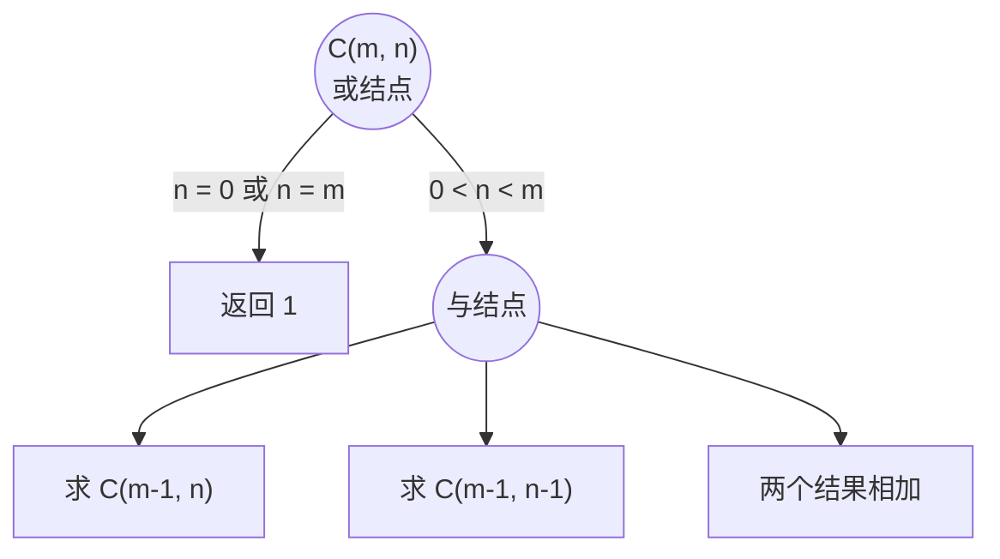
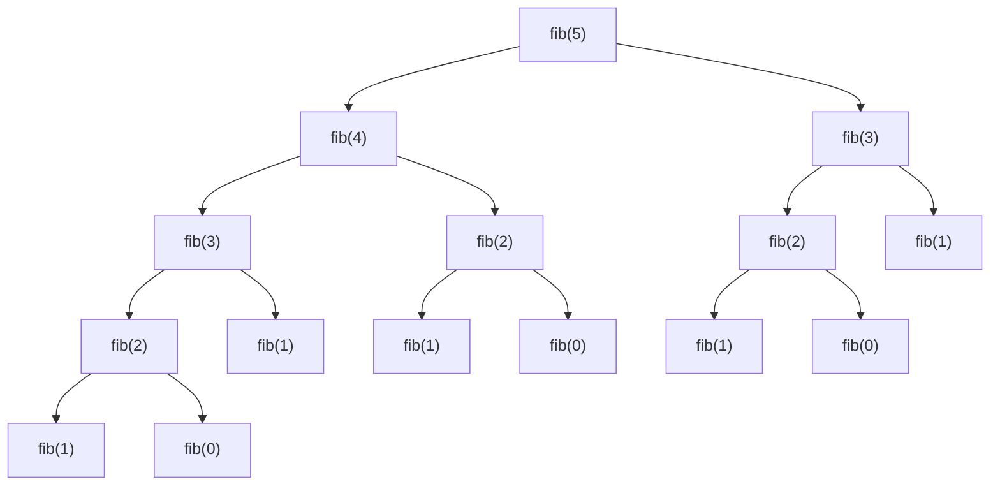

从本章开始，课程的重点从"语言提供了什么"转向"怎样想出解法"。接下来五章讨论几种基本的问题求解策略：本章的递归与减治、[4.1.11](/4.1.11) 的分治、[4.1.12](/4.1.12) 的枚举与回溯、[4.1.13](/4.1.13) 的动态规划、[4.1.14](/4.1.14) 的状态空间搜索。它们有一个共同的出发点：把一个问题化为规模更小的同类问题。递归是表达这种思路最直接的程序结构，它与数学归纳法是同一件事的两面：归纳法从小的情形推出大的情形，递归则把大的情形归结为小的情形。本章先讲递归函数是什么、怎样执行，再讲每次只把规模减小一点的减治策略和分析递归的工具与或图，然后用组合数和 Fibonacci 数列说明递归中的重复计算及其解决办法，最后讨论汉诺塔。这几章侧重思路与建模；算法的复杂度分析只点到为止，系统的讨论在 [4.3 数据结构与算法](/4.3)。

## 10.1. 递归

### 10.1.1. 从归纳到递归

以阶乘为例。按定义 $n! = 1 \times 2 \times \cdots \times n$，可以用循环累乘；也可以换一个角度，只看相邻两项的关系：

$$
n! =
\begin{cases}
1, & n = 0, \\
n \cdot (n-1)!, & n \geq 1.
\end{cases}
$$

这个式子本身就是一个算法：要求 $n!$，先求 $(n-1)!$ 再乘以 $n$；而 $(n-1)!$ 又可以用同样的方法求，直到 $0! = 1$。把它直接写成程序，函数在自己的函数体中调用了自己。

**定义 10.1.1（递归）** 一个函数在其定义中直接或间接地调用自身，称为**递归**，这样的函数称为**递归函数**。递归函数必须包含不再递归、直接给出结果的情形，称为**递归基**；其余情形把问题化为一个或几个规模更小的同类问题，称为递归步。

```cpp tab
#include <iostream>

long long factorial(int n) {
    if (n == 0) return 1;            // base case
    return n * factorial(n - 1);     // recursive step
}

int main() {
    for (int n = 0; n <= 10; ++n) std::cout << factorial(n) << ' ';
    std::cout << '\n';
}
```

```python tab
def factorial(n: int) -> int:
    if n == 0:
        return 1                     # base case
    return n * factorial(n - 1)      # recursive step

print(*(factorial(n) for n in range(11)))
```

递归与数学归纳法的对应关系如下：

| 数学归纳法 | 递归函数 |
|---|---|
| 奠基：命题对 $n = 0$ 成立 | 递归基：`n == 0` 时直接返回 |
| 归纳步：若对 $n - 1$ 成立，则对 $n$ 成立 | 递归步：假定 `f(n - 1)` 正确，用它算出 `f(n)` |
| 结论：对所有 $n \geq 0$ 成立 | 每次调用规模严格减小，终将到达递归基 |

这个对应也说明了怎样证明递归函数正确：对规模做归纳。写递归函数时同样要"相信"递归调用：在写 `factorial(n)` 时，假定 `factorial(n - 1)` 已经正确地返回了 $(n-1)!$，只需考虑怎样用它得到 $n!$，而不要试图在脑中展开每一层调用。

### 10.1.2. 递归的执行：调用栈

递归之所以能工作，是因为每次函数调用都在调用栈上拥有自己的栈帧（[4.1.4](/4.1.4)、[4.1.8](/4.1.8)）：`factorial(3)` 调用 `factorial(2)` 时，`n = 3` 保存在自己的栈帧中，不会被下一层的 `n = 2` 覆盖。执行过程分为两个阶段：不断调用、压栈，直到递归基（"递"）；再逐层返回、出栈，用下层的结果算出本层的结果（"归"）。

```text
factorial(3)
  factorial(2)
    factorial(1)
      factorial(0)    -> 1        (base case reached; start returning)
    factorial(1)      -> 1 * 1 = 1
  factorial(2)        -> 2 * 1 = 2
factorial(3)          -> 3 * 2 = 6
```

在调试器中对递归函数设断点，调用栈窗口会列出每一层尚未返回的调用及其局部变量，这是理解递归最直观的方法（[4.1.5](/4.1.5)）。

递归的代价也来自调用栈：每层调用占用一个栈帧，递归深度为 $n$ 就占用 $n$ 个栈帧。栈区的容量有限，递归深度达到几万到几十万层时（取决于栈帧大小和系统设置），C++ 程序会因栈溢出而崩溃。Python 解释器则设置了递归深度上限（默认为 1000），超过时抛出 `RecursionError`；可以用 `sys.setrecursionlimit` 调大，但深度很大的问题应当改写成循环。另外，Python 和 C++ 标准都不保证尾调用优化（把"最后一步是递归调用"的函数自动变成循环），不能依赖它。

### 10.1.3. 设计递归函数的要点

1. 定义函数的含义：用一句话说清楚函数的参数是什么、返回什么（或完成什么），例如"`fill(num, begin, size)` 把从 `num` 开始的数填入左上角在 `(begin, begin)`、边长为 `size` 的方阵"。参数要足以描述任一规模的子问题。
2. 找出递归步：怎样用一个或几个更小的子问题的结果得到原问题的结果。
3. 确定递归基：最小的、可以直接回答的情形；检查每一条递归路径都会到达它。
4. 检查规模确实减小：漏掉这一点会导致无限递归。

能用递归写的程序都能改写成循环（必要时用一个显式的栈模拟调用栈，见 [4.3.4](/4.3.4)）。递归的价值在于它直接对应问题的结构，代码短而清楚；当问题本身具有递归结构（树、嵌套的表达式、分而治之）时，递归往往是最自然的写法。

## 10.2. 减治

### 10.2.1. 减治的思想

**定义 10.2.1（减治）** 把规模为 $n$ 的问题化为一个规模更小的同类问题，求出它的解后再扩展为原问题的解，这种策略称为**减治**。按规模减小的方式可分为三类：每次减去一个常数（通常为 1）、每次减为一个常数因子（通常为一半）、每次减小的量不固定。

| 类型 | 例子 | 子问题 |
|---|---|---|
| 减去常数 | 阶乘、递归选择排序、数字方阵 | 规模 $n - 1$ 或 $n - 2$ |
| 减为常数因子 | 折半查找（[4.1.6](/4.1.6)） | 规模 $n / 2$ |
| 减小的量可变 | 辗转相除法 $\gcd(a, b) = \gcd(b, a \bmod b)$ | 取决于数据 |

减治与下一章的分治的区别在于子问题的个数：减治每次只留下一个子问题，分治则把问题分成几个子问题分别求解再合并。

**例 10.2.1（递归选择排序）** 把数组 $A[0..n-1]$ 从小到大排序：先找出最小元素，与 $A[0]$ 交换；此时 $A[0]$ 已就位，剩下的 $A[1..n-1]$ 是规模为 $n - 1$ 的同一问题。

```cpp tab
#include <iostream>
#include <span>
#include <utility>

void selection_sort(std::span<int> a) {
    if (a.size() <= 1) return;                   // base case
    std::size_t smallest = 0;
    for (std::size_t i = 1; i < a.size(); ++i)
        if (a[i] < a[smallest]) smallest = i;
    std::swap(a[0], a[smallest]);                // a[0] is now in place
    selection_sort(a.subspan(1));                // sort the rest
}

int main() {
    int a[] = {5, 2, 6, 1, 7, 3, 4};
    selection_sort(a);
    for (int x : a) std::cout << x << ' ';
    std::cout << '\n';
}
```

```python tab
def selection_sort(a: list[int], start: int = 0) -> None:
    if len(a) - start <= 1:                      # base case
        return
    smallest = min(range(start, len(a)), key=a.__getitem__)
    a[start], a[smallest] = a[smallest], a[start]  # a[start] is now in place
    selection_sort(a, start + 1)                 # sort the rest

a = [5, 2, 6, 1, 7, 3, 4]
selection_sort(a)
print(a)
```

C++ 版本中，`std::span` 的 `subspan(1)` 表示"去掉首元素后的那一段"，正对应子问题；Python 版本用起始下标 `start` 描述子问题，而不是用切片 `a[1:]`，因为切片会复制出一个新列表，对它排序不会改变原列表。这类递归的深度为 $n$，实际中用循环实现；这里用它说明减治的结构。

### 10.2.2. 例：数字方阵的旋转填充

**例 10.2.2** 输出 $N \times N$ 的方阵，把 $1, 2, \dots, N^2$ 从左上角开始沿逆时针方向一圈一圈地填入。$N = 6$ 时结果为

```text
 1 20 19 18 17 16
 2 21 32 31 30 15
 3 22 33 36 29 14
 4 23 34 35 28 13
 5 24 25 26 27 12
 6  7  8  9 10 11
```

直接按坐标规律写公式很难，但观察到：填完最外一圈后，剩下的是一个边长为 $N - 2$ 的方阵，填法与原问题完全相同，只是起始数字和位置变了。于是定义 `fill(num, begin, size)`：把从 `num` 开始的数，逆时针填入左上角为 `(begin, begin)`、边长为 `size` 的方阵。外圈的四条边各有 `size - 1` 个数（每条边不含它的最后一个角，四条边恰好不重不漏），填完后递归调用 `fill(num + 4 * (size - 1), begin + 1, size - 2)`。递归基有两个：`size == 0`（偶数阶，什么也不做）和 `size == 1`（奇数阶，中心只有一个数）。

```cpp tab
#include <iomanip>
#include <iostream>
#include <vector>

using Matrix = std::vector<std::vector<int>>;

void fill(Matrix& m, int num, int begin, int size) {
    if (size == 0) return;
    if (size == 1) { m[begin][begin] = num; return; }
    int last = begin + size - 1;
    for (int k = 0; k < size - 1; ++k) {
        m[begin + k][begin] = num + k;                     // left side, downwards
        m[last][begin + k] = num + (size - 1) + k;         // bottom, rightwards
        m[last - k][last] = num + 2 * (size - 1) + k;      // right side, upwards
        m[begin][last - k] = num + 3 * (size - 1) + k;     // top, leftwards
    }
    fill(m, num + 4 * (size - 1), begin + 1, size - 2);    // the inner square
}

int main() {
    const int n = 6;
    Matrix m(n, std::vector<int>(n));
    fill(m, 1, 0, n);
    for (const auto& row : m) {
        for (int x : row) std::cout << std::setw(3) << x;
        std::cout << '\n';
    }
}
```

```python tab
def fill(m: list[list[int]], num: int, begin: int, size: int) -> None:
    if size == 0:
        return
    if size == 1:
        m[begin][begin] = num
        return
    last = begin + size - 1
    for k in range(size - 1):
        m[begin + k][begin] = num + k                    # left side, downwards
        m[last][begin + k] = num + (size - 1) + k        # bottom, rightwards
        m[last - k][last] = num + 2 * (size - 1) + k     # right side, upwards
        m[begin][last - k] = num + 3 * (size - 1) + k    # top, leftwards
    fill(m, num + 4 * (size - 1), begin + 1, size - 2)   # the inner square

n = 6
m = [[0] * n for _ in range(n)]
fill(m, 1, 0, n)
for row in m:
    print("".join(f"{x:3}" for x in row))
```

这个例子说明了减治的典型用法：先找到"做完一部分之后，剩下的还是同一个问题"的那个部分，再把描述子问题所需的参数（这里是起始数字、位置和边长）放进函数的参数表。

### 10.2.3. 与或图

分析递归算法时，可以把"问题怎样分解为子问题"画成一张图。

**定义 10.2.2（与或图）** 用结点表示问题，用边表示问题与其子问题之间的分解关系，并把结点分为两类的图称为**与或图**：**或结点**表示问题有几种可能的解法，根据条件选择其中之一（如递归基与递归步的选择，或枚举中的各种选择）；**与结点**表示问题要依次解决全部子问题才能得到解答，子问题从左到右求解，通常以最后一个子问题的结果作为该结点的值。不再分解、可以直接求解的结点称为终结点。

与或图来自人工智能中的问题归约（[4.5](/4.5)），在这里只用作画草图的工具：或结点对应程序中的 `if` 或枚举循环，与结点对应顺序执行的几个步骤，指向与原问题同类的结点就是递归调用。画出与或图后，翻译成代码几乎是机械的。下一节的组合数是一个简单的例子。

## 10.3. 重复子问题与记忆化

### 10.3.1. 组合数

从 $m$ 个不同元素中取 $n$ 个的组合数满足 Pascal 公式

$$
\binom{m}{n} = \binom{m-1}{n} + \binom{m-1}{n-1}, \qquad 0 < n < m,
$$

含义是：考虑某个特定元素，不取它的方案有 $\binom{m-1}{n}$ 种，取它的方案有 $\binom{m-1}{n-1}$ 种。边界为 $\binom{m}{0} = \binom{m}{m} = 1$。它的与或图如下：根结点是或结点，按边界条件选择直接返回 1，或者进入与结点"先求两个子问题、再相加"。



```cpp
long long binom(int m, int n) {
    if (n < 0 || n > m) return 0;
    if (n == 0 || n == m) return 1;
    return binom(m - 1, n) + binom(m - 1, n - 1);
}
```

这个程序是正确的，但很慢：`binom(30, 15)` 要进行上亿次调用。原因是同一个子问题被反复求解，例如 `binom(m-2, n-1)` 既是 `binom(m-1, n)` 的子问题，又是 `binom(m-1, n-1)` 的子问题。

### 10.3.2. Fibonacci 数列

**例 10.3.1（Fibonacci 数列）** 1202 年 Fibonacci 提出：一对新生的兔子一个月后长成，再过一个月起每月生一对小兔子，兔子不死，问每个月有多少对兔子。设第 $n$ 个月有 $F_n$ 对，则第 $n$ 个月的兔子由两部分组成：第 $n-1$ 个月的全部兔子（都还活着），以及第 $n-2$ 个月的兔子在本月生下的后代（每对生一对）。于是

$$
F_0 = 0, \quad F_1 = 1, \quad F_n = F_{n-1} + F_{n-2} \ (n \geq 2),
$$

数列为 $0, 1, 1, 2, 3, 5, 8, 13, \dots$，第 12 个月有 $F_{12} = 144$ 对。

按定义直接写成递归函数，`fib(5)` 的调用关系形成一棵树：



`fib(3)` 算了 2 次，`fib(2)` 算了 3 次。一般地，计算 `fib(n)` 的总调用次数是 $2F_{n+1} - 1$，随 $n$ 指数增长（约以 $1.618^n$ 的速度）：`fib(30)` 需要约 269 万次调用，`fib(50)` 需要约 400 亿次。在线评测中，这样的程序会因超时而失败。

### 10.3.3. 记忆化

既然问题出在重复求解同一个子问题，解决办法就是把算过的结果记下来。

**定义 10.3.1（记忆化）** 在递归函数中用一张表记录已经求解过的子问题的结果，每次调用先查表、查到就直接返回，没查到才计算并把结果存入表中，这种技术称为**记忆化**，记录结果的表称为备忘录。

```cpp tab
#include <iostream>
#include <vector>

// memo[n] == -1 means fib(n) has not been computed yet.
long long fib(int n, std::vector<long long>& memo) {
    if (memo[n] != -1) return memo[n];           // look it up
    memo[n] = (n < 2) ? n : fib(n - 1, memo) + fib(n - 2, memo);
    return memo[n];                              // remember it
}

int main() {
    const int n = 90;
    std::vector<long long> memo(n + 1, -1);
    std::cout << fib(n, memo) << '\n';           // 2880067194370816120
}
```

```python tab
from functools import cache

@cache                       # the decorator keeps a dict from arguments to results
def fib(n: int) -> int:
    return n if n < 2 else fib(n - 1) + fib(n - 2)

print(fib(90))               # 2880067194370816120
```

记忆化之后每个 `fib(k)`（$0 \leq k \leq n$）只计算一次，总的计算量从指数级降为与 $n$ 成正比。备忘录中的"未计算"标记要选一个不可能是合法结果的值：这里用 $-1$，而不是 $0$，因为 $F_0 = 0$ 本身就是一个合法的结果。Python 标准库的 `functools.cache`（等价于 `functools.lru_cache(maxsize=None)`）把记忆化做成装饰器，适用于参数可散列的纯函数；C++ 没有对应的标准设施，通常用数组或 `std::unordered_map` 手写。

注意 C++ 的 `long long` 只能存到 $F_{92}$，再大就溢出（[4.1.2](/4.1.2)）；Python 的整数没有上限。

记忆化递归也可以改写为不递归的递推：按 $F_0, F_1, F_2, \dots$ 的顺序依次计算，只保留最后两项即可。这种"先算小的、再算大的"的递推与"从大问题出发、带备忘录递归"的记忆化，是 [4.1.13](/4.1.13) 动态规划的两种实现方式；同样的办法也让组合数的计算从指数级降到 $mn$ 量级（Pascal 三角形）。

## 10.4. 汉诺塔

**例 10.4.1（汉诺塔）** 有 A、B、C 三根柱子，A 上套着 $n$ 个大小各不相同的圆盘，大的在下、小的在上。要把所有圆盘移到 C 上，每次只能移动一个圆盘，并且任何时候大盘都不能压在小盘上。给出移动步骤。

先看简单情形。只有 1 个盘时，直接从 A 移到 C。有 2 个盘时：小盘 A→B，大盘 A→C，小盘 B→C。有 3 个盘时，把上面两个盘看作一个整体：先借助 C 把它们移到 B（这正是 2 个盘的问题），再把最大的盘从 A 移到 C，最后借助 A 把 B 上的两个盘移到 C（又是 2 个盘的问题）。

一般地，定义 `move(n, from, via, to)`：借助 `via`，把 `from` 上面的 $n$ 个盘移到 `to`。它是一个与结点，依次完成三步：

1. `move(n - 1, from, to, via)`：把上面 $n - 1$ 个盘移到中转柱；
2. 把第 $n$ 号盘（最大的）从 `from` 移到 `to`；
3. `move(n - 1, via, from, to)`：把中转柱上的 $n - 1$ 个盘移到目标柱。

第 1 步之后，最大的盘上面没有别的盘、目标柱是空的，所以第 2 步合法；第 1、3 步移动的都是比第 $n$ 号小的盘，最大的盘在柱底不影响它们，所以这两步正是规模为 $n - 1$ 的同一问题。

```cpp tab
#include <iostream>

void move(int n, char from, char via, char to) {
    if (n == 0) return;
    move(n - 1, from, to, via);
    std::cout << "disc " << n << ": " << from << " -> " << to << '\n';
    move(n - 1, via, from, to);
}

int main() { move(3, 'A', 'B', 'C'); }
```

```python tab
def move(n: int, src: str, via: str, dst: str) -> None:
    if n == 0:
        return
    move(n - 1, src, dst, via)
    print(f"disc {n}: {src} -> {dst}")
    move(n - 1, via, src, dst)

move(3, "A", "B", "C")
```

设移动 $n$ 个盘需要 $T(n)$ 步，则 $T(0) = 0$，$T(n) = 2T(n-1) + 1$，于是 $T(n) + 1 = 2\bigl(T(n-1) + 1\bigr)$，得 $T(n) = 2^n - 1$。这也是最少步数：最大的盘至少要移动一次，而在它移动之前，其余 $n - 1$ 个盘必须全部在中转柱上，移动之后又必须全部移到它上面，两次各至少需要 $T(n-1)$ 步。传说中的 64 个金盘需要 $2^{64} - 1 \approx 1.8 \times 10^{19}$ 步，即使每秒移动一次，也要约 5800 亿年。

汉诺塔说明了递归的表达力：不用递归时，很难直接说清楚第 $k$ 步该移哪个盘（虽然确实存在这样的迭代解法）；用递归，三行代码就够了。它也说明递归程序可能运行极长的时间：程序很短，不代表计算量小。

## 小结

| 概念 | 要点 |
|---|---|
| 递归 | 递归基 + 递归步；与数学归纳法对应；每层调用占一个栈帧 |
| 减治 | 化为一个更小的同类问题：减一、减半或可变 |
| 与或图 | 或结点：选择一种情形；与结点：依次解决全部子问题 |
| 记忆化 | 记录子问题的结果，消除重复计算；Python 用 `functools.cache` |
| 汉诺塔 | $T(n) = 2T(n-1) + 1 = 2^n - 1$ |
