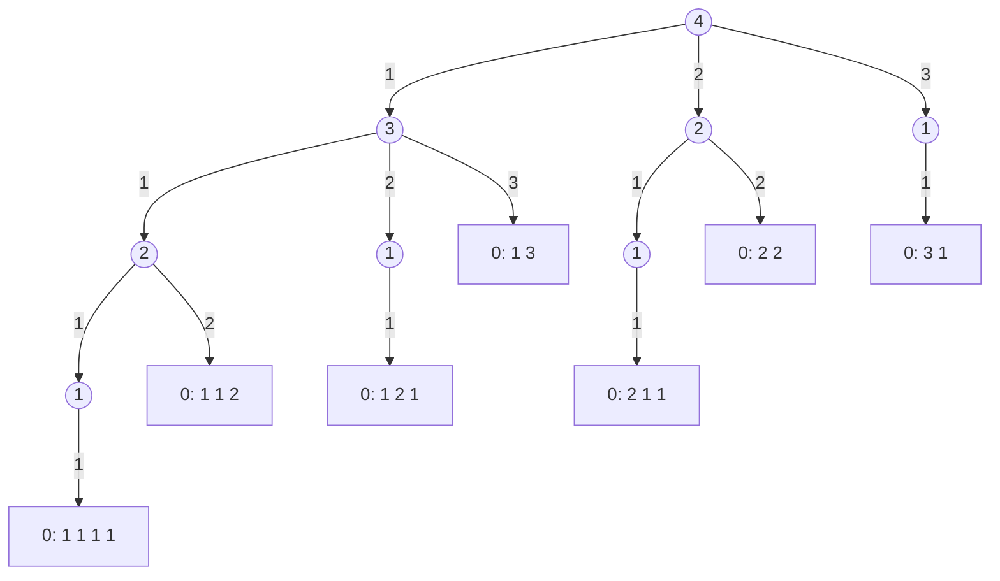

The **exhaustive search** of [4.1.3](/4.1.3) uses several nested loops to check every possible answer one by one. When a solution consists of a number of choices and the number of steps is unknown in advance or varies from case to case, the number of nested loops cannot be written down: how many steps it takes to go down a staircase depends on how many stairs each step covers. Recursion solves this problem: each level of recursion is responsible for one choice, enumerates all possibilities for this step with a loop, and for each possibility recursively handles the remaining steps. This chapter first uses two problems, going downstairs and the knight's path, to establish this pattern of "recursive enumeration", then discusses backtracking for the case where the choices constrain one another: make a choice, recurse, undo the choice, and try the next. The eight queens problem shows how excluding impossible branches as early as possible (pruning) reduces the amount of search by several orders of magnitude. These problems are in essence all depth-first searches on a "decision tree"; [4.1.14](/4.1.14) extends this viewpoint to general state spaces, and [4.3.4](/4.3.4) reexamines trial and backtracking from the viewpoint of the stack.

## 12.1. Recursive Enumeration

### 12.1.1. The Staircase Problem

**Example 12.1.1 (Staircase Problem)** There are $h$ stairs from the upper floor to the lower floor, and each step may cover 1, 2, or 3 stairs. Output all possible ways of going down (how many stairs each step covers) and count them.

Start with a simple case: for $h = 4$, the first step may cover 1, 2, or 3 stairs, leaving 3, 2, or 1 stairs, and "finishing the remaining stairs" is exactly the same as the original problem, only with fewer stairs. Drawing these choices gives a tree: the root is "4 stairs left", each edge is the choice of one step, and each leaf "0 left" corresponds to one way.



So we define `go_down(remaining)`: when `remaining` stairs are left, enumerate the choices $j \in \{1, 2, 3\}$ for this step; if $j$ does not exceed the number of remaining stairs, record this step and recursively handle the remaining `remaining - j` stairs. When the remainder is 0, the recorded steps form a complete way. A "path" array records the steps of the current way: before going to the next level we append $j$ to the end of the path, and after returning from the next level we delete it, so that the path always corresponds exactly to the route from the root to the current node of the recursion tree.

```cpp tab
#include <iostream>
#include <vector>

std::vector<int> path;   // steps taken so far
int plans = 0;

void go_down(int remaining) {
    if (remaining == 0) {                    // reached the ground: one plan
        ++plans;
        for (int s : path) std::cout << s << ' ';
        std::cout << '\n';
        return;
    }
    for (int j = 1; j <= 3 && j <= remaining; ++j) {
        path.push_back(j);                   // choose
        go_down(remaining - j);              // explore the rest
        path.pop_back();                     // un-choose
    }
}

int main() {
    go_down(4);
    std::cout << plans << " plans\n";        // 7
}
```

```python tab
path: list[int] = []     # steps taken so far
plans = 0

def go_down(remaining: int) -> None:
    global plans
    if remaining == 0:                       # reached the ground: one plan
        plans += 1
        print(*path)
        return
    for j in range(1, min(3, remaining) + 1):
        path.append(j)                       # choose
        go_down(remaining - j)               # explore the rest
        path.pop()                           # un-choose

go_down(4)
print(plans, "plans")                        # 7
```

If only the number of ways is needed and not the ways themselves, let $f(h)$ be the number of ways; classifying by the first step gives $f(h) = f(h-1) + f(h-2) + f(h-3)$ with $f(0) = 1$. This is a generalization of the Fibonacci sequence of [4.1.10](/4.1.10) and should be computed with **memoization** or iteration. "Listing all ways" is different: the number of ways itself grows exponentially with $h$, any algorithm needs at least that much time to output them, and recursive enumeration is already the most natural way to write it.

### 12.1.2. The Knight's Path Problem

**Example 12.1.2 (Knight's Path Problem)** On half a Chinese chessboard ($9 \times 5$ intersection points), a knight goes from the lower-left corner to the upper-right corner, and each move may only jump to the right. How many ways are there? Output each way.

The key to the solution is to "digitize" the board and the moves so that they can be computed with:

1. Positions: set up coordinates with the origin at the lower-left corner, with abscissa $x \in \{0, \dots, 8\}$ and ordinate $y \in \{0, \dots, 4\}$; the start is $(0, 0)$ and the target $(8, 4)$.
2. Moves: the knight moves in an "L" shape; there are 4 rightward jumps, each corresponding to an increment $(\Delta x, \Delta y)$ of the coordinates: $(1, 2)$, $(2, 1)$, $(2, -1)$, $(1, -2)$. Storing them in an array lets us enumerate them with a loop.
3. Recursion: after jumping one step from $(x, y)$ to $(x', y')$, "which ways lead from $(x', y')$ to the target" is the same problem, with the start closer to the target.
4. Boundary: moves that leave the board are infeasible and are skipped; on reaching the target, output the current path.

Storing the increments as an array of structures is clearer than storing them in two parallel arrays `dx[]` and `dy[]` ([4.1.9](/4.1.9)).

```cpp tab
#include <iostream>
#include <vector>

struct Point { int x, y; };

constexpr Point kMoves[] = {{1, 2}, {2, 1}, {2, -1}, {1, -2}};  // rightward only
constexpr int kMaxX = 8, kMaxY = 4;
std::vector<Point> path{{0, 0}};
int plans = 0;

void jump(Point p) {
    if (p.x == kMaxX && p.y == kMaxY) {               // reached the target
        ++plans;
        for (auto [x, y] : path) std::cout << '(' << x << ',' << y << ") ";
        std::cout << '\n';
        return;
    }
    for (auto [dx, dy] : kMoves) {
        Point q{p.x + dx, p.y + dy};
        if (q.x > kMaxX || q.y < 0 || q.y > kMaxY) continue;  // off the board
        path.push_back(q);
        jump(q);
        path.pop_back();
    }
}

int main() {
    jump({0, 0});
    std::cout << plans << " plans\n";                 // 37
}
```

```python tab
MOVES = [(1, 2), (2, 1), (2, -1), (1, -2)]           # rightward only
MAX_X, MAX_Y = 8, 4
path = [(0, 0)]
plans = 0

def jump(x: int, y: int) -> None:
    global plans
    if (x, y) == (MAX_X, MAX_Y):                      # reached the target
        plans += 1
        print(*path)
        return
    for dx, dy in MOVES:
        nx, ny = x + dx, y + dy
        if nx > MAX_X or not 0 <= ny <= MAX_Y:        # off the board
            continue
        path.append((nx, ny))
        jump(nx, ny)
        path.pop()

jump(0, 0)
print(plans, "plans")                                 # 37
```

There are 37 ways. Since jumps go only to the right, the abscissa strictly increases at every step, so the recursion must terminate and no point can appear twice on one path; if leftward jumps were allowed, we would have to record the points already visited to avoid going in circles, which is exactly the problem that [4.1.14](/4.1.14) deals with.

The programs for going downstairs and for the knight's path have exactly the same structure: the parameters of the recursive function describe "where we are", and the body first tests whether the goal is reached, then enumerates all choices for this step with a loop, recursing for each feasible choice. The two problems differ only in the meaning of "position" and "choice".

## 12.2. Backtracking

### 12.2.1. The Backtracking Method

In the two preceding problems, the choices at different steps do not affect each other: how many stairs this step covers does not change the rule for the next step. In many problems the choices constrain one another: once a book is given to person A, it cannot also be given to B. Then we need to record "which choices have been made so far", and before trying the next choice we must undo the effect of the previous one.

**Definition 12.2.1 (Backtracking)** The search method that constructs a solution step by step is called **backtracking**: at each step it tries the possible choices in turn in the current state; after making a choice, it modifies the state and recursively handles the next step; when some step has no way forward or a complete solution has been obtained, it returns to the previous step, undoes the choice just made, restores the former state, and tries the next choice. It is a search that "goes forward and turns back on hitting a wall".

The recursive functions of backtracking all have the same skeleton:

```text
try(step):
    if the solution is complete: record it; return
    for each choice c available at this step:
        if c is consistent with the choices so far:
            make choice c          (update the state)
            try(step + 1)
            undo choice c          (restore the state)
```

The `push_back` and `pop_back` on the path in §12.1 are in fact already this pattern: undoing the choice keeps the path consistent with the position in the recursion.

### 12.2.2. Example: The Book Assignment Problem

**Example 12.2.1 (Book Assignment Problem)** Five books numbered 0 to 4 are to be given to five people A, B, C, D, and E, one book each, and each person must receive a book he or she likes. The preferences are given in the table below (1 means liked); output all assignments.

| | Book 0 | Book 1 | Book 2 | Book 3 | Book 4 |
|---|---|---|---|---|---|
| A | 0 | 0 | 1 | 1 | 0 |
| B | 1 | 1 | 0 | 0 | 1 |
| C | 0 | 1 | 1 | 0 | 1 |
| D | 0 | 0 | 0 | 1 | 0 |
| E | 0 | 1 | 0 | 0 | 1 |

Data structures: the preference relation is a two-dimensional array `like[person][book]`; the assignment state is an array `owner[book]`, where the value $-1$ means the book has not yet been given out. We assign people one by one in order: when assigning a book to person number `person`, enumerate each book; if the person likes it and it has not been given out, give it to the person and recursively assign books to the next person; after the recursion returns, take the book back (`owner[book] = -1`) and try the next book. When all 5 people have books, we have one assignment. After giving a book to one person, the remaining problem is "4 people, 4 books", which is smaller and of the same nature.

```cpp tab
#include <array>
#include <iostream>

constexpr int N = 5;
constexpr int like[N][N] = {{0, 0, 1, 1, 0},
                            {1, 1, 0, 0, 1},
                            {0, 1, 1, 0, 1},
                            {0, 0, 0, 1, 0},
                            {0, 1, 0, 0, 1}};
std::array<int, N> owner;        // owner[book] = person, or -1 if not given yet
int plans = 0;

void assign(int person) {
    if (person == N) {                               // everyone has a book
        ++plans;
        for (int book = 0; book < N; ++book)
            std::cout << char('A' + owner[book]) << " gets book " << book << "; ";
        std::cout << '\n';
        return;
    }
    for (int book = 0; book < N; ++book) {
        if (!like[person][book] || owner[book] != -1) continue;
        owner[book] = person;                        // give the book
        assign(person + 1);
        owner[book] = -1;                            // take it back (backtrack)
    }
}

int main() {
    owner.fill(-1);
    assign(0);
    std::cout << plans << " plans\n";                // 2
}
```

```python tab
LIKE = [[0, 0, 1, 1, 0],
        [1, 1, 0, 0, 1],
        [0, 1, 1, 0, 1],
        [0, 0, 0, 1, 0],
        [0, 1, 0, 0, 1]]
N = len(LIKE)
owner = [-1] * N         # owner[book] = person, or -1 if not given yet
plans = 0

def assign(person: int) -> None:
    global plans
    if person == N:                                  # everyone has a book
        plans += 1
        print("; ".join(f"{'ABCDE'[owner[b]]} gets book {b}" for b in range(N)))
        return
    for book in range(N):
        if not LIKE[person][book] or owner[book] != -1:
            continue
        owner[book] = person                         # give the book
        assign(person + 1)
        owner[book] = -1                             # take it back (backtrack)

assign(0)
print(plans, "plans")                                # 2
```

There are only two assignments: D likes only book 3, so A can take only book 2; B can take only book 0; C and E split books 1 and 4. If the "take back" step is forgotten, then after the first assignment is found all the books remain marked as given out, every later attempt fails, and the program finds only one assignment.

Another way to undo choices is not to share the state: pass the assignment state as a parameter using **pass by value**, so that each level of recursion gets a copy, modifying the copy does not affect the previous level, and nothing needs to be restored on return. In C++ one can wrap the array in a structure or pass a `std::array` by value; in Python one must copy explicitly (`owner.copy()`), because a list argument is passed as a reference ([4.1.8](/4.1.8)). Copying is less error-prone, but it copies the entire state at every level; when the state is large, "modify, recurse, restore" saves time and space.

## 12.3. The Eight Queens Problem and Pruning

**Example 12.3.1 (Eight Queens)** Place 8 queens on an $8 \times 8$ chessboard so that no two queens lie in the same row, the same column, or on the same diagonal. Find all placements.

### 12.3.1. Starting from Brute Force

The most direct idea is to enumerate all positions of the 8 queens. Since each row has exactly one queen, we can let $q_0, q_1, \dots, q_7$ denote the column of the queen in row $i$, enumerate all $8^8 = 16\,777\,216$ combinations, and check each for conflicts in columns and diagonals. There is a trick for checking diagonals: the cells $(i, j)$ on one "/" diagonal have constant $i + j$, and the cells on one "\\" diagonal have constant $i - j$, so $(i, q_i)$ and $(k, q_k)$ lie on the same diagonal if and only if $\lvert q_i - q_k\rvert = \lvert i - k\rvert$.

Going further, the 8 queens are in different columns, so $(q_0, \dots, q_7)$ must be a permutation of $0, \dots, 7$, and it suffices to enumerate the $8! = 40\,320$ permutations and check the diagonals. C++'s `std::next_permutation` and Python's `itertools.permutations` generate all permutations directly. Using the structure of the problem to reduce the candidates from 16.77 million to 40 thousand is already a kind of pruning.

### 12.3.2. Backtracking and Pruning

The waste in brute-force enumeration is that once the queens in the first two rows attack each other, no placement of the remaining six rows can succeed, yet each is still checked one by one. Backtracking places the queens row by row, checks each newly placed queen against those already placed, and abandons the position at once if there is a conflict, without recursing further.

**Definition 12.3.1 (Pruning)** The practice of determining, during a search, from the constraints of the problem or a known bound, that a partial solution cannot be extended to a (valid) complete solution, and so not searching the whole subtree rooted at it, is called **pruning**.

To judge conflicts in constant time, we use three boolean arrays recording which columns and diagonals are occupied: the column `col[j]`, the "/" diagonal `diag1[i + j]` ($i + j$ from 0 to 14), and the "\\" diagonal `diag2[i - j + 7]` (adding 7 makes the index nonnegative). This is the same idea as "using an array to record the number of occurrences of each word" in word-frequency counting ([4.1.9](/4.1.9)): trade space for time, turning "check all queens already placed" into one table lookup.

```cpp tab
#include <array>
#include <iostream>

constexpr int N = 8;
std::array<int, N> queen;                      // queen[row] = column
std::array<bool, N> col{};
std::array<bool, 2 * N - 1> diag1{}, diag2{};  // row + c, and row - c + N - 1
int solutions = 0;

void place(int row) {
    if (row == N) {
        if (++solutions == 1) {                // print the first solution
            for (int r = 0; r < N; ++r) {
                for (int c = 0; c < N; ++c) std::cout << (queen[r] == c ? "Q " : ". ");
                std::cout << '\n';
            }
        }
        return;
    }
    for (int c = 0; c < N; ++c) {
        if (col[c] || diag1[row + c] || diag2[row - c + N - 1]) continue;  // prune
        queen[row] = c;
        col[c] = diag1[row + c] = diag2[row - c + N - 1] = true;
        place(row + 1);
        col[c] = diag1[row + c] = diag2[row - c + N - 1] = false;          // undo
    }
}

int main() {
    place(0);
    std::cout << solutions << " solutions\n";  // 92
}
```

```python tab
N = 8
queen = [0] * N                     # queen[row] = column
col = [False] * N
diag1 = [False] * (2 * N - 1)       # indexed by row + c
diag2 = [False] * (2 * N - 1)       # indexed by row - c + N - 1
solutions = 0

def place(row: int) -> None:
    global solutions
    if row == N:
        solutions += 1
        if solutions == 1:          # print the first solution
            for r in range(N):
                print(" ".join("Q" if queen[r] == c else "." for c in range(N)))
        return
    for c in range(N):
        if col[c] or diag1[row + c] or diag2[row - c + N - 1]:
            continue                # prune
        queen[row] = c
        col[c] = diag1[row + c] = diag2[row - c + N - 1] = True
        place(row + 1)
        col[c] = diag1[row + c] = diag2[row - c + N - 1] = False  # undo

place(0)
print(solutions, "solutions")       # 92
```

The eight queens problem has 92 solutions. Backtracking calls `place` only 2057 times in total and examines 15720 candidate positions, whereas brute-force enumeration examines 16.77 million combinations and permutation enumeration still examines 40 thousand permutations. The earlier the pruning, the more search is saved: finding a conflict in row $i$ saves all the combinations of the remaining $8 - i$ rows.

| Method | Number of candidates | Check per candidate |
|---|---|---|
| Enumerate all combinations of positions | $8^8 \approx 1.7 \times 10^7$ | check columns and diagonals |
| Enumerate permutations of columns | $8! = 40\,320$ | check diagonals only |
| Backtracking + pruning | 2057 partial solutions | table lookup, constant time |

For $n$ queens, both the number of solutions and the amount of search grow rapidly with $n$ (already 365 596 solutions for $n = 14$), and backtracking remains the basic method for finding all solutions; when only one solution is needed, there are also constructive methods that require no search.

## 12.4. Decision Trees and Depth-First Search

The problems of this chapter share a common structure. The solution process of each can be drawn as a decision tree: the root is the initial state, the children of each node correspond to the choices for this step, and the leaves are complete solutions or dead ends. What recursive enumeration and backtracking do is start from the root, follow one branch all the way to the bottom, then return to the nearest fork and try another branch; this is exactly **depth-first search**. The **call stack** of recursion automatically records the "path from the root to the current node" and, at every fork, "which branch to try next".

| Problem | Each level decides | Choices | Constraint and pruning |
|---|---|---|---|
| Staircase | how many stairs in step $k$ | 1, 2, 3 stairs | not more than the remaining stairs |
| Knight's path | how to jump in step $k$ | 4 kinds of jumps | stay on the board |
| Book assignment | which book person $k$ takes | 5 books | liked and not yet given out (backtracking) |
| Eight queens | which column the queen of row $k$ goes in | 8 columns | no conflict in columns and diagonals (backtracking + pruning) |

The steps for designing such algorithms can be summarized as follows: determine what a "step" is (which decision each level of recursion makes), determine what data are needed to describe the current state, list all choices within a step, write the feasibility condition (the earlier infeasible choices are excluded, the better), and finally determine the condition for reaching the goal and the result to be recorded.

These problems share a feature: a path never passes through the same state twice (the number of stairs decreases, the abscissa increases, the number of assigned people increases). If states can recur (the knight may jump left, or a person may be ferried back in a river-crossing puzzle), blind depth-first search may fall into a cycle, and the states visited must be recorded; and when the "fewest steps" is required, **breadth-first search** is often more suitable. These are the contents of [4.1.14](/4.1.14). On the other hand, if different paths reach the same subproblem and we care only about the optimal value rather than all solutions, we should remember the results of subproblems as in [4.1.10](/4.1.10); this is the dynamic programming of [4.1.13](/4.1.13).

## Summary

- Recursive enumeration: each level of recursion is responsible for one choice and enumerates all its possibilities with a loop; a path array records the current solution.
- Backtracking: choose, recurse, undo; the purpose of undoing is to keep the shared state consistent with the position in the recursion; alternatively, pass the state by value and replace undoing by copying.
- Pruning: exclude partial solutions that cannot succeed as early as possible; recording occupied resources in arrays lets conflicts be checked in constant time.
- Recursive enumeration and backtracking are depth-first search on a decision tree.
