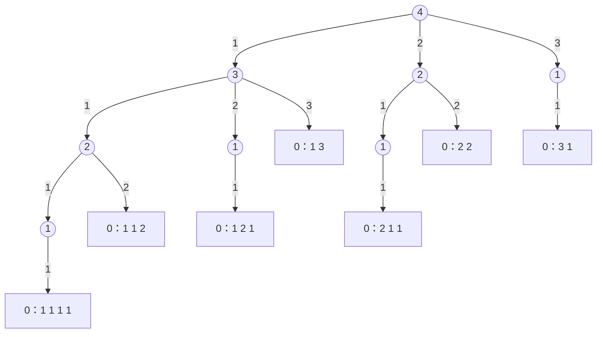

[4.1.3](/4.1.3) 中的**枚举法**用几重循环把所有可能的答案逐一检验。当一个方案由若干步选择组成、而步数事先不知道或随情况变化时，循环的重数就写不出来了：下楼梯要走几步，取决于每一步迈几级。递归解决了这个问题：每一层递归负责一步选择，在这一层用循环枚举这一步的所有可能，对每种可能递归地处理剩下的步骤。本章先用下楼和跳马两个问题建立这种"递归枚举"的模式，再讨论选择之间有约束时的回溯法：做出一个选择、递归、撤销这个选择、再试下一个。八皇后问题展示了怎样通过尽早排除不可能的分支（剪枝）把搜索量降低几个数量级。这些问题本质上都是在一棵"决策树"上做深度优先搜索；[4.1.14](/4.1.14) 将把这一视角推广到一般的状态空间，[4.3.4](/4.3.4) 则从栈的角度重新审视试探与回溯。

## 12.1. 递归枚举

### 12.1.1. 下楼问题

**例 12.1.1（下楼问题）** 从楼上到楼下共有 $h$ 级台阶，每一步可以走 1 级、2 级或 3 级。输出所有可能的下楼方案（每一步走几级），并统计方案数。

从简单情形开始：$h = 4$ 时，第一步可以走 1、2 或 3 级，分别剩下 3、2、1 级台阶，而"走完剩下的台阶"与原问题完全相同，只是台阶数变少了。把这些选择画出来，就是一棵树：根结点是"剩 4 级"，每条边是一步的选择，每个叶子"剩 0 级"对应一个方案。



于是定义 `go_down(remaining)`：在还剩 `remaining` 级台阶时，枚举这一步的走法 $j \in \{1, 2, 3\}$；若 $j$ 不超过剩余台阶数，就记下这一步，再递归处理剩下的 `remaining - j` 级。剩余为 0 时，记录下来的各步就是一个完整方案。用一个"路径"数组记录当前方案的各步：进入下一层前把 $j$ 追加到路径末尾，从下一层返回后再把它删去，这样路径总是恰好对应递归树中从根到当前结点的那条路。

```cpp tab
#include <iostream>
#include <vector>

std::vector<int> path;   // steps taken so far
int plans = 0;

void go_down(int remaining) {
    if (remaining == 0) {                    // reached the ground: one plan
        ++plans;
        for (int s : path) std::cout << s << ' ';
        std::cout << '\n';
        return;
    }
    for (int j = 1; j <= 3 && j <= remaining; ++j) {
        path.push_back(j);                   // choose
        go_down(remaining - j);              // explore the rest
        path.pop_back();                     // un-choose
    }
}

int main() {
    go_down(4);
    std::cout << plans << " plans\n";        // 7
}
```

```python tab
path: list[int] = []     # steps taken so far
plans = 0

def go_down(remaining: int) -> None:
    global plans
    if remaining == 0:                       # reached the ground: one plan
        plans += 1
        print(*path)
        return
    for j in range(1, min(3, remaining) + 1):
        path.append(j)                       # choose
        go_down(remaining - j)               # explore the rest
        path.pop()                           # un-choose

go_down(4)
print(plans, "plans")                        # 7
```

如果只要方案数而不必列出方案，设 $f(h)$ 为方案数，按第一步的走法分类得 $f(h) = f(h-1) + f(h-2) + f(h-3)$，$f(0) = 1$；这是 [4.1.10](/4.1.10) 中 Fibonacci 数列的推广，应当用**记忆化**或递推计算。"列出所有方案"则不同：方案数本身随 $h$ 指数增长，任何算法都至少要花这么多时间来输出，递归枚举已是最自然的写法。

### 12.1.2. 跳马问题

**例 12.1.2（跳马问题）** 在半张中国象棋棋盘上（$9 \times 5$ 个交叉点），一匹马从左下角跳到右上角，每一步只允许向右跳。问有多少种跳法，并输出每种跳法。

求解的关键是把棋盘和走法"数字化"，使它们可以计算：

1. 位置：以左下角为原点建立坐标，横坐标 $x \in \{0, \dots, 8\}$，纵坐标 $y \in \{0, \dots, 4\}$，起点 $(0, 0)$，终点 $(8, 4)$。
2. 走法：马走"日"字，向右的跳法有 4 种，每种对应坐标的一个增量 $(\Delta x, \Delta y)$：$(1, 2)$、$(2, 1)$、$(2, -1)$、$(1, -2)$。把它们存进一个数组，就可以用循环枚举。
3. 递归：从 $(x, y)$ 跳一步到 $(x', y')$ 后，"从 $(x', y')$ 跳到终点有哪些跳法"是同一问题，起点更靠近终点。
4. 边界：跳出棋盘的走法不可行，跳过；到达终点时输出当前路径。

把增量存成结构体数组比存成两个平行的数组 `dx[]`、`dy[]` 更清楚（[4.1.9](/4.1.9)）。

```cpp tab
#include <iostream>
#include <vector>

struct Point { int x, y; };

constexpr Point kMoves[] = {{1, 2}, {2, 1}, {2, -1}, {1, -2}};  // rightward only
constexpr int kMaxX = 8, kMaxY = 4;
std::vector<Point> path{{0, 0}};
int plans = 0;

void jump(Point p) {
    if (p.x == kMaxX && p.y == kMaxY) {               // reached the target
        ++plans;
        for (auto [x, y] : path) std::cout << '(' << x << ',' << y << ") ";
        std::cout << '\n';
        return;
    }
    for (auto [dx, dy] : kMoves) {
        Point q{p.x + dx, p.y + dy};
        if (q.x > kMaxX || q.y < 0 || q.y > kMaxY) continue;  // off the board
        path.push_back(q);
        jump(q);
        path.pop_back();
    }
}

int main() {
    jump({0, 0});
    std::cout << plans << " plans\n";                 // 37
}
```

```python tab
MOVES = [(1, 2), (2, 1), (2, -1), (1, -2)]           # rightward only
MAX_X, MAX_Y = 8, 4
path = [(0, 0)]
plans = 0

def jump(x: int, y: int) -> None:
    global plans
    if (x, y) == (MAX_X, MAX_Y):                      # reached the target
        plans += 1
        print(*path)
        return
    for dx, dy in MOVES:
        nx, ny = x + dx, y + dy
        if nx > MAX_X or not 0 <= ny <= MAX_Y:        # off the board
            continue
        path.append((nx, ny))
        jump(nx, ny)
        path.pop()

jump(0, 0)
print(plans, "plans")                                 # 37
```

共有 37 种跳法。由于只能向右跳，横坐标每步严格增大，递归一定会终止，同一点也不会在一条路径上出现两次；若允许向左跳，就必须记录走过的点以免绕圈，这正是 [4.1.14](/4.1.14) 要处理的问题。

下楼与跳马的程序结构完全相同：递归函数的参数描述"当前在哪里"，函数体先判断是否到达终点，再用循环枚举这一步的所有选择，对每个可行的选择递归。两种问题的差别只在于"位置"和"选择"的含义。

## 12.2. 回溯

### 12.2.1. 回溯法

前面两个问题中，各步的选择互不影响：这一步走几级，不会改变下一步能走几级的规则。很多问题的选择之间有约束：一本书分给了甲，就不能再分给乙。这时需要记录"到目前为止做了哪些选择"，在尝试下一个选择之前，把上一个选择的影响撤销。

**定义 12.2.1（回溯）** 逐步构造问题的解，每一步在当前状态下依次尝试各种可能的选择：做出选择后修改状态并递归地处理下一步；当某一步无路可走或已得到一个完整的解时，退回上一步，撤销刚才的选择、恢复原来的状态，再尝试下一种选择。这种"向前走，碰壁就回头"的搜索方法称为**回溯**。

回溯法的递归函数都有同样的骨架：

```text
try(step):
    if the solution is complete: record it; return
    for each choice c available at this step:
        if c is consistent with the choices so far:
            make choice c          (update the state)
            try(step + 1)
            undo choice c          (restore the state)
```

12.1 节中路径的 `push_back` 与 `pop_back` 其实已经是这一模式：撤销选择，使路径与递归的位置保持一致。

### 12.2.2. 例：分书问题

**例 12.2.1（分书问题）** 把编号为 0 至 4 的五本书分给 A、B、C、D、E 五个人，每人一本，并且每人都分到自己喜欢的书。各人的喜好如下表（1 表示喜欢），输出所有分配方案。

| | 书 0 | 书 1 | 书 2 | 书 3 | 书 4 |
|---|---|---|---|---|---|
| A | 0 | 0 | 1 | 1 | 0 |
| B | 1 | 1 | 0 | 0 | 1 |
| C | 0 | 1 | 1 | 0 | 1 |
| D | 0 | 0 | 0 | 1 | 0 |
| E | 0 | 1 | 0 | 0 | 1 |

数据结构：喜好关系用二维数组 `like[person][book]` 表示；分配状态用数组 `owner[book]` 表示，值为 $-1$ 表示这本书还没分出去。按人的顺序逐个分配：给第 `person` 个人分书时，枚举每一本书，若他喜欢它且它还没分出去，就把书分给他，再递归地为下一个人分书；递归返回后把这本书收回（`owner[book] = -1`），再试下一本。5 个人都分到书时得到一个方案。给一个人分了书之后，剩下的问题是"4 个人分 4 本书"，规模更小、性质相同。

```cpp tab
#include <array>
#include <iostream>

constexpr int N = 5;
constexpr int like[N][N] = {{0, 0, 1, 1, 0},
                            {1, 1, 0, 0, 1},
                            {0, 1, 1, 0, 1},
                            {0, 0, 0, 1, 0},
                            {0, 1, 0, 0, 1}};
std::array<int, N> owner;        // owner[book] = person, or -1 if not given yet
int plans = 0;

void assign(int person) {
    if (person == N) {                               // everyone has a book
        ++plans;
        for (int book = 0; book < N; ++book)
            std::cout << char('A' + owner[book]) << " gets book " << book << "; ";
        std::cout << '\n';
        return;
    }
    for (int book = 0; book < N; ++book) {
        if (!like[person][book] || owner[book] != -1) continue;
        owner[book] = person;                        // give the book
        assign(person + 1);
        owner[book] = -1;                            // take it back (backtrack)
    }
}

int main() {
    owner.fill(-1);
    assign(0);
    std::cout << plans << " plans\n";                // 2
}
```

```python tab
LIKE = [[0, 0, 1, 1, 0],
        [1, 1, 0, 0, 1],
        [0, 1, 1, 0, 1],
        [0, 0, 0, 1, 0],
        [0, 1, 0, 0, 1]]
N = len(LIKE)
owner = [-1] * N         # owner[book] = person, or -1 if not given yet
plans = 0

def assign(person: int) -> None:
    global plans
    if person == N:                                  # everyone has a book
        plans += 1
        print("; ".join(f"{'ABCDE'[owner[b]]} gets book {b}" for b in range(N)))
        return
    for book in range(N):
        if not LIKE[person][book] or owner[book] != -1:
            continue
        owner[book] = person                         # give the book
        assign(person + 1)
        owner[book] = -1                             # take it back (backtrack)

assign(0)
print(plans, "plans")                                # 2
```

只有两种方案：D 只喜欢书 3，A 只能拿书 2，B 只能拿书 0，C 与 E 分书 1 和书 4。若忘了"收回"这一步，第一种方案找到之后，所有书都还标记为已分配，后面的尝试全部失败，程序只能找到一个方案。

撤销选择的另一种做法是不共享状态：把分配状态作为参数按**值传递**，每层递归得到一份副本，修改副本不会影响上一层，返回时也就无须恢复。C++ 中可以把数组包进结构体或用 `std::array` 按值传递；Python 中则要显式复制（`owner.copy()`），因为列表参数传递的是引用（[4.1.8](/4.1.8)）。复制的写法不易出错，但每层都要复制整个状态；状态较大时，"修改—递归—恢复"更省时间和空间。

## 12.3. 八皇后问题与剪枝

**例 12.3.1（八皇后问题）** 在 $8 \times 8$ 的国际象棋棋盘上放置 8 个皇后，使任意两个皇后都不在同一行、同一列或同一条斜线上。求所有放法。

### 12.3.1. 从暴力枚举开始

最直接的想法是枚举 8 个皇后的所有位置。由于每行恰好一个皇后，可以用 $q_0, q_1, \dots, q_7$ 表示第 $i$ 行的皇后所在的列，枚举所有 $8^8 = 16\,777\,216$ 种组合，逐一检查列和斜线是否冲突。检查斜线有一个技巧：同一条"/"方向斜线上的格子 $(i, j)$ 满足 $i + j$ 为常数，同一条"\\"方向斜线上的格子满足 $i - j$ 为常数，所以 $(i, q_i)$ 与 $(k, q_k)$ 在同一斜线上当且仅当 $\lvert q_i - q_k\rvert = \lvert i - k\rvert$。

进一步，8 个皇后各在不同的列，所以 $(q_0, \dots, q_7)$ 必是 $0, \dots, 7$ 的一个排列，只需枚举 $8! = 40\,320$ 个排列、检查斜线即可。C++ 的 `std::next_permutation` 和 Python 的 `itertools.permutations` 可以直接生成所有排列。利用问题的结构把候选从 1677 万个缩小到 4 万个，这已经是一种剪枝。

### 12.3.2. 回溯与剪枝

暴力枚举的浪费在于：只要前两行的皇后已经互相攻击，后面六行无论怎样放都不会成功，却仍然要逐一检查。回溯法逐行放置皇后，每放一个就检查它与已放的皇后是否冲突，冲突就立即放弃这个位置，不再向下递归。

**定义 12.3.1（剪枝）** 在搜索过程中，根据问题的约束或已知的界，判定某个部分解不可能扩展为（满足要求的）完整解，从而不再搜索以它为根的整棵子树，这种做法称为**剪枝**。

为了在常数时间内判断冲突，用三个布尔数组记录哪些列、哪些斜线已被占用：列 `col[j]`，"/"斜线 `diag1[i + j]`（$i + j$ 从 0 到 14），"\\"斜线 `diag2[i - j + 7]`（加 7 使下标非负）。这与词频统计中"用数组记录每个单词出现的次数"是同一个思路（[4.1.9](/4.1.9)）：用空间换时间，把"检查一遍所有已放的皇后"变成查一次表。

```cpp tab
#include <array>
#include <iostream>

constexpr int N = 8;
std::array<int, N> queen;                      // queen[row] = column
std::array<bool, N> col{};
std::array<bool, 2 * N - 1> diag1{}, diag2{};  // row + c, and row - c + N - 1
int solutions = 0;

void place(int row) {
    if (row == N) {
        if (++solutions == 1) {                // print the first solution
            for (int r = 0; r < N; ++r) {
                for (int c = 0; c < N; ++c) std::cout << (queen[r] == c ? "Q " : ". ");
                std::cout << '\n';
            }
        }
        return;
    }
    for (int c = 0; c < N; ++c) {
        if (col[c] || diag1[row + c] || diag2[row - c + N - 1]) continue;  // prune
        queen[row] = c;
        col[c] = diag1[row + c] = diag2[row - c + N - 1] = true;
        place(row + 1);
        col[c] = diag1[row + c] = diag2[row - c + N - 1] = false;          // undo
    }
}

int main() {
    place(0);
    std::cout << solutions << " solutions\n";  // 92
}
```

```python tab
N = 8
queen = [0] * N                     # queen[row] = column
col = [False] * N
diag1 = [False] * (2 * N - 1)       # indexed by row + c
diag2 = [False] * (2 * N - 1)       # indexed by row - c + N - 1
solutions = 0

def place(row: int) -> None:
    global solutions
    if row == N:
        solutions += 1
        if solutions == 1:          # print the first solution
            for r in range(N):
                print(" ".join("Q" if queen[r] == c else "." for c in range(N)))
        return
    for c in range(N):
        if col[c] or diag1[row + c] or diag2[row - c + N - 1]:
            continue                # prune
        queen[row] = c
        col[c] = diag1[row + c] = diag2[row - c + N - 1] = True
        place(row + 1)
        col[c] = diag1[row + c] = diag2[row - c + N - 1] = False  # undo

place(0)
print(solutions, "solutions")       # 92
```

八皇后问题共有 92 个解。回溯法总共只调用 `place` 2057 次，检验 15720 个候选位置，而暴力枚举要检查 1677 万种组合，排列枚举也要检查 4 万个排列。剪枝越早，省下的搜索越多：在第 $i$ 行就发现冲突，就省掉了下面 $8 - i$ 行的所有组合。

| 方法 | 候选数 | 每个候选的检查 |
|---|---|---|
| 枚举所有位置组合 | $8^8 \approx 1.7 \times 10^7$ | 检查列与斜线 |
| 枚举列的排列 | $8! = 40\,320$ | 只检查斜线 |
| 回溯 + 剪枝 | 2057 个部分解 | 查表，常数时间 |

皇后数为 $n$ 时，解的个数和搜索量都随 $n$ 迅速增长（$n = 14$ 时已有 365 596 个解），回溯仍是求所有解的基本方法；只求一个解时，还有不需要搜索的构造方法。

## 12.4. 决策树与深度优先搜索

本章的问题有共同的结构。每个问题的求解过程都可以画成一棵决策树：根结点是初始状态，每个结点的子结点对应这一步的各种选择，叶子是完整的方案或走不通的死路。递归枚举与回溯法所做的，就是从根出发，沿着一条分支一直走到底，再退回最近的岔路口尝试另一条分支，这正是**深度优先搜索**。递归的**调用栈**自动记录了"从根到当前结点的路径"和每个岔路口"下一个该试哪条分支"。

| 问题 | 每层递归决定 | 选择 | 约束与剪枝 |
|---|---|---|---|
| 下楼 | 第 $k$ 步走几级 | 1、2、3 级 | 不超过剩余台阶数 |
| 跳马 | 第 $k$ 步怎样跳 | 4 种跳法 | 不跳出棋盘 |
| 分书 | 第 $k$ 个人拿哪本书 | 5 本书 | 喜欢且未分出（回溯） |
| 八皇后 | 第 $k$ 行的皇后放哪列 | 8 列 | 列与斜线不冲突（回溯 + 剪枝） |

设计这类算法的步骤可以总结为：确定"一步"是什么（每层递归做哪个决定），确定描述当前状态需要哪些数据，列出一步中的所有选择，写出可行性条件（越早排除越好），最后确定到达终点的条件和要记录的结果。

这些问题有一个特点：一条路径上不会两次经过同一个状态（台阶数递减、横坐标递增、已分配的人数递增）。若状态可能重复出现（允许马向左跳、渡河时把人运回去），盲目的深度优先搜索就可能陷入循环，需要记录访问过的状态；而要求"步数最少"时，**广度优先搜索**往往更合适。这些是 [4.1.14](/4.1.14) 的内容。另一方面，若不同的路径会到达同一个子问题、而我们只关心最优值而非所有方案，就应当像 [4.1.10](/4.1.10) 那样记住子问题的结果，这就是 [4.1.13](/4.1.13) 的动态规划。

## 小结

- 递归枚举：每层递归负责一步选择，用循环枚举这一步的所有可能；用路径数组记录当前方案。
- 回溯：选择—递归—撤销；撤销的目的是让共享的状态与递归的位置保持一致；也可以把状态按值传递，以复制代替撤销。
- 剪枝：尽早排除不可能成功的部分解；用数组记录已占用的资源可以在常数时间内检查冲突。
- 递归枚举和回溯是在决策树上的深度优先搜索。
