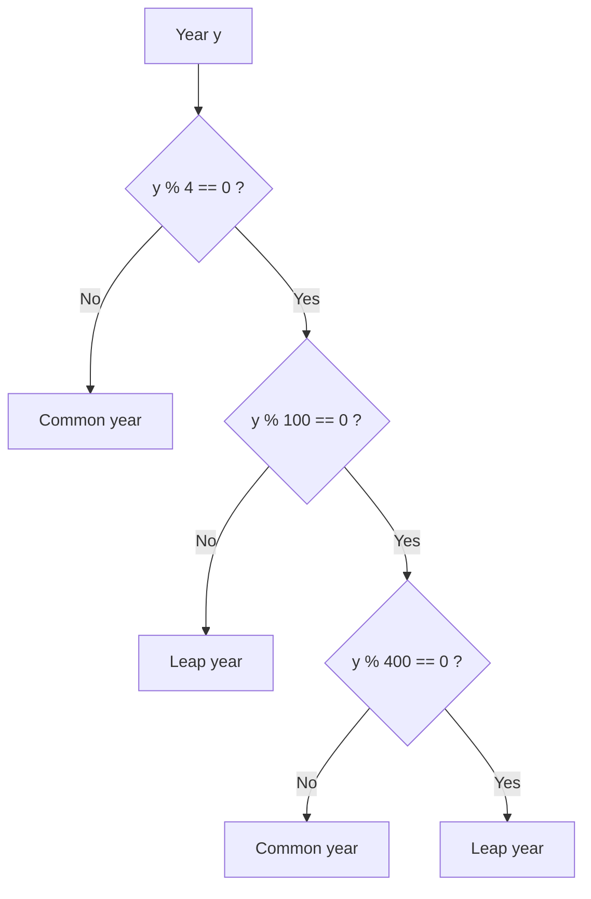

The programs of the previous chapter executed sequentially from beginning to end. This chapter introduces two structures that change the flow of execution: branches (choosing which piece to execute according to a condition) and loops (executing a piece repeatedly). Sequence, branch and loop suffice to express any algorithm, which is the basic conclusion of *structured programming*. With loops, what computers do best, tireless repetition, can come into play, and the second half of this chapter uses it to introduce the first algorithmic idea: exhaustive search, which checks all possibilities one by one. For the relation between logical expressions and **propositions** and propositional logic see [1.1](/1.1); exhaustive search develops into backtracking in [4.1.12](/4.1.12) and into state-space search in [4.1.14](/4.1.14); the analysis of the cost of loops is in [4.3.1](/4.3.1).

## 3.1. Branches

### 3.1.1. if and else

To find the real roots of the quadratic equation $ax^2 + bx + c = 0$ ($a \ne 0$): when the discriminant $\Delta = b^2 - 4ac$ is less than zero there are no real roots, when it equals zero there are two equal real roots, and when it is greater than zero there are two distinct real roots $x_{1,2} = \frac{-b \pm \sqrt{\Delta}}{2a}$.

```cpp tab
#include <cmath>
#include <iostream>

int main() {
    double a, b, c;
    std::cin >> a >> b >> c;
    double delta = b * b - 4 * a * c;
    if (delta < 0) {
        std::cout << "no real roots\n";
    } else if (delta == 0) {
        std::cout << -b / (2 * a) << '\n';
    } else {
        double r = std::sqrt(delta);
        std::cout << (-b + r) / (2 * a) << ' ' << (-b - r) / (2 * a) << '\n';
    }
    return 0;
}
```

```python tab
import math

a, b, c = map(float, input().split())
delta = b * b - 4 * a * c
if delta < 0:
    print("no real roots")
elif delta == 0:
    print(-b / (2 * a))
else:
    r = math.sqrt(delta)
    print((-b + r) / (2 * a), (-b - r) / (2 * a))
```

`if (condition) statement1 else statement2`: when the condition is true, statement 1 is executed, otherwise statement 2; the `else` part may be omitted. When a branch contains several statements they must be enclosed in braces to form a block; with a single statement the braces may be omitted, but it is safer always to write them, so that no statement is left out when one is added later. Python uses a colon and indentation for blocks, and writes `else if` as `elif`.

The three conditions are mutually exclusive and exhaustive, so `if … else if … else` is clearer than three independent `if` statements, and it makes only the necessary number of comparisons. Here `delta == 0` compares floating-point numbers only to match the mathematical statement; when the coefficients are computed results, $\Delta$ may well become a small number such as $10^{-17}$ because of rounding error, and a rigorous program should test whether $\lvert\Delta\rvert$ is below some tolerance ([4.1.2](/4.1.2)).

### 3.1.2. Nesting and Multiway Branches

To decide whether a year is a leap year: a year divisible by 4 but not by 100 is a leap year, and a year divisible by 400 is also a leap year. Testing the conditions layer by layer gives nested branches:



Merging the nested conditions into one logical expression ([3.2](#sec-3.2)) makes the program shorter:

```cpp tab
#include <iostream>

int main() {
    int y;
    std::cin >> y;
    bool leap = (y % 4 == 0 && y % 100 != 0) || y % 400 == 0;
    std::cout << (leap ? "YES" : "NO") << '\n';
    return 0;
}
```

```python tab
y = int(input())
leap = (y % 4 == 0 and y % 100 != 0) or y % 400 == 0
print("YES" if leap else "NO")
```

`condition ? value1 : value2` is the conditional operator: when the condition is true it takes value 1, otherwise value 2. It is an expression rather than a statement and can appear wherever a value is needed; between `<<` operators it must be parenthesized. In Python it is written `value1 if condition else value2`.

In nested branches, an `else` always pairs with the nearest preceding unpaired `if`, not with the one it is aligned with by indentation; this is the "dangling else" problem. Writing the extent of each branch explicitly with braces avoids the error.

When one variable is compared with several constants, `switch` can be used:

```cpp
char op;
double x, y;
std::cin >> x >> op >> y;
switch (op) {
case '+': std::cout << x + y << '\n'; break;
case '-': std::cout << x - y << '\n'; break;
case '*': std::cout << x * y << '\n'; break;
case '/': std::cout << x / y << '\n'; break;
default:  std::cout << "unknown operator\n";
}
```

`switch` jumps to the `case` label that corresponds to the value of the expression and then keeps executing until it meets a `break` or the end of the `switch`; a forgotten `break` "falls through" to the next branch, and the compiler option `-Wimplicit-fallthrough` (included in `-Wextra`) warns about this. Only integer or character constants can follow `case`. Since version 3.10 Python has the `match` statement, where `case "+": …` does not fall through and which can also match on the structure of data; for simple value comparisons, `if … elif` is just as clear.

## 3.2. Logical Expressions

### 3.2.1. Logical Operations and Short-Circuit Evaluation

The logical operators of C++ are `&&` (and), `||` (or) and `!` (not); Python writes `and`, `or` and `not`. They correspond to the **logical connectives** of propositional logic, and the result is determined by the **truth table**. An important property of logical expressions is that they are evaluated from left to right and that, once the result is determined, the rest is not evaluated; this is called *short-circuit evaluation*:

- `p && q`: if `p` is false, the whole expression is false and `q` is not evaluated;
- `p || q`: if `p` is true, the whole expression is true and `q` is not evaluated.

Short-circuit evaluation is often used to guard the later condition: in `if (b != 0 && a % b == 0)`, `a % b` is not evaluated when `b` is $0$, which avoids division by zero; `if (i < n && a[i] > 0)` checks the index before accessing the array element ([4.1.6](/4.1.6)). The order of the two conditions cannot be swapped.

Writing natural-language conditions as logical expressions is a basic skill of programming. Let `a` and `b` stand for two propositions:

| Natural language | Logical expression | Note |
|---|---|---|
| At least one of $a$, $b$ holds | `a \|\| b` | |
| Both $a$ and $b$ hold | `a && b` | |
| $a$ and $b$ do not hold simultaneously | `!(a && b)`, that is, `!a \|\| !b` | **De Morgan's laws** |
| Exactly one of $a$, $b$ holds | `a != b` | Exclusive or |
| $a$ and $b$ both hold or both fail | `a == b` | |
| If $a$ then $b$ | `!a \|\| b` | Implication: false only when $a$ is true and $b$ is false |
| At least two of the three hold | `a + b + c >= 2` | Uses the conversion of `bool` to $0$, $1$ |

The last row shows that in C++ and Python, logical values can be added as $0$ and $1$ to count how many conditions hold. This trick is used repeatedly in the enumeration problems of this chapter.

### 3.2.2. Bitwise Operations

An integer in memory is a string of binary digits, and bitwise operations act directly on these bits:

| Operator | Meaning | Example (`6` is `110`, `3` is `011`) |
|---|---|---|
| `&` | Bitwise and | `6 & 3` is `2` (`010`) |
| `\|` | Bitwise or | `6 \| 3` is `7` (`111`) |
| `^` | Bitwise exclusive or | `6 ^ 3` is `5` (`101`) |
| `~` | Bitwise complement | `~6` is `-7` (two's complement) |
| `<<` | Shift left by $k$ bits, equivalent to multiplying by $2^k$ | `3 << 2` is `12` |
| `>>` | Shift right by $k$ bits, equivalent to dividing by $2^k$ and rounding down | `6 >> 1` is `3` |

The common bit manipulations are all based on the *mask* `1 << k` (the number whose only $1$ bit is bit $k$), with bits numbered from $0$ starting at the low end:

- Get bit $k$: `(n >> k) & 1`, or test whether `n & (1 << k)` is nonzero;
- Set bit $k$ to $1$: `n | (1 << k)`; clear it: `n & ~(1 << k)`; flip it: `n ^ (1 << k)`.

In the number-guessing cards of [4.1.2](/4.1.2), the numbers on card $k$ are exactly those whose bit $k$ is $1$; bitwise operations generate the cards (7 cards are needed for $1 \sim 100$):

```cpp tab
#include <iostream>

int main() {
    for (int k = 0; k < 7; ++k) {            // card number k
        std::cout << "card " << k << ":";
        for (int n = 1; n <= 100; ++n)
            if (n & (1 << k)) std::cout << ' ' << n;   // bit k of n is set
        std::cout << '\n';
    }
    return 0;
}
```

```python tab
for k in range(7):                                   # card number k
    numbers = [n for n in range(1, 101) if n & (1 << k)]
    print(f"card {k}:", *numbers)
```

Bitwise operations are safest on unsigned integers: before C++20, operations such as shifting a negative number right or shifting a $1$ into the sign bit were undefined or implementation defined. `<bit>` in C++20 provides functions such as `std::popcount` (counting the $1$ bits). The integers of Python have no fixed width, `~n` always equals `-n - 1`, `bin(n)` gives the binary string, and `n.bit_count()` (since 3.10) counts the $1$ bits.

## 3.3. Loops

### 3.3.1. while, do-while and for

```cpp tab
#include <iostream>

int main() {
    int sum = 0;
    for (int n = 1; n <= 100; ++n)    // init; condition; update
        sum += n;
    std::cout << sum << '\n';         // 5050

    long long fact = 1;
    int k = 1;
    while (k <= 20) {                 // 20! still fits in long long
        fact *= k;
        ++k;
    }
    std::cout << fact << '\n';        // 2432902008176640000
    return 0;
}
```

```python tab
total = 0
for n in range(1, 101):   # n = 1, 2, ..., 100
    total += n
print(total)              # 5050

fact = 1
k = 1
while k <= 20:
    fact *= k
    k += 1
print(fact)               # 2432902008176640000
```

C++ has three loop statements:

- `while (condition) body`: test the condition first; if it is true, execute the body and go back to the test; when the condition is false from the start, the body is never executed.
- `do body while (condition);`: execute the body once and then test the condition; the body is executed at least once. It suits situations of "do it once, then see whether to continue", such as reading repeatedly until the input is valid.
- `for (initialization; condition; update) body`: the order of execution is initialization → condition → body → update → condition → body → update → … until the condition is false. It is equivalent to

  ```cpp
  {
      initialization;
      while (condition) {
          body;
          update;
      }
  }
  ```

  (With a `continue` in the body there is a slight difference: the `continue` of a `for` still executes the update.) A `for` puts the three elements that control the loop in one place and suits counting loops with a known number of iterations; a variable defined in the initialization is valid only inside the loop. All three parts may be omitted, and `for (;;)`, like `while (true)`, denotes an infinite loop that must be left with a `break` in the body.

`for (int i = 0; i < n; ++i)` executes $n$ times with the index running from $0$ to $n-1$; this is the most common form in C++ and is consistent with array indices starting from $0$ ([4.1.6](/4.1.6)).

The `for` of Python is different: it takes out in turn each element of a sequence (a list, a string, a `range` or another iterable), where `range(a, b)` produces $a, a+1, \dots, b-1$ and `range(a, b, s)` uses step $s$. Python has no `do-while`; write `while True:` with a `break` when the condition is met. C++11 also has a similar range-based `for` loop, `for (int x : v)`, for traversing the elements of a container ([4.1.6](/4.1.6)).

Common errors in writing loops: an off-by-one loop condition (confusing `<` and `<=`), forgetting to update the loop variable and so producing an infinite loop, an extra semicolon after `for (…);` or `while (…);` (the body becomes an empty statement), and an accumulator that is not initialized or is reinitialized inside the loop.

### 3.3.2. break and continue

`break` ends the innermost enclosing loop (or `switch`) immediately and moves to the statement after the loop; `continue` skips the rest of the loop body in this iteration and goes directly to the next one (in a `for` loop the update is executed first). For example, to find all numbers of the form $4n+1$ in $1 \sim 100$ that are divisible by 3, and stop at the first one exceeding 50:

```cpp
for (int i = 1; i <= 100; ++i) {
    if (i % 4 != 1) continue;   // not of the form 4n+1: skip
    if (i % 3 != 0) continue;   // not divisible by 3: skip
    if (i > 50) break;          // stop the whole loop
    std::cout << i << ' ';      // prints 9 21 33 45
}
```

Using `continue` to write "skip if the condition is not met" at the beginning of the loop avoids deeply nested `if` statements. `break` leaves only one level of loop; to leave several nested loops at once, one can set a flag variable, or put the loops in a function and `return` directly ([4.1.4](/4.1.4)). The `for` and `while` of Python can also have an `else` clause, which is executed when the loop ends normally without being interrupted by `break`, and suits the case of "searched everywhere and found nothing".

### 3.3.3. Designing Loops

The key to writing a loop is to distill, from the repeated code, the part that stays the same and the part that changes: the unchanging part becomes the loop body and the changing part is expressed by the loop variable. For example, four almost identical pieces of code test `'A'`, `'B'`, `'C'` and `'D'` respectively; only the letter changes, so we let the loop variable take these four values in turn. Repeated code is not only verbose but also easy to get wrong on modification, when one copy is forgotten; eliminating repetition is the main use of loops (and of the functions of [4.1.4](/4.1.4)).

Several kinds of variables commonly used in loops:

- Accumulators and counters: initialized before the loop (sum $0$, product $1$, count $0$) and updated in the loop;
- Extreme values: the initial value is the first element, or an extreme value that cannot occur, and it is compared with each element in the loop;
- Flag variables: set to "not found" before the loop, changed to "found" when the condition is met, and checked after the loop. The initial value of the flag must differ from the "found" value.

A useful tool for judging whether a loop is correct is the *loop invariant*: a condition that holds at the beginning of every iteration. If it holds before the loop starts and still holds after each execution of the body, then at the end of the loop it, together with the termination condition of the loop, implies the desired result. For example, the invariant of the summation loop is "at the beginning of each iteration `sum` equals $1 + 2 + \dots + (n-1)$"; the loop ends when $n = 101$, so `sum` equals $1 + \dots + 100$. This is the same kind of reasoning as mathematical induction. [4.1.6](/4.1.6) uses loop invariants to explain the correctness of binary search.

## 3.4. Exhaustive Search

### 3.4.1. The Three Ingredients of Exhaustive Search

For many problems the solution space is finite: the answer must be one of finitely many candidates. The most direct method is to list the candidates one by one and check whether each satisfies the conditions.

**Definition 3.4.1 (Exhaustive Search)** **Exhaustive search** (also called brute force) is the method of listing all possible candidate solutions of a problem one by one in some order and checking whether each candidate satisfies all conditions of the problem, so as to find all solutions (or to decide that there is none).

To solve a problem by exhaustive search, three things must be determined:

1. Range: what the set of candidate solutions is; it must contain all true solutions;
2. Order: how to generate each candidate in turn without repetition or omission, usually corresponding to one or several nested loops;
3. Check: how to use an expression to decide whether a candidate satisfies the conditions.

The idea of exhaustive search is simple and its correctness is easy to guarantee; its drawback is that the number of candidates may be huge. A good enumeration program uses the properties of the problem to narrow the range as much as possible ([3.4.4](#sec-3.4.4)), an idea that develops into "pruning" in backtracking ([4.1.12](/4.1.12)).

### 3.4.2. Example: Who Did the Good Deed

**Example 3.4.1** One of four students A, B, C, D did a good deed. A says: "It was not me." B says: "It was C." C says: "It was D." D says: "C is lying." It is known that three of them told the truth and one lied. Who did the good deed?

The range is the four people; the order is to assume in turn that the one who did the good deed is A, B, C, D; the check is to count how many statements are true under this assumption. Let the variable `who` denote the assumed person; the four statements become four relational expressions: `who != 'A'`, `who == 'C'`, `who == 'D'`, `who != 'D'`.

```cpp tab
#include <iostream>

int main() {
    bool found = false;
    for (char who = 'A'; who <= 'D'; ++who) {     // assume "who" did it
        int truths = (who != 'A') + (who == 'C') + (who == 'D') + (who != 'D');
        if (truths == 3) {
            std::cout << who << '\n';               // prints C
            found = true;
        }
    }
    if (!found) std::cout << "no solution\n";
    return 0;
}
```

```python tab
found = False
for who in "ABCD":                               # assume "who" did it
    truths = (who != "A") + (who == "C") + (who == "D") + (who != "D")
    if truths == 3:
        print(who)                               # prints C
        found = True
if not found:
    print("no solution")
```

Here we do not `break` immediately after finding an answer but check all candidates; this also reveals the case where the solution is not unique. Characters are integers in C++, so `who` can be incremented from `'A'` to `'D'`; one can also use the integers $k = 0, 1, 2, 3$ to stand for the four people and write `char('A' + k)` for output.

### 3.4.3. Example: Who Committed the Crime

**Example 3.4.2** Six suspects A through F are involved in a case. It is known that: (1) at least one of A and B committed the crime; (2) at least two of A, E and F did; (3) A and D cannot be accomplices; (4) B and C either both took part or both had nothing to do with the case; (5) exactly one of C and D took part; (6) if D did not take part, then E did not either. Who are the perpetrators?

Each person either committed the crime ($1$) or did not ($0$), giving $2^6 = 64$ combinations. Following the method of [3.2.1](#sec-3.2.1), we write the clues as logical expressions:

| Clue | Expression |
|---|---|
| (1) | `a \|\| b` |
| (2) | `a + e + f >= 2` |
| (3) | `!(a && d)` |
| (4) | `b == c` |
| (5) | `c != d` |
| (6) | `d \|\| !e` ("if not $d$ then not $e$" is `!(!d) \|\| !e`) |

One way to generate the 64 combinations is six nested loops, each enumerating one person; a more concise way is to let an integer `s` run from $0$ to $63$ and use its 6 binary bits for the 6 people ([3.2.2](#sec-3.2.2)). The standard library function `itertools.product` of Python produces all combinations directly.

```cpp tab
#include <iostream>

int main() {
    for (int s = 0; s < (1 << 6); ++s) {          // 64 combinations
        bool a = s & 1, b = s >> 1 & 1, c = s >> 2 & 1,
             d = s >> 3 & 1, e = s >> 4 & 1, f = s >> 5 & 1;
        bool ok = (a || b) && (a + e + f >= 2) && !(a && d)
               && (b == c) && (c != d) && (d || !e);
        if (ok) {
            const char names[] = "ABCDEF";
            bool guilty[] = {a, b, c, d, e, f};
            for (int i = 0; i < 6; ++i)
                if (guilty[i]) std::cout << names[i] << ' ';
            std::cout << '\n';                     // prints A B C F
        }
    }
    return 0;
}
```

```python tab
from itertools import product

for a, b, c, d, e, f in product([False, True], repeat=6):   # 64 combinations
    ok = ((a or b) and a + e + f >= 2 and not (a and d)
          and b == c and c != d and (d or not e))
    if ok:
        print(*[name for name, g in zip("ABCDEF", (a, b, c, d, e, f)) if g])
        # prints A B C F
```

The unique solution is that A, B, C and F took part and D and E did not. This can be verified clue by clue: (1) A took part; (2) A and F took part; (3) D did not take part; (4) B and C both took part; (5) C took part and D did not; (6) neither D nor E took part.

### 3.4.4. Narrowing the Search Range

**Example 3.4.3** The license plate number of a hit-and-run car is a four-digit perfect square whose digits strictly increase from left to right. Find the plate number.

Rather than enumerating the 9000 numbers $1000 \sim 9999$ and testing each for being a perfect square, we enumerate square roots: $31^2 = 961 < 1000 \le 32^2$ and $99^2 = 9801 \le 9999 < 100^2$, so only $i = 32, \dots, 99$, that is 68 numbers, need to be enumerated, and we check whether the digits of $i^2$ are increasing.

```cpp tab
#include <iostream>

int main() {
    for (int i = 32; i <= 99; ++i) {
        int n = i * i;
        int d3 = n / 1000, d2 = n / 100 % 10, d1 = n / 10 % 10, d0 = n % 10;
        if (d3 < d2 && d2 < d1 && d1 < d0)
            std::cout << n << '\n';               // prints 1369
    }
    return 0;
}
```

```python tab
for i in range(32, 100):
    s = str(i * i)                                 # compare the digit characters
    if s[0] < s[1] < s[2] < s[3]:
        print(i * i)                               # prints 1369
```

The answer is $1369 = 37^2$. The Python version converts the number to a string and compares the digit characters, which is equivalent to comparing digits because the codes of the digit characters are consecutive and increasing; C++ can do the same with `std::to_string` ([4.1.7](/4.1.7)).

**Example 3.4.4 (Fishing Partners)** Five people A, B, C, D, E went fishing together and fell asleep. A woke up first, divided the fish into five equal shares, threw the one extra fish back into the lake, and took his own share; B woke up, thought that nobody else had taken any yet, also divided the remaining fish into five equal shares, threw away the extra fish and took one share; C, D and E did the same in turn. What is the least number of fish they caught?

Let the $k$-th person see $x_k$ fish when waking up. Then $x_k \equiv 1 \pmod 5$ and $x_{k+1} = \frac{4}{5}(x_k - 1)$, that is, $x_k = \frac{5}{4}x_{k+1} + 1$. A relation between successive terms of this kind is called a recurrence relation, and a loop is used to derive each term from the next one. Enumerating $x_1$ directly requires many trials; a better way is to enumerate the number $x_5$ seen by the last person (satisfying $x_5 \equiv 1 \pmod 5$, that is $6, 11, 16, \dots$) and work backwards, requiring an integer at every step:

```cpp tab
#include <iostream>

int main() {
    for (int x5 = 6; ; x5 += 5) {           // E saw x5 fish, x5 % 5 == 1
        int fish[6];
        fish[5] = x5;
        int k = 5;
        while (k > 1 && fish[k] % 4 == 0) { // x_{k-1} = x_k / 4 * 5 + 1 must be an integer
            fish[k - 1] = fish[k] / 4 * 5 + 1;
            --k;
        }
        if (k == 1) {                        // all five steps succeeded
            for (int i = 1; i <= 5; ++i) std::cout << fish[i] << ' ';
            std::cout << '\n';               // prints 3121 2496 1996 1596 1276
            break;
        }
    }
    return 0;
}
```

```python tab
x5 = 6
while True:                       # E saw x5 fish, x5 % 5 == 1
    fish = [x5]
    while len(fish) < 5 and fish[-1] % 4 == 0:
        fish.append(fish[-1] // 4 * 5 + 1)
    if len(fish) == 5:            # all five steps succeeded
        print(*reversed(fish))    # prints 3121 2496 1996 1596 1276
        break
    x5 += 5
```

They caught at least 3121 fish. Note that the $x_{k-1} = \frac{5}{4}x_k + 1$ obtained from the recurrence automatically satisfies $x_{k-1} \equiv 1 \pmod 5$, so only whether $x_k$ is divisible by 4 needs to be tested.

Ways of narrowing the range include: using mathematical relations to switch to another object of enumeration (enumerating the square root instead of the square, the last term instead of the first), using constraints to exclude candidates early, and using symmetry to enumerate only part of the candidates. When the number of candidates grows exponentially with the problem size ($2^n$ combinations for $n$ people), plain enumeration soon becomes infeasible, and more advanced methods such as backtracking with pruning ([4.1.12](/4.1.12)) and dynamic programming ([4.1.13](/4.1.13)) are needed.

## Summary

- Sequence, branch and loop suffice to express any algorithm. Use `if … else if … else` or `switch` for multiway branches; make the extent of each branch explicit with braces.
- Logical operations are evaluated from left to right with short-circuiting, which can be used to guard later conditions. When writing natural-language conditions as logical expressions, "exactly one" is `!=`, "if $a$ then $b$" is `!a || b`, and logical values can be added to count.
- Bitwise operations are based on the mask `1 << k` and can get, set, clear and flip any bit; the bits of one integer can also be used to enumerate all subsets.
- `for` suits counting loops, `while` suits conditional loops, and `do-while` executes at least once; `break` leaves the loop and `continue` goes to the next iteration. Use loop invariants to check the correctness of loops.
- The three ingredients of exhaustive search are range, order and check; use the properties of the problem to narrow the search range.
