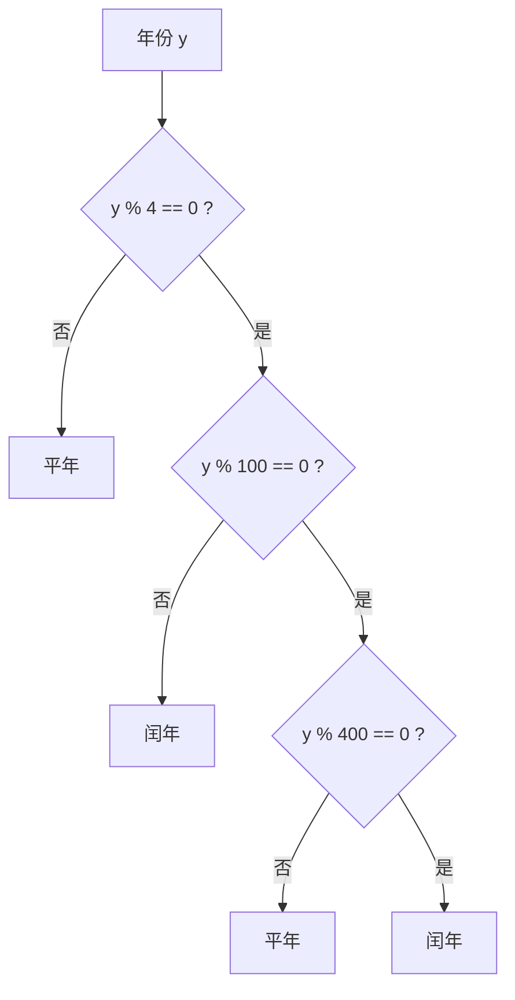

上一章的程序都是从头到尾顺序执行的。本章引入改变执行流程的两种结构：分支（根据条件选择执行哪一段）和循环（重复执行一段）。顺序、分支、循环这三种结构足以表达任何算法，这是结构化程序设计（structured programming）的基本结论。有了循环，计算机最擅长的事——不知疲倦地重复——才能发挥出来，本章的后半部分由此引出第一种算法思想：枚举法，即逐一检验所有可能性。逻辑表达式与**命题**逻辑的关系见 [1.1](/1.1)；枚举法在 [4.1.12](/4.1.12) 发展为回溯，在 [4.1.14](/4.1.14) 发展为状态空间搜索；循环的代价分析见 [4.3.1](/4.3.1)。

## 3.1. 分支

### 3.1.1. if 与 else

求一元二次方程 $ax^2 + bx + c = 0$（$a \ne 0$）的实根：判别式 $\Delta = b^2 - 4ac$ 小于零时没有实根，等于零时有两个相等的实根，大于零时有两个不等的实根 $x_{1,2} = \frac{-b \pm \sqrt{\Delta}}{2a}$。

```cpp tab
#include <cmath>
#include <iostream>

int main() {
    double a, b, c;
    std::cin >> a >> b >> c;
    double delta = b * b - 4 * a * c;
    if (delta < 0) {
        std::cout << "no real roots\n";
    } else if (delta == 0) {
        std::cout << -b / (2 * a) << '\n';
    } else {
        double r = std::sqrt(delta);
        std::cout << (-b + r) / (2 * a) << ' ' << (-b - r) / (2 * a) << '\n';
    }
    return 0;
}
```

```python tab
import math

a, b, c = map(float, input().split())
delta = b * b - 4 * a * c
if delta < 0:
    print("no real roots")
elif delta == 0:
    print(-b / (2 * a))
else:
    r = math.sqrt(delta)
    print((-b + r) / (2 * a), (-b - r) / (2 * a))
```

`if (条件) 语句1 else 语句2`：条件为真时执行语句 1，否则执行语句 2；`else` 部分可以省略。分支中有多条语句时要用花括号括成一个语句块；只有一条语句时花括号可以省略，但始终写上更安全，因为以后添加语句时不会遗漏。Python 用冒号和缩进表示语句块，`else if` 写作 `elif`。

三个条件互斥且穷尽，写成 `if … else if … else` 比写三个独立的 `if` 更清楚，也只需比较必要的次数。这里用 `delta == 0` 比较浮点数只是为了与数学表述对应；系数是计算结果时，$\Delta$ 很可能因舍入误差而成为 $10^{-17}$ 这样的小数，严格的程序应当判断 $\lvert\Delta\rvert$ 是否小于某个容差（[4.1.2](/4.1.2)）。

### 3.1.2. 嵌套与多路分支

判断闰年：能被 4 整除但不能被 100 整除的年份是闰年，能被 400 整除的年份也是闰年。按条件逐层判断，得到嵌套的分支：



把嵌套的条件合并成一个逻辑表达式（[3.2](#sec-3.2)），程序更短：

```cpp tab
#include <iostream>

int main() {
    int y;
    std::cin >> y;
    bool leap = (y % 4 == 0 && y % 100 != 0) || y % 400 == 0;
    std::cout << (leap ? "YES" : "NO") << '\n';
    return 0;
}
```

```python tab
y = int(input())
leap = (y % 4 == 0 and y % 100 != 0) or y % 400 == 0
print("YES" if leap else "NO")
```

`条件 ? 值1 : 值2` 是条件运算符：条件为真时取值 1，否则取值 2。它是表达式而不是语句，可以出现在需要值的地方；放在 `<<` 之间时要加括号。Python 的写法是 `值1 if 条件 else 值2`。

嵌套分支中，`else` 总是与它前面最近的、尚未配对的 `if` 配对，而不是与缩进对齐的那个，这就是"悬垂 else"问题。用花括号明确写出每个分支的范围就不会出错。

一个变量与多个常量比较时，可以用 `switch`：

```cpp
char op;
double x, y;
std::cin >> x >> op >> y;
switch (op) {
case '+': std::cout << x + y << '\n'; break;
case '-': std::cout << x - y << '\n'; break;
case '*': std::cout << x * y << '\n'; break;
case '/': std::cout << x / y << '\n'; break;
default:  std::cout << "unknown operator\n";
}
```

`switch` 根据表达式的值跳转到对应的 `case` 标签，然后一直执行下去，直到遇到 `break` 或 `switch` 结束；漏写 `break` 会"贯穿"到下一个分支，编译选项 `-Wimplicit-fallthrough`（含在 `-Wextra` 中）会对此警告。`case` 后只能是整数或字符常量。Python 3.10 起有 `match` 语句，`case "+": …` 不会贯穿，还能按数据的结构匹配；只做简单的值比较时，`if … elif` 同样清楚。

## 3.2. 逻辑表达式

### 3.2.1. 逻辑运算与短路求值

C++ 的逻辑运算符是 `&&`（与）、`||`（或）、`!`（非），Python 写作 `and`、`or`、`not`。它们对应命题逻辑的**联结词**，运算结果由**真值表**确定。逻辑表达式的一个重要性质是从左到右求值，并且结果一旦确定就不再计算剩下的部分，这称为短路求值（short-circuit evaluation）：

- `p && q`：若 `p` 为假，整个表达式为假，不再计算 `q`；
- `p || q`：若 `p` 为真，整个表达式为真，不再计算 `q`。

短路求值常用来保护后面的条件：`if (b != 0 && a % b == 0)` 在 `b` 为 $0$ 时不会计算 `a % b`，避免了除以零；`if (i < n && a[i] > 0)` 先检查下标再访问数组元素（[4.1.6](/4.1.6)）。两个条件的顺序不能交换。

把自然语言的条件写成逻辑表达式是编程的基本功。设 `a`、`b` 表示两个命题：

| 自然语言 | 逻辑表达式 | 说明 |
|---|---|---|
| $a$、$b$ 至少有一个成立 | `a \|\| b` | |
| $a$、$b$ 都成立 | `a && b` | |
| $a$、$b$ 不同时成立 | `!(a && b)`，即 `!a \|\| !b` | **德摩根律** |
| $a$、$b$ 恰有一个成立 | `a != b` | 异或 |
| $a$、$b$ 同时成立或同时不成立 | `a == b` | |
| 若 $a$ 则 $b$ | `!a \|\| b` | 蕴涵：只有 $a$ 真 $b$ 假时为假 |
| 三者中至少两个成立 | `a + b + c >= 2` | 利用 `bool` 转为 $0$、$1$ |

最后一行说明，在 C++ 和 Python 中，逻辑值可以当作 $0$、$1$ 相加，用来数有几个条件成立。这个技巧在本章的枚举题中反复使用。

### 3.2.2. 位运算

整数在内存中是一串二进制位，位运算直接对这些位操作：

| 运算符 | 含义 | 例（`6` 是 `110`，`3` 是 `011`） |
|---|---|---|
| `&` | 按位与 | `6 & 3` 是 `2`（`010`） |
| `\|` | 按位或 | `6 \| 3` 是 `7`（`111`） |
| `^` | 按位异或 | `6 ^ 3` 是 `5`（`101`） |
| `~` | 按位取反 | `~6` 是 `-7`（补码） |
| `<<` | 左移 $k$ 位，相当于乘 $2^k$ | `3 << 2` 是 `12` |
| `>>` | 右移 $k$ 位，相当于除以 $2^k$ 向下取整 | `6 >> 1` 是 `3` |

常用的位操作都以掩码（mask）`1 << k`（只有第 $k$ 位为 $1$ 的数）为基础，位从低位起从 $0$ 编号：

- 取第 $k$ 位：`(n >> k) & 1`，或判断 `n & (1 << k)` 是否非零；
- 置第 $k$ 位为 $1$：`n | (1 << k)`；清零：`n & ~(1 << k)`；翻转：`n ^ (1 << k)`。

[4.1.2](/4.1.2) 的猜数卡片中，第 $k$ 张卡片上的数恰好是第 $k$ 位为 $1$ 的数，用位运算生成卡片（$1 \sim 100$ 需要 7 张）：

```cpp tab
#include <iostream>

int main() {
    for (int k = 0; k < 7; ++k) {            // card number k
        std::cout << "card " << k << ":";
        for (int n = 1; n <= 100; ++n)
            if (n & (1 << k)) std::cout << ' ' << n;   // bit k of n is set
        std::cout << '\n';
    }
    return 0;
}
```

```python tab
for k in range(7):                                   # card number k
    numbers = [n for n in range(1, 101) if n & (1 << k)]
    print(f"card {k}:", *numbers)
```

位运算用于无符号整数最安全：对负数右移、把 $1$ 移进符号位等操作在 C++20 以前有未定义或由实现决定的情况。C++20 的 `<bit>` 提供 `std::popcount`（数 $1$ 的个数）等函数。Python 的整数没有固定位数，`~n` 总是等于 `-n - 1`，`bin(n)` 给出二进制字符串，`n.bit_count()`（3.10 起）数 $1$ 的个数。

## 3.3. 循环

### 3.3.1. while、do-while 与 for

```cpp tab
#include <iostream>

int main() {
    int sum = 0;
    for (int n = 1; n <= 100; ++n)    // init; condition; update
        sum += n;
    std::cout << sum << '\n';         // 5050

    long long fact = 1;
    int k = 1;
    while (k <= 20) {                 // 20! still fits in long long
        fact *= k;
        ++k;
    }
    std::cout << fact << '\n';        // 2432902008176640000
    return 0;
}
```

```python tab
total = 0
for n in range(1, 101):   # n = 1, 2, ..., 100
    total += n
print(total)              # 5050

fact = 1
k = 1
while k <= 20:
    fact *= k
    k += 1
print(fact)               # 2432902008176640000
```

C++ 有三种循环语句：

- `while (条件) 循环体`：先判断条件，为真则执行循环体，再回到判断；条件一开始就为假时循环体一次也不执行。
- `do 循环体 while (条件);`：先执行一次循环体，再判断条件；循环体至少执行一次。适合"先做一次、再看要不要继续"的情形，如反复读入直到输入合法。
- `for (初始化; 条件; 更新) 循环体`：执行顺序是 初始化 → 条件 → 循环体 → 更新 → 条件 → 循环体 → 更新 → … 直到条件为假。它等价于

  ```cpp
  {
      初始化;
      while (条件) {
          循环体;
          更新;
      }
  }
  ```

  （循环体中有 `continue` 时略有不同：`for` 的 `continue` 仍会执行更新。）`for` 把控制循环的三个要素写在一处，适合次数已知的计数循环；在初始化中定义的变量只在循环内有效。三部分都可以省略，`for (;;)` 与 `while (true)` 一样表示无限循环，需要在循环体中用 `break` 退出。

`for (int i = 0; i < n; ++i)` 执行 $n$ 次，下标从 $0$ 到 $n-1$，这是 C++ 最常见的写法，与数组下标从 $0$ 开始（[4.1.6](/4.1.6)）相一致。

Python 的 `for` 不同：它依次取出一个序列（列表、字符串、`range` 等可迭代对象）中的每个元素，`range(a, b)` 产生 $a, a+1, \dots, b-1$，`range(a, b, s)` 以 $s$ 为步长。Python 没有 `do-while`，写成 `while True:` 加上条件满足时的 `break`。C++11 也有类似的"范围 for"循环 `for (int x : v)`，用于遍历容器中的元素（[4.1.6](/4.1.6)）。

写循环时常见的错误：循环条件差一（`<` 与 `<=` 混淆）、忘记更新循环变量导致死循环、在 `for (…);` 或 `while (…);` 后面多写了分号（循环体变成空语句）、累加变量没有初始化或在循环内部被重复初始化。

### 3.3.2. break 与 continue

`break` 立即结束它所在的最内层循环（或 `switch`），转到循环之后的语句；`continue` 跳过本轮循环体中剩下的语句，直接进入下一轮（`for` 循环先执行更新）。例如找出 $1 \sim 100$ 中所有的 $4n+1$ 型数中能被 3 整除的数，并在发现第一个超过 50 的数时停止：

```cpp
for (int i = 1; i <= 100; ++i) {
    if (i % 4 != 1) continue;   // not of the form 4n+1: skip
    if (i % 3 != 0) continue;   // not divisible by 3: skip
    if (i > 50) break;          // stop the whole loop
    std::cout << i << ' ';      // prints 9 21 33 45
}
```

用 `continue` 把"不满足条件就跳过"写在循环开头，可以避免多层嵌套的 `if`。`break` 只跳出一层循环；要从多重循环中一次跳出，可以设置一个标志变量，或者把循环放进函数中直接 `return`（[4.1.4](/4.1.4)）。Python 的 `for` 和 `while` 还可以带 `else` 子句，它在循环没有被 `break` 打断、正常结束时执行，适合"找遍了也没找到"的情形。

### 3.3.3. 循环的设计

写循环的关键是从重复的代码中归纳出不变的部分和变化的部分：不变的部分成为循环体，变化的部分由循环变量表达。例如四段几乎相同的代码分别检验 `'A'`、`'B'`、`'C'`、`'D'`，变化的只有这个字母，于是让循环变量依次取这四个值。重复的代码不仅冗长，修改时也容易漏改其中一处，消除重复是循环（以及 [4.1.4](/4.1.4) 的函数）的主要用途。

循环中常用的几种变量：

- 累加器与计数器：循环前初始化（求和为 $0$，求积为 $1$，计数为 $0$），循环中更新；
- 最值：初值取第一个元素，或取不可能出现的极端值，循环中与每个元素比较；
- 标志变量：循环前设为"未找到"，满足条件时改为"已找到"，循环结束后检查。标志的初值必须与"已找到"的值不同。

判断一个循环是否正确，有用的工具是循环不变式（loop invariant）：在每轮循环开始时都成立的一个条件。若它在循环开始前成立、每轮循环体执行后仍然成立，那么循环结束时它与循环的终止条件合在一起，就能推出想要的结果。例如求和循环的不变式是"每轮开始时 `sum` 等于 $1 + 2 + \dots + (n-1)$"，循环在 $n = 101$ 时结束，于是 `sum` 等于 $1 + \dots + 100$。这与数学归纳法是同一种推理。[4.1.6](/4.1.6) 用循环不变式说明二分查找的正确性。

## 3.4. 枚举法

### 3.4.1. 枚举的三要素

很多问题的解空间是有限的：答案必定是有限个候选中的某一个。最直接的解法是把候选逐一列出，检验每一个是否满足条件。

**定义 3.4.1（枚举法）** **枚举法**（exhaustive search，也称穷举法、蛮力法）是按某种顺序逐一列出问题所有可能的候选解，对每个候选检验是否满足问题的全部条件，从而找出所有解（或判定无解）的方法。

用枚举法解题要确定三件事：

1. 范围：候选解的集合是什么，它必须包含所有真正的解；
2. 顺序：怎样不重复、不遗漏地依次产生每个候选，通常对应一重或多重循环；
3. 检验：怎样用表达式判断一个候选是否满足条件。

枚举法的思路简单、正确性容易保证，缺点是候选的个数可能很大。好的枚举程序会尽量利用问题的性质缩小范围（[3.4.4](#sec-3.4.4)），这一思想在回溯法中发展为"剪枝"（[4.1.12](/4.1.12)）。

### 3.4.2. 例：谁做的好事

**例 3.4.1** 四位同学 A、B、C、D 中有一位做了好事。A 说："不是我。" B 说："是 C。" C 说："是 D。" D 说："C 胡说。" 已知其中三人说的是真话，一人说的是假话，问是谁做的好事。

范围是四个人；顺序是依次假设做好事的人为 A、B、C、D；检验是数一数在这个假设下有几句话为真。用变量 `who` 表示假设的人，四句话就成为四个关系表达式：`who != 'A'`、`who == 'C'`、`who == 'D'`、`who != 'D'`。

```cpp tab
#include <iostream>

int main() {
    bool found = false;
    for (char who = 'A'; who <= 'D'; ++who) {     // assume "who" did it
        int truths = (who != 'A') + (who == 'C') + (who == 'D') + (who != 'D');
        if (truths == 3) {
            std::cout << who << '\n';               // prints C
            found = true;
        }
    }
    if (!found) std::cout << "no solution\n";
    return 0;
}
```

```python tab
found = False
for who in "ABCD":                               # assume "who" did it
    truths = (who != "A") + (who == "C") + (who == "D") + (who != "D")
    if truths == 3:
        print(who)                               # prints C
        found = True
if not found:
    print("no solution")
```

这里没有在找到答案后立即 `break`，而是检验了全部候选：这样还能顺便发现解不唯一的情况。字符在 C++ 中是整数，所以 `who` 可以从 `'A'` 自增到 `'D'`；也可以用整数 $k = 0, 1, 2, 3$ 代表四个人，输出时写 `char('A' + k)`。

### 3.4.3. 例：谁是作案者

**例 3.4.2** 六个嫌疑人 A～F 涉及一桩案件，已知：(1) A、B 至少有一人作案；(2) A、E、F 中至少有两人作案；(3) A、D 不可能是同案犯；(4) B、C 或同时作案，或都与本案无关；(5) C、D 中有且仅有一人作案；(6) 如果 D 没有作案，则 E 也没有作案。问谁是作案者。

每人有作案（$1$）和未作案（$0$）两种可能，共 $2^6 = 64$ 种组合。按 [3.2.1](#sec-3.2.1) 的方法把线索写成逻辑表达式：

| 线索 | 表达式 |
|---|---|
| (1) | `a \|\| b` |
| (2) | `a + e + f >= 2` |
| (3) | `!(a && d)` |
| (4) | `b == c` |
| (5) | `c != d` |
| (6) | `d \|\| !e`（"若非 $d$ 则非 $e$"即 `!(!d) \|\| !e`） |

产生 64 种组合的一种方法是六重循环，每重循环枚举一个人；更简洁的方法是让一个整数 `s` 从 $0$ 枚举到 $63$，用它的 6 个二进制位表示 6 个人（[3.2.2](#sec-3.2.2)）。Python 标准库的 `itertools.product` 直接产生所有组合。

```cpp tab
#include <iostream>

int main() {
    for (int s = 0; s < (1 << 6); ++s) {          // 64 combinations
        bool a = s & 1, b = s >> 1 & 1, c = s >> 2 & 1,
             d = s >> 3 & 1, e = s >> 4 & 1, f = s >> 5 & 1;
        bool ok = (a || b) && (a + e + f >= 2) && !(a && d)
               && (b == c) && (c != d) && (d || !e);
        if (ok) {
            const char names[] = "ABCDEF";
            bool guilty[] = {a, b, c, d, e, f};
            for (int i = 0; i < 6; ++i)
                if (guilty[i]) std::cout << names[i] << ' ';
            std::cout << '\n';                     // prints A B C F
        }
    }
    return 0;
}
```

```python tab
from itertools import product

for a, b, c, d, e, f in product([False, True], repeat=6):   # 64 combinations
    ok = ((a or b) and a + e + f >= 2 and not (a and d)
          and b == c and c != d and (d or not e))
    if ok:
        print(*[name for name, g in zip("ABCDEF", (a, b, c, d, e, f)) if g])
        # prints A B C F
```

唯一的解是 A、B、C、F 作案，D、E 未作案。可以逐条验证：(1) A 作案；(2) A、F 作案；(3) D 未作案；(4) B、C 都作案；(5) C 作案、D 未作案；(6) D、E 都未作案。

### 3.4.4. 缩小枚举范围

**例 3.4.3** 肇事汽车的车牌号是一个四位的完全平方数，且各位数字从左到右严格递增，求车牌号。

直接枚举 $1000 \sim 9999$ 共 9000 个数并检验是否为完全平方数，不如枚举平方根：$31^2 = 961 < 1000 \le 32^2$，$99^2 = 9801 \le 9999 < 100^2$，只需枚举 $i = 32, \dots, 99$ 共 68 个数，检验 $i^2$ 的各位是否递增。

```cpp tab
#include <iostream>

int main() {
    for (int i = 32; i <= 99; ++i) {
        int n = i * i;
        int d3 = n / 1000, d2 = n / 100 % 10, d1 = n / 10 % 10, d0 = n % 10;
        if (d3 < d2 && d2 < d1 && d1 < d0)
            std::cout << n << '\n';               // prints 1369
    }
    return 0;
}
```

```python tab
for i in range(32, 100):
    s = str(i * i)                                 # compare the digit characters
    if s[0] < s[1] < s[2] < s[3]:
        print(i * i)                               # prints 1369
```

答案是 $1369 = 37^2$。Python 版本把数转成字符串后比较各位字符，这与比较数字是等价的，因为数字字符的编码是连续递增的；C++ 也可以用 `std::to_string`（[4.1.7](/4.1.7)）做同样的事。

**例 3.4.4（合伙捕鱼）** A、B、C、D、E 五人合伙捕鱼后睡着了。A 先醒来，把鱼平分成五份，多出一条扔回湖中，拿走自己的一份；B 醒来后，以为别人都还没拿，也把剩下的鱼平分成五份，扔掉多出的一条，拿走一份；C、D、E 依次照此办理。问他们至少捕了多少条鱼？

设第 $k$ 个人醒来时看到 $x_k$ 条鱼，则 $x_k \equiv 1 \pmod 5$，且 $x_{k+1} = \frac{4}{5}(x_k - 1)$，即 $x_k = \frac{5}{4}x_{k+1} + 1$。这样的前后项关系称为递推关系，用循环从一项推出下一项。直接枚举 $x_1$ 要试很多次；更好的办法是枚举最后一个人看到的鱼数 $x_5$（满足 $x_5 \equiv 1 \pmod 5$，即 $6, 11, 16, \dots$），向前递推，要求每一步都得到整数：

```cpp tab
#include <iostream>

int main() {
    for (int x5 = 6; ; x5 += 5) {           // E saw x5 fish, x5 % 5 == 1
        int fish[6];
        fish[5] = x5;
        int k = 5;
        while (k > 1 && fish[k] % 4 == 0) { // x_{k-1} = x_k / 4 * 5 + 1 must be an integer
            fish[k - 1] = fish[k] / 4 * 5 + 1;
            --k;
        }
        if (k == 1) {                        // all five steps succeeded
            for (int i = 1; i <= 5; ++i) std::cout << fish[i] << ' ';
            std::cout << '\n';               // prints 3121 2496 1996 1596 1276
            break;
        }
    }
    return 0;
}
```

```python tab
x5 = 6
while True:                       # E saw x5 fish, x5 % 5 == 1
    fish = [x5]
    while len(fish) < 5 and fish[-1] % 4 == 0:
        fish.append(fish[-1] // 4 * 5 + 1)
    if len(fish) == 5:            # all five steps succeeded
        print(*reversed(fish))    # prints 3121 2496 1996 1596 1276
        break
    x5 += 5
```

至少捕了 3121 条鱼。注意递推得到的 $x_{k-1} = \frac{5}{4}x_k + 1$ 自动满足 $x_{k-1} \equiv 1 \pmod 5$，所以只需检验 $x_k$ 能否被 4 整除。

缩小范围的思路有：利用数学关系换一个枚举对象（枚举平方根而不是平方数，枚举最后一项而不是第一项）、利用约束提前排除候选、利用对称性只枚举一部分。当候选数随问题规模指数增长时（$n$ 个人有 $2^n$ 种组合），单纯的枚举很快就不可行，需要回溯与剪枝（[4.1.12](/4.1.12)）、动态规划（[4.1.13](/4.1.13)）等更高级的方法。

## 小结

- 顺序、分支、循环三种结构足以表达任何算法。多路分支用 `if … else if … else` 或 `switch`；用花括号明确每个分支的范围。
- 逻辑运算从左到右短路求值，可以用来保护后面的条件。把自然语言条件写成逻辑表达式时，"恰有一个"是 `!=`，"若 $a$ 则 $b$"是 `!a || b`，逻辑值可以相加计数。
- 位运算以掩码 `1 << k` 为基础，可以取、置、清、翻转任意一位，也可以用一个整数的各位枚举所有子集。
- `for` 适合计数循环，`while` 适合条件循环，`do-while` 至少执行一次；`break` 跳出循环，`continue` 进入下一轮。用循环不变式检查循环的正确性。
- 枚举法的三要素是范围、顺序、检验；利用问题的性质缩小枚举范围。
