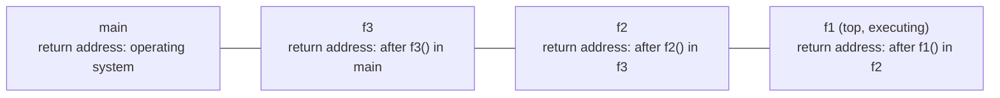

Loops eliminate "the same piece of code repeated consecutively", but programs contain another kind of repetition: the same computation appears in different places with different data, such as testing whether a number is prime in several places. A function packages a computation, gives it a name, and calls it with different arguments wherever it is needed. The function is the basic unit of procedural programming: a complex problem is decomposed into several subproblems, each solved by one function, which is modularity. This chapter covers defining and calling functions, how arguments are passed, where variables are visible, how calls are implemented with the call stack, and how to organize programs with functions. A function that calls itself is recursion ([4.1.10](/4.1.10)); organizing functions together with the data they operate on leads to the object-oriented programming of [4.2](/4.2); the call stack as a data structure is in [4.3.4](/4.3.4).

## 4.1. The Concept of a Function

### 4.1.1. From Mathematical Functions to Functions in Programs

A function $f\colon X \to Y$ in mathematics ([1.2.3](/1.2.3#def-3.1.1)) assigns an output to every input; the symbol $f$ says how to use it, and a defining formula such as $f(x) = ax^2 + bx + c$ says how to compute its value. Functions in programs follow this idea, but with a wider meaning.

**Definition 4.1.1 (Function)** A **function** in a program is a piece of code that has a name and can be called repeatedly. It has four elements: a name; inputs, that is, parameters; an output, that is, the return value; and a body, that is, the statements that carry out the computation. When a function is called, the actual data are passed to the parameters, the body is executed, and the return value is brought back to the place of the call.

Unlike mathematical functions, functions in programs may have no parameters or no return value (in C++ the return type is written `void`), may read and write data outside the function, and may also produce effects such as output. The influence that a function has on the outside world other than its return value (modifying global variables or data pointed to by parameters, input and output, and so on) is called a *side effect*. A function without side effects whose return value is determined only by its parameters is called a *pure function*; it is the closest to a mathematical function and the easiest to test and reason about.

When defining a function, answer three questions in turn: what is to be obtained (the return value and effects), what needs to be provided (the parameters), and how it is done (the body). For example, testing for primes:

```cpp tab
#include <iostream>

// Returns true if n is a prime number.
bool is_prime(int n) {
    if (n < 2) return false;               // 0, 1 and negatives are not prime
    for (int k = 2; k * k <= n; ++k)       // a factor <= sqrt(n) exists if n is composite
        if (n % k == 0) return false;
    return true;
}

int main() {
    int count = 0;
    for (int i = 2; i <= 100; ++i)
        if (is_prime(i) && i % 4 == 1) {   // primes of the form 4n+1
            std::cout << i << ' ';
            ++count;
        }
    std::cout << "\ncount = " << count << '\n';   // count = 11
    return 0;
}
```

```python tab
def is_prime(n: int) -> bool:
    """Return True if n is a prime number."""
    if n < 2:                     # 0, 1 and negatives are not prime
        return False
    k = 2
    while k * k <= n:             # a factor <= sqrt(n) exists if n is composite
        if n % k == 0:
            return False
        k += 1
    return True


primes = [i for i in range(2, 101) if is_prime(i) and i % 4 == 1]
print(*primes)
print("count =", len(primes))     # count = 11
```

With `is_prime`, the main program can directly express "is prime and of the form $4n+1$" without caring how primality is tested. The `return` statement ends the function immediately and gives the return value, so as soon as a factor is found we can return `false`; if the loop ends normally there is no factor. The loop condition is written `k * k <= n` rather than `k <= sqrt(n)`, which avoids computing a square root in each iteration and also avoids boundary errors caused by floating-point rounding.

The design principle for functions is that a function does one thing. If `is_prime` did not return a result but printed "is prime" directly, it would take on both computation and output and could not be reused in other computations. Likewise, a function that computes the area of a triangle should return the area rather than store the result in a global variable or print it.

### 4.1.2. Declaration, Definition and Call

A C++ function definition is written `return-type function-name(parameter-list) { body }`. Before a function is called, the compiler must already know its name, parameter types and return type; that is, a function must be "declared before use". If the definition is written after the call, a function declaration (also called a function prototype) must be written before it:

```cpp
bool is_prime(int n);   // declaration: ends with a semicolon, no body
                        // the parameter name may be omitted: bool is_prime(int);

int main() {
    return is_prime(7) ? 0 : 1;   // OK: declared above
}

bool is_prime(int n) {  // definition
    if (n < 2) return false;
    for (int k = 2; k * k <= n; ++k)
        if (n % k == 0) return false;
    return true;
}
```

A `void` function may omit `return`, or end early with a `return;` without a value. A function whose return type is not `void` must return a value on every execution path; otherwise the program has **undefined behavior** (`-Wall` warns about this).

Python defines functions with `def`; the function object is created when the `def` statement is executed, so it suffices that the function has been defined by the time of the call; a function without a `return` statement returns `None`. The type annotations of parameters and return values (`n: int`, `-> bool`) are only documentation and are not checked. A string at the beginning of the function body is a documentation string (docstring), which `help(is_prime)` displays.

## 4.2. Parameter Passing

### 4.2.1. Parameters and Arguments

The parameters in a function definition are called formal *parameters*, and the values supplied at the call are called actual *arguments*. When `is_prime(i)` is called, C++ allocates a new storage unit for the parameter `n` and initializes it with the value of the argument `i`; after the function returns, the storage unit of `n` is released. Parameters and arguments are different variables, and it does not matter whether their names are the same; an argument may be any expression, such as `is_prime(2 * k + 1)`; when the type of an argument differs from that of the parameter, an **implicit conversion** takes place according to the rules of [4.1.2](/4.1.2).

### 4.2.2. Pass by Value and Pass by Reference

The default way of passing arguments in C++ is *pass by value*: the parameter is a copy of the argument, and modifying the parameter inside the function does not affect the argument. Hence the `swap_by_value` below cannot swap two variables; to let a function modify the caller's variables, declare the parameter as a reference (add `&` after the type), which is called *pass by reference*: the parameter is merely another name for the argument, and operations on the parameter are operations on the argument.

```cpp
#include <iostream>

void swap_by_value(int a, int b) {   // a, b are copies
    int t = a; a = b; b = t;
}

void swap_by_ref(int& a, int& b) {   // a, b are aliases of the arguments
    int t = a; a = b; b = t;
}

int main() {
    int x = 1, y = 2;
    swap_by_value(x, y);
    std::cout << x << ' ' << y << '\n';   // 1 2: unchanged
    swap_by_ref(x, y);
    std::cout << x << ' ' << y << '\n';   // 2 1: swapped
    return 0;
}
```

The standard library already provides `std::swap` (in `<utility>`). Pass by reference has two uses:

1. Letting the function modify the argument, as in the swap above, or "returning" several results through parameters;
2. Avoiding the copying of large objects. Strings, arrays and the like may be large, and passing by value copies all the contents; a large read-only parameter should be written as a constant reference, `const std::string& s`, which neither copies nor allows the function to modify it.

Rule of thumb: small basic types such as `int` and `double` are passed by value; large read-only objects are passed by constant reference; parameters that need to be modified are passed by reference. When a function must return several values, modern C++ prefers returning a structure or a `std::pair` or `std::tuple` ([4.1.9](/4.1.9), [4.2.10](/4.2.10)) to outputting through several reference parameters. The details of references themselves (lvalue and rvalue references) are in [4.2.6](/4.2.6); another way to let a function access the caller's data is to pass a pointer ([4.1.8](/4.1.8)). Arrays as parameters follow special rules ([4.1.6](/4.1.6)).

### 4.2.3. In Python: Passing Object References

Variables in Python are names bound to objects ([4.1.2](/4.1.2)); when a function is called, the parameter is bound to the same object that the argument refers to, a way often called *call by sharing*. It is neither pass by value nor pass by reference, and the consequences depend on what the function does with the parameter:

```python
def rebind(x):
    x = [0, 0]        # binds the local name x to a new object; the caller is unaffected

def mutate(x):
    x.append(3)       # modifies the shared object; the caller sees the change

a = [1, 2]
rebind(a)
print(a)              # [1, 2]
mutate(a)
print(a)              # [1, 2, 3]
```

- Reassigning a parameter inside the function only makes the local name refer to another object; the caller is unaffected;
- Modifying the contents of a mutable object (a list, a dictionary, etc.) through the parameter is visible to the caller;
- Integers, floating-point numbers, strings and tuples are immutable objects, and a function cannot change the caller's variables of these types in any way.

Therefore a `swap(x, y)` function like the one in C++ cannot be written in Python, and is not needed: swapping is written `x, y = y, x`; to return several values, return a tuple directly with `return q, r` and write `q, r = divmod_like(a, b)` at the call.

A common pitfall is using a mutable object as the default value of a parameter: the empty list in `def f(item, acc=[])` is created only once, when the function is defined, and every later call that omits `acc` shares the same list. Write `acc=None` instead and `if acc is None: acc = []` in the body.

## 4.3. Scope and Lifetime

### 4.3.1. Scope

**Definition 4.3.1 (Scope)** The region of source code in a program in which a name (a variable name, a function name, etc.) can be used is called its **scope**.

Common scopes in C++:

- Block scope: a variable defined inside a pair of braces (a block) is visible from its definition to the end of the braces. The parameters of a function and the variables defined in the function body belong to the block of the body; the `i` defined in `for (int i = 0; …)` is visible only inside the loop. Such variables are called *local variables*.
- Namespace scope: a variable defined outside all functions is called a *global variable*; it is visible from its definition to the end of the file, and other files can use it through a declaration.

An inner scope may define a variable with the same name as one in an outer scope; the outer variable of the same name is then hidden in the inner scope, which is called *shadowing*:

```cpp
#include <iostream>

int num = 123;                    // global variable

void show_param(int num) { std::cout << num << '\n'; }   // the parameter shadows the global
void show_global() { std::cout << num << '\n'; }         // uses the global
void show_local() {
    int num = 789;                // the local variable shadows the global
    std::cout << num << '\n';
}

int main() {
    show_param(456);              // 456
    show_global();                // 123
    show_local();                 // 789
    {
        int num = 0;              // shadows the global inside this block only
        std::cout << num << ' ' << ::num << '\n';   // 0 123 (:: names the global)
    }
    return 0;
}
```

Shadowing makes code hard to read and should be avoided (the `-Wshadow` option warns about it). A more important principle is to avoid global variables as far as possible: any function may modify a global variable, so invisible dependencies arise between functions, and the larger the program, the harder it is to track down errors. The data a function needs should be passed in through parameters and the results passed out through return values. Constants that really need to be shared may be defined as global constants with `const` or `constexpr`.

When Python looks up a name, it searches in turn the local (Local), enclosing function (Enclosing), global (Global, that is, the module) and built-in (Built-in) scopes, called the LEGB rule. Assigning to a name inside a function makes it a local variable of that function; to assign to a global variable inside a function one must first declare `global name` (use `nonlocal` for variables of an enclosing function), a form that should also be used sparingly. Unlike in C++, `if` and `for` in Python do not form a new scope, and after a loop ends the loop variable still exists and keeps its last value.

### 4.3.2. Lifetime

Scope is a concept of the source code, while *lifetime* is a concept of run time: the period from the allocation to the release of the storage unit of a variable.

- A local variable is an automatic variable: it is allocated and initialized each time execution reaches its definition, and released when it leaves its block. When the same function is called twice, the local variables of the two calls are unrelated, and the value of the previous call is not kept.
- A global variable is allocated before the program starts executing and released when the program ends.
- Putting `static` before a local variable leaves its scope unchanged but makes its lifetime the whole program: it is initialized only once, the first time execution reaches the definition, and keeps its value from then on.

```cpp
int next_id() {
    static int counter = 0;   // initialized once; keeps its value between calls
    return ++counter;         // returns 1, 2, 3, ... on successive calls
}
```

Dynamically allocated objects (`new`, the elements of a `std::vector`) follow other lifetime rules, see [4.1.8](/4.1.8) and [4.2.4](/4.2.4).

## 4.4. The Call Stack

A function call must solve two problems: after the called function finishes, how to return to the statement following the call and continue; and where the parameters and local variables of each call are stored. Consider the following program:

```cpp tab
#include <iostream>

void f1() { std::cout << "f1\n"; }
void f2() { std::cout << "f2\n"; f1(); }
void f3() { std::cout << "f3\n"; f2(); f1(); }

int main() {
    f3();
    std::cout << "done\n";
    return 0;
}
```

```python tab
def f1():
    print("f1")

def f2():
    print("f2")
    f1()

def f3():
    print("f3")
    f2()
    f1()

f3()
print("done")
```

The output is `f3`, `f2`, `f1`, `f1`, `done` in turn. The order of calls is `main` → `f3` → `f2` → `f1`, and the order of returns is exactly the opposite: the function called last returns first. This "last in, first out" structure is precisely a stack.

**Definition 4.4.1 (Call Stack and Stack Frame)** While a program runs, each function call allocates a **stack frame** in a region of memory called the stack, storing the parameters, local variables and return address (the place where execution continues after the return) of this call; when the function returns, its stack frame is popped and control goes back to the return address. The sequence of all active stack frames, arranged in the order of the calls, is called the **call stack**, and the top of the stack is the function being executed.

When `f1` produces its first output, the call stack from bottom to top is:



After `f1` returns, its stack frame is popped and `f2` becomes the top; after `f2` returns, control goes back to `f3`, which calls `f1` again and pushes a new stack frame. This explains several phenomena:

- Local variables disappear automatically when the function returns, because the stack frame containing them is popped;
- The same function can have several active calls at the same time (recursion, [4.1.10](/4.1.10)), each call having its own stack frame and its own local variables;
- Stack space is limited (usually 8 MB by default on Linux), and calls nested too deeply (such as recursion without a termination condition) or local arrays that are too large cause a *stack overflow* and the program crashes.

A debugger can display the call stack when the program is paused, showing how the program called its way down to the current position ([4.1.5](/4.1.5)). The traceback that Python prints on an error is the call stack at the moment of the error. The concrete layout of stack frames in memory is in [4.1.8](/4.1.8) and [4.10](/4.10).

## 4.5. Modular Program Design

### 4.5.1. Top-Down Design and Stepwise Refinement

Facing a larger problem, first determine the overall framework of the program and write the main steps as calls to functions yet to be implemented; then implement these functions one by one, and if a function is still complicated, continue decomposing it. This method is called top-down design with *stepwise refinement*, proposed by Wirth in 1971. It lets each level care only about the logic of that level and postpones details to the next level.

**Example 4.5.1** Print a table of the characters for ASCII codes $32 \sim 126$ (the printable characters), where each entry has the format "decimal code (3 columns wide), 8-bit binary, character", with 4 entries per line.

Level 1: for each code, print an entry, and break the line after every 4 entries. Level 2: printing an entry = printing the decimal code, printing the binary code, printing the character. Level 3: printing the binary code = printing each bit in turn from bit 7 to bit 0. Level 4: get bit $k$ of an integer (the bitwise operations of [4.1.3](/4.1.3)). Each level is written as a function:

```cpp tab
#include <iomanip>
#include <iostream>

int get_bit(int n, int k) { return (n >> k) & 1; }   // bit k of n

void print_binary(int n) {                           // 8 binary digits
    for (int k = 7; k >= 0; --k) std::cout << get_bit(n, k);
}

void print_entry(int code) {                         // "65 01000001 A"
    std::cout << std::setw(3) << code << ' ';
    print_binary(code);
    std::cout << ' ' << static_cast<char>(code);
}

int main() {
    for (int code = 32; code < 127; ++code) {        // printable ASCII characters
        print_entry(code);
        std::cout << ((code - 32) % 4 == 3 ? '\n' : ' ');
    }
    std::cout << '\n';
    return 0;
}
```

```python tab
def get_bit(n: int, k: int) -> int:
    return (n >> k) & 1                              # bit k of n


def binary8(n: int) -> str:
    return "".join(str(get_bit(n, k)) for k in range(7, -1, -1))


def entry(code: int) -> str:
    return f"{code:3d} {binary8(code)} {chr(code)}"  # " 65 01000001 A"


for code in range(32, 127):                          # printable ASCII characters
    print(entry(code), end="\n" if (code - 32) % 4 == 3 else " ")
print()
```

The `format(code, "08b")` of Python gives the 8-bit binary string directly; we implement it ourselves here to show the layer-by-layer decomposition. When writing a program, one can first write the framework of `main` and let the functions not yet implemented merely return fixed values for the time being (such a temporary implementation is called a stub); once the framework compiles and runs, fill in the functions one by one, testing after each function is completed.

### 4.5.2. Eliminating Repetition with Functions: The Calendar

**Example 4.5.2** Print the calendar of a given month of a given year, with each week starting on Monday.

The clumsiest way is to write a separate piece of output code for each month, giving twelve almost identical pieces of code; and since the weekday of 1 January differs from year to year, this would have to be rewritten for each year. Looking at the code, one finds that the pieces differ only in two quantities: how many days the month has, and which day of the week the 1st of the month is. Write the computation of each of these two quantities as a function, and then one function that "prints the calendar from these two quantities"; all months then share the same code:

- `is_leap(y)`: the leap-year test ([4.1.3](/4.1.3));
- `days_in_month(y, m)`: February has 28 or 29 days, April, June, September and November have 30 days, and the rest have 31;
- `weekday(y, m, d)`: count the days elapsed from 1 January of year 1 (extrapolated in the Gregorian calendar, a Monday) to this day, and take the remainder modulo 7, where $0$ stands for Monday;
- `print_month(y, m)`: print the header, print the corresponding number of blanks before the 1st, then print each day, breaking the line after each Sunday.

```cpp tab
#include <iomanip>
#include <iostream>

bool is_leap(int y) { return (y % 4 == 0 && y % 100 != 0) || y % 400 == 0; }

int days_in_month(int y, int m) {
    if (m == 2) return is_leap(y) ? 29 : 28;
    if (m == 4 || m == 6 || m == 9 || m == 11) return 30;
    return 31;
}

// Day of the week, 0 = Monday, ..., 6 = Sunday (proleptic Gregorian calendar).
int weekday(int y, int m, int d) {
    long long days = 365LL * (y - 1) + (y - 1) / 4 - (y - 1) / 100 + (y - 1) / 400;
    for (int k = 1; k < m; ++k) days += days_in_month(y, k);
    days += d - 1;              // days elapsed since Monday, 1 January of year 1
    return static_cast<int>(days % 7);
}

void print_month(int y, int m) {
    std::cout << "      " << y << '-' << std::setw(2) << std::setfill('0') << m
              << std::setfill(' ') << "\n Mo Tu We Th Fr Sa Su\n";
    int first = weekday(y, m, 1);
    for (int i = 0; i < first; ++i) std::cout << "   ";   // blanks before day 1
    for (int d = 1; d <= days_in_month(y, m); ++d) {
        std::cout << std::setw(3) << d;
        if ((first + d) % 7 == 0) std::cout << '\n';     // Sunday ends the line
    }
    std::cout << '\n';
}

int main() {
    print_month(2026, 10);
    return 0;
}
```

```python tab
def is_leap(y: int) -> bool:
    return (y % 4 == 0 and y % 100 != 0) or y % 400 == 0


def days_in_month(y: int, m: int) -> int:
    if m == 2:
        return 29 if is_leap(y) else 28
    return 30 if m in (4, 6, 9, 11) else 31


def weekday(y: int, m: int, d: int) -> int:
    """Day of the week, 0 = Monday, ..., 6 = Sunday."""
    days = 365 * (y - 1) + (y - 1) // 4 - (y - 1) // 100 + (y - 1) // 400
    days += sum(days_in_month(y, k) for k in range(1, m)) + d - 1
    return days % 7


def print_month(y: int, m: int) -> None:
    print(f"      {y}-{m:02d}\n Mo Tu We Th Fr Sa Su")
    first = weekday(y, m, 1)
    print("   " * first, end="")                  # blanks before day 1
    for d in range(1, days_in_month(y, m) + 1):
        print(f"{d:3d}", end="\n" if (first + d) % 7 == 0 else "")
    print()


print_month(2026, 10)
```

1 October 2026 is a Thursday, so there are three blanks before the dates in the first line of output. Each function is short and does one thing, and can be tested separately: `weekday(2026, 10, 1)` should be $3$ and `days_in_month(2024, 2)` should be $29$. To print the calendar of a whole year, it suffices to call `print_month` in a loop over $m = 1, \dots, 12$ in `main`. The `calendar.month(2026, 10)` of the Python standard library gives the same result and can be used for checking.

This example shows the role of functions at two levels: at the implementation level, the same computation is written once and a change is made in only one place; at the design level, the problem is decomposed into several subproblems that can be understood and verified separately, and the complexity of the program is greatly reduced.

### 4.5.3. Multiple Files and Modules

When programs become larger, related functions are put into separate files. The C++ convention is to put function declarations in header files (`.h`) and definitions in source files (`.cpp`); users include the header file with `#include`:

```cpp
// calendar.h: declarations, the interface
#pragma once
bool is_leap(int y);
int days_in_month(int y, int m);
```

```cpp
// calendar.cpp: definitions, the implementation
#include "calendar.h"
bool is_leap(int y) { return (y % 4 == 0 && y % 100 != 0) || y % 400 == 0; }
int days_in_month(int y, int m) {
    if (m == 2) return is_leap(y) ? 29 : 28;
    if (m == 4 || m == 6 || m == 9 || m == 11) return 30;
    return 31;
}
```

```bash
g++ -std=c++20 main.cpp calendar.cpp -o cal   # compile both files and link them
```

The header file specifies what the module provides to the outside (the interface), the source file gives how it is done (the implementation), and users need only read the header file. Separate compilation, linking errors and CMake are in [4.2.2](/4.2.2). C++20 also introduced modules (`export module`, `import`), and C++23 allows `import std;` to import the whole standard library, but support in compilers and build tools is still maturing, so the code on this site continues to use header files.

In Python, each `.py` file is a module. A function defined in `calendar_utils.py` is called from another file in the same directory after `import calendar_utils` as `calendar_utils.is_leap(2024)`, or after `from calendar_utils import is_leap`. A module is executed once when first imported; code that is needed only when the file is run directly goes under `if __name__ == "__main__":` ([4.1.1](/4.1.1)), so that it is not executed when the module is imported. The standard library is itself a collection of many modules (`math`, `random`, `itertools`, `calendar`, etc.); packages and project structure are in [4.2.2](/4.2.2) and [4.4.1](/4.4.1).

## Summary

- A function has four elements: name, parameters, return value and body; a function does one thing, and should be written as a pure function without side effects where possible. C++ functions are declared before use.
- C++ passes by value by default, so the parameter is a copy of the argument; pass by reference (`T&`) lets the function modify the argument, and a constant reference (`const T&`) avoids copying large objects. Python passes object references: rebinding the parameter does not affect the caller, whereas modifying a mutable object does.
- Scope is the range of source code in which a name is visible, and lifetime is the time during which a storage unit exists; local variables are created and destroyed as blocks are entered and left, and `static` local variables keep their values. Avoid global variables.
- Each function call pushes a stack frame onto the call stack, storing the parameters, local variables and return address, and pops it on return; calls nested too deeply overflow the stack.
- Use top-down stepwise refinement to decompose a problem into functions; use functions to eliminate repetition; organize larger programs with header and source files (C++) and modules (Python).
