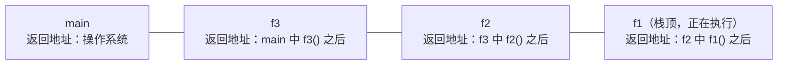

循环消除了"同一段代码连续重复"，但程序中还有另一种重复：同一个计算在不同的地方、以不同的数据出现，如在多处判断一个数是否为质数。函数把一段计算打包起来，起一个名字，在需要的地方用不同的参数调用它。函数是面向过程程序设计的基本单位：把复杂的问题分解为若干子问题，每个子问题由一个函数解决，这就是模块化。本章讲函数的定义和调用、参数怎样传递、变量在哪里可见、调用怎样借助调用栈实现，以及怎样用函数组织程序。函数调用自身就是递归（[4.1.10](/4.1.10)）；把函数和它操作的数据组织在一起，就走向了 [4.2](/4.2) 的面向对象；调用栈作为一种数据结构见 [4.3.4](/4.3.4)。

## 4.1. 函数的概念

### 4.1.1. 从数学函数到程序中的函数

数学中的函数 $f\colon X \to Y$（[1.2.3](/1.2.3#def-3.1.1)）给每个输入指定一个输出，记号 $f$ 表示怎样使用它，定义式 $f(x) = ax^2 + bx + c$ 给出怎样计算它的值。程序中的函数沿用了这一思想，但含义更广。

**定义 4.1.1（函数）** 程序中的**函数**（function，也称子程序）是一段有名字、可以被反复调用的代码。它有四个要素：名称；输入，即参数（parameter）；输出，即返回值（return value）；函数体，即完成计算的语句。调用函数时，把实际的数据传给参数，执行函数体，再把返回值带回调用处。

与数学函数不同，程序中的函数可以没有参数或没有返回值（C++ 中返回类型写 `void`），可以读写函数外部的数据，也可以产生输出等效果。函数除了返回值以外对外界造成的影响（修改全局变量或参数所指的数据、输入输出等）称为副作用（side effect）。没有副作用、返回值只由参数决定的函数称为纯函数（pure function），它最接近数学函数，也最容易测试和推理。

定义一个函数时依次回答三个问题：要得到什么（返回值与效果）、需要提供什么（参数）、怎样做到（函数体）。例如判断质数：

```cpp tab
#include <iostream>

// Returns true if n is a prime number.
bool is_prime(int n) {
    if (n < 2) return false;               // 0, 1 and negatives are not prime
    for (int k = 2; k * k <= n; ++k)       // a factor <= sqrt(n) exists if n is composite
        if (n % k == 0) return false;
    return true;
}

int main() {
    int count = 0;
    for (int i = 2; i <= 100; ++i)
        if (is_prime(i) && i % 4 == 1) {   // primes of the form 4n+1
            std::cout << i << ' ';
            ++count;
        }
    std::cout << "\ncount = " << count << '\n';   // count = 11
    return 0;
}
```

```python tab
def is_prime(n: int) -> bool:
    """Return True if n is a prime number."""
    if n < 2:                     # 0, 1 and negatives are not prime
        return False
    k = 2
    while k * k <= n:             # a factor <= sqrt(n) exists if n is composite
        if n % k == 0:
            return False
        k += 1
    return True


primes = [i for i in range(2, 101) if is_prime(i) and i % 4 == 1]
print(*primes)
print("count =", len(primes))     # count = 11
```

有了 `is_prime`，主程序可以直接表达"是质数且是 $4n+1$ 型"，而不必关心质数怎样判断。`return` 语句立即结束函数并给出返回值，所以找到一个因子就可以返回 `false`；循环正常结束说明没有因子。循环条件写 `k * k <= n` 而不是 `k <= sqrt(n)`，避免了每轮计算平方根，也避免了浮点舍入带来的边界误差。

函数的设计原则是一个函数只做一件事。若 `is_prime` 不返回结果，而是直接输出"是质数"，它就同时承担了计算和输出两项任务，无法在别的计算中复用。同理，计算三角形面积的函数应当返回面积，而不是把结果存进全局变量或打印出来。

### 4.1.2. 声明、定义与调用

C++ 的函数定义写作 `返回类型 函数名(参数列表) { 函数体 }`。调用一个函数之前，编译器必须已经知道它的名称、参数类型和返回类型，即函数要"先声明，后使用"。如果函数定义写在调用之后，就要在前面写一个函数声明（也称函数原型）：

```cpp
bool is_prime(int n);   // declaration: ends with a semicolon, no body
                        // the parameter name may be omitted: bool is_prime(int);

int main() {
    return is_prime(7) ? 0 : 1;   // OK: declared above
}

bool is_prime(int n) {  // definition
    if (n < 2) return false;
    for (int k = 2; k * k <= n; ++k)
        if (n % k == 0) return false;
    return true;
}
```

`void` 函数可以不写 `return`，或用不带值的 `return;` 提前结束。返回类型不是 `void` 的函数必须在每条执行路径上都返回一个值，否则是**未定义行为**（`-Wall` 会警告）。

Python 用 `def` 定义函数，执行到 `def` 语句时才创建函数对象，所以只要在调用时函数已经定义即可；没有 `return` 语句的函数返回 `None`。参数和返回值的类型标注（`n: int`、`-> bool`）只是说明，不被检查。函数体开头的字符串是文档字符串（docstring），`help(is_prime)` 会显示它。

## 4.2. 参数传递

### 4.2.1. 形参与实参

函数定义中的参数称为形式参数（parameter），简称形参，调用时提供的值称为实际参数（argument），简称实参。调用 `is_prime(i)` 时，C++ 为形参 `n` 分配新的存储单元，用实参 `i` 的值初始化它；函数返回后，`n` 的存储单元被释放。形参与实参是不同的变量，名字相同与否没有关系；实参可以是任意表达式，如 `is_prime(2 * k + 1)`；实参的类型与形参不同时按 [4.1.2](/4.1.2) 的规则**隐式转换**。

### 4.2.2. 值传递与引用传递

C++ 默认的参数传递方式是值传递（pass by value）：形参是实参的一个副本，函数中修改形参不影响实参。下面的 `swap_by_value` 因此交换不了两个变量；要让函数修改调用者的变量，把形参声明为引用（在类型后加 `&`），这称为引用传递（pass by reference）：形参只是实参的另一个名字，对形参的操作就是对实参的操作。

```cpp
#include <iostream>

void swap_by_value(int a, int b) {   // a, b are copies
    int t = a; a = b; b = t;
}

void swap_by_ref(int& a, int& b) {   // a, b are aliases of the arguments
    int t = a; a = b; b = t;
}

int main() {
    int x = 1, y = 2;
    swap_by_value(x, y);
    std::cout << x << ' ' << y << '\n';   // 1 2: unchanged
    swap_by_ref(x, y);
    std::cout << x << ' ' << y << '\n';   // 2 1: swapped
    return 0;
}
```

标准库已经提供了 `std::swap`（`<utility>`）。引用传递有两种用途：

1. 让函数修改实参，如上面的交换，或通过参数"返回"多个结果；
2. 避免复制大的对象。字符串、数组等可能很大，按值传递要复制全部内容；只读的大参数应当写成常量引用 `const std::string& s`，既不复制，又保证函数不会修改它。

经验规则：`int`、`double` 等小的基本类型按值传递；只读的大对象按常量引用传递；需要修改的参数按引用传递。函数要返回多个值时，现代 C++ 更推荐返回一个结构体或 `std::pair`、`std::tuple`（[4.1.9](/4.1.9)、[4.2.10](/4.2.10)），而不是用多个引用参数输出。引用本身的细节（左值与右值引用）见 [4.2.6](/4.2.6)；另一种让函数访问调用者数据的方式是传递指针（[4.1.8](/4.1.8)）。数组作为参数时有特殊的规则（[4.1.6](/4.1.6)）。

### 4.2.3. Python 对照：传递对象引用

Python 的变量是绑定到对象的名字（[4.1.2](/4.1.2)），调用函数时，形参被绑定到实参所指的同一个对象，这种方式常称为传递对象引用（call by sharing）。它既不是值传递也不是引用传递，后果取决于函数对形参做什么：

```python
def rebind(x):
    x = [0, 0]        # binds the local name x to a new object; the caller is unaffected

def mutate(x):
    x.append(3)       # modifies the shared object; the caller sees the change

a = [1, 2]
rebind(a)
print(a)              # [1, 2]
mutate(a)
print(a)              # [1, 2, 3]
```

- 在函数中给形参重新赋值，只是让局部名字指向别的对象，调用者不受影响；
- 通过形参修改一个可变对象（列表、字典等）的内容，调用者能看到修改；
- 整数、浮点数、字符串、元组是不可变对象，函数无论如何都改变不了调用者的这类变量。

因此 Python 中不能写出 C++ 那样的 `swap(x, y)` 函数，也不需要：交换写作 `x, y = y, x`；要返回多个值时直接返回一个元组 `return q, r`，调用处写 `q, r = divmod_like(a, b)`。

一个常见的陷阱是用可变对象作为参数的默认值：`def f(item, acc=[])` 中的空列表只在定义函数时创建一次，以后每次省略 `acc` 的调用共用同一个列表。应写成 `acc=None`，在函数体中 `if acc is None: acc = []`。

## 4.3. 作用域与生存期

### 4.3.1. 作用域

**定义 4.3.1（作用域）** 一个名字（变量名、函数名等）在程序中可以被使用的那部分源代码区域称为它的**作用域**（scope）。

C++ 中常见的作用域：

- 块作用域：在一对花括号（语句块）内定义的变量，从定义处起到这对花括号结束为止可见。函数的形参和函数体内定义的变量属于函数体这个块；`for (int i = 0; …)` 中定义的 `i` 只在循环内可见。这样的变量称为局部变量（local variable）。
- 命名空间作用域：在所有函数之外定义的变量称为全局变量（global variable），从定义处起到文件结束都可见，其他文件也可以通过声明使用它。

内层作用域可以定义与外层同名的变量，此时在内层中外层的同名变量被遮蔽（shadowing）：

```cpp
#include <iostream>

int num = 123;                    // global variable

void show_param(int num) { std::cout << num << '\n'; }   // the parameter shadows the global
void show_global() { std::cout << num << '\n'; }         // uses the global
void show_local() {
    int num = 789;                // the local variable shadows the global
    std::cout << num << '\n';
}

int main() {
    show_param(456);              // 456
    show_global();                // 123
    show_local();                 // 789
    {
        int num = 0;              // shadows the global inside this block only
        std::cout << num << ' ' << ::num << '\n';   // 0 123 (:: names the global)
    }
    return 0;
}
```

遮蔽使代码难以阅读，应当避免（`-Wshadow` 选项会对此警告）。更重要的原则是尽量不用全局变量：任何函数都可能修改全局变量，函数之间因此产生了看不见的依赖，程序越大越难追踪错误。函数需要的数据应通过参数传入，结果通过返回值传出。确实需要共享的常量，用 `const` 或 `constexpr` 定义为全局常量是可以的。

Python 中查找一个名字时，依次在局部（Local）、外层函数（Enclosing）、全局（Global，即模块）、内置（Built-in）作用域中寻找，称为 LEGB 规则。在函数中给一个名字赋值，会使它成为该函数的局部变量；要在函数中给全局变量赋值，需要先声明 `global name`（给外层函数的变量赋值用 `nonlocal`），这种写法同样应少用。与 C++ 不同，Python 的 `if`、`for` 不构成新的作用域，循环结束后循环变量仍然存在，保留最后一次的值。

### 4.3.2. 生存期

作用域是源代码中的概念，生存期（lifetime）是运行时的概念：一个变量的存储单元从分配到释放的这段时间。

- 局部变量是自动变量：每次执行到定义处时分配并初始化，离开所在的块时释放。同一个函数被调用两次，两次的局部变量互不相干，上一次的值不会保留。
- 全局变量在程序开始执行前分配，程序结束时释放。
- 在局部变量前加 `static`，它的作用域不变，生存期却变为整个程序：只在第一次执行到定义处时初始化一次，以后保留上次的值。

```cpp
int next_id() {
    static int counter = 0;   // initialized once; keeps its value between calls
    return ++counter;         // returns 1, 2, 3, ... on successive calls
}
```

动态分配的对象（`new`、`std::vector` 中的元素）有另外的生存期规则，见 [4.1.8](/4.1.8) 与 [4.2.4](/4.2.4)。

## 4.4. 调用栈

函数调用要解决两个问题：被调用的函数执行完毕后，怎样回到调用处的下一条语句继续执行；每次调用的参数和局部变量存放在哪里。看下面的程序：

```cpp tab
#include <iostream>

void f1() { std::cout << "f1\n"; }
void f2() { std::cout << "f2\n"; f1(); }
void f3() { std::cout << "f3\n"; f2(); f1(); }

int main() {
    f3();
    std::cout << "done\n";
    return 0;
}
```

```python tab
def f1():
    print("f1")

def f2():
    print("f2")
    f1()

def f3():
    print("f3")
    f2()
    f1()

f3()
print("done")
```

输出依次是 `f3`、`f2`、`f1`、`f1`、`done`。调用的顺序是 `main` → `f3` → `f2` → `f1`，返回的顺序恰好相反：最后被调用的函数最先返回。这种"后进先出"的结构正是栈。

**定义 4.4.1（调用栈与栈帧）** 程序运行时，每次函数调用都在内存中一块称为栈的区域上分配一个**栈帧**（stack frame），存放这次调用的参数、局部变量和返回地址（返回后继续执行的位置）；函数返回时，它的栈帧被弹出，控制转回返回地址。所有活动的栈帧按调用的先后排成的序列称为**调用栈**（call stack），栈顶是正在执行的函数。

执行到 `f1` 第一次输出时，调用栈从栈底到栈顶依次是：



`f1` 返回后，它的栈帧被弹出，`f2` 成为栈顶；`f2` 返回后回到 `f3`，`f3` 再调用 `f1`，压入一个新的栈帧。由此可以理解几个现象：

- 局部变量在函数返回时自动消失，因为它所在的栈帧被弹出了；
- 同一个函数可以同时有多个活动的调用（递归，[4.1.10](/4.1.10)），每个调用有自己的栈帧和自己的局部变量；
- 栈的空间有限（Linux 上默认通常为 8 MB），调用层次过深（如没有终止条件的递归）或局部数组过大，会导致栈溢出（stack overflow），程序崩溃。

调试器可以在程序暂停时显示调用栈，看出程序是怎样一层层调用到当前位置的（[4.1.5](/4.1.5)）。Python 出错时打印的 traceback，就是出错时刻的调用栈。栈帧在内存中的具体布局见 [4.1.8](/4.1.8) 与 [4.10](/4.10)。

## 4.5. 模块化程序设计

### 4.5.1. 自顶向下、逐步求精

面对一个较大的问题，先确定程序的整体框架，把主要步骤写成待实现的函数调用；再逐个实现这些函数，每个函数若仍然复杂，就继续分解。这种方法称为自顶向下、逐步求精（stepwise refinement），由 Wirth 在 1971 年提出。它让每一层只关心本层的逻辑，把细节推迟到下一层。

**例 4.5.1** 输出 ASCII 码 $32 \sim 126$（可打印字符）对应的字符表，每项的格式是"十进制编码（占 3 列）、8 位二进制、字符"，每行 4 项。

第一层：对每个编码，输出一项，每 4 项换行。第二层：输出一项 = 输出十进制、输出二进制、输出字符。第三层：输出二进制 = 从第 7 位到第 0 位依次输出每一位。第四层：取一个整数的第 $k$ 位（[4.1.3](/4.1.3) 的位运算）。每一层写成一个函数：

```cpp tab
#include <iomanip>
#include <iostream>

int get_bit(int n, int k) { return (n >> k) & 1; }   // bit k of n

void print_binary(int n) {                           // 8 binary digits
    for (int k = 7; k >= 0; --k) std::cout << get_bit(n, k);
}

void print_entry(int code) {                         // "65 01000001 A"
    std::cout << std::setw(3) << code << ' ';
    print_binary(code);
    std::cout << ' ' << static_cast<char>(code);
}

int main() {
    for (int code = 32; code < 127; ++code) {        // printable ASCII characters
        print_entry(code);
        std::cout << ((code - 32) % 4 == 3 ? '\n' : ' ');
    }
    std::cout << '\n';
    return 0;
}
```

```python tab
def get_bit(n: int, k: int) -> int:
    return (n >> k) & 1                              # bit k of n


def binary8(n: int) -> str:
    return "".join(str(get_bit(n, k)) for k in range(7, -1, -1))


def entry(code: int) -> str:
    return f"{code:3d} {binary8(code)} {chr(code)}"  # " 65 01000001 A"


for code in range(32, 127):                          # printable ASCII characters
    print(entry(code), end="\n" if (code - 32) % 4 == 3 else " ")
print()
```

Python 的 `format(code, "08b")` 能直接给出 8 位二进制串，这里自己实现是为了展示逐层分解。写程序时可以先写出 `main` 的框架，让尚未实现的函数暂时只返回固定值（这样的临时实现称为桩，stub），框架能编译运行后再逐个填充，每完成一个函数就测试一次。

### 4.5.2. 用函数消除重复：日历

**例 4.5.2** 输出某年某月的月历，每周从星期一开始。

最笨的写法是为每个月分别写一段输出代码，十二个月就有十二段几乎相同的代码；不同年份 1 月 1 日是星期几不同，每年还要再写一遍。观察这些代码可以发现，它们只在两个量上不同：这个月有几天，这个月的 1 日是星期几。把这两个量的计算各写成一个函数，再写一个"按这两个量输出月历"的函数，所有月份就共用同一段代码：

- `is_leap(y)`：闰年的判断（[4.1.3](/4.1.3)）；
- `days_in_month(y, m)`：2 月为 28 或 29 天，4、6、9、11 月为 30 天，其余为 31 天；
- `weekday(y, m, d)`：从公元 1 年 1 月 1 日（按格里历外推，是星期一）起数到这一天经过了多少天，对 7 取余，$0$ 表示星期一；
- `print_month(y, m)`：输出表头，在 1 日之前输出相应个数的空位，然后输出每一天，逢星期日换行。

```cpp tab
#include <iomanip>
#include <iostream>

bool is_leap(int y) { return (y % 4 == 0 && y % 100 != 0) || y % 400 == 0; }

int days_in_month(int y, int m) {
    if (m == 2) return is_leap(y) ? 29 : 28;
    if (m == 4 || m == 6 || m == 9 || m == 11) return 30;
    return 31;
}

// Day of the week, 0 = Monday, ..., 6 = Sunday (proleptic Gregorian calendar).
int weekday(int y, int m, int d) {
    long long days = 365LL * (y - 1) + (y - 1) / 4 - (y - 1) / 100 + (y - 1) / 400;
    for (int k = 1; k < m; ++k) days += days_in_month(y, k);
    days += d - 1;              // days elapsed since Monday, 1 January of year 1
    return static_cast<int>(days % 7);
}

void print_month(int y, int m) {
    std::cout << "      " << y << '-' << std::setw(2) << std::setfill('0') << m
              << std::setfill(' ') << "\n Mo Tu We Th Fr Sa Su\n";
    int first = weekday(y, m, 1);
    for (int i = 0; i < first; ++i) std::cout << "   ";   // blanks before day 1
    for (int d = 1; d <= days_in_month(y, m); ++d) {
        std::cout << std::setw(3) << d;
        if ((first + d) % 7 == 0) std::cout << '\n';     // Sunday ends the line
    }
    std::cout << '\n';
}

int main() {
    print_month(2026, 10);
    return 0;
}
```

```python tab
def is_leap(y: int) -> bool:
    return (y % 4 == 0 and y % 100 != 0) or y % 400 == 0


def days_in_month(y: int, m: int) -> int:
    if m == 2:
        return 29 if is_leap(y) else 28
    return 30 if m in (4, 6, 9, 11) else 31


def weekday(y: int, m: int, d: int) -> int:
    """Day of the week, 0 = Monday, ..., 6 = Sunday."""
    days = 365 * (y - 1) + (y - 1) // 4 - (y - 1) // 100 + (y - 1) // 400
    days += sum(days_in_month(y, k) for k in range(1, m)) + d - 1
    return days % 7


def print_month(y: int, m: int) -> None:
    print(f"      {y}-{m:02d}\n Mo Tu We Th Fr Sa Su")
    first = weekday(y, m, 1)
    print("   " * first, end="")                  # blanks before day 1
    for d in range(1, days_in_month(y, m) + 1):
        print(f"{d:3d}", end="\n" if (first + d) % 7 == 0 else "")
    print()


print_month(2026, 10)
```

2026 年 10 月 1 日是星期四，输出的第一行日期前有三个空位。每个函数都短小、只做一件事，可以单独测试：`weekday(2026, 10, 1)` 应为 $3$，`days_in_month(2024, 2)` 应为 $29$。要输出全年的日历，只需在 `main` 中对 $m = 1, \dots, 12$ 循环调用 `print_month`。Python 标准库的 `calendar.month(2026, 10)` 能给出同样的结果，可以用来检验。

这个例子说明了函数在两个层面上的作用：在实现层面，相同的计算只写一次，修改时只改一处；在设计层面，问题被分解为几个可以分别理解和验证的子问题，程序的复杂度显著降低。

### 4.5.3. 多文件与模块

程序更大时，把相关的函数放进单独的文件。C++ 的惯例是把函数声明放在头文件（`.h`）中，把定义放在源文件（`.cpp`）中，使用者用 `#include` 包含头文件：

```cpp
// calendar.h: declarations, the interface
#pragma once
bool is_leap(int y);
int days_in_month(int y, int m);
```

```cpp
// calendar.cpp: definitions, the implementation
#include "calendar.h"
bool is_leap(int y) { return (y % 4 == 0 && y % 100 != 0) || y % 400 == 0; }
int days_in_month(int y, int m) {
    if (m == 2) return is_leap(y) ? 29 : 28;
    if (m == 4 || m == 6 || m == 9 || m == 11) return 30;
    return 31;
}
```

```bash
g++ -std=c++20 main.cpp calendar.cpp -o cal   # compile both files and link them
```

头文件规定了模块对外提供什么（接口），源文件给出怎样做（实现），使用者只需要读头文件。分别编译、链接错误与 CMake 见 [4.2.2](/4.2.2)。C++20 还引入了模块（`export module`、`import`），C++23 可以 `import std;` 导入整个标准库，但编译器和构建工具的支持仍在完善中，本站的代码继续使用头文件。

Python 中每个 `.py` 文件就是一个模块。在 `calendar_utils.py` 中定义的函数，在同一目录的另一个文件中用 `import calendar_utils` 后以 `calendar_utils.is_leap(2024)` 调用，或 `from calendar_utils import is_leap`。模块在第一次导入时执行一遍；把只在直接运行时才需要的代码放在 `if __name__ == "__main__":` 之下（[4.1.1](/4.1.1)），模块被导入时就不会执行它们。标准库本身就是大量模块的集合（`math`、`random`、`itertools`、`calendar` 等），包与项目结构见 [4.2.2](/4.2.2) 与 [4.4.1](/4.4.1)。

## 小结

- 函数有名称、参数、返回值、函数体四个要素；一个函数只做一件事，尽量写成没有副作用的纯函数。C++ 函数先声明后使用。
- C++ 默认值传递，形参是实参的副本；引用传递（`T&`）让函数修改实参，常量引用（`const T&`）避免复制大对象。Python 传递对象引用：重新绑定形参不影响调用者，修改可变对象则影响调用者。
- 作用域是名字可见的源代码范围，生存期是存储单元存在的时间；局部变量随块的进入和离开而创建和销毁，`static` 局部变量保留其值。避免全局变量。
- 每次函数调用在调用栈上压入一个栈帧，存放参数、局部变量和返回地址，返回时弹出；调用层次过深会栈溢出。
- 用自顶向下、逐步求精的方法把问题分解为函数；用函数消除重复；用头文件与源文件（C++）、模块（Python）组织较大的程序。
