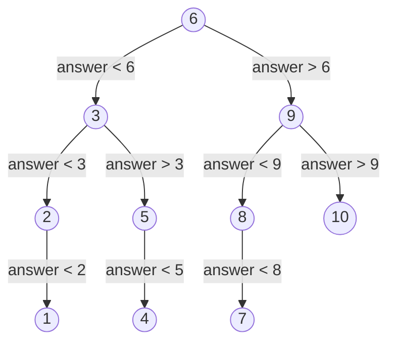

So far every piece of data in a program has had its own variable name. Handling the scores of 7 judges might still be done with 7 variables, but handling 1000 numbers cannot, to say nothing of the case where the number of data items is known only at run time. An array stores a batch of data of the same type contiguously in memory and accesses any one of them by "name + index"; the index can be a variable, so a loop can process all the data one by one. This chapter introduces C++ arrays and `std::vector` and Python lists, together with two classical algorithms based on arrays: the sieve for finding primes, and linear search and binary search for finding a value in data. The next chapter [4.1.7](/4.1.7) discusses character arrays (strings), two-dimensional arrays and sorting; the relation between arrays and pointers is in [4.1.8](/4.1.8); the implementation of vectors (dynamic resizing and amortized analysis) and more searching algorithms are in [4.3.2](/4.3.2); NumPy's multidimensional arrays are in [4.4.2](/4.4.2).

## 6.1. Arrays

### 6.1.1. Why Arrays Are Needed

**Example 6.1.1** Seven judges score a singer (integers in $0 \sim 100$); after removing one highest and one lowest score, the average of the remaining 5 scores is the final score.

It is not necessary to store all the scores: while reading, accumulate the sum and update the maximum and minimum, and at the end subtract both from the sum and divide by 5.

```cpp
int sum = 0, max_score = 0, min_score = 100;
for (int i = 0; i < 7; ++i) {
    int score;
    std::cin >> score;
    sum += score;
    if (score > max_score) max_score = score;   // two independent checks: not if-else
    if (score < min_score) min_score = score;
}
std::cout << (sum - max_score - min_score) / 5.0 << '\n';   // 5.0: floating-point division
```

But if we also want the variance of these 5 scores, each score must be visited once more after the average has been computed, so the data must be stored. Even when it is not needed, storing all the input first and computing afterwards separates input and output from computation, making the program clearer and easier to test. This calls for arrays.

### 6.1.2. Arrays in C++

**Definition 6.1.1 (Array)** An **array** is a data structure consisting of a fixed number of elements of the same type, stored contiguously in memory and accessed through an integer index. In C++ and Python, the indices of an array of length $n$ are $0, 1, \dots, n-1$.

```cpp
int a[5];                         // 5 ints, values indeterminate
int b[5] = {3, 5, 4, 1, 2};       // initialized
int c[] = {3, 5, 4};              // size deduced: 3
int d[101] = {1, 1};              // d[0] = d[1] = 1, the rest are 0
int e[100] = {};                  // all zero
constexpr int N = 1000;
double f[N];                      // the size must be a compile-time constant

b[0] = 10;                        // each element is a variable of type int
for (int i = 0; i < 5; ++i)
    std::cout << b[i] << ' ';
```

The elements of an array are stored one after another: if the starting address of `b` is $p$ and an `int` occupies 4 bytes, then the address of `b[i]` is $p + 4i$. Precisely because the address can be computed directly in this way, the time needed to access any element is the same, independent of the index; this is called *random access*. `sizeof(b)` is the number of bytes of the whole array, $20$, and the number of elements is `sizeof(b) / sizeof(b[0])`; since C++17 one can write `std::size(b)`.

Built-in arrays in C++ have several limitations:

- The length must be a compile-time constant. A variable-length array such as `int n; std::cin >> n; int a[n];` is not standard C++ but only an extension of GCC, which other compilers may reject, and for large `n` it also causes a **stack overflow**; use `std::vector` for arrays whose length is determined at run time ([6.1.4](#sec-6.1.4)).
- Arrays cannot be assigned or compared as a whole: `a = b` is a compile error, and `a == b` compares addresses rather than contents.
- Indices are not range checked. Accessing `b[5]` or `b[-1]` is an out-of-bounds access and **undefined behavior**: it may read a meaningless value, silently overwrite another variable, or crash (Example 5.2.1 in [4.1.5](/4.1.5)). When writing loops, always make sure the index is within $0 \sim n-1$.

### 6.1.3. Arrays as Function Parameters

When an array is passed to a function, only the address of the first element is passed, not a copy of the whole array ([4.1.8](/4.1.8) explains why). The function therefore does not know how long the array is, and the length must be passed in separately; modifications of the elements inside the function act directly on the caller's array.

```cpp
// The three parameter forms int a[], int a[100] and int* a are equivalent.
void fill_squares(int a[], int n) {
    for (int i = 0; i < n; ++i) a[i] = i * i;   // modifies the caller's array
}

int sum(const int a[], int n) {                 // const: read-only access
    int s = 0;
    for (int i = 0; i < n; ++i) s += a[i];
    return s;
}

int main() {
    int sq[10];
    fill_squares(sq, 10);
    return sum(sq, 10) == 285 ? 0 : 1;
}
```

Add `const` to read-only parameters, so that an accidental write to an element inside the function fails to compile. The `std::span<const int>` of C++20 can pass the starting address and the length together in a single parameter; a more common practice is to use `std::vector` directly and pass it by constant reference, `const std::vector<int>&` ([4.1.4](/4.1.4)).

Fixed-length arrays can also use the standard library's `std::array<int, 5>` (in `<array>`): like a built-in array it is stored contiguously and has a fixed length, but it can be assigned and compared as a whole, has `.size()`, and `.at(i)` checks the index and throws an exception when it is out of bounds; passed by value to a function, it is also copied completely.

### 6.1.4. std::vector

`std::vector<T>` (in `<vector>`) is an array of variable length whose elements are likewise stored contiguously, and it is the most commonly used container in C++:

**Example 6.1.2** Read integers until $-1$ is encountered and print the sum of all the multiples of 3 or 5 among them. The number of data items is not known in advance, so `push_back` appends each number at the end:

```cpp tab
#include <iostream>
#include <vector>

int main() {
    std::vector<int> nums;                // empty
    int x;
    while (std::cin >> x && x != -1)      // stops at -1 or at the end of input
        nums.push_back(x);                // append at the end

    long long total = 0;
    for (int v : nums)                    // range-based for: each element in turn
        if (v % 3 == 0 || v % 5 == 0) total += v;
    std::cout << nums.size() << " numbers, sum = " << total << '\n';
    return 0;
}
```

```python tab
nums = []                                  # an empty list
while (x := int(input())) != -1:           # one integer per line, stop at -1
    nums.append(x)                         # append at the end

total = sum(v for v in nums if v % 3 == 0 or v % 5 == 0)
print(f"{len(nums)} numbers, sum = {total}")
```

Common operations of `std::vector`:

| Operation | Form | Note |
|---|---|---|
| Create | `std::vector<int> v(n);`, `v(n, 0)`, `{1, 2, 3}` | When a length is given the elements are initialized to $0$ |
| Length | `v.size()`, `v.empty()` | The type of `size()` is the unsigned `std::size_t` |
| Access | `v[i]`, `v.at(i)` | `[]` does not check the index, `at` throws an exception when out of bounds |
| First and last | `v.front()`, `v.back()` | |
| Append, remove the last | `v.push_back(x)`, `v.pop_back()` | Amortized $O(1)$ |
| Change the length | `v.resize(m)`, `v.clear()` | |
| Traverse | `for (int x : v)`, `for (int& x : v)` | The reference form can modify the elements |

`while (std::cin >> x && …)` uses a property of input streams: the expression is true when the read succeeds and false at the end of input or on invalid input, so this loop also handles input that does not end with $-1$ correctly. Note that `v.size()` is unsigned: in `for (int i = 0; i < v.size() - 1; ++i)`, when `v` is empty `v.size() - 1` wraps around to a huge number ([4.1.2](/4.1.2)); write `i + 1 < v.size()` instead. How `vector` achieves a constant amortized cost for appending is in [4.3.2](/4.3.2).

### 6.1.5. Lists in Python

Python has no built-in fixed-length array; the most commonly used sequence type is the list (`list`). It is an array of variable length that stores references to element objects, so objects of different types can be put in the same list:

```python
a = [3, 5, 4, 1, 2]
print(a[0], a[-1])        # 3 2: negative indices count from the end
print(a[1:3])             # [5, 4]: slicing creates a new list, end excluded
a.append(6)               # append at the end, amortized O(1)
print(len(a), sum(a), max(a))
squares = [i * i for i in range(10)]   # list comprehension
zeros = [0] * 5           # [0, 0, 0, 0, 0]
# a[10] raises IndexError: list index out of range
```

List indices are checked, and an out-of-bounds index raises `IndexError`. `a[-1]` is the last element, and the slice `a[i:j]` takes the elements with indices $i \le k < j$ to form a new list. The list comprehension `[expression for variable in sequence if condition]` is a concise way to construct a new list from a sequence.

Because references are stored, `b = a` does not copy the list: `a` and `b` are two names of the same list, and after modifying `b[0]` the value `a[0]` has changed too; when a copy is needed, write `b = a.copy()` or `b = a[:]` ([4.2.6](/4.2.6)). Each element of a list is an independent Python object, and the overhead in storage and computation is much larger than for a C++ `vector<int>`; heavy numerical computation should use NumPy arrays ([4.4.2](/4.4.2)), and the `array` module of the standard library also provides typed arrays with compact storage.

## 6.2. The Sieve

The `is_prime` of [4.1.4](/4.1.4) tests a number by trial division: it checks whether $2 \sim \sqrt{n}$ contains a factor of it. To find all primes up to $N$, trial division of each number separately takes about $N\sqrt{N}$ divisions. A faster method thinks the other way round: rather than testing whether each number has a factor, start from each prime and cross out all its multiples.

**Algorithm 6.2.1 (Sieve of Eratosthenes)** Find all primes in $2 \sim N$.

1. Mark all of $2 \sim N$ as "possibly prime".
2. For $d = 2, 3, \dots$ as long as $d^2 \le N$: if $d$ is still marked "possibly prime", then $d$ is a prime, and mark $d^2, d^2 + d, d^2 + 2d, \dots$ (the multiples of $d$ not exceeding $N$) as composite.
3. The numbers still marked "possibly prime" are exactly all the primes.

Correctness: if $n \le N$ is composite, its smallest prime factor $p$ satisfies $p^2 \le n \le N$, so $n$ is crossed out when $d = p$ is processed; a prime is not a multiple of any smaller number and is never crossed out. Crossing out starts from $d^2$ rather than $2d$ because the multiples $kd$ of $d$ below $d^2$ ($k < d$) have a smaller prime factor and have already been crossed out; the same reason shows that $d$ needs to be enumerated only up to $\sqrt{N}$.

Use a boolean array with indices $0 \sim N$ to record the marks, the index standing for the number itself:

```cpp tab
#include <iostream>
#include <vector>

// Returns all primes <= n (Sieve of Eratosthenes).
std::vector<int> primes_up_to(int n) {
    std::vector<bool> is_prime(n + 1, true);   // index = the number itself
    std::vector<int> primes;
    for (int d = 2; d <= n; ++d) {
        if (!is_prime[d]) continue;
        primes.push_back(d);
        for (long long k = 1LL * d * d; k <= n; k += d)   // start at d*d; long long avoids overflow
            is_prime[k] = false;
    }
    return primes;
}

int main() {
    for (int p : primes_up_to(100)) std::cout << p << ' ';
    std::cout << '\n';   // 2 3 5 7 11 ... 97 (25 primes)
    return 0;
}
```

```python tab
def primes_up_to(n: int) -> list[int]:
    """All primes <= n (Sieve of Eratosthenes)."""
    is_prime = [True] * (n + 1)                # index = the number itself
    primes = []
    for d in range(2, n + 1):
        if not is_prime[d]:
            continue
        primes.append(d)
        for k in range(d * d, n + 1, d):       # start at d*d
            is_prime[k] = False
    return primes


print(*primes_up_to(100))                      # 2 3 5 7 11 ... 97 (25 primes)
```

Here the outer loop runs all the way to $n$ in order to collect the primes along the way; the inner loop that crosses out multiples naturally does not execute when $d^2 > n$. The amount of work of the sieve is about $\sum_{p \le N} N/p \approx N \ln\ln N$, almost linear: for $N = 10^7$ the C++ version finishes in under a second. The price is the memory for $N + 1$ marks. This is a typical example of "trading space for time", and also a typical use of the "direct addressing" ability of array indices.

## 6.3. Searching

Searching means finding, in a batch of data, the element equal to a given value (called the key): answering whether it exists and, if it does, at which position.

### 6.3.1. Linear Search

The most direct method is exhaustive search ([4.1.3](/4.1.3)): compare one by one from beginning to end.

```cpp tab
#include <vector>

// Returns the index of the first element equal to key, or -1 if absent.
int linear_search(const std::vector<int>& a, int key) {
    for (int i = 0; i < static_cast<int>(a.size()); ++i)
        if (a[i] == key) return i;
    return -1;
}

int main() {
    std::vector<int> a = {7, 3, 9, 3, 5};
    return linear_search(a, 3) == 1 && linear_search(a, 4) == -1 ? 0 : 1;
}
```

```python tab
def linear_search(a: list[int], key: int) -> int:
    """Index of the first element equal to key, or -1 if absent."""
    for i, x in enumerate(a):       # enumerate yields (index, element) pairs
        if x == key:
            return i
    return -1


a = [7, 3, 9, 3, 5]
print(linear_search(a, 3), linear_search(a, 4))   # 1 -1
```

Linear search places no requirements on the data; for length $n$ it needs $n$ comparisons in the worst case and about $n/2$ on average (for a successful search). The counterparts in the standard library are `std::find` in C++ (in `<algorithm>`) and `key in a` and `a.index(key)` in Python.

### 6.3.2. Binary Search

Guess an integer between $1$ and $10$: each time you guess a number, and the other person answers "too high", "too low" or "correct". The clever way to guess is to guess the middle of the remaining range each time: first guess $6$; if it is too low, $7 \sim 10$ remain, so guess $9$; and so on. Whatever the answer, at most 4 guesses are needed. The process of guessing can be drawn as a decision tree:



Each node is one guess, and a correct guess stops at that node; the height 4 of the tree is the number of guesses in the worst case. The same idea is used to search in a sorted array.

**Algorithm 6.3.1 (Binary Search)** Binary search (also called halving search) looks for a key $x$ in an array $a[0..n-1]$ sorted in ascending order: maintain an interval $[lo, hi]$, initially $[0, n-1]$. As long as the interval is nonempty ($lo \le hi$), take the midpoint $mid$ and compare $x$ with $a[mid]$: if equal, found; if $x < a[mid]$, set $hi = mid - 1$ and continue in the left part; if $x > a[mid]$, set $lo = mid + 1$ and continue in the right part. When the interval is empty, $x$ does not exist.

```cpp tab
#include <iostream>
#include <vector>

// a must be sorted in ascending order. Returns an index of key, or -1.
int binary_search(const std::vector<int>& a, int key) {
    int lo = 0, hi = static_cast<int>(a.size()) - 1;
    while (lo <= hi) {                    // invariant: if key is in a, it is in a[lo..hi]
        int mid = lo + (hi - lo) / 2;     // avoids the overflow of (lo + hi) / 2
        if (a[mid] == key) return mid;
        if (key < a[mid]) hi = mid - 1;   // key cannot be in a[mid..hi]
        else lo = mid + 1;                // key cannot be in a[lo..mid]
    }
    return -1;                            // the range is empty
}

int main() {
    std::vector<int> a;
    for (int i = 0; i < 100; ++i) a.push_back(i * i + 1);   // 1, 2, 5, 10, ..., 9802
    std::cout << binary_search(a, 2501) << ' ' << binary_search(a, 2500) << '\n';   // 50 -1
    return 0;
}
```

```python tab
def binary_search(a: list[int], key: int) -> int:
    """a is sorted in ascending order. Returns an index of key, or -1."""
    lo, hi = 0, len(a) - 1
    while lo <= hi:               # invariant: if key is in a, it is in a[lo..hi]
        mid = (lo + hi) // 2      # Python ints do not overflow
        if a[mid] == key:
            return mid
        if key < a[mid]:
            hi = mid - 1          # key cannot be in a[mid..hi]
        else:
            lo = mid + 1          # key cannot be in a[lo..mid]
    return -1                     # the range is empty


a = [i * i + 1 for i in range(100)]
print(binary_search(a, 2501), binary_search(a, 2500))   # 50 -1
```

The code of binary search is short but notorious for being easy to get wrong. We argue its correctness with a **loop invariant**:

- Invariant: "if $x$ is in the array, then it is in $a[lo..hi]$". Initially the interval is the whole array, and the invariant holds.
- Maintenance: if $x < a[mid]$, since the array is ascending, all elements of $a[mid..hi]$ are greater than $x$ and $x$ can only be in $a[lo..mid-1]$, so after setting $hi = mid - 1$ the invariant still holds; the other case is symmetric.
- Termination: each iteration shortens the interval by at least 1, so the loop must end; if it ends because $lo > hi$, the interval is empty, and by the invariant $x$ is not in the array.

This shows why several details must be written the way they are: the loop condition is `lo <= hi` (an interval $[lo, hi]$ with a single element must also be checked); the updates are `mid - 1` and `mid + 1`, and if one writes `hi = mid`, the interval may no longer shrink, causing an infinite loop.

The midpoint is written `lo + (hi - lo) / 2` rather than `(lo + hi) / 2` because $lo + hi$ suffers **integer overflow** when the array length exceeds $2^{30}$. The binary search of the Java standard library once went wrong for this reason, which was discovered and fixed only in 2006.

Each comparison at least halves the length of the interval, so an array of length $n$ needs at most $\lfloor \log_2 n \rfloor + 1$ comparisons:

| $n$ | Linear search (worst case) | Binary search (worst case) |
|---|---|---|
| $10$ | $10$ | $4$ |
| $10^3$ | $10^3$ | $10$ |
| $10^6$ | $10^6$ | $20$ |
| $10^9$ | $10^9$ | $30$ |

The price is the preconditions: the array must be sorted, and it must allow random access (a linked list does not). If the data is searched only once, sorting first (about $n \log_2 n$ comparisons, [4.1.7](/4.1.7)) and then using binary search does not pay; if many searches are to be made on the same data, sorting once is worthwhile.

A variant of binary search is more commonly used in practice: finding the position of the first element not less than $x$, which is also the position at which $x$ can be inserted while keeping the array sorted. It gives useful information even when $x$ does not exist, and with repeated elements it gives the position of the first element equal to $x$. The standard libraries provide these functions:

```cpp
#include <algorithm>
// a is sorted: 1 3 3 3 7
auto first = std::lower_bound(a.begin(), a.end(), 3);   // first element >= 3: index 1
auto last  = std::upper_bound(a.begin(), a.end(), 3);   // first element >  3: index 4
bool found = std::binary_search(a.begin(), a.end(), 7); // true
int count = last - first;                               // 3 copies of 3
```

```python
from bisect import bisect_left, bisect_right
a = [1, 3, 3, 3, 7]
print(bisect_left(a, 3), bisect_right(a, 3))   # 1 4
```

`a.begin()` and `a.end()` are iterators pointing to the first element and the position past the end ([4.2.10](/4.2.10)). The idea of bisection is used for more than searching arrays: whenever one can decide on which side of the midpoint the answer lies, the search range can be halved, as in the **bisection method** for finding roots of equations in numerical computation ([3.5.4](/3.5.4)). Variants such as Fibonacci search and interpolation search are in [4.3.2](/4.3.2).

## Summary

- An array is contiguous storage of elements of the same type, with indices from $0$ to $n-1$; the time of random access by index is independent of the index. A built-in C++ array has fixed length and no bounds checking, and an out-of-bounds access is undefined behavior.
- When an array is a parameter only the starting address is passed and the length must be passed separately; use `std::vector` for arrays whose length is determined at run time, passed by constant reference. A Python list is a variable-length array of object references, with checked indices and support for negative indices and slices.
- The sieve of Eratosthenes uses array indices to represent numbers and crosses out the multiples of each prime starting from its square, with about $N \ln\ln N$ operations.
- Linear search does not require sorted data and needs $n$ comparisons in the worst case; binary search requires sortedness and random access and needs at most $\lfloor \log_2 n \rfloor + 1$ comparisons. Use the loop invariant to write binary search correctly, with the midpoint `lo + (hi - lo) / 2`; in practice `std::lower_bound` and `bisect` are mostly used.
