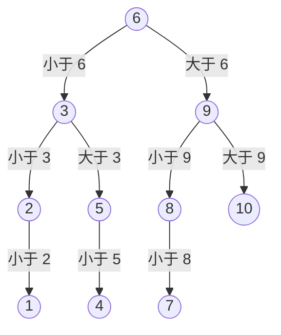

到目前为止，程序中每个数据都有一个单独的变量名。处理 7 个评委的分数还可以定义 7 个变量，处理 1000 个数就不行了，更不用说数据的个数要到运行时才知道的情形。数组把同一类型的一批数据连续存放在内存中，用"名字 + 下标"访问其中任意一个，下标可以是变量，于是循环可以逐个处理全部数据。本章介绍 C++ 的数组与 `std::vector`、Python 的列表，以及两个以数组为基础的经典算法：求质数的筛法，在数据中查找的顺序查找与二分查找。下一章 [4.1.7](/4.1.7) 讨论字符数组（字符串）、二维数组与排序；数组与指针的关系见 [4.1.8](/4.1.8)；向量的实现（动态扩容与分摊分析）和更多查找算法见 [4.3.2](/4.3.2)；NumPy 的多维数组见 [4.4.2](/4.4.2)。

## 6.1. 数组

### 6.1.1. 为什么需要数组

**例 6.1.1** 7 位评委给歌手打分（$0 \sim 100$ 的整数），去掉一个最高分和一个最低分，其余 5 个分数的平均值为最终得分。

不需要保存全部分数：一边读入，一边累加并更新最大值和最小值，最后从总和中减去两者再除以 5。

```cpp
int sum = 0, max_score = 0, min_score = 100;
for (int i = 0; i < 7; ++i) {
    int score;
    std::cin >> score;
    sum += score;
    if (score > max_score) max_score = score;   // two independent checks: not if-else
    if (score < min_score) min_score = score;
}
std::cout << (sum - max_score - min_score) / 5.0 << '\n';   // 5.0: floating-point division
```

但如果还要计算这 5 个分数的方差，就要在求出平均值以后再访问每个分数一次，数据必须保存下来。即使不需要，先把全部输入存好、再进行计算，也能把输入输出与计算分开，使程序更清晰、更容易测试。这就需要数组。

### 6.1.2. C++ 的数组

**定义 6.1.1（数组）** **数组**（array）是由固定个数的、同一类型的元素组成的数据结构，各元素在内存中连续存放，通过整数下标（index）访问。在 C++ 和 Python 中，长度为 $n$ 的数组的下标是 $0, 1, \dots, n-1$。

```cpp
int a[5];                         // 5 ints, values indeterminate
int b[5] = {3, 5, 4, 1, 2};       // initialized
int c[] = {3, 5, 4};              // size deduced: 3
int d[101] = {1, 1};              // d[0] = d[1] = 1, the rest are 0
int e[100] = {};                  // all zero
constexpr int N = 1000;
double f[N];                      // the size must be a compile-time constant

b[0] = 10;                        // each element is a variable of type int
for (int i = 0; i < 5; ++i)
    std::cout << b[i] << ' ';
```

数组的元素依次存放：若 `b` 的首地址是 $p$，`int` 占 4 字节，则 `b[i]` 的地址是 $p + 4i$。正因为地址可以这样直接算出，访问任意一个元素所需的时间都相同，与下标大小无关，这称为随机访问（random access）。`sizeof(b)` 是整个数组的字节数 $20$，元素个数是 `sizeof(b) / sizeof(b[0])`，C++17 起可以写 `std::size(b)`。

C++ 的内置数组有几个限制：

- 长度必须是编译时常量。`int n; std::cin >> n; int a[n];` 这种变长数组不是标准 C++，只是 GCC 的扩展，其他编译器可能不接受，`n` 很大时还会**栈溢出**；运行时才确定长度的数组用 `std::vector`（[6.1.4](#sec-6.1.4)）。
- 数组不能整体赋值或比较：`a = b` 是编译错误，`a == b` 比较的是地址而不是内容。
- 下标不检查范围。访问 `b[5]` 或 `b[-1]` 是越界访问，属于**未定义行为**：可能读到无意义的值，可能悄悄改写了别的变量，也可能崩溃（[4.1.5](/4.1.5) 的例 5.2.1）。写循环时始终确认下标在 $0 \sim n-1$ 之内。

### 6.1.3. 数组作为函数参数

把数组传给函数时，传过去的只是首元素的地址，而不是整个数组的副本（[4.1.8](/4.1.8) 说明原因）。因此函数不知道数组有多长，必须另外传入长度；函数中对元素的修改直接作用于调用者的数组。

```cpp
// The three parameter forms int a[], int a[100] and int* a are equivalent.
void fill_squares(int a[], int n) {
    for (int i = 0; i < n; ++i) a[i] = i * i;   // modifies the caller's array
}

int sum(const int a[], int n) {                 // const: read-only access
    int s = 0;
    for (int i = 0; i < n; ++i) s += a[i];
    return s;
}

int main() {
    int sq[10];
    fill_squares(sq, 10);
    return sum(sq, 10) == 285 ? 0 : 1;
}
```

只读的参数加上 `const`，这样函数中误写入元素会编译失败。C++20 的 `std::span<const int>` 可以把首地址和长度合在一个参数中传递；更常用的做法是直接使用 `std::vector`，按常量引用 `const std::vector<int>&` 传递（[4.1.4](/4.1.4)）。

固定长度的数组也可以用标准库的 `std::array<int, 5>`（`<array>`）：它与内置数组一样连续存放、长度固定，但可以整体赋值和比较，有 `.size()`，`.at(i)` 会检查下标，越界时抛出异常，按值传给函数时也会完整复制。

### 6.1.4. std::vector

`std::vector<T>`（`<vector>`）是长度可变的数组，元素同样连续存放，是 C++ 中最常用的容器：

**例 6.1.2** 读入整数直到遇到 $-1$，输出其中所有 3 或 5 的倍数之和。数据个数事先不知道，用 `push_back` 把每个数追加到末尾：

```cpp tab
#include <iostream>
#include <vector>

int main() {
    std::vector<int> nums;                // empty
    int x;
    while (std::cin >> x && x != -1)      // stops at -1 or at the end of input
        nums.push_back(x);                // append at the end

    long long total = 0;
    for (int v : nums)                    // range-based for: each element in turn
        if (v % 3 == 0 || v % 5 == 0) total += v;
    std::cout << nums.size() << " numbers, sum = " << total << '\n';
    return 0;
}
```

```python tab
nums = []                                  # an empty list
while (x := int(input())) != -1:           # one integer per line, stop at -1
    nums.append(x)                         # append at the end

total = sum(v for v in nums if v % 3 == 0 or v % 5 == 0)
print(f"{len(nums)} numbers, sum = {total}")
```

`std::vector` 的常用操作：

| 操作 | 写法 | 说明 |
|---|---|---|
| 创建 | `std::vector<int> v(n);`、`v(n, 0)`、`{1, 2, 3}` | 指定长度时元素初始化为 $0$ |
| 长度 | `v.size()`、`v.empty()` | `size()` 的类型是无符号的 `std::size_t` |
| 访问 | `v[i]`、`v.at(i)` | `[]` 不检查下标，`at` 越界时抛出异常 |
| 首尾 | `v.front()`、`v.back()` | |
| 追加、删除末尾 | `v.push_back(x)`、`v.pop_back()` | 分摊 $O(1)$ |
| 改变长度 | `v.resize(m)`、`v.clear()` | |
| 遍历 | `for (int x : v)`、`for (int& x : v)` | 引用形式可以修改元素 |

`while (std::cin >> x && …)` 利用了输入流的一个性质：读取成功时表达式为真，读到输入末尾或遇到非法输入时为假，所以这个循环也能正确处理没有 $-1$ 结尾的输入。注意 `v.size()` 是无符号数，`for (int i = 0; i < v.size() - 1; ++i)` 在 `v` 为空时，`v.size() - 1` 回绕成一个巨大的数（[4.1.2](/4.1.2)），应写成 `i + 1 < v.size()`。`vector` 怎样做到追加的分摊代价是常数，见 [4.3.2](/4.3.2)。

### 6.1.5. Python 的列表

Python 没有内置的定长数组，最常用的序列类型是列表（`list`）。它是长度可变的数组，存放的是对各元素对象的引用，所以同一个列表中可以放不同类型的对象：

```python
a = [3, 5, 4, 1, 2]
print(a[0], a[-1])        # 3 2: negative indices count from the end
print(a[1:3])             # [5, 4]: slicing creates a new list, end excluded
a.append(6)               # append at the end, amortized O(1)
print(len(a), sum(a), max(a))
squares = [i * i for i in range(10)]   # list comprehension
zeros = [0] * 5           # [0, 0, 0, 0, 0]
# a[10] raises IndexError: list index out of range
```

列表的下标会被检查，越界时抛出 `IndexError`。`a[-1]` 是最后一个元素，切片 `a[i:j]` 取出下标 $i \le k < j$ 的元素组成的新列表。列表推导式 `[表达式 for 变量 in 序列 if 条件]` 是由一个序列构造新列表的简洁写法。

由于存放的是引用，`b = a` 并不复制列表，`a`、`b` 是同一个列表的两个名字，修改 `b[0]` 后 `a[0]` 也变了；需要副本时写 `b = a.copy()` 或 `b = a[:]`（[4.2.6](/4.2.6)）。列表中每个元素都是独立的 Python 对象，存储和计算的开销都比 C++ 的 `vector<int>` 大得多；大量数值计算应使用 NumPy 数组（[4.4.2](/4.4.2)），标准库的 `array` 模块也提供紧凑存储的定类型数组。

## 6.2. 筛法

[4.1.4](/4.1.4) 的 `is_prime` 用试除法判断一个数：检验 $2 \sim \sqrt{n}$ 中是否有它的因子。要求出 $N$ 以内的全部质数，对每个数分别试除需要大约 $N\sqrt{N}$ 次除法。更快的方法反过来想：不是检验每个数有没有因子，而是从每个质数出发，把它的倍数全部划掉。

**算法 6.2.1（Eratosthenes 筛法）** 求 $2 \sim N$ 中的全部质数。

1. 把 $2 \sim N$ 全部标记为"可能是质数"。
2. 对 $d = 2, 3, \dots$，只要 $d^2 \le N$：若 $d$ 仍被标记为"可能是质数"，则 $d$ 是质数，把 $d^2, d^2 + d, d^2 + 2d, \dots$（不超过 $N$ 的 $d$ 的倍数）标记为合数。
3. 仍被标记为"可能是质数"的数就是全部质数。

正确性：若 $n \le N$ 是合数，它的最小质因子 $p$ 满足 $p^2 \le n \le N$，所以 $n$ 会在处理 $d = p$ 时被划掉；质数不是任何更小的数的倍数，不会被划掉。从 $d^2$ 而不是 $2d$ 开始划，是因为小于 $d^2$ 的 $d$ 的倍数 $kd$（$k < d$）有更小的质因子，已经被划掉了；同样的理由说明 $d$ 只需枚举到 $\sqrt{N}$。

用一个下标为 $0 \sim N$ 的布尔数组记录标记，下标就代表数本身：

```cpp tab
#include <iostream>
#include <vector>

// Returns all primes <= n (Sieve of Eratosthenes).
std::vector<int> primes_up_to(int n) {
    std::vector<bool> is_prime(n + 1, true);   // index = the number itself
    std::vector<int> primes;
    for (int d = 2; d <= n; ++d) {
        if (!is_prime[d]) continue;
        primes.push_back(d);
        for (long long k = 1LL * d * d; k <= n; k += d)   // start at d*d; long long avoids overflow
            is_prime[k] = false;
    }
    return primes;
}

int main() {
    for (int p : primes_up_to(100)) std::cout << p << ' ';
    std::cout << '\n';   // 2 3 5 7 11 ... 97 (25 primes)
    return 0;
}
```

```python tab
def primes_up_to(n: int) -> list[int]:
    """All primes <= n (Sieve of Eratosthenes)."""
    is_prime = [True] * (n + 1)                # index = the number itself
    primes = []
    for d in range(2, n + 1):
        if not is_prime[d]:
            continue
        primes.append(d)
        for k in range(d * d, n + 1, d):       # start at d*d
            is_prime[k] = False
    return primes


print(*primes_up_to(100))                      # 2 3 5 7 11 ... 97 (25 primes)
```

这里外层循环一直走到 $n$，以便顺便收集质数；划掉倍数的内层循环在 $d^2 > n$ 时自然不执行。筛法的运算量约为 $\sum_{p \le N} N/p \approx N \ln\ln N$，几乎是线性的：$N = 10^7$ 时 C++ 版本在一秒内完成。代价是需要 $N + 1$ 个标记的内存。这是"用空间换时间"的典型例子，也是数组下标"直接定位"能力的典型用法。

## 6.3. 查找

查找（search）是在一批数据中找出等于给定值（称为关键字，key）的元素：回答它是否存在，若存在，它在哪个位置。

### 6.3.1. 顺序查找

最直接的方法是枚举（[4.1.3](/4.1.3)）：从头到尾逐个比较。

```cpp tab
#include <vector>

// Returns the index of the first element equal to key, or -1 if absent.
int linear_search(const std::vector<int>& a, int key) {
    for (int i = 0; i < static_cast<int>(a.size()); ++i)
        if (a[i] == key) return i;
    return -1;
}

int main() {
    std::vector<int> a = {7, 3, 9, 3, 5};
    return linear_search(a, 3) == 1 && linear_search(a, 4) == -1 ? 0 : 1;
}
```

```python tab
def linear_search(a: list[int], key: int) -> int:
    """Index of the first element equal to key, or -1 if absent."""
    for i, x in enumerate(a):       # enumerate yields (index, element) pairs
        if x == key:
            return i
    return -1


a = [7, 3, 9, 3, 5]
print(linear_search(a, 3), linear_search(a, 4))   # 1 -1
```

顺序查找对数据没有任何要求，长度为 $n$ 时最坏要比较 $n$ 次，平均约 $n/2$ 次（查找成功时）。标准库中对应的是 C++ 的 `std::find`（`<algorithm>`）和 Python 的 `key in a`、`a.index(key)`。

### 6.3.2. 二分查找

猜一个 $1 \sim 10$ 之间的整数，每次猜一个数，对方回答"大了""小了"或"对了"。聪明的猜法是每次猜剩余范围的中间值：先猜 $6$；若小了，剩下 $7 \sim 10$，再猜 $9$；…… 无论答案是几，最多猜 4 次。猜的过程可以画成一棵判定树：



每个结点是一次猜测，猜中就停在该结点；树的高度 4 就是最坏情况下的猜测次数。同样的思想用于在有序数组中查找。

**算法 6.3.1（二分查找）** 二分查找（binary search，也称折半查找）在按升序排列的数组 $a[0..n-1]$ 中查找关键字 $x$：维护一个区间 $[lo, hi]$，初始为 $[0, n-1]$。只要区间非空（$lo \le hi$），取中点 $mid$，比较 $x$ 与 $a[mid]$：相等则找到；$x < a[mid]$ 则令 $hi = mid - 1$，在左半部分继续；$x > a[mid]$ 则令 $lo = mid + 1$，在右半部分继续。区间为空时，$x$ 不存在。

```cpp tab
#include <iostream>
#include <vector>

// a must be sorted in ascending order. Returns an index of key, or -1.
int binary_search(const std::vector<int>& a, int key) {
    int lo = 0, hi = static_cast<int>(a.size()) - 1;
    while (lo <= hi) {                    // invariant: if key is in a, it is in a[lo..hi]
        int mid = lo + (hi - lo) / 2;     // avoids the overflow of (lo + hi) / 2
        if (a[mid] == key) return mid;
        if (key < a[mid]) hi = mid - 1;   // key cannot be in a[mid..hi]
        else lo = mid + 1;                // key cannot be in a[lo..mid]
    }
    return -1;                            // the range is empty
}

int main() {
    std::vector<int> a;
    for (int i = 0; i < 100; ++i) a.push_back(i * i + 1);   // 1, 2, 5, 10, ..., 9802
    std::cout << binary_search(a, 2501) << ' ' << binary_search(a, 2500) << '\n';   // 50 -1
    return 0;
}
```

```python tab
def binary_search(a: list[int], key: int) -> int:
    """a is sorted in ascending order. Returns an index of key, or -1."""
    lo, hi = 0, len(a) - 1
    while lo <= hi:               # invariant: if key is in a, it is in a[lo..hi]
        mid = (lo + hi) // 2      # Python ints do not overflow
        if a[mid] == key:
            return mid
        if key < a[mid]:
            hi = mid - 1          # key cannot be in a[mid..hi]
        else:
            lo = mid + 1          # key cannot be in a[lo..mid]
    return -1                     # the range is empty


a = [i * i + 1 for i in range(100)]
print(binary_search(a, 2501), binary_search(a, 2500))   # 50 -1
```

二分查找的代码很短，却以容易写错著称。用**循环不变式**来论证它的正确性：

- 不变式："若 $x$ 在数组中，则它在 $a[lo..hi]$ 中"。初始时区间是整个数组，不变式成立。
- 保持：若 $x < a[mid]$，由于数组升序，$a[mid..hi]$ 中的元素都大于 $x$，$x$ 只可能在 $a[lo..mid-1]$ 中，令 $hi = mid - 1$ 后不变式仍成立；另一种情况对称。
- 终止：每轮区间长度至少减少 1，所以循环必定结束；若因 $lo > hi$ 结束，区间为空，由不变式知 $x$ 不在数组中。

从中可以看出几个细节为什么必须这样写：循环条件是 `lo <= hi`（区间 $[lo, hi]$ 只有一个元素时也要检查）；更新是 `mid - 1` 和 `mid + 1`，若写成 `hi = mid`，区间可能不再缩小，造成死循环。

中点写成 `lo + (hi - lo) / 2` 而不是 `(lo + hi) / 2`，是因为 $lo + hi$ 在数组长度超过 $2^{30}$ 时会发生**整数溢出**。Java 标准库的二分查找就曾因此出错，直到 2006 年才被发现并修正。

每比较一次，区间长度至少减半，长度为 $n$ 的数组最多比较 $\lfloor \log_2 n \rfloor + 1$ 次：

| $n$ | 顺序查找（最坏） | 二分查找（最坏） |
|---|---|---|
| $10$ | $10$ | $4$ |
| $10^3$ | $10^3$ | $10$ |
| $10^6$ | $10^6$ | $20$ |
| $10^9$ | $10^9$ | $30$ |

代价是前提条件：数组必须有序，而且必须能随机访问（链表不行）。若数据只查一次，先排序（约 $n \log_2 n$ 次比较，[4.1.7](/4.1.7)）再二分并不划算；若要在同一批数据上查找很多次，排序一次就值得了。

实际中更常用的是二分查找的一个变形：找出第一个不小于 $x$ 的元素的位置，它也是把 $x$ 插入数组后仍保持有序的位置。它在 $x$ 不存在时也给出有用的信息，在有重复元素时给出第一个等于 $x$ 的位置。标准库提供了这些函数：

```cpp
#include <algorithm>
// a is sorted: 1 3 3 3 7
auto first = std::lower_bound(a.begin(), a.end(), 3);   // first element >= 3: index 1
auto last  = std::upper_bound(a.begin(), a.end(), 3);   // first element >  3: index 4
bool found = std::binary_search(a.begin(), a.end(), 7); // true
int count = last - first;                               // 3 copies of 3
```

```python
from bisect import bisect_left, bisect_right
a = [1, 3, 3, 3, 7]
print(bisect_left(a, 3), bisect_right(a, 3))   # 1 4
```

`a.begin()`、`a.end()` 是指向首元素和末尾之后位置的迭代器（[4.2.10](/4.2.10)）。二分的思想不止用于查找数组：只要能判断答案在中点的哪一侧，就能把搜索范围减半，例如数值计算中求方程根的**二分法**（[3.5.4](/3.5.4)）。Fibonacci 查找、插值查找等变形见 [4.3.2](/4.3.2)。

## 小结

- 数组是同类型元素的连续存储，下标从 $0$ 到 $n-1$，按下标随机访问的时间与下标无关；C++ 内置数组长度固定、不检查越界，越界是未定义行为。
- 数组作为参数时只传首地址，要另外传长度；运行时确定长度的数组用 `std::vector`，按常量引用传递。Python 的列表是存放对象引用的可变长数组，下标受检查，支持负下标和切片。
- Eratosthenes 筛法用数组下标表示数，划掉每个质数从平方开始的倍数，运算量约 $N \ln\ln N$。
- 顺序查找不要求有序，最坏 $n$ 次比较；二分查找要求有序和随机访问，最多 $\lfloor \log_2 n \rfloor + 1$ 次比较。用循环不变式写对二分查找，中点用 `lo + (hi - lo) / 2`；实际中多用 `std::lower_bound` 和 `bisect`。
