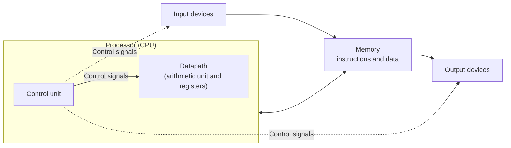
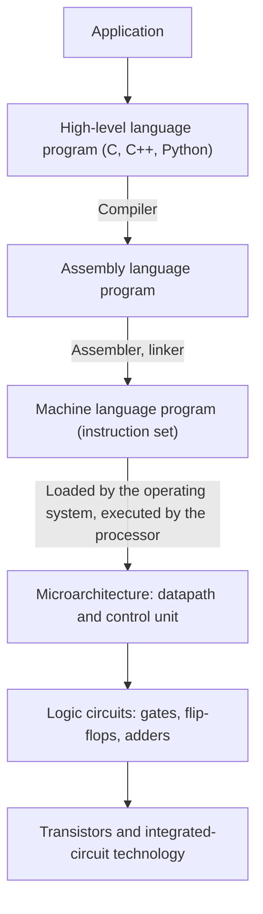

Computer organization studies how the hardware of a computer executes programs: how the instruction set that programmers see is implemented by the arithmetic unit, the control unit, the memory and the input/output devices, and how to implement it faster. This chapter introduces the whole course and answers three questions: how computers evolved into today's structure; into which layers a computer system divides, from program to circuit, and where this course sits among them; and how to compare the speed of two computers objectively. The first two questions set up the framework used throughout the course. The third gives the yardstick for judging every design: CPU time is the product of the instruction count, the CPI and the clock cycle time. The next chapter, [4.10.2](/4.10.2), discusses the interface between hardware and software, the instruction set. Components at the digital-circuit level are covered in [4.9 Digital Logic Circuits](/4.9), and the programmer's viewpoint in [4.1.1](/4.1.1).

## 1.1. The Evolution of Computers

### 1.1.1. From Calculating Tools to the Stored Program

People built calculating tools very early: the abacus was in common use in China by the Song and Yuan dynasties at the latest; in 1642 Pascal built a geared adder with automatic carry; from 1822 Babbage designed the Difference Engine, and in the 1830s the programmable Analytical Engine, which already had a "store" and a "mill" (memory and arithmetic). The steps Ada Lovelace wrote for it to compute Bernoulli numbers are regarded as the first program. These machines aimed to make certain kinds of calculation more efficient, and all were mechanical.

The theoretical foundation of the modern computer is the **Turing machine** ([4.8.10](/4.8.10)), proposed by Turing in 1936: a **universal Turing machine** can read the description of another machine and simulate it, so the "machine" and the "program" can be separated, and the same hardware performs different tasks by changing the program. In 1937 Shannon showed that relay switching circuits can implement **Boolean algebra**, which laid the foundation for implementing logical operations in circuits ([4.9.2](/4.9.2)).

The first general-purpose electronic computer, ENIAC (Electronic Numerical Integrator and Computer), was designed by Mauchly and Eckert and made public in February 1946 to compute artillery trajectories. It used about 18,000 vacuum tubes, weighed 30 tons, consumed about 150 kW and performed 5,000 additions per second. It was decimal, with 20 accumulators each holding a 10-digit decimal number, and "programming" meant setting switches and re-plugging cables, which often took days for a new problem.

In 1945 von Neumann proposed, in his draft report on the EDVAC, storing programs in memory just like data. This is the **von Neumann architecture** ([4.1.1](/4.1.1#sec-1.2.1)). The IAS computer built on this idea (completed in 1952) had 1024 words of 40 bits, used binary and performed only integer arithmetic. The first machine to run a stored program was the experimental Manchester Baby of the University of Manchester in 1948, and the first stored-program computer put to practical use was the EDSAC at Cambridge in 1949.

Several later milestones:

- **Compilers**: Grace Hopper wrote the A-0 system in 1952, a precursor of the compiler; she later led the design of COBOL (1959). In 1957 IBM released the compiler for Fortran, the first widely used **high-level language**.
- Computer families: in 1964 IBM released the System/360 family, whose models from low end to high end executed the same instruction set, so that one program could run on the entire family. To describe this "computer as the programmer sees it", Amdahl, Blaauw and Brooks introduced the concept of computer architecture (Section 1.3.2).
- Operating systems and time sharing: from running one program at a time, loaded by hand by an operator, through the batch and time-sharing systems of the 1960s, to Unix in 1969, computers gradually became systems shared by many users and many programs ([4.11.1](/4.11.1)).
- Microprocessors: in 1971 the Intel 4004 put an entire CPU on one chip, after which personal computers, mobile phones and embedded devices spread.

### 1.1.2. Generations of Devices and Moore's Law

By the logic devices used, electronic computers are usually divided into generations:

| Generation | Period (approx.) | Logic device | Representatives |
|---|---|---|---|
| First | late 1940s–1950s | Vacuum tubes | ENIAC, EDSAC, IAS, UNIVAC I |
| Second | late 1950s–early 1960s | Transistors | IBM 7090, DEC PDP-1 |
| Third | mid-1960s–early 1970s | Small- and medium-scale integrated circuits | IBM System/360, DEC PDP-8 |
| Fourth | 1970s to the present | Large- and very-large-scale integrated circuits (VLSI) | Microprocessors, personal computers, phones, servers |

Each change of device brought improvements of orders of magnitude in speed, size, power and price. After the fourth generation, computers are no longer classified by device: the changes come from architecture (pipelining, multicore, special-purpose accelerators) rather than from new switching elements. Non-silicon technologies such as quantum, optical and biological computing are still at the research stage.

The driving force behind more than half a century of progress of fourth-generation computers is the continuous scaling of integrated-circuit technology.

**Definition 1.1.1 (Moore's Law)** The number of transistors that fit on a single integrated circuit doubles about every two years. This empirical rule is called **Moore's law**.

What Gordon Moore observed in 1965 was a doubling every year; in 1975 he revised it to every two years. It is not a physical law but a roadmap that the semiconductor industry has made self-fulfilling for decades: from about 2,300 transistors in the 4004 in 1971 to tens or hundreds of billions on today's high-end processor chips. Since the 2010s, both the pace of scaling and the decline in cost per transistor have slowed markedly, and Moore's law is becoming hard to sustain.

Accompanying Moore's law was Dennard scaling (Section 1.4.5): when transistors shrink, voltage and current shrink proportionally, so the power per unit area stays constant and the clock frequency can rise along with the process. Around 2005 Dennard scaling broke down, single-core clock frequencies stalled at 3–5 GHz, and processors turned to multicore designs and special-purpose hardware. In their 2017 Turing Award lecture, Hennessy and Patterson called this shift "a new golden age for computer architecture": the performance of general-purpose processors no longer grows automatically, and domain-specific architectures (GPUs, AI accelerators and so on), open instruction sets (RISC-V, [4.10.3](/4.10.3)) and hardware–software co-design become the new sources of growth.

## 1.2. The Organization of a Computer

### 1.2.1. The Five Components

The **von Neumann architecture** divides a computer into five parts: the arithmetic unit, the control unit, the memory, the input devices and the output devices. In today's terms:

- The datapath performs arithmetic and logical operations and includes the arithmetic unit and the **registers** that hold intermediate results.
- The control unit directs the datapath, the memory and the input/output devices to work together according to the instruction.
- The datapath and the control unit together form the processor (central processing unit, CPU).
- The memory holds the running program and the data it needs.
- Input devices (keyboard, mouse, network card, sensors) and output devices (display, printer, speaker); disks and solid-state drives can serve as both.

The **von Neumann architecture** has three key points:

1. Stored program: instructions and data are held in the same form in a single memory and accessed by address.
2. Binary: both instructions and data are encoded in binary, which simplifies the storage and arithmetic components.
3. Sequential execution: a program is a sequence of instructions stored in order in memory, and the processor fetches and executes them one by one, as indicated by a dedicated register.

**Definition 1.2.1 (Harvard Architecture)** An architecture that separates the instruction memory from the data memory and accesses each through its own path is called the **Harvard architecture**. In contrast, the von Neumann architecture, in which instructions and data share one memory and one path, is also called the Princeton architecture.

The Harvard architecture can fetch an instruction and read or write data in the same clock cycle, and many digital signal processors and microcontrollers use it. Today's general-purpose processors also separate the instruction cache from the data cache inside the core (the "modified Harvard architecture"), but at the level of main memory the address space is still unified, and a program can be loaded, generated and modified like data. This is precisely what makes operating systems, compilers and **just-in-time compilation** work. The single-cycle processor of [4.10.6](/4.10.6) in this course uses a separate instruction memory and data memory.

### 1.2.2. Program Execution

How the processor "fetches and executes instructions one by one" relies on a dedicated register.

**Definition 1.2.2 (Program Counter and Instruction Cycle)** The register in the processor that holds the address of the instruction currently being executed (or of the next one) is called the **program counter** (PC). All the steps the processor goes through to fetch and execute one instruction are called an **instruction cycle**.

An instruction cycle divides roughly into:

1. Fetch: read the instruction from memory, using the value of the PC as the address.
2. Decode: identify the operation the instruction specifies and read the registers it uses.
3. Execute: carry out the operation in the arithmetic unit, or compute a memory address, or evaluate a branch condition.
4. Memory access: for load and store instructions, read or write the data memory.
5. Write back: write the result into the destination register.
6. Update the PC: for sequential execution, add the instruction length to the PC (4 in RISC-V); a branch instruction sets the PC to the target address.

Branches, loops and function calls in a program all ultimately change the PC. These five or six steps also provide the thread for the following chapters: [4.10.6](/4.10.6) lets an instruction go through all the steps in one clock cycle (the single-cycle processor), and later chapters spread the steps over several cycles (the multicycle processor) or overlap different steps of several instructions (pipelining).

## 1.3. The Layers of a Computer System

### 1.3.1. From High-Level Languages to Control Signals

A computer is one of the most complex systems humans have designed, and it can be understood and designed only through **abstraction**: the system is divided into layers, and each layer uses the layer below it only through a clean interface, without caring how that layer is implemented.

Take swapping two adjacent elements of an **array** as an example. The same computation is represented at several layers as follows:

| Layer | Representation |
|---|---|
| **High-level language** (C) | `temp = v[k]; v[k] = v[k+1]; v[k+1] = temp;` |
| **Assembly language** (RISC-V, with `&v[k]` in `t2`) | `lw t0, 0(t2)` `lw t1, 4(t2)` `sw t1, 0(t2)` `sw t0, 4(t2)` |
| **Machine language** (hexadecimal) | `0003a283` `0043a303` `0063a023` `0053a223` |
| Control signals | Each instruction is decoded into a set of control signals: which register to select, the arithmetic unit adds, the memory reads or writes, and so on |

The **compiler** translates the high-level language into **assembly language**, the assembler translates assembly language into **machine language** ([4.1.1](/4.1.1#sec-1.3), [4.2.2](/4.2.2)), and the processor's control unit translates machine language into control signals. This course is mainly concerned with the last two steps: how machine language is designed ([4.10.2](/4.10.2), [4.10.3](/4.10.3)) and how the processor turns it into actions on the datapath ([4.10.5](/4.10.5), [4.10.6](/4.10.6) and the following chapters).

### 1.3.2. Architecture and Organization

The most important interface in the layered structure is the level of machine language, which separates software from hardware.

**Definition 1.3.1 (Instruction Set Architecture)** All attributes of a computer that are visible to the machine-language programmer, including the instructions and their encoding, the registers, the memory addressing modes, the data types and the handling of exceptions and interrupts, are collectively called the **instruction set architecture** (ISA), also called the architecture for short, or the instruction set.

**Definition 1.3.2 (Microarchitecture)** The concrete hardware organization that implements an instruction set architecture, including the structure of the datapath and the control unit, the number of pipeline stages and the capacity and organization of the caches, is called the **microarchitecture**, also called computer organization.

The architecture answers "what the computer does", the microarchitecture answers "how it does it", and the implementation further down (logic design, circuit design, fabrication technology) answers "what it is built from". The division of labor can be illustrated with a multiply instruction: the architecture specifies that a multiply instruction exists and what it does; the microarchitecture decides whether it is carried out by an array multiplier in one cycle or by an adder and a shifter over several cycles; the implementation decides which technology that multiplier is built in and how fast it runs.

| Level | Visible to | Examples |
|---|---|---|
| Instruction set architecture | Assembly programmers, compilers, operating systems | x86-64, ARMv8-A (AArch64), RISC-V RV64GC |
| Microarchitecture | Hardware designers; affects software only through performance | Pipeline depth, issue width, branch predictor, caches |
| Implementation | Chip design and manufacturing | Process node, layout, packaging, frequency |

The value of the architecture as an interface lies in compatibility: different microarchitectures of the same architecture can run the same programs. System/360 was the first to make this a commercial strategy; today the microarchitectures of Intel and AMD processors are entirely different, yet both execute x86-64 programs. Correspondingly, the operating system also defines an **application binary interface** (ABI) for applications, that is, the sum of the user-mode instructions, system calls, function-calling conventions and executable file format, so that a compiled program can run on different machines of the same platform ([4.10.3](/4.10.3)).

The content of this course is to design the microarchitecture for a given architecture, and to evaluate and optimize its performance. The design of the architecture itself is discussed in the two chapters on instruction sets, and deeper material belongs to the follow-up course on computer architecture.

### 1.3.3. The Seven Great Ideas

Patterson and Hennessy summarize the ideas that have recurred in computer design over more than sixty years in seven items, which will appear again and again in different parts of this course:

| Idea | Meaning | Examples in this course |
|---|---|---|
| Abstraction | Use layered representations to hide lower-level details and simplify design | Layers; separation of architecture and microarchitecture |
| Make the common case fast | Optimizing the common case pays off more than optimizing the rare case | RISC instruction sets; **Amdahl's law** (Section 1.4.6) |
| Parallelism | Do several things at once | **Carry-lookahead adders**, multicore |
| Pipelining | Split a task into stages and overlap the stages | Pipelined processors |
| Prediction | Execute on a guess and correct it when wrong, which is faster on average | Branch prediction |
| Memory hierarchy | Put the fastest, smallest and most expensive memory at the top | Registers, caches, main memory, secondary storage |
| Dependability via redundancy | Use redundant components to detect and correct faults | Parity and error-correcting codes ([4.10.4](/4.10.4)), RAID |

Early editions of the textbook had an eighth item, "design for Moore's law" (anticipate the technology that will be available when the chip is finished a few years later); as Moore's law slowed, newer editions dropped it.

## 1.4. Performance

### 1.4.1. Response Time and Throughput

Saying that a computer is "fast" can mean two different things.

**Definition 1.4.1 (Response Time and Throughput)** The total time a computer needs to complete a task, from start to finish, is called the **response time**, also called the execution time; the number of tasks completed per unit time is called the **throughput**.

Individual users care about response time, while data centers care more about throughput. The two are related but not identical: replacing the processor with a faster model improves both, whereas adding more processors raises the throughput but leaves the response time of a single task unchanged (unless the task itself can be parallelized). We discuss mainly response time below. For a given program, define the performance of computer $X$ as

$$
\text{Performance}_X = \frac{1}{\text{Execution time}_X},
$$

and "$X$ is $n$ times as fast as $Y$" means $\dfrac{\text{Performance}_X}{\text{Performance}_Y} = \dfrac{\text{Execution time}_Y}{\text{Execution time}_X} = n$. For example, if the same program runs in 10 s on $A$ and 15 s on $B$, the performance of $A$ is 1.5 times that of $B$.

Execution time itself can be measured in different ways. Elapsed (wall-clock) time includes disk accesses, waiting for input and output, operating-system overhead and the time spent running other programs; CPU time counts only the time the processor works for this program, and is divided into user CPU time, spent executing the program's own code, and system CPU time, spent by the operating system on its behalf. The `real`, `user` and `sys` printed by `time ./prog` in Linux are these three, respectively. Evaluating a processor design uses the user CPU time.

### 1.4.2. CPU Time and CPI

A synchronous digital circuit is driven by a clock of fixed frequency ([4.9.7](/4.9.7)), and every action of the processor takes place on the beat of the clock.

**Definition 1.4.2 (Clock Cycle Time and Clock Rate)** The time between two consecutive active edges of the processor clock is called the **clock cycle time**, and its reciprocal is called the **clock rate**.

For example, a clock rate of 4 GHz corresponds to a clock cycle time of $1/(4 \times 10^9\ \mathrm{Hz}) = 0.25\ \mathrm{ns} = 250\ \mathrm{ps}$. The CPU time of a program is the number of clock cycles it occupies times the clock cycle time:

$$
\text{CPU time} = \text{CPU clock cycles} \times \text{Clock cycle time} = \frac{\text{CPU clock cycles}}{\text{Clock rate}}.
$$

The number of clock cycles in turn depends on how many instructions the program executes and how many cycles each instruction takes on average.

**Definition 1.4.3 (CPI)** The average number of clock cycles per instruction when executing a program (or a portion of it) is called the **CPI** (clock cycles per instruction):

$$
\mathrm{CPI} = \frac{\text{CPU clock cycles}}{\text{Instruction count}}.
$$
Its reciprocal $\mathrm{IPC} = 1/\mathrm{CPI}$ is called instructions per cycle, and is more commonly used for processors that can complete several instructions per cycle.

Multiplying the three gives the most basic formula for processor performance:

$$
\text{CPU time} = \text{Instruction count} \times \mathrm{CPI} \times \text{Clock cycle time} = \frac{\text{Instruction count} \times \mathrm{CPI}}{\text{Clock rate}}. \tag{1.1}
$$

In terms of units, this reads

$$
\frac{\text{Seconds}}{\text{Program}} = \frac{\text{Instructions}}{\text{Program}} \times \frac{\text{Clock cycles}}{\text{Instruction}} \times \frac{\text{Seconds}}{\text{Clock cycle}},
$$
and is often called the "iron law" of processor performance. The three factors are determined at different levels, and often trade off against one another:

| Factor | Instruction count | CPI | Clock cycle time |
|---|---|---|---|
| Algorithm | ✓ | ✓ (instruction mix) | |
| Programming language, compiler | ✓ | ✓ | |
| Instruction set architecture | ✓ | ✓ | ✓ |
| Microarchitecture | | ✓ | ✓ |
| Technology and circuits | | | ✓ |

Only the product of the three is performance, and no single factor tells the whole story: a design that lowers the clock cycle time may raise the CPI, and a complex instruction that reduces the instruction count may raise both the CPI and the clock cycle time ([4.10.2](/4.10.2#sec-2.4.3)).

Different types of instructions need different numbers of cycles. If a program has $C_i$ instructions of class $i$, each taking $\mathrm{CPI}_i$ cycles, with $n$ classes in all, then

$$
\text{CPU clock cycles} = \sum_{i=1}^{n} \mathrm{CPI}_i \times C_i, \qquad
\mathrm{CPI} = \sum_{i=1}^{n} \mathrm{CPI}_i \times \frac{C_i}{\text{Instruction count}}, \tag{1.2}
$$
that is, the overall CPI is the average of the CPI of each class weighted by its frequency of occurrence.

**Example 1.4.1** Two implementations of the same architecture: $A$ has a clock cycle time of 250 ps and a CPI of 2.0 on a certain program; $B$ has a clock cycle time of 500 ps and a CPI of 1.2. Which is faster?

Both execute the same program, so the instruction count $I$ is the same. By Eq. (1.1), the CPU time of $A$ is $I \times 2.0 \times 250\ \mathrm{ps} = 500I\ \mathrm{ps}$, and that of $B$ is $I \times 1.2 \times 500\ \mathrm{ps} = 600I\ \mathrm{ps}$. $A$ is $600/500 = 1.2$ times as fast as $B$. $A$ has the higher CPI, but its clock cycle time is shorter by a larger factor.

**Example 1.4.2** The instructions of a processor fall into three classes with CPI 1, 2 and 3. A compiler generates two instruction sequences for the same piece of code:

| Sequence | Class A (CPI = 1) | Class B (CPI = 2) | Class C (CPI = 3) |
|---|---|---|---|
| 1 | 2 | 1 | 2 |
| 2 | 4 | 1 | 1 |

Sequence 1 has 5 instructions and takes $2 \times 1 + 1 \times 2 + 2 \times 3 = 10$ cycles, for a CPI of 2.0; sequence 2 has 6 instructions and takes $4 + 2 + 3 = 9$ cycles, for a CPI of 1.5. Sequence 2 has more instructions but is faster.

**Example 1.4.3** A program runs for 10 s on computer $A$ at 2 GHz. The designers want a new machine $B$ to run the same program in 6 s; raising the frequency requires a change in the circuits that makes $B$ need 1.2 times as many clock cycles as $A$ for this program. What clock rate should $B$ have?

The number of cycles for $A$ is $10\ \mathrm{s} \times 2 \times 10^9\ \mathrm{Hz} = 2 \times 10^{10}$, and for $B$ it is $2.4 \times 10^{10}$, so the clock rate of $B$ should be $2.4 \times 10^{10} / 6\ \mathrm{s} = 4\ \mathrm{GHz}$.

### 1.4.3. The Limits of MIPS

Clock rate is the most advertised metric, but by Example 1.4.1 a machine with a higher clock rate is not necessarily faster. Another once-popular metric is the number of instructions executed per second.

**Definition 1.4.4 (MIPS)** The number of millions of instructions executed per second is called **MIPS** (million instructions per second):

$$
\mathrm{MIPS} = \frac{\text{Instruction count}}{\text{Execution time} \times 10^6} = \frac{\text{Clock rate}}{\mathrm{CPI} \times 10^6}.
$$

MIPS shares its name with the MIPS instruction set but is entirely unrelated to it. Its meaning is intuitive (larger is faster), but it has three fundamental problems:

1. It cannot be compared across instruction sets: MIPS counts only the number of instructions, not how much each instruction does. One CISC instruction may be worth several RISC instructions.
2. It varies with the program on the same machine: different programs have different CPI, so a computer has no single MIPS value.
3. It can vary inversely with performance, as the following example shows.

**Example 1.4.4** A 4 GHz computer has instructions of three classes A, B and C with CPI 1, 2 and 3. Two compilers generate the following code for the same program (in units of $10^9$ instructions):

| Compiler | A | B | C |
|---|---|---|---|
| 1 | 5 | 1 | 1 |
| 2 | 10 | 1 | 1 |

The code from compiler 1 needs $5 + 2 + 3 = 10 \times 10^9$ cycles and runs in 2.5 s, with $7 \times 10^9 / (2.5 \times 10^6) = 2800$ MIPS; the code from compiler 2 needs $15 \times 10^9$ cycles and runs in 3.75 s, with $12 \times 10^9 / (3.75 \times 10^6) = 3200$ MIPS. Compiler 2 has the higher MIPS, yet its program is 50% slower: the extra instructions it generates are all simple class A instructions, which pull the average CPI down.

FLOPS (**floating-point operations** per second), commonly used in scientific computing, has similar problems, but because it counts the operations that the program itself requires (independently of the instruction set), it remains comparable across different implementations of the same algorithm. The conclusion is that the only reliable measure of performance is the execution time of real programs.

### 1.4.4. Benchmarks

Which programs should be used to measure execution time? The ideal is the programs the user runs every day (the workload), but that is usually impractical, so a generally accepted set of programs is needed.

**Definition 1.4.5 (Benchmark)** A set of programs selected to compare computer performance and representative of some kind of real workload is called a **benchmark**; the execution times measured with them, and the summary metrics derived from those, serve as the basis for comparing performance.

The most influential are the CPU benchmarks of SPEC (Standard Performance Evaluation Corporation), such as SPEC CPU 2017. They comprise an integer suite and a floating-point suite, with programs taken from real applications such as compilers, compression, route planning, physics simulation and weather forecasting, and can be run in two ways: SPECspeed measures the execution time of a single task, and SPECrate runs several copies at once to measure throughput. The score of each program is its ratio to a reference machine, and the ratios are summarized by the geometric mean:

$$
\text{SPECratio}_i = \frac{\text{Execution time of reference machine}_i}{\text{Execution time of machine under test}_i}, \qquad
\text{Overall score} = \Bigl(\prod_{i=1}^{n} \text{SPECratio}_i\Bigr)^{1/n}.
$$

The reason for the geometric mean is that the ratio of the overall scores of two machines $A$ and $B$,

$$
\frac{\bigl(\prod_i T_{\mathrm{ref},i}/T_{A,i}\bigr)^{1/n}}{\bigl(\prod_i T_{\mathrm{ref},i}/T_{B,i}\bigr)^{1/n}}
= \Bigl(\prod_{i=1}^{n} \frac{T_{B,i}}{T_{A,i}}\Bigr)^{1/n}
$$
does not depend on the reference machine, so the conclusion of the comparison does not change when another reference machine is used; the arithmetic mean does not have this property.

Other fields have their own benchmarks: CoreMark is commonly used for embedded processors, SPECpower for server energy efficiency, MLPerf for the training and inference of machine learning, and HPL (LINPACK), which solves a dense system of linear equations, for the TOP500 ranking of supercomputers. Benchmarks can also be "gamed": a compiler or the hardware may be optimized specifically for a fragment of code in the benchmark, an optimization that does not help real programs. Reliable evaluations therefore disclose all configurations and use as diverse a set of real programs as possible.

### 1.4.5. The Power Wall

From the 1980s to the early 2000s, processor clock rates rose by a factor of several hundred: the Intel 80286 (1982) ran at about 12.5 MHz, and the Pentium 4 (2004) reached 3.6 GHz. Power rose with them, from a few watts to more than 100 W. After that, clock rates essentially stopped growing, because of power.

The main energy consumption of a CMOS circuit occurs when transistors switch, that is, when load capacitances are charged and discharged ([4.9.3](/4.9.3)). When the supply charges a capacitance $C$ from 0 to $V$ through a transistor, it provides energy $QV = CV^2$, half of which is stored in the capacitor and half dissipated in the charging path; on discharge, the stored half is dissipated as well. A $0 \to 1 \to 0$ cycle therefore consumes $CV^2$, and on average each transition ($0 \to 1$ or $1 \to 0$) consumes $\tfrac{1}{2}CV^2$. If the number of transitions per second is proportional to the clock rate $f$, then

$$
P_{\text{dynamic}} \propto \frac{1}{2} \times \text{Capacitive load} \times \text{Voltage}^2 \times \text{Switching frequency}. \tag{1.3}
$$

In addition there is static power caused by leakage current when a transistor is off, which grows rapidly as technology scales and voltage drops, and accounts for a considerable share in today's chips.

**Example 1.4.5** The capacitive load of a newly designed processor is 85% of that of the old one, and its voltage is reduced by 15%, with the frequency reduced by 15% as a result. By Eq. (1.3), the ratio of dynamic power is

$$
\frac{P_{\text{new}}}{P_{\text{old}}} = 0.85 \times 0.85^2 \times 0.85 = 0.85^4 \approx 0.52,
$$
that is, the power falls to about half. Lowering the voltage is the most effective way to save energy, because power is proportional to the square of the voltage.

In the era when Dennard scaling held, each process generation shrank the linear dimensions of transistors by a factor of $1/k$ ($k \approx \sqrt{2}$), the capacitance and voltage both shrank by $1/k$, and the switching speed rose by a factor of $k$. The dynamic power of each transistor then became $\frac{1}{k} \cdot \frac{1}{k^2} \cdot k = \frac{1}{k^2}$ of its former value, while the number of transistors per unit area grew by a factor of $k^2$, so the power density stayed constant. The frequency rose with every generation while the chip got no hotter, which underlay three decades of rapid frequency growth.

Voltage cannot be lowered indefinitely: as it approaches the threshold voltage of the transistor, the transistor can no longer be switched on and off reliably, and lowering the threshold voltage makes the leakage current grow exponentially. Around 2005 the supply voltage stalled at about 1 V and Dennard scaling broke down. Raising the frequency further then means higher power density, while the heat a chip can dissipate (about a hundred watts with air cooling) is limited.

**Definition 1.4.6 (Power Wall)** The limit that a single processor can no longer raise its performance by raising the clock rate, because the voltage cannot keep falling with technology and the cooling capacity of the chip is limited, is called the **power wall**.

The power wall has turned the whole industry toward multicore processors: put several cores of moderate frequency on one chip and obtain performance through parallelism rather than frequency. This shifts part of the responsibility for performance to programmers, since programs must be explicitly parallel to benefit from multiple cores ([4.4.7](/4.4.7), [4.11.6](/4.11.6)). Another way out is specialization: hardware designed for specific tasks such as graphics, matrix operations and video coding does an order of magnitude or two more useful work per joule than a general-purpose processor. In designing processors today, energy efficiency (performance per watt) is as important as performance: phones are limited by battery capacity, and data centers by the cost of power supply and cooling.

### 1.4.6. Amdahl's Law

How much does the whole improve when one part of the system is improved? Let $T_{\text{affected}}$ be the part of the execution time that the improvement affects, and suppose this part is sped up by a factor of $s$. Then the execution time after the improvement is

$$
T_{\text{improved}} = \frac{T_{\text{affected}}}{s} + T_{\text{unaffected}}.
$$

In proportional form, if the affected part accounts for a fraction $f$ of the original execution time, the overall speedup is

$$
S = \frac{1}{(1 - f) + f/s} < \frac{1}{1 - f}.
$$

This is **Amdahl's law** ([4.4.7](/4.4.7#sec-7.4.4) uses it to analyze the speedup of parallel programs). It shows that the overall improvement in performance is limited by the fraction that is not improved.

**Example 1.4.6** A program runs for 100 s, of which multiplication takes 80 s. How much faster must multiplication become to make the program 4 times as fast? And 5 times as fast?

Four times as fast means 25 s: $80/s + 20 = 25$, so $s = 16$. Five times as fast means 20 s: $80/s + 20 = 20$ has no solution, so it is impossible however fast the multiplier is, because the rest already takes 20 s.

Two design principles follow. The first is "make the common case fast": spend effort on the part that accounts for a large fraction of the execution time. The second is to beware of the mistake of improving only one part of the system and expecting the overall performance to improve in proportion. A related common fallacy is that an idle computer uses almost no power: a server at 10% load still consumes a considerable fraction of its peak power, so energy-efficiency evaluations (such as SPECpower) measure at different load levels.

## Summary

- Computers evolved from mechanical calculating tools; the **Turing machine** provided the theoretical foundation, and the stored-program idea made the computer a general-purpose machine. Devices went through four generations: vacuum tubes, transistors, integrated circuits and VLSI. Moore's law and Dennard scaling drove decades of rapid growth, and both have now slowed or failed.
- The **von Neumann architecture**: five components, stored program, binary, sequential execution under the control of the program counter; the datapath and the control unit form the processor. The Harvard architecture separates the storage of instructions and data.
- A computer system is layered; the instruction set architecture is the interface between software and hardware, and the microarchitecture is one hardware implementation of it. This course studies the design and evaluation of the microarchitecture.
- Performance = 1 / execution time. CPU time = instruction count × CPI × clock cycle time; the three factors are determined jointly by the algorithm, the compiler, the instruction set, the microarchitecture and the technology, and only the product indicates performance. MIPS and clock rate are both unreliable performance metrics; the execution time of real programs in benchmarks should be used instead, and SPEC summarizes ratios by the geometric mean.
- Dynamic power is proportional to $\frac{1}{2}CV^2f$; voltage can no longer fall with technology, which creates the power wall, and processors therefore turn to multicore and special-purpose hardware. **Amdahl's law** limits the contribution of a local improvement to the whole.
