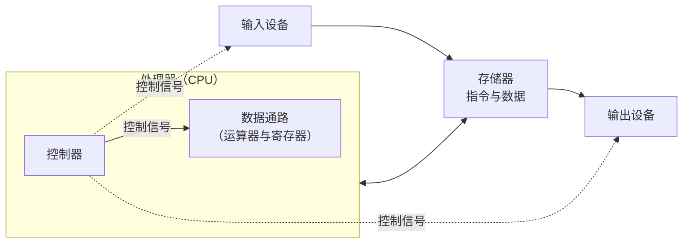
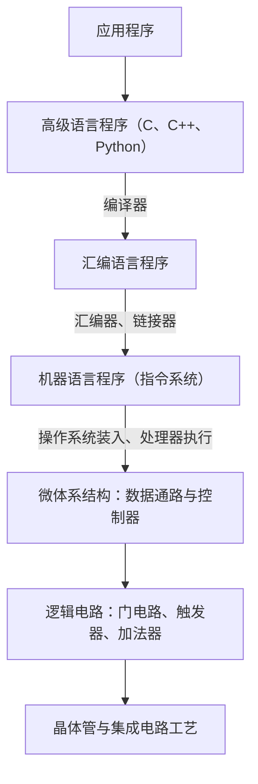

计算机组成原理研究一台计算机的硬件怎样执行程序：程序员看到的指令系统怎样由运算器、控制器、存储器和输入输出设备实现，又怎样实现得更快。本章是全课的导论，回答三个问题：计算机是怎样一步步发展到今天的结构的；从程序到电路，计算机系统分成哪些层次，本课程处在哪一层；怎样客观地比较两台计算机的快慢。前两个问题建立贯穿全课的框架，第三个问题给出全课评价一切设计的标准：CPU 时间等于指令数、CPI 与时钟周期之积。下一章 [4.10.2](/4.10.2) 讨论硬件与软件之间的接口：指令系统；数字电路层面的部件见 [4.9 数字逻辑电路](/4.9)，程序设计的视角见 [4.1.1](/4.1.1)。

## 1.1. 计算机的发展

### 1.1.1. 从计算工具到存储程序

人类很早就制造计算工具：算盘在中国至迟于宋元时期已普遍使用；1642 年 Pascal 制成能自动进位的齿轮加法器；1822 年起 Babbage 设计差分机（Difference Engine），1830 年代又设计了可编程的分析机（Analytical Engine），它已经有了"存储"与"运算"两个部分，Ada Lovelace 为它写下的计算 Bernoulli 数的步骤被视为第一个程序。这些机器的目标都是提高某类计算的效率，而且都用机械实现。

现代计算机的理论基础来自 1936 年 Turing 提出的**图灵机**（[4.8.10](/4.8.10)）：一台**通用图灵机**可以读入另一台机器的描述并模拟它，因此"机器"与"程序"可以分开，同一台硬件靠更换程序完成不同的任务。1937 年 Shannon 证明继电器开关电路可以实现**布尔代数**，为用电路实现逻辑运算奠定了基础（[4.9.2](/4.9.2)）。

第一台通用电子计算机 ENIAC（Electronic Numerical Integrator and Computer）由 Mauchly 与 Eckert 设计，1946 年 2 月公开，用于计算火炮弹道。它用了约 18000 个电子管，重 30 吨，功耗约 150 kW，每秒做 5000 次加法；采用十进制，有 20 个能存放 10 位十进制数的累加器，"编程"要靠拨动开关和重新插接电缆，换一个问题往往要花几天。

1945 年，von Neumann 在关于 EDVAC 的报告草稿中提出把程序和数据一样存放在存储器中，这就是**冯·诺依曼结构**（[4.1.1](/4.1.1#sec-1.2.1)）。按这一思想建造的 IAS 计算机（1952 年完成）有 1024 个 40 位的字，用二进制，只做整数运算。最早运行存储程序的是 1948 年曼彻斯特大学的实验机 Manchester Baby，第一台投入实用的存储程序计算机是 1949 年剑桥大学的 EDSAC。

此后的几个里程碑：

- **编译器**：Grace Hopper 在 1952 年写出 A-0 系统，这是编译器的雏形；她后来主导了 COBOL 的设计（1959）。1957 年 IBM 发布第一个被广泛使用的**高级语言** Fortran 的编译器。
- 系列机：1964 年 IBM 发布 System/360 系列，从低端到高端的各种型号执行同一套指令，同一份程序可以在整个系列上运行。为了描述这种"程序员眼中的计算机"，Amdahl、Blaauw 和 Brooks 提出了计算机体系结构这一概念（1.3.2 节）。
- 操作系统与分时：从一次只能运行一个程序、由操作员手工装入，到 1960 年代的批处理和分时系统，再到 1969 年诞生的 Unix，计算机逐步变成多用户、多程序共享的系统（[4.11.1](/4.11.1)）。
- 微处理器：1971 年 Intel 4004 把整个 CPU 做在一块芯片上，此后个人计算机、手机和嵌入式设备相继普及。

### 1.1.2. 器件的几代与摩尔定律

按所用的逻辑器件，电子计算机通常分为几代：

| 代 | 年代（大致） | 逻辑器件 | 代表 |
|---|---|---|---|
| 第一代 | 1940 年代后期–1950 年代 | 电子管 | ENIAC、EDSAC、IAS、UNIVAC I |
| 第二代 | 1950 年代后期–1960 年代前期 | 晶体管 | IBM 7090、DEC PDP-1 |
| 第三代 | 1960 年代中期–1970 年代初 | 中小规模集成电路 | IBM System/360、DEC PDP-8 |
| 第四代 | 1970 年代至今 | 大规模与超大规模集成电路（VLSI） | 微处理器、个人计算机、手机、服务器 |

器件每换一代，速度、体积、功耗和价格都有数量级的改善。第四代以后不再按器件划分：变化来自体系结构（流水线、多核、专用加速器），而不是新的开关元件。量子计算、光计算、生物计算等非硅技术仍处在研究阶段。

推动第四代计算机半个多世纪进步的，是集成电路工艺的持续微缩。

**定义 1.1.1（摩尔定律）** 单块集成电路上可容纳的晶体管数目大约每两年翻一番。这一经验规律称为**摩尔定律**（Moore's law）。

Gordon Moore 在 1965 年观察到的是每年翻一番，1975 年修正为每两年。它不是物理定律，而是半导体产业几十年来自我实现的路线图：从 1971 年 4004 的约 2300 个晶体管，到今天的高端处理器芯片上的数百亿到上千亿个晶体管。2010 年代以来，工艺微缩的速度和每个晶体管的成本下降都明显放缓，摩尔定律已经难以为继。

与摩尔定律相伴的是 Dennard 缩放（1.4.5 节）：晶体管尺寸缩小时，电压和电流按比例减小，单位面积的功耗保持不变，因此时钟频率可以随工艺一起提高。2005 年前后 Dennard 缩放失效，单核处理器的频率停在 3–5 GHz，处理器转向多核与专用硬件。Hennessy 与 Patterson 在 2017 年的图灵奖演讲中把这种转变称为"计算机体系结构的新黄金时代"：通用处理器的性能不再自动增长，领域专用体系结构（GPU、AI 加速器等）、开放的指令集（RISC-V，[4.10.3](/4.10.3)）和软硬件协同设计成为新的增长点。

## 1.2. 计算机的组成

### 1.2.1. 五大部件

**冯·诺依曼结构**把计算机分为五个部分：运算器、控制器、存储器、输入设备和输出设备。按今天的说法：

- 数据通路：完成算术与逻辑运算的部分，包括运算器和保存中间结果的**寄存器**；
- 控制器：根据指令指挥数据通路、存储器和输入输出设备协同工作；
- 数据通路与控制器合起来就是处理器（中央处理器，CPU）；
- 存储器：存放运行中的程序和它所需的数据；
- 输入设备（键盘、鼠标、网卡、传感器）和输出设备（显示器、打印机、扬声器），磁盘、固态硬盘既可输入也可输出。

**冯·诺依曼结构**有三个要点：

1. 存储程序：指令和数据以同样的形式存放在同一个存储器中，按地址访问；
2. 二进制：指令和数据都用二进制编码，简化了存储与运算部件；
3. 顺序执行：程序由指令序列构成，指令在存储器中顺序存放，处理器在一个专门的寄存器的指示下逐条取出并执行。

**定义 1.2.1（哈佛结构）** 把指令存储器和数据存储器分开、各用一条独立的通路访问的结构称为**哈佛结构**（Harvard architecture）；与之相对，指令与数据共用一个存储器和一条通路的冯·诺依曼结构又称普林斯顿结构。

哈佛结构可以在同一个时钟周期里同时取指令和读写数据，许多数字信号处理器和微控制器采用它。今天的通用处理器在核心内部也把指令高速缓存与数据高速缓存分开（"改进的哈佛结构"），但在主存层面仍是统一的地址空间，程序可以像数据一样被装入、生成和修改，这正是操作系统、编译器和**即时编译**能够工作的前提。本课程 [4.10.6](/4.10.6) 的单周期处理器就使用分开的指令存储器和数据存储器。

### 1.2.2. 程序的执行

处理器怎样"逐条取出并执行"指令，要靠一个专门的寄存器。

**定义 1.2.2（程序计数器与指令周期）** 处理器中存放当前（或下一条）要执行的指令地址的寄存器称为**程序计数器**（program counter，PC）。处理器取出、执行一条指令所经历的全部步骤称为一个**指令周期**（instruction cycle）。

一个指令周期大致分为：

1. 取指：以 PC 的值为地址，从存储器读出指令；
2. 译码：识别指令要做的操作，读出它用到的寄存器；
3. 执行：在运算器中完成运算，或计算访存地址、比较分支条件；
4. 访存：对 load、store 指令读写数据存储器；
5. 写回：把结果写入目的寄存器；
6. 更新 PC：顺序执行时 PC 加上指令的长度（RISC-V 中加 4），转移指令则把 PC 改为目标地址。

程序中的分支、循环和函数调用，归根结底都是改变 PC。这五六个步骤也正是后续章节的线索：[4.10.6](/4.10.6) 让一条指令在一个时钟周期内走完全部步骤（单周期处理器），后续章节再把这些步骤分到多个周期（多周期处理器），或让多条指令的不同步骤重叠进行（流水线）。

## 1.3. 计算机的层次结构

### 1.3.1. 从高级语言到控制信号

计算机是人类设计过的最复杂的系统之一，能被理解和设计，全靠**抽象**：把系统分成若干层，每一层只通过一个清晰的接口使用下一层，而不必关心下一层的实现。

以交换**数组**中相邻两个元素为例，同一段计算在几个层次上的表示：

| 层次 | 表示 |
|---|---|
| **高级语言**（C） | `temp = v[k]; v[k] = v[k+1]; v[k+1] = temp;` |
| **汇编语言**（RISC-V，设 `t2` 中是 `&v[k]`） | `lw t0, 0(t2)` `lw t1, 4(t2)` `sw t1, 0(t2)` `sw t0, 4(t2)` |
| **机器语言**（十六进制） | `0003a283` `0043a303` `0063a023` `0053a223` |
| 控制信号 | 每条指令被译码为一组控制信号：选择哪个寄存器、运算器做加法、存储器读还是写…… |

**编译器**把高级语言翻译成**汇编语言**，汇编器把汇编语言翻译成**机器语言**（[4.1.1](/4.1.1#sec-1.3)、[4.2.2](/4.2.2)），机器语言再由处理器的控制器翻译成控制信号。本课程主要关心最后两步：机器语言怎样设计（[4.10.2](/4.10.2)、[4.10.3](/4.10.3)），处理器怎样把它变成数据通路上的动作（[4.10.5](/4.10.5)、[4.10.6](/4.10.6) 及后续章节）。

### 1.3.2. 体系结构与组成

层次结构中最重要的一个接口是机器语言这一层，它把软件和硬件分开。

**定义 1.3.1（指令集体系结构）** 计算机中对机器语言程序员可见的全部属性，包括指令及其编码、寄存器、存储器的寻址方式、数据类型、异常与中断的处理方式等，合称**指令集体系结构**（instruction set architecture，ISA），简称体系结构，也称指令系统。

**定义 1.3.2（微体系结构）** 实现某个指令集体系结构的具体硬件组织，包括数据通路与控制器的结构、流水线的级数、高速缓存的容量与组织等，称为**微体系结构**（microarchitecture），中文教材也称计算机组成。

体系结构回答"计算机做什么"，微体系结构回答"怎样做"，再往下的实现（逻辑设计、电路设计、工艺）回答"用什么做"。三者的分工可以用乘法指令说明：体系结构规定有一条乘法指令及其功能；微体系结构决定用阵列乘法器在一个周期内完成，还是用加法器与移位器在多个周期内完成；实现决定这个乘法器用哪种工艺、跑多快。

| 层面 | 对谁可见 | 例子 |
|---|---|---|
| 指令集体系结构 | 汇编程序员、编译器、操作系统 | x86-64、ARMv8-A（AArch64）、RISC-V RV64GC |
| 微体系结构 | 硬件设计者；对软件只影响性能 | 流水线级数、发射宽度、分支预测器、高速缓存 |
| 实现 | 芯片设计与制造 | 工艺节点、版图、封装、频率 |

体系结构作为接口的价值在于兼容：同一体系结构的不同微体系结构可以运行同样的程序。System/360 第一次把这一点做成商业策略；今天 Intel 与 AMD 的处理器微体系结构完全不同，却都执行 x86-64 程序。相应地，操作系统还为应用程序规定了应用二进制接口（application binary interface），简称 ABI，即用户态指令、系统调用、函数调用约定与可执行文件格式的总和，使编译好的程序可以在同一平台的不同机器上运行（[4.10.3](/4.10.3)）。

本课程"计算机组成原理"的内容，就是在给定体系结构的前提下设计微体系结构，并评价和优化它的性能；体系结构本身的设计在指令系统两章讨论，更深入的内容属于后续的"计算机体系结构"课程。

### 1.3.3. 七个伟大思想

Patterson 与 Hennessy 把计算机设计六十多年来反复出现的思想概括为七条，它们会在本课程的不同部分一再出现：

| 思想 | 含义 | 本课程中的例子 |
|---|---|---|
| 抽象 | 用分层的表示隐藏下层细节，简化设计 | 层次结构，体系结构与微体系结构的分离 |
| 加速大概率事件 | 优化常见情况比优化罕见情况收益更大 | RISC 指令集；**Amdahl 定律**（1.4.6 节） |
| 并行 | 同时做多件事 | **超前进位加法器**，多核 |
| 流水线 | 把任务分段，让各段重叠进行 | 流水线处理器 |
| 预测 | 先按猜测执行，猜错再纠正，平均更快 | 分支预测 |
| 存储层次 | 速度最快、容量最小、最贵的存储器放在最上层 | 寄存器、高速缓存、主存、外存 |
| 冗余提高可靠性 | 用冗余部件检测和纠正故障 | 校验码与纠错码（[4.10.4](/4.10.4)），RAID |

教材早期的版本还有第八条"为摩尔定律而设计"（设计时要预见几年后芯片完成时的工艺水平）；随着摩尔定律放缓，新版本删去了这一条。

## 1.4. 性能

### 1.4.1. 响应时间与吞吐率

说一台计算机"快"，可以有两种不同的含义。

**定义 1.4.1（响应时间与吞吐率）** 计算机完成一项任务所需的总时间，即从开始到结束所经过的时间，称为**响应时间**（response time），也称执行时间；单位时间内完成的任务数称为**吞吐率**（throughput）。

个人用户关心响应时间，数据中心更关心吞吐率。两者相关但不等同：把处理器换成更快的型号，两者都改善；增加处理器的个数，吞吐率提高，单个任务的响应时间却不变（除非任务本身能并行）。下面主要讨论响应时间。对某个程序，定义计算机 $X$ 的性能为

$$
\text{性能}_X = \frac{1}{\text{执行时间}_X},
$$

"$X$ 比 $Y$ 快 $n$ 倍"指 $\dfrac{\text{性能}_X}{\text{性能}_Y} = \dfrac{\text{执行时间}_Y}{\text{执行时间}_X} = n$。例如同一程序在 $A$ 上运行 10 s、在 $B$ 上运行 15 s，则 $A$ 的性能是 $B$ 的 1.5 倍。

执行时间本身也有不同的量法。墙钟时间（elapsed time）包括访问磁盘、等待输入输出、操作系统开销和运行其他程序的时间；CPU 时间只计处理器为这个程序工作的时间，又分为执行程序本身代码的用户 CPU 时间和操作系统代为执行的系统 CPU 时间。Linux 中 `time ./prog` 输出的 `real`、`user`、`sys` 就分别是这三者。评价处理器的设计，用的是用户 CPU 时间。

### 1.4.2. CPU 时间与 CPI

同步数字电路由一个固定频率的时钟驱动（[4.9.7](/4.9.7)），处理器的每个动作都在时钟的节拍上发生。

**定义 1.4.2（时钟周期与时钟频率）** 处理器时钟相邻两个有效边沿之间的时间称为**时钟周期**（clock cycle time），其倒数称为**时钟频率**（clock rate）。

例如时钟频率 4 GHz 对应时钟周期 $1/(4 \times 10^9\ \mathrm{Hz}) = 0.25\ \mathrm{ns} = 250\ \mathrm{ps}$。一个程序的 CPU 时间就是它占用的时钟周期数乘以时钟周期：

$$
\text{CPU 时间} = \text{CPU 时钟周期数} \times \text{时钟周期} = \frac{\text{CPU 时钟周期数}}{\text{时钟频率}}.
$$

时钟周期数又取决于程序执行了多少条指令、每条指令平均占用多少个周期。

**定义 1.4.3（CPI）** 执行一个程序（或程序的一段）时，平均每条指令所需的时钟周期数称为 **CPI**（clock cycles per instruction）：

$$
\mathrm{CPI} = \frac{\text{CPU 时钟周期数}}{\text{指令数}}.
$$
其倒数 $\mathrm{IPC} = 1/\mathrm{CPI}$ 称为每周期指令数，在每周期能完成多条指令的处理器中更常用。

把三者相乘，得到评价处理器性能最基本的公式：

$$
\text{CPU 时间} = \text{指令数} \times \mathrm{CPI} \times \text{时钟周期} = \frac{\text{指令数} \times \mathrm{CPI}}{\text{时钟频率}}. \tag{1.1}
$$

按量纲写，这是

$$
\frac{\text{秒}}{\text{程序}} = \frac{\text{指令}}{\text{程序}} \times \frac{\text{时钟周期}}{\text{指令}} \times \frac{\text{秒}}{\text{时钟周期}},
$$
它常被称为处理器性能的"铁律"（iron law）。三个因子分别由不同的层次决定，而且往往此消彼长：

| 因素 | 指令数 | CPI | 时钟周期 |
|---|---|---|---|
| 算法 | ✓ | ✓（指令的种类构成） | |
| 程序设计语言、编译器 | ✓ | ✓ | |
| 指令集体系结构 | ✓ | ✓ | ✓ |
| 微体系结构 | | ✓ | ✓ |
| 工艺与电路 | | | ✓ |

只有三者之积才是性能，任何一个因子单独都不能说明问题：降低时钟周期的设计可能使 CPI 上升，减少指令数的复杂指令可能使 CPI 和时钟周期都上升（[4.10.2](/4.10.2#sec-2.4.3)）。

不同类型的指令所需的周期数不同。若程序中第 $i$ 类指令有 $C_i$ 条、每条需 $\mathrm{CPI}_i$ 个周期，共 $n$ 类，则

$$
\text{CPU 时钟周期数} = \sum_{i=1}^{n} \mathrm{CPI}_i \times C_i, \qquad
\mathrm{CPI} = \sum_{i=1}^{n} \mathrm{CPI}_i \times \frac{C_i}{\text{指令数}}, \tag{1.2}
$$
即总 CPI 是各类指令 CPI 按出现频率的加权平均。

**例 1.4.1** 同一体系结构的两种实现：$A$ 的时钟周期为 250 ps，运行某程序的 CPI 为 2.0；$B$ 的时钟周期为 500 ps，CPI 为 1.2。哪一个更快？

两者执行同一程序，指令数 $I$ 相同。由式 (1.1)，$A$ 的 CPU 时间为 $I \times 2.0 \times 250\ \mathrm{ps} = 500I\ \mathrm{ps}$，$B$ 为 $I \times 1.2 \times 500\ \mathrm{ps} = 600I\ \mathrm{ps}$。$A$ 比 $B$ 快 $600/500 = 1.2$ 倍。$A$ 的 CPI 更高，但时钟周期短得更多。

**例 1.4.2** 某处理器的指令分为三类，CPI 分别为 1、2、3。编译器为同一段代码生成了两种指令序列：

| 序列 | A 类（CPI = 1） | B 类（CPI = 2） | C 类（CPI = 3） |
|---|---|---|---|
| 1 | 2 | 1 | 2 |
| 2 | 4 | 1 | 1 |

序列 1 有 5 条指令，周期数 $2 \times 1 + 1 \times 2 + 2 \times 3 = 10$，CPI 为 2.0；序列 2 有 6 条指令，周期数 $4 + 2 + 3 = 9$，CPI 为 1.5。序列 2 的指令更多，却更快。

**例 1.4.3** 某程序在 2 GHz 的计算机 $A$ 上运行 10 s。设计者希望新机器 $B$ 运行同一程序只需 6 s；提高频率要改变电路，使 $B$ 运行该程序所需的时钟周期数是 $A$ 的 1.2 倍。$B$ 的时钟频率应为多少？

$A$ 的周期数为 $10\ \mathrm{s} \times 2 \times 10^9\ \mathrm{Hz} = 2 \times 10^{10}$，$B$ 的周期数为 $2.4 \times 10^{10}$，所以 $B$ 的时钟频率应为 $2.4 \times 10^{10} / 6\ \mathrm{s} = 4\ \mathrm{GHz}$。

### 1.4.3. MIPS 的局限

时钟频率是最常被宣传的指标，但由例 1.4.1，频率高的机器未必快。另一个曾经流行的指标是每秒执行的指令数。

**定义 1.4.4（MIPS）** 每秒执行的百万条指令数称为 **MIPS**（million instructions per second）：

$$
\mathrm{MIPS} = \frac{\text{指令数}}{\text{执行时间} \times 10^6} = \frac{\text{时钟频率}}{\mathrm{CPI} \times 10^6}.
$$

MIPS 是一个与 MIPS 指令集同名、却毫不相干的性能指标。它的含义直观（越大越快），却有三个根本问题：

1. 不同指令集之间不可比：MIPS 只数指令条数，不看每条指令做了多少事。CISC 的一条指令可能抵得上 RISC 的几条。
2. 同一台机器上随程序而变：不同程序的 CPI 不同，一台计算机没有一个统一的 MIPS 值。
3. 可能与性能反向变化：见下例。

**例 1.4.4** 一台 4 GHz 的计算机，指令分为 A、B、C 三类，CPI 分别为 1、2、3。两个编译器为同一程序生成的代码如下（单位：$10^9$ 条）：

| 编译器 | A | B | C |
|---|---|---|---|
| 1 | 5 | 1 | 1 |
| 2 | 10 | 1 | 1 |

编译器 1 的代码需要 $5 + 2 + 3 = 10 \times 10^9$ 个周期，执行时间 2.5 s，MIPS 为 $7 \times 10^9 / (2.5 \times 10^6) = 2800$；编译器 2 的代码需要 $15 \times 10^9$ 个周期，执行时间 3.75 s，MIPS 为 $12 \times 10^9 / (3.75 \times 10^6) = 3200$。编译器 2 的 MIPS 更高，程序却慢了 50%：它多生成的都是简单的 A 类指令，拉低了平均 CPI。

科学计算中常用的 FLOPS（每秒**浮点运算**次数）有类似的问题，但因为它数的是程序本身要求的运算次数（与指令集无关），在同一算法的不同实现之间还有可比性。结论是：唯一可靠的性能度量是真实程序的执行时间。

### 1.4.4. 基准测试

用哪些程序来测执行时间？最理想的是用户自己每天运行的程序（工作负载），但通常做不到，于是需要公认的一组程序。

**定义 1.4.5（基准测试）** 为比较计算机性能而选定的、代表某类实际工作负载的一组程序称为**基准测试**（benchmark），用它们测得的执行时间及其汇总指标作为性能的比较依据。

最有影响的是 SPEC（Standard Performance Evaluation Corporation）的 CPU 基准测试，如 SPEC CPU 2017。它包括整数和浮点两组程序，分别取自编译器、压缩、路径搜索、物理模拟、天气预报等真实应用，并有两种测法：SPECspeed 测单个任务的执行时间，SPECrate 同时运行多份副本测吞吐率。每个程序的成绩是相对于一台参考机器的比值，汇总时取几何平均：

$$
\text{SPECratio}_i = \frac{\text{参考机器的执行时间}_i}{\text{被测机器的执行时间}_i}, \qquad
\text{总成绩} = \Bigl(\prod_{i=1}^{n} \text{SPECratio}_i\Bigr)^{1/n}.
$$

取几何平均的理由是：两台机器 $A$、$B$ 总成绩之比

$$
\frac{\bigl(\prod_i T_{\mathrm{ref},i}/T_{A,i}\bigr)^{1/n}}{\bigl(\prod_i T_{\mathrm{ref},i}/T_{B,i}\bigr)^{1/n}}
= \Bigl(\prod_{i=1}^{n} \frac{T_{B,i}}{T_{A,i}}\Bigr)^{1/n}
$$
与参考机器无关，比较的结论不会因为换一台参考机器而改变；算术平均没有这个性质。

其他领域有各自的基准：嵌入式处理器常用 CoreMark，服务器能效用 SPECpower，机器学习的训练与推理用 MLPerf，超级计算机的 TOP500 排名用求解稠密线性方程组的 HPL（LINPACK）。基准测试也会被"针对性优化"：编译器或硬件专门为基准中的某段代码做优化，而这种优化对真实程序没有帮助。因此可靠的评测会公开全部配置，并尽量用多样的真实程序。

### 1.4.5. 功耗墙

1980 年代到 2000 年代初，处理器的时钟频率提高了几百倍：Intel 80286（1982）约 12.5 MHz，Pentium 4（2004）达到 3.6 GHz。功耗也随之从几瓦增加到 100 W 以上。此后频率基本停止增长，原因在于功耗。

CMOS 电路的主要能耗发生在晶体管开关时，即负载电容的充放电（[4.9.3](/4.9.3)）。电源经晶体管把电容 $C$ 从 0 充电到 $V$，提供的能量为 $QV = CV^2$，其中一半储存在电容中，一半在充电通路上耗散；放电时储存的那一半也被耗散。因此一次 $0 \to 1 \to 0$ 的翻转消耗 $CV^2$，平均每次翻转（$0 \to 1$ 或 $1 \to 0$）消耗 $\tfrac{1}{2}CV^2$。若每秒发生的翻转次数与时钟频率 $f$ 成正比，则

$$
P_{\text{动态}} \propto \frac{1}{2} \times \text{电容负载} \times \text{电压}^2 \times \text{开关频率}. \tag{1.3}
$$

此外还有晶体管关断时的漏电流造成的静态功耗，它随工艺微缩和电压降低而迅速增大，在今天的芯片中占相当的比例。

**例 1.4.5** 新设计的处理器的电容负载是旧处理器的 85%，电压降低 15%，频率也因此降低 15%。由式 (1.3)，动态功耗之比为

$$
\frac{P_{\text{新}}}{P_{\text{旧}}} = 0.85 \times 0.85^2 \times 0.85 = 0.85^4 \approx 0.52,
$$
即功耗约降为原来的一半。降低电压是最有效的节能手段，因为功耗与电压的平方成正比。

在 Dennard 缩放成立的年代，工艺每一代把晶体管的线性尺寸缩小为原来的 $1/k$（$k \approx \sqrt{2}$），电容和电压都缩小为 $1/k$，开关速度提高 $k$ 倍，于是每个晶体管的动态功耗变为原来的 $\frac{1}{k} \cdot \frac{1}{k^2} \cdot k = \frac{1}{k^2}$，而单位面积的晶体管数增加 $k^2$ 倍，功率密度保持不变。频率每代提高、芯片却不更热，这是三十年间频率高速增长的基础。

电压不能无限降低：电压接近晶体管的阈值电压时，晶体管无法可靠地导通和关断；降低阈值电压又会使漏电流按指数增长。2005 年前后电源电压停在 1 V 左右，Dennard 缩放失效，继续提高频率意味着功率密度上升，而芯片的散热能力（风冷大约一百多瓦）是有限的。

**定义 1.4.6（功耗墙）** 由于电压无法继续随工艺降低、芯片的散热能力有限，单个处理器不能再靠提高时钟频率来提高性能的限制，称为**功耗墙**（power wall）。

功耗墙使整个产业转向多核处理器：在一块芯片上放多个频率不太高的核心，用并行而不是频率换取性能。这把提高性能的责任部分转移给了程序员，程序必须显式并行才能从多核中受益（[4.4.7](/4.4.7)、[4.11.6](/4.11.6)）。另一个出路是专用化：针对图形、矩阵运算、视频编解码等特定任务设计的硬件，每焦耳能量完成的有用工作比通用处理器多一两个数量级。今天设计处理器时，能效（每瓦性能）与性能同样重要：手机受电池容量限制，数据中心受供电和散热成本限制。

### 1.4.6. Amdahl 定律

对系统的某一部分做改进，整体能提高多少？设程序执行时间中受改进影响的部分为 $T_{\text{受影响}}$，这部分被加速 $s$ 倍，则改进后的执行时间为

$$
T_{\text{改进后}} = \frac{T_{\text{受影响}}}{s} + T_{\text{不受影响}}.
$$

写成比例的形式，若受影响的部分占原执行时间的比例为 $f$，整体加速比为

$$
S = \frac{1}{(1 - f) + f/s} < \frac{1}{1 - f}.
$$

这就是 **Amdahl 定律**（[4.4.7](/4.4.7#sec-7.4.4) 用它分析并行程序的加速比）。它说明，整体性能的提高受限于未改进部分所占的比例。

**例 1.4.6** 某程序运行 100 s，其中乘法占 80 s。要使程序快 4 倍，乘法需要快多少倍？要快 5 倍呢？

快 4 倍即 25 s：$80/s + 20 = 25$，得 $s = 16$。快 5 倍即 20 s：$80/s + 20 = 20$ 无解，无论乘法器多快都不可能，因为其余部分已经占了 20 s。

由此得到两条设计原则。其一是"加速大概率事件"：把力气花在占执行时间比例大的部分。其二是警惕只改进系统的一部分、却期望整体性能按比例提高的错误。与之相关的另一个常见误区是认为空闲的计算机几乎不耗电：服务器在 10% 的负载下仍然消耗峰值功耗的相当一部分，因此能效的评价（如 SPECpower）要在不同负载水平下测量。

## 小结

- 计算机从机械计算工具发展而来，**图灵机**提供了理论基础，存储程序思想使计算机成为通用的机器。器件经历了电子管、晶体管、集成电路、超大规模集成电路四代；摩尔定律与 Dennard 缩放推动了几十年的高速增长，如今都已放缓或失效。
- **冯·诺依曼结构**：五大部件，存储程序，二进制，在**程序计数器**控制下顺序执行；数据通路与控制器构成处理器。哈佛结构把指令与数据的存储分开。
- 计算机系统是分层的；指令集体系结构是软件与硬件之间的接口，微体系结构是它的一种硬件实现。本课程研究微体系结构的设计与评价。
- 性能 = 1 / 执行时间。CPU 时间 = 指令数 × CPI × 时钟周期，三个因子由算法、编译器、指令集、微体系结构和工艺共同决定，只有乘积才说明性能。MIPS 和时钟频率都是不可靠的性能指标；应以基准测试中真实程序的执行时间为准，SPEC 用比值的几何平均汇总。
- 动态功耗正比于 $\frac{1}{2}CV^2f$；电压不能再随工艺降低，形成功耗墙，处理器因此转向多核与专用硬件。**Amdahl 定律**限制了局部改进对整体的贡献。
