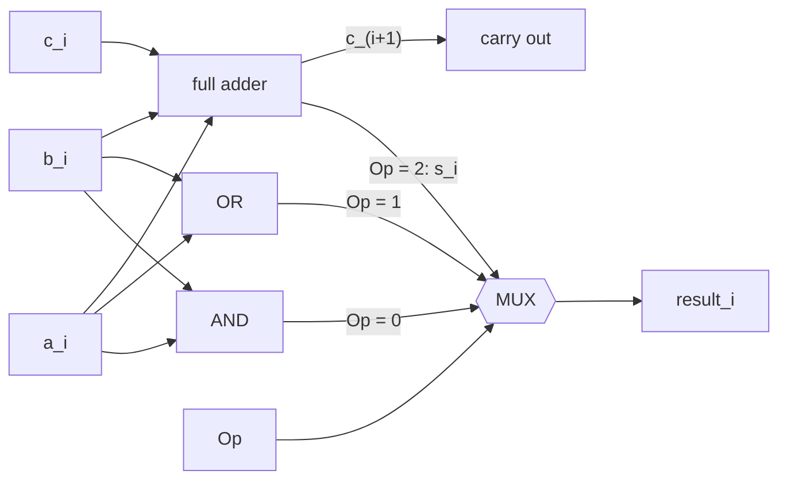
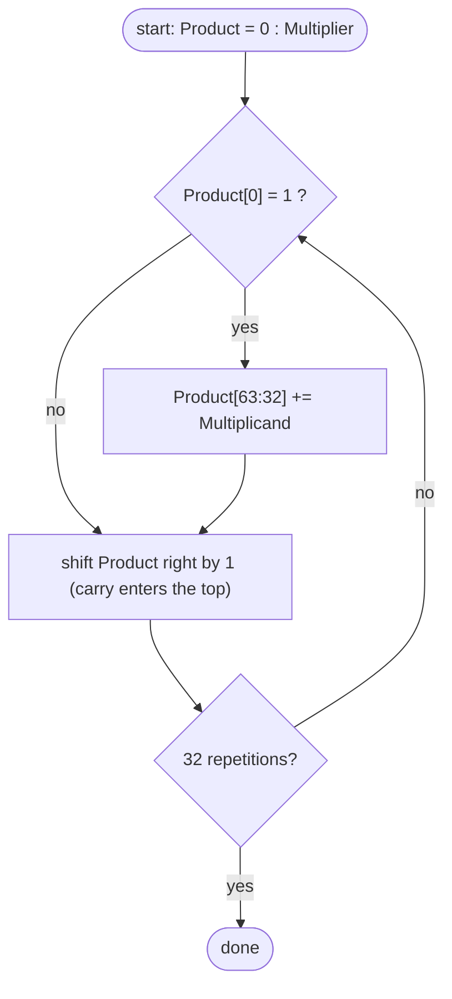
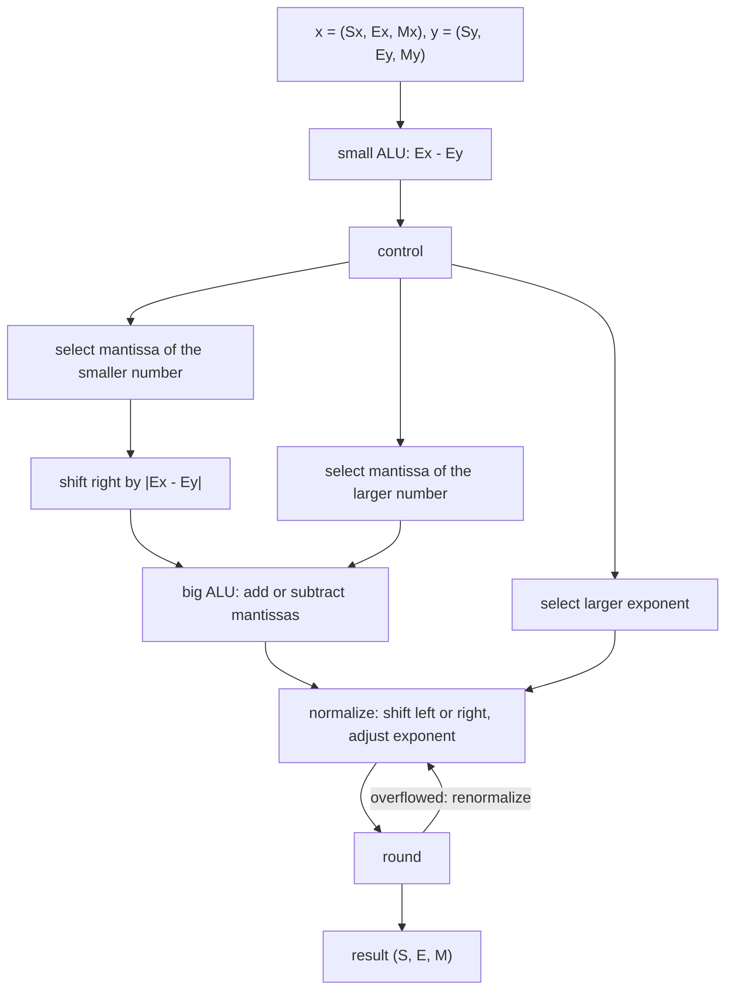

The arithmetic unit is the part of a processor that performs arithmetic and logic operations. The previous chapter gave the encodings of data in the machine; this chapter discusses how to implement operations on these encodings with combinational and **sequential circuits**: starting from a 1-bit **ALU**, we extend the width and the functions to obtain the 32-bit ALU needed by RV32I; then we use adders, **shift registers**, and control logic to implement multiplication and division; finally we discuss the steps of floating-point arithmetic and rounding. The gate-level design of adders (full adders, carry-lookahead) was covered in [Arithmetic Circuits](/4.9.5) and is recalled here only when needed; the emphasis is on how the arithmetic unit is organized in a processor. The next chapter puts the ALU into a datapath to form a processor that can execute RISC-V instructions.

## 5.1. Function and Organization of the Arithmetic Unit

The basic functions of the arithmetic unit are:

- to perform arithmetic operations ($+, -, \times, \div$) and logic operations (AND, OR, NOT, **exclusive or**, shifts);
- to report the status of the result, such as whether it is zero, whether **overflow** occurred, its sign, and whether there was a carry;
- to obtain operands from the **register** set or the data bus, and to send results back to the register set or the data bus;
- to hold intermediate results, such as the partial product and partial remainder during multiplication and division (using dedicated registers and **shift registers**).

The arithmetic unit does not itself decide which operation to perform; it is driven by control signals produced by the control unit. There are four basic kinds of circuits in an arithmetic unit: logic gates perform logic operations, adders perform addition, registers built from **flip-flops** hold data, and **multiplexers** and shifters select and connect the sources and destinations of data. The ALU is the core: it is a combinational circuit whose inputs are two operands $a$ and $b$ and an operation select signal, whose output is the result, and which stores no state.

## 5.2. Design of the ALU

### 5.2.1. The 1-Bit ALU

The steps in designing an ALU are: determine the functions (which operations are supported), determine the inputs and outputs, write the **truth table** and logic expressions, and then implement them with logic circuits. We first design a 1-bit ALU that performs only AND, OR, and addition: an AND gate, an OR gate, and a **full adder** compute the three results, and a multiplexer outputs one of them according to the operation select signal $\mathrm{Op}$.

A 1-bit full adder has three inputs $a_i, b_i, c_i$ ($c_i$ is the carry from the lower bit) and two outputs:

$$
s_i = a_i \oplus b_i \oplus c_i, \qquad c_{i+1} = a_ib_i + a_ic_i + b_ic_i ,
$$
where $c_{i+1}$ is obtained by simplifying the four **minterms** of the truth table for which the carry is $1$. The sum $s_i$ is the XOR of the three inputs, that is, it is $1$ when an odd number of the three inputs are $1$.



### 5.2.2. Multibit ALUs and Fast Carry

Chaining $n$ 1-bit ALUs, with the carry-out of each bit connected to the carry-in of the next higher bit, gives an $n$-bit ALU; the carry-in of the lowest bit is $0$ for addition. This ripple-carry adder has a regular structure, but the carry must propagate from the lowest bit to the highest through every stage, so the delay is proportional to $n$: if one full-adder stage takes $2$ gate delays to produce a carry, a $32$-bit addition needs about $64$ gate delays.

The idea of carry-lookahead is to compute the carry of every bit in advance. Define the generate signal $g_i = a_ib_i$ and the propagate signal $p_i = a_i + b_i$ of bit $i$: when $a_i = b_i = 1$ this bit certainly generates a carry, when $a_i = b_i = 0$ it certainly does not, and when exactly one of them is $1$ the carry-out equals the carry-in. Thus $c_{i+1} = g_i + p_ic_i$, and substituting successively gives

$$
\begin{aligned}
c_1 &= g_0 + p_0c_0, \\
c_2 &= g_1 + p_1g_0 + p_1p_0c_0, \\
c_3 &= g_2 + p_2g_1 + p_2p_1g_0 + p_2p_1p_0c_0, \\
c_4 &= g_3 + p_3g_2 + p_3p_2g_1 + p_3p_2p_1g_0 + p_3p_2p_1p_0c_0 .
\end{aligned}
$$
Each carry is a two-level AND-OR circuit, and all of them are obtained simultaneously. As the number of bits grows, the expressions become long very quickly, so in practice the bits are grouped: each group of $4$ bits produces a group generate signal and a group propagate signal, and the same lookahead is then applied between groups, forming a multilevel structure whose delay grows with $\log n$. The gate-level design and delay analysis are in [Arithmetic Circuits](/4.9.5). Estimating the maximum delay of an ALU amounts to finding, along the carry chain, the longest gate-level path from input to output.

### 5.2.3. Subtraction, Comparison, and Overflow

By the property of **two's complement** from the previous chapter, $a - b = a + {\sim}b + 1$, so subtraction needs only a row of XOR gates in front of the $b$ input of the adder as a controllable inverter, with the carry-in of the lowest bit equal to the subtract control signal $\mathrm{Sub}$: when $\mathrm{Sub} = 0$, $b_i \oplus 0 = b_i$ and $c_0 = 0$, and the adder adds; when $\mathrm{Sub} = 1$, $b_i \oplus 1 = \bar b_i$ and $c_0 = 1$, and it subtracts. Addition and subtraction thus share one adder.

Many processors set flag bits after an operation for use by later conditional branches. Let $s = s_{n-1}\cdots s_0$ be the $n$-bit result and $c_n$ the carry-out of the top bit:

| Flag | Meaning | Logic |
|---|---|---|
| Z (zero) | the result is zero | $Z = \overline{s_{n-1} + \cdots + s_1 + s_0}$ |
| N or S (negative) | the result is negative (in two's complement) | $N = s_{n-1}$ |
| C (carry) | carry of an unsigned operation | $C = c_n$ |
| V or OV (overflow) | overflow of a signed operation | $V = c_n \oplus c_{n-1}$ |

**Theorem 5.2.1 (Overflow Detection for Two's Complement Addition)** Add two $n$-bit two's complement numbers $a$ and $b$, and let the top bit of the sum be $s_{n-1}$, the carry into the top bit be $c_{n-1}$, and the carry-out of the top bit be $c_n$. The following three conditions are equivalent:

1. the result **overflows**, that is, the true sum lies outside $[-2^{n-1}, 2^{n-1}-1]$;
2. $a_{n-1} = b_{n-1} \ne s_{n-1}$, that is, two numbers of the same sign are added and the sign of the result is opposite to theirs;
3. $c_n \ne c_{n-1}$.

**Proof** When two numbers of opposite signs are added, the absolute value of the sum does not exceed the larger of the two, so no overflow occurs; when two numbers of the same sign are added, the true sum has that same sign, and on overflow the result truncated to $n$ bits differs from the true value by $2^n$, so its sign is exactly the opposite; hence (1)$\Leftrightarrow$(2). Now look at the top bit: $s_{n-1} = a_{n-1} \oplus b_{n-1} \oplus c_{n-1}$ and $c_n = a_{n-1}b_{n-1} + (a_{n-1} \oplus b_{n-1})c_{n-1}$. If $a_{n-1} \ne b_{n-1}$, then $c_n = c_{n-1}$, and neither (2) nor (3) holds. If $a_{n-1} = b_{n-1} = 0$, then $c_n = 0$ and $s_{n-1} = c_{n-1}$; if $a_{n-1} = b_{n-1} = 1$, then $c_n = 1$ and $s_{n-1} = c_{n-1}$. In both cases $s_{n-1} \ne a_{n-1}$ is equivalent to $c_{n-1} \ne c_n$, so (2)$\Leftrightarrow$(3). $\square$

**Example 5.2.1** The $4$-bit two's complement addition $0111 + 0001 = 1000$: the true result of $7 + 1$ is $8$, outside $[-8, 7]$; two positive numbers give a negative number, and $c_3 = 1 \ne c_4 = 0$, so overflow occurs. For $1111 + 1111 = 1\,1110$: $(-1) + (-1) = -2$, and $c_3 = c_4 = 1$, so there is no overflow; the discarded top carry $c_4 = 1$ is meaningful only for unsigned operations ($15 + 15$ produces a carry).

Comparison is also done by subtraction. A signed comparison $a < b$ holds if and only if the true value of $a - b$ is negative, that is, $N \oplus V = 1$ (on overflow the sign bit is inverted); an unsigned comparison $a < b$ holds if and only if $a + {\sim}b + 1$ produces no carry out of the top bit, that is, $C = 0$ (equivalent to a borrow). And $a = b$ if and only if the result of $a - b$ is zero.

**RISC-V** deliberately has no flag bits: conditional branch instructions such as `beq`, `blt`, and `bltu` compare two registers directly, and `slt` and `sltu` write the comparison result ($0$ or $1$) into a register. This avoids the implicit dependences that flag bits cause in pipelines and out-of-order execution, at the cost of leaving overflow checks to software. The sequences given in the RISC-V specification are:

```asm
# unsigned addition: overflow iff the sum is smaller than an operand
add  t0, t1, t2
bltu t0, t1, overflow

# signed addition (general case): overflow iff (t2 < 0) != (t0 < t1)
add  t0, t1, t2
slti t3, t2, 0
slt  t4, t0, t1
bne  t3, t4, overflow
```

### 5.2.4. Shifters

RV32I has three kinds of shift: logical shift left `sll`, logical shift right `srl` (filling the upper bits with $0$), and arithmetic shift right `sra` (filling the upper bits with the sign bit, equivalent to dividing a signed number by a power of $2$ and rounding toward $-\infty$). The shift amount is the low $5$ bits of $b$.

**Definition 5.2.1 (Barrel Shifter)** A combinational shifting circuit made of $\lceil \log_2 n \rceil$ levels of $2$-to-$1$ multiplexers is called a **barrel shifter**: level $i$ decides, according to bit $i$ of the shift amount, whether to move the data by $2^i$ positions, so that a shift by any number of positions is completed in one clock cycle.

A $32$-bit **barrel shifter** has $5$ levels with $32$ multiplexers each, and its delay is proportional to $\log n$, much faster than a **shift register** that moves one bit at a time. A right shift can share the circuit of a left shift by first reversing the bits of the data, shifting left, and reversing again; an arithmetic right shift only needs the shifted-in bits to be changed from $0$ to the sign bit.

### 5.2.5. The RV32I ALU

The integer instructions of RV32I require the ALU to support $10$ operations, plus one more operation, which outputs $b$ directly, for `lui`. The $4$-bit operation code in the table below is $\{\mathtt{funct7}[5], \mathtt{funct3}\}$, so that the control unit obtains the operation select signal almost directly from the instruction (next chapter):

| Operation | Code | Result | Used by |
|---|---|---|---|
| ADD | `0000` | $a + b$ | `add`, `addi`, memory addresses, `auipc`, `jal`, `jalr`, branch targets |
| SUB | `1000` | $a - b$ | `sub` |
| SLL | `0001` | $a \ll b[4{:}0]$ | `sll`, `slli` |
| SLT | `0010` | $1$ if signed $a < b$ | `slt`, `slti` |
| SLTU | `0011` | $1$ if unsigned $a < b$ | `sltu`, `sltiu` |
| XOR | `0100` | $a \oplus b$ | `xor`, `xori` |
| SRL | `0101` | logical shift right | `srl`, `srli` |
| SRA | `1101` | arithmetic shift right | `sra`, `srai` |
| OR | `0110` | $a \lor b$ (bitwise) | `or`, `ori` |
| AND | `0111` | $a \land b$ (bitwise) | `and`, `andi` |
| PASS B | `1111` | $b$ | `lui` |

When described in **SystemVerilog**, one only needs to write the behavior of each operation, and the synthesis tool selects suitable structures from its library for the adder, shifter, and comparator (such as a **carry-lookahead adder** and a barrel shifter):

```systemverilog
package alu_pkg;
  typedef enum logic [3:0] {
    ALU_ADD  = 4'b0000, ALU_SUB = 4'b1000, ALU_SLL = 4'b0001, ALU_SLT = 4'b0010,
    ALU_SLTU = 4'b0011, ALU_XOR = 4'b0100, ALU_SRL = 4'b0101, ALU_SRA = 4'b1101,
    ALU_OR   = 4'b0110, ALU_AND = 4'b0111, ALU_B   = 4'b1111
  } alu_op_t;
endpackage

module alu
  import alu_pkg::*;
(
  input  logic [31:0] a, b,
  input  alu_op_t     op,
  output logic [31:0] y
);
  always_comb begin
    unique case (op)
      ALU_ADD:  y = a + b;
      ALU_SUB:  y = a - b;
      ALU_SLL:  y = a << b[4:0];
      ALU_SLT:  y = {31'b0, $signed(a) < $signed(b)};
      ALU_SLTU: y = {31'b0, a < b};
      ALU_XOR:  y = a ^ b;
      ALU_SRL:  y = a >> b[4:0];
      ALU_SRA:  y = $signed(a) >>> b[4:0];
      ALU_OR:   y = a | b;
      ALU_AND:  y = a & b;
      ALU_B:    y = b;
      default:  y = '0;
    endcase
  end
endmodule
```

## 5.3. Multiplication

### 5.3.1. Unsigned Multiplication

Binary multiplication is the same as decimal long multiplication but simpler: each digit of the multiplier can only be $0$ or $1$, so a partial product is either the multiplicand or $0$. The basic algorithm is:

1. if the current bit of the multiplier is $1$, add the multiplicand to the partial product; if it is $0$, skip;
2. shift the multiplicand left by one bit relative to the partial product, and examine the next bit of the multiplier;
3. when all bits of the multiplier have been processed, the partial product is the product.

Multiplying an $n$-bit number by an $m$-bit number gives a product of at most $n + m$ bits, so the result of a $32$-bit multiplication has $64$ bits. Following this algorithm with one adder performing $32$ steps of "add, shift", the hardware has three successively improved versions:

| Version | Multiplicand register | ALU | Product register | Multiplier register | Operation per step |
|---|---|---|---|---|---|
| 1 | 64 bits, shifts left each step | 64 bits | 64 bits | 32 bits, shifts right each step | if the lowest multiplier bit is $1$, product += multiplicand |
| 2 | 32 bits, fixed | 32 bits | 64 bits, shifts right each step | 32 bits, shifts right each step | if the lowest multiplier bit is $1$, upper half of product += multiplicand |
| 3 | 32 bits, fixed | 32 bits | 64 bits, lower half initially holds the multiplier | none | if the lowest product bit is $1$, upper half += multiplicand; then shift the whole register right |

The problem with version 1 is that half of the multiplicand register is always $0$, and only $32$ bits of each $64$-bit addition are useful. Version 2 lets the partial product shift right with the multiplicand fixed, so the adder shrinks to $32$ bits. In version 2, each time a bit is shifted out of the multiplier register, a bit is freed in the partial product register, so version 3 places the multiplier in the lower half of the product register and shifts the two together, eliminating the multiplier register. The carry-out of the addition must be shifted into the top bit of the product register on the right shift, so the upper half actually needs $33$ bits.



**Example 5.3.1** Use version 3 to compute the $4$-bit unsigned product $0010 \times 0011$ ($2 \times 3$):

| Step | Lowest bit of product register | Operation | Product register (upper 4 bits, lower 4 bits) |
|---|---|---|---|
| 0 | | initial | `0000 0011` |
| 1 | 1 | upper half += `0010`, shift right | `0010 0011` → `0001 0001` |
| 2 | 1 | upper half += `0010`, shift right | `0011 0001` → `0001 1000` |
| 3 | 0 | shift right | `0000 1100` |
| 4 | 0 | shift right | `0000 0110` |

The result is `0000 0110` $= 6$.

### 5.3.2. Signed Multiplication and Booth's Algorithm

The first way to do signed multiplication is to convert the two two's complement numbers to absolute values, multiply them as unsigned numbers, make the product positive if the signs are the same and negative otherwise, and convert the result back to two's complement. This needs extra negation steps. The second way is to multiply the two's complement numbers directly, the representative method being Booth's algorithm (A. D. Booth, 1951).

The starting point of Booth's algorithm is that multiplication can be seen either as repeated addition or as a combination of additions and subtractions. In decimal, $6 \times 99 = 6 \times 100 - 6 \times 1 = 594$ needs just one addition and one subtraction; in binary, $7 \times 0011_2 = 7 \times (0100_2 - 0001_2) = -7 + 28 = 21$. A run of consecutive $1$s can be replaced by "add once above the high end of the run and subtract once at its low end".

**Theorem 5.3.1** Let $y = y_{n-1}y_{n-2}\cdots y_0$ be an $n$-bit two's complement number and set $y_{-1} = 0$. Then

$$
y = \sum_{i=0}^{n-1} (y_{i-1} - y_i)\, 2^i .
$$

**Proof** The right-hand side is $\sum_{i=0}^{n-1} y_{i-1}2^i - \sum_{i=0}^{n-1} y_i 2^i = \sum_{j=0}^{n-2} y_j 2^{j+1} - \sum_{j=0}^{n-1} y_j 2^j = \sum_{j=0}^{n-2} y_j 2^j - y_{n-1}2^{n-1}$, which is exactly the value of the two's complement number $y$. $\square$

Hence $x \cdot y = \sum_{i=0}^{n-1} (y_{i-1} - y_i)\, x \cdot 2^i$: each step examines the adjacent pair of multiplier bits $(y_i, y_{i-1})$ and, according to the difference $y_{i-1} - y_i \in \{-1, 0, 1\}$, adds $x$ to, subtracts $x$ from, or leaves unchanged the partial product, and then shifts right.

**Definition 5.3.1 (Booth's Algorithm)** The following algorithm for computing $x \cdot y$ directly in two's complement is called **Booth's algorithm**: append an extra bit $y_{-1} = 0$ after the lowest bit of the multiplier and set the partial product to $0$; repeat $n$ times, each time modifying the partial product according to the combination of the current lowest multiplier bit $y_i$ and the extra bit $y_{i-1}$, and then arithmetically shift the partial product, the multiplier, and the extra bit right by one bit together:

| $y_i$ | $y_{i-1}$ | Operation | Meaning |
|---|---|---|---|
| 0 | 0 | $+0$ | in the middle of a run of $0$s |
| 0 | 1 | $+[x]_{\text{tc}}$ | end of a run of $1$s (high end) |
| 1 | 0 | $-[x]_{\text{tc}}$, that is, $+[-x]_{\text{tc}}$ | start of a run of $1$s (low end) |
| 1 | 1 | $+0$ | in the middle of a run of $1$s |

The algorithm need not distinguish the sign bit from the value bits; the sign bit of the multiplier takes part as usual, and a $2n$-bit two's complement product results. The right shift must be an arithmetic right shift, to preserve the sign of the partial product.

**Example 5.3.2** Compute $2 \times (-5)$ in $4$-bit two's complement: $[x]_{\text{tc}} = 0010$, $[-x]_{\text{tc}} = 1110$, $[y]_{\text{tc}} = 1011$. The registers consist of the partial product $A$ (4 bits), the multiplier $Q$ (4 bits), and the extra bit $Q_{-1}$:

| Step | $(Q_0, Q_{-1})$ | Operation | $A$ after the operation | $A$, $Q$, $Q_{-1}$ after the arithmetic right shift |
|---|---|---|---|---|
| 0 | | initial | | `0000` `1011` `0` |
| 1 | $(1, 0)$ | $A - x$ | `1110` | `1111` `0101` `1` |
| 2 | $(1, 1)$ | no operation | `1111` | `1111` `1010` `1` |
| 3 | $(0, 1)$ | $A + x$ | `0001` | `0000` `1101` `0` |
| 4 | $(1, 0)$ | $A - x$ | `1110` | `1111` `0110` `1` |

The product is $AQ = 1111\,0110 = -10$.

Booth's algorithm reduces the number of additions when the multiplier has long runs of $1$s, but in the worst case (alternating $0101\cdots$) it adds or subtracts at every step. Its real value lies in handling signed numbers uniformly and in the radix-4 extension of the next section.

### 5.3.3. Fast Multiplication and the RISC-V M Extension

A shift-and-add multiplier needs $n$ **clock cycles**; modern processors use combinational circuits to complete a multiplication in a few cycles, mainly with three techniques:

- *Radix-4 Booth encoding*, also called modified Booth's algorithm: each step examines three multiplier bits $(y_{2i+1}, y_{2i}, y_{2i-1})$ and rewrites the multiplier in base $4$ with digits from $\{-2, -1, 0, 1, 2\}$; the number of partial products is halved, and each partial product requires only shifting and negating $x$.
- Carry-save addition and Wallace trees: **full adders** compress three numbers into two (a sum and a carry, with no carry propagation), and a row of full adders used this way is called a *carry-save adder*; the $n$ partial products are arranged in a tree and compressed level by level, reaching two numbers after $O(\log n)$ levels, which a fast adder finally adds.
- Pipelining: the multiplier is divided into several stages so that a new multiplication can start every cycle.

An array multiplier arranges $n \times n$ AND gates and full adders in a regular array; it is simple in structure but its delay is proportional to $n$, which suits small widths and teaching.

Multiplication and division in RISC-V are not part of the base integer **instruction set** but of the M extension (an implementation that wants multiplication without division can support only the Zmmul subset). The $64$-bit product of two $32$-bit numbers is obtained by two instructions that take the lower and upper halves respectively:

| Instruction | Result |
|---|---|
| `mul rd, rs1, rs2` | lower $32$ bits of the product (the same for signed and unsigned) |
| `mulh` / `mulhu` / `mulhsu` | upper $32$ bits of the product: signed × signed / unsigned × unsigned / signed × unsigned |
| `mulw` (RV64) | lower $32$ bits of the product, with **sign extension** to $64$ bits |

When the full product is needed, the specification recommends writing `mulh rdh, rs1, rs2` immediately followed by `mul rdl, rs1, rs2` (with the same source registers and `rdh` different from `rs1` and `rs2`), so that the processor can fuse the two instructions into one multiplication.

## 5.4. Division

Division has problems similar to those of multiplication: an adder and registers must work together, the dividend is longer, and the quotient is found one bit at a time. The difference is that at every step one must first decide "whether the divisor fits" before the quotient bit can be determined.

### 5.4.1. Restoring Division

Take as an example a $2n$-bit dividend (an $n$-bit unsigned number whose upper $n$ bits are $0$) divided by an $n$-bit divisor $D$. The remainder register $R$ is $2n$ bits wide and initially holds the dividend; the low part of the dividend shares the lower half of the register with the final quotient, and the remainder and quotient shift left together.

**Definition 5.4.1 (Restoring Division)** Repeat $n$ times: shift $R$ left by one bit; subtract the divisor $D$ from the upper half of $R$; if the difference is $\ge 0$, keep it and set this quotient bit (the lowest bit of $R$) to $1$; if the difference is $< 0$, add the divisor back (restoring the remainder) and set this quotient bit to $0$. At the end the upper half of $R$ is the remainder and the lower half is the quotient. This algorithm is called **restoring division**.

The hardware is an $n$-bit divisor register, an $n$-bit ALU, and a $2n$-bit remainder register (which can shift left), symmetric with version 3 of the multiplier.

**Example 5.4.1** The $4$-bit unsigned division $0111 \div 0010$ ($7 \div 2$), with $R$ initially `0000 0111`:

| Step | $R$ after the left shift | Upper half $- D$ | Decision | $R$ at the end of the step |
|---|---|---|---|---|
| 1 | `0000 1110` | $0 - 2 = -2$ | $< 0$, restore, quotient 0 | `0000 1110` |
| 2 | `0001 1100` | $1 - 2 = -1$ | $< 0$, restore, quotient 0 | `0001 1100` |
| 3 | `0011 1000` | $3 - 2 = 1$ | $\ge 0$, quotient 1 | `0001 1001` |
| 4 | `0011 0010` | $3 - 2 = 1$ | $\ge 0$, quotient 1 | `0001 0011` |

The remainder is `0001` $= 1$ and the quotient is `0011` $= 3$.

### 5.4.2. Non-Restoring Division

Restoring the remainder costs an extra addition, and the number of steps depends on the data. Real computers never do this; instead they use the negative remainder directly to find the next quotient bit.

**Theorem 5.4.1** Let $R_i$ be the remainder at step $i$ (before the shift) and $R_{i+1}$ the next remainder under restoring division. If $R_i < 0$, then restoring first and then shifting left and subtracting the divisor gives the same result as not restoring and directly shifting left and adding the divisor:

$$
2(R_i + D) - D = 2R_i + D .
$$

**Proof** When $R_i < 0$, restoring division first obtains $R_i + D$; the next step shifts left by one bit and subtracts $D$, giving $2(R_i + D) - D$, which expands to $2R_i + D$. $\square$

**Definition 5.4.2 (Non-Restoring Division)** At each step the operation is determined by the sign of the previous remainder: if the remainder is $\ge 0$, shift left and subtract $D$; if it is $< 0$, shift left and add $D$; the quotient bit is $1$ if the new remainder is $\ge 0$ and $0$ otherwise. After $n$ steps, if the remainder is negative, add $D$ once more to correct it. This algorithm is called **non-restoring division**, also known as the add-subtract alternating method.

Each step performs exactly one addition or subtraction, so control is simple and the number of steps is fixed.

**Example 5.4.2** Compute $7 \div 2$ again, recording the true value of the remainder (in hardware the upper half of the remainder register needs an extra sign bit). The bits of the dividend are shifted in from the highest to the lowest:

| Step | Sign of previous remainder | Operation | New remainder | Quotient bit |
|---|---|---|---|---|
| 1 | (initially $0$) | $2 \cdot 0 + 0 - 2$ | $-2$ | 0 |
| 2 | negative | $2 \cdot (-2) + 1 + 2$ | $-1$ | 0 |
| 3 | negative | $2 \cdot (-1) + 1 + 2$ | $1$ | 1 |
| 4 | positive | $2 \cdot 1 + 1 - 2$ | $1$ | 1 |

The quotient is $0011 = 3$, and the remainder $1$ is nonnegative, so no correction is needed.

Division of two's complement numbers is similar to division of **sign-magnitude** numbers: divide the two's complement numbers directly, with the first step choosing subtraction or addition according to whether the dividend and divisor have the same sign; thereafter, when the remainder and divisor have the same sign, the quotient bit is $1$ and the next step subtracts, and when the signs differ the quotient bit is $0$ and the next step adds; finally the quotient is corrected (by computing one extra bit and rounding, or by forcing the lowest bit to $1$). In actual processors it is more common to take absolute values first, divide as unsigned numbers, and then adjust the result according to the sign rules.

### 5.4.3. Signed Division and the RISC-V Division Instructions

Signed division requires dividend $=$ quotient $\times$ divisor $+$ remainder and $\lvert\text{remainder}\rvert < \lvert\text{divisor}\rvert$; there are two pairs $(q, r)$ satisfying these two conditions, so the sign of the remainder must be fixed by convention. C, C++, and RISC-V all round the quotient toward zero, so the remainder has the same sign as the dividend:

| Operation | Quotient | Remainder |
|---|---|---|
| $7 \div 2$ | $3$ | $1$ |
| $-7 \div 2$ | $-3$ | $-1$ |
| $7 \div (-2)$ | $-3$ | $1$ |
| $-7 \div (-2)$ | $3$ | $-1$ |

This guarantees $-(x \div y) = (-x) \div y$. Python's `//` and `%`, by contrast, round toward $-\infty$, and the remainder has the same sign as the divisor ([Data, Variables and Expressions](/4.1.2)).

The M extension provides `div` and `divu` (quotient) and `rem` and `remu` (remainder); RV64 also has the $32$-bit versions `divw`, `remw`, and so on. RISC-V does not raise exceptions for division, and the results of the two special cases are specified (let $L$ be the register width in bits):

| Case | Quotient of `div` / `divu` | Remainder of `rem` / `remu` |
|---|---|---|
| division by zero | all $1$s (`div`: $-1$; `divu`: $2^L-1$) | the dividend |
| signed overflow: $-2^{L-1} \div (-1)$ | $-2^{L-1}$ | $0$ |

This design spares the division unit from raising exceptions; languages that need to check for division by zero can add a branch before the division. As with multiplication, when both quotient and remainder are needed, write `div` immediately followed by `rem` so that hardware can fuse them.

Division is the slowest integer operation, and modern processors use faster algorithms: SRT division (named after Sweeney, Robertson, and Tocher) allows each quotient digit to be taken from $\{-1, 0, 1\}$, selects it by examining only the top few bits of the partial remainder, and can produce $2$ or more quotient bits per step (the 1994 floating-point division bug of the Intel Pentium came from a few missing entries in the SRT quotient-selection **lookup table**); the Newton–Raphson iteration and Goldschmidt's algorithm use a fast multiplier to iterate toward the reciprocal of the divisor, doubling the number of correct digits at each iteration, and are commonly used for floating-point division.

## 5.5. Floating-Point Arithmetic

### 5.5.1. Floating-Point Addition and Subtraction

Let $x = M_x \times 2^{E_x}$ and $y = M_y \times 2^{E_y}$. The steps of floating-point addition and subtraction are:

1. alignment: compute the exponent difference $\Delta E = E_x - E_y$, shift the mantissa of the number with the smaller exponent right by $\lvert\Delta E\rvert$ bits, and give it the larger exponent (the bits shifted out are retained for rounding);
2. mantissa addition or subtraction: the mantissas are in **sign-magnitude**; add them if the signs are the same, otherwise subtract the smaller absolute value from the larger, and take the sign of the one with the larger absolute value;
3. normalization: if the resulting mantissa is $\ge 2$, shift right by one bit and add $1$ to the exponent; if the top bit is $0$, shift left until the top bit is $1$, subtracting $1$ from the exponent for each shift;
4. rounding: round the mantissa to the precision of the format according to the rounding mode; rounding may make the mantissa $\ge 2$ again, requiring another normalization;
5. check the result: if the exponent is out of range, overflow (the result is $\pm\infty$) or **underflow** (the result is a **subnormal number** or $0$) occurs, and the corresponding exception flag is set.

**Example 5.5.1** Compute $0.5 + (-0.4375)$ with a binary mantissa of $4$ bits of precision. We have $0.5 = 1.000_2 \times 2^{-1}$ and $-0.4375 = -1.110_2 \times 2^{-2}$.

1. Alignment: shift the smaller number right by $1$ bit, $-1.110_2 \times 2^{-2} = -0.111_2 \times 2^{-1}$;
2. mantissa addition: $1.000_2 - 0.111_2 = 0.001_2$, so the result is $0.001_2 \times 2^{-1}$;
3. normalization: shift left by $3$ bits to get $1.000_2 \times 2^{-4}$; the exponent $-4$ lies within the **single precision** range $[-126, 127]$, so there is neither overflow nor underflow;
4. rounding: the mantissa is exactly $4$ bits, so no rounding is needed.

The result is $1.000_2 \times 2^{-4} = 0.0625$, which is correct.

The hardware of a floating-point adder is organized according to these steps: a small ALU computes the exponent difference and also controls three multiplexers that select the larger exponent, the mantissa of the larger number, and the mantissa that must be shifted right; the right shifter performs the alignment; the big ALU adds or subtracts the mantissas; then come normalization (leading-zero detection plus a shifter, with the exponent adjusted at the same time) and the rounding unit, and if renormalization is needed after rounding, control returns to the normalization unit. The hardware cost depends mainly on the widths of the exponent and mantissa.



### 5.5.2. Implementing Rounding

**IEEE 754** requires that the result of a basic operation equal the exact result rounded according to the current rounding mode (correct rounding). Hardware cannot keep all the bits shifted out during alignment, but it needs to keep only three extra bits beyond the least significant bit of the mantissa:

**Definition 5.5.1 (Guard Bit, Round Bit, and Sticky Bit)** In a floating-point operation, the first extra bit kept after the least significant bit of the mantissa is called the **guard bit**, the second is called the **round bit**, and the logical OR of all the bits after that is called the **sticky bit**: the sticky bit is $1$ whenever any later bit is $1$.

The **guard bit** is shifted into the mantissa when normalization shifts left by one bit, and the round bit and sticky bit together decide how the discarded part compares with "one half". For round to nearest (ties to even), let the two bits after the mantissa after normalization be $G$ (which has now taken the role of the round bit) and $S'$ (the OR of all bits after it): when $G = 0$, round down; when $G = 1$ and $S' = 1$, round up; when $G = 1$ and $S' = 0$ there is exactly a tie, and we round up if the lowest bit of the mantissa is $1$ and down if it is $0$.

**Example 5.5.2** Compute $1.000_2 \times 2^0 + 1.001_2 \times 2^{-4}$ ($1 + 0.0703125$) with $4$ bits of precision. During alignment the second number is shifted right by $4$ bits to $0.000\,1001_2$: what stays in the mantissa is $0.000$, the guard bit is $G = 1$, the round bit is $R = 0$, and the OR of the remaining shifted-out bits $01$ makes the sticky bit $S = 1$. Adding the mantissas gives $1.000$, followed by $GRS = 101$; the discarded part is more than one half, so we round up to $1.001_2 = 1.125$. The distances of the exact result $1.0703125$ to $1.125$ and to $1$ are $0.0547$ and $0.0703$, so rounding up is correct. Without the sticky bit, looking only at $GR = 10$ would wrongly be taken for a tie, and "ties to even" would give the incorrect $1.000$.

### 5.5.3. Floating-Point Multiplication

Floating-point multiplication is simpler than addition and needs no alignment:

1. add the exponents: $E = E_x + E_y$. With **biased representation**, adding two biased exponents counts the bias twice, so subtract $127$ (single precision);
2. multiply the mantissas (unsigned multiplication): the product of two mantissas in $[1, 2)$ lies in $[1, 4)$;
3. normalize: if the product is $\ge 2$, shift right by one bit and add $1$ to the exponent;
4. round, which may require normalizing again;
5. check the exponent for overflow and underflow;
6. the sign is the XOR of the two signs.

Division is symmetric: subtract the exponents (and add back the bias) and divide the mantissas.

**Example 5.5.3** Compute $0.5 \times (-0.4375) = (1.000_2 \times 2^{-1}) \times (-1.110_2 \times 2^{-2})$. Exponent: $-1 + (-2) = -3$, and the biased exponent is $126 + 125 - 127 = 124$. Mantissa: $1.000_2 \times 1.110_2 = 1.110000_2$, which is already normalized and rounds to $4$ bits as $1.110_2$. Sign: $0 \oplus 1 = 1$. The result is $-1.110_2 \times 2^{-3} = -0.21875$, which is correct.

Modern processors generally provide *fused multiply-add* (FMA), that is, $a \times b + c$: the product is added to $c$ without rounding, so the whole operation is rounded only once, which is faster and more accurate than a separate multiplication and addition. IEEE 754-2008 lists it as a basic operation, and the RISC-V instructions `fmadd.s`, `fmsub.s`, `fnmadd.s`, and `fnmsub.s` implement it.

### 5.5.4. Properties of Floating-Point Arithmetic

Floating-point addition satisfies the **commutative law** but not the **associative law**. Take $x = -1.5 \times 10^{38}$, $y = 1.5 \times 10^{38}$, and $z = 1.0$ (single precision):

$$
x + (y + z) = -1.5\times10^{38} + 1.5\times10^{38} = 0.0, \qquad (x + y) + z = 0.0 + 1.0 = 1.0 .
$$
The $1.0$ in $y + z$ is far smaller than the least significant bit of $y$ and is absorbed by rounding. Therefore a **compiler** cannot freely reorder **floating-point operations**, and the result of a parallel sum may vary with the number of threads.

Comparing **floating-point numbers** for equality requires great care:

```c
for (float i = 0; i != 10; i += 0.1f) { /* ... */ }   /* may never terminate */
```

Since $0.1$ cannot be represented exactly, the result of accumulating it $100$ times is not exactly $10$, and the loop never terminates. Loop variables should be integers, and comparisons of floating-point numbers should allow for some error. A systematic analysis of numerical error is in [Computer Representation of Numbers](/3.5.1).

### 5.5.5. Floating-Point Units and the RISC-V F/D Extensions

Early floating-point arithmetic was performed by a separate coprocessor: the Intel 8087 (1980) and 80287 had their own control logic and $8$ floating-point registers of $80$ bits each, organized as a stack (x87), working together with the main processor. The 80486DX of 1989 was the first to integrate the floating-point unit onto the processor chip. Today's processors also process several floating-point numbers in parallel with single instruction, multiple data (SIMD) technology: x86 SSE, AVX, and AVX-512 handle $128$ to $512$ bits of data per instruction, and the V extension of RISC-V provides vector instructions of variable length; highly parallel floating-point computation is handed to GPUs (see the low-precision formats in the previous chapter).

Floating-point arithmetic in RISC-V is provided by standard extensions: F (single precision), D (**double precision**), Q (quadruple precision), and the half-precision Zfh. Their main points are:

- there are $32$ separate floating-point registers `f0`–`f31`, whose **ABI** names in the **calling convention** are `ft0`–`ft11` (temporaries), `fs0`–`fs11` (callee-saved), and `fa0`–`fa7` (arguments and return values);
- the floating-point control and status register `fcsr` contains the rounding mode `frm` (previous chapter) and the accumulated exception flags `fflags`: NV (invalid operation), DZ (divide by zero), OF (overflow), UF (underflow), and NX (inexact). RISC-V floating-point exceptions only set flags and do not cause traps; software queries them when needed;
- the instructions include `fadd.s`, `fsub.s`, `fmul.s`, `fdiv.s`, `fsqrt.s`, fused multiply-add, `fmin.s` / `fmax.s`, the comparisons `feq.s` / `flt.s` / `fle.s` (whose result is written to an integer register), the conversions `fcvt` between integer and floating point, and the bitwise moves `fmv.x.w` / `fmv.w.x`; the suffix `.d` denotes the double-precision version;
- when an operation produces a NaN, the result is the canonical NaN (`0x7FC00000` in single precision), which simplifies the hardware.

## Summary

| Topic | Key points |
|---|---|
| ALU | combinational circuit; 1-bit ALU = AND, OR, **full adder** + multiplexer; ripple-carry delay $O(n)$, carry-lookahead $O(\log n)$ |
| Subtraction and comparison | $a - b = a + {\sim}b + 1$; overflow $V = c_n \oplus c_{n-1}$; signed $a < b \iff N \oplus V$, unsigned $a < b \iff C = 0$; RISC-V has no flag bits |
| Shifting | **barrel shifter**: $\log_2 n$ levels of multiplexers; `sll`, `srl`, `sra` |
| Multiplication | shift-and-add, version 3: $32$-bit multiplicand, $32$-bit ALU, multiplier in the lower half of the $64$-bit product register; Booth's algorithm adds or subtracts the multiplicand according to $(y_i, y_{i-1})$; fast multiplication: radix-4 Booth, Wallace tree |
| Division | restoring division; non-restoring division $2(R + D) - D = 2R + D$; quotient rounded toward zero, remainder has the sign of the dividend; RISC-V specifies results for division by zero and overflow, with no exceptions |
| Floating-point addition | align, add or subtract mantissas, normalize, round, check overflow; **guard bit**, round bit, and sticky bit give correct rounding |
| Floating-point multiplication | add exponents and subtract the bias, multiply mantissas, normalize, round, XOR the signs; FMA rounds only once |
| Properties | not associative; do not compare floating-point numbers with `==` |
| RISC-V | M extension: `mul`, `mulh[s][u]`, `div[u]`, `rem[u]`; F/D extensions: `f0`–`f31`, `fcsr` (`frm`, `fflags`) |
