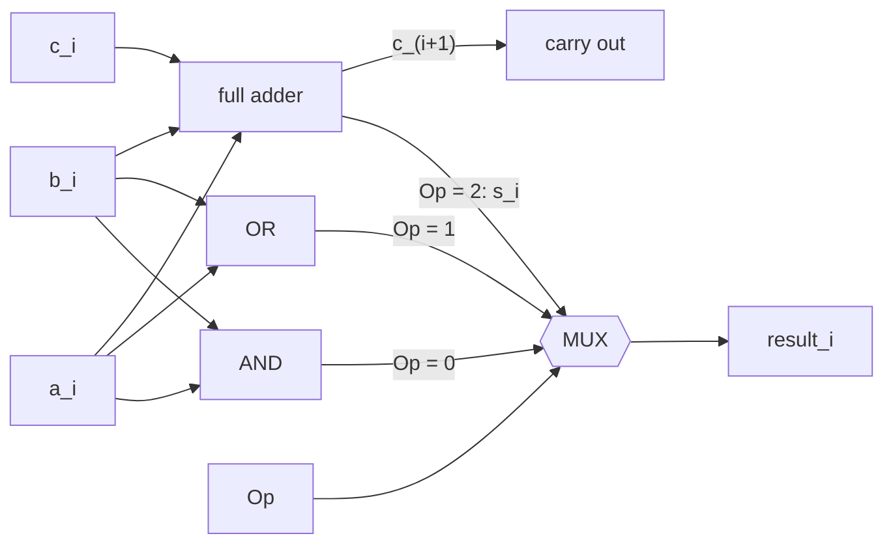
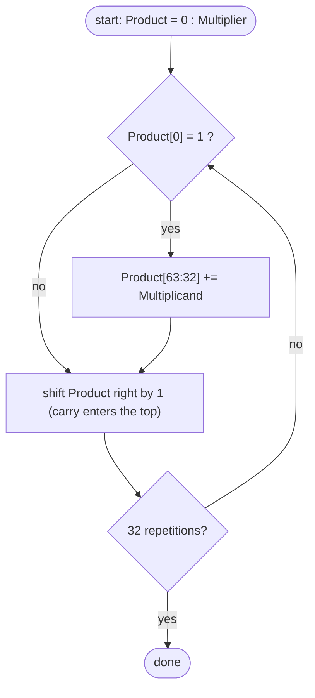
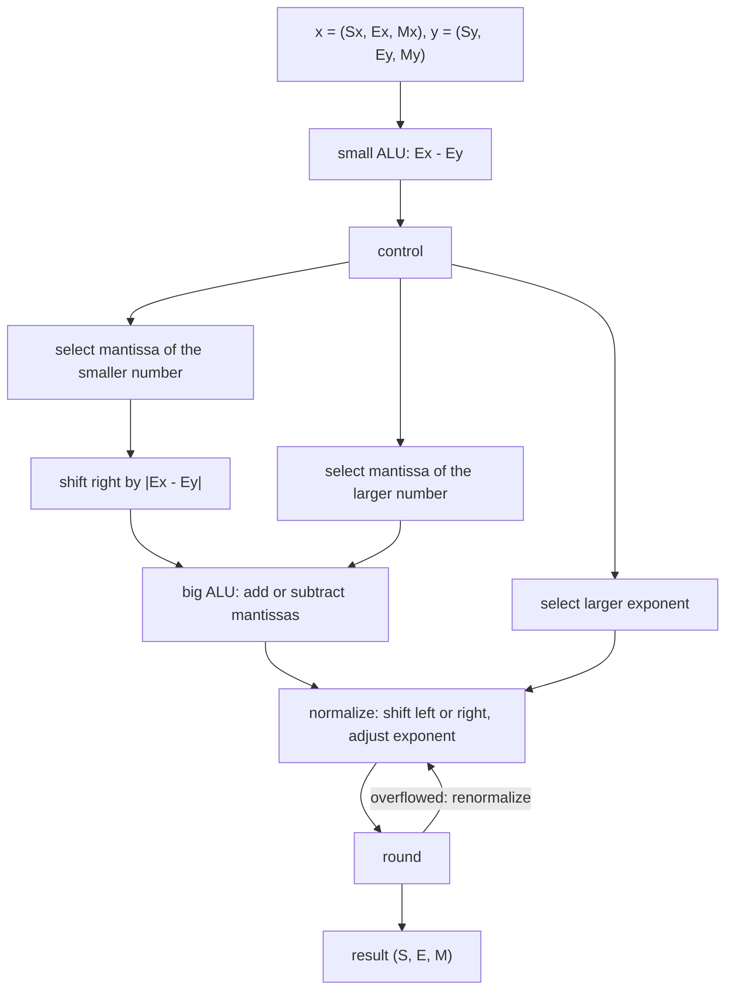

运算器是处理器中完成算术与逻辑运算的部件。上一章给出了数据在机器中的编码，本章讨论怎样用组合与时序电路在这些编码上实现运算：从 1 位的 ALU 出发，扩展位数与功能得到 RV32I 所需的 32 位 ALU；再用加法器、移位寄存器与控制逻辑实现乘法和除法；最后讨论浮点运算的步骤与舍入。门级的加法器设计（全加器、超前进位）已在[运算电路](/4.9.5)中讲过，这里只在需要时简述，重点是运算器在处理器中的组织方式。下一章把 ALU 放进数据通路，组成一个能执行 RISC-V 指令的处理器。

## 5.1. 运算器的功能与组成

运算器的基本功能是：

- 完成算术运算（$+, -, \times, \div$）和逻辑运算（与、或、非、异或、移位）；
- 给出运算结果的状态，如结果是否为零、是否溢出、正负、有无进位；
- 从寄存器组或数据总线取得操作数，把结果送回寄存器组或数据总线；
- 暂存运算的中间结果，如乘除法过程中的部分积、部分余数（使用专门的寄存器和移位寄存器）。

运算器本身不决定做什么运算，它由控制器产生的控制信号驱动。构成运算器的基本电路有四类：逻辑门完成逻辑运算，加法器完成加法，触发器组成的寄存器保存数据，多路选择器与移位器负责选择和连通数据的来源与去向。其中 ALU 是核心，它是一个组合电路：输入两个操作数 $a$、$b$ 和一个运算选择信号，输出运算结果，不保存任何状态。

## 5.2. ALU 的设计

### 5.2.1. 1 位 ALU

设计一个 ALU 的步骤是：确定功能（支持哪些运算），确定输入输出，写出真值表与逻辑表达式，再用逻辑电路实现。先设计只做与、或、加三种运算的 1 位 ALU：分别用与门、或门、全加器算出三种结果，再用一个多路选择器按运算选择信号 $\mathrm{Op}$ 输出其中之一。

1 位全加器有三个输入 $a_i, b_i, c_i$（$c_i$ 为低位来的进位）和两个输出：

$$
s_i = a_i \oplus b_i \oplus c_i, \qquad c_{i+1} = a_ib_i + a_ic_i + b_ic_i ,
$$
其中 $c_{i+1}$ 由真值表中四个使进位为 $1$ 的最小项化简得到。和 $s_i$ 是三个输入的异或，即三个输入中有奇数个 $1$ 时为 $1$。



### 5.2.2. 多位 ALU 与快速进位

把 $n$ 个 1 位 ALU 串联、每一位的进位输出接到高一位的进位输入，就得到 $n$ 位 ALU；最低位的进位输入做加法时为 $0$。这种串行进位（行波进位）加法器结构规整，但进位要从最低位逐级传到最高位，延迟与 $n$ 成正比：若一级全加器产生进位的延迟为 $2$ 个门延迟，$32$ 位加法就需要约 $64$ 个门延迟。

超前进位的思想是提前算出各位的进位。定义第 $i$ 位的生成信号 $g_i = a_ib_i$ 和传递信号 $p_i = a_i + b_i$：$a_i = b_i = 1$ 时这一位一定产生进位，$a_i = b_i = 0$ 时一定不产生进位，只有一个为 $1$ 时进位输出等于进位输入。于是 $c_{i+1} = g_i + p_ic_i$，逐次代入得

$$
\begin{aligned}
c_1 &= g_0 + p_0c_0, \\
c_2 &= g_1 + p_1g_0 + p_1p_0c_0, \\
c_3 &= g_2 + p_2g_1 + p_2p_1g_0 + p_2p_1p_0c_0, \\
c_4 &= g_3 + p_3g_2 + p_3p_2g_1 + p_3p_2p_1g_0 + p_3p_2p_1p_0c_0 ,
\end{aligned}
$$
每个进位都是两级与或电路，可以同时得到。位数增加时表达式迅速变长，实际做法是分组：$4$ 位一组算出组生成信号与组传递信号，再在组间做同样的超前进位，形成多级结构，延迟随 $\log n$ 增长。门级设计和延迟分析见[运算电路](/4.9.5)。估算 ALU 的最大延迟，就是沿进位链找出从输入到输出最长的一条门级路径。

### 5.2.3. 减法、比较与溢出

由上一章的补码性质 $a - b = a + {\sim}b + 1$，减法只需在加法器的 $b$ 输入前加一组异或门作为可控取反器，并让最低位的进位输入等于减法控制信号 $\mathrm{Sub}$：$\mathrm{Sub} = 0$ 时 $b_i \oplus 0 = b_i$、$c_0 = 0$，做加法；$\mathrm{Sub} = 1$ 时 $b_i \oplus 1 = \bar b_i$、$c_0 = 1$，做减法。加法与减法因此共用一个加法器。

许多处理器在运算后设置标志位，供后续的条件转移使用。设 $s = s_{n-1}\cdots s_0$ 为 $n$ 位结果，$c_n$ 为最高位的进位输出：

| 标志 | 含义 | 逻辑 |
|---|---|---|
| Z（zero） | 结果为零 | $Z = \overline{s_{n-1} + \cdots + s_1 + s_0}$ |
| N 或 S（negative） | 结果为负（按补码） | $N = s_{n-1}$ |
| C（carry） | 无符号运算的进位 | $C = c_n$ |
| V 或 OV（overflow） | 有符号运算溢出 | $V = c_n \oplus c_{n-1}$ |

**定理 5.2.1（补码加法的溢出判断）** 两个 $n$ 位补码 $a, b$ 相加，设和的最高位为 $s_{n-1}$，向最高位的进位为 $c_{n-1}$、最高位的进位输出为 $c_n$。以下三个条件等价：

1. 结果**溢出**，即真实的和超出 $[-2^{n-1}, 2^{n-1}-1]$；
2. $a_{n-1} = b_{n-1} \ne s_{n-1}$，即两个同号的数相加，结果的符号与它们相反；
3. $c_n \ne c_{n-1}$。

**证明** 异号的两数相加，和的绝对值不超过其中较大者，不会溢出；同号的两数相加，真实的和与它们同号，溢出时截断到 $n$ 位的结果与真实值相差 $2^n$，符号恰好相反，故 (1)$\Leftrightarrow$(2)。再看最高位：$s_{n-1} = a_{n-1} \oplus b_{n-1} \oplus c_{n-1}$，$c_n = a_{n-1}b_{n-1} + (a_{n-1} \oplus b_{n-1})c_{n-1}$。若 $a_{n-1} \ne b_{n-1}$，则 $c_n = c_{n-1}$，(2) 和 (3) 都不成立。若 $a_{n-1} = b_{n-1} = 0$，则 $c_n = 0$、$s_{n-1} = c_{n-1}$；若 $a_{n-1} = b_{n-1} = 1$，则 $c_n = 1$、$s_{n-1} = c_{n-1}$。两种情形下 $s_{n-1} \ne a_{n-1}$ 都等价于 $c_{n-1} \ne c_n$，故 (2)$\Leftrightarrow$(3)。$\square$

**例 5.2.1** $4$ 位补码 $0111 + 0001 = 1000$：$7 + 1$ 的真实结果 $8$ 超出 $[-8, 7]$，两个正数相加得到负数，$c_3 = 1 \ne c_4 = 0$，溢出。$1111 + 1111 = 1\,1110$：$(-1) + (-1) = -2$，$c_3 = c_4 = 1$，不溢出，丢弃的最高进位 $c_4 = 1$ 只对无符号运算有意义（$15 + 15$ 产生进位）。

比较运算也用减法完成。有符号比较 $a < b$ 当且仅当 $a - b$ 的真实值为负，即 $N \oplus V = 1$（溢出时符号位是反的）；无符号比较 $a < b$ 当且仅当 $a + {\sim}b + 1$ 不产生最高位进位，即 $C = 0$（相当于有借位）。$a = b$ 当且仅当 $a - b$ 的结果为零。

RISC-V 刻意不设标志位：条件转移指令 `beq`、`blt`、`bltu` 等直接比较两个寄存器，`slt`、`sltu` 把比较结果（$0$ 或 $1$）写入寄存器。这避免了标志位在流水线和乱序执行中带来的隐含依赖，代价是溢出检查要由软件完成。RISC-V 规范给出的写法是：

```asm
# unsigned addition: overflow iff the sum is smaller than an operand
add  t0, t1, t2
bltu t0, t1, overflow

# signed addition (general case): overflow iff (t2 < 0) != (t0 < t1)
add  t0, t1, t2
slti t3, t2, 0
slt  t4, t0, t1
bne  t3, t4, overflow
```

### 5.2.4. 移位器

RV32I 有三种移位：逻辑左移 `sll`、逻辑右移 `srl`（高位补 $0$）和算术右移 `sra`（高位补符号位，相当于有符号数除以 $2$ 的幂并向 $-\infty$ 取整）。移位量取 $b$ 的低 $5$ 位。

**定义 5.2.1（桶形移位器）** 由 $\lceil \log_2 n \rceil$ 级 $2$ 选 $1$ 多路选择器构成的组合移位电路称为**桶形移位器**（barrel shifter）：第 $i$ 级按移位量的第 $i$ 位决定是否把数据移动 $2^i$ 位，从而在一个时钟周期内完成任意位数的移位。

$32$ 位的桶形移位器有 $5$ 级，每级 $32$ 个多路选择器，延迟与 $\log n$ 成正比，比逐位移动的移位寄存器快得多。右移可以先把数据逐位反转、左移、再反转，从而与左移共用同一组电路；算术右移只需把移入的位由 $0$ 改为符号位。

### 5.2.5. RV32I 的 ALU

RV32I 的整数运算指令需要 ALU 支持 $10$ 种运算，另外为 `lui` 增加一种直接输出 $b$ 的运算。下表的 4 位运算编码取 $\{\mathtt{funct7}[5], \mathtt{funct3}\}$，使控制器从指令中几乎直接得到运算选择信号（下一章）：

| 运算 | 编码 | 结果 | 使用者 |
|---|---|---|---|
| ADD | `0000` | $a + b$ | `add`、`addi`、访存地址、`auipc`、`jal`、`jalr`、分支目标 |
| SUB | `1000` | $a - b$ | `sub` |
| SLL | `0001` | $a \ll b[4{:}0]$ | `sll`、`slli` |
| SLT | `0010` | 有符号 $a < b$ 时为 $1$ | `slt`、`slti` |
| SLTU | `0011` | 无符号 $a < b$ 时为 $1$ | `sltu`、`sltiu` |
| XOR | `0100` | $a \oplus b$ | `xor`、`xori` |
| SRL | `0101` | 逻辑右移 | `srl`、`srli` |
| SRA | `1101` | 算术右移 | `sra`、`srai` |
| OR | `0110` | $a \lor b$（按位） | `or`、`ori` |
| AND | `0111` | $a \land b$（按位） | `and`、`andi` |
| PASS B | `1111` | $b$ | `lui` |

用 SystemVerilog 描述时，只需写出每种运算的行为，加法器、移位器与比较器由综合工具从库中选择合适的结构（如超前进位加法器、桶形移位器）：

```systemverilog
package alu_pkg;
  typedef enum logic [3:0] {
    ALU_ADD  = 4'b0000, ALU_SUB = 4'b1000, ALU_SLL = 4'b0001, ALU_SLT = 4'b0010,
    ALU_SLTU = 4'b0011, ALU_XOR = 4'b0100, ALU_SRL = 4'b0101, ALU_SRA = 4'b1101,
    ALU_OR   = 4'b0110, ALU_AND = 4'b0111, ALU_B   = 4'b1111
  } alu_op_t;
endpackage

module alu
  import alu_pkg::*;
(
  input  logic [31:0] a, b,
  input  alu_op_t     op,
  output logic [31:0] y
);
  always_comb begin
    unique case (op)
      ALU_ADD:  y = a + b;
      ALU_SUB:  y = a - b;
      ALU_SLL:  y = a << b[4:0];
      ALU_SLT:  y = {31'b0, $signed(a) < $signed(b)};
      ALU_SLTU: y = {31'b0, a < b};
      ALU_XOR:  y = a ^ b;
      ALU_SRL:  y = a >> b[4:0];
      ALU_SRA:  y = $signed(a) >>> b[4:0];
      ALU_OR:   y = a | b;
      ALU_AND:  y = a & b;
      ALU_B:    y = b;
      default:  y = '0;
    endcase
  end
endmodule
```

## 5.3. 乘法

### 5.3.1. 无符号乘法

二进制乘法与十进制竖式相同，但更简单：乘数的每一位只能是 $0$ 或 $1$，部分积要么是被乘数，要么是 $0$。基本算法是：

1. 若乘数的当前位为 $1$，把被乘数加到部分积上；为 $0$ 则跳过；
2. 被乘数相对部分积左移一位，考察乘数的下一位；
3. 乘数的所有位处理完后，部分积就是乘积。

$n$ 位数乘 $m$ 位数，乘积最多 $n + m$ 位，$32$ 位乘法的结果是 $64$ 位。按这个算法，用一个加法器做 $32$ 次"加、移位"，硬件结构有逐步改进的三个版本：

| 版本 | 被乘数寄存器 | ALU | 乘积寄存器 | 乘数寄存器 | 每步操作 |
|---|---|---|---|---|---|
| 一 | 64 位，每步左移 | 64 位 | 64 位 | 32 位，每步右移 | 乘数最低位为 $1$ 时乘积 += 被乘数 |
| 二 | 32 位，固定 | 32 位 | 64 位，每步右移 | 32 位，每步右移 | 乘数最低位为 $1$ 时乘积高半部 += 被乘数 |
| 三 | 32 位，固定 | 32 位 | 64 位，低半部初始为乘数 | 无 | 乘积最低位为 $1$ 时高半部 += 被乘数，再整体右移 |

版本一的问题是被乘数寄存器有一半始终是 $0$，$64$ 位加法中每次只有 $32$ 位有用。版本二改为让部分积右移、被乘数不动，加法器缩为 $32$ 位。版本二中乘数寄存器每移出一位、部分积寄存器就空出一位，于是版本三把乘数放在乘积寄存器的低半部，两者一起右移，省去了乘数寄存器。加法的进位输出要在右移时移入乘积寄存器的最高位，因此高半部实际需要 $33$ 位。



**例 5.3.1** 用版本三计算 $4$ 位无符号数 $0010 \times 0011$（$2 \times 3$）：

| 步 | 乘积寄存器最低位 | 操作 | 乘积寄存器（高 4 位、低 4 位） |
|---|---|---|---|
| 0 | | 初始 | `0000 0011` |
| 1 | 1 | 高半部 += `0010`，右移 | `0010 0011` → `0001 0001` |
| 2 | 1 | 高半部 += `0010`，右移 | `0011 0001` → `0001 1000` |
| 3 | 0 | 右移 | `0000 1100` |
| 4 | 0 | 右移 | `0000 0110` |

结果 `0000 0110` $= 6$。

### 5.3.2. 有符号乘法与 Booth 算法

有符号乘法的第一种办法是：把两个补码转换为绝对值做无符号乘法，同号时乘积为正、异号时为负，再把结果转换回补码。它需要额外的求补步骤。第二种办法是直接对补码相乘，其代表是 Booth 算法（A. D. Booth，1951）。

Booth 算法的出发点是：乘法既可以看作加法的重复，也可以看作加法与减法的组合。十进制中 $6 \times 99 = 6 \times 100 - 6 \times 1 = 594$，只做一次加法和一次减法；二进制中 $7 \times 0011_2 = 7 \times (0100_2 - 0001_2) = -7 + 28 = 21$。一串连续的 $1$ 可以换成"在串的高端之上加一次、在串的低端减一次"。

**定理 5.3.1** 设 $y = y_{n-1}y_{n-2}\cdots y_0$ 是 $n$ 位补码，补充 $y_{-1} = 0$，则

$$
y = \sum_{i=0}^{n-1} (y_{i-1} - y_i)\, 2^i .
$$

**证明** 右边 $= \sum_{i=0}^{n-1} y_{i-1}2^i - \sum_{i=0}^{n-1} y_i 2^i = \sum_{j=0}^{n-2} y_j 2^{j+1} - \sum_{j=0}^{n-1} y_j 2^j = \sum_{j=0}^{n-2} y_j 2^j - y_{n-1}2^{n-1}$，正是补码 $y$ 的值。$\square$

因此 $x \cdot y = \sum_{i=0}^{n-1} (y_{i-1} - y_i)\, x \cdot 2^i$：每一步考察乘数的相邻两位 $(y_i, y_{i-1})$，按差 $y_{i-1} - y_i \in \{-1, 0, 1\}$ 决定对部分积加 $x$、减 $x$ 或不操作，然后右移。

**定义 5.3.1（Booth 算法）** 用补码直接计算 $x \cdot y$ 的如下算法称为 **Booth 算法**：在乘数最低位之后附加一位 $y_{-1} = 0$，部分积初值为 $0$；重复 $n$ 次，每次按乘数当前最低位 $y_i$ 与附加位 $y_{i-1}$ 的组合修改部分积，再把部分积、乘数与附加位整体算术右移一位：

| $y_i$ | $y_{i-1}$ | 操作 | 含义 |
|---|---|---|---|
| 0 | 0 | $+0$ | 在一串 $0$ 的中间 |
| 0 | 1 | $+[x]_{\text{补}}$ | 一串 $1$ 的结束（高端） |
| 1 | 0 | $-[x]_{\text{补}}$，即 $+[-x]_{\text{补}}$ | 一串 $1$ 的开始（低端） |
| 1 | 1 | $+0$ | 在一串 $1$ 的中间 |

算法不必区分符号位与数值位，乘数的符号位也照常参与，最终得到 $2n$ 位的补码乘积。右移必须是算术右移，以保持部分积的符号。

**例 5.3.2** 用 $4$ 位补码计算 $2 \times (-5)$：$[x]_{\text{补}} = 0010$，$[-x]_{\text{补}} = 1110$，$[y]_{\text{补}} = 1011$。寄存器由部分积 $A$（4 位）、乘数 $Q$（4 位）与附加位 $Q_{-1}$ 组成：

| 步 | $(Q_0, Q_{-1})$ | 操作 | 操作后的 $A$ | 算术右移后 $A$、$Q$、$Q_{-1}$ |
|---|---|---|---|---|
| 0 | | 初始 | | `0000` `1011` `0` |
| 1 | $(1, 0)$ | $A - x$ | `1110` | `1111` `0101` `1` |
| 2 | $(1, 1)$ | 不操作 | `1111` | `1111` `1010` `1` |
| 3 | $(0, 1)$ | $A + x$ | `0001` | `0000` `1101` `0` |
| 4 | $(1, 0)$ | $A - x$ | `1110` | `1111` `0110` `1` |

乘积 $AQ = 1111\,0110 = -10$。

Booth 算法在乘数中有长串的 $1$ 时减少了加法次数，但最坏情况（$0101\cdots$ 交替）反而每步都要加减。它的真正价值在于统一处理有符号数，以及下一节的基 4 推广。

### 5.3.3. 快速乘法与 RISC-V M 扩展

移位相加的乘法器需要 $n$ 个时钟周期，现代处理器用组合电路在几个周期内完成乘法，主要有三种技术：

- 基 4 Booth 编码（radix-4 Booth encoding），也称改进的 Booth 算法：每次考察乘数的三位 $(y_{2i+1}, y_{2i}, y_{2i-1})$，把乘数改写为以 $4$ 为基、数字取自 $\{-2, -1, 0, 1, 2\}$ 的形式，部分积的个数减半，每个部分积只需对 $x$ 做移位与求补。
- 进位保留加法与 Wallace 树：用全加器把三个数压缩为两个数（一个和、一个进位，不做进位传播），这样的一排全加器称为进位保留加法器（carry-save adder）；把 $n$ 个部分积排成树形逐层压缩，经 $O(\log n)$ 层得到两个数，最后用一个快速加法器相加。
- 流水化：把乘法器分成几级，每个周期都可以开始一次新的乘法。

阵列乘法器把 $n \times n$ 个与门和全加器排成规则阵列，结构简单但延迟与 $n$ 成正比，适合小位宽和教学。

RISC-V 的乘除法不在基本整数指令集中，而在 M 扩展中（只要乘法、不要除法的实现可以只支持 Zmmul 子集）。$32$ 位乘以 $32$ 位的 $64$ 位乘积由两条指令分别取低半部和高半部：

| 指令 | 结果 |
|---|---|
| `mul rd, rs1, rs2` | 乘积的低 $32$ 位（有符号、无符号相同） |
| `mulh` / `mulhu` / `mulhsu` | 乘积的高 $32$ 位：有符号 × 有符号 / 无符号 × 无符号 / 有符号 × 无符号 |
| `mulw`（RV64） | 低 $32$ 位乘积，符号扩展到 $64$ 位 |

需要完整乘积时，规范建议按 `mulh rdh, rs1, rs2` 紧接 `mul rdl, rs1, rs2` 的顺序书写（源寄存器相同、`rdh` 不等于 `rs1`、`rs2`），处理器可以把两条指令融合为一次乘法。

## 5.4. 除法

除法与乘法有类似的问题：要用加法器与寄存器配合，被除数更长，商要一位一位地求出。区别在于每一步都要先判断"够不够减"，才能确定这一位商。

### 5.4.1. 恢复余数除法

以 $2n$ 位的被除数（高 $n$ 位为 $0$ 的 $n$ 位无符号数）除以 $n$ 位除数 $D$ 为例。余数寄存器 $R$ 为 $2n$ 位，初值为被除数；被除数的低位部分与最终的商合用寄存器的低半部，余数与商同时左移。

**定义 5.4.1（恢复余数除法）** 重复 $n$ 次：把 $R$ 左移一位；从 $R$ 的高半部减去除数 $D$；若差 $\ge 0$，保留差并令商的这一位（$R$ 的最低位）为 $1$；若差 $< 0$，把除数加回去（恢复余数），商的这一位为 $0$。结束后 $R$ 的高半部是余数，低半部是商。这种算法称为**恢复余数除法**（restoring division）。

硬件是一个 $n$ 位除数寄存器、一个 $n$ 位 ALU 和一个 $2n$ 位的余数寄存器（可左移），与乘法器的版本三结构对称。

**例 5.4.1** $4$ 位无符号数 $0111 \div 0010$（$7 \div 2$），$R$ 初值为 `0000 0111`：

| 步 | 左移后 $R$ | 高半部 $- D$ | 判断 | 本步结束时 $R$ |
|---|---|---|---|---|
| 1 | `0000 1110` | $0 - 2 = -2$ | $< 0$，恢复，商 0 | `0000 1110` |
| 2 | `0001 1100` | $1 - 2 = -1$ | $< 0$，恢复，商 0 | `0001 1100` |
| 3 | `0011 1000` | $3 - 2 = 1$ | $\ge 0$，商 1 | `0001 1001` |
| 4 | `0011 0010` | $3 - 2 = 1$ | $\ge 0$，商 1 | `0001 0011` |

余数 `0001` $= 1$，商 `0011` $= 3$。

### 5.4.2. 不恢复余数除法

恢复余数要多做一次加法，而且步数依赖数据。实际的计算机从不这样做，而是直接用负的余数求下一位商。

**定理 5.4.1** 设第 $i$ 步的余数为 $R_i$（左移前），下一步的余数按恢复余数法为 $R_{i+1}$。若 $R_i < 0$，则先恢复再左移、减除数，与不恢复而直接左移、加除数的结果相同：

$$
2(R_i + D) - D = 2R_i + D .
$$

**证明** 恢复余数法在 $R_i < 0$ 时先得到 $R_i + D$，下一步左移一位再减 $D$，得 $2(R_i + D) - D$，展开即 $2R_i + D$。$\square$

**定义 5.4.2（不恢复余数除法）** 每一步按上一步余数的符号决定运算：余数 $\ge 0$ 时左移后减 $D$，余数 $< 0$ 时左移后加 $D$；新余数 $\ge 0$ 时商的这一位为 $1$，否则为 $0$。$n$ 步之后若余数为负，再加一次 $D$ 修正余数。这种算法称为**不恢复余数除法**（non-restoring division），也称加减交替法。

每一步恰好做一次加法或减法，控制简单、步数固定。

**例 5.4.2** 仍计算 $7 \div 2$，记录余数的真值（硬件中余数寄存器的高半部要多一位符号位）。被除数的各位从高到低依次移入：

| 步 | 上步余数符号 | 运算 | 新余数 | 商位 |
|---|---|---|---|---|
| 1 | （初值 $0$） | $2 \cdot 0 + 0 - 2$ | $-2$ | 0 |
| 2 | 负 | $2 \cdot (-2) + 1 + 2$ | $-1$ | 0 |
| 3 | 负 | $2 \cdot (-1) + 1 + 2$ | $1$ | 1 |
| 4 | 正 | $2 \cdot 1 + 1 - 2$ | $1$ | 1 |

商 $0011 = 3$，余数 $1$ 非负，无需修正。

补码除法与原码除法类似：直接用补码相除，第一步按被除数与除数是否同号决定做减法还是加法；此后余数与除数同号时商 $1$、下一步做减法，异号时商 $0$、下一步做加法；最后对商做修正（多求一位后舍入，或令最低位恒为 $1$）。实际处理器更常见的做法是先取绝对值做无符号除法，再按符号规则调整结果。

### 5.4.3. 有符号除法与 RISC-V 的除法指令

有符号除法要求被除数 $=$ 商 $\times$ 除数 $+$ 余数，且 $\lvert\text{余数}\rvert < \lvert\text{除数}\rvert$；满足这两条的 $(q, r)$ 有两组，需要再约定余数的符号。C、C++ 和 RISC-V 都规定商向零取整，因而余数与被除数同号：

| 运算 | 商 | 余数 |
|---|---|---|
| $7 \div 2$ | $3$ | $1$ |
| $-7 \div 2$ | $-3$ | $-1$ |
| $7 \div (-2)$ | $-3$ | $1$ |
| $-7 \div (-2)$ | $3$ | $-1$ |

这保证了 $-(x \div y) = (-x) \div y$。Python 的 `//` 与 `%` 则向 $-\infty$ 取整，余数与除数同号（[数据、变量与表达式](/4.1.2)）。

M 扩展提供 `div`、`divu`（商）与 `rem`、`remu`（余数），RV64 另有 `divw`、`remw` 等 $32$ 位版本。RISC-V 不因除法产生异常，两种特殊情况的结果是规定好的（设 $L$ 为寄存器位数）：

| 情况 | `div` / `divu` 的商 | `rem` / `remu` 的余数 |
|---|---|---|
| 除以零 | 全 $1$（`div` 为 $-1$，`divu` 为 $2^L-1$） | 被除数 |
| 有符号溢出：$-2^{L-1} \div (-1)$ | $-2^{L-1}$ | $0$ |

这种设计使除法单元不必产生异常，需要检查除零的语言可以在除法前加一条分支。与乘法相同，需要商和余数时按 `div` 紧接 `rem` 书写，便于硬件融合。

除法是最慢的整数运算，现代处理器使用更快的算法：SRT 除法（以 Sweeney、Robertson、Tocher 命名）允许商的每一位取 $\{-1, 0, 1\}$，只需查看部分余数的最高几位就能选商，还可以每步求出 $2$ 位或更多位商（1994 年 Intel Pentium 的浮点除法错误就源于 SRT 选商查找表中缺失的几项）；Newton–Raphson 迭代与 Goldschmidt 算法则用快速乘法器迭代求除数的倒数，每次迭代有效位数加倍，常用于浮点除法。

## 5.5. 浮点运算

### 5.5.1. 浮点加减法

设 $x = M_x \times 2^{E_x}$、$y = M_y \times 2^{E_y}$。浮点加减法的步骤是：

1. 对阶：求阶差 $\Delta E = E_x - E_y$，把阶码小的数的尾数右移 $\lvert\Delta E\rvert$ 位，其阶码取大的阶码值（右移出的位保存下来用于舍入）；
2. 尾数加减：尾数是原码，同号相加，异号时用绝对值大的减去小的，结果取绝对值大者的符号；
3. 规格化：若结果尾数 $\ge 2$，右移一位、阶码加 $1$；若最高位为 $0$，左移直到最高位为 $1$，每移一位阶码减 $1$；
4. 舍入：按舍入方式把尾数舍入到格式的精度，舍入可能使尾数再次 $\ge 2$，需要再规格化一次；
5. 检查结果：阶码超出范围时上溢（结果为 $\pm\infty$）或下溢（结果为非规格化数或 $0$），并设置相应的异常标志。

**例 5.5.1** 用 $4$ 位精度的二进制尾数计算 $0.5 + (-0.4375)$。$0.5 = 1.000_2 \times 2^{-1}$，$-0.4375 = -1.110_2 \times 2^{-2}$。

1. 对阶：较小的数右移 $1$ 位，$-1.110_2 \times 2^{-2} = -0.111_2 \times 2^{-1}$；
2. 尾数相加：$1.000_2 - 0.111_2 = 0.001_2$，结果为 $0.001_2 \times 2^{-1}$；
3. 规格化：左移 $3$ 位，得 $1.000_2 \times 2^{-4}$；阶码 $-4$ 在单精度的 $[-126, 127]$ 之内，没有上溢或下溢；
4. 舍入：尾数恰好是 $4$ 位，无需舍入。

结果 $1.000_2 \times 2^{-4} = 0.0625$，正确。

浮点加法器的硬件按这些步骤组织：一个小 ALU 计算阶差，它同时控制三个多路选择器，选出较大的阶码、较大数的尾数和需要右移的尾数；右移器完成对阶；大 ALU 做尾数加减；之后是规格化（前导零检测加移位器，同时调整阶码）和舍入部件，舍入后若需要再规格化则回到规格化部件。硬件开销主要取决于指数和尾数的位宽。



### 5.5.2. 舍入的实现

IEEE 754 要求基本运算的结果等于精确结果按当前舍入方式舍入后的值（正确舍入）。硬件不可能保存对阶时移出的全部位，但只需在尾数的最低位之后多保留三位：

**定义 5.5.1（保护位、舍入位与粘滞位）** 浮点运算中，在尾数最低有效位之后额外保留的第一位称为**保护位**，第二位称为**舍入位**（round bit），再往后的所有位的逻辑或称为**粘滞位**（sticky bit）：只要后面有任何一位为 $1$，粘滞位就是 $1$。

保护位用于规格化左移一位时补进尾数，舍入位与粘滞位合起来判断被舍去的部分与"一半"的大小关系。就近舍入（平局取偶）时，设规格化后尾数之后的两位为 $G$（这时已处在舍入位的角色）和 $S'$（其后所有位的或）：$G = 0$ 时舍去；$G = 1$ 且 $S' = 1$ 时进位；$G = 1$ 且 $S' = 0$ 恰为平局，尾数最低位为 $1$ 时进位、为 $0$ 时舍去。

**例 5.5.2** 用 $4$ 位精度计算 $1.000_2 \times 2^0 + 1.001_2 \times 2^{-4}$（即 $1 + 0.0703125$）。对阶时第二个数右移 $4$ 位，为 $0.000\,1001_2$：保留在尾数中的是 $0.000$，保护位 $G = 1$、舍入位 $R = 0$，移出的其余位 $01$ 的或使粘滞位 $S = 1$。尾数相加得 $1.000$，其后的 $GRS = 101$，被舍去的部分大于一半，进位得 $1.001_2 = 1.125$。精确结果 $1.0703125$ 与 $1.125$、$1$ 的距离分别是 $0.0547$ 和 $0.0703$，进位是正确的。如果没有粘滞位，只看 $GR = 10$ 会误判为平局，按"取偶"得到错误的 $1.000$。

### 5.5.3. 浮点乘法

浮点乘法比加法简单，不需要对阶：

1. 阶码相加：$E = E_x + E_y$。用移码表示时两个移码相加会多出一个偏移量，要减去 $127$（单精度）；
2. 尾数相乘（无符号乘法）：两个 $[1, 2)$ 中的尾数之积在 $[1, 4)$ 中；
3. 规格化：积 $\ge 2$ 时右移一位、阶码加 $1$；
4. 舍入，可能需要再次规格化；
5. 检查阶码的上溢、下溢；
6. 符号为两个符号的异或。

除法与之对称：阶码相减（再加上偏移量），尾数相除。

**例 5.5.3** 计算 $0.5 \times (-0.4375) = (1.000_2 \times 2^{-1}) \times (-1.110_2 \times 2^{-2})$。阶码：$-1 + (-2) = -3$，移码为 $126 + 125 - 127 = 124$。尾数：$1.000_2 \times 1.110_2 = 1.110000_2$，已规格化，舍入到 $4$ 位为 $1.110_2$。符号：$0 \oplus 1 = 1$。结果 $-1.110_2 \times 2^{-3} = -0.21875$，正确。

现代处理器普遍提供融合乘加（fused multiply-add），简称 FMA，即 $a \times b + c$：乘积不经舍入就与 $c$ 相加，整个运算只舍入一次，比分开的乘法与加法更快也更准确。IEEE 754-2008 把它列为基本运算，RISC-V 的 `fmadd.s`、`fmsub.s`、`fnmadd.s`、`fnmsub.s` 即是。

### 5.5.4. 浮点运算的性质

浮点加法满足交换律，但不满足结合律。取 $x = -1.5 \times 10^{38}$、$y = 1.5 \times 10^{38}$、$z = 1.0$（单精度）：

$$
x + (y + z) = -1.5\times10^{38} + 1.5\times10^{38} = 0.0, \qquad (x + y) + z = 0.0 + 1.0 = 1.0 .
$$
$y + z$ 中的 $1.0$ 远小于 $y$ 的最低有效位，被舍入吸收。因此编译器不能随意重排浮点运算，并行求和的结果也可能随线程数变化。

浮点数的相等比较要格外小心：

```c
for (float i = 0; i != 10; i += 0.1f) { /* ... */ }   /* may never terminate */
```

$0.1$ 不能精确表示，累加 $100$ 次的结果不恰好等于 $10$，循环永不终止。循环变量应使用整数，比较浮点数时应允许一定的误差。数值误差的系统分析见[数在计算机中的表示](/3.5.1)。

### 5.5.5. 浮点运算部件与 RISC-V 的 F/D 扩展

早期的浮点运算由独立的协处理器完成：Intel 8087（1980 年）与 80287 有自己的控制逻辑和 $8$ 个 $80$ 位的浮点寄存器，按栈的方式组织（x87），与主处理器协同工作。1989 年的 80486DX 首次把浮点运算单元集成到处理器芯片内。今天的处理器还通过单指令多数据（SIMD）技术并行处理多个浮点数：x86 的 SSE、AVX、AVX-512 一条指令处理 $128$ 到 $512$ 位的数据，RISC-V 的 V 扩展提供长度可变的向量指令；高度并行的浮点计算则交给 GPU（上一章的低精度格式部分）。

RISC-V 的浮点运算由标准扩展提供：F（单精度）、D（双精度）、Q（四精度），以及半精度的 Zfh。它们的要点是：

- 独立的 $32$ 个浮点寄存器 `f0`–`f31`，调用约定中的 ABI 名为 `ft0`–`ft11`（临时）、`fs0`–`fs11`（被调用者保存）、`fa0`–`fa7`（参数与返回值）；
- 浮点控制状态寄存器 `fcsr` 包含舍入方式 `frm`（上一章）与累积的异常标志 `fflags`：NV（无效运算）、DZ（除以零）、OF（上溢）、UF（下溢）、NX（不精确）。RISC-V 的浮点异常只设置标志、不产生陷阱，需要时由软件查询；
- 指令包括 `fadd.s`、`fsub.s`、`fmul.s`、`fdiv.s`、`fsqrt.s`、融合乘加、`fmin.s` / `fmax.s`、比较 `feq.s` / `flt.s` / `fle.s`（结果写入整数寄存器）、整数与浮点之间的转换 `fcvt`，以及按位搬运 `fmv.x.w` / `fmv.w.x`；`.d` 后缀为双精度版本；
- 运算产生 NaN 时，结果是规范的 NaN（单精度为 `0x7FC00000`），简化了硬件。

## 小结

| 主题 | 要点 |
|---|---|
| ALU | 组合电路；1 位 ALU = 与、或、全加器 + 多路选择器；串行进位延迟 $O(n)$，超前进位 $O(\log n)$ |
| 减法与比较 | $a - b = a + {\sim}b + 1$；溢出 $V = c_n \oplus c_{n-1}$；有符号 $a < b \iff N \oplus V$，无符号 $a < b \iff C = 0$；RISC-V 无标志位 |
| 移位 | 桶形移位器：$\log_2 n$ 级多路选择器；`sll`、`srl`、`sra` |
| 乘法 | 移位相加，版本三：$32$ 位被乘数、$32$ 位 ALU、乘数放在 $64$ 位乘积寄存器低半部；Booth 算法按 $(y_i, y_{i-1})$ 加减被乘数；快速乘法：基 4 Booth、Wallace 树 |
| 除法 | 恢复余数法；不恢复余数法 $2(R + D) - D = 2R + D$；商向零取整、余数与被除数同号；RISC-V 除零与溢出有规定结果，不产生异常 |
| 浮点加法 | 对阶、尾数加减、规格化、舍入、检查溢出；保护位、舍入位、粘滞位实现正确舍入 |
| 浮点乘法 | 阶码相加减偏移、尾数相乘、规格化、舍入、符号异或；FMA 只舍入一次 |
| 性质 | 不满足结合律；不要用 `==` 比较浮点数 |
| RISC-V | M 扩展：`mul`、`mulh[s][u]`、`div[u]`、`rem[u]`；F/D 扩展：`f0`–`f31`、`fcsr`（`frm`、`fflags`） |
