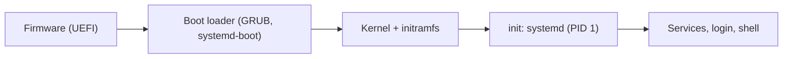

Every program on a computer runs on top of an operating system. The program sees a private processor, a large private memory, files that survive a reboot and a network that delivers messages; the hardware offers a few cores, a limited amount of physical memory shared by everything, storage devices that read and write numbered blocks, and network cards that move frames. The operating system builds the first picture out of the second, shares the hardware among many programs and users, and keeps them from interfering with each other. This chapter describes what an operating system is, how it came to look the way it does, and the hardware mechanism on which all of it rests: the processor runs in two privilege modes, and programs enter the operating system only through well-defined doors, the system calls. The following chapters take the three big themes in turn: virtualizing the processor ([4.11.2](/4.11.2), [4.11.3](/4.11.3)) and memory ([4.11.4](/4.11.4), [4.11.5](/4.11.5)), concurrency ([4.11.6](/4.11.6)), and persistence ([4.11.7](/4.11.7), [4.11.8](/4.11.8)); the last three chapters turn to virtual machines and containers and to the practical use of Linux on workstations, servers and clusters. The hardware side (instruction sets, privilege modes of RISC-V, the processor) is the subject of [4.10](/4.10); here we take the programmer's and the system designer's view, with Linux on x86-64 as the running example.

## 1.1. What an Operating System Does

### 1.1.1. Definition and Roles

**Definition 1.1.1 (Operating System)** An **operating system** (OS) is the software that manages the hardware resources of a computer (processors, memory, storage and other devices) and provides programs with abstractions of them through a fixed interface. The part of it that runs with full hardware privileges, permanently resident in memory, is the **kernel**; the rest (the shell, system libraries, service programs) runs as ordinary programs.

An operating system plays three roles at once:

- *Illusionist*: it turns a limited physical resource into an abstraction that is easier to use and appears unlimited or private. One processor becomes many processes, a few gigabytes of RAM become a private address space for each program, a disk of numbered blocks becomes a tree of named files.
- *Referee*: it decides who gets which resource and when (scheduling, memory allocation, disk quotas) and isolates programs and users from each other, so that a faulty or malicious program cannot read another's memory or crash the machine.
- *Glue*: it provides common services every program needs (a file system, networking, a clock, a terminal), so that applications do not have to drive each device themselves.

The standard textbook organization (Arpaci-Dusseau, *Operating Systems: Three Easy Pieces*) groups the work into three themes, which this course follows:

| Theme | Question | Physical resource → abstraction | Chapters |
|---|---|---|---|
| Virtualization | How does one machine look like many? | CPU → processes and threads; RAM → address spaces | 4.11.2–4.11.5 |
| Concurrency | How do activities that share data run correctly at the same time? | locks, condition variables, semaphores | 4.11.6 |
| Persistence | How does data survive crashes and power loss? | disks and SSDs → files and directories | 4.11.7–4.11.8 |

Security cuts across all three: isolation between processes, permissions on files, and the boundary between user programs and the kernel.

### 1.1.2. Design Goals

The design of an operating system is a balance between several goals:

- Abstraction: programs should be written against simple, stable interfaces (a file, a process) rather than against particular hardware.
- Performance: the operating system is overhead. Its mechanisms must cost little time (a system call takes about a hundred nanoseconds, §1.4.3) and little space.
- Protection and isolation: one program's errors must not affect another; the kernel must not trust any input from user programs.
- Reliability: the kernel runs all the time, and a bug in it brings the whole machine down.
- Energy efficiency, security and portability matter more or less depending on the platform (a phone, a laptop, a cluster node).

A recurring design principle is the *separation of mechanism and policy*: the kernel implements a low-level mechanism (how to switch from one process to another, how to map a page) and keeps the policy that uses it (which process runs next, which page to evict) separate and replaceable. Scheduling policies in [4.11.3](/4.11.3) and page-replacement policies in [4.11.4](/4.11.4) are the main examples.

## 1.2. A Short History

Operating systems grew out of the effort to keep expensive machines busy, and later out of the wish to share them comfortably.

| Period | Development | Idea it introduced |
|---|---|---|
| 1950s | Batch systems (e.g. GM-NAA I/O for the IBM 704): an operator feeds a queue of jobs; a resident monitor loads one after another | Libraries of device routines; the first "operating system" was a job loader |
| 1960s | *Multiprogramming*: several jobs reside in memory, and the CPU switches to another one whenever the running job waits for I/O (IBM OS/360) | Overlapping computation with I/O; the need for memory protection |
| 1960s | *Time-sharing*: many interactive users share one machine, each getting short time slices (CTSS at MIT 1961, Multics 1969) | Interactive response; hierarchical file systems; protection rings |
| 1969–1980s | Unix (Thompson and Ritchie at Bell Labs, rewritten in C in 1973); BSD at Berkeley added virtual memory and networking (TCP/IP sockets) | Small composable programs, "everything is a file", pipes, a portable kernel in a **high-level language** |
| 1980s | Personal computers (MS-DOS, early Mac OS) without protection; POSIX (IEEE 1003.1, 1988) standardized the Unix interface | A common API for Unix-like systems |
| 1991– | Linux (Linus Torvalds), combined with the GNU user-space tools; Windows NT (1993); macOS on the Darwin/XNU kernel (2001) | Free software kernels; the operating systems still dominant today |
| 2000s– | Virtual machines on commodity hardware, smartphones (iOS; Android on the Linux kernel), cloud computing, containers | Operating systems on top of other operating systems ([4.11.9](/4.11.9)) |

Today almost every computer runs one of three kernel families. The Linux kernel runs Android phones, most servers and cloud instances, embedded devices and, since November 2017, every one of the 500 fastest supercomputers in the TOP500 list. Windows dominates desktop computers, and Apple's XNU kernel runs macOS and iOS. macOS is a certified Unix (it complies with the POSIX standard), and Linux is Unix-like; Windows has its own interface (the Win32 API) and runs Linux programs through WSL (§1.5.4).

## 1.3. Kernel Mode and User Mode

### 1.3.1. Privilege Modes

If every program could execute every instruction, any program could overwrite the kernel, reprogram a disk controller or disable the timer, and isolation would be impossible. The solution is in hardware.

**Definition 1.3.1 (User Mode and Kernel Mode)** A processor that supports an operating system has at least two privilege levels. In **kernel mode** (supervisor mode) code may execute every instruction and access all memory and devices. In **user mode** the *privileged instructions* (changing the page table, disabling interrupts, accessing I/O devices directly, halting the processor) are forbidden, and memory accesses are restricted to what the kernel has permitted; an attempt to violate these rules causes an exception that transfers control to the kernel.

The kernel runs in kernel mode and every application in user mode. Each **instruction set architecture** has its own names for the levels:

| Architecture | Levels (least to most privileged) | Linux uses |
|---|---|---|
| x86-64 | rings 3, 2, 1, 0 (rings 1–2 unused today) | ring 3 for user programs, ring 0 for the kernel |
| ARMv8 / ARMv9 | EL0, EL1, EL2 (hypervisor), EL3 (secure monitor) | EL0 and EL1 |
| **RISC-V** | U, S, M (machine mode, firmware); H extension for hypervisors ([4.10.3](/4.10.3)) | U and S |

Mode switches happen in only two directions. User code cannot simply jump into kernel mode: it enters the kernel only through an exception, at an address that the kernel itself stored in a protected table when it booted. The kernel returns to user mode with a special instruction (`sysret` or `iret` on x86-64, `sret` on RISC-V) that lowers the privilege level and jumps back in one step.

### 1.3.2. Exceptions, Interrupts and Traps

A program normally executes instructions one after another, with jumps and calls changing the order in ways the program chose. *Exceptional control flow* is a change in control flow caused by an event that the program did not express as a jump: a key press, the expiry of a timer, a division by zero, a request to the kernel. It is the mechanism by which the kernel gets control.

**Definition 1.3.2 (Exception)** An **exception** is an abrupt transfer of control from the running program to the kernel in response to an event, caused either by the instruction being executed or by an external device. The processor saves enough state to resume the program (at least the program counter and the processor status), switches to kernel mode, and jumps to an *exception handler* whose address it takes from the *exception table* (on x86-64, the interrupt descriptor table), indexed by the exception number.

Following Bryant and O'Hallaron (*Computer Systems: A Programmer's Perspective*), exceptions fall into four classes.

**Definition 1.3.3 (Interrupt, Trap, Fault, Abort)** An **interrupt** is an exception caused asynchronously by a device outside the processor (a timer, a network card, a disk controller signalling completion); after handling it, the processor resumes the interrupted program at the next instruction. A **trap** is an intentional exception caused by executing a special instruction, mainly to request a service from the kernel; control returns to the next instruction. A **fault** is caused by an instruction that the kernel might be able to fix (a page fault, [4.11.4](/4.11.4)); if the handler fixes the cause, the faulting instruction is executed again, otherwise the program is terminated. An **abort** is an unrecoverable hardware error (such as an uncorrectable memory error); the program, or the whole machine, is stopped.

| Class | Cause | Synchronous? | Returns to |
|---|---|---|---|
| Interrupt | signal from an I/O device or timer | no | next instruction |
| Trap | intentional (`syscall`, `ecall`, `int3`) | yes | next instruction |
| Fault | potentially recoverable error (page fault, division by zero, protection violation) | yes | the same instruction, or never |
| Abort | unrecoverable hardware error | yes | never |

Terminology varies: Intel and RISC-V call all four "exceptions" or "traps" (RISC-V uses "trap" for the transfer of control, "exception" for synchronous causes and "interrupt" for asynchronous ones), and many textbooks use "interrupt" for all of them. The behavior is the same everywhere. Two consequences matter for everything that follows. First, the timer interrupt guarantees that the kernel regains control periodically even if a program runs an infinite loop; this is how the kernel shares one processor among many processes ([4.11.2](/4.11.2)). Second, faults let the kernel make memory appear present before it is: the first access to a page that is not yet in memory faults, the kernel loads the page and the instruction is retried, invisibly to the program ([4.11.4](/4.11.4)).

### 1.3.3. Kernel Architectures

How much of the operating system runs in kernel mode is a design choice.

- A *monolithic kernel* runs the scheduler, memory management, file systems, network stack and device drivers in kernel mode, in one address space. Calls between subsystems are ordinary function calls, which is fast; a bug in any driver can crash the whole system. Linux and the BSDs are monolithic; Linux reduces the rigidity with loadable kernel modules (drivers loaded at run time, `lsmod`, `modprobe`) and with eBPF, which lets verified user-supplied programs run safely inside the kernel for tracing, networking and, since Linux 6.12, scheduling.
- A *microkernel* keeps only the minimum in kernel mode (address spaces, threads, inter-process communication) and runs file systems, drivers and network stacks as user-mode server processes that communicate by messages (Mach, QNX, the formally verified seL4). Faults are contained, but every service request costs extra mode switches and messages.
- Hybrid kernels (Windows NT, Apple's XNU) start from a microkernel design and move performance-critical services back into kernel mode.

## 1.4. System Calls

### 1.4.1. The System Call Interface

**Definition 1.4.1 (System Call)** A **system call** is a request from a user program to the kernel for a service that requires kernel privileges, such as reading a file, creating a process or allocating memory. It is made by executing a trap instruction with the number of the requested service and its arguments in agreed registers; the kernel validates the arguments, performs the service in kernel mode and returns a result to the program.

The system call interface is the boundary of the kernel: it is the only way for a program to affect anything outside its own memory. On Linux there are about 350–460 system calls, depending on the architecture. They are grouped as follows:

| Category | Examples |
|---|---|
| Processes | `fork`/`clone`, `execve`, `exit`, `wait4`, `kill`, `getpid` |
| Memory | `mmap`, `munmap`, `brk`, `mprotect` |
| Files and directories | `openat`, `read`, `write`, `close`, `lseek`, `stat`, `mkdir`, `unlink`, `rename` |
| Devices and I/O | `ioctl`, `poll`, `epoll_wait`, `io_uring_enter` |
| Communication | `pipe`, `socket`, `connect`, `sendmsg` |
| Time and information | `clock_gettime`, `nanosleep`, `uname` |

Programs rarely execute the trap instruction themselves. The C library (glibc on most Linux distributions, musl on Alpine) provides a wrapper function for each system call that places the arguments in registers, traps, and converts the result: by convention the kernel returns a negative error number $-e$ on failure, and the wrapper stores $e$ in the variable `errno` and returns $-1$. The manual pages distinguish the two layers: section 2 documents system calls (`man 2 write`), section 3 library functions (`man 3 printf`); `printf` is a library function that formats into a buffer and eventually calls `write`.

### 1.4.2. The Mechanism on x86-64 Linux

On x86-64, Linux passes the system call number in register `rax` and up to six arguments in `rdi`, `rsi`, `rdx`, `r10`, `r8` and `r9`; the `syscall` instruction switches to kernel mode and jumps to the entry point registered by the kernel at boot; the result comes back in `rax`. This differs from the function **calling convention** of x86-64 Linux ([4.10.3](/4.10.3) describes the RISC-V one) only in the fourth argument, which functions receive in `rcx`: the `syscall` instruction itself overwrites `rcx` (with the return address) and `r11` (with the flags). The following program bypasses the C library and calls `write` (number 1) directly:

```c
#include <stdio.h>

/* Invoke write(2) directly with the x86-64 syscall instruction. */
static long raw_write(long fd, const void *buf, unsigned long n) {
    long ret;
    __asm__ volatile ("syscall"
                      : "=a"(ret)                     /* rax: return value */
                      : "a"(1L),                      /* rax: number of write */
                        "D"(fd), "S"(buf), "d"(n)     /* rdi, rsi, rdx: arguments */
                      : "rcx", "r11", "memory");      /* clobbered by syscall */
    return ret;
}

int main(void) {
    long ok = raw_write(1, "hello from the kernel\n", 22);
    long bad = raw_write(42, "x", 1);                 /* no such descriptor */
    printf("returned %ld and %ld\n", ok, bad);
    return 0;
}
```

```text
hello from the kernel
returned 22 and -9
```

The first call wrote 22 bytes to file descriptor 1 (standard output). The second used a descriptor that is not open, and the kernel returned $-9$, that is $-$`EBADF` ("bad file descriptor"); through the library wrapper the same call returns $-1$ and `perror` prints `Bad file descriptor`. On the kernel side the entry code saves the user registers on a per-thread kernel stack, looks up the handler in the system call table by number, and checks every argument: a pointer passed by the user must point into the user's own memory, or the call fails with `EFAULT`. The kernel never trusts user memory, since another thread of the same program could change it during the call.

The command `strace ./program` (installed separately on most distributions) shows every system call a program makes, with arguments and results. It is the quickest way to see what a program actually does: which files it opens, where it fails, where it waits.

### 1.4.3. The Cost of a System Call

A system call is much more expensive than a function call: the mode switch, saving and restoring registers, argument checks and, on processors vulnerable to the Meltdown and Spectre attacks (2018), the extra mitigations at the kernel boundary. A measurement on the laptop used throughout this course (Intel Core Ultra 7 258V, Linux 6.6 under WSL 2), averaging over $10^7$ calls:

```c
#define _GNU_SOURCE
#include <stdio.h>
#include <time.h>
#include <unistd.h>
#include <sys/syscall.h>

static double now(void) {
    struct timespec t;
    clock_gettime(CLOCK_MONOTONIC, &t);
    return t.tv_sec + t.tv_nsec * 1e-9;
}

static int f(int x) { return x + 1; }
int (*volatile fp)(int) = f;   /* defeat inlining */

int main(void) {
    const int N = 10000000;
    double t0 = now();
    int s = 0;
    for (int i = 0; i < N; i++) s = fp(s);
    double t1 = now();
    for (int i = 0; i < N; i++) syscall(SYS_getppid);
    double t2 = now();
    struct timespec ts;
    for (int i = 0; i < N; i++) clock_gettime(CLOCK_MONOTONIC, &ts);
    double t3 = now();
    printf("function call      %6.1f ns\n", (t1 - t0) / N * 1e9);
    printf("getppid() syscall  %6.1f ns\n", (t2 - t1) / N * 1e9);
    printf("clock_gettime vDSO %6.1f ns\n", (t3 - t2) / N * 1e9);
    return s == 0;
}
```

```text
function call         2.4 ns
getppid() syscall   220.9 ns
clock_gettime vDSO   49.7 ns
```

The trivial system call `getppid` costs about a hundred times a function call (on bare-metal Linux it is usually 50–150 ns; the virtual machine of WSL adds to it). Two consequences:

- Programs batch their requests. The C library's `stdio` buffers output and calls `write` once per few kilobytes rather than once per character, and reading a file in large blocks is far faster than reading it byte by byte ([4.11.8](/4.11.8)).
- Frequent read-only calls are made without entering the kernel. The kernel maps a small **shared library**, the *vDSO* (virtual dynamic shared object), into every process; `clock_gettime` and `gettimeofday` read the time from a page the kernel keeps updated, without a mode switch.

## 1.5. Linux and WSL

### 1.5.1. The Linux Kernel

Linux is a free, monolithic, Unix-like kernel, begun by Linus Torvalds in 1991 and developed since then by thousands of contributors under the GNU General Public License version 2. A new mainline version appears every nine to ten weeks; one version per year becomes a long-term support (LTS) release maintained for several years, and distributions build on those. The version is printed by `uname -r`:

```text
$ uname -r
6.6.114.1-microsoft-standard-WSL2
```

This is the LTS kernel 6.6 (released in October 2023) as built by Microsoft for WSL 2. Most of the kernel is device drivers; the core subsystems are the process scheduler ([4.11.3](/4.11.3)), memory management ([4.11.4](/4.11.4)), the virtual file system layer with its concrete file systems ([4.11.7](/4.11.7)), the block and network layers, and security mechanisms such as namespaces and cgroups that make containers possible ([4.11.9](/4.11.9)).

The kernel exposes much of its state as files. The pseudo file system `/proc` has a directory for every process (`/proc/<pid>/status`, `/proc/<pid>/maps`) and system-wide files (`/proc/cpuinfo`, `/proc/meminfo`, `/proc/loadavg`); `/sys` describes devices and kernel parameters. Tools such as `ps`, `top` and `free` are front ends that read these files.

### 1.5.2. Distributions

The kernel alone is not a usable system. A *Linux distribution* combines the kernel with a C library, the GNU core utilities and shell, an init system, a **package manager** and thousands of applications, built and tested together.

| Family | Distributions | Package manager | Typical use |
|---|---|---|---|
| Debian | Debian, Ubuntu (LTS release every two years) | `apt` (`.deb`) | desktops, WSL default, many servers and cloud images |
| Red Hat | RHEL, Rocky Linux, AlmaLinux, Fedora | `dnf` (`.rpm`) | enterprise servers, most HPC clusters |
| Others | Arch Linux, openSUSE, Alpine (musl, very small, common in containers) | `pacman`, `zypper`, `apk` | enthusiasts, containers |

Scientific software is distributed mainly for Linux: compilers, MPI libraries and job schedulers on clusters are Linux-only, and bioinformatics tools are developed on Linux first and packaged for it (Bioconda builds every package for Linux, and only some for macOS). Package managers that work in user space, such as conda and its faster reimplementations, sidestep the distribution's own packages ([4.11.11](/4.11.11)).

### 1.5.3. From Power-On to a Login Prompt

The boot sequence of a modern PC or server shows the layers of the system:



The firmware initializes the hardware and loads a boot loader from the EFI system partition; the boot loader loads the compressed kernel image and an initial RAM file system (*initramfs*) containing the drivers needed to find the real root file system; the kernel initializes memory management, the scheduler and the drivers, mounts the root file system and starts the first user process, `init`, with process ID 1. On almost all current distributions `init` is systemd, which starts services in parallel according to their dependencies and supervises them (`systemctl status`, `journalctl`). Every other process descends from it ([4.11.2](/4.11.2)).

### 1.5.4. WSL: Linux on Windows

The Windows Subsystem for Linux lets Linux programs run on Windows; it is the environment in which the examples of this course were run. It exists in two versions with very different designs:

| | WSL 1 (2016) | WSL 2 (2019, the default) |
|---|---|---|
| Design | A Windows kernel component translates Linux system calls into Windows NT calls | A real Linux kernel runs in a lightweight virtual machine managed by Hyper-V |
| Compatibility | Incomplete (no containers, some system calls missing) | Full Linux system call compatibility, systemd, Docker, GPU computing |
| Linux files | Stored in the Windows file system | Stored in an ext4 file system inside a virtual disk file (`ext4.vhdx`) |
| Windows files | Fast access | Through `/mnt/c`, served over the 9P network file protocol: much slower |

In WSL 2, `mount` shows the two worlds:

```text
/dev/sdd on / type ext4 (rw,relatime,discard,errors=remount-ro,data=ordered)
C:\ on /mnt/c type 9p (rw,noatime,aname=drvfs;path=C:\;uid=1000;gid=1000;...)
```

The practical rules follow from the design. Keep projects and data inside the Linux file system (the home directory, not `/mnt/c/Users/...`): tools that touch many small files, such as `git`, compilers and package managers, run many times faster there. The virtual machine receives a share of the host's memory (by default half of it) and grows its virtual disk on demand; limits are set in `%UserProfile%\.wslconfig`. GPUs are available to CUDA programs through a paravirtualized driver. Microsoft published the source code of WSL in 2025; the kernel itself has always been open source. How a virtual machine runs a whole operating system as a guest is explained in [4.11.9](/4.11.9).

## Summary

- An operating system manages the hardware and offers abstractions (processes, address spaces, files); its kernel runs with full privileges. Its work falls into virtualization, concurrency and persistence, with protection throughout.
- Batch systems, multiprogramming and time-sharing led to Unix, whose ideas (small tools, files, pipes, a portable kernel) live on in Linux, macOS and the POSIX standard.
- The processor runs user programs in user mode and the kernel in kernel mode. Control enters the kernel only through exceptions: interrupts (asynchronous, from devices), traps (intentional, for system calls), faults (recoverable errors such as page faults) and aborts.
- A system call is a trap with a service number and arguments in registers; library wrappers convert errors to `errno`. A system call costs about a hundred function calls, which is why I/O is buffered and why the vDSO exists.
- Linux is a monolithic kernel extended by modules and eBPF. A distribution adds the user space; systemd starts everything else. WSL 2 runs a real Linux kernel in a lightweight virtual machine; keep data inside its ext4 file system.
