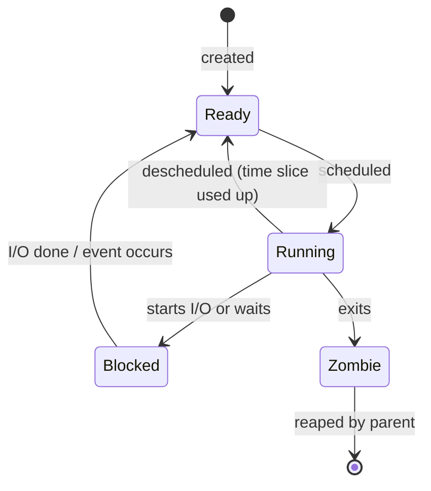

A program is a passive thing, a file of instructions and data on disk. A process is the program in execution: the same file can be run as many processes at once, each with its own variables and its own position in the code. The process is the operating system's first and most important abstraction, the unit to which it gives processor time, memory and open files, and the unit it protects from the others. This chapter treats the process from three sides: what a process consists of and how programs create and control processes through the Unix interface (`fork`, `exec`, `wait`); how the **kernel** runs many processes on few processors while keeping control, using the exceptions and privilege modes of [4.11.1](/4.11.1); and how the kernel notifies processes of events through signals. Which process runs when is the scheduling question of [4.11.3](/4.11.3); how each process gets a private memory is the subject of [4.11.4](/4.11.4); several flows of control inside one process, the threads, follow in [4.11.6](/4.11.6). Python's **process pools** ([4.4.7](/4.4.7)) and the job schedulers of clusters ([4.11.11](/4.11.11)) are built on exactly the mechanisms described here.

## 2.1. The Process Abstraction

### 2.1.1. What a Process Is

**Definition 2.1.1 (Process)** A **process** is an instance of a running program. It consists of an address space (the memory the program can address: its code, data, heap and stack), the processor state of its execution (the program counter, the stack pointer and the other registers), and the state the kernel keeps on its behalf (open files, the current directory, user and group identities, signal settings, resource limits). Each process is identified by a positive integer, its **process ID** (PID).

The process gives each program two illusions: a *logical control flow*, as if the program had the processor to itself, and a *private address space*, as if it had the memory to itself. Neither is true; the kernel interleaves many processes on each processor and maps their memories onto the same physical RAM.

The memory regions of a running program, already met in [4.1.8](/4.1.8) (code, static data, heap, stack), are the parts of its address space. The **call stack** with one **stack frame** per active function ([4.1.4](/4.1.4)) is the stack region; each process has its own.

### 2.1.2. Process States

**Definition 2.1.2 (Process States)** At any moment a process is in one of three basic states: **running** (executing instructions on a processor), **ready** (able to run, waiting for the scheduler to give it a processor) or **blocked** (waiting for an event, such as the completion of a disk read, the arrival of network data or the expiry of a timer, and unable to run until it occurs).



Moving a process between ready and running is the scheduler's decision ([4.11.3](/4.11.3)). The transition from running to blocked is what makes multiprogramming worthwhile: while one process waits for the disk, another uses the processor. The zombie state (§2.2.3) holds a terminated process until its parent collects its exit status.

Linux shows the state in the `STAT` column of `ps` and in `/proc/<pid>/status`:

| Letter | State | Meaning |
|---|---|---|
| `R` | running or runnable | on a processor or in a run queue (Linux does not distinguish running from ready here) |
| `S` | interruptible sleep | blocked, can be woken by a signal (most idle processes) |
| `D` | uninterruptible sleep | blocked inside the kernel, usually on disk or network file system I/O; cannot be killed until the I/O completes |
| `T` | stopped | suspended by a signal (Ctrl-Z) or by a debugger |
| `Z` | zombie | terminated, not yet reaped |

On a quiet machine almost all processes are in state `S`: of 82 processes on the laptop used for this course, 79 were sleeping and 3 runnable at the moment of measurement.

### 2.1.3. The Process Control Block

**Definition 2.1.3 (Process Control Block)** The kernel represents each process by a data structure, the **process control block** (PCB), that holds everything needed to manage and resume it: the PID and parent PID, the state, the saved registers while the process is not running, a pointer to its address space (page tables, [4.11.4](/4.11.4)), the table of open files, credentials, scheduling parameters, signal state and accounting information.

In Linux the PCB is `struct task_struct` (several kilobytes, defined in `include/linux/sched.h`). Linux uses the same structure for threads: a *task* is one schedulable flow of control, and the threads of one process are tasks that share an address space and a file table ([4.11.6](/4.11.6)). This is why the kernel's PID is really a task ID, and why the "process ID" reported to user programs is the ID of the thread group.

### 2.1.4. From Program to Process

When a program is started, the kernel does not copy the whole executable into memory. It reads the headers of the ELF file (Executable and Linkable Format, the format of executables and libraries on Linux), sets up the address space so that the code and data regions *map* the file, and lets the pages be read on first access ([4.11.4](/4.11.4)). For a dynamically linked program it also maps the dynamic linker (`ld-linux-x86-64.so.2`), which in turn maps the shared libraries the program needs (**dynamic library**, [4.2.2](/4.2.2)). The kernel then builds the initial stack, with the command-line arguments `argv`, the environment `envp` and some auxiliary information, and starts executing at the entry point `_start`, which calls the C library's start-up code, which calls `main`. When `main` returns, the start-up code calls `exit` with its return value.

## 2.2. The Process API

Unix creates processes with an unusual pair of calls: `fork` makes a copy of the calling process, and `exec` replaces the program running in a process by another one. Their separation is what lets a shell set up redirections and pipes between the two steps.

### 2.2.1. fork

**Definition 2.2.1 (fork)** The system call **fork** creates a new process, the *child*, that is a copy of the calling process, the *parent*: it has a copy of the parent's address space, the same open files and the same register values, and it continues at the same point, the return from `fork`. The two processes are distinguished only by the return value: `fork` returns 0 in the child and the child's PID in the parent, and $-1$ in the parent if no process could be created.

`fork` is called once and returns twice. The kernel does not really copy the memory: parent and child share the physical pages, marked read-only, and a page is copied only when one of them writes to it (**copy-on-write**, [4.11.4](/4.11.4)). This makes `fork` fast even for a large process.

```c
#include <stdio.h>
#include <stdlib.h>
#include <unistd.h>
#include <sys/wait.h>

int main(void) {
    int x = 100;
    printf("parent: pid %d\n", (int)getpid());
    fflush(stdout);                  /* do not duplicate buffered output */
    pid_t pid = fork();
    if (pid < 0) {                   /* fork failed */
        perror("fork");
        exit(1);
    } else if (pid == 0) {           /* child: fork returned 0 */
        x += 1;
        printf("child:  pid %d, parent %d, x = %d\n",
               (int)getpid(), (int)getppid(), x);
        exit(7);
    } else {                         /* parent: fork returned the child's pid */
        int status;
        waitpid(pid, &status, 0);    /* block until the child terminates */
        x -= 1;
        printf("parent: child %d exited with status %d, x = %d\n",
               (int)pid, WEXITSTATUS(status), x);
    }
    return 0;
}
```

```text
parent: pid 23077
child:  pid 23078, parent 23077, x = 101
parent: child 23078 exited with status 7, x = 99
```

The child's `x` and the parent's `x` are different variables after the fork: each changed its own copy. The order of output between parent and child would be arbitrary without `waitpid`; the scheduler decides which runs first. The `fflush` before `fork` matters: `printf` writes into a buffer in the process's memory, and an unflushed buffer would be copied into the child and printed twice (try redirecting the output to a file without it).

### 2.2.2. exec

**Definition 2.2.2 (exec)** The system call **execve** (and its library front ends, the *exec family* `execl`, `execlp`, `execv`, `execvp`, …) replaces the program of the calling process by a new program loaded from an executable file: the address space is discarded and rebuilt for the new program, which starts at its entry point with the given arguments and environment. The PID, the parent, the open file descriptors (except those marked close-on-exec), the current directory and the signal mask are kept. On success `exec` does not return.

Together with `waitpid`, these calls are a complete shell. The following one reads commands, forks a child for each, lets the child `exec` the command, and waits for it:

```c
#include <stdio.h>
#include <string.h>
#include <unistd.h>
#include <sys/wait.h>

/* A minimal shell: read a line, split it into words, fork, exec, wait. */
int main(void) {
    char line[1024];
    for (;;) {
        printf("tsh> ");
        fflush(stdout);
        if (!fgets(line, sizeof line, stdin)) break;    /* end of input */
        char *argv[64];
        int argc = 0;
        for (char *w = strtok(line, " \t\n"); w && argc < 63; w = strtok(NULL, " \t\n"))
            argv[argc++] = w;
        argv[argc] = NULL;
        if (argc == 0) continue;
        if (strcmp(argv[0], "exit") == 0) break;        /* a built-in command */
        pid_t pid = fork();
        if (pid == 0) {
            execvp(argv[0], argv);
            fprintf(stderr, "tsh: %s: command not found\n", argv[0]);
            _exit(127);
        }
        int status;
        waitpid(pid, &status, 0);
        if (WIFEXITED(status) && WEXITSTATUS(status) != 0)
            printf("[exit status %d]\n", WEXITSTATUS(status));
    }
    printf("\n");
    return 0;
}
```

Fed the commands `echo hello world`, `date -u +%Y`, `ls /nonexistent`, `foo` and `exit`:

```text
tsh> hello world
tsh> 2026
tsh> ls: cannot access '/nonexistent': No such file or directory
[exit status 2]
tsh> tsh: foo: command not found
[exit status 127]
tsh>
```

`execvp` searches the directories in the `PATH` environment variable for the command. The exit status 127 for "command not found" and the convention that 0 means success are those of real shells, which report the status of the last command in `$?`. Built-in commands such as `exit` and `cd` must be executed by the shell itself: `cd` in a child would change only the child's directory.

The gap between `fork` and `exec` is where the child can rearrange its environment before the new program starts: redirect file descriptors, change directory, drop privileges, set resource limits. This is how `wc -l /etc/passwd > out.txt` works: the child opens the file and makes it its standard output with `dup2`, then `exec`s `wc`, which writes to descriptor 1 without knowing it is a file.

```c
#include <fcntl.h>
#include <stdio.h>
#include <stdlib.h>
#include <unistd.h>
#include <sys/wait.h>

/* Run "wc -l /etc/passwd > out.txt", as a shell would. */
int main(void) {
    pid_t pid = fork();
    if (pid == 0) {
        int fd = open("out.txt", O_WRONLY | O_CREAT | O_TRUNC, 0644);
        if (fd < 0) { perror("open"); _exit(127); }
        dup2(fd, STDOUT_FILENO);     /* descriptor 1 now refers to out.txt */
        close(fd);
        char *argv[] = {"wc", "-l", "/etc/passwd", NULL};
        execvp(argv[0], argv);       /* replaces the program; returns only on error */
        perror("execvp");
        _exit(127);
    }
    int status;
    waitpid(pid, &status, 0);
    printf("wc exited with %d; out.txt contains: ", WEXITSTATUS(status));
    fflush(stdout);
    char *cat[] = {"cat", "out.txt", NULL};
    if (fork() == 0) { execvp("cat", cat); _exit(127); }
    wait(NULL);
    return 0;
}
```

```text
wc exited with 0; out.txt contains: 29 /etc/passwd
```

A pipe `a | b` is built the same way: the shell creates a pipe with `pipe()`, forks twice, and connects the write end to the standard output of `a` and the read end to the standard input of `b` before the two `exec`s ([4.11.10](/4.11.10)). File descriptors themselves are described in [4.11.8](/4.11.8).

The fork–exec design has costs: copying page tables for a large process is not free, and a child of a multithreaded process inherits only the calling thread, with locks possibly held by threads that no longer exist. Alternatives exist: `posix_spawn` creates a process running a new program in one call (Python's `subprocess` uses it where possible), `vfork` lets the child borrow the parent's memory until it calls `exec`, and Linux's general `clone` system call specifies exactly what parent and child share; threads and containers are created with it ([4.11.6](/4.11.6), [4.11.9](/4.11.9)).

### 2.2.3. Termination, Zombies and Orphans

A process terminates by calling `exit(status)` (which flushes `stdio` buffers and runs functions registered with `atexit`, then calls the system call `_exit`), by returning from `main`, or by being killed by a signal (§2.4). The kernel then releases its memory and closes its files, but keeps a small record, with the exit status and resource usage, until the parent asks for it.

**Definition 2.2.3 (Zombie and Orphan)** A process that has terminated but whose exit status has not yet been collected by its parent with `wait` or `waitpid` is a **zombie**; collecting the status, which removes the zombie, is called *reaping*. A process whose parent terminates before it is an **orphan**; it is adopted by the process with PID 1 (or by the nearest ancestor that declared itself a *subreaper*), which reaps it when it exits.

```c
#include <stdio.h>
#include <stdlib.h>
#include <unistd.h>
#include <sys/wait.h>

int main(void) {
    pid_t pid = fork();
    if (pid == 0) exit(0);                 /* child terminates at once */
    sleep(1);                              /* parent has not called wait yet */
    char cmd[64];
    snprintf(cmd, sizeof cmd, "ps -o pid,ppid,stat,comm -p %d", (int)pid);
    if (system(cmd) < 0) return 1;         /* the child is a zombie: state Z */
    waitpid(pid, NULL, 0);                 /* reap it */
    if (system(cmd) < 0) return 1;         /* now it is gone */
    return 0;
}
```

```text
    PID    PPID STAT COMMAND
  23263   23262 Z    zombie
    PID    PPID STAT COMMAND
```

A zombie uses no memory beyond its kernel record, but it occupies a PID. A long-running server that forks children and never reaps them accumulates zombies until it can no longer create processes; that is why such programs reap in a `SIGCHLD` handler (§2.4.3). The macros `WIFEXITED`, `WEXITSTATUS`, `WIFSIGNALED` and `WTERMSIG` decode the status returned by `wait`; shells report a process killed by signal $n$ with exit status $128 + n$.

## 2.3. Limited Direct Execution

### 2.3.1. The Problem

The kernel wants two things that seem to conflict. Programs should run fast, which means directly on the processor, not interpreted or simulated instruction by instruction. And the kernel must stay in control: a process must not be able to do whatever it likes with the hardware, and it must not be able to keep the processor forever.

**Definition 2.3.1 (Limited Direct Execution)** **Limited direct execution** is the technique by which the kernel runs a program directly on the processor, in user mode, while retaining control: operations that need privileges are requested through system calls (traps into the kernel), and a hardware timer interrupts the processor periodically so that the kernel regains control even from a program that never makes a system call.

Both limits rest on the hardware of [4.11.1](/4.11.1#sec-1.3): **user mode** makes privileged operations trap, and the **exception table**, filled by the kernel at boot, determines where control goes. A sketch of the whole protocol, from boot to a process making a system call and being preempted:

| Kernel (kernel mode) | Hardware | Process (user mode) |
|---|---|---|
| At boot: fill the exception table (system call entry, timer handler, …); start the interrupt timer | remember the handler addresses; interrupt every few ms | |
| Create a process: set up its address space, PCB and kernel stack; return to user mode at `_start` | restore registers, switch to user mode, jump to the entry point | run `main` |
| | save registers on the kernel stack, switch to kernel mode, jump to the trap handler | execute `syscall` (e.g. `read`) |
| Handle the system call; return from trap | restore registers, switch to user mode, continue after the trap | continue |
| | timer interrupt: save registers, switch to kernel mode, jump to the timer handler | (computing) |
| Timer handler: decide whether to switch to another process (§2.3.2) | | |

### 2.3.2. The Timer Interrupt and Preemption

Early systems (Mac OS before X, Windows 3.1) used *cooperative* multitasking: the kernel regained control only when a process made a **system call** or explicitly yielded, so a single process in an infinite loop froze the machine. Every modern kernel is *preemptive*: a hardware timer raises an **interrupt** at regular intervals (Linux traditionally uses a "tick" of 1–4 ms, `CONFIG_HZ` = 250 or 1000; with `NO_HZ` the tick is stopped on idle processors and programmed on demand), and the interrupt handler may decide that the running process has had enough and switch to another. Blocking system calls (a `read` that must wait for the disk) are the other occasion for a switch: the process cannot continue, so the kernel runs someone else.

### 2.3.3. The Context Switch

**Definition 2.3.2 (Context Switch)** A **context switch** is the operation by which the kernel stops running one process (or thread) on a processor and resumes another: it saves the register state of the current process in kernel memory, switches to the address space and kernel stack of the next one, and restores that one's saved registers, so that the return from the kernel continues the next process where it was previously interrupted.

Two different register saves are involved. When the timer interrupt arrives, the hardware (and the entry code) saves the user registers of process A on A's kernel stack. If the kernel then decides to switch, the switch routine (`switch_to` in Linux) saves A's kernel registers in A's PCB, loads B's kernel registers from B's PCB, and switches the page-table base register to B's page tables; from then on the kernel is executing on B's kernel stack, and the return from the interrupt pops B's user registers and resumes B. To process B it looks as if it had returned from its own last trap.

The direct cost of a switch is a few hundred nanoseconds to a few microseconds. It can be measured by passing a byte back and forth between two processes through two pipes, pinned to one CPU so that every transfer forces a switch:

```c
#define _GNU_SOURCE
#include <sched.h>
#include <stdio.h>
#include <time.h>
#include <unistd.h>
#include <sys/wait.h>

/* Two processes on one CPU pass a byte back and forth through two pipes.
   Each round trip forces two context switches. */
int main(void) {
    cpu_set_t set;
    CPU_ZERO(&set);
    CPU_SET(0, &set);
    sched_setaffinity(0, sizeof set, &set);    /* pin to CPU 0; inherited by the child */

    int ab[2], ba[2];
    if (pipe(ab) < 0 || pipe(ba) < 0) return 1;
    const int N = 200000;
    char c = 'x';
    if (fork() == 0) {
        for (int i = 0; i < N; i++) {
            if (read(ab[0], &c, 1) != 1 || write(ba[1], &c, 1) != 1) _exit(1);
        }
        _exit(0);
    }
    struct timespec t0, t1;
    clock_gettime(CLOCK_MONOTONIC, &t0);
    for (int i = 0; i < N; i++) {
        if (write(ab[1], &c, 1) != 1 || read(ba[0], &c, 1) != 1) return 1;
    }
    clock_gettime(CLOCK_MONOTONIC, &t1);
    wait(NULL);
    double ns = ((t1.tv_sec - t0.tv_sec) * 1e9 + (t1.tv_nsec - t0.tv_nsec)) / N;
    printf("round trip %.0f ns, i.e. about %.0f ns per switch (incl. 2 syscalls)\n",
           ns, ns / 2);
    return 0;
}
```

```text
round trip 4364 ns, i.e. about 2182 ns per switch (incl. 2 syscalls)
```

Each one-way transfer includes a `write`, a `read` and a switch, so the switch itself costs somewhat less than the 2.2 µs shown (repeated runs on this virtualized machine, under varying load, gave 1.8–3.5 µs per one-way transfer). The indirect cost is often larger: the new process finds the caches and the translation buffer of the processor filled with the old process's data ([4.11.4](/4.11.4)) and runs slowly until they are refilled. This is one reason why time slices are milliseconds long rather than microseconds, a trade-off examined in [4.11.3](/4.11.3).

## 2.4. Signals

### 2.4.1. Signals as Software Exceptions

**Exceptions** let the hardware notify the kernel of events. Signals are the analogous mechanism one level up: the kernel notifies a process of an event, and the process's normal control flow is interrupted to handle it.

**Definition 2.4.1 (Signal)** A **signal** is a small message, identified only by a number, that the kernel delivers to a process to notify it of an event: a hardware exception caused by the process (an invalid memory reference, an illegal instruction, a division by zero), an event in the kernel (a child terminated, a timer expired, a pipe's reader disappeared), or a request from another process (the `kill` system call) or from the terminal (Ctrl-C). On delivery the process either performs the signal's *default action* (terminate, terminate and write a core dump, stop, continue, or ignore), ignores it, or runs a function it has installed for it, a **signal handler**.

The most important signals on Linux (the numbers are those of x86-64 and ARM; use the names in programs):

| Signal | No. | Default | Typical cause |
|---|---|---|---|
| `SIGHUP` | 1 | terminate | terminal closed; often reused to mean "reload configuration" |
| `SIGINT` | 2 | terminate | Ctrl-C in the terminal |
| `SIGQUIT` | 3 | core dump | Ctrl-\ in the terminal |
| `SIGKILL` | 9 | terminate | `kill -9`; cannot be caught, blocked or ignored |
| `SIGSEGV` | 11 | core dump | invalid memory reference (segmentation fault) |
| `SIGPIPE` | 13 | terminate | writing to a pipe or socket with no reader |
| `SIGALRM` | 14 | terminate | timer set with `alarm` expired |
| `SIGTERM` | 15 | terminate | polite termination request (default of `kill`) |
| `SIGCHLD` | 17 | ignore | a child stopped or terminated |
| `SIGCONT` | 18 | continue | resume a stopped process (`fg`, `bg`) |
| `SIGSTOP` | 19 | stop | stop; cannot be caught |
| `SIGTSTP` | 20 | stop | Ctrl-Z in the terminal |
| `SIGUSR1`, `SIGUSR2` | 10, 12 | terminate | user-defined |

A null-pointer dereference shows the chain from hardware to shell: the load from address 0 faults, the kernel finds that the address is not mapped in the process, sends it `SIGSEGV`, and the default action terminates it; the shell reports the death and the exit status $128 + 11$. Similarly a process killed by `SIGKILL` (9) gets status 137:

```c
int main(void) {
    int *p = (int *)0;   /* null pointer */
    return *p;           /* invalid read: the kernel sends SIGSEGV */
}
```

```text
bash: line 1: 23431 Segmentation fault      (core dumped) ./segv
exit status 139
bash: line 1: 23433 Killed                  sleep 100
exit status 137
```

Status 137 is common on servers and clusters: it is what a process killed by the kernel's out-of-memory killer ([4.11.4](/4.11.4)) or by a job scheduler enforcing a memory limit looks like.

### 2.4.2. Sending, Pending and Blocking

A signal is *sent* when the kernel records it for the destination process, and *received* when the process is next about to return to user mode and the kernel makes it act on it. In between, the signal is *pending*. Three rules follow from the implementation, in which the kernel keeps for each process one bit per signal type:

- There is at most one pending signal of each type: standard signals are not queued. If three children exit while a `SIGCHLD` is already pending, the process receives one `SIGCHLD`, not three. (POSIX real-time signals, `SIGRTMIN` to `SIGRTMAX`, are queued.)
- A process can *block* signals with `sigprocmask`: a blocked signal stays pending and is delivered when it is unblocked. `SIGKILL` and `SIGSTOP` cannot be blocked.
- A signal does not tell who sent it or how often; it is a notification that something happened, and the process must find out what (for `SIGCHLD`, by calling `waitpid`).

Signals are sent by `kill(pid, sig)` from programs and the `kill` command from the shell, by the kernel itself, and by the terminal driver, which sends `SIGINT`, `SIGQUIT` and `SIGTSTP` to every process of the terminal's *foreground process group*. A process group is the set of processes of one shell job (for example all the processes of a pipeline), so Ctrl-C stops the whole pipeline at once; the job control commands `jobs`, `fg` and `bg` move groups between foreground and background ([4.11.10](/4.11.10)).

### 2.4.3. Handlers

A handler is installed with `sigaction`. It runs asynchronously, in the middle of whatever the program was doing, possibly while the main program was itself inside `printf` or `malloc` with their internal data structures half updated. A handler that calls `printf` or `malloc` can therefore deadlock or corrupt them. The rules for safe handlers:

1. Keep handlers as simple as possible; the simplest handler only sets a global flag and returns, and the main program checks the flag.
2. Call only *async-signal-safe* functions (listed in `man 7 signal-safety`): system calls such as `write`, `_exit`, `waitpid`, `kill`, but not `printf`, `malloc` or `exit`.
3. Save and restore `errno`, which the handler's system calls may overwrite.
4. Declare shared flags `volatile sig_atomic_t`, so that the compiler does not keep them in a register and reads and writes are atomic.
5. Block signals while the main program manipulates data structures that a handler also uses.

The graceful handling of `SIGTERM` is the most useful application. Batch systems, container runtimes and `systemd` stop a program by sending `SIGTERM`, waiting a grace period, and then sending `SIGKILL`; a long computation that catches `SIGTERM` can write a checkpoint and exit cleanly:

```c
#include <signal.h>
#include <stdio.h>
#include <string.h>
#include <unistd.h>

static volatile sig_atomic_t stop = 0;

static void on_term(int sig) {
    (void)sig;
    stop = 1;                                /* only set a flag in the handler */
}

int main(void) {
    struct sigaction sa;
    memset(&sa, 0, sizeof sa);
    sa.sa_handler = on_term;
    sigemptyset(&sa.sa_mask);
    sigaction(SIGTERM, &sa, NULL);           /* install the handler */

    printf("pid %d working; send SIGTERM to stop\n", (int)getpid());
    fflush(stdout);
    long step = 0;
    while (!stop) {
        usleep(100000);                      /* one unit of "work" */
        step++;
    }
    printf("caught SIGTERM after %ld steps; saving a checkpoint and exiting\n", step);
    return 0;
}
```

Started in the background and sent `kill -TERM` about one second later:

```text
pid 23419 working; send SIGTERM to stop
caught SIGTERM after 11 steps; saving a checkpoint and exiting
exit status 0
```

The second classic application is reaping children. Because signals are not queued, the handler must reap in a loop until no terminated child remains; and because the main program waits for a condition that the handler changes, it must check the condition and go to sleep atomically, or the last signal can arrive between the check and the sleep and the program sleeps forever. `sigsuspend` replaces the signal mask and suspends the process in one step:

```c
#include <errno.h>
#include <signal.h>
#include <stdio.h>
#include <string.h>
#include <unistd.h>
#include <sys/wait.h>

static volatile sig_atomic_t reaped = 0;

static void on_child(int sig) {
    (void)sig;
    int saved = errno;                       /* handlers must preserve errno */
    /* Several children may have exited while one SIGCHLD was pending:
       standard signals are not queued, so reap in a loop. */
    while (waitpid(-1, NULL, WNOHANG) > 0) reaped++;
    errno = saved;
}

int main(void) {
    struct sigaction sa;
    memset(&sa, 0, sizeof sa);
    sa.sa_handler = on_child;
    sa.sa_flags = SA_RESTART;                /* restart interrupted system calls */
    sigemptyset(&sa.sa_mask);
    sigaction(SIGCHLD, &sa, NULL);

    sigset_t block, old;
    sigemptyset(&block);
    sigaddset(&block, SIGCHLD);
    sigprocmask(SIG_BLOCK, &block, &old);    /* hold SIGCHLD back for now */

    for (int i = 0; i < 5; i++)
        if (fork() == 0) _exit(0);           /* five children exit almost at once */

    /* Atomically unblock SIGCHLD and sleep; a plain "check, then pause()"
       would hang if the last signal arrived between the check and pause. */
    while (reaped < 5) sigsuspend(&old);
    sigprocmask(SIG_SETMASK, &old, NULL);
    printf("reaped %d children\n", (int)reaped);
    return 0;
}
```

```text
reaped 5 children
```

A handler interrupts a blocking system call such as `read`; with the flag `SA_RESTART` the kernel restarts the call afterwards, otherwise it fails with `EINTR` and the program must retry. Linux also offers `signalfd`, which turns signals into data read from a file descriptor, so that an event loop ([4.11.6](/4.11.6)) can handle them synchronously like any other input. Multithreaded programs commonly block all signals in every thread and dedicate one thread to waiting for them with `sigwait`.

## Summary

- A process is a running program: an address space, processor state and kernel state (open files, credentials, signal settings), described in the kernel by its PCB (`task_struct` in Linux). It is running, ready or blocked, and briefly a zombie after it terminates.
- `fork` copies the calling process and returns twice (0 in the child, the child's PID in the parent); `exec` replaces the program; `waitpid` collects the child's exit status. Between `fork` and `exec` the child sets up redirections, which is how shells implement `>` and `|`. Unreaped children are zombies; orphans are adopted by PID 1.
- Limited direct execution runs programs directly in user mode; system calls trap into the kernel, and the timer interrupt returns control to it periodically, making preemption possible.
- A context switch saves one process's registers, switches address space and kernel stack, and restores another's. It costs microseconds directly and more through cold caches.
- Signals notify processes of events. Each type is pending at most once; signals can be blocked; `SIGKILL` and `SIGSTOP` cannot be caught. Handlers should only set flags or call async-signal-safe functions; programs should catch `SIGTERM` to shut down cleanly, and a death by signal $n$ shows as exit status $128 + n$.
