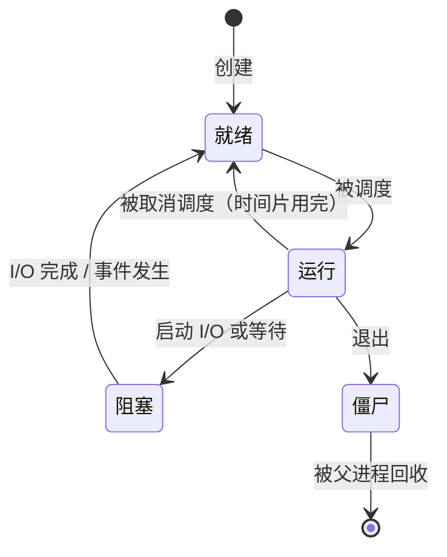

程序是被动的东西，是磁盘上一个由指令和数据组成的文件。进程则是执行中的程序：同一个文件可以同时作为许多个进程运行，每个进程有自己的变量和在代码中的位置。进程是操作系统的第一个也是最重要的抽象，操作系统以它为单位分配处理器时间、内存和打开的文件，也以它为单位把各个程序相互保护起来。本章从三个方面讨论进程：进程由什么组成，程序怎样通过 Unix 接口（`fork`、`exec`、`wait`）创建和控制进程；**内核**怎样利用 [4.11.1](/4.11.1) 中的异常和特权模式，在很少的处理器上运行许多进程并始终保持控制；以及内核怎样通过信号把事件通知给进程。哪个进程在何时运行是 [4.11.3](/4.11.3) 的调度问题；每个进程怎样得到私有的内存是 [4.11.4](/4.11.4) 的内容；同一进程内部的多个控制流，即线程，见 [4.11.6](/4.11.6)。Python 的**进程池**（[4.4.7](/4.4.7)）和集群的作业调度器（[4.11.11](/4.11.11)）正是建立在这里所述的机制之上。

## 2.1. 进程的抽象

### 2.1.1. 什么是进程

**定义 2.1.1（进程）** **进程**是运行中的程序的一个实例。它由三部分组成：地址空间（程序可以寻址的内存：代码、数据、堆和栈），执行的处理器状态（程序计数器、栈指针和其他寄存器），以及内核代表它保存的状态（打开的文件、当前目录、用户与组的标识、信号设置、资源限制）。每个进程由一个正整数标识，称为它的**进程标识符**（PID）。

进程给每个程序两种假象：逻辑控制流，好像程序独占处理器；以及私有的地址空间，好像程序独占内存。二者都不是真的：内核在每个处理器上交替运行许多进程，并把它们的内存映射到同一块物理内存上。

运行中的程序的各内存区域（代码、静态数据、堆、栈）已在 [4.1.8](/4.1.8) 中见过，它们是进程地址空间的组成部分。每个活动函数对应一个**栈帧**的**调用栈**（[4.1.4](/4.1.4)）就是栈区域；每个进程各有一个。

### 2.1.2. 进程状态

**定义 2.1.2（进程状态）** 任一时刻，进程处于三种基本状态之一：**运行**（在处理器上执行指令）、**就绪**（能够运行，等待调度器分配处理器）或**阻塞**（等待某个事件，如磁盘读取完成、网络数据到达或定时器到期，在事件发生之前无法运行）。



进程在就绪与运行之间的转换由调度器决定（[4.11.3](/4.11.3)）。从运行到阻塞的转换使多道程序设计有价值：一个进程等待磁盘时，另一个进程使用处理器。僵尸状态（2.2.3 节）保留已终止的进程，直到其父进程取走它的退出状态。

Linux 在 `ps` 的 `STAT` 列和 `/proc/<pid>/status` 中显示状态：

| 字母 | 状态 | 含义 |
|---|---|---|
| `R` | 运行或可运行 | 在处理器上，或在运行队列中（Linux 在此不区分运行与就绪） |
| `S` | 可中断睡眠 | 阻塞，可被信号唤醒（大多数空闲进程） |
| `D` | 不可中断睡眠 | 在内核中阻塞，通常是磁盘或网络文件系统的 I/O；I/O 完成之前不能被杀死 |
| `T` | 已停止 | 被信号（Ctrl-Z）或调试器挂起 |
| `Z` | 僵尸 | 已终止，尚未被回收 |

在空闲的机器上，几乎所有进程都处于 `S` 状态：在本课程使用的笔记本电脑上，测量时共有 82 个进程，其中 79 个在睡眠，3 个可运行。

### 2.1.3. 进程控制块

**定义 2.1.3（进程控制块）** 内核用一个数据结构，即**进程控制块**（PCB），来表示每个进程，其中保存管理和恢复该进程所需的一切：PID 和父进程的 PID、状态、进程不运行时保存的寄存器、指向其地址空间的指针（页表，[4.11.4](/4.11.4)）、打开文件表、凭据、调度参数、信号状态和统计信息。

在 Linux 中，PCB 是 `struct task_struct`（几千字节，定义在 `include/linux/sched.h` 中）。Linux 对线程使用同一个结构：任务（task）是一个可调度的控制流，同一进程的线程是共享地址空间和文件表的任务（[4.11.6](/4.11.6)）。这就是内核的 PID 实际上是任务 ID 的原因，也是向用户程序报告的"进程 ID"实际上是线程组 ID 的原因。

### 2.1.4. 从程序到进程

启动程序时，内核并不把整个可执行文件复制到内存。它读取 ELF 文件（Executable and Linkable Format，Linux 上可执行文件与库的格式）的头部，建立地址空间，使代码和数据区域映射该文件，并让页在第一次访问时才被读入（[4.11.4](/4.11.4)）。对于动态链接的程序，它还映射动态链接器（`ld-linux-x86-64.so.2`），再由动态链接器映射程序需要的共享库（**动态库**，[4.2.2](/4.2.2)）。然后内核构造初始栈，其中有命令行参数 `argv`、环境 `envp` 和一些辅助信息，并从入口点 `_start` 开始执行；`_start` 调用 C 库的启动代码，启动代码再调用 `main`。`main` 返回时，启动代码以其返回值调用 `exit`。

## 2.2. 进程 API

Unix 用一对不寻常的调用创建进程：`fork` 复制调用进程，`exec` 则把进程中运行的程序替换为另一个程序。正是这种分离，使 Shell 能够在两步之间设置重定向和管道。

### 2.2.1. fork

**定义 2.2.1（fork）** 系统调用 **fork** 创建一个新进程，即子进程，它是调用进程（父进程）的副本：它有父进程地址空间的副本、相同的打开文件和相同的寄存器值，并从同一个位置，即从 `fork` 的返回处，继续执行。两个进程只靠返回值区分：`fork` 在子进程中返回 0，在父进程中返回子进程的 PID，若无法创建进程则在父进程中返回 $-1$。

`fork` 调用一次，返回两次。内核并不真正复制内存：父子进程共享物理页，并把这些页标为只读，只有当其中一个写某页时才复制该页（**写时复制**，[4.11.4](/4.11.4)）。这使得即使对大进程，`fork` 也很快。

```c
#include <stdio.h>
#include <stdlib.h>
#include <unistd.h>
#include <sys/wait.h>

int main(void) {
    int x = 100;
    printf("parent: pid %d\n", (int)getpid());
    fflush(stdout);                  /* do not duplicate buffered output */
    pid_t pid = fork();
    if (pid < 0) {                   /* fork failed */
        perror("fork");
        exit(1);
    } else if (pid == 0) {           /* child: fork returned 0 */
        x += 1;
        printf("child:  pid %d, parent %d, x = %d\n",
               (int)getpid(), (int)getppid(), x);
        exit(7);
    } else {                         /* parent: fork returned the child's pid */
        int status;
        waitpid(pid, &status, 0);    /* block until the child terminates */
        x -= 1;
        printf("parent: child %d exited with status %d, x = %d\n",
               (int)pid, WEXITSTATUS(status), x);
    }
    return 0;
}
```

```text
parent: pid 23077
child:  pid 23078, parent 23077, x = 101
parent: child 23078 exited with status 7, x = 99
```

fork 之后，子进程的 `x` 与父进程的 `x` 是不同的变量：各自修改了自己的副本。没有 `waitpid` 时，父子进程之间的输出顺序是任意的，由调度器决定谁先运行。`fork` 之前的 `fflush` 很重要：`printf` 写入进程内存中的缓冲区，未刷新的缓冲区会被复制到子进程中并被打印两次（可以去掉它并把输出重定向到文件试一试）。

### 2.2.2. exec

**定义 2.2.2（exec）** 系统调用 **execve**（及其库中的前端，即 exec 系列函数 `execl`、`execlp`、`execv`、`execvp` 等）用从可执行文件加载的新程序替换调用进程的程序：地址空间被丢弃并为新程序重建，新程序从入口点开始，带着给定的参数和环境。PID、父进程、打开的文件描述符（标记为 close-on-exec 的除外）、当前目录和信号屏蔽字保持不变。成功时 `exec` 不返回。

与 `waitpid` 一起，这些调用就构成了一个完整的 Shell。下面这个 Shell 读入命令，为每条命令 fork 一个子进程，让子进程 `exec` 该命令，并等待它结束：

```c
#include <stdio.h>
#include <string.h>
#include <unistd.h>
#include <sys/wait.h>

/* A minimal shell: read a line, split it into words, fork, exec, wait. */
int main(void) {
    char line[1024];
    for (;;) {
        printf("tsh> ");
        fflush(stdout);
        if (!fgets(line, sizeof line, stdin)) break;    /* end of input */
        char *argv[64];
        int argc = 0;
        for (char *w = strtok(line, " \t\n"); w && argc < 63; w = strtok(NULL, " \t\n"))
            argv[argc++] = w;
        argv[argc] = NULL;
        if (argc == 0) continue;
        if (strcmp(argv[0], "exit") == 0) break;        /* a built-in command */
        pid_t pid = fork();
        if (pid == 0) {
            execvp(argv[0], argv);
            fprintf(stderr, "tsh: %s: command not found\n", argv[0]);
            _exit(127);
        }
        int status;
        waitpid(pid, &status, 0);
        if (WIFEXITED(status) && WEXITSTATUS(status) != 0)
            printf("[exit status %d]\n", WEXITSTATUS(status));
    }
    printf("\n");
    return 0;
}
```

输入命令 `echo hello world`、`date -u +%Y`、`ls /nonexistent`、`foo` 和 `exit`：

```text
tsh> hello world
tsh> 2026
tsh> ls: cannot access '/nonexistent': No such file or directory
[exit status 2]
tsh> tsh: foo: command not found
[exit status 127]
tsh>
```

`execvp` 在环境变量 `PATH` 的各个目录中搜索命令。"找不到命令"时的退出状态 127，以及 0 表示成功的约定，与真实的 Shell 相同；真实的 Shell 在 `$?` 中报告最后一条命令的状态。`exit` 和 `cd` 等内置命令必须由 Shell 自己执行：在子进程中执行 `cd` 只会改变子进程的目录。

`fork` 与 `exec` 之间的空隙，是子进程在新程序开始前调整自身环境的地方：重定向文件描述符、改变目录、放弃特权、设置资源限制。`wc -l /etc/passwd > out.txt` 就是这样工作的：子进程打开文件，用 `dup2` 使它成为自己的标准输出，然后 `exec` 执行 `wc`，`wc` 向描述符 1 写入，并不知道它是一个文件。

```c
#include <fcntl.h>
#include <stdio.h>
#include <stdlib.h>
#include <unistd.h>
#include <sys/wait.h>

/* Run "wc -l /etc/passwd > out.txt", as a shell would. */
int main(void) {
    pid_t pid = fork();
    if (pid == 0) {
        int fd = open("out.txt", O_WRONLY | O_CREAT | O_TRUNC, 0644);
        if (fd < 0) { perror("open"); _exit(127); }
        dup2(fd, STDOUT_FILENO);     /* descriptor 1 now refers to out.txt */
        close(fd);
        char *argv[] = {"wc", "-l", "/etc/passwd", NULL};
        execvp(argv[0], argv);       /* replaces the program; returns only on error */
        perror("execvp");
        _exit(127);
    }
    int status;
    waitpid(pid, &status, 0);
    printf("wc exited with %d; out.txt contains: ", WEXITSTATUS(status));
    fflush(stdout);
    char *cat[] = {"cat", "out.txt", NULL};
    if (fork() == 0) { execvp("cat", cat); _exit(127); }
    wait(NULL);
    return 0;
}
```

```text
wc exited with 0; out.txt contains: 29 /etc/passwd
```

管道 `a | b` 以同样的方式构建：Shell 用 `pipe()` 创建管道，fork 两次，并在两次 `exec` 之前，把写端连接到 `a` 的标准输出，把读端连接到 `b` 的标准输入（[4.11.10](/4.11.10)）。文件描述符本身在 [4.11.8](/4.11.8) 中介绍。

fork–exec 的设计有代价：为大进程复制页表并不是免费的，多线程进程的子进程只继承调用 `fork` 的那个线程，而锁可能被已经不存在的线程持有。也有替代方案：`posix_spawn` 在一次调用中创建运行新程序的进程（Python 的 `subprocess` 尽可能使用它），`vfork` 让子进程借用父进程的内存直到它调用 `exec`，而 Linux 通用的 `clone` 系统调用则精确指定父子进程共享什么；线程和容器都是用它创建的（[4.11.6](/4.11.6)、[4.11.9](/4.11.9)）。

### 2.2.3. 终止、僵尸进程与孤儿进程

进程通过调用 `exit(status)`（它刷新 `stdio` 缓冲区并运行用 `atexit` 注册的函数，然后调用系统调用 `_exit`）、从 `main` 返回，或被信号杀死（2.4 节）而终止。随后内核释放它的内存并关闭它的文件，但保留一条小记录，其中有退出状态和资源使用情况，直到父进程来取。

**定义 2.2.3（僵尸进程与孤儿进程）** 已经终止、但其退出状态尚未被父进程用 `wait` 或 `waitpid` 取走的进程是**僵尸进程**；取走状态从而移除僵尸进程，称为回收。父进程先于自己终止的进程是**孤儿进程**；它被 PID 为 1 的进程（或声明自己为 subreaper 的最近祖先进程）收养，由后者在它退出时回收。

```c
#include <stdio.h>
#include <stdlib.h>
#include <unistd.h>
#include <sys/wait.h>

int main(void) {
    pid_t pid = fork();
    if (pid == 0) exit(0);                 /* child terminates at once */
    sleep(1);                              /* parent has not called wait yet */
    char cmd[64];
    snprintf(cmd, sizeof cmd, "ps -o pid,ppid,stat,comm -p %d", (int)pid);
    if (system(cmd) < 0) return 1;         /* the child is a zombie: state Z */
    waitpid(pid, NULL, 0);                 /* reap it */
    if (system(cmd) < 0) return 1;         /* now it is gone */
    return 0;
}
```

```text
    PID    PPID STAT COMMAND
  23263   23262 Z    zombie
    PID    PPID STAT COMMAND
```

僵尸进程除内核中的记录外不占用内存，但它占着一个 PID。长期运行的服务器如果 fork 了子进程却从不回收，僵尸进程就会不断积累，直到再也无法创建进程；所以这类程序要在 `SIGCHLD` 处理程序中回收（2.4.3 节）。宏 `WIFEXITED`、`WEXITSTATUS`、`WIFSIGNALED` 和 `WTERMSIG` 用来解码 `wait` 返回的状态；Shell 报告被信号 $n$ 杀死的进程时，退出状态为 $128 + n$。

## 2.3. 受限直接执行

### 2.3.1. 问题

内核想要两件看似冲突的事。程序应当运行得快，这意味着直接在处理器上运行，而不是逐条指令地解释或模拟。而内核又必须保持控制：进程不能对硬件为所欲为，也不能永远占住处理器。

**定义 2.3.1（受限直接执行）** **受限直接执行**是内核让程序在用户态直接在处理器上运行、同时保留控制权的技术：需要特权的操作通过系统调用（陷入内核的陷阱）请求，硬件定时器周期性地中断处理器，使内核即使对从不发出系统调用的程序也能重新获得控制。

这两方面的限制都依赖 [4.11.1](/4.11.1#sec-1.3) 中的硬件：**用户态**使特权操作陷入内核，而由内核在启动时填写的**异常表**决定控制转到哪里。下表概述从启动，到进程发出系统调用，再到被抢占的整个协议：

| 内核（内核态） | 硬件 | 进程（用户态） |
|---|---|---|
| 启动时：填写异常表（系统调用入口、定时器处理程序等）；启动中断定时器 | 记住处理程序的地址；每隔几毫秒中断一次 | |
| 创建进程：建立它的地址空间、PCB 和内核栈；在 `_start` 处返回用户态 | 恢复寄存器，切换到用户态，跳转到入口点 | 运行 `main` |
| | 把寄存器保存到内核栈上，切换到内核态，跳转到陷阱处理程序 | 执行 `syscall`（如 `read`） |
| 处理系统调用；从陷阱返回 | 恢复寄存器，切换到用户态，从陷阱之后继续 | 继续 |
| | 定时器中断：保存寄存器，切换到内核态，跳转到定时器处理程序 | （计算中） |
| 定时器处理程序：决定是否切换到另一个进程（2.3.2 节） | | |

### 2.3.2. 定时器中断与抢占

早期的系统（Mac OS X 之前的 Mac OS、Windows 3.1）使用协作式多任务：只有当进程发出**系统调用**或主动让出处理器时，内核才重新获得控制，所以一个进程陷入死循环就会使整台机器冻结。所有现代内核都是抢占式的：硬件定时器按固定间隔产生**中断**（Linux 传统上使用 1–4 ms 的"滴答"，`CONFIG_HZ` = 250 或 1000；在 `NO_HZ` 下，空闲处理器上的滴答被停止，按需重新设定），中断处理程序可以判定正在运行的进程已经用够了，并切换到另一个进程。阻塞的系统调用（必须等待磁盘的 `read`）是引起切换的另一种场合：进程无法继续，所以内核去运行别的进程。

### 2.3.3. 上下文切换

**定义 2.3.2（上下文切换）** **上下文切换**是内核停止在处理器上运行一个进程（或线程）、转而恢复另一个进程的操作：它把当前进程的寄存器状态保存在内核内存中，切换到下一个进程的地址空间和内核栈，并恢复该进程保存的寄存器，使从内核的返回在下一个进程上次被中断的地方继续。

这里涉及两次不同的寄存器保存。定时器中断到来时，硬件（以及入口代码）把进程 A 的用户寄存器保存在 A 的内核栈上。如果内核随后决定切换，切换例程（Linux 中的 `switch_to`）把 A 的内核寄存器保存在 A 的 PCB 中，从 B 的 PCB 加载 B 的内核寄存器，并把页表基址寄存器切换到 B 的页表；从此内核在 B 的内核栈上执行，中断返回时弹出 B 的用户寄存器并恢复 B。对进程 B 来说，就好像它刚从自己上一次的陷阱中返回。

切换的直接开销是几百纳秒到几微秒。可以这样测量：让一个字节通过两条管道在两个进程之间来回传递，并把它们固定在同一个 CPU 上，使每次传递都强制发生一次切换：

```c
#define _GNU_SOURCE
#include <sched.h>
#include <stdio.h>
#include <time.h>
#include <unistd.h>
#include <sys/wait.h>

/* Two processes on one CPU pass a byte back and forth through two pipes.
   Each round trip forces two context switches. */
int main(void) {
    cpu_set_t set;
    CPU_ZERO(&set);
    CPU_SET(0, &set);
    sched_setaffinity(0, sizeof set, &set);    /* pin to CPU 0; inherited by the child */

    int ab[2], ba[2];
    if (pipe(ab) < 0 || pipe(ba) < 0) return 1;
    const int N = 200000;
    char c = 'x';
    if (fork() == 0) {
        for (int i = 0; i < N; i++) {
            if (read(ab[0], &c, 1) != 1 || write(ba[1], &c, 1) != 1) _exit(1);
        }
        _exit(0);
    }
    struct timespec t0, t1;
    clock_gettime(CLOCK_MONOTONIC, &t0);
    for (int i = 0; i < N; i++) {
        if (write(ab[1], &c, 1) != 1 || read(ba[0], &c, 1) != 1) return 1;
    }
    clock_gettime(CLOCK_MONOTONIC, &t1);
    wait(NULL);
    double ns = ((t1.tv_sec - t0.tv_sec) * 1e9 + (t1.tv_nsec - t0.tv_nsec)) / N;
    printf("round trip %.0f ns, i.e. about %.0f ns per switch (incl. 2 syscalls)\n",
           ns, ns / 2);
    return 0;
}
```

```text
round trip 4364 ns, i.e. about 2182 ns per switch (incl. 2 syscalls)
```

每次单向传递包含一次 `write`、一次 `read` 和一次切换，所以切换本身的开销比所示的 2.2 µs 略少（在这台虚拟化的机器上、不同负载下重复运行，每次单向传递为 1.8–3.5 µs）。间接开销往往更大：新进程发现处理器的缓存和**快表**里装满了旧进程的数据（[4.11.4](/4.11.4)），在它们被重新填满之前运行得很慢。这是时间片长达毫秒而不是微秒的原因之一，[4.11.3](/4.11.3) 将讨论这一权衡。

## 2.4. 信号

### 2.4.1. 作为软件异常的信号

**异常**使硬件能把事件通知内核。信号是高一层的类似机制：内核把事件通知给进程，进程正常的控制流被打断以处理它。

**定义 2.4.1（信号）** **信号**是内核递送给进程的、仅由一个编号标识的小消息，用来通知进程某个事件：由进程自身引起的硬件异常（无效的内存引用、非法指令、除以零），内核中的事件（子进程终止、定时器到期、管道的读端消失），或来自另一个进程（`kill` 系统调用）或终端（Ctrl-C）的请求。信号递送时，进程要么执行该信号的默认动作（终止、终止并写出核心转储、停止、继续或忽略），要么忽略它，要么运行为它安装的函数，即**信号处理程序**。

Linux 上最重要的信号（编号是 x86-64 和 ARM 的；程序中请使用名称）：

| 信号 | 编号 | 默认动作 | 典型原因 |
|---|---|---|---|
| `SIGHUP` | 1 | 终止 | 终端关闭；常被复用为"重新加载配置" |
| `SIGINT` | 2 | 终止 | 终端中的 Ctrl-C |
| `SIGQUIT` | 3 | 核心转储 | 终端中的 Ctrl-\ |
| `SIGKILL` | 9 | 终止 | `kill -9`；不能被捕获、阻塞或忽略 |
| `SIGSEGV` | 11 | 核心转储 | 无效的内存引用（段错误） |
| `SIGPIPE` | 13 | 终止 | 向没有读端的管道或套接字写入 |
| `SIGALRM` | 14 | 终止 | 用 `alarm` 设置的定时器到期 |
| `SIGTERM` | 15 | 终止 | 礼貌的终止请求（`kill` 的默认信号） |
| `SIGCHLD` | 17 | 忽略 | 子进程停止或终止 |
| `SIGCONT` | 18 | 继续 | 恢复已停止的进程（`fg`、`bg`） |
| `SIGSTOP` | 19 | 停止 | 停止；不能被捕获 |
| `SIGTSTP` | 20 | 停止 | 终端中的 Ctrl-Z |
| `SIGUSR1`、`SIGUSR2` | 10、12 | 终止 | 用户自定义 |

空指针解引用展示了从硬件到 Shell 的整条链：从地址 0 的加载引发故障，内核发现该地址在进程中没有映射，向它发送 `SIGSEGV`，默认动作终止了进程；Shell 报告进程的死亡和退出状态 $128 + 11$。类似地，被 `SIGKILL`（9）杀死的进程的状态为 137：

```c
int main(void) {
    int *p = (int *)0;   /* null pointer */
    return *p;           /* invalid read: the kernel sends SIGSEGV */
}
```

```text
bash: line 1: 23431 Segmentation fault      (core dumped) ./segv
exit status 139
bash: line 1: 23433 Killed                  sleep 100
exit status 137
```

状态 137 在服务器和集群上很常见：被内核的 **OOM 杀手**（[4.11.4](/4.11.4)）或执行内存限制的作业调度器杀死的进程就是这个样子。

### 2.4.2. 发送、待决与阻塞

当内核为目标进程记录下一个信号时，该信号即被发送；当进程下一次即将返回用户态、内核使它对信号作出响应时，该信号即被接收。两者之间，信号是待决的。从内核为每个进程的每种信号类型保存一位的实现出发，可得到三条规则：

- 每种类型至多有一个待决信号：标准信号不排队。如果在一个 `SIGCHLD` 已经待决时有三个子进程退出，进程只收到一个 `SIGCHLD`，而不是三个。（POSIX 实时信号，即 `SIGRTMIN` 到 `SIGRTMAX`，是排队的。）
- 进程可以用 `sigprocmask` 阻塞信号：被阻塞的信号保持待决，在解除阻塞时递送。`SIGKILL` 和 `SIGSTOP` 不能被阻塞。
- 信号不说明是谁发送的，也不说明发送了几次；它只是发生了某事的通知，进程必须自己弄清是什么事（对 `SIGCHLD`，调用 `waitpid`）。

信号由程序中的 `kill(pid, sig)` 和 Shell 中的 `kill` 命令发送，由内核自己发送，也由终端驱动程序发送，后者把 `SIGINT`、`SIGQUIT` 和 `SIGTSTP` 发给终端前台进程组的每个进程。进程组是同一个 Shell 作业的进程的集合（例如一条管道线的所有进程），所以 Ctrl-C 能一次停止整条管道线；作业控制命令 `jobs`、`fg` 和 `bg` 在前台与后台之间移动进程组（[4.11.10](/4.11.10)）。

### 2.4.3. 处理程序

处理程序用 `sigaction` 安装。它异步运行，插在程序当时正在做的任何事情的中间，甚至可能主程序本身正在 `printf` 或 `malloc` 内部、它们的内部数据结构只更新了一半。因此调用 `printf` 或 `malloc` 的处理程序可能死锁，或破坏它们。安全的处理程序有这些规则：

1. 处理程序尽可能简单；最简单的处理程序只设置一个全局标志并返回，由主程序检查该标志。
2. 只调用异步信号安全（async-signal-safe）的函数（列在 `man 7 signal-safety` 中）：`write`、`_exit`、`waitpid`、`kill` 等系统调用，而不是 `printf`、`malloc` 或 `exit`。
3. 保存并恢复 `errno`，处理程序中的系统调用可能覆盖它。
4. 把共享的标志声明为 `volatile sig_atomic_t`，使编译器不把它们保存在寄存器中，并且读写是原子的。
5. 当主程序操作处理程序也要使用的数据结构时，阻塞信号。

优雅地处理 `SIGTERM` 是最有用的应用。批处理系统、容器运行时和 `systemd` 通过发送 `SIGTERM`、等待一段宽限期、再发送 `SIGKILL` 来停止程序；捕获 `SIGTERM` 的长时间计算可以写出检查点并干净地退出：

```c
#include <signal.h>
#include <stdio.h>
#include <string.h>
#include <unistd.h>

static volatile sig_atomic_t stop = 0;

static void on_term(int sig) {
    (void)sig;
    stop = 1;                                /* only set a flag in the handler */
}

int main(void) {
    struct sigaction sa;
    memset(&sa, 0, sizeof sa);
    sa.sa_handler = on_term;
    sigemptyset(&sa.sa_mask);
    sigaction(SIGTERM, &sa, NULL);           /* install the handler */

    printf("pid %d working; send SIGTERM to stop\n", (int)getpid());
    fflush(stdout);
    long step = 0;
    while (!stop) {
        usleep(100000);                      /* one unit of "work" */
        step++;
    }
    printf("caught SIGTERM after %ld steps; saving a checkpoint and exiting\n", step);
    return 0;
}
```

在后台启动，约一秒后发送 `kill -TERM`：

```text
pid 23419 working; send SIGTERM to stop
caught SIGTERM after 11 steps; saving a checkpoint and exiting
exit status 0
```

第二个经典的应用是回收子进程。由于信号不排队，处理程序必须循环回收，直到没有已终止的子进程；而且由于主程序等待的条件由处理程序改变，它必须以原子方式检查条件并进入睡眠，否则最后一个信号可能恰好到达于检查与睡眠之间，使程序永远睡下去。`sigsuspend` 在一步之内替换信号屏蔽字并挂起进程：

```c
#include <errno.h>
#include <signal.h>
#include <stdio.h>
#include <string.h>
#include <unistd.h>
#include <sys/wait.h>

static volatile sig_atomic_t reaped = 0;

static void on_child(int sig) {
    (void)sig;
    int saved = errno;                       /* handlers must preserve errno */
    /* Several children may have exited while one SIGCHLD was pending:
       standard signals are not queued, so reap in a loop. */
    while (waitpid(-1, NULL, WNOHANG) > 0) reaped++;
    errno = saved;
}

int main(void) {
    struct sigaction sa;
    memset(&sa, 0, sizeof sa);
    sa.sa_handler = on_child;
    sa.sa_flags = SA_RESTART;                /* restart interrupted system calls */
    sigemptyset(&sa.sa_mask);
    sigaction(SIGCHLD, &sa, NULL);

    sigset_t block, old;
    sigemptyset(&block);
    sigaddset(&block, SIGCHLD);
    sigprocmask(SIG_BLOCK, &block, &old);    /* hold SIGCHLD back for now */

    for (int i = 0; i < 5; i++)
        if (fork() == 0) _exit(0);           /* five children exit almost at once */

    /* Atomically unblock SIGCHLD and sleep; a plain "check, then pause()"
       would hang if the last signal arrived between the check and pause. */
    while (reaped < 5) sigsuspend(&old);
    sigprocmask(SIG_SETMASK, &old, NULL);
    printf("reaped %d children\n", (int)reaped);
    return 0;
}
```

```text
reaped 5 children
```

处理程序会打断 `read` 之类的阻塞系统调用；带标志 `SA_RESTART` 时，内核在之后重新启动该调用，否则调用以 `EINTR` 失败，程序必须重试。Linux 还提供 `signalfd`，它把信号变成从文件描述符读取的数据，使**事件循环**（[4.11.6](/4.11.6)）能像处理其他输入一样同步地处理信号。多线程程序通常在每个线程中阻塞所有信号，并专门用一个线程以 `sigwait` 等待它们。

## 小结

- 进程是运行中的程序：地址空间、处理器状态和内核状态（打开的文件、凭据、信号设置），在内核中由它的 PCB（Linux 中的 `task_struct`）描述。它处于运行、就绪或阻塞状态，终止后短暂地成为僵尸进程。
- `fork` 复制调用进程并返回两次（子进程中为 0，父进程中为子进程的 PID）；`exec` 替换程序；`waitpid` 取走子进程的退出状态。在 `fork` 与 `exec` 之间，子进程设置重定向，Shell 就是这样实现 `>` 和 `|` 的。未被回收的子进程是僵尸进程；孤儿进程由 PID 1 收养。
- 受限直接执行让程序在用户态直接运行；系统调用陷入内核，定时器中断周期性地把控制权交还给内核，使抢占成为可能。
- 上下文切换保存一个进程的寄存器，切换地址空间和内核栈，并恢复另一个进程的寄存器。其直接开销是微秒级，缓存变冷带来的间接开销更大。
- 信号把事件通知给进程。每种类型至多有一个待决信号；信号可以被阻塞；`SIGKILL` 和 `SIGSTOP` 不能被捕获。处理程序只应设置标志或调用异步信号安全的函数；程序应当捕获 `SIGTERM` 以干净地关闭；被信号 $n$ 杀死表现为退出状态 $128 + n$。
