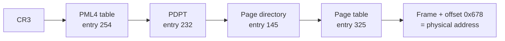

Every **process** in [4.11.2](/4.11.2) believes it owns a large, private memory that starts at the same addresses as everyone else's. Physically, all processes share one RAM, much smaller than the sum of their memories, and the **kernel** itself lives in it too. Virtual memory is the combination of hardware and kernel software that maintains the illusion: every address a program uses is *virtual*, translated on every access into a physical address by the processor's memory management unit, according to tables that the kernel sets up. Translation gives three things at once: isolation (a process cannot even name another's memory), convenience (every program is linked for the same addresses, and memory looks contiguous although it is scattered), and the ability to use more memory than is physically present by keeping part of it on disk. This chapter builds up the mechanism step by step, from the simplest relocation by a base register to paging with multi-level page tables and a translation cache, then turns to the policy question of which pages to keep in memory when it is full, and ends with memory-mapped files and shared libraries. The memory regions of a C or C++ program (code, static data, heap, stack; [4.1.8](/4.1.8)) are the parts of the address space; the allocator that manages the heap inside them is the subject of [4.11.5](/4.11.5). The cache hierarchy in hardware is treated in [4.10](/4.10); the replacement policies here are the same ideas applied one level lower, with pages instead of cache lines and the disk instead of RAM.

## 4.1. Address Spaces

### 4.1.1. The Abstraction

Early machines ran one program at a time, which used all memory except the part occupied by the operating system. **Multiprogramming** and **time-sharing** ([4.11.1](/4.11.1#sec-1.2)) put several programs in memory at once, and with them came the problems of protection (one program must not write into another) and relocation (a program cannot know in advance where in physical memory it will be loaded).

**Definition 4.1.1 (Address Space)** The **address space** of a process is the range of addresses that the process can use, together with the contents of those addresses as the process sees them. The addresses a program generates are **virtual addresses**; the addresses of actual locations in the memory hardware are **physical addresses**. **Virtual memory** is the technique of giving each process its own address space, in which virtual addresses are mapped to physical addresses (or to data on disk) by the hardware and the kernel.

The goals of a virtual memory system are *transparency* (the program does not notice the translation), *efficiency* (translation costs little time and the tables little space) and *protection* (a process can access only its own memory, with the permissions the kernel granted).

### 4.1.2. The Layout on x86-64 Linux

A small program that prints the addresses of a function, a **global variable**, a heap block and a **local variable**, and then its own memory map from `/proc/self/maps`:

```c
#include <stdio.h>
#include <stdlib.h>

int global_init = 42;          /* .data */
int global_zero;               /* .bss */

int main(void) {
    int local = 0;             /* stack */
    int *heap = malloc(16);    /* heap */
    printf("code %p (main)\n", (void *)main);
    printf("data %p (global_init)\n", (void *)&global_init);
    printf("bss %p (global_zero)\n", (void *)&global_zero);
    printf("heap %p (malloc)\n", (void *)heap);
    printf("libc %p (printf)\n", (void *)printf);
    printf("stack %p (local)\n", (void *)&local);
    fflush(stdout);
    FILE *f = fopen("/proc/self/maps", "r");
    char line[512];
    while (fgets(line, sizeof line, f)) fputs(line, stdout);
    fclose(f);
    free(heap);
    return 0;
}
```

The output, with the long directory names of the files shortened and the column padding removed:

```text
code 0x653efa473160 (main)
data 0x653efa476010 (global_init)
bss 0x653efa476024 (global_zero)
heap 0x653f133372a0 (malloc)
libc 0x7bf081e60100 (printf)
stack 0x7ffdbc9f9e9c (local)
653efa472000-653efa473000 r--p 00000000 08:30 1178010 /home/user/maps
653efa473000-653efa474000 r-xp 00001000 08:30 1178010 /home/user/maps
653efa474000-653efa475000 r--p 00002000 08:30 1178010 /home/user/maps
653efa475000-653efa476000 r--p 00002000 08:30 1178010 /home/user/maps
653efa476000-653efa477000 rw-p 00003000 08:30 1178010 /home/user/maps
653f13337000-653f13358000 rw-p 00000000 00:00 0 [heap]
7bf081e00000-7bf081e28000 r--p 00000000 08:30 55518 libc.so.6
7bf081e28000-7bf081fb1000 r-xp 00028000 08:30 55518 libc.so.6
7bf081fb1000-7bf082000000 r--p 001b1000 08:30 55518 libc.so.6
7bf082000000-7bf082004000 r--p 001ff000 08:30 55518 libc.so.6
7bf082004000-7bf082006000 rw-p 00203000 08:30 55518 libc.so.6
7bf082006000-7bf082013000 rw-p 00000000 00:00 0
7bf0820b6000-7bf0820b9000 rw-p 00000000 00:00 0
7bf0820c2000-7bf0820c4000 rw-p 00000000 00:00 0
7bf0820c4000-7bf0820c5000 r--p 00000000 08:30 55515 ld-linux-x86-64.so.2
7bf0820c5000-7bf0820f0000 r-xp 00001000 08:30 55515 ld-linux-x86-64.so.2
7bf0820f0000-7bf0820fa000 r--p 0002c000 08:30 55515 ld-linux-x86-64.so.2
7bf0820fa000-7bf0820fc000 r--p 00036000 08:30 55515 ld-linux-x86-64.so.2
7bf0820fc000-7bf0820fe000 rw-p 00038000 08:30 55515 ld-linux-x86-64.so.2
7ffdbc9db000-7ffdbc9fd000 rw-p 00000000 00:00 0 [stack]
7ffdbcb72000-7ffdbcb76000 r--p 00000000 00:00 0 [vvar]
7ffdbcb76000-7ffdbcb78000 r-xp 00000000 00:00 0 [vdso]
```

Each line is a *mapping* (Linux calls it a virtual memory area): a range of virtual addresses, permissions (`r`ead, `w`rite, e`x`ecute; `p`rivate or `s`hared), the offset in the file it maps, the device and inode of the file, and its name. From low to high addresses:

| Region | Permissions | Contents |
|---|---|---|
| Program file | `r--`, `r-x`, `r--`, `rw-` | ELF headers and read-only data, the code (`.text`), constants, initialized and zero-initialized globals (`.data`, `.bss`) |
| `[heap]` | `rw-` | memory managed by `malloc`, grown with the `brk` system call ([4.11.5](/4.11.5)) |
| Memory-mapping area | various | shared libraries (here the C library and the dynamic linker), anonymous mappings for large allocations and thread stacks, mapped files |
| `[stack]` | `rw-` | the main thread's stack, growing downward from near the top of the user half |
| `[vvar]`, `[vdso]` | `r--`, `r-x` | the kernel's data page and code for system calls without mode switch ([4.11.1](/4.11.1#sec-1.4.3)) |

Only 47 bits of address are used for user space, up to `0x7fffffffffff` (128 TiB); the upper half of the 64-bit range belongs to the kernel, which is mapped into every process but accessible only in **kernel mode**. The code is not writable and the stack and heap are not executable: a **buffer overflow** that writes **machine code** onto the stack can no longer simply execute it. Running the program again prints different addresses: *address space layout randomization* (ASLR) places the program, the libraries, the heap and the stack at random offsets on every run, so that an attacker cannot predict where code and data are.

## 4.2. Address Translation

### 4.2.1. Base and Bounds

**Definition 4.2.1 (Address Translation and MMU)** **Address translation** is the conversion of each virtual address issued by a running program into a physical address, performed by the hardware on every instruction fetch, load and store. The hardware unit that performs it is the **memory management unit** (MMU).

The simplest translation, used in the 1960s, is *dynamic relocation* by two registers: a *base* register holds the physical address where the address space begins, and a *bounds* (limit) register its size. For every access the MMU checks $0 \le \mathit{va} < \mathit{bounds}$ (otherwise it raises an **exception**, and the kernel typically kills the process) and computes $\mathit{pa} = \mathit{base} + \mathit{va}$. Only the kernel may change the two registers, and it reloads them on every **context switch**. For example, with base 32 KiB and bounds 16 KiB, virtual address 3000 maps to physical address $32768 + 3000 = 35768$, and virtual address 17000 faults.

Base and bounds protects and relocates, but wastes memory: the whole address space, including the unused gap between heap and stack, must occupy contiguous physical memory.

### 4.2.2. Segmentation

**Definition 4.2.2 (Segmentation)** In **segmentation** the address space consists of several variable-sized *segments* (typically code, heap and stack), each with its own base, bounds and protection bits. A virtual address names a segment (for example by its top bits) and an offset in it; the MMU checks the offset against the segment's bounds and adds the segment's base.

Segments can be placed independently, only the used parts of the address space occupy memory, and segments such as library code can be shared between processes. But segments have different sizes, and as they are allocated and freed, physical memory becomes a patchwork of used segments and free holes.

**Definition 4.2.3 (External Fragmentation)** **External fragmentation** is the waste of memory in free pieces between allocated blocks, each too small to satisfy a request although their total would suffice.

With 30 KiB free in three holes of 10 KiB, a request for a 20 KiB segment fails. Compaction (moving segments to merge the holes) is expensive. The same problem returns in the heap allocator ([4.11.5](/4.11.5)). On x86-64, segmentation survives only in vestigial form: the bases of the segment registers `fs` and `gs` point to per-thread and per-CPU data.

## 4.3. Paging

### 4.3.1. Pages and Page Tables

Paging avoids external fragmentation by dividing memory into pieces of one fixed size.

**Definition 4.3.1 (Page, Page Frame and Page Table)** In **paging**, the virtual address space is divided into fixed-size blocks called **pages** and physical memory into blocks of the same size called **page frames**. A virtual address consists of a *virtual page number* (VPN) and an *offset* within the page. The **page table** of a process maps each virtual page number to the *physical frame number* (PFN) holding that page; the physical address is the frame number followed by the unchanged offset.

With pages of $2^p$ bytes, the offset is the low $p$ bits of the address and the virtual page number the remaining high bits:

$$
\mathit{pa} = \mathrm{PFN}(\mathrm{VPN}) \cdot 2^{p} + \mathit{offset}, \qquad \mathrm{VPN} = \lfloor \mathit{va} / 2^{p} \rfloor, \qquad \mathit{offset} = \mathit{va} \bmod 2^{p} .
$$

The standard page size on x86-64 and most ARM systems is 4 KiB ($p = 12$); Apple's ARM processors use 16 KiB.

**Definition 4.3.2 (Page Table Entry)** A **page table entry** (PTE) holds the frame number of a page and status bits, the most important being: *present* (valid) — the page is in memory; *writable* and *user* — access permissions (a user-mode access to a page without the user bit faults); *no-execute* — instructions may not be fetched from the page; *accessed* (referenced) — set by the hardware on every access; *dirty* — set by the hardware on every write.

**Example 4.3.1** A 32-bit address space with 4 KiB pages: 20 bits of page number, 12 bits of offset. The virtual address `0x00403A7C` has VPN `0x00403` and offset `0xA7C`. If entry `0x403` of the page table holds frame number `0x001F2` with the present bit set, the physical address is `0x001F2A7C`. A store to this address succeeds only if the entry also has the writable bit; afterwards the hardware has set its accessed and dirty bits. An access to a page whose entry is not present raises a page fault (§4.6).

### 4.3.2. Two Problems: Space and Time

Paging as just described has two costs.

- Space: a linear page table has one entry per virtual page, whether used or not. For the 32-bit example, $2^{20}$ entries of 4 bytes are 4 MiB per process. For a 48-bit address space with 8-byte entries they would be $2^{36} \cdot 8\,\mathrm{B} = 512\,\mathrm{GiB}$ per process: impossible. §4.5 solves this with multi-level tables.
- Time: the page table is in memory, so every memory access by the program would need an extra access to read the PTE, doubling the cost of memory access (and with multi-level tables, quintupling it). §4.4 solves this with a cache of translations.

## 4.4. The Translation Lookaside Buffer

### 4.4.1. Caching Translations

**Definition 4.4.1 (TLB)** A **translation lookaside buffer** (TLB) is a small, fast cache of recent translations from virtual page numbers to page table entries, inside the MMU. On each memory access the hardware looks up the VPN in the TLB; on a *TLB hit* the frame number and permissions come from the TLB, and on a *TLB miss* the page table is consulted (by the hardware *page-table walker* on x86-64, ARM and RISC-V, by a kernel trap handler on older RISC architectures such as MIPS) and the translation is inserted into the TLB before the access is retried.

A modern core has a small first-level TLB (around 64 entries for data) and a larger second-level TLB (one to a few thousand entries); a hit costs nothing beyond the normal cache access. The TLB works because of the **locality** of memory references ([4.3.8](/4.3.8)): consecutive accesses usually fall into the same page (spatial locality), and the same pages are used again soon (temporal locality).

**Example 4.4.1** An array of ten 4-byte integers starts at virtual address 100 in a toy system with 16-byte pages (OSTEP, chapter 19). The elements occupy addresses 100 to 139, that is page 6 (addresses 96–111: `a[0]` to `a[2]`), page 7 (112–127: `a[3]` to `a[6]`) and page 8 (128–143: `a[7]` to `a[9]`). Summing the array with an initially empty TLB misses on `a[0]`, `a[3]` and `a[7]` and hits on the other seven accesses: hit rate 70 %. With 4 KiB pages, a sequential pass over an array of `int`s misses once per 1024 elements.

The effective cost of a memory access with TLB hit rate $h$, memory access time $m$ and a page walk of $k$ memory accesses is roughly $h\,m + (1 - h)(k + 1)\,m$. With $m = 100\,\mathrm{ns}$, $k = 4$ (§4.5) and $h = 0.99$ this is $99 + 5 = 104\,\mathrm{ns}$; with $h = 0.9$, $90 + 50 = 140\,\mathrm{ns}$. (In practice page-table entries are themselves cached in the data caches, so a walk is usually cheaper than $k$ full memory accesses.)

The TLB's reach, its number of entries times the page size, limits how much memory a program can touch without TLB misses. The following program reads one integer from each of $n$ pages, repeatedly, and prints the average time per access:

```c
#define _GNU_SOURCE
#include <sched.h>
#include <stdio.h>
#include <stdlib.h>
#include <time.h>

/* Read one int on each of n pages, many times; report the time per access.
   The offset within the page varies so that the accesses spread over
   different cache sets: the growth in time then comes from the TLB. */
int main(void) {
    cpu_set_t set;
    CPU_ZERO(&set);
    CPU_SET(2, &set);
    sched_setaffinity(0, sizeof set, &set);
    const long PAGE = 4096, MAXPAGES = 1L << 14;
    int *a = aligned_alloc(PAGE, MAXPAGES * PAGE);
    long *idx = malloc(MAXPAGES * sizeof(long));
    for (long i = 0; i < MAXPAGES * PAGE / (long)sizeof(int); i++) a[i] = 1;
    for (long p = 0; p < MAXPAGES; p++)
        idx[p] = p * (PAGE / sizeof(int)) + (p % 64) * 16;  /* page p, line p mod 64 */
    printf("pages   ns/access\n");
    long sum = 0;
    for (long n = 8; n <= MAXPAGES; n *= 2) {
        long rounds = (1L << 26) / n;
        struct timespec t0, t1;
        clock_gettime(CLOCK_MONOTONIC, &t0);
        for (long r = 0; r < rounds; r++)
            for (long p = 0; p < n; p++) sum += a[idx[p]];
        clock_gettime(CLOCK_MONOTONIC, &t1);
        double ns = ((t1.tv_sec - t0.tv_sec) * 1e9 + (t1.tv_nsec - t0.tv_nsec))
                    / (double)(rounds * n);
        printf("%6ld  %6.2f\n", n, ns);
    }
    return sum == 42;
}
```

```text
pages   ns/access
     8    0.36
    16    0.31
    32    0.40
    64    0.44
   128    0.39
   256    0.44
   512    0.46
  1024    0.74
  2048    1.17
  4096    4.78
  8192    5.95
 16384    6.43
```

The accesses are independent of each other, so the out-of-order processor overlaps misses in the small first-level TLB with other work, and up to 512 pages (2 MiB) the cost stays below half a nanosecond. Between 1024 and 4096 pages the second-level TLB no longer holds all translations, every access needs a page walk, and the cost rises more than tenfold. (The cache lines touched, at most 16384 × 64 B = 1 MiB, would fit in the processor's second-level cache, so the growth is due to the TLB, not to the data caches.) Programs that sweep large arrays repeatedly benefit from *huge pages*: on x86-64 a page-directory entry can map a 2 MiB page directly, and a page-directory-pointer entry a 1 GiB page, multiplying the TLB's reach by 512 or by $2^{18}$. Linux provides them automatically as *transparent huge pages* (mode `always`, or `madvise` for regions the program marks with `madvise(MADV_HUGEPAGE)`, the setting on this machine) and explicitly through `hugetlbfs`.

### 4.4.2. Context Switches and Shootdowns

TLB entries belong to one address space. On a **context switch** the kernel must either flush the TLB, making the next process start with misses, or tag entries with an *address space identifier* (ASID; x86-64 calls it the process-context identifier, PCID), so that entries of several processes coexist and only matching ones hit. Linux on x86-64 uses PCIDs (the `pcid` flag in `/proc/cpuinfo`) and, since the Meltdown mitigations of 2018, also uses them to keep separate kernel and user page tables cheaply.

When the kernel changes or removes a mapping that other CPUs might have cached in their TLBs, it must make them invalidate the entry: it sends them inter-processor **interrupts** and waits for acknowledgment, a *TLB shootdown*. Shootdowns are one reason why `munmap` and `mprotect` are expensive in multithreaded programs.

## 4.5. Multi-Level Page Tables

### 4.5.1. The Idea

Most of an address space is unused: in the map of §4.1.2 a few dozen megabytes are mapped out of 128 TiB. A linear page table spends entries on all of it.

**Definition 4.5.1 (Multi-Level Page Table)** A **multi-level page table** is a tree of page-sized tables. The virtual page number is split into several index fields; the first indexes the root table, whose entry gives the physical address of a second-level table, indexed by the second field, and so on; the entry in the last-level table is the PTE. A subtree that would map only unused addresses is omitted, its entry in the parent marked not present.

The cost is one memory access per level on a TLB miss; the gain is that the size of the table is proportional to the memory actually used. Alternatives are *inverted page tables*, with one entry per physical frame instead of one per virtual page, and *hashed page tables*; both are searched through a **hash table** keyed by the virtual page number (PowerPC and Itanium used such designs).

### 4.5.2. Four-Level Paging on x86-64

x86-64 uses 48-bit virtual addresses (bits 48–63 must be copies of bit 47) and four levels of tables, each a 4 KiB page of 512 entries of 8 bytes, so each level consumes 9 bits:

| Bits | 47–39 | 38–30 | 29–21 | 20–12 | 11–0 |
|---|---|---|---|---|---|
| Field | PML4 index | PDPT index | PD index | PT index | offset |
| Table (Intel name) | page map level 4 | page directory pointer table | page directory | page table | — |
| One entry maps | 512 GiB | 1 GiB | 2 MiB | 4 KiB | — |

**Example 4.5.1** The virtual address `0x7f3a12345678` (in the memory-mapping area of a process) splits into PML4 index $\lfloor \mathit{va}/2^{39} \rfloor \bmod 512 = 254$, PDPT index $232$, PD index $145$, PT index $325$ and offset `0x678`. On a TLB miss the walker reads the physical address of the PML4 table from the register `CR3` (loaded by the kernel at each context switch), reads entry 254 of the PML4, which points to a PDPT; entry 232 of that, which points to a page directory; entry 145 of that, which points to a page table; and entry 325 of that, the PTE with the frame number. If any entry on the way is not present, the walk stops with a page fault.



A process that uses one contiguous megabyte of memory needs one table at each level, four pages or 16 KiB of page tables, instead of the 512 GiB of a linear table. On the laptop of this course, all page tables of all processes together took 65 MiB (`PageTables` in `/proc/meminfo`) for about 3.6 GiB of process memory. Since Linux 4.14, processors with five-level paging (Intel *LA57*, 57-bit addresses, 128 PiB of user space) can use a fifth level; the kernel enables it only when the hardware supports it. RISC-V defines the analogous schemes Sv39, Sv48 and Sv57 with 3, 4 and 5 levels ([4.10.3](/4.10.3)); ARMv8 uses up to four levels of 4, 16 or 64 KiB granules.

## 4.6. Swapping and Page Replacement

### 4.6.1. Demand Paging and Page Faults

So far every page of the address space was in memory. The present bit allows more: a page can be absent and still valid, its contents in a file or on a swap device, and be brought in only when touched.

**Definition 4.6.1 (Page Fault and Demand Paging)** A **page fault** is the exception raised by the MMU when a program accesses a virtual page whose entry is not present or does not allow the access. The kernel's page-fault handler determines whether the address is valid for the process; if so, it obtains a free frame (evicting another page if necessary), fills it (with zeros, from a file, or from swap), updates the page table and returns, so that the faulting instruction is retried. If the address is invalid, the process receives `SIGSEGV` ([4.11.2](/4.11.2#sec-2.4.1)). **Demand paging** is the policy of loading a page only when it is first accessed. **Swap space** is the area on disk (a partition or a file) where the kernel stores pages of anonymous memory that it has evicted from RAM.

A fault that needs no disk I/O (the first touch of a zero-filled page, a page already in the page cache, a copy-on-write copy) is a *minor fault* and takes about a microsecond or less; a fault that must read from disk is a *major fault* and takes from about a hundred microseconds (SSD) to several milliseconds (hard disk). Demand paging can be observed directly:

```c
#include <stdio.h>
#include <stdlib.h>
#include <string.h>
#include <sys/mman.h>
#include <sys/resource.h>
#include <sys/wait.h>
#include <unistd.h>

static long minor_faults(void) {
    struct rusage u;
    getrusage(RUSAGE_SELF, &u);
    return u.ru_minflt;
}

static long rss_kib(void) {          /* resident set size from /proc */
    FILE *f = fopen("/proc/self/statm", "r");
    long pages_total, pages_resident;
    if (fscanf(f, "%ld %ld", &pages_total, &pages_resident) != 2) pages_resident = -1;
    fclose(f);
    return pages_resident * (sysconf(_SC_PAGESIZE) / 1024);
}

int main(void) {
    const size_t size = 256UL << 20;                  /* 256 MiB */
    const long page = sysconf(_SC_PAGESIZE);
    printf("page size %ld bytes\n", page);

    char *p = mmap(NULL, size, PROT_READ | PROT_WRITE,
                   MAP_PRIVATE | MAP_ANONYMOUS, -1, 0);
    printf("after mmap:      RSS %7ld KiB\n", rss_kib());

    long f0 = minor_faults();
    for (size_t i = 0; i < size; i += page) p[i] = 1; /* touch every page */
    long f1 = minor_faults();
    printf("after touching:  RSS %7ld KiB, %ld page faults for %zu pages\n",
           rss_kib(), f1 - f0, size / page);

    fflush(stdout);
    pid_t pid = fork();                               /* copy-on-write */
    if (pid == 0) {
        long g0 = minor_faults();
        for (size_t i = 0; i < size / 4; i += page) p[i] = 2;  /* write a quarter */
        printf("child wrote 64 MiB: %ld copy-on-write faults\n", minor_faults() - g0);
        fflush(stdout);
        _exit(0);
    }
    waitpid(pid, NULL, 0);
    printf("parent still sees p[0] = %d\n", p[0]);
    munmap(p, size);
    return 0;
}
```

```text
page size 4096 bytes
after mmap:      RSS    1536 KiB
after touching:  RSS  263772 KiB, 65536 page faults for 65536 pages
child wrote 64 MiB: 16384 copy-on-write faults
parent still sees p[0] = 1
```

The `mmap` of 256 MiB only reserved addresses; the *resident set size* (RSS, the memory actually in RAM) did not change. Each first touch of a page caused one minor fault, which allocated a zeroed frame. After `fork`, the child's writes each caused a fault that copied one page (§4.7.2), and the parent's memory was unaffected.

A consequence is that Linux by default *overcommits* memory: `malloc` of a huge block succeeds even when the memory is not available, since it may never be touched. If the processes then touch more memory than RAM and swap can hold, the kernel's *out-of-memory killer* (OOM killer) chooses a process, preferring the one using the most memory (adjustable with `/proc/<pid>/oom_score_adj`), and kills it with `SIGKILL`; the kernel log (`dmesg`, `journalctl -k`) records it. Memory limits of **batch jobs** and containers work the same way within their control group ([4.11.9](/4.11.9), [4.11.11](/4.11.11)): a job that exceeds its limit is killed with status 137.

**Example 4.6.1** Let a memory access take $m = 100\,\mathrm{ns}$ and a major fault from a hard disk $8\,\mathrm{ms}$. With fault probability $p$ per access, the effective access time is $(1 - p) \cdot 100\,\mathrm{ns} + p \cdot 8\,\mathrm{ms}$. For a slowdown of at most 10 %, $p \cdot 8 \times 10^{6}\,\mathrm{ns} < 10\,\mathrm{ns}$, so $p < 1.25 \times 10^{-6}$: fewer than one access in 800000 may fault. With an SSD (about $100\,\mathrm{\mu s}$) the bound is 80 times weaker but still strict. Swapping is a safety valve, not a way to compute with more memory than the machine has.

### 4.6.2. Replacement Policies

When memory is full and a page must be brought in, another must be evicted. Main memory then acts as a cache for the pages of all address spaces, and the replacement policy determines its miss rate. Misses are *compulsory* (first access to a page), *capacity* (the cache is too small for the working data) or *conflict* misses (absent in fully associative caches such as page frames).

**Definition 4.6.2 (Replacement Policies)** When a page must be evicted, the **optimal replacement policy** (OPT, Belady's MIN) evicts the page whose next use lies farthest in the future; **FIFO** evicts the page that has been in memory longest; **least recently used** (LRU) evicts the page whose last use lies farthest in the past; **random** replacement evicts a random page.

OPT minimizes the number of misses (Belady, 1966) but needs to know the future; it serves as the benchmark. LRU uses the past as a predictor of the future, which works when there is locality.

**Example 4.6.2** The reference string `0 1 2 0 1 3 0 3 1 2 1` with three frames (OSTEP, chapter 22). Under OPT: the first three references miss (compulsory), `0` and `1` hit; `3` misses and evicts `2`, whose next use is the farthest; `0`, `3`, `1` hit; `2` misses and evicts `0` or `3`, neither of which is used again; `1` hits. That makes 6 hits and 5 misses. A simulator for the four policies of this section:

```python
def simulate(refs, frames, policy):
    """Return the number of page faults and the trace of memory contents."""
    mem, faults, trace = [], 0, []
    last_use, ref_bit, hand = {}, {}, 0
    for t, page in enumerate(refs):
        hit = page in mem
        if not hit:
            faults += 1
            if len(mem) < frames:
                mem.append(page)
            else:
                if policy == "FIFO":                 # mem is kept in arrival order
                    victim = 0
                elif policy == "LRU":
                    victim = min(range(frames), key=lambda i: last_use[mem[i]])
                elif policy == "OPT":                # farthest next use
                    def next_use(p):
                        rest = refs[t + 1:]
                        return rest.index(p) if p in rest else float("inf")
                    victim = max(range(frames), key=lambda i: next_use(mem[i]))
                elif policy == "CLOCK":              # second chance
                    while ref_bit[mem[hand]]:
                        ref_bit[mem[hand]] = 0
                        hand = (hand + 1) % frames
                    victim = hand
                    hand = (hand + 1) % frames
                if policy == "FIFO":
                    mem.pop(0)
                    mem.append(page)
                else:
                    mem[victim] = page
        last_use[page] = t
        ref_bit[page] = 1
        trace.append(("hit " if hit else "miss") + " " + str(mem))
    return faults, trace

refs = [0, 1, 2, 0, 1, 3, 0, 3, 1, 2, 1]
for policy in ["OPT", "FIFO", "LRU", "CLOCK"]:
    f, _ = simulate(refs, 3, policy)
    print(f"{policy:5s} {f} faults, {len(refs) - f} hits")
_, trace = simulate(refs, 3, "OPT")
for page, line in zip(refs, trace):
    print(f"  ref {page}: {line}")

belady = [1, 2, 3, 4, 1, 2, 5, 1, 2, 3, 4, 5]
for frames in [3, 4]:
    print(f"FIFO with {frames} frames: {simulate(belady, frames, 'FIFO')[0]} faults;",
          f"LRU: {simulate(belady, frames, 'LRU')[0]} faults")
```

```text
OPT   5 faults, 6 hits
FIFO  7 faults, 4 hits
LRU   5 faults, 6 hits
CLOCK 7 faults, 4 hits
  ref 0: miss [0]
  ref 1: miss [0, 1]
  ref 2: miss [0, 1, 2]
  ref 0: hit  [0, 1, 2]
  ref 1: hit  [0, 1, 2]
  ref 3: miss [0, 1, 3]
  ref 0: hit  [0, 1, 3]
  ref 3: hit  [0, 1, 3]
  ref 1: hit  [0, 1, 3]
  ref 2: miss [2, 1, 3]
  ref 1: hit  [2, 1, 3]
FIFO with 3 frames: 9 faults; LRU: 10 faults
FIFO with 4 frames: 10 faults; LRU: 8 faults
```

On this short string LRU matches OPT. The last two lines show *Belady's anomaly*: with FIFO, the string `1 2 3 4 1 2 5 1 2 3 4 5` causes 9 faults with three frames but 10 with four. More memory can make FIFO worse. LRU cannot behave this way: it is a *stack algorithm*, meaning that the set of pages it keeps with $k$ frames is always a subset of the set it keeps with $k + 1$ frames, so adding frames never adds misses.

The behavior of the policies depends on the workload. The figure compares them on three synthetic workloads of 10000 references to 100 pages: without locality all policies except OPT have the same hit rate, proportional to the cache size; with an 80-20 hot set LRU does best among the realistic policies; and on a loop over 50 pages with fewer than 50 frames, LRU and FIFO miss on every access (each page is evicted just before it is needed), while random replacement degrades gracefully.


### 4.6.3. Approximating LRU: the Clock Algorithm

Exact LRU would need to update a timestamp or a list on every memory access, which no hardware does. The accessed bit of the PTE gives a cheap approximation.

**Definition 4.6.3 (Clock Algorithm)** The **clock algorithm** (second-chance algorithm) arranges the page frames in a circle with a *hand* pointing at one of them. To choose a victim, it examines the page under the hand: if its accessed bit is set, it clears the bit and advances the hand; if the bit is clear, the page has not been used during a full revolution of the hand, and it is evicted.

The clock algorithm approximates LRU well on workloads with locality (the "Clock" curve in the figure lies close to LRU on the 80-20 workload). Real systems refine it: they prefer clean pages to dirty ones, since a dirty page must be written back before its frame can be reused, and they write dirty pages back in the background so that clean frames are available when needed.

### 4.6.4. Thrashing and Working Sets

**Definition 4.6.4 (Working Set and Thrashing)** The **working set** of a process at time $t$ for a window $\tau$ is the set of pages it referenced in the last $\tau$ time units (Denning, 1968). When the working sets of the running processes together exceed physical memory, the system spends most of its time moving pages between memory and disk and makes almost no progress; this is **thrashing**.

A thrashing machine has its disk constantly busy and its CPUs mostly idle (waiting for page faults), and it does not recover by itself. Remedies are to run fewer processes at a time (old systems suspended whole processes; Linux's OOM killer is the brutal modern version), to add memory, or to reduce the memory used. For data analysis this is the practical lesson: check that the data, and the copies an analysis makes of it, fit in RAM (`free -h`, the `RES` column of `top`, `/usr/bin/time -v` for the peak RSS of a command), and process data in chunks or with streaming tools when they do not.

### 4.6.5. Memory Reclaim in Linux

Linux uses all otherwise free memory as a cache for file data (the page cache, [4.11.7](/4.11.7), shown as `buff/cache` by `free`), so "free" memory is normally small and "available" memory (free plus easily reclaimable cache) is the meaningful number. When free memory runs low, a kernel thread (`kswapd`) reclaims frames in the background, and allocating processes reclaim directly when that is not enough.

- Linux traditionally keeps two LRU lists per memory group, *active* and *inactive*, for file-backed and for anonymous pages; pages move between them according to their accessed bits, a two-list variant of the clock algorithm. Since Linux 6.1 the optional *multi-generational LRU* (MGLRU) sorts pages into several generations by recency, which reduces CPU overhead and makes better choices under memory pressure; some distributions enable it by default (`/sys/kernel/mm/lru_gen/enabled`).
- The parameter `vm.swappiness` (default 60, range 0–200) sets the relative preference for evicting anonymous pages (to swap) versus file pages (which can be reread from their files).
- Swap does not have to be a disk: *zram* is a compressed block device in RAM, and *zswap* a compressed cache in front of a swap device; both trade CPU time for fewer disk writes and are common on laptops and phones.

## 4.7. Memory Mapping and Sharing

### 4.7.1. mmap

**Definition 4.7.1 (Memory Mapping)** A **memory mapping** is a region of the address space whose pages are backed by a file (a *file-backed* mapping, whose contents are the file's) or by nothing (an *anonymous* mapping, initially zero). It is created by the system call `mmap`. A *shared* mapping makes changes visible to all processes mapping the same file and writes them to the file; a *private* mapping gives each process its own copy of every page it modifies.

All the regions of §4.1.2 are mappings: the program's code is a private, read-only mapping of the executable, the heap and the stacks are anonymous mappings. Programs can map files themselves and then read them with ordinary memory accesses, the kernel loading pages on demand:

```c
#include <fcntl.h>
#include <stdio.h>
#include <sys/mman.h>
#include <sys/stat.h>
#include <unistd.h>

/* GC content of a sequence file, read through a memory mapping. */
int main(int argc, char **argv) {
    if (argc != 2) { fprintf(stderr, "usage: %s FILE\n", argv[0]); return 2; }
    int fd = open(argv[1], O_RDONLY);
    if (fd < 0) { perror("open"); return 1; }
    struct stat st;
    fstat(fd, &st);
    const char *s = mmap(NULL, st.st_size, PROT_READ, MAP_PRIVATE, fd, 0);
    if (s == MAP_FAILED) { perror("mmap"); return 1; }
    close(fd);                               /* the mapping stays valid */
    madvise((void *)s, st.st_size, MADV_SEQUENTIAL);   /* hint: read ahead */
    long gc = 0, acgt = 0;
    for (off_t i = 0; i < st.st_size; i++) {
        char c = s[i];                       /* page faults load the file lazily */
        if (c == 'G' || c == 'C') gc++;
        if (c == 'A' || c == 'C' || c == 'G' || c == 'T') acgt++;
    }
    printf("%ld bases, GC content %.4f\n", acgt, (double)gc / acgt);
    munmap((void *)s, st.st_size);
    return 0;
}
```

On a 100 MB file of one million random lines of 99 bases (generated with 20 % each of C and G):

```text
99000000 bases, GC content 0.4000
```

Memory mapping avoids copying data from the kernel into a user buffer and lets several processes share one copy of a large read-only file (an index, a reference genome); NumPy's `np.memmap` and many bioinformatics indexes use it. Its costs are page faults instead of large reads, and errors that appear as `SIGBUS` when the file shrinks underneath the mapping. For a single sequential pass, ordinary `read` calls with a large buffer are as fast ([4.11.8](/4.11.8)).

### 4.7.2. Copy-on-Write

**Definition 4.7.2 (Copy-on-Write)** **Copy-on-write** (COW) is the technique of sharing a page between several address spaces, or between a private mapping and its file, by mapping it read-only into all of them, and copying it only when one of them writes to it: the write faults, and the fault handler copies the page into a new frame, maps the copy writable for the writer and retries the write.

Copy-on-write makes `fork` cheap ([4.11.2](/4.11.2#sec-2.2.1)): only the page tables are copied, and pages are duplicated one at a time as parent or child modify them; in the measurement of §4.6.1, writing 64 MiB in the child caused exactly 16384 copy faults. It also makes private file mappings cheap: the data region of a program is shared with the executable file until the program writes a variable. Python's multiprocessing with the `fork` start method relies on it to give workers large read-only data structures for free; reference counting writes to every object it touches, which gradually defeats this sharing.

### 4.7.3. Shared Libraries

A **dynamic library** ([4.2.2](/4.2.2)) is loaded by mapping its file into each process that uses it. The code pages are mapped read-only and shared, so one physical copy of the C library's 1.6 MB of code serves every process on the machine; only the pages each process writes (its copies of the library's global variables and pointer tables) are private, by copy-on-write. Because the library is mapped at a different (randomized) address in every process, its code is compiled as **position-independent code** (`-fPIC`): it reaches its own data through addresses relative to the **program counter**, and calls functions in other libraries through a table of pointers (the global offset table, GOT, and the procedure linkage table, PLT) that the dynamic linker fills in. `ldd` lists the libraries a program will map:

```text
$ ldd ./maps
	linux-vdso.so.1 (0x00007fff9892b000)
	libc.so.6 => /lib/x86_64-linux-gnu/libc.so.6 (0x00007ec408600000)
	/lib64/ld-linux-x86-64.so.2 (0x00007ec408904000)
```

The vDSO is listed as a library although no file backs it: the kernel maps it into every process. The search path for libraries (`LD_LIBRARY_PATH`, the paths recorded in the executable, `/etc/ld.so.cache`) is a frequent source of trouble with software installed outside the distribution's **package manager**, one of the reasons for the environment managers and containers of [4.11.9](/4.11.9) and [4.11.11](/4.11.11).

## Summary

- Each process has a private address space of virtual addresses, translated to physical addresses by the MMU on every access. On x86-64 Linux the user half (128 TiB) holds the program, the heap, the memory-mapping area with the libraries, and the stack, at addresses randomized by ASLR.
- Base and bounds relocates and protects but needs contiguous memory; segmentation allocates variable-sized segments and suffers from external fragmentation. Paging divides memory into fixed-size pages and frames; page table entries hold frame numbers and present, permission, accessed and dirty bits.
- The TLB caches translations; locality gives it hit rates near 100 %, and huge pages enlarge its reach. ASIDs (PCIDs) avoid flushes on context switches; changing mappings requires TLB shootdowns.
- Multi-level page tables store only the parts of the table that are used: x86-64 walks four levels of 512-entry tables (9 + 9 + 9 + 9 + 12 bits).
- Pages are loaded on demand: a page fault brings in the page and retries the instruction. Linux overcommits memory and kills processes with the OOM killer when memory runs out.
- OPT evicts the page used farthest in the future and is the benchmark; LRU approximates it on workloads with locality and is free of Belady's anomaly, unlike FIFO; the clock algorithm approximates LRU with accessed bits. When working sets exceed RAM the system thrashes.
- `mmap` maps files and anonymous memory; copy-on-write makes `fork` and private mappings cheap; shared libraries are mapped once in RAM and shared by all processes, using position-independent code.
