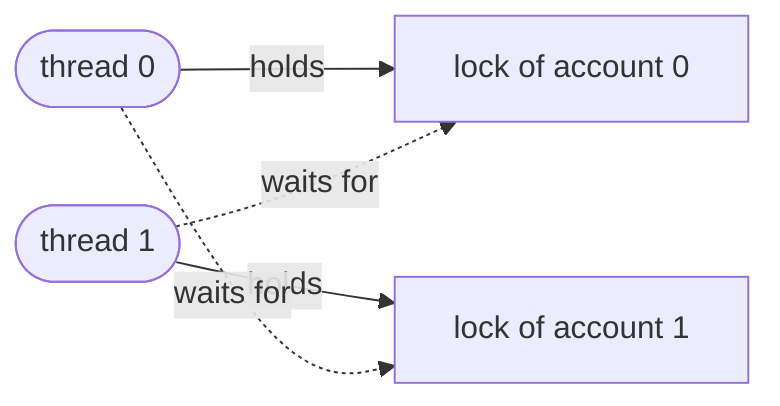

A **process** of [4.11.2](/4.11.2) has one flow of control. Many programs want several: a server handles many clients at once, an analysis uses all cores of a machine on one data set, an interactive program keeps responding while it computes. Several processes can do this, but they share nothing by default and must copy data to communicate. Threads are flows of control inside one process that share its **address space**, so that they cooperate through ordinary memory. Sharing is the source of their power and of their difficulty: when two threads update the same data at the same time, the result can depend on the exact interleaving of their instructions, and bugs appear only occasionally and vanish under a debugger. This chapter presents threads and the standard tools for writing correct concurrent programs: locks, condition variables and semaphores, how they are built from atomic hardware instructions and kernel support, the typical concurrency bugs including deadlock, and the alternative of event-based concurrency. Scheduling threads on processors was the subject of [4.11.3](/4.11.3); the practical use of threads and processes in Python, constrained by the **global interpreter lock**, was treated in [4.4.7](/4.4.7) and is connected to the concepts of this chapter at the end.

## 6.1. Threads

### 6.1.1. The Thread Abstraction

**Definition 6.1.1 (Thread)** A **thread** is a single sequential flow of control within a process. Each thread has its own program counter, registers and stack (and thread-local storage); all threads of a process share its address space (code, global data, heap, memory mappings), its open files and its other resources.

Compared with **processes**, threads are cheap to create and switch (no new address space, no **page tables** to copy, no **TLB** flush), and they communicate by reading and writing shared variables. The price is the loss of isolation: any thread can corrupt any data of the process, and a crash in one thread ends the whole process.

The POSIX thread interface (pthreads) is the standard on Unix-like systems:

| Function | Meaning |
|---|---|
| `pthread_create(&t, attr, f, arg)` | start a thread running `f(arg)` |
| `pthread_join(t, &ret)` | wait for thread `t` to finish and get its return value |
| `pthread_exit(ret)` | terminate the calling thread |
| `pthread_mutex_*`, `pthread_cond_*`, `pthread_rwlock_*` | synchronization (§6.2–§6.4) |

Linux implements each thread as a kernel task ([4.11.2](/4.11.2#sec-2.1.3)), created by the `clone` **system call** with flags that share the address space, the file table and the signal handlers; the C library's implementation is NPTL (Native POSIX Thread Library), a *one-to-one* model in which every user thread is a kernel-scheduled task. Each thread gets its own stack, by default 8 MiB of virtual memory (the `ulimit -s` value) of which only the touched pages occupy RAM. `ps -L` and `top -H` show the threads of a process; in `/proc/<pid>/task/` each has a directory. Runtimes such as Go's and Java's virtual threads add *many-to-many* scheduling of lightweight user-level threads on top of a smaller number of kernel threads.

### 6.1.2. Race Conditions

Two threads each increment a shared counter ten million times:

```c
#include <pthread.h>
#include <stdatomic.h>
#include <stdio.h>
#include <stdlib.h>
#include <time.h>

#define N 10000000

static volatile long counter = 0;            /* shared; volatile keeps the loads and stores */
static atomic_long acounter = 0;
static pthread_mutex_t lock = PTHREAD_MUTEX_INITIALIZER;
static int mode;                             /* 0 racy, 1 mutex, 2 atomic */

static void *worker(void *arg) {
    (void)arg;
    for (long i = 0; i < N; i++) {
        if (mode == 0) {
            counter = counter + 1;           /* load, add, store: not atomic */
        } else if (mode == 1) {
            pthread_mutex_lock(&lock);
            counter = counter + 1;           /* critical section */
            pthread_mutex_unlock(&lock);
        } else {
            atomic_fetch_add(&acounter, 1);  /* one atomic read-modify-write */
        }
    }
    return NULL;
}

int main(int argc, char **argv) {
    const char *names[] = {"racy", "mutex", "atomic"};
    mode = argc > 1 ? atoi(argv[1]) : 0;
    struct timespec t0, t1;
    clock_gettime(CLOCK_MONOTONIC, &t0);
    pthread_t a, b;
    pthread_create(&a, NULL, worker, NULL);
    pthread_create(&b, NULL, worker, NULL);
    pthread_join(a, NULL);
    pthread_join(b, NULL);
    clock_gettime(CLOCK_MONOTONIC, &t1);
    long result = mode == 2 ? atomic_load(&acounter) : counter;
    printf("%-6s counter = %8ld (expected %d)  %.2f s\n", names[mode], result, 2 * N,
           (t1.tv_sec - t0.tv_sec) + (t1.tv_nsec - t0.tv_nsec) * 1e-9);
    return 0;
}
```

Compiled with `gcc -O2 -pthread` and run with the arguments 0, 0, 1 and 2:

```text
racy   counter = 12486741 (expected 20000000)  0.08 s
racy   counter = 13634585 (expected 20000000)  0.06 s
mutex  counter = 20000000 (expected 20000000)  1.39 s
atomic counter = 20000000 (expected 20000000)  0.48 s
```

Without synchronization, about a third of the increments were lost, and differently in each run. The statement `counter = counter + 1` compiles to three instructions:

```text
movq    counter(%rip), %rax    # load the counter into a register
addq    $1, %rax               # increment the register
movq    %rax, counter(%rip)    # store it back
```

If thread 1 loads the value 50, is interrupted (or runs simultaneously on another core), and thread 2 loads 50, increments and stores 51, then thread 1 also stores 51: one increment is lost.

**Definition 6.1.2 (Race Condition, Critical Section and Mutual Exclusion)** A **race condition** occurs when the result of a computation depends on the relative timing or interleaving of several threads. A **critical section** is a piece of code that accesses a shared resource and must not be executed by more than one thread at a time. **Mutual exclusion** is the property that at most one thread executes a critical section at any time.

The two correct versions in the measurement show the two remedies. The mutex (§6.2) makes the three instructions a critical section; the atomic version uses a single hardware instruction (`lock xadd` on x86-64) that performs the read-modify-write indivisibly.

**Definition 6.1.3 (Atomicity)** An operation is **atomic** if it appears to the rest of the system to happen all at once: no other thread can observe an intermediate state, and two atomic operations on the same data never interleave.

In C11 and C++11, a *data race* (two threads access the same memory location, at least one writes, and the accesses are neither atomic nor ordered by synchronization) is **undefined behavior**: the compiler may assume it never happens and optimize accordingly, for example keeping a shared variable in a register. Correct programs therefore protect all shared mutable data by locks or access it through atomic types; `volatile` (used above only to make the race reliably visible) is not a synchronization mechanism.

## 6.2. Locks

### 6.2.1. The Lock Abstraction

**Definition 6.2.1 (Lock)** A **lock** (or **mutex**, from mutual exclusion) is a variable that is either free or held by one thread, with two operations: `lock` (acquire) waits until the lock is free and then takes it, atomically; `unlock` (release) frees it. Surrounding a critical section with `lock` and `unlock` on the same lock guarantees mutual exclusion.

```c
pthread_mutex_t m = PTHREAD_MUTEX_INITIALIZER;
pthread_mutex_lock(&m);
/* critical section: at most one thread at a time */
pthread_mutex_unlock(&m);
```

A lock is evaluated by three criteria: *correctness* (does it provide mutual exclusion?), *fairness* (does every waiting thread eventually get the lock, or can a thread starve?), and *performance* (the cost without contention, with contention on one processor, and with contention on many). In the measurement above, the uncontended path of a pthread mutex is a few nanoseconds, but two threads fighting over one lock took 17 times longer than the racy version and three times longer than the atomic increment.

### 6.2.2. Building a Lock

Disabling **interrupts** during critical sections works on a single processor (no other thread can run) but is privileged, dangerous, and useless on a multiprocessor. Software-only solutions exist: *Peterson's algorithm* (1981) achieves mutual exclusion for two threads with ordinary loads and stores:

```c
int flag[2] = {0, 0};   /* flag[i]: thread i wants to enter */
int turn;               /* whose turn it is to wait */

void lock(int self) {
    flag[self] = 1;
    turn = 1 - self;                          /* give priority to the other */
    while (flag[1 - self] && turn == 1 - self)
        ;                                     /* wait */
}
void unlock(int self) { flag[self] = 0; }
```

It is correct only if memory operations happen in program order. Modern processors and compilers reorder them (x86-64 lets a load overtake an earlier store to a different address), so Peterson's algorithm fails on real hardware unless memory fences are inserted. Practical locks use atomic instructions provided by the hardware:

- *Test-and-set* (atomic exchange, `xchg` on x86-64): write 1 to a location and return its old value. A thread that gets back 0 has acquired the lock.
- *Compare-and-swap* (CAS, `lock cmpxchg` on x86-64): if a location holds an expected value, replace it by a new value; report whether it did. CAS is the universal building block of lock-free data structures.
- *Load-linked / store-conditional* (LL/SC; `lr`/`sc` in RISC-V, `ldxr`/`stxr` in ARM): the store succeeds only if no other write to the location happened since the load.
- *Fetch-and-add* (`lock xadd`): increment a location and return its old value.

**Definition 6.2.2 (Spin Lock and Ticket Lock)** A **spin lock** is a lock whose waiting threads repeatedly test it in a loop (*spin*) until it becomes free, typically acquiring it with test-and-set or compare-and-swap. A **ticket lock** is a spin lock that serves waiters in order of arrival: acquiring takes a ticket number with fetch-and-add on a `next` counter and spins until a `serving` counter equals the ticket; releasing increments `serving`.

Both, with C11 atomics, used by four threads to protect a counter:

```c
#include <pthread.h>
#include <stdatomic.h>
#include <stdio.h>
#include <time.h>

/* Test-and-set spin lock. */
typedef struct { atomic_flag held; } spinlock_t;
static void spin_lock(spinlock_t *l) {
    while (atomic_flag_test_and_set_explicit(&l->held, memory_order_acquire))
        ;                                            /* spin until the old value was 0 */
}
static void spin_unlock(spinlock_t *l) {
    atomic_flag_clear_explicit(&l->held, memory_order_release);
}

/* Ticket lock: fetch-and-add hands out tickets, so waiters enter in FIFO order. */
typedef struct { atomic_uint next, serving; } ticketlock_t;
static void ticket_lock(ticketlock_t *l) {
    unsigned my = atomic_fetch_add_explicit(&l->next, 1, memory_order_relaxed);
    while (atomic_load_explicit(&l->serving, memory_order_acquire) != my)
        ;                                            /* wait for our turn */
}
static void ticket_unlock(ticketlock_t *l) {
    atomic_fetch_add_explicit(&l->serving, 1, memory_order_release);
}

#define N 5000000
#define THREADS 4
static long counter;
static spinlock_t sl = { ATOMIC_FLAG_INIT };
static ticketlock_t tl;
static int use_ticket;

static void *worker(void *arg) {
    (void)arg;
    for (long i = 0; i < N; i++) {
        if (use_ticket) { ticket_lock(&tl); counter++; ticket_unlock(&tl); }
        else            { spin_lock(&sl);   counter++; spin_unlock(&sl); }
    }
    return NULL;
}

int main(void) {
    for (use_ticket = 0; use_ticket <= 1; use_ticket++) {
        counter = 0;
        struct timespec t0, t1;
        clock_gettime(CLOCK_MONOTONIC, &t0);
        pthread_t t[THREADS];
        for (int i = 0; i < THREADS; i++) pthread_create(&t[i], NULL, worker, NULL);
        for (int i = 0; i < THREADS; i++) pthread_join(t[i], NULL);
        clock_gettime(CLOCK_MONOTONIC, &t1);
        printf("%-12s counter = %ld (expected %d)  %.2f s\n",
               use_ticket ? "ticket lock" : "spin lock", counter, THREADS * N,
               (t1.tv_sec - t0.tv_sec) + (t1.tv_nsec - t0.tv_nsec) * 1e-9);
    }
    return 0;
}
```

```text
spin lock    counter = 20000000 (expected 20000000)  2.50 s
ticket lock  counter = 20000000 (expected 20000000)  22.47 s
```

Both are correct. The memory orders `acquire` and `release` tell compiler and processor that accesses inside the critical section may not move out of it. The large difference in speed (repeated runs on this machine, which was loaded by other work, gave 2.5–3.1 s against 15–22 s) shows the price of fairness. The test-and-set lock is unfair: the thread that has just released it often takes it again at once, while its cache still holds the lock and the counter, so long runs of iterations stay on one core. The ticket lock hands the lock to a specific next thread every time, so the lock's cache line moves between cores on every acquisition; and if that next thread has been preempted, all others spin uselessly until it runs again.

### 6.2.3. Spinning or Sleeping

Spinning wastes processor time, and on a single processor a spinning thread can only waste its whole **time slice**, since the holder cannot run meanwhile. Spinning pays only when critical sections are short and the holder is running on another core. Otherwise a waiting thread should sleep, which needs the kernel.

**Definition 6.2.3 (Futex)** A **futex** (fast user-space mutex) is a Linux mechanism for building sleeping locks: the lock state is an integer in user memory, manipulated with atomic instructions without entering the kernel when there is no contention; only a thread that finds the lock taken calls the system call `futex(FUTEX_WAIT)` to sleep until the value changes, and the releasing thread calls `futex(FUTEX_WAKE)` only if there are waiters.

glibc's mutexes, condition variables and semaphores are built on futexes, typically as *two-phase locks*: spin briefly (the lock may be released soon), then sleep. That is why the uncontended mutex costs a few nanoseconds, while a contended one costs **system calls** and **context switches**. The deadlocked threads of §6.5 are found sleeping in the kernel's futex wait queue.

### 6.2.4. Locking Data Structures

Adding locks to a data structure is a design problem. One lock for the whole structure (*coarse-grained locking*) is simple and correct but serializes all threads; one lock per part (*fine-grained locking*: per bucket of a **hash table**, per node of a **linked list** with *hand-over-hand* locking, where a thread holds the lock of a node until it has acquired the next one) allows parallelism but costs more locking operations and makes deadlock possible. A third approach avoids contention on hot counters: each thread updates a private counter and adds it to the global one only occasionally (an *approximate* or *sloppy counter*), trading accuracy of intermediate values for scalability. Measure before refining: more concurrency is not necessarily faster.

## 6.3. Condition Variables

### 6.3.1. Waiting for a Condition

Locks provide mutual exclusion, but threads also need to wait for each other: a consumer must wait until there is data, a parent thread until a child has finished. Spinning on a shared flag wastes the processor.

**Definition 6.3.1 (Condition Variable)** A **condition variable** is a queue of threads waiting for some condition on shared state to become true, used together with the lock protecting that state. The operation `wait(cv, m)` atomically releases the lock `m` and puts the calling thread to sleep; when the thread is woken, it reacquires `m` before returning. `signal(cv)` wakes one waiting thread, if any; `broadcast(cv)` wakes all of them.

The atomic release in `wait` matters: if the thread released the lock and then went to sleep in two steps, a signal sent between them would be lost and the thread could sleep forever (the same race as with `pause` in [4.11.2](/4.11.2#sec-2.4.3)). Two rules make condition variables safe:

1. Hold the lock when changing the state and when calling `wait` and `signal`.
2. Always wait in a `while` loop that rechecks the condition, never with an `if`. Condition variables in POSIX have *Mesa semantics* (Lampson and Redell, 1980): a signal is only a hint that the state may have changed. By the time the woken thread runs, another thread may have taken the item, and POSIX also permits *spurious wakeups*.

### 6.3.2. The Bounded Buffer

The classic application is the *producer–consumer* problem: producers put items into a buffer of fixed capacity, a **circular buffer**, and consumers take them out; producers must wait when the buffer is full and consumers when it is empty. Pipes between **processes** ([4.11.10](/4.11.10)), work queues of thread pools and `queue.Queue` in Python are bounded buffers.

```c
#include <pthread.h>
#include <stdio.h>

/* Bounded buffer (producer/consumer) with one mutex and two condition variables. */
#define CAP 8
static int buf[CAP];
static int head = 0, tail = 0, count = 0;
static pthread_mutex_t m = PTHREAD_MUTEX_INITIALIZER;
static pthread_cond_t not_full = PTHREAD_COND_INITIALIZER;
static pthread_cond_t not_empty = PTHREAD_COND_INITIALIZER;

static void put(int x) {
    pthread_mutex_lock(&m);
    while (count == CAP)                     /* while, not if: recheck after waking */
        pthread_cond_wait(&not_full, &m);    /* releases m while sleeping */
    buf[tail] = x;
    tail = (tail + 1) % CAP;
    count++;
    pthread_cond_signal(&not_empty);
    pthread_mutex_unlock(&m);
}

static int get(void) {
    pthread_mutex_lock(&m);
    while (count == 0)
        pthread_cond_wait(&not_empty, &m);
    int x = buf[head];
    head = (head + 1) % CAP;
    count--;
    pthread_cond_signal(&not_full);
    pthread_mutex_unlock(&m);
    return x;
}

#define ITEMS 100000
#define PRODUCERS 2
#define CONSUMERS 3

static void *producer(void *arg) {
    (void)arg;
    for (int i = 1; i <= ITEMS; i++) put(i);   /* each producer sends 1..ITEMS */
    return NULL;
}

static void *consumer(void *arg) {
    long *sum = arg;
    for (;;) {
        int x = get();
        if (x == 0) break;                   /* 0 is the end-of-stream marker */
        *sum += x;
    }
    return NULL;
}

int main(void) {
    pthread_t p[PRODUCERS], c[CONSUMERS];
    long sums[CONSUMERS] = {0};
    for (long i = 0; i < CONSUMERS; i++) pthread_create(&c[i], NULL, consumer, &sums[i]);
    for (long i = 0; i < PRODUCERS; i++) pthread_create(&p[i], NULL, producer, NULL);
    for (int i = 0; i < PRODUCERS; i++) pthread_join(p[i], NULL);
    for (int i = 0; i < CONSUMERS; i++) put(0);  /* one marker per consumer */
    long total = 0;
    for (int i = 0; i < CONSUMERS; i++) {
        pthread_join(c[i], NULL);
        printf("consumer %d: partial sum %ld\n", i, sums[i]);
        total += sums[i];
    }
    printf("total %ld (expected %ld)\n", total, (long)PRODUCERS * ITEMS * (ITEMS + 1) / 2);
    return 0;
}
```

```text
consumer 0: partial sum 3333451926
consumer 1: partial sum 3291528756
consumer 2: partial sum 3375119318
total 10000100000 (expected 10000100000)
```

Every item arrived exactly once, divided among the consumers by the scheduler. The two condition variables are essential: with only one, a consumer's `signal` could wake another consumer instead of a waiting producer, and all threads could end up asleep. With a buffer of 8 slots the threads constantly sleep and wake; the run took 2.7 s, almost all of it in the kernel. Real queues use larger buffers and pass items in batches.

## 6.4. Semaphores

**Definition 6.4.1 (Semaphore)** A **semaphore** (Dijkstra, 1965) is an integer variable with two atomic operations: `wait` (originally P; `sem_wait`) decrements the value and, if the result would be negative, blocks until it can decrement; `post` (originally V; `sem_post`) increments the value and wakes a waiting thread if there is one. The initial value determines its use: a *binary semaphore* initialized to 1 acts as a lock; a semaphore initialized to 0 lets one thread wait for an event signalled by another; a *counting semaphore* initialized to $n$ admits at most $n$ threads at a time.

```c
#include <pthread.h>
#include <semaphore.h>
#include <stdatomic.h>
#include <stdio.h>
#include <unistd.h>

/* A counting semaphore initialized to 2 lets at most two of eight
   workers use a resource (say, a licence or a disk) at the same time. */
static sem_t slots;
static atomic_int active, max_active;

static void *worker(void *arg) {
    (void)arg;
    for (int round = 0; round < 5; round++) {
        sem_wait(&slots);                          /* P: take a slot or sleep */
        int now = atomic_fetch_add(&active, 1) + 1;
        int seen = atomic_load(&max_active);
        while (now > seen && !atomic_compare_exchange_weak(&max_active, &seen, now))
            ;                                      /* record the maximum */
        usleep(2000);                              /* use the resource */
        atomic_fetch_sub(&active, 1);
        sem_post(&slots);                          /* V: give the slot back */
    }
    return NULL;
}

int main(void) {
    sem_init(&slots, 0, 2);
    pthread_t t[8];
    for (int i = 0; i < 8; i++) pthread_create(&t[i], NULL, worker, NULL);
    for (int i = 0; i < 8; i++) pthread_join(t[i], NULL);
    printf("at most %d workers were inside at once\n", atomic_load(&max_active));
    return 0;
}
```

```text
at most 2 workers were inside at once
```

(The maximum is recorded with a compare-and-swap loop: it retries until it either sees a value at least as large or installs its own.) The bounded buffer can also be written with semaphores: `empty` initialized to the capacity, `full` initialized to 0, and a binary semaphore `mutex` around the buffer updates. A producer does `wait(empty); wait(mutex); insert; post(mutex); post(full)`. The order matters: a producer that took `mutex` first and then blocked on `wait(empty)` would hold the mutex while sleeping, and no consumer could ever make room, a deadlock.

Semaphores are more general than locks but less structured than condition variables: the meaning of a semaphore's value is implicit, and a forgotten `post` is hard to find. Two further classical patterns: a *reader–writer lock* (`pthread_rwlock_t`) lets any number of readers or one writer hold it, which helps data that is read much more often than written (at the risk of starving writers); and the *dining philosophers* problem (five philosophers, five forks, each needs both neighbouring forks) is the standard illustration of deadlock, solved by making one philosopher pick up the forks in the opposite order, an instance of lock ordering (§6.5.3).

## 6.5. Concurrency Bugs and Deadlock

### 6.5.1. Non-Deadlock Bugs

A study of concurrency bugs in large open-source programs (MySQL, Apache, Mozilla, OpenOffice; Lu et al., 2008) found that most of them fall into two classes besides deadlock:

- *Atomicity violations*: code that the programmer assumed would execute atomically is interleaved, for example checking that a pointer is not `NULL` and then using it, while another thread sets it to `NULL` in between. The fix is a lock around the whole sequence.
- *Order violations*: an operation that should happen after another may happen before it, for example a thread using a variable that another thread has not yet initialized. The fix is a condition variable or semaphore that enforces the order.

### 6.5.2. Deadlock

**Definition 6.5.1 (Deadlock)** A set of threads (or processes) is in **deadlock** if each of them is waiting for an event, typically the release of a resource, that only another thread of the set can cause; none of them can ever proceed.

The standard example: two accounts, each protected by its own lock, and two threads transferring money in opposite directions, each locking the source account first.

```c
#include <pthread.h>
#include <stdio.h>
#include <stdlib.h>
#include <unistd.h>

/* Two accounts, each protected by its own lock. A transfer locks both. */
typedef struct { pthread_mutex_t lock; long balance; } account_t;
static account_t acc[2] = { {PTHREAD_MUTEX_INITIALIZER, 100},
                            {PTHREAD_MUTEX_INITIALIZER, 100} };
static int ordered;                              /* 1: always lock the lower index first */

static void transfer(int from, int to, long amount) {
    account_t *first = &acc[from], *second = &acc[to];
    if (ordered && from > to) { first = &acc[to]; second = &acc[from]; }
    pthread_mutex_lock(&first->lock);
    usleep(1000);                                /* widen the window for the bad interleaving */
    pthread_mutex_lock(&second->lock);
    acc[from].balance -= amount;
    acc[to].balance += amount;
    pthread_mutex_unlock(&second->lock);
    pthread_mutex_unlock(&first->lock);
}

static void *t0(void *arg) { (void)arg; for (int i = 0; i < 100; i++) transfer(0, 1, 1); return NULL; }
static void *t1(void *arg) { (void)arg; for (int i = 0; i < 100; i++) transfer(1, 0, 1); return NULL; }

int main(int argc, char **argv) {
    ordered = argc > 1;
    pthread_t a, b;
    pthread_create(&a, NULL, t0, NULL);
    pthread_create(&b, NULL, t1, NULL);
    pthread_join(a, NULL);
    pthread_join(b, NULL);
    printf("balances %ld %ld\n", acc[0].balance, acc[1].balance);
    return 0;
}
```

Run once without and once with lock ordering:

```text
$ timeout 5 ./deadlock; echo "exit status $?"
exit status 124
$ ./deadlock ordered; echo "exit status $?"
balances 100 100
exit status 0
```

The first run never finished and was killed by `timeout` (status 124). Thread 0 holds account 0's lock and waits for account 1's; thread 1 holds account 1's and waits for account 0's. While it hung, `ps` showed all three threads (the main thread waiting in `pthread_join`) asleep in the kernel's futex wait queue, using no processor time:

```text
    PID     LWP STAT WCHAN                  COMMAND
  33876   33876 Sl   futex_wait_queue       deadlock
  33876   33878 Sl   futex_wait_queue       deadlock
  33876   33879 Sl   futex_wait_queue       deadlock
```



The graph of which thread holds and which waits for which resource (the *resource allocation graph*) contains a cycle; that is the signature of a deadlock.

**Theorem 6.5.1 (Coffman Conditions)** A deadlock can occur only if four conditions hold simultaneously (Coffman, Elphick and Shoshani, 1971):

1. Mutual exclusion: resources are held exclusively (a lock is held by one thread);
2. Hold and wait: threads hold resources while waiting for others;
3. No preemption: resources cannot be taken away from the threads holding them;
4. Circular wait: there is a cycle of threads, each waiting for a resource held by the next.

With single-instance resources such as locks, the four conditions are also sufficient: a cycle in the resource allocation graph is a deadlock.

### 6.5.3. Dealing with Deadlock

*Prevention* breaks one of the four conditions by design.

- Circular wait: impose a **total order** on locks and always acquire them in that order. This is the standard practice; it fixed the example above (lock the account with the lower index first). The Linux kernel documents the order of its locks, and its *lockdep* checker records the order in which locks are taken at run time and reports any potential cycle.
- Hold and wait: acquire all needed locks at once, protected by a global lock, or not at all.
- No preemption: with `pthread_mutex_trylock`, a thread that cannot get its second lock releases its first and tries again later. This avoids deadlock but can cause *livelock*: threads repeatedly back off and retry in lockstep without progress; random delays before retrying help.
- Mutual exclusion: lock-free data structures built on compare-and-swap avoid locks altogether.

*Avoidance* lets the system refuse requests that could lead to deadlock. The *banker's algorithm* (Dijkstra) requires each thread to declare its maximum demand in advance; a request is granted only if the resulting state is *safe*, meaning that there is an order in which every thread can obtain its maximum demand and finish.

**Example 6.5.1** Ten units of one resource; three threads with maximum demands 8, 4 and 6 currently hold 3, 2 and 2 units, so 3 units are free and the remaining needs are 5, 2 and 4. The state is safe: thread 2 can get its 2 and finish (5 free), then thread 3 its 4 (7 free), then thread 1 its 5. If thread 3 now requests 2 units, granting would leave 1 free with needs 5, 2 and 2: no thread could finish for certain, the state would be unsafe, so the request is delayed. A request by thread 1 for 1 unit, in contrast, leaves 2 free with needs 4, 2 and 4, and the order 2, 3, 1 still finishes; it is granted.

Avoidance needs advance knowledge that general-purpose programs do not have, and it is rarely used outside special systems. *Detection and recovery* lets deadlocks happen, finds cycles in the wait graph periodically and breaks them by aborting a participant; databases do exactly this, aborting and retrying one of the deadlocked transactions. Many systems, finally, ignore the problem (the "ostrich algorithm"), relying on lock ordering in the code and on a restart when it hangs.

### 6.5.4. Priority Inversion

With priority scheduling, locks can defeat priorities. A low-priority thread L holds a lock; a high-priority thread H blocks on it; a medium-priority thread M, which does not need the lock, preempts L and runs for a long time. H, the most important thread, now waits for M. This *priority inversion* reset the computer of the Mars Pathfinder lander repeatedly in 1997, until engineers enabled *priority inheritance* remotely: a thread holding a lock temporarily inherits the highest priority of the threads waiting for it, so L runs at H's priority until it releases the lock. POSIX mutexes support it (`PTHREAD_PRIO_INHERIT`), and Linux's real-time mutexes in the kernel use it.

## 6.6. Event-Based Concurrency

Threads are not the only way to handle many activities at once. An *event-based* program runs a single thread with an *event loop*: it waits until one of many sources (network connections, timers, signals) has an event, runs the handler for that event to completion, and repeats. Handlers never block; any operation that would wait is started and its completion becomes another event. Because only one handler runs at a time, no locks are needed within the program.

The kernel supports this with **system calls** that wait on many file descriptors at once: `select` and `poll` (which scan the whole list on every call) and Linux's `epoll`, which keeps the set of watched descriptors in the kernel and returns only those that are ready, so that one thread can serve tens of thousands of connections (the design of nginx, Node.js and Redis). Linux's io_uring interface goes further, passing requests and completions through rings of shared memory ([4.11.8](/4.11.8)).

Python's `asyncio` is an event loop with coroutines: `await` marks the points where a coroutine yields to the loop while it waits.

```python
import asyncio
import time

async def fetch(name, seconds):
    """Stand-in for a network request: await yields to the event loop."""
    print(f"{time.perf_counter() - t0:4.1f} s  start {name}")
    await asyncio.sleep(seconds)
    print(f"{time.perf_counter() - t0:4.1f} s  done  {name}")
    return seconds

async def main():
    results = await asyncio.gather(fetch("A", 1.0), fetch("B", 2.0), fetch("C", 1.5))
    print(f"{time.perf_counter() - t0:4.1f} s  all done, results {results}")

t0 = time.perf_counter()
asyncio.run(main())
```

```text
 0.0 s  start A
 0.0 s  start B
 0.0 s  start C
 1.0 s  done  A
 1.5 s  done  C
 2.0 s  done  B
 2.0 s  all done, results [1.0, 2.0, 1.5]
```

Three waits of 1, 2 and 1.5 s overlap and finish after 2 s, in one thread. The limitations are those of the model: a handler that computes for a long time, or calls a blocking function, stalls every other activity; and an event-based program uses only one core unless it is combined with threads or processes. Event loops are therefore the tool for many concurrent I/O-bound activities (web servers, downloading many files, querying many web services), and threads or processes the tool for using several cores.

## 6.7. Threads in Python

The concepts of this chapter map directly onto Python's standard library and explain the advice of [4.4.7](/4.4.7):

| Concept | Python |
|---|---|
| thread | `threading.Thread`, `concurrent.futures.ThreadPoolExecutor` |
| lock | `threading.Lock`, `threading.RLock` (reentrant), `with lock:` |
| condition variable | `threading.Condition` (with `wait_for(predicate)`, which contains the `while` loop) |
| semaphore | `threading.Semaphore`, `threading.BoundedSemaphore` |
| bounded buffer | `queue.Queue(maxsize=n)` |
| event loop | `asyncio` |
| processes instead of threads | `multiprocessing`, `concurrent.futures.ProcessPoolExecutor` |

The **global interpreter lock** of CPython is a lock in exactly the sense of §6.2: a thread must hold it to execute bytecode, and the interpreter releases it periodically (every 5 ms by default, `sys.getswitchinterval()`) and around blocking I/O. It protects the interpreter's own data, such as reference counts, but not the program's: `counts[k] += 1` from several threads is a read-modify-write that can lose updates exactly like the C counter above, even with the GIL, because the GIL can be released between the bytecodes. Python programs that share mutable data between threads need `threading.Lock` regardless of the GIL, and on the free-threaded build of Python 3.13 and later they need it even more. A **process pool** sidesteps both the GIL and shared-state bugs by giving each worker its own address space, at the price of copying data between processes; and **Amdahl's law** bounds the gain of any of these approaches by the fraction of the work that remains serial.

## Summary

- Threads are flows of control that share one address space; each has its own registers and stack. Linux implements them as tasks created by `clone` (NPTL, one-to-one).
- Unsynchronized updates of shared data cause race conditions: `counter = counter + 1` lost a third of the increments. Critical sections need mutual exclusion; in C and C++ a data race is undefined behavior.
- Locks are built from atomic instructions (test-and-set, compare-and-swap, LL/SC, fetch-and-add). Test-and-set spin locks are fast but unfair; ticket locks are fair but hand the lock between cores on every acquisition. Waiting threads should usually sleep: futexes make uncontended locks cheap and put contended waiters to sleep in the kernel.
- Condition variables let threads wait for a condition: wait atomically releases the lock, and the condition must be rechecked in a `while` loop. The bounded buffer uses one lock and two condition variables.
- Semaphores generalize locks and signals with a counter; their order of use matters.
- Common bugs are atomicity violations, order violations and deadlocks. Deadlock requires mutual exclusion, hold and wait, no preemption and circular wait; acquiring locks in a fixed global order prevents it. The banker's algorithm avoids it with declared maximum demands; databases detect and break it. Priority inheritance solves priority inversion.
- Event loops (`epoll`, `asyncio`) handle many I/O-bound activities in one thread without locks, but block on long computations.
- Python's threading primitives are the same concepts; the GIL protects the interpreter, not the program's data.
