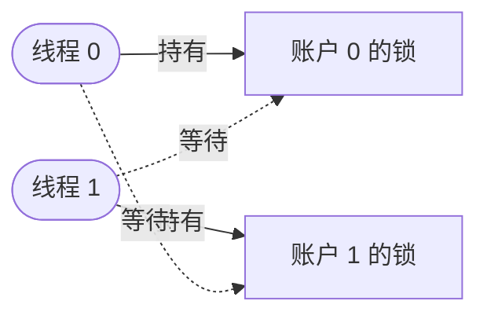

[4.11.2](/4.11.2) 中的**进程**只有一个控制流。许多程序需要几个：服务器同时处理许多客户端，数据分析在同一数据集上使用机器的全部核，交互式程序在计算的同时仍能响应。多个进程可以做到这一点，但它们默认不共享任何东西，通信时必须复制数据。线程是同一进程内共享其**地址空间**的控制流，因此可以通过普通内存协作。共享既是线程的力量所在，也是困难所在：两个线程同时更新同一数据时，结果可能取决于它们的指令交错的具体方式，错误只是偶尔出现，在调试器下又消失了。本章介绍线程，以及编写正确的并发程序的标准工具：锁、条件变量和信号量，它们怎样由硬件的原子指令和内核的支持构造出来，包括死锁在内的典型并发错误，以及基于事件的并发这一替代方案。在处理器上调度线程是 [4.11.3](/4.11.3) 的主题；Python 中线程和进程的实际使用受**全局解释器锁**的限制，已在 [4.4.7](/4.4.7) 中讨论，本章末尾把它与本章的概念联系起来。

## 6.1. 线程

### 6.1.1. 线程抽象

**定义 6.1.1（线程）** **线程**是进程内的一个顺序控制流。每个线程有自己的程序计数器、寄存器和栈（以及线程局部存储）；同一进程的所有线程共享该进程的地址空间（代码、全局数据、堆、内存映射）、打开的文件和其他资源。

与**进程**相比，线程创建和切换的代价都很小（不需要新的地址空间，无需复制**页表**，也无需清空 **TLB**），并且通过读写共享变量来通信。代价是失去了隔离：任何线程都可以破坏进程的任何数据，一个线程崩溃会使整个进程终止。

POSIX 线程接口（pthreads）是类 Unix 系统上的标准：

| 函数 | 含义 |
|---|---|
| `pthread_create(&t, attr, f, arg)` | 启动一个运行 `f(arg)` 的线程 |
| `pthread_join(t, &ret)` | 等待线程 `t` 结束并获得其返回值 |
| `pthread_exit(ret)` | 终止调用线程 |
| `pthread_mutex_*`、`pthread_cond_*`、`pthread_rwlock_*` | 同步（§6.2–§6.4） |

Linux 把每个线程实现为一个内核任务（[4.11.2](/4.11.2#sec-2.1.3)），由 `clone` **系统调用**创建，所带的标志使新任务共享地址空间、文件表和信号处理程序；C 库的实现是 NPTL（Native POSIX Thread Library），采用一对一模型，每个用户线程都是由内核调度的任务。每个线程有自己的栈，默认为 8 MiB 虚拟内存（`ulimit -s` 的值），其中只有被访问过的页才占用内存。`ps -L` 和 `top -H` 显示进程的各个线程；在 `/proc/<pid>/task/` 中，每个线程有一个目录。Go 和 Java 的虚拟线程等运行时，在数量较少的内核线程之上，对轻量的用户级线程实行多对多调度。

### 6.1.2. 竞态条件

两个线程各对一个共享计数器加一，各做一千万次：

```c
#include <pthread.h>
#include <stdatomic.h>
#include <stdio.h>
#include <stdlib.h>
#include <time.h>

#define N 10000000

static volatile long counter = 0;            /* shared; volatile keeps the loads and stores */
static atomic_long acounter = 0;
static pthread_mutex_t lock = PTHREAD_MUTEX_INITIALIZER;
static int mode;                             /* 0 racy, 1 mutex, 2 atomic */

static void *worker(void *arg) {
    (void)arg;
    for (long i = 0; i < N; i++) {
        if (mode == 0) {
            counter = counter + 1;           /* load, add, store: not atomic */
        } else if (mode == 1) {
            pthread_mutex_lock(&lock);
            counter = counter + 1;           /* critical section */
            pthread_mutex_unlock(&lock);
        } else {
            atomic_fetch_add(&acounter, 1);  /* one atomic read-modify-write */
        }
    }
    return NULL;
}

int main(int argc, char **argv) {
    const char *names[] = {"racy", "mutex", "atomic"};
    mode = argc > 1 ? atoi(argv[1]) : 0;
    struct timespec t0, t1;
    clock_gettime(CLOCK_MONOTONIC, &t0);
    pthread_t a, b;
    pthread_create(&a, NULL, worker, NULL);
    pthread_create(&b, NULL, worker, NULL);
    pthread_join(a, NULL);
    pthread_join(b, NULL);
    clock_gettime(CLOCK_MONOTONIC, &t1);
    long result = mode == 2 ? atomic_load(&acounter) : counter;
    printf("%-6s counter = %8ld (expected %d)  %.2f s\n", names[mode], result, 2 * N,
           (t1.tv_sec - t0.tv_sec) + (t1.tv_nsec - t0.tv_nsec) * 1e-9);
    return 0;
}
```

用 `gcc -O2 -pthread` 编译，以参数 0、0、1、2 运行：

```text
racy   counter = 12486741 (expected 20000000)  0.08 s
racy   counter = 13634585 (expected 20000000)  0.06 s
mutex  counter = 20000000 (expected 20000000)  1.39 s
atomic counter = 20000000 (expected 20000000)  0.48 s
```

没有同步时，大约三分之一的加一操作丢失了，而且每次运行都不同。语句 `counter = counter + 1` 被编译成三条指令：

```text
movq    counter(%rip), %rax    # load the counter into a register
addq    $1, %rax               # increment the register
movq    %rax, counter(%rip)    # store it back
```

如果线程 1 读入值 50 后被中断（或在另一个核上同时运行），而线程 2 读入 50，加一并存回 51，那么线程 1 也会存回 51：一次加一就丢失了。

**定义 6.1.2（竞态条件、临界区与互斥）** 当计算结果取决于多个线程的相对时序或交错方式时，就出现了**竞态条件**。**临界区**是访问共享资源的一段代码，同一时刻不能有多个线程执行它。**互斥**是指任何时刻至多有一个线程执行临界区的性质。

测量中的两个正确版本展示了两种补救办法。互斥锁（§6.2）把这三条指令变成临界区；原子版本使用一条硬件指令（x86-64 上的 `lock xadd`），不可分割地完成读-改-写。

**定义 6.1.3（原子性）** 称一个操作为**原子操作**，如果在系统的其余部分看来它是一次完成的：其他线程观察不到中间状态，对同一数据的两个原子操作也绝不会交错。

在 C11 和 C++11 中，数据竞争（data race）（两个线程访问同一内存位置，至少有一个写，并且这些访问既不是原子的，也没有被同步操作排出先后）是**未定义行为**：编译器可以假定它不会发生，并据此优化，例如把共享变量保存在寄存器里。因此正确的程序要用锁保护所有共享的可变数据，或者通过原子类型访问；`volatile`（上面使用它只是为了让竞态稳定地出现）并不是同步机制。

## 6.2. 锁

### 6.2.1. 锁的抽象

**定义 6.2.1（锁）** **锁**（或称**互斥锁**，取自 mutual exclusion）是一个变量，处于空闲或被某个线程持有的状态，有两个操作：`lock`（获取）等待锁空闲，然后原子地取得它；`unlock`（释放）使它空闲。用同一个锁的 `lock` 和 `unlock` 把临界区括起来，就能保证互斥。

```c
pthread_mutex_t m = PTHREAD_MUTEX_INITIALIZER;
pthread_mutex_lock(&m);
/* critical section: at most one thread at a time */
pthread_mutex_unlock(&m);
```

锁用三条标准来评价：正确性（是否提供互斥）、公平性（每个等待的线程最终能否得到锁，还是会有线程饿死）和性能（无竞争时的开销、单个处理器上有竞争时的开销、多个处理器上有竞争时的开销）。在上面的测量中，pthread 互斥锁在无竞争时的路径只需几纳秒，但两个线程争夺一把锁所用的时间是有竞态的版本的 17 倍，是原子加一的 3 倍。

### 6.2.2. 构造一把锁

在临界区内关闭**中断**，在单处理器上可行（没有其他线程能运行），但这是特权操作，很危险，并且在多处理器上无效。也有纯软件的解法：Peterson 算法（Peterson's algorithm）（1981）只用普通的读写就能为两个线程实现互斥：

```c
int flag[2] = {0, 0};   /* flag[i]: thread i wants to enter */
int turn;               /* whose turn it is to wait */

void lock(int self) {
    flag[self] = 1;
    turn = 1 - self;                          /* give priority to the other */
    while (flag[1 - self] && turn == 1 - self)
        ;                                     /* wait */
}
void unlock(int self) { flag[self] = 0; }
```

它只在内存操作按程序顺序发生时才正确。现代处理器和编译器会对它们重新排序（x86-64 允许一次读越过先前对不同地址的写），所以除非插入内存屏障，Peterson 算法在真实硬件上会失败。实用的锁使用硬件提供的原子指令：

- 测试并设置（test-and-set）（原子交换，x86-64 上的 `xchg`）：向某个位置写入 1，并返回它原来的值。拿到 0 的线程就获得了锁。
- 比较并交换（compare-and-swap），简称 CAS（x86-64 上的 `lock cmpxchg`）：如果某个位置保存着期望的值，就把它替换成新值，并报告是否替换成功。CAS 是无锁数据结构的通用构件。
- 链接加载/条件存储（load-linked / store-conditional），简称 LL/SC（RISC-V 中的 `lr`/`sc`，ARM 中的 `ldxr`/`stxr`）：只有自加载以来没有其他线程写过该位置，存储才会成功。
- 取并加（fetch-and-add）（`lock xadd`）：把某个位置加一，并返回它原来的值。

**定义 6.2.2（自旋锁与票据锁）** **自旋锁**是这样一种锁：等待的线程在循环中反复测试它（自旋），直到它空闲，通常用测试并设置或比较并交换来获取。**票据锁**是按到达顺序服务等待者的自旋锁：获取时用取并加在计数器 `next` 上领取一个票号，并自旋直到计数器 `serving` 等于该票号；释放时把 `serving` 加一。

下面用 C11 原子操作实现这两种锁，由四个线程用它们保护一个计数器：

```c
#include <pthread.h>
#include <stdatomic.h>
#include <stdio.h>
#include <time.h>

/* Test-and-set spin lock. */
typedef struct { atomic_flag held; } spinlock_t;
static void spin_lock(spinlock_t *l) {
    while (atomic_flag_test_and_set_explicit(&l->held, memory_order_acquire))
        ;                                            /* spin until the old value was 0 */
}
static void spin_unlock(spinlock_t *l) {
    atomic_flag_clear_explicit(&l->held, memory_order_release);
}

/* Ticket lock: fetch-and-add hands out tickets, so waiters enter in FIFO order. */
typedef struct { atomic_uint next, serving; } ticketlock_t;
static void ticket_lock(ticketlock_t *l) {
    unsigned my = atomic_fetch_add_explicit(&l->next, 1, memory_order_relaxed);
    while (atomic_load_explicit(&l->serving, memory_order_acquire) != my)
        ;                                            /* wait for our turn */
}
static void ticket_unlock(ticketlock_t *l) {
    atomic_fetch_add_explicit(&l->serving, 1, memory_order_release);
}

#define N 5000000
#define THREADS 4
static long counter;
static spinlock_t sl = { ATOMIC_FLAG_INIT };
static ticketlock_t tl;
static int use_ticket;

static void *worker(void *arg) {
    (void)arg;
    for (long i = 0; i < N; i++) {
        if (use_ticket) { ticket_lock(&tl); counter++; ticket_unlock(&tl); }
        else            { spin_lock(&sl);   counter++; spin_unlock(&sl); }
    }
    return NULL;
}

int main(void) {
    for (use_ticket = 0; use_ticket <= 1; use_ticket++) {
        counter = 0;
        struct timespec t0, t1;
        clock_gettime(CLOCK_MONOTONIC, &t0);
        pthread_t t[THREADS];
        for (int i = 0; i < THREADS; i++) pthread_create(&t[i], NULL, worker, NULL);
        for (int i = 0; i < THREADS; i++) pthread_join(t[i], NULL);
        clock_gettime(CLOCK_MONOTONIC, &t1);
        printf("%-12s counter = %ld (expected %d)  %.2f s\n",
               use_ticket ? "ticket lock" : "spin lock", counter, THREADS * N,
               (t1.tv_sec - t0.tv_sec) + (t1.tv_nsec - t0.tv_nsec) * 1e-9);
    }
    return 0;
}
```

```text
spin lock    counter = 20000000 (expected 20000000)  2.50 s
ticket lock  counter = 20000000 (expected 20000000)  22.47 s
```

两者都是正确的。内存序 `acquire` 和 `release` 告诉编译器和处理器，临界区内的访问不得移到临界区之外。速度的巨大差异（在这台被其他工作占用的机器上重复运行，结果为 2.5–3.1 秒对 15–22 秒）显示了公平的代价。测试并设置锁是不公平的：刚释放锁的线程常常立刻再次取得它，此时它的缓存中还保存着锁和计数器，所以长长的一串迭代都停留在同一个核上。票据锁每次都把锁交给一个确定的下一个线程，所以锁所在的缓存行在每次获取时都要在核之间移动；而且如果这个下一个线程被抢占了，其他所有线程都会白白地自旋，直到它再次运行。

### 6.2.3. 自旋还是睡眠

自旋浪费处理器时间；在单处理器上，自旋的线程只能白白用掉它的整个**时间片**，因为持有者在这期间无法运行。只有当临界区很短、持有者正在另一个核上运行时，自旋才划算。否则等待的线程应该睡眠，这需要内核的参与。

**定义 6.2.3（Futex）** **futex**（fast user-space mutex，快速用户空间互斥锁）是 Linux 中用来构造睡眠锁的机制：锁的状态是用户内存中的一个整数，无竞争时用原子指令操作它，不必进入内核；只有发现锁已被占用的线程才调用系统调用 `futex(FUTEX_WAIT)` 睡眠，直到该值改变；释放锁的线程只有在有等待者时才调用 `futex(FUTEX_WAKE)`。

glibc 的互斥锁、条件变量和信号量都建立在 futex 之上，通常是两阶段锁：先自旋一小会儿（锁可能很快释放），然后睡眠。这就是无竞争的互斥锁只花几纳秒，而有竞争的却要付出**系统调用**和**上下文切换**代价的原因。§6.5 中死锁的线程，就是在内核的 futex 等待队列里睡眠时被发现的。

### 6.2.4. 给数据结构加锁

给数据结构加锁是一个设计问题。整个结构只用一把锁（粗粒度锁（coarse-grained locking））简单而正确，但使所有线程串行化；每个部分一把锁（细粒度锁（fine-grained locking）：**散列表**的每个桶一把锁，或者**链表**的每个结点一把锁并采用手递手加锁，即线程持有一个结点的锁，直到取得下一个结点的锁）允许并行，但需要更多的加锁操作，并使死锁成为可能。第三种方法避免在热点计数器上的竞争：每个线程更新私有计数器，只是偶尔才把它加到全局计数器上（近似计数器或松弛计数器），以中间值的精确性换取可扩展性。先测量再改进：并发度更高未必更快。

## 6.3. 条件变量

### 6.3.1. 等待条件

锁提供互斥，但线程还需要互相等待：消费者必须等到有数据，父线程必须等到子线程结束。在共享标志上自旋会浪费处理器。

**定义 6.3.1（条件变量）** **条件变量**是一个队列，其中的线程在等待共享状态上的某个条件变为真，它与保护该状态的锁一起使用。操作 `wait(cv, m)` 原子地释放锁 `m` 并使调用线程睡眠；线程被唤醒时，先重新获得 `m` 再返回。`signal(cv)` 唤醒一个等待的线程（如果有的话）；`broadcast(cv)` 唤醒所有等待的线程。

`wait` 中释放锁的原子性很重要：如果线程分两步，先释放锁再去睡眠，那么在两步之间发出的信号就会丢失，线程可能永远睡下去（与 [4.11.2](/4.11.2#sec-2.4.3) 中 `pause` 的竞态相同）。两条规则使条件变量安全：

1. 修改状态以及调用 `wait` 和 `signal` 时都要持有锁。
2. 总是在 `while` 循环中等待，重新检查条件，绝不用 `if`。POSIX 的条件变量具有 Mesa 语义（Mesa semantics）（Lampson 和 Redell，1980）：信号只是一个提示，表明状态可能已经改变。等被唤醒的线程运行时，别的线程可能已经取走了数据项，而且 POSIX 还允许虚假唤醒（spurious wakeup）。

### 6.3.2. 有界缓冲区

经典的应用是生产者-消费者问题（producer–consumer problem）：生产者把数据项放入容量固定的缓冲区，即**循环数组**，消费者把它们取出来；缓冲区满时生产者必须等待，缓冲区空时消费者必须等待。**进程**之间的管道（[4.11.10](/4.11.10)）、线程池的工作队列以及 Python 中的 `queue.Queue` 都是有界缓冲区。

```c
#include <pthread.h>
#include <stdio.h>

/* Bounded buffer (producer/consumer) with one mutex and two condition variables. */
#define CAP 8
static int buf[CAP];
static int head = 0, tail = 0, count = 0;
static pthread_mutex_t m = PTHREAD_MUTEX_INITIALIZER;
static pthread_cond_t not_full = PTHREAD_COND_INITIALIZER;
static pthread_cond_t not_empty = PTHREAD_COND_INITIALIZER;

static void put(int x) {
    pthread_mutex_lock(&m);
    while (count == CAP)                     /* while, not if: recheck after waking */
        pthread_cond_wait(&not_full, &m);    /* releases m while sleeping */
    buf[tail] = x;
    tail = (tail + 1) % CAP;
    count++;
    pthread_cond_signal(&not_empty);
    pthread_mutex_unlock(&m);
}

static int get(void) {
    pthread_mutex_lock(&m);
    while (count == 0)
        pthread_cond_wait(&not_empty, &m);
    int x = buf[head];
    head = (head + 1) % CAP;
    count--;
    pthread_cond_signal(&not_full);
    pthread_mutex_unlock(&m);
    return x;
}

#define ITEMS 100000
#define PRODUCERS 2
#define CONSUMERS 3

static void *producer(void *arg) {
    (void)arg;
    for (int i = 1; i <= ITEMS; i++) put(i);   /* each producer sends 1..ITEMS */
    return NULL;
}

static void *consumer(void *arg) {
    long *sum = arg;
    for (;;) {
        int x = get();
        if (x == 0) break;                   /* 0 is the end-of-stream marker */
        *sum += x;
    }
    return NULL;
}

int main(void) {
    pthread_t p[PRODUCERS], c[CONSUMERS];
    long sums[CONSUMERS] = {0};
    for (long i = 0; i < CONSUMERS; i++) pthread_create(&c[i], NULL, consumer, &sums[i]);
    for (long i = 0; i < PRODUCERS; i++) pthread_create(&p[i], NULL, producer, NULL);
    for (int i = 0; i < PRODUCERS; i++) pthread_join(p[i], NULL);
    for (int i = 0; i < CONSUMERS; i++) put(0);  /* one marker per consumer */
    long total = 0;
    for (int i = 0; i < CONSUMERS; i++) {
        pthread_join(c[i], NULL);
        printf("consumer %d: partial sum %ld\n", i, sums[i]);
        total += sums[i];
    }
    printf("total %ld (expected %ld)\n", total, (long)PRODUCERS * ITEMS * (ITEMS + 1) / 2);
    return 0;
}
```

```text
consumer 0: partial sum 3333451926
consumer 1: partial sum 3291528756
consumer 2: partial sum 3375119318
total 10000100000 (expected 10000100000)
```

每个数据项恰好到达一次，由调度器在消费者之间分配。两个条件变量是必不可少的：如果只有一个，消费者的 `signal` 可能唤醒另一个消费者而不是等待的生产者，最后所有线程可能都睡着。缓冲区只有 8 个槽时，线程不断地睡眠和唤醒；这次运行用了 2.7 秒，几乎全部花在内核中。实际的队列使用更大的缓冲区，并成批地传递数据项。

## 6.4. 信号量

**定义 6.4.1（信号量）** **信号量**（Dijkstra，1965）是带有两个原子操作的整型变量：`wait`（原称 P；`sem_wait`）把值减一，如果结果将为负，就阻塞直到可以减；`post`（原称 V；`sem_post`）把值加一，并在有等待线程时唤醒其中一个。初始值决定它的用法：初值为 1 的二值信号量相当于锁；初值为 0 的信号量使一个线程能够等待另一个线程发出的事件；初值为 $n$ 的计数信号量最多允许 $n$ 个线程同时进入。

```c
#include <pthread.h>
#include <semaphore.h>
#include <stdatomic.h>
#include <stdio.h>
#include <unistd.h>

/* A counting semaphore initialized to 2 lets at most two of eight
   workers use a resource (say, a licence or a disk) at the same time. */
static sem_t slots;
static atomic_int active, max_active;

static void *worker(void *arg) {
    (void)arg;
    for (int round = 0; round < 5; round++) {
        sem_wait(&slots);                          /* P: take a slot or sleep */
        int now = atomic_fetch_add(&active, 1) + 1;
        int seen = atomic_load(&max_active);
        while (now > seen && !atomic_compare_exchange_weak(&max_active, &seen, now))
            ;                                      /* record the maximum */
        usleep(2000);                              /* use the resource */
        atomic_fetch_sub(&active, 1);
        sem_post(&slots);                          /* V: give the slot back */
    }
    return NULL;
}

int main(void) {
    sem_init(&slots, 0, 2);
    pthread_t t[8];
    for (int i = 0; i < 8; i++) pthread_create(&t[i], NULL, worker, NULL);
    for (int i = 0; i < 8; i++) pthread_join(t[i], NULL);
    printf("at most %d workers were inside at once\n", atomic_load(&max_active));
    return 0;
}
```

```text
at most 2 workers were inside at once
```

（最大值用比较并交换的循环来记录：它不断重试，直到看到一个不小于自己的值，或者装入自己的值。）有界缓冲区也可以用信号量来写：`empty` 初始化为容量，`full` 初始化为 0，再用一个二值信号量 `mutex` 保护对缓冲区的更新。生产者执行 `wait(empty); wait(mutex); insert; post(mutex); post(full)`。顺序很重要：如果生产者先取得 `mutex`，再在 `wait(empty)` 上阻塞，它就会在睡眠时持有互斥锁，没有消费者能腾出空位，这就是死锁。

信号量比锁更一般，但不如条件变量结构化：信号量的值的含义是隐含的，忘记的 `post` 很难发现。还有两个经典模式：**读写锁**（`pthread_rwlock_t`）允许任意多个读者或一个写者持有它，对读远多于写的数据有帮助（有使写者饥饿的风险）；以及哲学家就餐问题（dining philosophers problem）（五位哲学家、五支叉子，每人需要同时拿起左右两支），它是死锁的标准例子，解法是让其中一位哲学家以相反的顺序拿叉子，这是加锁顺序（§6.5.3）的一个实例。

## 6.5. 并发错误与死锁

### 6.5.1. 非死锁错误

一项针对大型开源程序（MySQL、Apache、Mozilla、OpenOffice；Lu 等，2008）中并发错误的研究发现，除死锁之外，大多数错误属于两类：

- 原子性违例（atomicity violation）：程序员以为会原子地执行的代码被交错了，例如检查指针不是 `NULL` 然后使用它，而另一个线程在两者之间把它设为 `NULL`。修复办法是用锁把整个序列保护起来。
- 顺序违例（order violation）：本应在另一个操作之后发生的操作却可能先发生，例如一个线程使用另一个线程尚未初始化的变量。修复办法是用条件变量或信号量来强制顺序。

### 6.5.2. 死锁

**定义 6.5.1（死锁）** 如果一组线程（或进程）中的每一个都在等待一个事件（通常是某个资源的释放），而这个事件只能由该组中的另一个线程引起，则称这组线程处于**死锁**；它们谁也不可能再继续运行。

标准的例子：两个账户，各由自己的锁保护，两个线程朝相反方向转账，都先锁住转出账户。

```c
#include <pthread.h>
#include <stdio.h>
#include <stdlib.h>
#include <unistd.h>

/* Two accounts, each protected by its own lock. A transfer locks both. */
typedef struct { pthread_mutex_t lock; long balance; } account_t;
static account_t acc[2] = { {PTHREAD_MUTEX_INITIALIZER, 100},
                            {PTHREAD_MUTEX_INITIALIZER, 100} };
static int ordered;                              /* 1: always lock the lower index first */

static void transfer(int from, int to, long amount) {
    account_t *first = &acc[from], *second = &acc[to];
    if (ordered && from > to) { first = &acc[to]; second = &acc[from]; }
    pthread_mutex_lock(&first->lock);
    usleep(1000);                                /* widen the window for the bad interleaving */
    pthread_mutex_lock(&second->lock);
    acc[from].balance -= amount;
    acc[to].balance += amount;
    pthread_mutex_unlock(&second->lock);
    pthread_mutex_unlock(&first->lock);
}

static void *t0(void *arg) { (void)arg; for (int i = 0; i < 100; i++) transfer(0, 1, 1); return NULL; }
static void *t1(void *arg) { (void)arg; for (int i = 0; i < 100; i++) transfer(1, 0, 1); return NULL; }

int main(int argc, char **argv) {
    ordered = argc > 1;
    pthread_t a, b;
    pthread_create(&a, NULL, t0, NULL);
    pthread_create(&b, NULL, t1, NULL);
    pthread_join(a, NULL);
    pthread_join(b, NULL);
    printf("balances %ld %ld\n", acc[0].balance, acc[1].balance);
    return 0;
}
```

分别在不用和使用加锁顺序时运行一次：

```text
$ timeout 5 ./deadlock; echo "exit status $?"
exit status 124
$ ./deadlock ordered; echo "exit status $?"
balances 100 100
exit status 0
```

第一次运行始终没有结束，被 `timeout` 杀死（状态 124）。线程 0 持有账户 0 的锁并等待账户 1 的锁；线程 1 持有账户 1 的锁并等待账户 0 的锁。挂起期间，`ps` 显示全部三个线程（主线程在 `pthread_join` 中等待）都在内核的 futex 等待队列中睡眠，不占用处理器时间：

```text
    PID     LWP STAT WCHAN                  COMMAND
  33876   33876 Sl   futex_wait_queue       deadlock
  33876   33878 Sl   futex_wait_queue       deadlock
  33876   33879 Sl   futex_wait_queue       deadlock
```



记录哪个线程持有、哪个线程等待哪个资源的图（资源分配图（resource allocation graph））中出现了一个环；这就是死锁的标志。

**定理 6.5.1（Coffman 条件）** 死锁只有在以下四个条件同时成立时才可能发生（Coffman、Elphick 和 Shoshani，1971）：

1. 互斥：资源被独占地持有（锁由一个线程持有）；
2. 持有并等待：线程在等待其他资源的同时持有资源；
3. 不可抢占：资源不能从持有它的线程那里夺走；
4. 循环等待：存在一个线程环，其中每个线程都在等待下一个线程所持有的资源。

对于锁这样每种只有一个实例的资源，这四个条件也是充分的：资源分配图中的环就是死锁。

### 6.5.3. 应对死锁

预防（prevention）通过设计来破坏四个条件之一。

- 循环等待：对锁规定一个**全序关系**，并总是按这个顺序获取它们。这是标准做法；上面的例子就是这样修复的（先锁下标较小的账户）。Linux 内核记录了它的锁的顺序，其 lockdep 检查器在运行时记录取锁的顺序，并报告任何潜在的环。
- 持有并等待：用一把全局锁保护，一次取得所需的全部锁，要么一把也不取。
- 不可抢占：用 `pthread_mutex_trylock`，拿不到第二把锁的线程释放第一把，稍后再试。这样避免了死锁，但可能导致活锁（livelock）：线程反复退让、同步地重试而没有进展；重试前随机延迟有帮助。
- 互斥：基于比较并交换的无锁数据结构完全避免了锁。

避免（avoidance）让系统拒绝可能导致死锁的请求。银行家算法（banker's algorithm）（Dijkstra）要求每个线程事先声明它的最大需求；只有当授予后的状态是安全的，请求才被批准，所谓安全，是指存在一个顺序，使每个线程都能得到它的最大需求并完成。

**例 6.5.1** 某种资源共 10 个单位；三个线程的最大需求为 8、4 和 6，当前分别持有 3、2 和 2 个单位，因此有 3 个单位空闲，还需要的数量是 5、2 和 4。这个状态是安全的：线程 2 可以拿到它的 2 个并完成（空闲 5 个），然后线程 3 拿到它的 4 个（空闲 7 个），再然后线程 1 拿到它的 5 个。如果线程 3 现在请求 2 个单位，授予后只剩 1 个空闲，需求为 5、2 和 2：没有线程能确保完成，状态将是不安全的，所以该请求被推迟。相反，线程 1 请求 1 个单位，则剩下 2 个空闲，需求为 4、2 和 4，顺序 2、3、1 仍能完成；该请求被批准。

避免需要通用程序所没有的事先知识，除了特殊系统，很少使用。检测与恢复（detection and recovery）让死锁发生，定期在等待图中查找环，并通过中止一个参与者来打破它；数据库正是这样做的，中止并重试死锁的事务之一。最后，许多系统干脆忽视这个问题（"鸵鸟算法"），依靠代码中的加锁顺序，并在挂起时重启。

### 6.5.4. 优先级反转

在优先级调度下，锁可能使优先级失效。低优先级线程 L 持有一把锁；高优先级线程 H 在这把锁上阻塞；不需要这把锁的中优先级线程 M 抢占了 L，并长时间运行。最重要的线程 H 于是在等待 M。这种**优先级反转**（priority inversion）在 1997 年使火星探路者号着陆器的计算机反复重置，直到工程师远程启用了**优先级继承**（priority inheritance）：持有锁的线程暂时继承等待该锁的线程中最高的优先级，于是 L 以 H 的优先级运行，直到它释放锁。POSIX 互斥锁支持它（`PTHREAD_PRIO_INHERIT`），Linux 内核中的实时互斥锁也使用它。

## 6.6. 基于事件的并发

线程并不是同时处理多项活动的唯一办法。基于事件的程序只运行一个线程，并带有一个事件循环（event loop）：它等待许多来源（网络连接、定时器、信号）中的某一个出现事件，把该事件的处理程序运行到完成，然后重复。处理程序从不阻塞；任何要等待的操作都先启动，它的完成成为另一个事件。由于同一时刻只运行一个处理程序，程序内部不需要锁。

内核用能同时等待多个文件描述符的**系统调用**来支持这种方式：`select` 和 `poll`（每次调用都扫描整个列表），以及 Linux 的 `epoll`，它在内核中保存被监视的描述符集合，只返回已就绪的那些，因此一个线程可以服务数万个连接（nginx、Node.js 和 Redis 的设计）。Linux 的 io_uring 接口走得更远，通过共享内存环传递请求和完成通知（[4.11.8](/4.11.8)）。

Python 的 `asyncio` 是带协程的事件循环：`await` 标出协程在等待时把控制权交还给循环的位置。

```python
import asyncio
import time

async def fetch(name, seconds):
    """Stand-in for a network request: await yields to the event loop."""
    print(f"{time.perf_counter() - t0:4.1f} s  start {name}")
    await asyncio.sleep(seconds)
    print(f"{time.perf_counter() - t0:4.1f} s  done  {name}")
    return seconds

async def main():
    results = await asyncio.gather(fetch("A", 1.0), fetch("B", 2.0), fetch("C", 1.5))
    print(f"{time.perf_counter() - t0:4.1f} s  all done, results {results}")

t0 = time.perf_counter()
asyncio.run(main())
```

```text
 0.0 s  start A
 0.0 s  start B
 0.0 s  start C
 1.0 s  done  A
 1.5 s  done  C
 2.0 s  done  B
 2.0 s  all done, results [1.0, 2.0, 1.5]
```

1、2 和 1.5 秒的三个等待相互重叠，在一个线程中 2 秒后全部结束。局限是这一模型本身的：长时间计算或调用阻塞函数的处理程序会使所有其他活动停顿；而且除非与线程或进程结合，基于事件的程序只使用一个核。因此事件循环是处理大量并发的 I/O 密集型活动（Web 服务器、下载许多文件、查询许多 Web 服务）的工具，而线程或进程是使用多个核的工具。

## 6.7. Python 中的线程

本章的概念可以直接对应到 Python 的标准库，并解释了 [4.4.7](/4.4.7) 中的建议：

| 概念 | Python |
|---|---|
| 线程 | `threading.Thread`、`concurrent.futures.ThreadPoolExecutor` |
| 锁 | `threading.Lock`、`threading.RLock`（可重入）、`with lock:` |
| 条件变量 | `threading.Condition`（带 `wait_for(predicate)`，其中包含 `while` 循环） |
| 信号量 | `threading.Semaphore`、`threading.BoundedSemaphore` |
| 有界缓冲区 | `queue.Queue(maxsize=n)` |
| 事件循环 | `asyncio` |
| 用进程代替线程 | `multiprocessing`、`concurrent.futures.ProcessPoolExecutor` |

CPython 的**全局解释器锁**恰好就是 §6.2 意义上的锁：线程必须持有它才能执行字节码，解释器会周期性地释放它（默认每 5 毫秒，见 `sys.getswitchinterval()`），并在阻塞的 I/O 前后释放。它保护解释器自己的数据，例如引用计数，但不保护程序的数据：多个线程执行 `counts[k] += 1` 是一次读-改-写，即使有 GIL，也会像上面的 C 计数器那样丢失更新，因为 GIL 可能在字节码之间被释放。在线程之间共享可变数据的 Python 程序，无论 GIL 如何，都需要 `threading.Lock`，而在 Python 3.13 及以后的自由线程构建中就更需要。**进程池**让每个工作进程拥有自己的地址空间，既回避了 GIL，也回避了共享状态的错误，代价是在进程之间复制数据；而 **Amdahl 定律**用仍然串行的那部分工作所占的比例，限定了所有这些做法所能得到的加速。

## 小结

- 线程是共享同一个地址空间的控制流；每个线程有自己的寄存器和栈。Linux 把它们实现为由 `clone` 创建的任务（NPTL，一对一）。
- 对共享数据的不同步更新会引起竞态条件：`counter = counter + 1` 丢失了三分之一的加一操作。临界区需要互斥；在 C 和 C++ 中，数据竞争是未定义行为。
- 锁由原子指令构造（测试并设置、比较并交换、LL/SC、取并加）。测试并设置的自旋锁快但不公平；票据锁公平，但每次获取都要在核之间传递锁。等待的线程通常应该睡眠：futex 使无竞争的锁开销很小，并让有竞争的等待者在内核中睡眠。
- 条件变量使线程能够等待某个条件：wait 原子地释放锁，并且必须在 `while` 循环中重新检查条件。有界缓冲区使用一把锁和两个条件变量。
- 信号量用一个计数器推广了锁和信号；使用的顺序很重要。
- 常见的错误有原子性违例、顺序违例和死锁。死锁需要互斥、持有并等待、不可抢占和循环等待；按固定的全局顺序获取锁可以预防它。银行家算法凭借声明的最大需求避免它；数据库则检测并打破它。优先级继承解决优先级反转。
- 事件循环（`epoll`、`asyncio`）在一个线程中不用锁地处理许多 I/O 密集型活动，但会被长时间的计算阻塞。
- Python 的线程原语就是同样的概念；GIL 保护解释器，不保护程序的数据。
